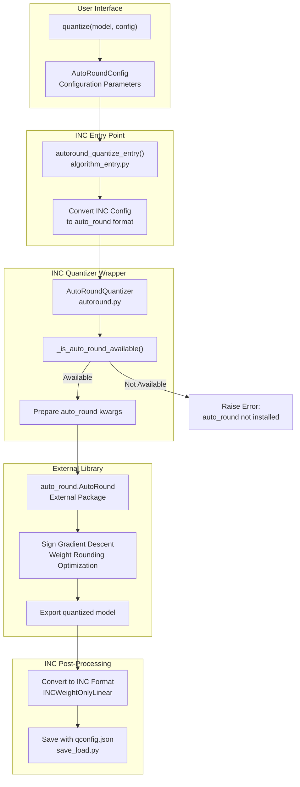
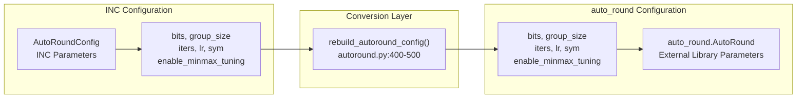
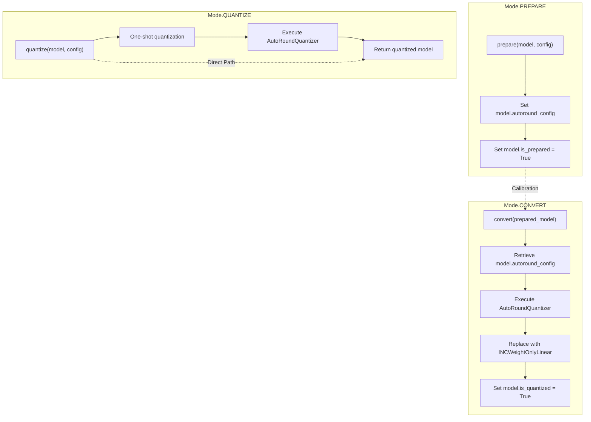
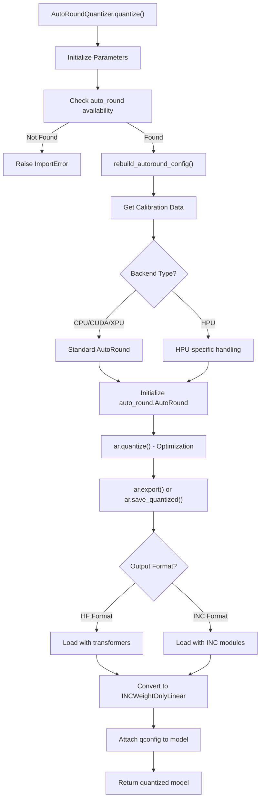
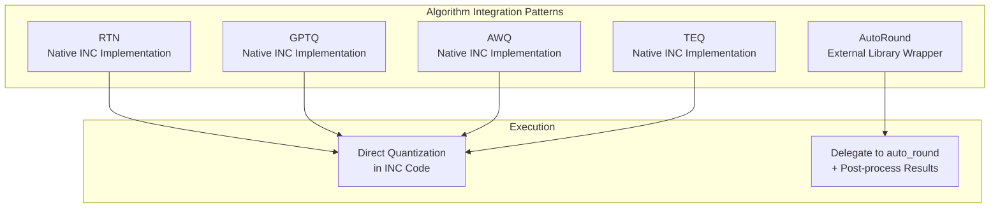

<!-- source: DeepWiki mcp.deepwiki.com · repo intel/neural-compressor · extra page AutoRound Algorithm · fetched 2026-10-21 -->

# AutoRound Algorithm

<details>
<summary>Relevant source files</summary>

The following files were used as context for generating this wiki page:

- [.azure-pipelines/scripts/ut/env_setup.sh](.azure-pipelines/scripts/ut/env_setup.sh)
- [docs/source/quantization_weight_only.md](docs/source/quantization_weight_only.md)
- [examples/pytorch/multimodal-modeling/quantization/auto_round/mllm.py](examples/pytorch/multimodal-modeling/quantization/auto_round/mllm.py)
- [neural_compressor/adaptor/pytorch.py](neural_compressor/adaptor/pytorch.py)
- [neural_compressor/adaptor/pytorch_cpu.yaml](neural_compressor/adaptor/pytorch_cpu.yaml)
- [neural_compressor/adaptor/pytorch_ipex.yaml](neural_compressor/adaptor/pytorch_ipex.yaml)
- [neural_compressor/adaptor/torch_utils/auto_round.py](neural_compressor/adaptor/torch_utils/auto_round.py)
- [neural_compressor/adaptor/torch_utils/awq.py](neural_compressor/adaptor/torch_utils/awq.py)
- [neural_compressor/adaptor/torch_utils/bf16_convert.py](neural_compressor/adaptor/torch_utils/bf16_convert.py)
- [neural_compressor/adaptor/torch_utils/model_wrapper.py](neural_compressor/adaptor/torch_utils/model_wrapper.py)
- [neural_compressor/adaptor/torch_utils/teq.py](neural_compressor/adaptor/torch_utils/teq.py)
- [neural_compressor/adaptor/torch_utils/util.py](neural_compressor/adaptor/torch_utils/util.py)
- [neural_compressor/adaptor/torch_utils/weight_only.py](neural_compressor/adaptor/torch_utils/weight_only.py)
- [neural_compressor/algorithm/smooth_quant.py](neural_compressor/algorithm/smooth_quant.py)
- [neural_compressor/model/torch_model.py](neural_compressor/model/torch_model.py)
- [neural_compressor/torch/algorithms/layer_wise/utils.py](neural_compressor/torch/algorithms/layer_wise/utils.py)
- [neural_compressor/torch/algorithms/mixed_low_precision/modules.py](neural_compressor/torch/algorithms/mixed_low_precision/modules.py)
- [neural_compressor/torch/algorithms/mixed_low_precision/quantizer.py](neural_compressor/torch/algorithms/mixed_low_precision/quantizer.py)
- [neural_compressor/torch/algorithms/weight_only/__init__.py](neural_compressor/torch/algorithms/weight_only/__init__.py)
- [neural_compressor/torch/algorithms/weight_only/autoround.py](neural_compressor/torch/algorithms/weight_only/autoround.py)
- [neural_compressor/torch/algorithms/weight_only/awq.py](neural_compressor/torch/algorithms/weight_only/awq.py)
- [neural_compressor/torch/algorithms/weight_only/gptq.py](neural_compressor/torch/algorithms/weight_only/gptq.py)
- [neural_compressor/torch/algorithms/weight_only/modules.py](neural_compressor/torch/algorithms/weight_only/modules.py)
- [neural_compressor/torch/algorithms/weight_only/rtn.py](neural_compressor/torch/algorithms/weight_only/rtn.py)
- [neural_compressor/torch/algorithms/weight_only/save_load.py](neural_compressor/torch/algorithms/weight_only/save_load.py)
- [neural_compressor/torch/algorithms/weight_only/teq.py](neural_compressor/torch/algorithms/weight_only/teq.py)
- [neural_compressor/torch/algorithms/weight_only/utility.py](neural_compressor/torch/algorithms/weight_only/utility.py)
- [neural_compressor/torch/quantization/__init__.py](neural_compressor/torch/quantization/__init__.py)
- [neural_compressor/torch/quantization/algorithm_entry.py](neural_compressor/torch/quantization/algorithm_entry.py)
- [neural_compressor/torch/quantization/config.py](neural_compressor/torch/quantization/config.py)
- [neural_compressor/torch/quantization/quantize.py](neural_compressor/torch/quantization/quantize.py)
- [neural_compressor/torch/quantization/save_load_entry.py](neural_compressor/torch/quantization/save_load_entry.py)
- [neural_compressor/torch/utils/constants.py](neural_compressor/torch/utils/constants.py)
- [neural_compressor/torch/utils/utility.py](neural_compressor/torch/utils/utility.py)
- [neural_compressor/transformers/models/modeling_auto.py](neural_compressor/transformers/models/modeling_auto.py)
- [neural_compressor/transformers/quantization/utils.py](neural_compressor/transformers/quantization/utils.py)
- [neural_compressor/transformers/utils/quantization_config.py](neural_compressor/transformers/utils/quantization_config.py)
- [neural_compressor/utils/pytorch.py](neural_compressor/utils/pytorch.py)
- [test/3x/torch/algorithms/weight_only/test_teq_quantizer.py](test/3x/torch/algorithms/weight_only/test_teq_quantizer.py)
- [test/3x/torch/quantization/fp8_quant/test_fp8_jsons/test_pow2_w4a8_quant.json](test/3x/torch/quantization/fp8_quant/test_fp8_jsons/test_pow2_w4a8_quant.json)
- [test/3x/torch/quantization/fp8_quant/test_gptq_mixed_precision.py](test/3x/torch/quantization/fp8_quant/test_gptq_mixed_precision.py)
- [test/3x/torch/quantization/weight_only/test_autoround.py](test/3x/torch/quantization/weight_only/test_autoround.py)
- [test/3x/torch/quantization/weight_only/test_awq.py](test/3x/torch/quantization/weight_only/test_awq.py)
- [test/3x/torch/quantization/weight_only/test_gptq.py](test/3x/torch/quantization/weight_only/test_gptq.py)
- [test/3x/torch/quantization/weight_only/test_rtn.py](test/3x/torch/quantization/weight_only/test_rtn.py)
- [test/3x/torch/quantization/weight_only/test_teq.py](test/3x/torch/quantization/weight_only/test_teq.py)
- [test/3x/torch/quantization/weight_only/test_transformers.py](test/3x/torch/quantization/weight_only/test_transformers.py)
- [test/3x/torch/requirements.txt](test/3x/torch/requirements.txt)
- [test/adaptor/pytorch_adaptor/test_adaptor_pytorch_2x.py](test/adaptor/pytorch_adaptor/test_adaptor_pytorch_2x.py)
- [test/adaptor/pytorch_adaptor/test_weight_only_adaptor_pytorch.py](test/adaptor/pytorch_adaptor/test_weight_only_adaptor_pytorch.py)
- [test/algorithm/test_smooth_quant.py](test/algorithm/test_smooth_quant.py)
- [test/ipex/test_adaptor_ipex.py](test/ipex/test_adaptor_ipex.py)
- [test/quantization/test_weight_only_quantization.py](test/quantization/test_weight_only_quantization.py)
- [test/requirements.txt](test/requirements.txt)
- [test/utils/test_huggingface.py](test/utils/test_huggingface.py)

</details>


## Purpose and Scope

This document describes the AutoRound (Adaptive Rounding) weight-only quantization algorithm implementation in Intel Neural Compressor. AutoRound is a gradient-based weight rounding optimization method designed for large language model (LLM) quantization. For general weight-only quantization concepts, see [Weight-Only Quantization](#6.3). For other weight-only algorithms, see [RTN](#6.3.1), [GPTQ](#6.3.2), [AWQ](#6.3.3), and [TEQ](#6.3.4).

## Overview

AutoRound is a weight-only quantization algorithm that optimizes weight rounding through gradient descent rather than using simple rounding or Hessian-based methods. Unlike RTN which uses deterministic rounding and GPTQ which relies on second-order information, AutoRound employs a sign gradient descent approach to find optimal rounding values for quantized weights.

**Key Characteristics:**
- **External Library**: Depends on the `auto_round` package (separate from INC)
- **Gradient-Based**: Uses iterative optimization with configurable learning rate and iterations
- **Flexible Data Types**: Supports INT (2-8 bits), FP8, MX formats (fp4, fp6, int8)
- **Multi-Backend**: Works on CPU, CUDA, XPU (Intel GPU), and HPU (Intel Gaudi)
- **Advanced Features**: Multimodal model support, W4A8 quantization, low memory mode

**Algorithm Flow:**
```
FP32 Model → AutoRound Library → Optimize Rounding → Quantized Weights → INC Modules → Quantized Model
```

Sources: [neural_compressor/torch/algorithms/weight_only/autoround.py:1-50](), [neural_compressor/torch/quantization/config.py:843-900]()

## AutoRound Library Integration



**Integration Architecture:**

The AutoRound implementation follows a wrapper pattern where INC provides the configuration interface and post-processing while delegating the core quantization to the external `auto_round` library.

Sources: [neural_compressor/torch/algorithms/weight_only/autoround.py:24-32](), [neural_compressor/torch/quantization/algorithm_entry.py:554-629]()

## Configuration Parameters

### AutoRoundConfig Class

The `AutoRoundConfig` class in [neural_compressor/torch/quantization/config.py:843-1120]() provides comprehensive configuration options:

**Core Quantization Parameters:**

| Parameter | Type | Default | Description |
|-----------|------|---------|-------------|
| `data_type` | str | "int" | Quantization data type: "int", "mx_fp4", "mx_fp6", "mx_int8", "fp8_e5m2", "fp8_e4m3" |
| `bits` | int | 4 | Number of bits for quantization (2-8 for int) |
| `group_size` | int | 128 | Size of quantization groups (-1 for per-channel) |
| `sym` | bool | False | Symmetric vs asymmetric quantization |

**Optimization Parameters:**

| Parameter | Type | Default | Description |
|-----------|------|---------|-------------|
| `iters` | int | 200 | Number of optimization iterations |
| `lr` | float | None | Learning rate (auto-calculated if None) |
| `minmax_lr` | float | None | Learning rate for min-max tuning |
| `enable_minmax_tuning` | bool | True | Enable min-max range optimization |
| `enable_quanted_input` | bool | True | Use quantized input during optimization |

**Advanced Features:**

| Parameter | Type | Default | Description |
|-----------|------|---------|-------------|
| `act_bits` | int | None | Activation quantization bits (enables W4A8) |
| `low_gpu_mem_usage` | bool | False | Optimize for low GPU memory |
| `quant_lm_head` | bool | False | Quantize language model head layer |
| `use_layer_wise` | bool | False | Layer-wise quantization mode |
| `to_quant_block_names` | str | None | Specific blocks to quantize |
| `data_type_dict` | dict | None | Per-layer data type configuration |

**Layer-Wise Quantization Parameters:**

```python
# Configuration for memory-constrained environments
AutoRoundConfig(
    use_layer_wise=True,          # Enable layer-wise mode
    model_path="path/to/model",   # Model checkpoint for reloading
    low_gpu_mem_usage=True        # Minimize memory footprint
)
```

Sources: [neural_compressor/torch/quantization/config.py:843-1000](), [neural_compressor/torch/algorithms/weight_only/autoround.py:100-200]()

### Configuration Mapping



Sources: [neural_compressor/torch/algorithms/weight_only/autoround.py:400-511]()

## Quantization Process

### Three-Phase Workflow

AutoRound supports the standard INC workflow with three modes:



Sources: [neural_compressor/torch/quantization/algorithm_entry.py:554-629]()

### AutoRoundQuantizer Execution Flow

The `AutoRoundQuantizer` class orchestrates the quantization process:



Sources: [neural_compressor/torch/algorithms/weight_only/autoround.py:100-400]()

### Key Implementation Details

**1. Calibration Data Preparation**

AutoRound requires calibration data for optimization. The quantizer extracts data from the provided `run_fn` or dataloader:

[neural_compressor/torch/algorithms/weight_only/autoround.py:200-250]()

**2. Backend-Specific Initialization**

Different backends require different handling:
- **CPU/CUDA/XPU**: Standard `auto_round.AutoRound` initialization
- **HPU (Gaudi)**: Special handling for `torch.compile` and lazy mode

[neural_compressor/torch/algorithms/weight_only/autoround.py:250-350]()

**3. Gradient-Based Optimization**

The core optimization happens in the external library via `ar.quantize()`, which:
1. Adds quantization layers with learnable rounding parameters
2. Runs forward passes on calibration data
3. Computes gradients and updates rounding values via sign gradient descent
4. Iterates for the specified number of steps

**4. Export and Conversion**

After optimization, weights are exported and converted to INC's format:
- Export to temporary directory or in-memory format
- Load into INC's `INCWeightOnlyLinear` modules
- Attach quantization configuration metadata

[neural_compressor/torch/algorithms/weight_only/autoround.py:350-400]()

Sources: [neural_compressor/torch/algorithms/weight_only/autoround.py:100-511]()

## Backend Support

### Multi-Backend Architecture

AutoRound supports multiple hardware backends through the external library:

| Backend | Device Type | Special Handling |
|---------|-------------|------------------|
| CPU | x86 CPUs | Standard support |
| CUDA | NVIDIA GPUs | Standard support, CUDA-specific optimizations |
| XPU | Intel GPUs | Intel Extension for PyTorch (IPEX) required |
| HPU | Intel Gaudi | Special handling for lazy mode and torch.compile |

### HPU (Gaudi) Integration

Intel Gaudi accelerators require special configuration:

```python
# HPU-specific environment setup
os.environ["PT_HPU_LAZY_MODE"] = "0"  # Disable lazy mode for compile
os.environ["PT_ENABLE_INT64_SUPPORT"] = "1"

# torch.compile settings
import torch._dynamo.config as dynamo_config
import torch._inductor.config as inductor_config
inductor_config.force_disable_caches = True
dynamo_config.inline_inbuilt_nn_modules = True
```

The AutoRound implementation detects HPU and applies appropriate configurations automatically.

Sources: [neural_compressor/torch/algorithms/weight_only/autoround.py:100-150](), [test/3x/torch/quantization/weight_only/test_autoround.py:23-38]()

## Output Formats

### INC Native Format

AutoRound produces models using INC's weight-only modules:

```
quantized_model/
├── quantized_weight.pt          # Model state dict with INCWeightOnlyLinear
├── qconfig.json                 # Quantization configuration metadata
└── (optional) model_bin_index.json  # For sharded checkpoints
```

**Module Replacement:**

Original `torch.nn.Linear` layers are replaced with `INCWeightOnlyLinear`:

```python
# Before quantization
self.layer = torch.nn.Linear(in_features, out_features)

# After quantization
self.layer = INCWeightOnlyLinear(
    in_features=in_features,
    out_features=out_features,
    bits=4,
    group_size=128,
    dtype="int",
    # ... other params
)
```

Sources: [neural_compressor/torch/algorithms/weight_only/modules.py:156-320](), [neural_compressor/torch/algorithms/weight_only/save_load.py:55-108]()

### HuggingFace Compatible Format

AutoRound can export to HuggingFace-compatible format:

```
saved_model/
├── config.json                  # Model configuration
├── quantize_config.json         # AutoRound quantization config
├── pytorch_model.bin (or .safetensors)
└── (optional) generation_config.json, tokenizer files
```

This format allows loading with standard HuggingFace `transformers` APIs:

```python
from transformers import AutoModelForCausalLM
model = AutoModelForCausalLM.from_pretrained("saved_model")
```

Sources: [neural_compressor/torch/algorithms/weight_only/save_load.py:70-89]()

## Advanced Features

### Multimodal Model Support

AutoRound has special support for multimodal models (vision-language models):

**Key Parameters:**
- `quant_vision`: Whether to quantize vision components
- `to_quant_block_names`: Specify which blocks to quantize
- Vision-specific handling for different architectures (Qwen, LLaVa, etc.)

```python
config = AutoRoundConfig(
    bits=4,
    group_size=128,
    quant_vision=True,  # Enable vision quantization
    to_quant_block_names="model.layers,model.vision_model"  # Specify blocks
)
```

Sources: [neural_compressor/torch/quantization/config.py:900-950]()

### W4A8 Quantization

AutoRound supports Weight-4bit Activation-8bit (W4A8) quantization for improved inference performance:

**Configuration:**

```python
config = AutoRoundConfig(
    bits=4,           # 4-bit weights
    act_bits=8,       # 8-bit activations
    data_type="int"   # Integer quantization
)
```

**Special Handling:**

When `act_bits` is specified, AutoRound:
1. Quantizes weights to INT4
2. Adds FP8 measurement for activations
3. Produces models compatible with W4A8 inference kernels

After quantization, the model may be post-processed to use specialized W4A8 modules:

[neural_compressor/torch/algorithms/weight_only/save_load.py:162-172]()

Sources: [neural_compressor/torch/quantization/config.py:920-930](), [neural_compressor/torch/algorithms/weight_only/save_load.py:286-292]()

### Low Memory Usage Mode

For large models that don't fit in GPU memory, AutoRound provides memory-efficient options:

```python
config = AutoRoundConfig(
    bits=4,
    low_gpu_mem_usage=True,    # Minimize GPU memory
    use_layer_wise=True,       # Quantize layer-by-layer
    model_path="path/to/checkpoint"  # Reload weights per layer
)
```

**Memory Optimization Strategies:**
- Layer-wise processing: Quantize and offload one layer at a time
- Checkpoint reloading: Load weights on-demand from disk
- Temporary offloading: Move quantized layers to CPU

Sources: [neural_compressor/torch/quantization/config.py:960-980](), [neural_compressor/torch/algorithms/layer_wise/utils.py:1-100]()

### Mixed Data Type Quantization

AutoRound allows different data types for different layers via `data_type_dict`:

```python
config = AutoRoundConfig(
    data_type="int",
    bits=4,
    data_type_dict={
        "lm_head": {"data_type": "fp8_e5m2", "bits": 8},
        "vision_layers": {"data_type": "int", "bits": 8}
    }
)
```

This enables fine-grained control over quantization precision across the model.

Sources: [neural_compressor/torch/quantization/config.py:870-890]()

## Save and Load

### Saving Quantized Models

AutoRound-quantized models use INC's standard save/load infrastructure:

```python
# Save in INC native format
model.save("./saved_model", format="default")

# Save in HuggingFace format
model.save("./saved_model", format="huggingface", 
           safe_serialization=True, tokenizer=tokenizer)
```

**Metadata Storage:**

The `qconfig.json` file contains all quantization configuration:

```json
{
  "('layer.0', 'Linear')": {
    "autoround": {
      "bits": 4,
      "group_size": 128,
      "sym": false,
      "dtype": "int",
      "scale_dtype": "fp16"
    }
  }
}
```

Sources: [neural_compressor/torch/algorithms/weight_only/save_load.py:55-108]()

### Loading Quantized Models

**INC Format:**

```python
from neural_compressor.torch.quantization import load

# Load requires original FP32 model structure
fp32_model = AutoModelForCausalLM.from_pretrained("model_name")
quantized_model = load("./saved_model", original_model=fp32_model)
```

**HuggingFace Format:**

```python
from neural_compressor.torch.quantization import load

# Can load directly without original model
quantized_model = load("./saved_model", format="huggingface")
```

The loader automatically detects AutoRound format by checking for the `"backend": "auto_round"` field in the configuration.

Sources: [neural_compressor/torch/algorithms/weight_only/save_load.py:110-363](), [neural_compressor/torch/algorithms/weight_only/save_load.py:305-340]()

## Usage Examples

### Basic Quantization

```python
from neural_compressor.torch.quantization import quantize, AutoRoundConfig
import transformers

# Load model
model = transformers.AutoModelForCausalLM.from_pretrained(
    "facebook/opt-125m", 
    torch_dtype=torch.float16
)

# Configure AutoRound
config = AutoRoundConfig(
    bits=4,
    group_size=128,
    sym=False,
    iters=200
)

# Quantize (requires calibration data via run_fn)
def run_fn(model, dataloader):
    for data in dataloader:
        model(**data)

quantized_model = quantize(
    model, 
    config, 
    run_fn=run_fn
)
```

Sources: [test/3x/torch/quantization/weight_only/test_autoround.py:100-200]()

### Prepare-Convert Workflow

```python
from neural_compressor.torch.quantization import prepare, convert

# Prepare model for calibration
prepared_model = prepare(model, config)

# Run calibration
for batch in calibration_dataloader:
    prepared_model(**batch)

# Convert to quantized model
quantized_model = convert(prepared_model)
```

Sources: [neural_compressor/torch/quantization/quantize.py:156-233]()

### Advanced Configuration

```python
# W4A8 with multimodal support
config = AutoRoundConfig(
    bits=4,
    act_bits=8,               # Enable W4A8
    group_size=128,
    iters=200,
    lr=0.001,
    enable_minmax_tuning=True,
    quant_vision=True,        # Quantize vision components
    low_gpu_mem_usage=True,   # Memory optimization
    data_type_dict={          # Mixed precision
        "lm_head": {"data_type": "fp8_e5m2"}
    }
)
```

Sources: [neural_compressor/torch/quantization/config.py:843-1000]()

## Comparison with Other Weight-Only Algorithms

### Algorithm Characteristics

| Algorithm | Method | Calibration Data | Optimization | Speed | Accuracy |
|-----------|--------|------------------|--------------|-------|----------|
| RTN | Round-to-nearest | Optional (for MSE search) | None | Fastest | Baseline |
| GPTQ | Hessian-based | Required | Second-order | Slow | High |
| AWQ | Activation-aware scaling | Required | First-order (scales) | Medium | High |
| TEQ | Trainable equivalent transform | Required | First-order (alpha) | Medium | High |
| **AutoRound** | **Gradient-based rounding** | **Required** | **First-order (rounding)** | **Medium** | **Highest** |

**Key Differences:**

1. **RTN**: Deterministic rounding, no optimization
   - See [RTN Algorithm](#6.3.1)
   
2. **GPTQ**: Uses Hessian information for optimal quantization
   - See [GPTQ Algorithm](#6.3.2)
   
3. **AWQ**: Applies per-channel scales to protect important weights
   - See [AWQ Algorithm](#6.3.3)
   
4. **TEQ**: Learns affine transformations before quantization
   - See [TEQ Algorithm](#6.3.4)
   
5. **AutoRound**: Optimizes rounding values directly via gradient descent
   - Most flexible: supports multiple data types and backends
   - External dependency: requires separate `auto_round` package
   - Highest accuracy: gradient-based optimization typically achieves best results

### Integration Pattern



AutoRound is unique among INC's weight-only algorithms in that it wraps an external library rather than providing a native implementation. This design allows leveraging the specialized optimizations and continuous improvements from the AutoRound project while maintaining INC's unified configuration and save/load interfaces.

Sources: [neural_compressor/torch/algorithms/weight_only/autoround.py:1-50](), [neural_compressor/torch/quantization/algorithm_entry.py:554-629]()

---

**Related Documentation:**
- [Weight-Only Quantization Overview](#6.3)
- [Model Save and Load](#8.2)
- [HuggingFace Integration](#8.1)
- [3.x API Reference](#3.2)

---

