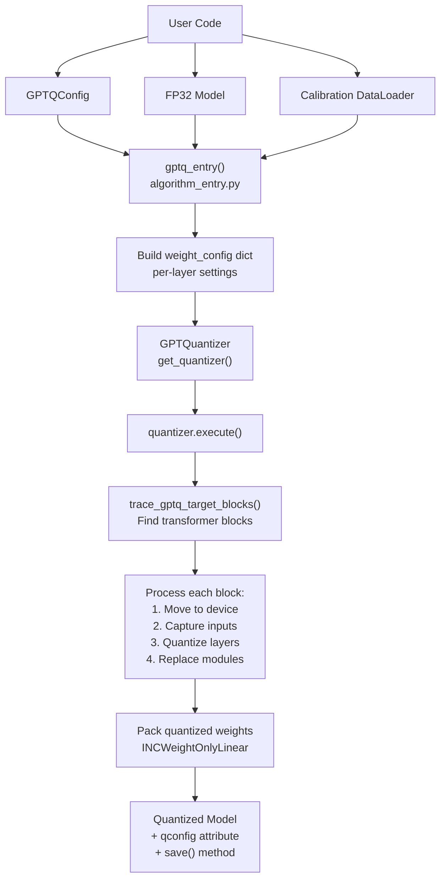
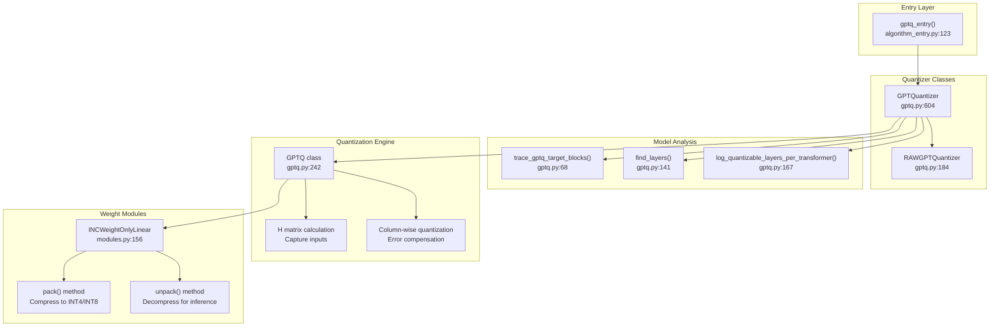
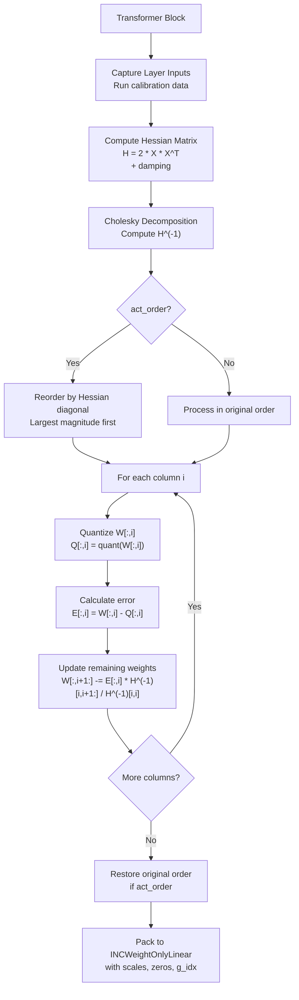
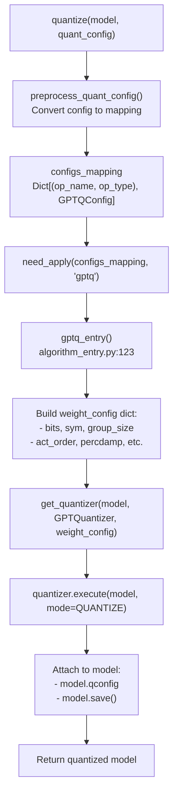

<!-- source: DeepWiki mcp.deepwiki.com · repo intel/neural-compressor · extra page GPTQ Algorithm · fetched 2026-10-21 -->

# GPTQ Algorithm

<details>
<summary>Relevant source files</summary>

The following files were used as context for generating this wiki page:

- [.azure-pipelines/scripts/ut/env_setup.sh](.azure-pipelines/scripts/ut/env_setup.sh)
- [docs/source/quantization_weight_only.md](docs/source/quantization_weight_only.md)
- [examples/pytorch/multimodal-modeling/quantization/auto_round/mllm.py](examples/pytorch/multimodal-modeling/quantization/auto_round/mllm.py)
- [neural_compressor/adaptor/pytorch.py](neural_compressor/adaptor/pytorch.py)
- [neural_compressor/adaptor/pytorch_cpu.yaml](neural_compressor/adaptor/pytorch_cpu.yaml)
- [neural_compressor/adaptor/pytorch_ipex.yaml](neural_compressor/adaptor/pytorch_ipex.yaml)
- [neural_compressor/adaptor/torch_utils/auto_round.py](neural_compressor/adaptor/torch_utils/auto_round.py)
- [neural_compressor/adaptor/torch_utils/awq.py](neural_compressor/adaptor/torch_utils/awq.py)
- [neural_compressor/adaptor/torch_utils/bf16_convert.py](neural_compressor/adaptor/torch_utils/bf16_convert.py)
- [neural_compressor/adaptor/torch_utils/model_wrapper.py](neural_compressor/adaptor/torch_utils/model_wrapper.py)
- [neural_compressor/adaptor/torch_utils/teq.py](neural_compressor/adaptor/torch_utils/teq.py)
- [neural_compressor/adaptor/torch_utils/util.py](neural_compressor/adaptor/torch_utils/util.py)
- [neural_compressor/adaptor/torch_utils/weight_only.py](neural_compressor/adaptor/torch_utils/weight_only.py)
- [neural_compressor/algorithm/smooth_quant.py](neural_compressor/algorithm/smooth_quant.py)
- [neural_compressor/model/torch_model.py](neural_compressor/model/torch_model.py)
- [neural_compressor/torch/algorithms/layer_wise/utils.py](neural_compressor/torch/algorithms/layer_wise/utils.py)
- [neural_compressor/torch/algorithms/mixed_low_precision/modules.py](neural_compressor/torch/algorithms/mixed_low_precision/modules.py)
- [neural_compressor/torch/algorithms/mixed_low_precision/quantizer.py](neural_compressor/torch/algorithms/mixed_low_precision/quantizer.py)
- [neural_compressor/torch/algorithms/weight_only/__init__.py](neural_compressor/torch/algorithms/weight_only/__init__.py)
- [neural_compressor/torch/algorithms/weight_only/autoround.py](neural_compressor/torch/algorithms/weight_only/autoround.py)
- [neural_compressor/torch/algorithms/weight_only/awq.py](neural_compressor/torch/algorithms/weight_only/awq.py)
- [neural_compressor/torch/algorithms/weight_only/gptq.py](neural_compressor/torch/algorithms/weight_only/gptq.py)
- [neural_compressor/torch/algorithms/weight_only/modules.py](neural_compressor/torch/algorithms/weight_only/modules.py)
- [neural_compressor/torch/algorithms/weight_only/rtn.py](neural_compressor/torch/algorithms/weight_only/rtn.py)
- [neural_compressor/torch/algorithms/weight_only/save_load.py](neural_compressor/torch/algorithms/weight_only/save_load.py)
- [neural_compressor/torch/algorithms/weight_only/teq.py](neural_compressor/torch/algorithms/weight_only/teq.py)
- [neural_compressor/torch/algorithms/weight_only/utility.py](neural_compressor/torch/algorithms/weight_only/utility.py)
- [neural_compressor/torch/quantization/__init__.py](neural_compressor/torch/quantization/__init__.py)
- [neural_compressor/torch/quantization/algorithm_entry.py](neural_compressor/torch/quantization/algorithm_entry.py)
- [neural_compressor/torch/quantization/config.py](neural_compressor/torch/quantization/config.py)
- [neural_compressor/torch/quantization/quantize.py](neural_compressor/torch/quantization/quantize.py)
- [neural_compressor/torch/quantization/save_load_entry.py](neural_compressor/torch/quantization/save_load_entry.py)
- [neural_compressor/torch/utils/constants.py](neural_compressor/torch/utils/constants.py)
- [neural_compressor/torch/utils/utility.py](neural_compressor/torch/utils/utility.py)
- [neural_compressor/transformers/models/modeling_auto.py](neural_compressor/transformers/models/modeling_auto.py)
- [neural_compressor/transformers/quantization/utils.py](neural_compressor/transformers/quantization/utils.py)
- [neural_compressor/transformers/utils/quantization_config.py](neural_compressor/transformers/utils/quantization_config.py)
- [neural_compressor/utils/pytorch.py](neural_compressor/utils/pytorch.py)
- [test/3x/torch/algorithms/weight_only/test_teq_quantizer.py](test/3x/torch/algorithms/weight_only/test_teq_quantizer.py)
- [test/3x/torch/quantization/fp8_quant/test_fp8_jsons/test_pow2_w4a8_quant.json](test/3x/torch/quantization/fp8_quant/test_fp8_jsons/test_pow2_w4a8_quant.json)
- [test/3x/torch/quantization/fp8_quant/test_gptq_mixed_precision.py](test/3x/torch/quantization/fp8_quant/test_gptq_mixed_precision.py)
- [test/3x/torch/quantization/weight_only/test_autoround.py](test/3x/torch/quantization/weight_only/test_autoround.py)
- [test/3x/torch/quantization/weight_only/test_awq.py](test/3x/torch/quantization/weight_only/test_awq.py)
- [test/3x/torch/quantization/weight_only/test_gptq.py](test/3x/torch/quantization/weight_only/test_gptq.py)
- [test/3x/torch/quantization/weight_only/test_rtn.py](test/3x/torch/quantization/weight_only/test_rtn.py)
- [test/3x/torch/quantization/weight_only/test_teq.py](test/3x/torch/quantization/weight_only/test_teq.py)
- [test/3x/torch/quantization/weight_only/test_transformers.py](test/3x/torch/quantization/weight_only/test_transformers.py)
- [test/3x/torch/requirements.txt](test/3x/torch/requirements.txt)
- [test/adaptor/pytorch_adaptor/test_adaptor_pytorch_2x.py](test/adaptor/pytorch_adaptor/test_adaptor_pytorch_2x.py)
- [test/adaptor/pytorch_adaptor/test_weight_only_adaptor_pytorch.py](test/adaptor/pytorch_adaptor/test_weight_only_adaptor_pytorch.py)
- [test/algorithm/test_smooth_quant.py](test/algorithm/test_smooth_quant.py)
- [test/ipex/test_adaptor_ipex.py](test/ipex/test_adaptor_ipex.py)
- [test/quantization/test_weight_only_quantization.py](test/quantization/test_weight_only_quantization.py)
- [test/requirements.txt](test/requirements.txt)
- [test/utils/test_huggingface.py](test/utils/test_huggingface.py)

</details>


## Purpose and Scope

This document describes the GPTQ (Generative Pre-trained Transformer Quantization) algorithm implementation in Intel Neural Compressor. GPTQ is a weight-only post-training quantization method that uses second-order (Hessian-based) information to achieve optimal compression of large language models while maintaining accuracy.

For general weight-only quantization concepts, see [Weight-Only Quantization](#6.3). For other weight-only algorithms, see [RTN Algorithm](#6.3.1), [AWQ Algorithm](#6.3.3), [TEQ Algorithm](#6.3.4), and [AutoRound Algorithm](#6.3.5).

**Key Characteristics:**
- **Hessian-based optimization**: Uses second-order derivative information for optimal weight quantization
- **Layer-wise quantization**: Processes transformer blocks sequentially to minimize memory overhead
- **Activation ordering**: Optional feature to reorder weights based on activation magnitude for better accuracy
- **Calibration data required**: Needs representative samples to compute Hessian matrices

Sources: [neural_compressor/torch/quantization/config.py:326-553](), [neural_compressor/torch/algorithms/weight_only/gptq.py:1-17](), [docs/source/quantization_weight_only.md:1-14]()

---

## Algorithm Overview

GPTQ quantizes weights by solving a layer-wise optimization problem that minimizes the squared error between the original and quantized outputs. The algorithm leverages the inverse Hessian matrix of the loss with respect to weights to determine the optimal quantization order and compensate for quantization errors.

### Mathematical Foundation

For each layer, GPTQ solves:

```
argmin_Wq ||W X - Wq X||²
```

where:
- `W` is the original weight matrix
- `Wq` is the quantized weight matrix
- `X` represents calibration inputs

The Hessian matrix `H = 2 X Xᵀ` provides second-order information used to guide the quantization process. GPTQ quantizes weights column-by-column and updates the remaining weights to compensate for quantization errors using the inverse Hessian.

Sources: [neural_compressor/torch/algorithms/weight_only/gptq.py:184-189](), [docs/source/quantization_weight_only.md:15-18]()

---

## Configuration

### GPTQConfig Class

The `GPTQConfig` class defines all parameters for GPTQ quantization.

**Basic Quantization Parameters:**

| Parameter | Type | Default | Description |
|-----------|------|---------|-------------|
| `dtype` | str | "int" | Data type for weights (int, int4, int8) |
| `bits` | int | 4 | Number of bits for quantization (1-8) |
| `use_sym` | bool | True | Use symmetric quantization |
| `group_size` | int | 32 | Size of weight groups for per-group quantization |
| `use_mse_search` | bool | False | Enable MSE-based clip range search |

**GPTQ-Specific Parameters:**

| Parameter | Type | Default | Description |
|-----------|------|---------|-------------|
| `act_order` | bool | False | Reorder weights based on Hessian diagonal values |
| `hybrid_order` | bool | False | Activation re-ordering within groups (no runtime overhead) |
| `fp8_aware` | bool | False | Include FP8 quantization step for W4A8 schemes |
| `percdamp` | float | 0.01 | Damping factor for numerical stability (% of Hessian diagonal average) |
| `block_size` | int | 2048 | Execute GPTQ per block [C_out, block_size] |
| `static_groups` | bool | False | Pre-calculate group-wise quantization parameters |
| `true_sequential` | bool | False | Quantize layers in original order within transformer blocks |

**Layer-wise Processing:**

| Parameter | Type | Default | Description |
|-----------|------|---------|-------------|
| `use_layer_wise` | bool | False | Quantize model per layer (memory efficient) |
| `use_block_wise` | bool | False | Quantize model per transformer block (for large GPU/HPU) |
| `model_path` | str | "" | Path to load state_dict per layer |

**Double Quantization:**

| Parameter | Type | Default | Description |
|-----------|------|---------|-------------|
| `use_double_quant` | bool | False | Enable double quantization of scales |
| `double_quant_dtype` | str | "int" | Data type for double quantization |
| `double_quant_bits` | int | 8 | Bits for double quantization |
| `double_quant_use_sym` | bool | False | Symmetric double quantization |
| `double_quant_group_size` | int | 256 | Group size for double quantization |

Sources: [neural_compressor/torch/quantization/config.py:326-456]()

---

## Architecture and Implementation

### High-Level Workflow



**Workflow Steps:**

1. **Configuration**: User creates `GPTQConfig` with algorithm parameters
2. **Entry Point**: `gptq_entry()` validates config and builds per-layer weight configuration
3. **Initialization**: `GPTQuantizer` is instantiated with the weight config
4. **Model Structure Analysis**: `trace_gptq_target_blocks()` identifies transformer architecture
5. **Block-wise Processing**: Each transformer block is processed sequentially
6. **Layer Quantization**: Hessian matrices are computed and used to quantize layers
7. **Module Replacement**: Original `torch.nn.Linear` modules are replaced with `INCWeightOnlyLinear`
8. **Return**: Quantized model with attached configuration and save method

Sources: [neural_compressor/torch/quantization/algorithm_entry.py:120-187](), [neural_compressor/torch/algorithms/weight_only/gptq.py:184-207]()

### Core Components



**Component Descriptions:**

- **`gptq_entry()`**: Main entry point that processes configuration mapping and dispatches to quantizer
- **`GPTQuantizer`**: High-level wrapper that handles layer-wise and block-wise execution modes
- **`RAWGPTQuantizer`**: Core quantization engine that processes transformer blocks sequentially
- **`GPTQ` class**: Implements the Hessian-based quantization algorithm for individual layers
- **`trace_gptq_target_blocks()`**: Analyzes model structure to identify embeddings, transformer blocks, and post-processing layers
- **`INCWeightOnlyLinear`**: Custom module that stores compressed quantized weights

Sources: [neural_compressor/torch/quantization/algorithm_entry.py:120-187](), [neural_compressor/torch/algorithms/weight_only/gptq.py:184-603](), [neural_compressor/torch/algorithms/weight_only/modules.py:156-375]()

---

## Quantization Process

### Hessian Computation and Layer Processing



**Detailed Process:**

1. **Input Capture**: Forward pass through calibration data captures inputs to each layer
2. **Hessian Calculation**: 
   - Compute `H = 2 X Xᵀ` where X contains calibration inputs
   - Add damping: `H[i,i] += percdamp * mean(diag(H))`
3. **Matrix Inversion**: Use Cholesky decomposition for numerical stability
4. **Activation Ordering** (if enabled):
   - Sort columns by `diag(H)` in descending order
   - Track permutation in `g_idx` tensor
5. **Column-wise Quantization**:
   - Quantize column i: `Q[:,i] = round((W[:,i] - zero) / scale) * scale + zero`
   - Calculate quantization error: `E[:,i] = W[:,i] - Q[:,i]`
   - Compensate remaining columns: Uses inverse Hessian to distribute error
6. **Weight Packing**:
   - Store quantized weights in compressed INT4/INT8 format
   - Save scales, zero points, and permutation index (`g_idx`)

Sources: [neural_compressor/torch/algorithms/weight_only/gptq.py:242-596]()

### Block-wise Execution

GPTQ supports three execution modes for memory efficiency:

**1. Standard Mode** (`use_layer_wise=False, use_block_wise=False`):
- All transformer blocks quantized in sequence
- Entire model kept in memory
- Fastest but highest memory usage

**2. Layer-wise Mode** (`use_layer_wise=True`):
- Each transformer block loaded from disk individually
- Block quantized and saved back to disk
- Minimal memory footprint
- Slower due to I/O overhead

**3. Block-wise Mode** (`use_block_wise=True`):
- Multiple transformer blocks processed together
- Balances memory usage and speed
- Suitable for large GPU/HPU memory

Sources: [neural_compressor/torch/algorithms/weight_only/gptq.py:604-900](), [neural_compressor/torch/quantization/config.py:403-405]()

---

## Key Features

### Activation Ordering

When `act_order=True`, GPTQ reorders weight columns based on Hessian diagonal values before quantization. This prioritizes columns with larger activation magnitudes, which typically have larger quantization errors, allowing better error compensation.

**Hybrid Ordering** (`hybrid_order=True`):
- Weights reordered within their groups only (no cross-group mixing)
- Eliminates runtime permutation overhead
- Maintains most benefits of activation ordering

**Implementation:**
- Permutation stored in `g_idx` tensor
- During inference, weights are unpacked in the permuted order
- For ordered `g_idx`, overhead can be eliminated by setting `g_idx=None`

Sources: [neural_compressor/torch/quantization/config.py:412-415](), [neural_compressor/torch/algorithms/weight_only/gptq.py:242-596]()

### Static Groups

When `static_groups=True`, group-wise quantization parameters (scales and zero points) are computed in advance rather than during the quantization loop. This optimization:

- Reduces computational overhead of activation ordering
- Pre-computes all scale/zero-point values
- Useful for models with many quantization groups

Sources: [neural_compressor/torch/quantization/config.py:422-424]()

### True Sequential Processing

By default, GPTQ processes all layers of the same type within a transformer block simultaneously. When `true_sequential=True`:

- Layers quantized in their original forward pass order
- Higher accuracy but slower quantization
- More sequential error propagation

Sources: [neural_compressor/torch/quantization/config.py:425-427]()

### FP8-Aware Quantization

When `fp8_aware=True`, GPTQ includes an additional FP8 quantization step during the process. This improves accuracy for W4A8 (4-bit weights, 8-bit activations) quantization schemes by considering the activation quantization during weight quantization.

Sources: [neural_compressor/torch/quantization/config.py:416-418]()

---

## Integration with Neural Compressor

### Algorithm Entry Point



**Configuration Mapping Example:**

```python
# User configuration
config = GPTQConfig(
    bits=4,
    group_size=128,
    act_order=True,
    percdamp=0.01
)

# Converted to configs_mapping
configs_mapping = {
    ("model.layers.0.self_attn.q_proj", "Linear"): config,
    ("model.layers.0.self_attn.k_proj", "Linear"): config,
    # ... all quantizable layers
}

# Converted to weight_config for GPTQuantizer
weight_config = {
    "model.layers.0.self_attn.q_proj": {
        "bits": 4,
        "group_size": 128,
        "sym": True,
        "act_order": True,
        "percdamp": 0.01,
        # ... other parameters
    },
    # ... all layers
}
```

Sources: [neural_compressor/torch/quantization/algorithm_entry.py:120-187](), [neural_compressor/torch/quantization/quantize.py:115-153]()

### Module Replacement

GPTQ replaces standard `torch.nn.Linear` modules with `INCWeightOnlyLinear`:

**Original Module:**
```
torch.nn.Linear(in_features=4096, out_features=4096, bias=True)
```

**Quantized Module:**
```
INCWeightOnlyLinear(
    in_features=4096,
    out_features=4096,
    bits=4,
    group_size=128,
    bias=True
)
```

The `INCWeightOnlyLinear` module stores:
- `qweight`: Compressed INT4/INT8 tensor
- `scales`: Per-group scaling factors
- `qzeros`: Per-group zero points (if asymmetric)
- `g_idx`: Permutation indices (if activation ordering used)
- `bias`: Original bias values

Sources: [neural_compressor/torch/algorithms/weight_only/modules.py:156-375](), [neural_compressor/torch/algorithms/weight_only/gptq.py:242-596]()

### Save and Load

Quantized models can be saved in two formats:

**1. INC Native Format** (default):
```python
model.save("./saved_model")
# Saves:
# - quantized_weight.pt (or quantized_hpu_weight.pt for HPU)
# - qconfig.json
```

**2. HuggingFace Format**:
```python
model.save("./saved_model", format="huggingface")
# Saves:
# - pytorch_model.bin (or safetensors)
# - quantize_config.json
# - config.json
```

The HuggingFace format includes compatibility with optimum and auto-gptq formats, with metadata such as:
- `quant_method`: "gptq"
- `bits`, `group_size`, `desc_act` (activation ordering)
- Weights stored with keys: `qweight`, `qzeros`, `scales`, `g_idx`

Sources: [neural_compressor/torch/algorithms/weight_only/save_load.py:55-108](), [neural_compressor/torch/algorithms/weight_only/save_load.py:308-362]()

---

## Usage Patterns

### Basic Usage

```python
from neural_compressor.torch.quantization import GPTQConfig, quantize

# Configure GPTQ
config = GPTQConfig(
    bits=4,                    # 4-bit quantization
    group_size=128,           # 128 weights per group
    act_order=True,           # Enable activation ordering
    use_sym=True              # Symmetric quantization
)

# Quantize model
quantized_model = quantize(
    model=fp32_model,
    quant_config=config,
    run_fn=calibration_function,  # Runs calibration data
    example_inputs=example_inputs
)

# Save quantized model
quantized_model.save("./gptq_model")
```

Sources: [neural_compressor/torch/quantization/quantize.py:115-153](), [neural_compressor/torch/quantization/algorithm_entry.py:120-187]()

### Advanced Configuration

```python
config = GPTQConfig(
    # Basic quantization
    bits=4,
    group_size=128,
    use_sym=True,
    
    # GPTQ-specific optimizations
    act_order=True,           # Reorder by activation magnitude
    static_groups=True,       # Pre-compute group parameters
    percdamp=0.01,           # Hessian damping factor
    block_size=2048,         # Block size for computation
    
    # Memory management
    use_layer_wise=True,     # Process layer-by-layer
    model_path="./fp32_model",  # Load weights from disk
    
    # Double quantization (quantize scales too)
    use_double_quant=True,
    double_quant_bits=8,
    double_quant_group_size=256,
    
    # LM head handling
    quant_lm_head=False      # Keep lm_head in FP32
)
```

Sources: [neural_compressor/torch/quantization/config.py:364-456]()

### Layer-wise Quantization

For memory-constrained environments:

```python
config = GPTQConfig(
    bits=4,
    group_size=128,
    use_layer_wise=True,     # Enable layer-wise processing
    model_path="./model",    # Path to load state_dict
)

# Model will be processed layer-by-layer
# Each layer loaded, quantized, and saved independently
quantized_model = quantize(model, config, run_fn=calib_fn)
```

This approach:
- Minimizes peak memory usage
- Loads one transformer block at a time
- Saves quantized blocks back to disk
- Slower but necessary for large models on limited hardware

Sources: [neural_compressor/torch/algorithms/weight_only/gptq.py:604-900](), [neural_compressor/torch/quantization/config.py:403]()

### Custom Per-Layer Configuration

```python
from neural_compressor.torch.quantization import quantize

# Create base config
base_config = GPTQConfig(bits=4, group_size=128)

# Customize specific layers
base_config.set_local(
    ["model.layers.0.self_attn.q_proj"],
    GPTQConfig(bits=8, group_size=64)  # Higher precision
)

base_config.set_local(
    ["model.lm_head"],
    GPTQConfig(dtype="fp32")  # Keep in FP32
)

quantized_model = quantize(model, base_config, run_fn=calib_fn)
```

Sources: [neural_compressor/torch/quantization/config.py:472-496]()

---

## Limitations and Considerations

### Calibration Data Requirements

GPTQ requires representative calibration data to compute accurate Hessian matrices. The quality of calibration data significantly impacts quantization accuracy:

- **Sample Count**: Typically 128-512 samples recommended
- **Diversity**: Should cover model's expected input distribution
- **Sequence Length**: For LLMs, longer sequences provide better statistics

Sources: [neural_compressor/torch/algorithms/weight_only/gptq.py:192-198]()

### Computational Overhead

GPTQ is more computationally intensive than simpler methods (e.g., RTN):

- Hessian matrix computation: O(n²) memory and O(n²m) time per layer
- Matrix inversion: Additional O(n³) complexity
- Typically 10-100x slower than RTN
- Suitable for offline quantization scenarios

Sources: [neural_compressor/torch/algorithms/weight_only/gptq.py:242-596]()

### Memory Requirements

Standard GPTQ mode requires:
- Full model in memory
- Hessian matrices per layer (can be large for wide layers)
- Calibration data batches

Use `use_layer_wise=True` or `use_block_wise=True` for memory-constrained scenarios.

Sources: [neural_compressor/torch/algorithms/weight_only/gptq.py:604-900]()

### Supported Operations

GPTQ currently quantizes:
- `torch.nn.Linear`
- `transformers.Conv1D` (if transformers installed)
- `torch.nn.Conv1d`, `torch.nn.Conv2d` (experimental)

Other layer types (LayerNorm, activations, etc.) remain in FP32.

Sources: [neural_compressor/torch/algorithms/weight_only/gptq.py:42-47]()

---

## Performance Characteristics

### Accuracy vs. Speed Trade-off

GPTQ provides superior accuracy compared to simple rounding methods:

**Typical INT4 Quantization Results:**
- **RTN**: Fastest, baseline accuracy
- **GPTQ**: 1-3% accuracy improvement over RTN, 10-100x slower quantization
- **GPTQ + act_order**: Additional 0.5-1% improvement, 1.5-2x slower than standard GPTQ

The accuracy improvement justifies the longer quantization time for production deployments.

Sources: [docs/source/quantization_weight_only.md:1-14]()

### Memory Efficiency Options

| Mode | Memory Usage | Speed | Use Case |
|------|-------------|-------|----------|
| Standard | High (full model) | Fast | Small models, ample memory |
| Layer-wise | Low (single block) | Slow | Large models, limited memory |
| Block-wise | Medium (few blocks) | Medium | Balanced approach |

Sources: [neural_compressor/torch/algorithms/weight_only/gptq.py:604-900]()

### Hardware Acceleration

GPTQ supports multiple execution devices:
- **CPU**: Default, works on all systems
- **GPU**: Recommended for faster quantization (CUDA)
- **HPU**: Intel Gaudi accelerators for specialized deployment

The quantized model format is device-agnostic and can be loaded on different hardware.

Sources: [neural_compressor/torch/algorithms/weight_only/gptq.py:192-207](), [neural_compressor/torch/utils/auto_accelerator.py]()

---

