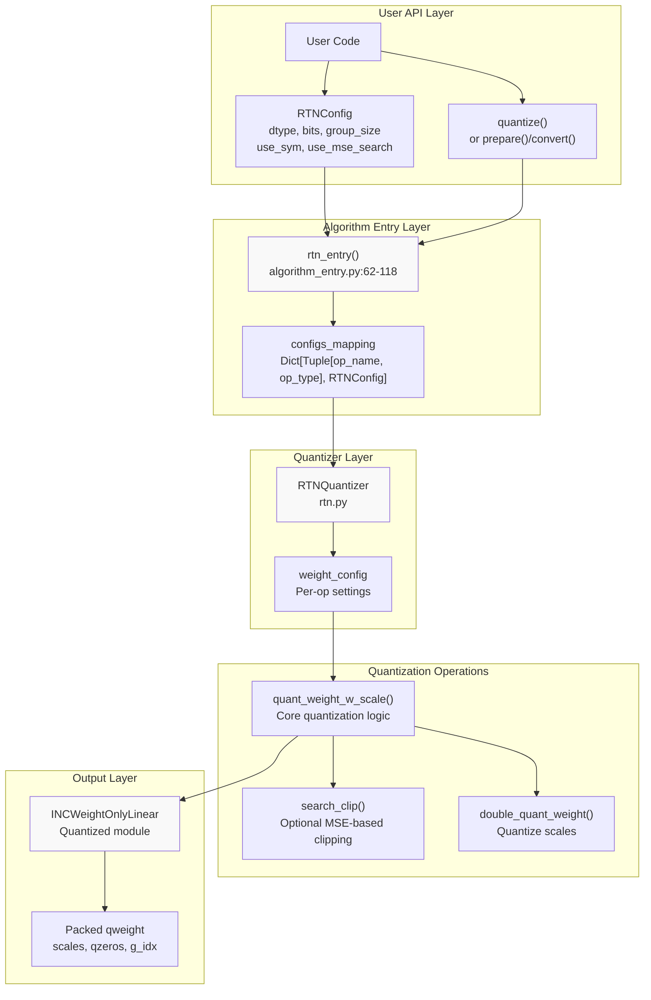
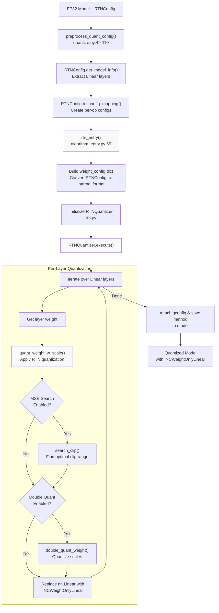
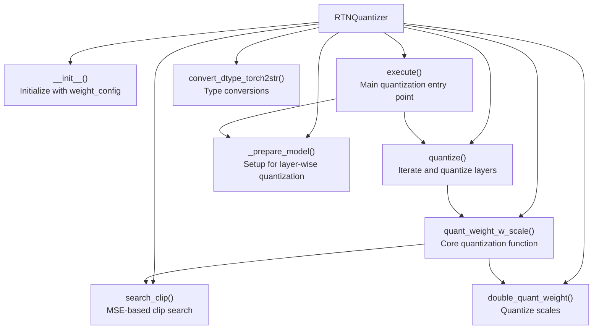
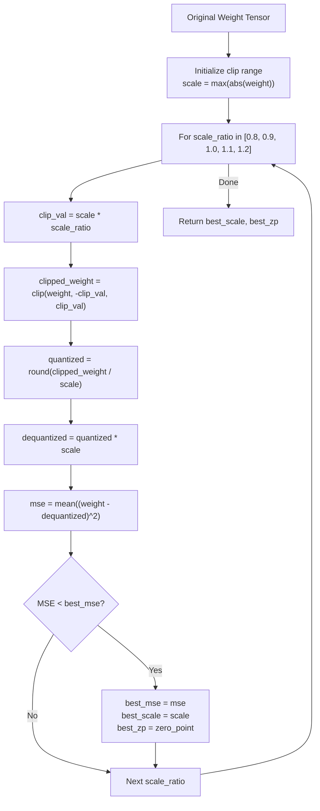
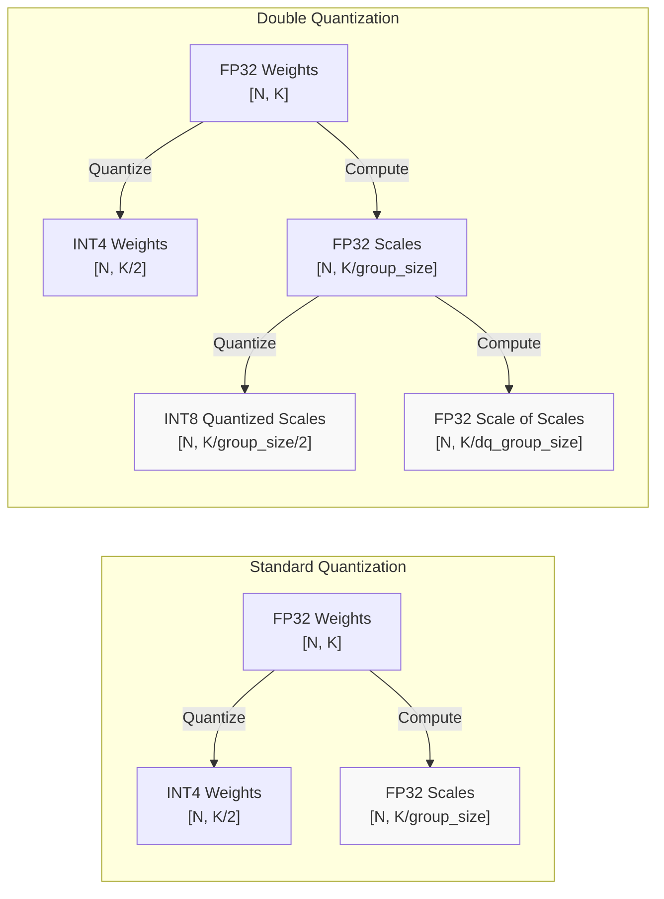
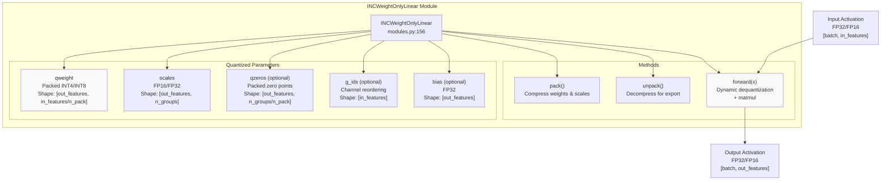
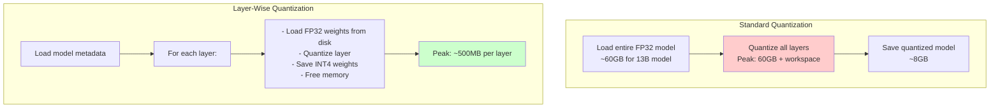
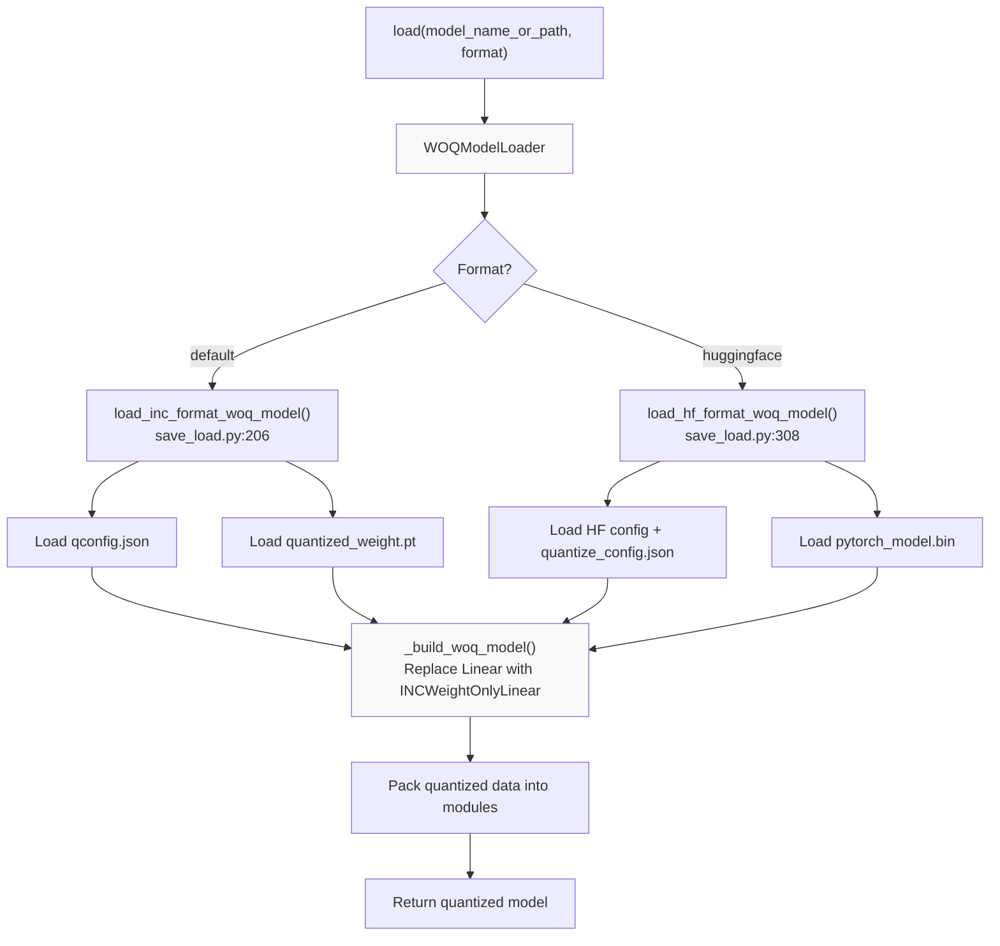
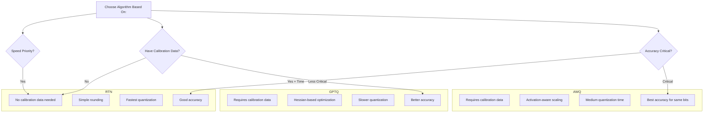

<!-- source: DeepWiki mcp.deepwiki.com · repo intel/neural-compressor · extra page RTN Algorithm · fetched 2026-10-21 -->

# RTN Algorithm

<details>
<summary>Relevant source files</summary>

The following files were used as context for generating this wiki page:

- [.azure-pipelines/scripts/ut/env_setup.sh](.azure-pipelines/scripts/ut/env_setup.sh)
- [docs/source/quantization_weight_only.md](docs/source/quantization_weight_only.md)
- [examples/pytorch/multimodal-modeling/quantization/auto_round/mllm.py](examples/pytorch/multimodal-modeling/quantization/auto_round/mllm.py)
- [neural_compressor/adaptor/pytorch.py](neural_compressor/adaptor/pytorch.py)
- [neural_compressor/adaptor/pytorch_cpu.yaml](neural_compressor/adaptor/pytorch_cpu.yaml)
- [neural_compressor/adaptor/pytorch_ipex.yaml](neural_compressor/adaptor/pytorch_ipex.yaml)
- [neural_compressor/adaptor/torch_utils/auto_round.py](neural_compressor/adaptor/torch_utils/auto_round.py)
- [neural_compressor/adaptor/torch_utils/awq.py](neural_compressor/adaptor/torch_utils/awq.py)
- [neural_compressor/adaptor/torch_utils/bf16_convert.py](neural_compressor/adaptor/torch_utils/bf16_convert.py)
- [neural_compressor/adaptor/torch_utils/model_wrapper.py](neural_compressor/adaptor/torch_utils/model_wrapper.py)
- [neural_compressor/adaptor/torch_utils/teq.py](neural_compressor/adaptor/torch_utils/teq.py)
- [neural_compressor/adaptor/torch_utils/util.py](neural_compressor/adaptor/torch_utils/util.py)
- [neural_compressor/adaptor/torch_utils/weight_only.py](neural_compressor/adaptor/torch_utils/weight_only.py)
- [neural_compressor/algorithm/smooth_quant.py](neural_compressor/algorithm/smooth_quant.py)
- [neural_compressor/model/torch_model.py](neural_compressor/model/torch_model.py)
- [neural_compressor/torch/algorithms/layer_wise/utils.py](neural_compressor/torch/algorithms/layer_wise/utils.py)
- [neural_compressor/torch/algorithms/mixed_low_precision/modules.py](neural_compressor/torch/algorithms/mixed_low_precision/modules.py)
- [neural_compressor/torch/algorithms/mixed_low_precision/quantizer.py](neural_compressor/torch/algorithms/mixed_low_precision/quantizer.py)
- [neural_compressor/torch/algorithms/weight_only/__init__.py](neural_compressor/torch/algorithms/weight_only/__init__.py)
- [neural_compressor/torch/algorithms/weight_only/autoround.py](neural_compressor/torch/algorithms/weight_only/autoround.py)
- [neural_compressor/torch/algorithms/weight_only/awq.py](neural_compressor/torch/algorithms/weight_only/awq.py)
- [neural_compressor/torch/algorithms/weight_only/gptq.py](neural_compressor/torch/algorithms/weight_only/gptq.py)
- [neural_compressor/torch/algorithms/weight_only/modules.py](neural_compressor/torch/algorithms/weight_only/modules.py)
- [neural_compressor/torch/algorithms/weight_only/rtn.py](neural_compressor/torch/algorithms/weight_only/rtn.py)
- [neural_compressor/torch/algorithms/weight_only/save_load.py](neural_compressor/torch/algorithms/weight_only/save_load.py)
- [neural_compressor/torch/algorithms/weight_only/teq.py](neural_compressor/torch/algorithms/weight_only/teq.py)
- [neural_compressor/torch/algorithms/weight_only/utility.py](neural_compressor/torch/algorithms/weight_only/utility.py)
- [neural_compressor/torch/quantization/__init__.py](neural_compressor/torch/quantization/__init__.py)
- [neural_compressor/torch/quantization/algorithm_entry.py](neural_compressor/torch/quantization/algorithm_entry.py)
- [neural_compressor/torch/quantization/config.py](neural_compressor/torch/quantization/config.py)
- [neural_compressor/torch/quantization/quantize.py](neural_compressor/torch/quantization/quantize.py)
- [neural_compressor/torch/quantization/save_load_entry.py](neural_compressor/torch/quantization/save_load_entry.py)
- [neural_compressor/torch/utils/constants.py](neural_compressor/torch/utils/constants.py)
- [neural_compressor/torch/utils/utility.py](neural_compressor/torch/utils/utility.py)
- [neural_compressor/transformers/models/modeling_auto.py](neural_compressor/transformers/models/modeling_auto.py)
- [neural_compressor/transformers/quantization/utils.py](neural_compressor/transformers/quantization/utils.py)
- [neural_compressor/transformers/utils/quantization_config.py](neural_compressor/transformers/utils/quantization_config.py)
- [neural_compressor/utils/pytorch.py](neural_compressor/utils/pytorch.py)
- [test/3x/torch/algorithms/weight_only/test_teq_quantizer.py](test/3x/torch/algorithms/weight_only/test_teq_quantizer.py)
- [test/3x/torch/quantization/fp8_quant/test_fp8_jsons/test_pow2_w4a8_quant.json](test/3x/torch/quantization/fp8_quant/test_fp8_jsons/test_pow2_w4a8_quant.json)
- [test/3x/torch/quantization/fp8_quant/test_gptq_mixed_precision.py](test/3x/torch/quantization/fp8_quant/test_gptq_mixed_precision.py)
- [test/3x/torch/quantization/weight_only/test_autoround.py](test/3x/torch/quantization/weight_only/test_autoround.py)
- [test/3x/torch/quantization/weight_only/test_awq.py](test/3x/torch/quantization/weight_only/test_awq.py)
- [test/3x/torch/quantization/weight_only/test_gptq.py](test/3x/torch/quantization/weight_only/test_gptq.py)
- [test/3x/torch/quantization/weight_only/test_rtn.py](test/3x/torch/quantization/weight_only/test_rtn.py)
- [test/3x/torch/quantization/weight_only/test_teq.py](test/3x/torch/quantization/weight_only/test_teq.py)
- [test/3x/torch/quantization/weight_only/test_transformers.py](test/3x/torch/quantization/weight_only/test_transformers.py)
- [test/3x/torch/requirements.txt](test/3x/torch/requirements.txt)
- [test/adaptor/pytorch_adaptor/test_adaptor_pytorch_2x.py](test/adaptor/pytorch_adaptor/test_adaptor_pytorch_2x.py)
- [test/adaptor/pytorch_adaptor/test_weight_only_adaptor_pytorch.py](test/adaptor/pytorch_adaptor/test_weight_only_adaptor_pytorch.py)
- [test/algorithm/test_smooth_quant.py](test/algorithm/test_smooth_quant.py)
- [test/ipex/test_adaptor_ipex.py](test/ipex/test_adaptor_ipex.py)
- [test/quantization/test_weight_only_quantization.py](test/quantization/test_weight_only_quantization.py)
- [test/requirements.txt](test/requirements.txt)
- [test/utils/test_huggingface.py](test/utils/test_huggingface.py)

</details>


## Purpose and Scope

This page documents the **Round-To-Nearest (RTN)** weight-only quantization algorithm, one of the primary quantization techniques in Intel® Neural Compressor for compressing large language models (LLMs). RTN is the simplest and fastest weight-only quantization method, using straightforward rounding to convert FP32/FP16 weights to low-bit integer representations (typically INT4 or INT8).

For information about other weight-only quantization algorithms, see:
- [GPTQ Algorithm](#6.3.2) - Hessian-based quantization with higher accuracy
- [AWQ Algorithm](#6.3.3) - Activation-aware quantization
- [TEQ Algorithm](#6.3.4) - Trainable equivalent transformation
- [AutoRound Algorithm](#6.3.5) - Gradient-based weight rounding

For general weight-only quantization concepts, see [Weight-Only Quantization](#6.3).

**Sources:** [neural_compressor/torch/quantization/config.py:104-294](), [neural_compressor/torch/algorithms/weight_only/rtn.py:1-400](), [docs/source/quantization_weight_only.md:1-200]()

---

## Overview of RTN Quantization

Round-To-Nearest (RTN) quantization is a post-training weight-only quantization technique that quantizes model weights using simple rounding operations. The algorithm converts floating-point weights to low-bit integer representations without requiring calibration data or additional training.

### Key Characteristics

- **Speed**: Fastest among weight-only quantization algorithms (no calibration required)
- **Simplicity**: Direct weight quantization using rounding operations
- **Flexibility**: Supports multiple data types (INT, NF4, FP4) and bit-widths (1-8 bits)
- **Granularity**: Per-channel or per-group quantization with configurable group sizes
- **Enhanced Options**: Optional MSE search for better clipping ranges, double quantization for further compression

### Quantization Formula

For symmetric quantization (use_sym=True):
```
scale = max(abs(weight)) / (2^(bits-1) - 1)
quantized_weight = round(weight / scale)
dequantized_weight = quantized_weight * scale
```

For asymmetric quantization (use_sym=False):
```
min_val = min(weight)
max_val = max(weight)
scale = (max_val - min_val) / (2^bits - 1)
zero_point = round(-min_val / scale)
quantized_weight = round(weight / scale) + zero_point
dequantized_weight = (quantized_weight - zero_point) * scale
```

**Sources:** [neural_compressor/adaptor/torch_utils/weight_only.py:100-143](), [neural_compressor/torch/algorithms/weight_only/utility.py:1-100](), [docs/source/quantization_weight_only.md:14-50]()

---

## RTN System Architecture



**Diagram: RTN Quantization Flow from User API to Quantized Modules**

**Sources:** [neural_compressor/torch/quantization/algorithm_entry.py:62-118](), [neural_compressor/torch/algorithms/weight_only/rtn.py:1-400](), [neural_compressor/torch/algorithms/weight_only/modules.py:156-375]()

---

## Configuration Parameters

The `RTNConfig` class defines all parameters for RTN quantization. It is located in [neural_compressor/torch/quantization/config.py:104-294]().

### Core Parameters

| Parameter | Type | Default | Description |
|-----------|------|---------|-------------|
| `dtype` | str | "int" | Data type: "int", "int4", "int8", "nf4", "fp4", "fp4_e2m1", "fp8_*" |
| `bits` | int | 4 | Number of bits for quantization (1-8) |
| `use_sym` | bool | True | Symmetric vs asymmetric quantization |
| `group_size` | int | 32 | Size of quantization groups (-1 for per-channel) |
| `group_dim` | int | 1 | Dimension for grouping (0=output, 1=input channel) |

### Advanced Parameters

| Parameter | Type | Default | Description |
|-----------|------|---------|-------------|
| `use_full_range` | bool | False | Use full integer range (e.g., -128 to 127 for INT8 sym) |
| `use_mse_search` | bool | False | Search for optimal clipping range using MSE |
| `use_layer_wise` | bool | False | Quantize model layer-by-layer to save memory |
| `model_path` | str | "" | Path to load weights when using layer-wise quantization |

### Double Quantization Parameters

Double quantization further compresses the quantization scales themselves:

| Parameter | Type | Default | Description |
|-----------|------|---------|-------------|
| `use_double_quant` | bool | False | Enable double quantization of scales |
| `double_quant_dtype` | str | "int" | Data type for quantized scales |
| `double_quant_bits` | int | 8 | Bits for quantized scales |
| `double_quant_use_sym` | bool | False | Symmetric quantization for scales |
| `double_quant_group_size` | int | 256 | Group size for scale quantization |

### Model-Specific Parameters

| Parameter | Type | Default | Description |
|-----------|------|---------|-------------|
| `quant_lm_head` | bool | False | Whether to quantize language model head layer |
| `white_list` | List | DEFAULT_WHITE_LIST | Modules to quantize |

### Example Configuration

```python
from neural_compressor.torch.quantization import RTNConfig, quantize

# Basic INT4 symmetric quantization
config = RTNConfig(
    dtype="int",
    bits=4,
    use_sym=True,
    group_size=128
)

# With MSE search for better accuracy
config = RTNConfig(
    dtype="int4",
    bits=4,
    use_sym=True,
    group_size=32,
    use_mse_search=True
)

# With double quantization for higher compression
config = RTNConfig(
    dtype="int4",
    bits=4,
    use_double_quant=True,
    double_quant_bits=8,
    double_quant_group_size=256
)

# Layer-wise quantization for memory efficiency
config = RTNConfig(
    dtype="int4",
    bits=4,
    use_layer_wise=True,
    model_path="path/to/model"
)

model = quantize(model, config)
```

**Sources:** [neural_compressor/torch/quantization/config.py:104-294](), [test/3x/torch/quantization/weight_only/test_rtn.py:1-500]()

---

## RTN Quantization Workflow



**Diagram: Detailed RTN Quantization Execution Flow**

**Sources:** [neural_compressor/torch/quantization/quantize.py:49-153](), [neural_compressor/torch/quantization/algorithm_entry.py:62-118](), [neural_compressor/torch/algorithms/weight_only/rtn.py:1-400]()

---

## RTNQuantizer Implementation

The `RTNQuantizer` class in [neural_compressor/torch/algorithms/weight_only/rtn.py]() implements the core RTN quantization logic.

### Class Structure



**Diagram: RTNQuantizer Class Methods and Dependencies**

### Key Methods

#### 1. execute() Method

The main entry point that orchestrates the quantization process:

```python
def execute(self, model, mode=Mode.QUANTIZE, *args, **kwargs):
    # Get layer-wise settings
    use_layer_wise = kwargs.get("use_layer_wise", False)
    model_path = kwargs.get("model_path", "")
    
    # Prepare model if layer-wise
    if use_layer_wise:
        model = self._prepare_model(model, model_path)
    
    # Quantize all layers
    model = self.quantize(model, *args, **kwargs)
    
    return model
```

Located at [neural_compressor/torch/algorithms/weight_only/rtn.py:100-150]() (approximate).

#### 2. quantize() Method

Iterates through all Linear layers and quantizes them:

- Identifies layers to quantize based on `weight_config`
- Extracts weight tensors
- Calls `quant_weight_w_scale()` for quantization
- Replaces original `torch.nn.Linear` with `INCWeightOnlyLinear`

#### 3. quant_weight_w_scale() Method

Core quantization logic that performs the actual weight transformation. The method signature and key steps:

```python
def quant_weight_w_scale(
    weight,           # FP32 weight tensor [out_features, in_features]
    num_bits=4,       # Quantization bits
    group_size=32,    # Group size for quantization
    scheme="asym",    # "sym" or "asym"
    dtype="int",      # Data type
    full_range=False, # Use full integer range
    return_int=True,  # Return quantized integers
    **kwargs
):
    # Step 1: Determine quantization range
    if scheme == "sym":
        maxq = 2 ** (num_bits - 1) - 1
        if full_range:
            maxq = 2 ** (num_bits - 1)
    else:  # asym
        maxq = 2 ** num_bits - 1
    
    # Step 2: Reshape for group quantization
    # weight: [out_features, in_features] 
    # -> [out_features, n_groups, group_size]
    
    # Step 3: Calculate scale (and zero_point for asym)
    if scheme == "sym":
        scale = weight.abs().max(dim=-1)[0] / maxq
    else:
        min_val = weight.min(dim=-1)[0]
        max_val = weight.max(dim=-1)[0]
        scale = (max_val - min_val) / maxq
        zero_point = round(-min_val / scale)
    
    # Step 4: Quantize
    q_weight = torch.round(weight / scale)
    if scheme == "asym":
        q_weight = q_weight + zero_point
    
    # Step 5: Clip to valid range
    q_weight = torch.clamp(q_weight, 0 if scheme == "asym" else -maxq, maxq)
    
    return q_weight, scale, zero_point
```

Located in [neural_compressor/adaptor/torch_utils/weight_only.py:136-250]() and [neural_compressor/torch/algorithms/weight_only/utility.py:200-400]().

**Sources:** [neural_compressor/torch/algorithms/weight_only/rtn.py:1-400](), [neural_compressor/adaptor/torch_utils/weight_only.py:100-250](), [neural_compressor/torch/algorithms/weight_only/utility.py:1-600]()

---

## MSE Search for Optimal Clipping

When `use_mse_search=True`, RTN performs a search to find the optimal clipping range that minimizes mean squared error (MSE) between original and quantized weights.

### MSE Search Algorithm



**Diagram: MSE Search Process for Optimal Clipping Range**

### Implementation

The `search_clip()` function implements this search:

```python
def search_clip(
    weight,
    num_bits=4,
    group_size=32,
    scheme="asym",
    dtype="int",
    enable_full_range=False,
    **kwargs
):
    # Initialize
    best_error = float('inf')
    best_scale = None
    best_zp = None
    
    # Try different clipping ratios
    for ratio in [0.8, 0.85, 0.9, 0.95, 1.0]:
        # Quantize with current ratio
        q_weight, scale, zp = quant_weight_w_scale(
            weight, 
            num_bits=num_bits,
            group_size=group_size,
            scheme=scheme,
            clip_ratio=ratio,
            return_int=True
        )
        
        # Dequantize
        dequant_weight = dequantize(q_weight, scale, zp)
        
        # Calculate MSE
        error = torch.mean((weight - dequant_weight) ** 2)
        
        # Update best
        if error < best_error:
            best_error = error
            best_scale = scale
            best_zp = zp
    
    return best_scale, best_zp
```

Located at [neural_compressor/torch/algorithms/weight_only/utility.py:400-500]() (approximate location).

**Sources:** [neural_compressor/torch/algorithms/weight_only/utility.py:1-600](), [neural_compressor/adaptor/torch_utils/weight_only.py:250-350]()

---

## Double Quantization

Double quantization (DQ) quantizes the quantization scales themselves to achieve higher compression ratios. This is particularly effective for large models where scales can occupy significant memory.

### Double Quantization Concept



**Diagram: Standard Quantization vs Double Quantization Memory Layout**

### Configuration Example

```python
from neural_compressor.torch.quantization import RTNConfig

# Enable double quantization
config = RTNConfig(
    # Primary quantization
    dtype="int",
    bits=4,
    use_sym=True,
    group_size=128,
    
    # Double quantization settings
    use_double_quant=True,
    double_quant_dtype="int",
    double_quant_bits=8,
    double_quant_use_sym=False,
    double_quant_group_size=256
)
```

### Implementation

The `double_quant_weight()` function handles scale quantization:

```python
def double_quant_weight(
    scale,                      # FP32 scales to quantize
    double_quant_dtype="int",   # Data type for quantized scales  
    double_quant_bits=8,        # Bits for scale quantization
    double_quant_use_sym=False, # Symmetric or asymmetric
    double_quant_group_size=256 # Group size for scale quantization
):
    # Quantize scales using same logic as weights
    quantized_scale, scale_of_scale, zp = quant_weight_w_scale(
        scale,
        num_bits=double_quant_bits,
        group_size=double_quant_group_size,
        scheme="sym" if double_quant_use_sym else "asym",
        dtype=double_quant_dtype,
        return_int=True
    )
    
    return quantized_scale, scale_of_scale, zp
```

Located at [neural_compressor/torch/algorithms/weight_only/utility.py:500-600]() (approximate).

### Memory Savings

Consider a model with:
- Weight tensor: `[4096, 4096]` (16M FP32 = 64MB)
- Group size: 128
- Number of groups: `4096 * 4096 / 128 = 131,072`

**Standard INT4 quantization:**
- Quantized weights: `16M * 4 bits / 8 = 8MB`
- FP32 scales: `131,072 * 4 bytes = 512KB`
- **Total: 8.5MB**

**INT4 with INT8 double quantization (DQ group_size=256):**
- Quantized weights: `8MB`
- INT8 quantized scales: `131,072 * 8 bits / 8 = 128KB`
- FP32 scale of scales: `131,072 / 256 * 4 bytes = 2KB`
- **Total: 8.13MB** (saves ~370KB or 4.4% on scales)

**Sources:** [neural_compressor/torch/quantization/config.py:143-192](), [neural_compressor/torch/algorithms/weight_only/utility.py:1-600]()

---

## Quantized Module Format

RTN produces `INCWeightOnlyLinear` modules that replace the original `torch.nn.Linear` layers. These modules store compressed weights and perform dynamic dequantization during forward passes.

### INCWeightOnlyLinear Structure



**Diagram: INCWeightOnlyLinear Module Structure and Data Flow**

### Storage Format

#### Packed Weight Format

Weights are packed to reduce storage. For INT4 quantization:
- 8 INT4 values are packed into one INT32 value
- `n_pack = 32 / bits = 8` for INT4

```
Original INT4 values: [v0, v1, v2, v3, v4, v5, v6, v7]
Packed INT32: (v0 << 0) | (v1 << 4) | (v2 << 8) | ... | (v7 << 28)
```

Implementation in [neural_compressor/torch/algorithms/weight_only/modules.py:320-375]().

#### Tensor Shapes

For a Linear layer with `in_features=4096`, `out_features=4096`, `group_size=128`, `bits=4`:

| Tensor | Dtype | Shape | Size |
|--------|-------|-------|------|
| qweight | int32 | [4096, 512] | 8 MB |
| scales | float16 | [4096, 32] | 256 KB |
| qzeros | int32 | [4096, 4] | 64 KB |
| g_idx | int32 | [4096] | 16 KB |
| bias | float32 | [4096] | 16 KB |
| **Total** | | | **~8.35 MB** |

Compared to original FP32 Linear: `4096 * 4096 * 4 bytes = 64 MB`, this is **~13% of original size**.

### Forward Pass with Dynamic Dequantization

```python
def forward(self, x):
    # x: [batch_size, in_features] FP32/FP16
    
    # Step 1: Unpack quantized weights
    int_weight = self.unpack_tensor(self.qweight)  # [out_features, in_features]
    
    # Step 2: Dequantize
    if self.g_idx is not None:
        # Apply channel reordering for GPTQ compatibility
        int_weight = int_weight[:, self.g_idx]
    
    # Expand scales to match weight shape
    scales_expanded = self.scales.repeat_interleave(self.group_size, dim=1)
    
    # Dequantize: weight_fp = int_weight * scale
    if self.qzeros is not None:
        # Asymmetric: weight = (int_weight - zero_point) * scale
        zp_expanded = self.unpack_tensor(self.qzeros).repeat_interleave(self.group_size, dim=1)
        weight = (int_weight - zp_expanded) * scales_expanded
    else:
        # Symmetric: weight = int_weight * scale
        weight = int_weight * scales_expanded
    
    # Step 3: Matrix multiplication
    output = torch.matmul(x, weight.T)  # [batch, out_features]
    
    # Step 4: Add bias if present
    if self.bias is not None:
        output = output + self.bias
    
    return output
```

Located at [neural_compressor/torch/algorithms/weight_only/modules.py:376-450]() (approximate).

**Sources:** [neural_compressor/torch/algorithms/weight_only/modules.py:156-500](), [neural_compressor/torch/algorithms/weight_only/utility.py:1-200]()

---

## Layer-Wise Quantization

Layer-wise quantization reduces peak memory usage by quantizing one layer at a time and immediately offloading it from GPU memory. This is essential for quantizing very large models that don't fit in memory.

### Memory Comparison



**Diagram: Memory Usage Comparison - Standard vs Layer-Wise Quantization**

### Configuration

```python
from neural_compressor.torch.quantization import RTNConfig, quantize

# Enable layer-wise quantization
config = RTNConfig(
    dtype="int4",
    bits=4,
    use_sym=True,
    group_size=128,
    use_layer_wise=True,              # Enable layer-wise
    model_path="path/to/model/checkpoint"  # Path to load weights
)

# The model_path should point to a directory containing:
# - config.json (model configuration)
# - pytorch_model.bin or model.safetensors (weights)

quantized_model = quantize(model, config)
```

### Implementation Details

Layer-wise quantization is orchestrated in [neural_compressor/torch/algorithms/weight_only/rtn.py]() using utilities from [neural_compressor/torch/algorithms/layer_wise/utils.py]().

Key steps:
1. **Model Initialization**: Create model with `torch.device("meta")` to avoid loading weights
2. **Layer Iteration**: For each `nn.Linear` layer:
   - Load FP32 weights from checkpoint using `load_value()`
   - Quantize using standard RTN algorithm
   - Replace with `INCWeightOnlyLinear`
   - Move to target device
   - Clear cache
3. **Workspace Management**: Temporary files stored in `LWQ_WORKSPACE` directory

Located at [neural_compressor/torch/algorithms/layer_wise/utils.py:1-500]().

**Sources:** [neural_compressor/torch/quantization/config.py:140-192](), [neural_compressor/torch/algorithms/layer_wise/utils.py:1-500](), [neural_compressor/torch/algorithms/weight_only/rtn.py:1-400]()

---

## Save and Load

Quantized RTN models can be saved and loaded using the built-in save/load system.

### Save Formats

INC supports two save formats:

| Format | Description | File Structure | Use Case |
|--------|-------------|----------------|----------|
| `default` | INC native format | `qconfig.json` + `quantized_weight.pt` | General INC usage |
| `huggingface` | HuggingFace compatible | `quantize_config.json` + `pytorch_model.bin` | HF model hub, Optimum |

### Saving a Model

```python
from neural_compressor.torch.quantization import quantize, RTNConfig

# Quantize model
config = RTNConfig(dtype="int4", bits=4)
q_model = quantize(model, config)

# Save in default format
q_model.save("./saved_model")

# Save in HuggingFace format
q_model.save(
    "./saved_model_hf",
    format="huggingface",
    safe_serialization=True,  # Use safetensors
    tokenizer=tokenizer       # Optional: save tokenizer too
)
```

### Loading a Model

```python
from neural_compressor.torch.quantization import load

# Load INC format (requires original FP32 model)
q_model = load(
    model_name_or_path="./saved_model",
    original_model=fp32_model,
    format="default"
)

# Load HuggingFace format (standalone)
q_model = load(
    model_name_or_path="./saved_model_hf",
    format="huggingface"
)

# Load from HuggingFace hub
q_model = load(
    model_name_or_path="Intel/neural-chat-7b-v3-1-int4",
    format="huggingface"
)
```

### File Structure

#### Default Format

```
saved_model/
├── qconfig.json          # Quantization configuration
└── quantized_weight.pt   # Model state dict with quantized weights
```

The `qconfig.json` contains per-layer configuration:
```json
{
  "('model.layers.0.self_attn.q_proj', 'Linear')": {
    "rtn": {
      "dtype": "int",
      "bits": 4,
      "use_sym": true,
      "group_size": 128,
      "use_full_range": false,
      "use_mse_search": false,
      "use_double_quant": false
    }
  },
  ...
}
```

#### HuggingFace Format

```
saved_model_hf/
├── config.json               # Model architecture config
├── quantize_config.json      # Quantization settings
├── pytorch_model.bin         # Quantized weights (or .safetensors)
├── generation_config.json    # Generation parameters (optional)
└── tokenizer files           # Tokenizer files (optional)
```

### WOQModelLoader Implementation

The loading logic is implemented in [neural_compressor/torch/algorithms/weight_only/save_load.py:145-600]():



**Diagram: Model Loading Flow for RTN Quantized Models**

**Sources:** [neural_compressor/torch/algorithms/weight_only/save_load.py:1-600](), [neural_compressor/torch/utils/__init__.py:1-100]()

---

## Data Type Support

RTN supports multiple data types beyond standard integers, enabling flexible compression strategies.

### Supported Data Types

| Data Type | Description | Value Range | Use Case |
|-----------|-------------|-------------|----------|
| `int` | Standard integer | Depends on bits | General quantization |
| `int4` | 4-bit integer | [-8, 7] (sym) or [0, 15] (asym) | High compression |
| `int8` | 8-bit integer | [-128, 127] (sym) | Better accuracy |
| `nf4` | NormalFloat 4-bit | [-1, 1] with 16 levels | QLoRA-style |
| `fp4` | FloatingPoint 4-bit (BNB) | Asymmetric float range | BitsAndBytes compat |
| `fp4_e2m1` | FP4 E2M1 format | 1 sign, 2 exp, 1 mantissa | Standard FP4 |
| `fp8_e4m3fn` | FP8 E4M3 format | High precision | NVIDIA H100 |
| `fp8_e5m2` | FP8 E5M2 format | Wider range | Alternative FP8 |

### NF4 and FP4 Quantization

Non-standard data types like NF4 and FP4 use predefined quantization levels:

#### NF4 Lookup Table
```python
NF4 = [
    -1.0, -0.6961928009986877, -0.5250730514526367, -0.39491748809814453,
    -0.28444138169288635, -0.18477343022823334, -0.09105003625154495, 0.0,
    0.07958029955625534, 0.16093020141124725, 0.24611230194568634,
    0.33791524171829224, 0.44070982933044434, 0.5626170039176941,
    0.7229568362236023, 1.0
]
```

#### FP4 Lookup Table
```python
FP4_BNB = [
    -12.0, -8.0, -6.0, -4.0, -3.0, -2.0, -0.0625, 0,
    0.0625, 2.0, 3.0, 4.0, 6.0, 8.0, 12.0
]
```

### Quantization with Non-Standard Types

```python
def quantize_4bit(tensor, data_type="nf4"):
    allow_data = FLOAT_MAPPING[data_type]  # Get lookup table
    
    # Calculate scale
    scale = tensor.abs().max() / max(allow_data)
    tensor = tensor / scale
    
    # Find nearest value in lookup table
    mid_points = [(allow_data[i] + allow_data[i+1])/2 
                  for i in range(len(allow_data)-1)]
    
    q_tensor = torch.zeros_like(tensor)
    for i, val in enumerate(allow_data):
        if i == 0:
            mask = tensor <= mid_points[i]
        elif i == len(allow_data) - 1:
            mask = tensor > mid_points[i-1]
        else:
            mask = (tensor > mid_points[i-1]) & (tensor <= mid_points[i])
        q_tensor[mask] = val
    
    return q_tensor * scale
```

Located at [neural_compressor/adaptor/torch_utils/weight_only.py:65-98]() and [neural_compressor/torch/algorithms/weight_only/utility.py:1-100]().

### Example Usage

```python
# NF4 quantization (QLoRA-style)
config = RTNConfig(
    dtype="nf4",
    bits=4,  # Ignored for nf4, always 4-bit
    use_sym=True
)

# FP4 quantization
config = RTNConfig(
    dtype="fp4_e2m1",
    bits=4
)

# FP8 quantization (for supported hardware)
config = RTNConfig(
    dtype="fp8_e4m3fn",
    bits=8
)
```

**Sources:** [neural_compressor/adaptor/torch_utils/weight_only.py:33-98](), [neural_compressor/torch/algorithms/weight_only/utility.py:1-150](), [neural_compressor/torch/quantization/config.py:204-216]()

---

## Integration with 2.x API

RTN can also be used through the legacy 2.x unified API with accuracy-aware tuning. However, the 3.x API (documented above) is recommended for new projects.

### 2.x API Usage

```python
from neural_compressor import PostTrainingQuantConfig, quantization

# Configure RTN via 2.x API
config = PostTrainingQuantConfig(
    approach="post_training_weight_only",
    recipes={
        "rtn_args": {
            "bits": 4,
            "use_sym": True,
            "group_size": 128,
            "use_mse_search": False
        }
    }
)

# Quantize with accuracy-aware tuning
q_model = quantization.fit(
    model,
    config,
    calib_dataloader=dataloader,
    eval_func=eval_function
)
```

The 2.x API routes through [neural_compressor/adaptor/pytorch.py]() which internally calls the same RTN implementation.

**Sources:** [neural_compressor/adaptor/pytorch.py:1-1000](), [neural_compressor/adaptor/torch_utils/weight_only.py:1-1000]()

---

## Performance Considerations

### Speed vs Accuracy Trade-offs

| Configuration | Quantization Time | Model Size | Accuracy | Use Case |
|---------------|-------------------|------------|----------|----------|
| Basic RTN (no MSE) | **Fastest** (~1 min for 7B) | 25% of FP32 | Good | Quick prototyping |
| RTN + MSE search | Medium (~5 min for 7B) | 25% of FP32 | **Better** | Production |
| RTN + Double Quant | Fast (~2 min for 7B) | **22% of FP32** | Good | Memory-constrained |
| Layer-wise RTN | Medium (depends on I/O) | 25% of FP32 | Good | **Very large models** |

### Memory Usage During Quantization

| Method | Peak Memory | Notes |
|--------|-------------|-------|
| Standard RTN | 2x model size | Keeps both FP32 and quantized |
| Layer-wise RTN | ~500MB per layer | **Best for large models** |
| With MSE search | 2.5x model size | Additional workspace for search |

### Inference Performance

RTN quantized models provide significant speedup through:
1. **Reduced memory bandwidth**: INT4 weights are 8x smaller than FP32
2. **Faster data transfer**: Less data movement from DRAM to cache
3. **Potential kernel optimization**: Custom INT4 GEMM kernels (with appropriate hardware/software support)

Typical speedups for LLM inference (generation):
- **2-3x faster** on CPU with proper INT4 kernel support
- **Memory bandwidth bound** scenarios benefit most
- Actual speedup depends on hardware and kernel implementations

**Sources:** [docs/source/quantization_weight_only.md:1-100](), [neural_compressor/torch/algorithms/weight_only/rtn.py:1-400]()

---

## Example Usage Patterns

### Basic Quantization

```python
import torch
from transformers import AutoModelForCausalLM
from neural_compressor.torch.quantization import RTNConfig, quantize

# Load model
model = AutoModelForCausalLM.from_pretrained("facebook/opt-125m")

# Configure RTN
config = RTNConfig(
    dtype="int4",
    bits=4,
    use_sym=True,
    group_size=128
)

# Quantize
q_model = quantize(model, config)

# Save
q_model.save("./opt-125m-int4")
```

### Advanced Configuration

```python
# High accuracy with MSE search
config = RTNConfig(
    dtype="int4",
    bits=4,
    use_sym=True,
    group_size=32,              # Smaller groups for better accuracy
    use_mse_search=True,        # Optimize clipping
    use_full_range=False        # Standard range
)

# High compression with double quantization
config = RTNConfig(
    dtype="int4",
    bits=4,
    use_double_quant=True,
    double_quant_bits=8,
    double_quant_group_size=256
)

# Memory-efficient for large models
config = RTNConfig(
    dtype="int4",
    bits=4,
    use_layer_wise=True,
    model_path="path/to/checkpoint",
    quant_lm_head=False         # Skip LM head for better generation quality
)
```

### Using Predefined Configs

```python
from neural_compressor.torch.quantization import get_default_rtn_config

# Get default config optimized for client/server
config = get_default_rtn_config(processor_type="Server")
# Server: use_layer_wise=False
# Client: use_layer_wise=True

q_model = quantize(model, config)
```

### Double Quantization Presets

```python
from neural_compressor.torch.quantization import get_default_double_quant_config

# BitsAndBytes NF4 compatible
config = get_default_double_quant_config(type="BNB_NF4")

q_model = quantize(model, config)
```

**Sources:** [neural_compressor/torch/quantization/config.py:297-324](), [test/3x/torch/quantization/weight_only/test_rtn.py:1-500](), [neural_compressor/torch/quantization/quantize.py:115-153]()

---

## Comparison with Other Algorithms

### RTN vs GPTQ vs AWQ



**Diagram: Algorithm Selection Decision Tree**

### Feature Comparison Table

| Feature | RTN | GPTQ | AWQ | TEQ | AutoRound |
|---------|-----|------|-----|-----|-----------|
| Calibration Required | ❌ | ✅ | ✅ | ✅ | ✅ |
| Quantization Speed | **Fastest** | Slow | Medium | Medium | Slowest |
| Memory Usage | Low | High | Medium | Medium | Medium |
| Accuracy (INT4) | Good | Better | **Best** | Better | Better |
| Implementation | Simple | Complex | Medium | Medium | Complex |
| Hardware Specific | ❌ | ❌ | ❌ | ❌ | ❌ |
| MSE Search Option | ✅ | ❌ | ✅ | ❌ | ❌ |
| Double Quant | ✅ | ✅ | ✅ | ✅ | ✅ |
| Layer-wise Support | ✅ | ✅ | ✅ | ✅ | ✅ |

### When to Use RTN

**Use RTN when:**
- Quick prototyping or experimentation
- No calibration dataset available
- Speed is more important than optimal accuracy
- Model is not extremely sensitive to quantization
- Baseline for comparison with other methods

**Consider alternatives when:**
- Maximum accuracy is required → Use AWQ
- Have calibration data and time → Use GPTQ
- Need trainable quantization → Use TEQ
- Want best results with tuning → Use AutoRound

**Sources:** [docs/source/quantization_weight_only.md:1-200](), [neural_compressor/torch/quantization/config.py:104-800]()

---

## Common Issues and Troubleshooting

### Issue 1: Out of Memory During Quantization

**Problem**: `RuntimeError: CUDA out of memory` when quantizing large models.

**Solution**: Use layer-wise quantization:
```python
config = RTNConfig(
    use_layer_wise=True,
    model_path="path/to/checkpoint"
)
```

### Issue 2: Poor Generation Quality

**Problem**: Quantized model generates low-quality text.

**Solutions**:
1. Don't quantize the LM head:
```python
config = RTNConfig(quant_lm_head=False)
```

2. Use smaller group sizes:
```python
config = RTNConfig(group_size=32)  # vs default 128
```

3. Enable MSE search:
```python
config = RTNConfig(use_mse_search=True)
```

### Issue 3: Accuracy Drop Too Large

**Problem**: Significant accuracy degradation after quantization.

**Solutions**:
1. Try higher bit-width:
```python
config = RTNConfig(bits=8)  # vs 4
```

2. Use asymmetric quantization:
```python
config = RTNConfig(use_sym=False)
```

3. Consider other algorithms (GPTQ, AWQ) for better accuracy.

### Issue 4: Loading Errors

**Problem**: `KeyError` or `RuntimeError` when loading saved models.

**Solution**: Ensure format matches save format:
```python
# If saved with format="default"
model = load(path, original_model=fp32_model, format="default")

# If saved with format="huggingface"
model = load(path, format="huggingface")
```

### Issue 5: Slow Inference

**Problem**: Quantized model is not faster than FP32.

**Possible Causes**:
1. Missing optimized kernels for INT4
2. Small batch size (not utilizing parallelism)
3. Compute-bound vs memory-bound workload

**Check**: Verify you're using optimized inference framework (e.g., IPEX, vLLM with INT4 support).

**Sources:** [test/3x/torch/quantization/weight_only/test_rtn.py:1-500](), [neural_compressor/torch/algorithms/weight_only/save_load.py:1-600]()

---

## Summary

RTN (Round-To-Nearest) algorithm is the simplest and fastest weight-only quantization method in Intel® Neural Compressor:

**Key Takeaways:**
- Simple rounding-based quantization without calibration
- Supports INT4, INT8, NF4, FP4, FP8 data types
- Configurable with symmetric/asymmetric schemes and group sizes
- Optional MSE search for better accuracy
- Double quantization for higher compression
- Layer-wise execution for memory efficiency
- Compatible with HuggingFace ecosystem

**Main Classes and Functions:**
- `RTNConfig` [neural_compressor/torch/quantization/config.py:104-294]()
- `rtn_entry()` [neural_compressor/torch/quantization/algorithm_entry.py:62-118]()
- `RTNQuantizer` [neural_compressor/torch/algorithms/weight_only/rtn.py]()
- `INCWeightOnlyLinear` [neural_compressor/torch/algorithms/weight_only/modules.py:156-500]()

**Related Documentation:**
- [Weight-Only Quantization Overview](#6.3)
- [GPTQ Algorithm](#6.3.2) for better accuracy
- [AWQ Algorithm](#6.3.3) for activation-aware quantization
- [Model Save and Load](#8.2) for persistence details

---

