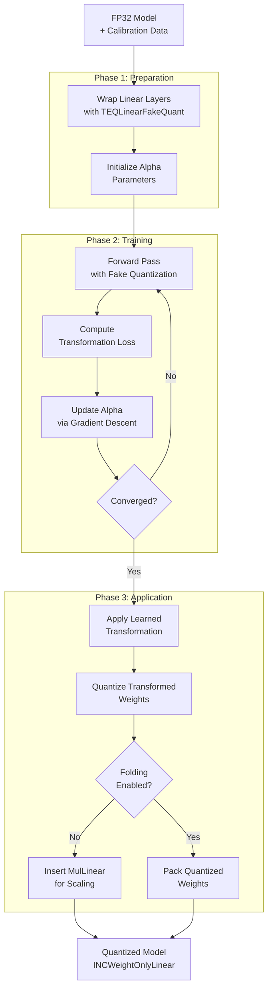
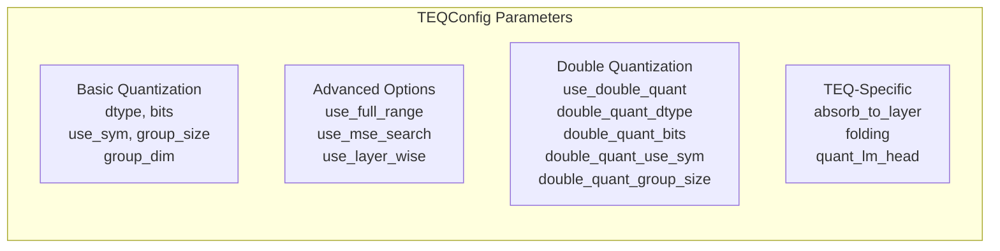
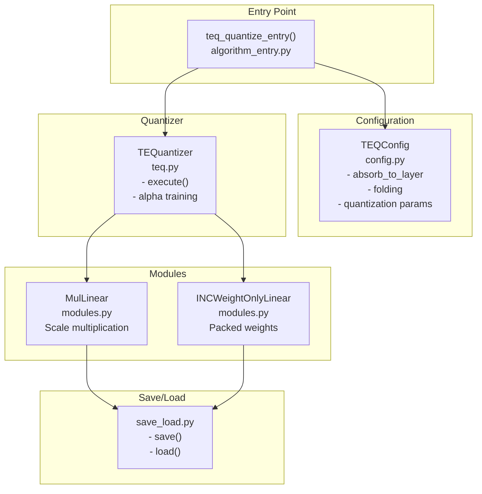
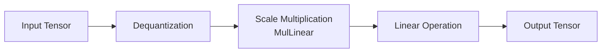
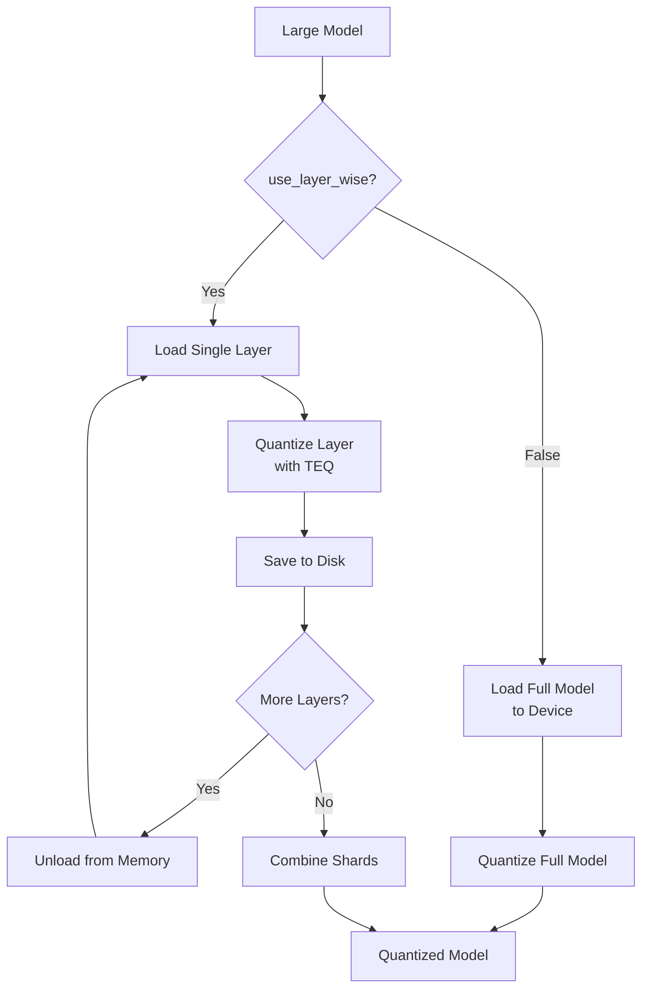
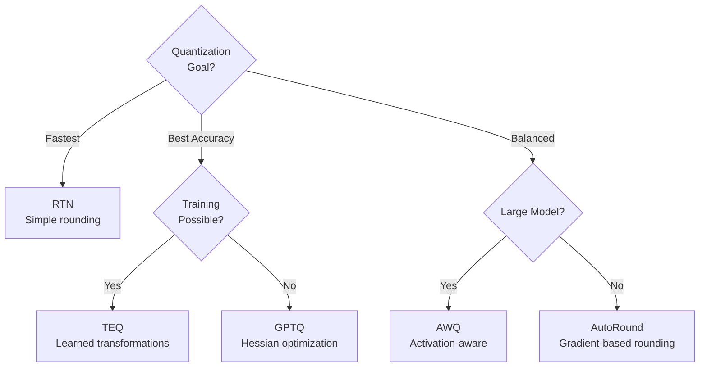

<!-- source: DeepWiki mcp.deepwiki.com · repo intel/neural-compressor · extra page TEQ Algorithm · fetched 2026-10-21 -->

# TEQ Algorithm

<details>
<summary>Relevant source files</summary>

The following files were used as context for generating this wiki page:

- [.azure-pipelines/scripts/ut/env_setup.sh](.azure-pipelines/scripts/ut/env_setup.sh)
- [docs/source/quantization_weight_only.md](docs/source/quantization_weight_only.md)
- [examples/pytorch/multimodal-modeling/quantization/auto_round/mllm.py](examples/pytorch/multimodal-modeling/quantization/auto_round/mllm.py)
- [neural_compressor/adaptor/pytorch.py](neural_compressor/adaptor/pytorch.py)
- [neural_compressor/adaptor/pytorch_cpu.yaml](neural_compressor/adaptor/pytorch_cpu.yaml)
- [neural_compressor/adaptor/pytorch_ipex.yaml](neural_compressor/adaptor/pytorch_ipex.yaml)
- [neural_compressor/adaptor/torch_utils/auto_round.py](neural_compressor/adaptor/torch_utils/auto_round.py)
- [neural_compressor/adaptor/torch_utils/awq.py](neural_compressor/adaptor/torch_utils/awq.py)
- [neural_compressor/adaptor/torch_utils/bf16_convert.py](neural_compressor/adaptor/torch_utils/bf16_convert.py)
- [neural_compressor/adaptor/torch_utils/model_wrapper.py](neural_compressor/adaptor/torch_utils/model_wrapper.py)
- [neural_compressor/adaptor/torch_utils/teq.py](neural_compressor/adaptor/torch_utils/teq.py)
- [neural_compressor/adaptor/torch_utils/util.py](neural_compressor/adaptor/torch_utils/util.py)
- [neural_compressor/adaptor/torch_utils/weight_only.py](neural_compressor/adaptor/torch_utils/weight_only.py)
- [neural_compressor/algorithm/smooth_quant.py](neural_compressor/algorithm/smooth_quant.py)
- [neural_compressor/model/torch_model.py](neural_compressor/model/torch_model.py)
- [neural_compressor/torch/algorithms/layer_wise/utils.py](neural_compressor/torch/algorithms/layer_wise/utils.py)
- [neural_compressor/torch/algorithms/mixed_low_precision/modules.py](neural_compressor/torch/algorithms/mixed_low_precision/modules.py)
- [neural_compressor/torch/algorithms/mixed_low_precision/quantizer.py](neural_compressor/torch/algorithms/mixed_low_precision/quantizer.py)
- [neural_compressor/torch/algorithms/weight_only/__init__.py](neural_compressor/torch/algorithms/weight_only/__init__.py)
- [neural_compressor/torch/algorithms/weight_only/autoround.py](neural_compressor/torch/algorithms/weight_only/autoround.py)
- [neural_compressor/torch/algorithms/weight_only/awq.py](neural_compressor/torch/algorithms/weight_only/awq.py)
- [neural_compressor/torch/algorithms/weight_only/gptq.py](neural_compressor/torch/algorithms/weight_only/gptq.py)
- [neural_compressor/torch/algorithms/weight_only/modules.py](neural_compressor/torch/algorithms/weight_only/modules.py)
- [neural_compressor/torch/algorithms/weight_only/rtn.py](neural_compressor/torch/algorithms/weight_only/rtn.py)
- [neural_compressor/torch/algorithms/weight_only/save_load.py](neural_compressor/torch/algorithms/weight_only/save_load.py)
- [neural_compressor/torch/algorithms/weight_only/teq.py](neural_compressor/torch/algorithms/weight_only/teq.py)
- [neural_compressor/torch/algorithms/weight_only/utility.py](neural_compressor/torch/algorithms/weight_only/utility.py)
- [neural_compressor/torch/quantization/__init__.py](neural_compressor/torch/quantization/__init__.py)
- [neural_compressor/torch/quantization/algorithm_entry.py](neural_compressor/torch/quantization/algorithm_entry.py)
- [neural_compressor/torch/quantization/config.py](neural_compressor/torch/quantization/config.py)
- [neural_compressor/torch/quantization/quantize.py](neural_compressor/torch/quantization/quantize.py)
- [neural_compressor/torch/quantization/save_load_entry.py](neural_compressor/torch/quantization/save_load_entry.py)
- [neural_compressor/torch/utils/constants.py](neural_compressor/torch/utils/constants.py)
- [neural_compressor/torch/utils/utility.py](neural_compressor/torch/utils/utility.py)
- [neural_compressor/transformers/models/modeling_auto.py](neural_compressor/transformers/models/modeling_auto.py)
- [neural_compressor/transformers/quantization/utils.py](neural_compressor/transformers/quantization/utils.py)
- [neural_compressor/transformers/utils/quantization_config.py](neural_compressor/transformers/utils/quantization_config.py)
- [neural_compressor/utils/pytorch.py](neural_compressor/utils/pytorch.py)
- [test/3x/torch/algorithms/weight_only/test_teq_quantizer.py](test/3x/torch/algorithms/weight_only/test_teq_quantizer.py)
- [test/3x/torch/quantization/fp8_quant/test_fp8_jsons/test_pow2_w4a8_quant.json](test/3x/torch/quantization/fp8_quant/test_fp8_jsons/test_pow2_w4a8_quant.json)
- [test/3x/torch/quantization/fp8_quant/test_gptq_mixed_precision.py](test/3x/torch/quantization/fp8_quant/test_gptq_mixed_precision.py)
- [test/3x/torch/quantization/weight_only/test_autoround.py](test/3x/torch/quantization/weight_only/test_autoround.py)
- [test/3x/torch/quantization/weight_only/test_awq.py](test/3x/torch/quantization/weight_only/test_awq.py)
- [test/3x/torch/quantization/weight_only/test_gptq.py](test/3x/torch/quantization/weight_only/test_gptq.py)
- [test/3x/torch/quantization/weight_only/test_rtn.py](test/3x/torch/quantization/weight_only/test_rtn.py)
- [test/3x/torch/quantization/weight_only/test_teq.py](test/3x/torch/quantization/weight_only/test_teq.py)
- [test/3x/torch/quantization/weight_only/test_transformers.py](test/3x/torch/quantization/weight_only/test_transformers.py)
- [test/3x/torch/requirements.txt](test/3x/torch/requirements.txt)
- [test/adaptor/pytorch_adaptor/test_adaptor_pytorch_2x.py](test/adaptor/pytorch_adaptor/test_adaptor_pytorch_2x.py)
- [test/adaptor/pytorch_adaptor/test_weight_only_adaptor_pytorch.py](test/adaptor/pytorch_adaptor/test_weight_only_adaptor_pytorch.py)
- [test/algorithm/test_smooth_quant.py](test/algorithm/test_smooth_quant.py)
- [test/ipex/test_adaptor_ipex.py](test/ipex/test_adaptor_ipex.py)
- [test/quantization/test_weight_only_quantization.py](test/quantization/test_weight_only_quantization.py)
- [test/requirements.txt](test/requirements.txt)
- [test/utils/test_huggingface.py](test/utils/test_huggingface.py)

</details>


## Overview

TEQ (Trainable Equivalent Transformation) is a weight-only quantization algorithm designed for large language model (LLM) compression. TEQ applies learnable equivalent transformations to model weights before quantization, allowing the model to adapt the transformation parameters through training to minimize quantization error. This approach differs from other weight-only quantization methods by introducing trainable alpha parameters that control the transformation applied to weights.

TEQ is part of the 3.x API's weight-only quantization suite. For information about other weight-only quantization algorithms, see:
- RTN (Round-To-Nearest): [6.3.1](#6.3.1)
- GPTQ: [6.3.2](#6.3.2) 
- AWQ (Activation-Aware Weight Quantization): [6.3.3](#6.3.3)
- AutoRound: [6.3.5](#6.3.5)

For general weight-only quantization concepts, see [6.3](#6.3).

**Sources:** [neural_compressor/torch/quantization/config.py:737-829](), [docs/source/quantization_weight_only.md:1-30]()

## Algorithm Methodology

TEQ quantizes model weights by learning optimal transformation parameters (alpha values) that create an equivalent representation with reduced quantization error. The algorithm proceeds in distinct phases:



**Algorithm Steps:**

1. **Wrapper Insertion**: Linear layers are wrapped with `TEQLinearFakeQuant` modules that simulate quantization behavior while maintaining differentiability
2. **Parameter Initialization**: Alpha parameters are initialized for controlling the equivalent transformation
3. **Training Phase**: The model performs forward passes with fake quantization, computing losses and updating alpha parameters through gradient descent
4. **Transformation Application**: Once training converges, the learned alpha transformations are applied to the actual weights
5. **Weight Quantization**: Transformed weights are quantized using the specified bit-width and grouping strategy
6. **Module Replacement**: Quantized weights are packed into `INCWeightOnlyLinear` modules, with optional `MulLinear` insertion if folding is disabled

**Sources:** [neural_compressor/torch/quantization/algorithm_entry.py:484-551](), [neural_compressor/torch/algorithms/weight_only/save_load.py:455-461]()

## Configuration

### TEQConfig Class

The `TEQConfig` class defines all parameters for TEQ quantization. It is registered in the framework with priority `PRIORITY_TEQ`.



### Key Parameters

| Parameter | Type | Default | Description |
|-----------|------|---------|-------------|
| `dtype` | str | `"int"` | Data type for quantized weights |
| `bits` | int | `4` | Number of bits for weight representation |
| `use_sym` | bool | `True` | Use symmetric quantization |
| `group_size` | int | `32` | Size of weight groups for quantization |
| `group_dim` | int | `1` | Dimension along which grouping is applied |
| `use_full_range` | bool | `False` | Enable full quantization range |
| `use_mse_search` | bool | `False` | Search for optimal clipping using MSE |
| `use_layer_wise` | bool | `False` | Quantize model layer-by-layer to save memory |
| `use_double_quant` | bool | `False` | Apply double quantization to scales |
| `double_quant_dtype` | str | `"int"` | Data type for double quantization |
| `double_quant_bits` | int | `8` | Bits for double quantization |
| `double_quant_use_sym` | bool | `True` | Symmetric double quantization |
| `double_quant_group_size` | int | `256` | Group size for double quantization |
| `quant_lm_head` | bool | `False` | Quantize language model head layer |
| `absorb_to_layer` | dict | `{}` | Mapping of layers where transformations are absorbed |
| `folding` | bool | `True` | Fold transformation into weights (vs. runtime multiplication) |

**Sources:** [neural_compressor/torch/quantization/config.py:737-829]()

## Usage

### Basic Quantization

```python
from neural_compressor.torch.quantization import TEQConfig, quantize

# Create TEQ configuration
teq_config = TEQConfig(
    dtype="int",
    bits=4,
    use_sym=True,
    group_size=32,
    folding=True
)

# Prepare calibration function
def run_fn(model):
    for batch in calibration_dataloader:
        model(batch)

# Quantize model
q_model = quantize(
    model=fp32_model,
    quant_config=teq_config,
    run_fn=run_fn,
    example_inputs=example_batch
)
```

### Configuration Requirements

TEQ quantization requires:
- **`example_inputs`**: Sample input tensors used to trace the model structure
- **`run_fn`**: Calibration/training function that performs forward passes for learning alpha parameters

The `run_fn` is particularly important for TEQ as it drives the training process for the learnable transformation parameters.

**Sources:** [neural_compressor/torch/quantization/algorithm_entry.py:484-551]()

### Advanced Configuration

```python
# TEQ with custom layer absorption and double quantization
teq_config = TEQConfig(
    bits=4,
    group_size=128,
    absorb_to_layer={
        "layer1": ["layer2", "layer3"],  # Absorb transformations
    },
    folding=False,  # Insert MulLinear for runtime scaling
    use_double_quant=True,
    double_quant_bits=8,
    use_layer_wise=True  # Save memory for large models
)

q_model = quantize(
    model=large_model,
    quant_config=teq_config,
    run_fn=calibration_fn,
    example_inputs=example_inputs,
    inplace=True
)
```

### Prepare-Convert Workflow

```python
from neural_compressor.torch.quantization import prepare, convert

# Prepare model with TEQ configuration
prepared_model = prepare(
    model=fp32_model,
    quant_config=teq_config,
    example_inputs=example_inputs
)

# Run training/calibration to learn alpha parameters
for epoch in range(num_epochs):
    for batch in calibration_dataloader:
        prepared_model(batch)

# Convert to quantized model
q_model = convert(prepared_model)
```

**Sources:** [neural_compressor/torch/quantization/quantize.py:155-193](), [neural_compressor/torch/quantization/quantize.py:226-248]()

## Implementation Architecture

### Key Components



### Algorithm Entry Function

The `teq_quantize_entry` function serves as the main entry point for TEQ quantization:

**Function Signature:**
```python
def teq_quantize_entry(
    model: torch.nn.Module,
    configs_mapping: Dict[Tuple[str, callable], TEQConfig],
    mode: Mode,
    *args,
    **kwargs,
) -> torch.nn.Module
```

**Process Flow:**
1. Extracts weight configuration from `configs_mapping`
2. Validates required inputs (`example_inputs` must be provided)
3. Extracts `absorb_to_layer` and `folding` settings
4. Creates `TEQuantizer` instance with configuration
5. Executes quantization via `quantizer.execute()`
6. Attaches `qconfig` attribute to quantized model
7. Attaches `save` method for model persistence

**Sources:** [neural_compressor/torch/quantization/algorithm_entry.py:484-551]()

### Weight Configuration Structure

The algorithm entry converts `TEQConfig` objects into a weight configuration dictionary:

```python
weight_config = {
    "layer_name": {
        "dtype": "int",
        "bits": 4,
        "scheme": "sym",  # or "asym"
        "group_size": 32,
        "group_dim": 1,
        "use_full_range": False,
        "use_mse_search": False,
        "use_layer_wise": False,
        "use_double_quant": False,
        "double_quant_dtype": "int",
        "double_quant_bits": 8,
        "double_quant_scheme": "sym",
        "double_quant_group_size": 256,
    }
}
```

Layers with `dtype="fp32"` are skipped during quantization.

**Sources:** [neural_compressor/torch/quantization/algorithm_entry.py:507-532]()

## Module Replacement

### MulLinear Module

When `folding=False`, TEQ inserts `MulLinear` modules to apply learned scale transformations at runtime:



The `MulLinear` wrapper is detected during model loading by checking for `".linear.qweight"` keys in the state dictionary.

**Sources:** [neural_compressor/torch/algorithms/weight_only/save_load.py:458-461](), [neural_compressor/torch/algorithms/weight_only/modules.py:52-71]()

### INCWeightOnlyLinear Module

Regardless of folding setting, quantized weights are packed into `INCWeightOnlyLinear` modules which:
- Store compressed INT4/INT8 weights
- Store quantization scales and zero points
- Perform dynamic dequantization during forward pass
- Support group-wise and per-channel quantization

**Module Structure:**
```python
INCWeightOnlyLinear(
    in_features=...,
    out_features=...,
    dtype="int",
    bits=4,
    group_size=32,
    zp=True/False,  # Zero point
    bias=True/False,
    scale_dtype=torch.float32,
    compression_dtype=torch.int32,
    g_idx=True/False,  # Channel ordering for GPTQ compatibility
)
```

**Sources:** [neural_compressor/torch/algorithms/weight_only/modules.py:156-319]()

## Model Persistence

### Saving TEQ Models

TEQ quantized models are saved with metadata indicating the transformation strategy:

```python
# Save model with TEQ configuration
model.save(output_dir="./saved_model")
```

**Saved Artifacts:**
- `quantized_weight.pt` or `model_bin_index.json` (sharded): Quantized weight tensors
- `qconfig.json`: Configuration mapping including TEQ-specific settings

The configuration mapping structure for TEQ models:
```json
{
    "(layer_name, layer_type)": {
        "teq": {
            "dtype": "int",
            "bits": 4,
            "use_sym": true,
            "group_size": 32,
            "folding": true,
            "absorb_to_layer": {}
        }
    }
}
```

**Sources:** [neural_compressor/torch/algorithms/weight_only/save_load.py:55-108](), [neural_compressor/common/utils:26]()

### Loading TEQ Models

During loading, the system identifies TEQ models by detecting algorithm name in the configuration:

```python
from neural_compressor.torch.quantization import load

# Load TEQ quantized model
model = load(
    model_name_or_path="./saved_model",
    original_model=fp32_model,
    format="default"
)
```

**Loading Process:**
1. Read `qconfig.json` to identify TEQ configuration
2. Detect `MulLinear` patterns by searching for `".linear.qweight"` keys
3. Build model structure with `INCWeightOnlyLinear` modules
4. Insert `MulLinear` wrappers if `folding=False`
5. Load quantized weight data into modules
6. Load remaining FP32 weights using `load_state_dict()`

The TEQ algorithm name detection triggers special handling during the loading process to reconstruct the transformation structure.

**Sources:** [neural_compressor/torch/algorithms/weight_only/save_load.py:206-284](), [neural_compressor/torch/algorithms/weight_only/save_load.py:274]()

## Integration with Other Components

### Relationship to AWQ

TEQ shares similarities with AWQ in its use of transformation scaling, but differs in approach:

| Aspect | TEQ | AWQ |
|--------|-----|-----|
| **Transformation** | Learnable alpha parameters | Activation statistics-based |
| **Training** | Requires training phase | Search-based optimization |
| **Scaling** | MulLinear (if not folded) | MulLinear (if not folded) |
| **Default Folding** | True | False |
| **Parameter Source** | Gradient descent | Activation analysis |

Both algorithms can insert `MulLinear` modules when transformations cannot be fully absorbed into weights.

**Sources:** [neural_compressor/torch/quantization/config.py:555-735](), [neural_compressor/torch/quantization/config.py:737-829]()

### Layer-wise Quantization

TEQ supports layer-wise quantization for memory-constrained environments:



This feature is shared across all weight-only quantization algorithms and is particularly useful for LLMs that exceed available device memory.

**Sources:** [neural_compressor/torch/algorithms/layer_wise/utils.py:1-200](), [neural_compressor/torch/quantization/config.py:778]()

### Double Quantization

TEQ supports double quantization of scale values to further reduce model size:

**Double Quantization Process:**
1. Quantize weights using primary quantization settings
2. Quantize the resulting scale tensors using `double_quant_*` parameters
3. Store both quantized weights and quantized scales

This technique is especially effective when using large group sizes, as it can significantly compress the scale storage overhead.

**Sources:** [neural_compressor/torch/quantization/config.py:780-784]()

## Comparison with Other Algorithms

### TEQ vs RTN

| Feature | TEQ | RTN |
|---------|-----|-----|
| **Complexity** | High (requires training) | Low (simple rounding) |
| **Accuracy** | Higher (learned transformations) | Lower (no optimization) |
| **Speed** | Slower (training phase) | Fastest (one-shot) |
| **Calibration Data** | Required for training | Optional (MSE search only) |
| **Best Use Case** | Critical accuracy applications | Quick quantization, baseline |

**Sources:** [neural_compressor/torch/quantization/config.py:104-294]()

### TEQ vs GPTQ

| Feature | TEQ | GPTQ |
|---------|-----|------|
| **Optimization** | Gradient-based alpha learning | Hessian-based weight adjustment |
| **Per-column Processing** | No | Yes |
| **Activation Order** | N/A | Optional (act_order) |
| **Training Required** | Yes (alpha parameters) | No (optimization during quantization) |
| **Memory Usage** | Moderate | High (Hessian computation) |

**Sources:** [neural_compressor/torch/quantization/config.py:326-553]()

### Algorithm Selection Guide



**Selection Criteria:**
- **TEQ**: When calibration data and compute time are available for training transformation parameters, and maximum accuracy is required
- **RTN**: When speed is critical or as a baseline for comparison
- **GPTQ**: When high accuracy is needed but training is not feasible
- **AWQ**: For large models where activation statistics provide good guidance
- **AutoRound**: When external library integration is acceptable

**Sources:** [docs/source/quantization_weight_only.md:1-200]()

---

