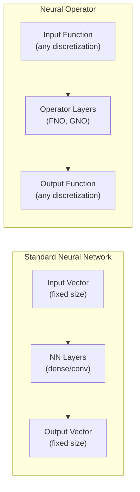
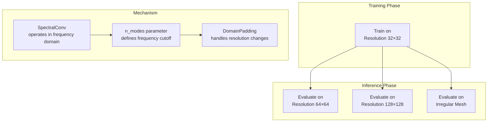
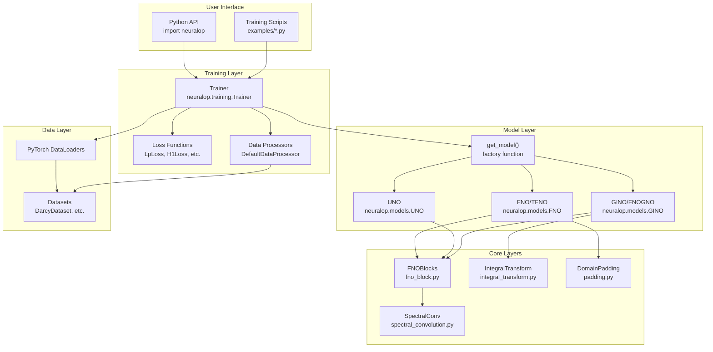
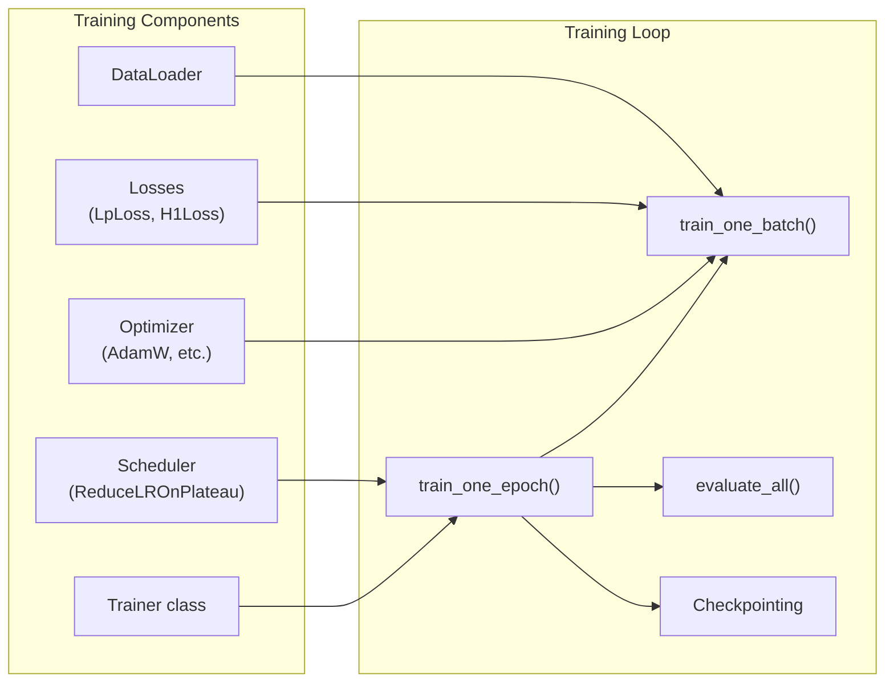
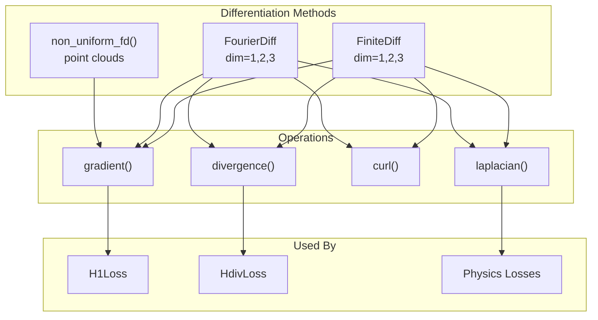
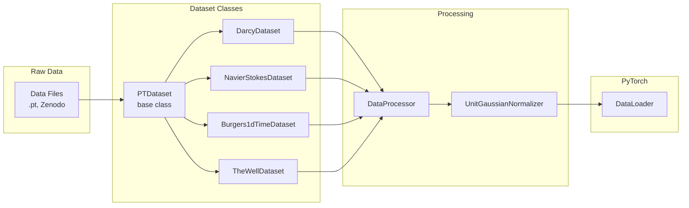

<!-- source: DeepWiki mcp.deepwiki.com · repo neuraloperator/neuraloperator · page 1 Overview · fetched 2026-10-21 -->

# Overview

<details>
<summary>Relevant source files</summary>

The following files were used as context for generating this wiki page:

- [README.rst](README.rst)
- [doc/source/conf.py](doc/source/conf.py)
- [doc/source/index.rst](doc/source/index.rst)
- [doc/source/install.rst](doc/source/install.rst)
- [neuralop/__init__.py](neuralop/__init__.py)
- [neuralop/losses/__init__.py](neuralop/losses/__init__.py)
- [neuralop/losses/data_losses.py](neuralop/losses/data_losses.py)
- [neuralop/losses/differentiation.py](neuralop/losses/differentiation.py)
- [neuralop/losses/equation_losses.py](neuralop/losses/equation_losses.py)
- [neuralop/losses/meta_losses.py](neuralop/losses/meta_losses.py)
- [neuralop/losses/tests/test_losses.py](neuralop/losses/tests/test_losses.py)

</details>


## Purpose and Scope

This document introduces the `neuraloperator` library and its core concepts. It explains what neural operators are, how they differ from standard neural networks, and provides an architectural overview of the library's main capabilities and components.

For detailed installation instructions, see [Installation](#1.1). For a hands-on tutorial on using the library, see [Quickstart Guide](#1.2). For detailed documentation of specific model architectures, see [Neural Operator Models](#2). For training infrastructure details, see [Training Infrastructure](#4).

**Sources:** [doc/source/index.rst:32-43](), [README.rst:13-24]()

---

## What are Neural Operators?

Neural operators are neural networks that learn mappings between **function spaces** rather than finite-dimensional vector spaces. Unlike traditional neural networks that map vectors to vectors (e.g., ℝⁿ → ℝᵐ), neural operators learn to map entire functions to functions (e.g., L²(Ω) → L²(Ω)).

### Conceptual Comparison



### Key Advantages

| Standard Neural Networks | Neural Operators |
|-------------------------|------------------|
| Fixed input/output resolution | **Resolution invariant** |
| Require retraining for different discretizations | Same model works across resolutions |
| Local receptive fields | **Global receptive fields** (via spectral methods) |
| Grid-dependent | Can handle irregular geometries (via GNO) |

**Example Use Case:** A neural operator trained on 64×64 grids can be directly evaluated on 128×128 or 256×256 grids without retraining. This is achieved through spectral convolutions that operate in the frequency domain, independent of spatial resolution.

**Sources:** [doc/source/index.rst:37-42](), [README.rst:18-23]()

---

## Resolution Invariance

Resolution invariance is a fundamental property of neural operators that distinguishes them from traditional convolutional neural networks.

### How Resolution Invariance Works



**Key Implementation Details:**

- **SpectralConv** ([neuralop/layers/spectral_convolution.py]()): Operates in frequency domain via FFT. The `n_modes` parameter specifies how many Fourier modes to retain, independent of input resolution.

- **DomainPadding** ([neuralop/layers/padding.py]()): Automatically adjusts padding based on input resolution to maintain consistent behavior across different discretizations.

- **Mode Selection**: The `n_modes` parameter (e.g., `n_modes=(16, 16)`) determines the frequency cutoff. This is resolution-independent—the same modes can be extracted from any resolution input.

**Sources:** [doc/source/index.rst:41-42](), [neuralop/__init__.py:3-4]()

---

## Library Architecture

The `neuraloperator` library is organized into five main functional layers:

### Component Hierarchy



**Sources:** [neuralop/__init__.py:1-8](), [doc/source/index.rst:32-43]()

---

## Main Library Capabilities

### 1. Model Architectures

The library provides multiple neural operator architectures for different problem types:

| Architecture | Class | Use Case | Key Feature |
|-------------|-------|----------|-------------|
| Fourier Neural Operator | `FNO`, `TFNO` | Regular grids, periodic domains | Spectral convolutions |
| U-shaped Neural Operator | `UNO` | Multi-scale problems | U-Net architecture with FNO blocks |
| Geometry-Informed NO | `GINO`, `FNOGNO` | Irregular meshes | Kernel integration on point clouds |
| Spherical FNO | `SFNO` | Spherical domains | Spherical harmonics |
| Local Neural Operator | `LocalNO` | Localized phenomena | Local convolutions |

All architectures share a common interface through the `BaseModel` class and can be instantiated via the `get_model()` factory function.

**Sources:** [neuralop/__init__.py:3](), [doc/source/index.rst:52-73]()

### 2. Training Infrastructure



The `Trainer` class ([neuralop/training/trainer.py]()) orchestrates the training process:
- Training loop with automatic batching
- Multi-resolution evaluation
- Mixed precision training
- Distributed data parallel support
- Checkpoint management
- Weights & Biases integration

**Sources:** [neuralop/__init__.py:6](), [doc/source/index.rst:97-111]()

### 3. Loss Functions

The library provides three categories of loss functions:

**Data Losses** (compare predictions to ground truth):
- `LpLoss`: Lp norm in function space with proper quadrature weights
- `H1Loss`: H1 Sobolev norm (includes derivatives)
- `HdivLoss`: Hdiv Sobolev norm (for vector fields)
- `MSELoss`: Mean squared error

**Physics-Informed Losses** (enforce PDE constraints):
- `BurgersEqnLoss`: Burgers' equation residual
- `ICLoss`: Initial condition loss
- `PoissonEqnLoss`: Poisson equation residual

**Meta Losses** (combine multiple objectives):
- `WeightedSumLoss`: Static weighted combination
- `SoftAdapt`: Adaptive weighting based on loss magnitudes
- `Relobralo`: Relative loss balancing with random lookback

**Sources:** [neuralop/__init__.py:7](), [neuralop/losses/__init__.py:1-4](), [neuralop/losses/data_losses.py:20-68]()

### 4. Differentiation Utilities

The library provides multiple methods for computing derivatives:

| Utility | Class | Method | Use Case |
|---------|-------|--------|----------|
| Finite Differences | `FiniteDiff` | Central/forward/backward differences | General purpose, any boundary conditions |
| Fourier Differentiation | `FourierDiff` | FFT-based spectral derivatives | Smooth functions, periodic/non-periodic |
| Non-uniform FD | `non_uniform_fd()` | Weighted least squares | Irregular grids, point clouds |



These utilities are used internally by loss functions (e.g., `H1Loss` uses `FiniteDiff` to compute gradients) and are also available for users to implement custom physics-informed losses.

**Sources:** [neuralop/losses/__init__.py:4](), [neuralop/losses/differentiation.py:11-91](), [neuralop/losses/data_losses.py:14]()

### 5. Data Management



Dataset classes inherit from `PTDataset` and provide:
- Automatic data loading from disk or Zenodo
- Train/test splitting
- Resolution subsampling
- Integration with `DataProcessor` for normalization

Example datasets include:
- `DarcyDataset`: 2D Darcy flow (permeability → pressure)
- `NavierStokesDataset`: 2D incompressible Navier-Stokes
- `Burgers1dTimeDataset`: 1D Burgers' equation time evolution
- `TheWellDataset`: Various physics simulations (MHD, active matter, etc.)

**Sources:** [neuralop/__init__.py:4](), [doc/source/index.rst:75-91]()

---

## Entry Points and Main Exports

The library can be imported as `neuralop` after installation. The main exports from [neuralop/__init__.py:1-8]() are:

```python
from neuralop import (
    # Models
    FNO, TFNO, get_model,
    
    # Training
    Trainer,
    
    # Losses
    LpLoss, H1Loss, 
    BurgersEqnLoss, ICLoss,
    WeightedSumLoss, Aggregator, Relobralo, SoftAdapt,
    
    # Differentiation
    FourierDiff, non_uniform_fd, FiniteDiff,
    
    # Data
    datasets, transforms
)
```

### Typical Usage Pattern

```python
# 1. Load data
train_loader, test_loaders, data_processor = load_darcy_flow_small(
    n_train=1000, batch_size=32
)

# 2. Create model
model = FNO(n_modes=(16, 16), hidden_channels=64,
            in_channels=3, out_channels=1)

# 3. Setup training
trainer = Trainer(model=model, n_epochs=20, 
                  data_processor=data_processor)

# 4. Train
trainer.train(train_loader=train_loader,
              test_loaders=test_loaders,
              optimizer=optimizer,
              training_loss=LpLoss(d=2))

# 5. Save model
model.save_checkpoint(save_folder='./checkpoints/', 
                      save_name='my_fno')
```

**Sources:** [doc/source/index.rst:52-111](), [README.rst:51-79]()

---

## Version and Citation

The library is currently at version 1.0.2 ([neuralop/__init__.py:1]()). When using this library in academic work, please cite:

1. Kossaifi, J., et al. (2024). "A Library for Learning Neural Operators", ArXiv 2412.10354.
2. Kovachki, N., et al. (2021). "Neural Operator: Learning Maps Between Function Spaces", JMLR.

**Sources:** [doc/source/index.rst:164-209](), [README.rst:174-209]()

---

