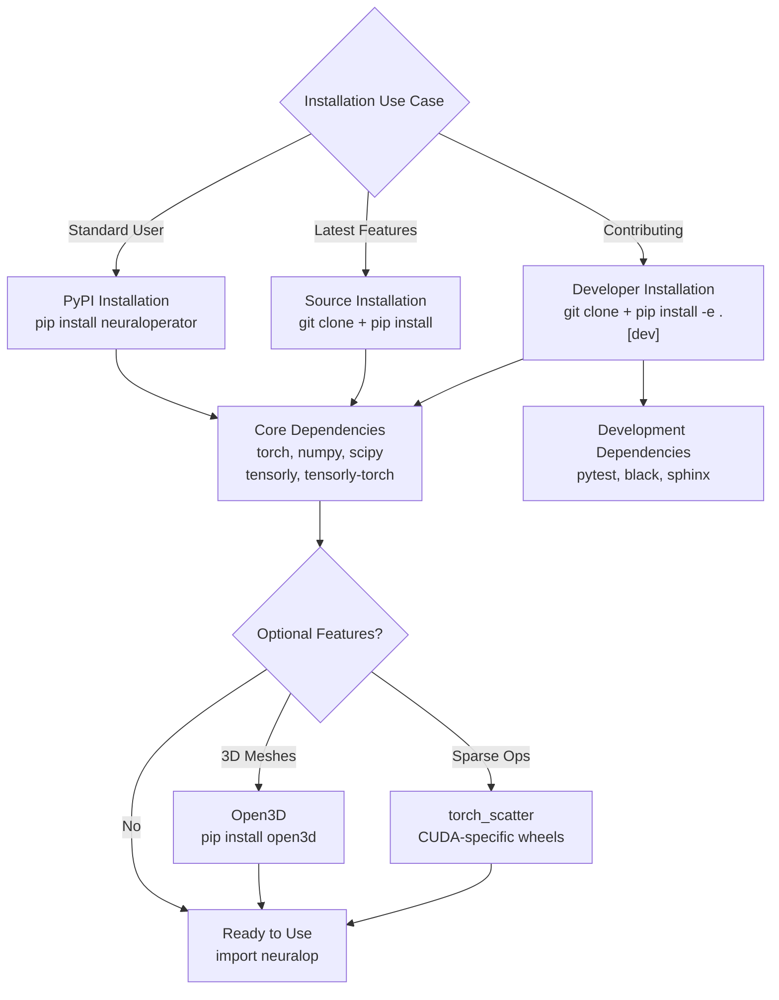
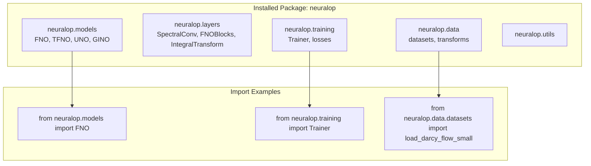
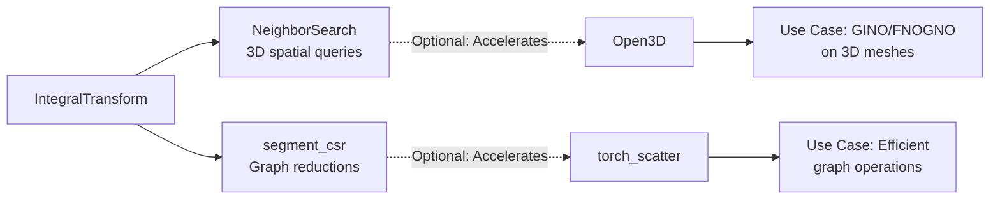
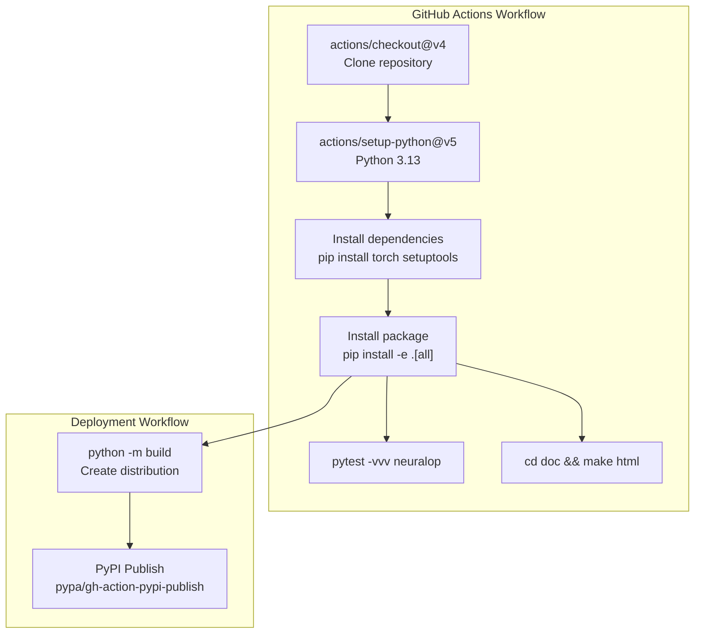
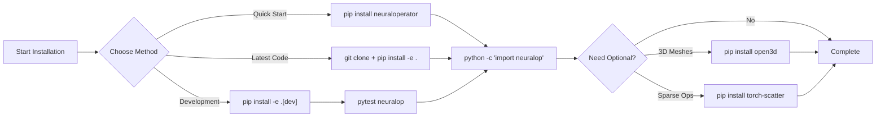

<!-- source: DeepWiki mcp.deepwiki.com · repo neuraloperator/neuraloperator · page 1.1 Installation · fetched 2026-10-21 -->

# Installation

<details>
<summary>Relevant source files</summary>

The following files were used as context for generating this wiki page:

- [.github/workflows/build_doc_dev.yml](.github/workflows/build_doc_dev.yml)
- [.github/workflows/deploy_pypi.yml](.github/workflows/deploy_pypi.yml)
- [.github/workflows/test.yml](.github/workflows/test.yml)
- [README.rst](README.rst)
- [constraints.txt](constraints.txt)
- [doc/source/conf.py](doc/source/conf.py)
- [doc/source/index.rst](doc/source/index.rst)
- [doc/source/install.rst](doc/source/install.rst)

</details>


This page provides instructions for installing the `neuraloperator` library for both standard use and development. It covers basic installation via pip, building from source, and optional dependencies for advanced features.

For information on getting started with the library after installation, see [Quickstart Guide](#1.2). For details on the development workflow and testing, see [Developer Guide](#8).

---

## Installation Overview

The `neuraloperator` library is distributed as a Python package named `neuraloperator` and imported as `neuralop`. Installation can be accomplished through multiple methods depending on your use case.



**Diagram: Installation pathways and dependencies**

Sources: [doc/source/install.rst:1-179](), [README.rst:26-46]()

---

## Basic Installation

### Prerequisites

The library requires Python 3.9 or higher and the following core dependencies:

| Dependency | Purpose | Installation Method |
|------------|---------|---------------------|
| `torch` | Deep learning framework | See PyTorch website for platform-specific instructions |
| `numpy` | Numerical computing | Automatically installed with PyTorch |
| `scipy` | Scientific computing | `pip install scipy` |
| `tensorly` | Tensor operations | `pip install tensorly` |
| `tensorly-torch` | PyTorch tensor backends | `pip install tensorly-torch` |
| `torch_harmonics` | Spherical harmonics (>=0.7) | `pip install torch_harmonics>=0.7` |

Sources: [doc/source/install.rst:16-22](), [constraints.txt:1-2]()

### Installation via pip

The simplest installation method uses the PyPI release:

```bash
pip install neuraloperator
```

This installs the most recent stable release. The package is imported as `neuralop`:

```python
import neuralop
from neuralop.models import FNO
```

To upgrade an existing installation:

```bash
pip install -U neuraloperator
```

Sources: [doc/source/install.rst:25-36](), [README.rst:39-45]()

### Installation from Source

For the latest development features or to contribute to the project, install from the GitHub repository:

```bash
git clone https://github.com/neuraloperator/neuraloperator
cd neuraloperator
pip install -r requirements.txt
pip install -e .
```

The `-e` flag installs in editable mode, meaning changes to the source code are immediately reflected without reinstallation.

Sources: [doc/source/install.rst:39-57](), [README.rst:29-37]()

---

## Package Structure After Installation



**Diagram: Installed package structure and import paths**

Sources: [doc/source/install.rst:1-9](), [README.rst:56-59]()

---

## Optional Dependencies

### Open3D for 3D Spatial Computing

The `Open3D` library accelerates spatial operations for 3D mesh applications, including fast neighbor search and mesh file I/O. It is used by geometry-informed neural operators (GINO/FNOGNO).

**Installation:**

```bash
pip install open3d
```

**Compatibility Note:** Open3D requires specific PyTorch and CUDA builds. Consult the [Open3D-ML documentation](https://github.com/isl-org/Open3D-ML) for compatibility details.

**Code Usage:** Open3D enables features in [neuralop/layers/neighbor_search.py]() for 3D neighbor queries in `IntegralTransform` layers.

Sources: [doc/source/install.rst:63-76]()

### torch_scatter for Efficient Sparse Operations

The `torch_scatter` package provides compiled CUDA kernels for efficient scatter/gather operations used in `IntegralTransform` during graph-based reductions.

**Installation Challenges:**

`torch_scatter` wheels are precompiled for specific OS/PyTorch/CUDA combinations. Installation requires matching your environment exactly.

1. **Check your PyTorch version:**
   ```bash
   python -c "import torch; print(torch.__version__)"
   ```

2. **Downgrade if necessary** (torch_scatter only supports up to PyTorch 2.5.1 as of early 2025):
   ```bash
   pip install -U torch==2.5.1
   ```

3. **Install matching torch_scatter wheel** from [https://data.pyg.org/whl/](https://data.pyg.org/whl/):
   ```bash
   pip install torch-scatter -f https://data.pyg.org/whl/torch-2.5.1+cu121.html
   ```
   
   Replace `torch-2.5.1+cu121` with your specific PyTorch and CUDA versions.

**Code Usage:** torch_scatter accelerates the `segment_csr` function in [neuralop/layers/integral_transform.py]() used by `GNOBlock`.

Sources: [doc/source/install.rst:79-103]()



**Diagram: Optional dependencies and their use in the codebase**

Sources: [doc/source/install.rst:63-103]()

---

## Developer Installation

### Setting Up a Development Environment

For contributors, we recommend using a virtual environment to isolate dependencies:

```bash
# Clone your fork
git clone https://github.com/YOURNAME/neuraloperator.git
cd neuraloperator

# Create and activate virtual environment
python -m venv .venv
source .venv/bin/activate  # On Windows: .venv\Scripts\activate

# Install PyTorch (adjust for your CUDA version)
pip install torch torchvision --extra-index-url https://download.pytorch.org/whl/cu121

# Install package with development dependencies
pip install -e .[dev]
```

The `[dev]` extra includes testing and documentation tools:

| Package | Purpose |
|---------|---------|
| `pytest` | Unit testing framework |
| `black` | Code formatting |
| `sphinx` | Documentation generation |
| Additional doc dependencies | `sphinx-gallery`, `tensorly-sphinx-theme`, etc. |

Sources: [doc/source/install.rst:106-154](), [README.rst:111-122]()

### Verification

After installation, verify the package is correctly installed:

```bash
python -c "import neuralop; print(neuralop.__version__)"
```

Expected output: Version string (e.g., `0.3.0`)

To run the test suite:

```bash
pytest -v neuralop
```

Sources: [doc/source/install.rst:143-153](), [README.rst:136-147]()

---

## CI/CD Installation Process

The GitHub Actions workflows demonstrate the complete installation process used in continuous integration:



**Diagram: CI/CD installation and deployment pipeline**

The workflows install dependencies and the package using the following sequence:

1. **Core Dependencies:** [.github/workflows/test.yml:32-33]()
   ```yaml
   python -m pip install torch torchvision torchaudio
   ```

2. **Package Installation:** [.github/workflows/test.yml:36-37]()
   ```yaml
   python -m pip install -e .[dev]
   ```

3. **Building for PyPI:** [.github/workflows/deploy_pypi.yml:28-30]()
   ```yaml
   python -m build
   ```

Sources: [.github/workflows/test.yml:1-41](), [.github/workflows/deploy_pypi.yml:1-114](), [.github/workflows/build_doc_dev.yml:1-69]()

---

## Installation Troubleshooting

### Common Issues

| Issue | Solution |
|-------|----------|
| **Import error: `No module named 'neuralop'`** | The package is imported as `neuralop`, not `neuraloperator` |
| **PyTorch version mismatch** | Ensure PyTorch is installed before `neuraloperator`: `pip install torch` then `pip install neuraloperator` |
| **torch_scatter installation fails** | Check PyTorch version compatibility and use correct wheel from [https://data.pyg.org/whl/](https://data.pyg.org/whl/) |
| **Open3D conflicts** | Open3D requires specific PyTorch/CUDA builds; see [Open3D-ML compatibility](https://github.com/isl-org/Open3D-ML) |
| **Documentation build fails** | Install doc dependencies: `cd doc && pip install -r requirements_doc.txt` |

Sources: [doc/source/install.rst:1-179](), [README.rst:26-122]()

---

## Summary



**Diagram: Installation decision tree**

After completing installation, proceed to the [Quickstart Guide](#1.2) to begin using the library, or consult the [API Reference](#7) for detailed module documentation.

Sources: [doc/source/install.rst:1-179](), [README.rst:26-122](), [doc/source/index.rst:44-112]()

---

