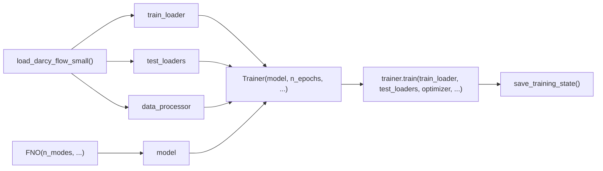
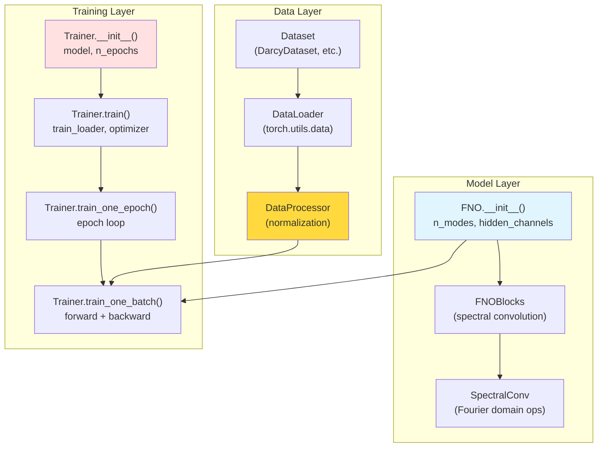
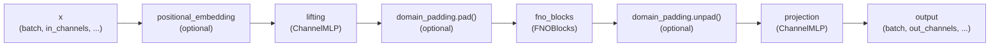

<!-- source: DeepWiki mcp.deepwiki.com · repo neuraloperator/neuraloperator · page 1.2 Quickstart Guide · fetched 2026-10-21 -->

# Quickstart Guide

<details>
<summary>Relevant source files</summary>

The following files were used as context for generating this wiki page:

- [README.rst](README.rst)
- [doc/source/conf.py](doc/source/conf.py)
- [doc/source/index.rst](doc/source/index.rst)
- [doc/source/install.rst](doc/source/install.rst)
- [neuralop/layers/fno_block.py](neuralop/layers/fno_block.py)
- [neuralop/models/fno.py](neuralop/models/fno.py)
- [neuralop/training/__init__.py](neuralop/training/__init__.py)
- [neuralop/training/trainer.py](neuralop/training/trainer.py)

</details>


This guide walks through a minimal, complete example of training a Fourier Neural Operator (FNO) on PDE data using the neuraloperator library. You will learn how to load data, create a model, train it, and save/load checkpoints.

For installation instructions, see [Installation](#1.1). For more examples, see [Example Training Scripts](#5).

## Installation Reminder

Before starting, ensure you have installed the library:

```bash
pip install neuraloperator
```

Or install from source for the latest version (see [Installation](#1.1) for details).

## Minimal Training Example

This example demonstrates the complete workflow for training an FNO on the Darcy flow problem, a standard benchmark in operator learning.

**Minimal Training Pipeline**



Sources: [neuralop/training/trainer.py:25-67](), [neuralop/models/fno.py:24-167](), [doc/source/index.rst:44-112]()

### Step 1: Import Required Modules

```python
import torch
from neuralop.models import FNO
from neuralop.data.datasets import load_darcy_flow_small
from neuralop.training import Trainer
from neuralop.losses import LpLoss, H1Loss
```

Sources: [neuralop/models/fno.py:1-22](), [neuralop/training/__init__.py:1-5]()

### Step 2: Load Data

The library provides a built-in Darcy flow dataset loader that returns PyTorch `DataLoader` objects and a `DataProcessor` for normalization:

```python
train_loader, test_loaders, data_processor = load_darcy_flow_small(
    n_train=1000,           # Number of training samples
    batch_size=32,          # Training batch size
    test_resolutions=[32],  # Test at resolution 32x32
    n_tests=[100],          # 100 test samples
    test_batch_sizes=[32],  # Test batch size
)
```

The function returns:
- `train_loader`: A `torch.utils.data.DataLoader` for training data
- `test_loaders`: A dictionary of test loaders (keyed by resolution)
- `data_processor`: Handles normalization/denormalization automatically

Sources: [doc/source/index.rst:75-88](), [README.rst:48-60]()

### Step 3: Create an FNO Model

Create a 2D Fourier Neural Operator:

```python
model = FNO(
    n_modes=(16, 16),       # Number of Fourier modes to keep in each dimension
    hidden_channels=64,     # Width of hidden layers
    in_channels=3,          # Input channels (2 coords + 1 coefficient field)
    out_channels=1,         # Output channels (solution field)
    n_layers=4              # Number of FNO layers
)
```

Key parameters:
- `n_modes`: Controls frequency resolution; higher values capture finer details but increase computation
- `hidden_channels`: Width of the network; affects model capacity
- `in_channels`/`out_channels`: Match your data dimensions
- `n_layers`: Depth of the FNO; typically 4-8 layers

Sources: [neuralop/models/fno.py:24-200](), [doc/source/index.rst:52-60]()

### Step 4: Setup Training

Configure the optimizer and loss functions:

```python
# Optimizer
optimizer = torch.optim.AdamW(
    model.parameters(),
    lr=1e-3,
    weight_decay=1e-4
)

# Learning rate scheduler
scheduler = torch.optim.lr_scheduler.CosineAnnealingLR(
    optimizer, T_max=50
)

# Loss functions
train_loss = LpLoss(d=2, p=2)  # L2 loss for training
eval_losses = {
    'l2': LpLoss(d=2, p=2),    # L2 error
    'h1': H1Loss(d=2)          # H1 error (includes derivatives)
}
```

Sources: [neuralop/training/trainer.py:171-182]()

### Step 5: Create Trainer and Run Training

Initialize the `Trainer` class and call `train()`:

```python
# Create trainer
trainer = Trainer(
    model=model,
    n_epochs=20,
    data_processor=data_processor,
    device='cuda',           # or 'cpu'
    verbose=True
)

# Train the model
trainer.train(
    train_loader=train_loader,
    test_loaders=test_loaders,
    optimizer=optimizer,
    scheduler=scheduler,
    training_loss=train_loss,
    eval_losses=eval_losses
)
```

The `Trainer.train()` method handles:
- Training loop over epochs
- Forward/backward passes
- Optimizer and scheduler steps
- Evaluation on test sets
- Progress logging

Sources: [neuralop/training/trainer.py:96-254](), [doc/source/index.rst:95-112]()

### Step 6: Save and Load Checkpoints

Save the trained model:

```python
from neuralop.training import save_training_state

save_training_state(
    save_dir='./checkpoints',
    save_name='my_fno_model',
    model=model,
    optimizer=optimizer,
    scheduler=scheduler,
    epoch=trainer.epoch
)
```

Load the model later:

```python
from neuralop.training import load_training_state

model, optimizer, scheduler, _, resume_epoch = load_training_state(
    save_dir='./checkpoints',
    save_name='my_fno_model',
    model=model,
    optimizer=optimizer,
    scheduler=scheduler
)
```

The checkpoint includes the full training state, allowing you to resume training from where you left off.

Sources: [neuralop/training/trainer.py:729-791](), [neuralop/training/__init__.py:3]()

## Understanding the Core Components

The training workflow involves several key classes that work together:

**Component Interaction Diagram**



Sources: [neuralop/training/trainer.py:25-67](), [neuralop/models/fno.py:24-167](), [neuralop/layers/fno_block.py:18-96]()

### Trainer Class

The `Trainer` class ([neuralop/training/trainer.py:25-791]()) orchestrates the training process. Key methods:

| Method | Purpose | Key Parameters |
|--------|---------|----------------|
| `__init__()` | Initialize trainer | `model`, `n_epochs`, `data_processor`, `device` |
| `train()` | Main training loop | `train_loader`, `test_loaders`, `optimizer`, `scheduler`, `training_loss`, `eval_losses` |
| `train_one_epoch()` | Single epoch training | `epoch`, `train_loader`, `training_loss` |
| `evaluate()` | Model evaluation | `loss_dict`, `data_loader` |
| `checkpoint()` | Save training state | `save_dir` |

The trainer handles:
- Epoch loops and batch processing ([neuralop/training/trainer.py:225-254]())
- Automatic mixed precision training ([neuralop/training/trainer.py:489-507]())
- Data preprocessing/postprocessing ([neuralop/training/trainer.py:474-499]())
- Evaluation across multiple test sets ([neuralop/training/trainer.py:327-365]())
- Checkpoint management ([neuralop/training/trainer.py:765-791]())

Sources: [neuralop/training/trainer.py:25-791]()

### FNO Model

The `FNO` class ([neuralop/models/fno.py:24-413]()) implements the Fourier Neural Operator architecture:

**FNO Forward Pass**



Components:
- `positional_embedding`: Adds grid coordinates ([neuralop/models/fno.py:235-257]())
- `lifting`: Projects input to hidden dimension ([neuralop/models/fno.py:305-331]())
- `domain_padding`: Pads domain for better boundary handling ([neuralop/models/fno.py:259-268]())
- `fno_blocks`: Core Fourier layers ([neuralop/models/fno.py:277-302]())
- `projection`: Projects to output dimension ([neuralop/models/fno.py:333-342]())

Sources: [neuralop/models/fno.py:344-403](), [neuralop/layers/fno_block.py:18-378]()

### FNOBlocks

The `FNOBlocks` class ([neuralop/layers/fno_block.py:18-411]()) implements the sequence of Fourier layers:

Each block performs:
1. Spectral convolution in Fourier domain ([neuralop/layers/fno_block.py:311-312]())
2. Skip connection ([neuralop/layers/fno_block.py:298-317]())
3. Non-linear activation ([neuralop/layers/fno_block.py:319-320]())
4. Optional channel MLP ([neuralop/layers/fno_block.py:322-323]())

Sources: [neuralop/layers/fno_block.py:291-331]()

### DataProcessor

The `DataProcessor` handles normalization:
- `preprocess()`: Normalizes inputs before model forward pass ([neuralop/training/trainer.py:474-475]())
- `postprocess()`: Denormalizes outputs for evaluation ([neuralop/training/trainer.py:498-499]())

This ensures the model trains on standardized data while evaluations occur in the original scale.

Sources: [neuralop/training/trainer.py:44-45](), [neuralop/training/trainer.py:474-499]()

## Complete Working Example

Here is a complete, runnable script that ties everything together:

```python
import torch
from neuralop.models import FNO
from neuralop.data.datasets import load_darcy_flow_small
from neuralop.training import Trainer
from neuralop.losses import LpLoss, H1Loss

# Set device
device = 'cuda' if torch.cuda.is_available() else 'cpu'

# Load data
train_loader, test_loaders, data_processor = load_darcy_flow_small(
    n_train=1000,
    batch_size=32,
    test_resolutions=[32],
    n_tests=[100],
    test_batch_sizes=[32]
)

# Create model
model = FNO(
    n_modes=(16, 16),
    hidden_channels=64,
    in_channels=3,
    out_channels=1,
    n_layers=4
).to(device)

# Setup training
optimizer = torch.optim.AdamW(model.parameters(), lr=1e-3, weight_decay=1e-4)
scheduler = torch.optim.lr_scheduler.CosineAnnealingLR(optimizer, T_max=20)
train_loss = LpLoss(d=2, p=2)
eval_losses = {'l2': LpLoss(d=2, p=2), 'h1': H1Loss(d=2)}

# Create trainer and train
trainer = Trainer(
    model=model,
    n_epochs=20,
    data_processor=data_processor,
    device=device,
    verbose=True
)

trainer.train(
    train_loader=train_loader,
    test_loaders=test_loaders,
    optimizer=optimizer,
    scheduler=scheduler,
    training_loss=train_loss,
    eval_losses=eval_losses
)

# Save checkpoint
from neuralop.training import save_training_state
save_training_state(
    save_dir='./checkpoints',
    save_name='fno_darcy',
    model=model,
    optimizer=optimizer,
    scheduler=scheduler,
    epoch=trainer.epoch
)
```

This script trains an FNO on the Darcy flow problem for 20 epochs and saves the final checkpoint.

Sources: [doc/source/index.rst:44-131](), [README.rst:48-78]()

## Next Steps

- Explore different neural operator architectures in [Neural Operator Models](#2)
- Learn about advanced training configurations in [Training Infrastructure](#4)
- Study complete examples for specific PDEs in [Example Training Scripts](#5)
- Understand the core building blocks in [Core Layers and Components](#3)

---

