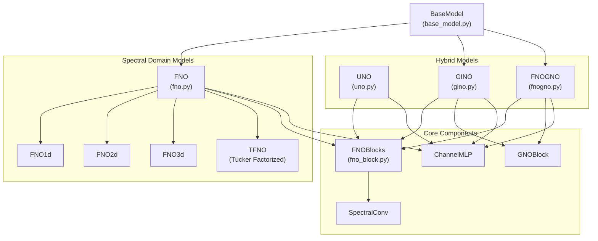
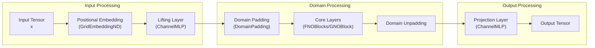

<!-- source: DeepWiki mcp.deepwiki.com · repo neuraloperator/neuraloperator · page 2 Neural Operator Models · fetched 2026-10-21 -->

# Neural Operator Models

<details>
<summary>Relevant source files</summary>

The following files were used as context for generating this wiki page:

- [doc/source/modules/api.rst](doc/source/modules/api.rst)
- [neuralop/layers/fno_block.py](neuralop/layers/fno_block.py)
- [neuralop/models/fno.py](neuralop/models/fno.py)
- [neuralop/models/fnogno.py](neuralop/models/fnogno.py)
- [neuralop/models/gino.py](neuralop/models/gino.py)

</details>


This page provides an overview of all neural operator architectures available in the neuraloperator library. Neural operators are deep learning models that learn mappings between function spaces, providing resolution-invariant solutions to parametric partial differential equations (PDEs).

For detailed implementation of individual model architectures, see [FNO Models](#2.1), [UNO Models](#2.2), [GINO/FNOGNO Models](#2.3), [SFNO Models](#2.4), and [Local Neural Operators](#2.5). For information about the core building blocks these models use, see [Core Layers and Components](#3). For training these models, see [Training Infrastructure](#4).

## Model Architecture Overview

The neuraloperator library implements several neural operator architectures, all inheriting from `BaseModel` and sharing common building blocks. The models differ primarily in their approach to handling geometry, domain structure, and multi-scale processing.

### Core Model Hierarchy



Sources: [neuralop/models/fno.py:18-161](), [neuralop/models/uno.py:13-101](), [neuralop/models/gino.py:15-165](), [neuralop/models/fnogno.py:13-133](), [neuralop/layers/fno_block.py:18-96]()

## Forward Pass Architecture

All neural operator models in the library follow a common forward pass pattern that can be broken down into standardized stages. This design enables consistent behavior across different architectures while allowing for model-specific customizations.

### Standard Forward Pass Pipeline



Sources: [neuralop/models/fno.py:336-388](), [neuralop/models/uno.py:305-346](), [neuralop/models/gino.py:398-525]()

## Model Characteristics and Use Cases

### FNO Family
The Fourier Neural Operator (`FNO`) class and its dimensional variants (`FNO1d`, `FNO2d`, `FNO3d`) operate in the frequency domain using `SpectralConv` layers. These models excel at problems with periodic or quasi-periodic structure.

**Key Parameters:**
- `n_modes`: Number of Fourier modes to retain per dimension
- `hidden_channels`: Width of the network
- `n_layers`: Number of spectral convolution layers
- `factorization`: Optional tensor decomposition (`"Tucker"` for `TFNO`)

### UNO (U-shaped Neural Operator)
The `UNO` class implements a U-Net-like architecture with multi-resolution processing through horizontal skip connections and scaling factors.

**Key Parameters:**
- `uno_out_channels`: Channel progression through layers
- `uno_n_modes`: Mode configuration per layer
- `uno_scalings`: Resolution scaling factors per layer
- `horizontal_skips_map`: Skip connection configuration

### GINO (Geometry-Informed Neural Operator)
The `GINO` class handles irregular geometries by combining GNO (Graph Neural Operator) blocks with FNO processing in a latent space.

**Key Architecture:**
- Input GNO: Maps irregular input geometry to regular latent grid
- FNO Blocks: Process in regular latent space
- Output GNO: Maps from latent grid to irregular output queries

### FNOGNO (Fourier/Geometry Neural Operator)
The `FNOGNO` class maps from regular grids to arbitrary point clouds, combining the efficiency of FNO with the flexibility of GNO for output queries.

## Model Registration and Factory

All models register with the `BaseModel` system using the `name` parameter in class definitions. The library provides a factory function for model instantiation:

```python
# Model registration examples from the codebase:
class FNO(BaseModel, name='FNO')  # neuralop/models/fno.py:18
class FNOGNO(BaseModel, name="FNOGNO")  # neuralop/models/fnogno.py:13
```

The `get_model()` dispatcher function (referenced in the high-level architecture) enables dynamic model creation based on configuration.

Sources: [neuralop/models/fno.py:18](), [neuralop/models/fnogno.py:13](), [neuralop/models/base_model.py]()

## Shared Configuration Patterns

All models share common configuration patterns for:

**Lifting and Projection:**
- `lifting_channels` / `lifting_channel_ratio`: Input dimension expansion
- `projection_channels` / `projection_channel_ratio`: Output dimension reduction

**Training Behavior:**
- `channel_mlp_dropout`: Regularization in channel mixing layers
- `non_linearity`: Activation function (typically `F.gelu`)
- `complex_data`: Enable complex-valued computation

**Advanced Features:**
- `factorization`: Tensor compression techniques
- `domain_padding`: Boundary condition handling  
- `resolution_scaling_factor`: Multi-resolution support

Sources: [neuralop/models/fno.py:163-195](), [neuralop/models/uno.py:103-136](), [neuralop/models/gino.py:166-219](), [neuralop/models/fnogno.py:135-182]()

---

