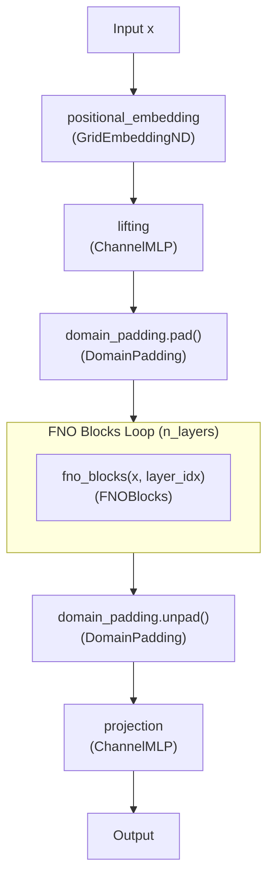
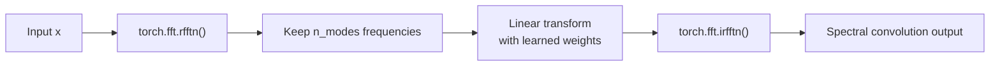
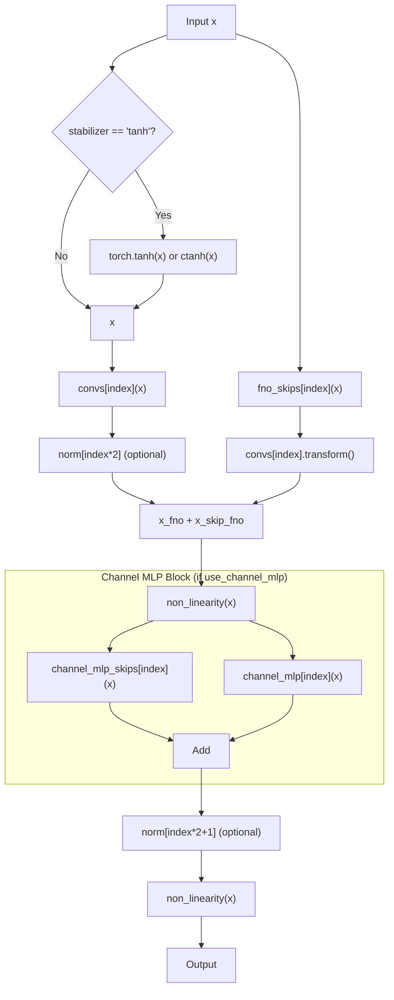
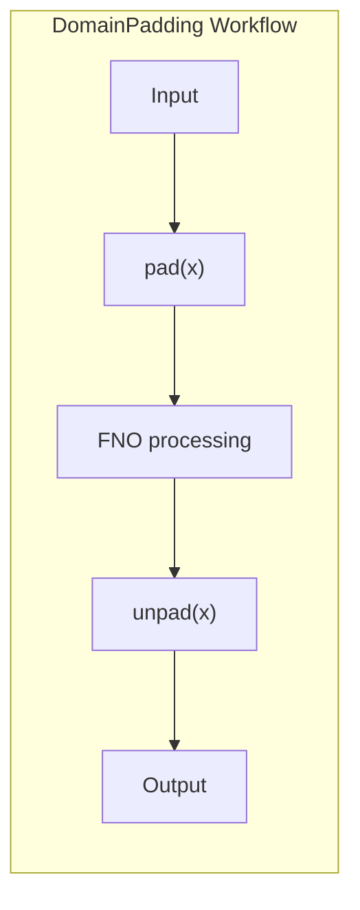
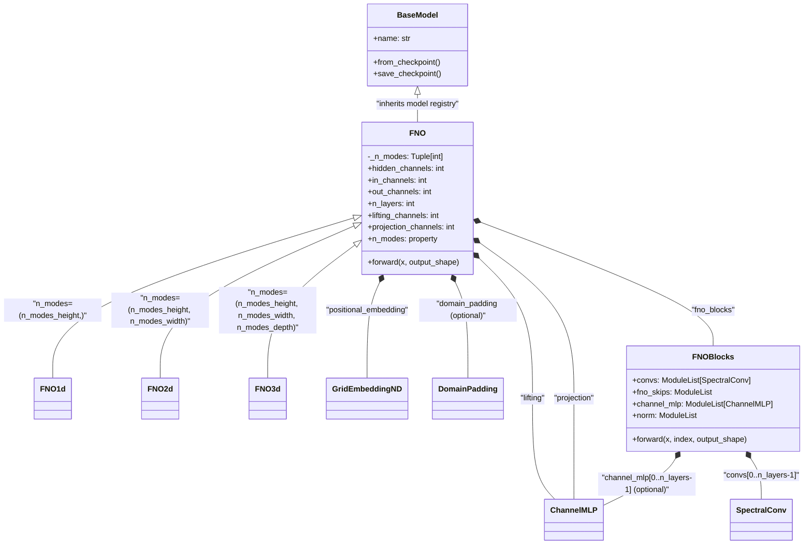

<!-- source: DeepWiki mcp.deepwiki.com · repo neuraloperator/neuraloperator · page 2.1 Fourier Neural Operators (FNO) · fetched 2026-10-21 -->

# Fourier Neural Operators (FNO)

<details>
<summary>Relevant source files</summary>

The following files were used as context for generating this wiki page:

- [doc/source/modules/api.rst](doc/source/modules/api.rst)
- [neuralop/layers/fno_block.py](neuralop/layers/fno_block.py)
- [neuralop/models/fno.py](neuralop/models/fno.py)
- [neuralop/models/fnogno.py](neuralop/models/fnogno.py)
- [neuralop/models/gino.py](neuralop/models/gino.py)

</details>


## Purpose and Scope

This document provides comprehensive documentation of Fourier Neural Operators (FNO) and Tensor-Factorized Neural Operators (TFNO), including architecture details, implementation specifics, and usage examples. FNOs learn mappings between function spaces using spectral convolutions in the Fourier domain, enabling resolution-invariant learning for partial differential equations (PDEs). TFNOs extend FNOs with tensor factorization for improved parameter efficiency.

## Introduction to Fourier Neural Operators

Fourier Neural Operators (FNOs) learn operators that map between infinite-dimensional function spaces using spectral convolutions. The `FNO` class implements N-dimensional FNOs that discretize functions over regular grids and perform convolutions in the Fourier domain via the `SpectralConv` layer.

Key capabilities of FNOs:

1. **Resolution Invariance**: Learn operators that generalize across different grid resolutions
2. **Global Information Processing**: Fourier domain operations capture long-range dependencies
3. **Computational Efficiency**: Fast inference compared to traditional numerical solvers
4. **Parameter Sharing**: Same operator can be applied to different discretization resolutions

The FNO architecture centers around the `SpectralConv` layer, which transforms inputs to frequency domain, applies learned linear transformations, and transforms back to spatial domain. This allows global convolution operations with computational complexity independent of kernel size.

Sources: [neuralop/models/fno.py:18-161]()

## FNO Architecture Overview

FNO Architecture Components



The `FNO.forward()` method implements this processing pipeline:

1. **`positional_embedding`**: Optional `GridEmbeddingND` adds spatial coordinates to input channels
2. **`lifting`**: `ChannelMLP` projects input to `hidden_channels` dimensional latent space  
3. **`domain_padding.pad()`**: Optional `DomainPadding` to mitigate boundary artifacts
4. **`fno_blocks`**: Sequence of `FNOBlocks` performing spectral convolutions and skip connections
5. **`domain_padding.unpad()`**: Removes padding if applied
6. **`projection`**: `ChannelMLP` maps latent representation to `out_channels`

The dimensionality is inferred from `len(n_modes)`, making the implementation flexible for 1D, 2D, 3D, and higher-dimensional problems.

Sources: [neuralop/models/fno.py:336-388]()

## Key Components

### Spectral Convolution Layer

The `SpectralConv` layer implements the core Fourier domain convolutions used in FNO blocks.

SpectralConv Operation Flow



The `SpectralConv` performs global convolution in Fourier domain:

1. **FFT Transform**: Convert input to frequency domain using `torch.fft.rfftn()`
2. **Mode Truncation**: Retain only the first `n_modes` frequencies in each dimension
3. **Linear Transform**: Apply learned weight matrices to frequency coefficients
4. **Inverse FFT**: Transform back to spatial domain using `torch.fft.irfftn()`

This enables global receptive fields with O(N log N) complexity instead of O(N²) for spatial convolutions. The `n_modes` parameter controls the frequency bandwidth and model capacity.

Sources: [neuralop/models/fno.py:24-25](), [neuralop/layers/fno_block.py:164-180]()

### FNO Blocks

The `FNOBlocks` class implements sequences of Fourier layers with skip connections and optional channel mixing.

FNO Block Forward Pass (Post-activation)



Key `FNOBlocks` components:

1. **`convs`**: `ModuleList` of `SpectralConv` layers for Fourier domain operations
2. **`fno_skips`**: Skip connections for residual learning (`linear`, `identity`, or `soft-gating`)
3. **`channel_mlp`**: Optional `ChannelMLP` for additional channel mixing
4. **`norm`**: Optional normalization (`instance_norm`, `group_norm`, `batch_norm`, `ada_in`)
5. **`stabilizer`**: Optional `tanh` stabilization for numerical stability

The block supports both post-activation (default) and pre-activation modes via the `preactivation` parameter.

Sources: [neuralop/layers/fno_block.py:18-96](), [neuralop/layers/fno_block.py:293-327]()

### Domain Padding

The `DomainPadding` class mitigates boundary artifacts from Fourier transforms for non-periodic domains.



Domain padding configuration:
- **`domain_padding`**: Percentage of padding per dimension (float or list)
- **`resolution_scaling_factor`**: Coordinates padding with resolution changes
- Applied when `domain_padding > 0` in FNO constructor

The padding is particularly important for non-periodic boundary conditions where Fourier transforms can introduce artifacts.

### Positional Embedding

The `positional_embedding` parameter configures spatial coordinate information:

| Configuration | Behavior |
|---------------|----------|
| `"grid"` (default) | Creates `GridEmbeddingND` with boundaries `[[0,1]] * n_dim` |
| `GridEmbeddingND` instance | Uses provided embedding module |
| `GridEmbedding2D` instance | Uses for 2D problems only |
| `None` | No positional embedding |

The embedding appends `n_dim` coordinate channels to the input, which are processed by the lifting layer.

Sources: [neuralop/models/fno.py:231-247](), [neuralop/models/fno.py:249-259](), [neuralop/models/fno.py:377-384]()

## FNO Variants by Dimensionality

The library provides dimension-specific FNO subclasses and tensor-factorized variants:

### Standard FNO Variants

| Class | Dimensions | Parameters | Use Cases |
|-------|------------|------------|-----------|
| `FNO1d` | 1D | `n_modes_height` | Burgers equation, 1D advection |
| `FNO2d` | 2D | `n_modes_height`, `n_modes_width` | Darcy flow, 2D Navier-Stokes |
| `FNO3d` | 3D | `n_modes_height`, `n_modes_width`, `n_modes_depth` | 3D problems, 2D+time evolution |

### Tensor-Factorized FNO Variants

Tensor-factorized variants use Tucker decomposition for parameter efficiency:

| Class | Base Class | Factorization |
|-------|------------|---------------|
| `TFNO` | `FNO` | `factorization="Tucker"` |
| `TFNO1d` | `FNO1d` | `factorization="Tucker"` |
| `TFNO2d` | `FNO2d` | `factorization="Tucker"` |
| `TFNO3d` | `FNO3d` | `factorization="Tucker"` |

All variants inherit from the base `FNO` class and configure `n_modes` appropriately. TFNO variants are created using `partialclass()` to set default `factorization="Tucker"`.

Sources: [neuralop/models/fno.py:400-654]()

## Implementation Details

### Class Hierarchy and Component Relationships

FNO Class Structure



### Key Implementation Features

#### Channel Configuration
The FNO uses ratio-based channel sizing:
- `lifting_channels = lifting_channel_ratio * hidden_channels`
- `projection_channels = projection_channel_ratio * hidden_channels`

#### Complex Data Support
When `complex_data=True`:
- `lifting` and `projection` wrapped in `ComplexValued`
- `FNOBlocks` uses `CGELU` instead of standard activation
- Skip connections wrapped in `ComplexValued`

#### Dynamic n_modes Property
The `n_modes` property enables dynamic mode adjustment:
```python
@property
def n_modes(self):
    return self._n_modes

@n_modes.setter
def n_modes(self, n_modes):
    self.fno_blocks.n_modes = n_modes
    self._n_modes = n_modes
```

This propagates mode changes to all `SpectralConv` layers in `fno_blocks.convs`.

#### Tensor Factorization Support
TFNO variants are implemented using `partialclass()`:
- `TFNO = partialclass("TFNO", FNO, factorization="Tucker")`
- Reduces parameters through tensor decomposition in `SpectralConv` weights

Sources: [neuralop/models/fno.py:163-398](), [neuralop/models/fno.py:390-397](), [neuralop/models/fno.py:651-654]()

## Configuration and Parameters

### Core Architecture Parameters

| Parameter | Type | Default | Description |
|-----------|------|---------|-------------|
| `n_modes` | `Tuple[int, ...]` | Required | Fourier modes to keep per dimension |
| `in_channels` | `int` | Required | Input function channels |
| `out_channels` | `int` | Required | Output function channels |
| `hidden_channels` | `int` | Required | Width of latent representation |
| `n_layers` | `int` | `4` | Number of FNO blocks |

### Channel Configuration

| Parameter | Type | Default | Description |
|-----------|------|---------|-------------|
| `lifting_channel_ratio` | `Number` | `2` | Lifting layer hidden channels ratio |
| `projection_channel_ratio` | `Number` | `2` | Projection layer hidden channels ratio |

### Embeddings and Preprocessing

| Parameter | Type | Default | Description |
|-----------|------|---------|-------------|
| `positional_embedding` | `Union[str, nn.Module]` | `"grid"` | Spatial coordinate embedding |
| `domain_padding` | `Union[Number, List[Number]]` | `None` | Padding percentage per dimension |

### FNO Block Configuration

| Parameter | Type | Default | Description |
|-----------|------|---------|-------------|
| `use_channel_mlp` | `bool` | `True` | Enable channel MLP in blocks |
| `channel_mlp_dropout` | `float` | `0` | Dropout in channel MLP |
| `channel_mlp_expansion` | `float` | `0.5` | Channel MLP expansion ratio |
| `channel_mlp_skip` | `Literal` | `"soft-gating"` | Channel MLP skip connection type |
| `fno_skip` | `Literal` | `"linear"` | FNO layer skip connection type |

### Advanced Options

| Parameter | Type | Default | Description |
|-----------|------|---------|-------------|
| `non_linearity` | `nn.Module` | `F.gelu` | Activation function |
| `norm` | `Literal` | `None` | Normalization (`"instance_norm"`, `"group_norm"`, etc.) |
| `complex_data` | `bool` | `False` | Enable complex-valued processing |
| `fno_block_precision` | `str` | `"full"` | Precision mode (`"full"`, `"half"`, `"mixed"`) |
| `stabilizer` | `str` | `None` | Stabilization method (`"tanh"`) |

### Tensor Factorization Parameters

| Parameter | Type | Default | Description |
|-----------|------|---------|-------------|
| `factorization` | `str` | `None` | Factorization method (`"Tucker"`, `"CP"`, etc.) |
| `rank` | `float` | `1.0` | Tensor rank for factorization |
| `fixed_rank_modes` | `bool` | `False` | Whether to factorize all modes |
| `implementation` | `str` | `"factorized"` | Implementation type |

### Dynamic Training Parameters

| Parameter | Type | Default | Description |
|-----------|------|---------|-------------|
| `max_n_modes` | `Tuple[int, ...]` | `None` | Maximum modes for incremental training |
| `resolution_scaling_factor` | `Union[Number, List[Number]]` | `None` | Layer-wise resolution scaling |

Sources: [neuralop/models/fno.py:29-136](), [neuralop/models/fno.py:163-194]()

## Usage Examples

### Basic FNO Creation

```python
from neuralop.models import FNO

# General N-dimensional FNO
model = FNO(
    n_modes=(12, 12),           # 2D with 12 modes per dimension
    in_channels=1,              # Single input channel
    out_channels=1,             # Single output channel  
    hidden_channels=64,         # 64 latent channels
    n_layers=4                  # 4 FNO blocks
)

# Forward pass
output = model(x)  # x shape: (batch, in_channels, height, width)
```

### Dimension-Specific Models

```python
from neuralop.models import FNO1d, FNO2d, FNO3d

# 1D Burgers equation
model_1d = FNO1d(
    n_modes_height=16,
    hidden_channels=64,
    in_channels=3,              # [u(x), x, t] 
    out_channels=1              # u(x, t+1)
)

# 2D Darcy flow
model_2d = FNO2d(
    n_modes_height=12,
    n_modes_width=12,
    hidden_channels=64,
    in_channels=1,              # permeability field
    out_channels=1              # pressure field
)

# 3D or 2D+time Navier-Stokes
model_3d = FNO3d(
    n_modes_height=12,
    n_modes_width=12, 
    n_modes_depth=4,
    hidden_channels=64,
    in_channels=10,             # velocity + forcing for multiple timesteps
    out_channels=2              # [u_x, u_y] velocity components
)
```

### Tensor-Factorized FNO (TFNO)

```python
from neuralop.models import TFNO2d

# Memory-efficient TFNO with Tucker decomposition
model_tfno = TFNO2d(
    n_modes_height=16,
    n_modes_width=16,
    hidden_channels=128,        # Can use more channels due to factorization
    rank=0.5,                   # 50% of full rank
    in_channels=1,
    out_channels=1
)
```

### Advanced Configuration

```python
# FNO with custom configurations
model_advanced = FNO(
    n_modes=(16, 16),
    in_channels=3,
    out_channels=1,
    hidden_channels=128,
    n_layers=6,
    
    # Channel configuration
    lifting_channel_ratio=3,     # 3 * 128 = 384 lifting channels
    projection_channel_ratio=2,  # 2 * 128 = 256 projection channels
    
    # Block configuration  
    use_channel_mlp=True,
    channel_mlp_expansion=0.5,
    fno_skip="soft-gating",
    
    # Boundary handling
    domain_padding=0.1,          # 10% padding
    
    # Normalization and regularization
    norm="group_norm",
    stabilizer="tanh",
    
    # Precision control
    fno_block_precision="mixed"
)
```

### Dynamic Mode Training

```python
# Incremental mode training
model = FNO(
    n_modes=(8, 8),             # Start with 8 modes
    max_n_modes=(16, 16),       # Can increase up to 16 modes
    hidden_channels=64,
    in_channels=1,
    out_channels=1
)

# During training, increase modes
model.n_modes = (12, 12)       # Dynamically increase to 12 modes
```

Sources: [neuralop/models/fno.py:138-154](), [neuralop/models/fno.py:400-467](), [neuralop/models/fno.py:651-654]()

## Performance and Applications

FNOs have been successfully applied to various PDE problems, including:

1. **Burgers' Equation**: 1D non-linear PDE for modeling fluid dynamics
2. **Darcy Flow**: 2D elliptic PDE for modeling subsurface flow
3. **Navier-Stokes**: 2D/3D non-linear PDE for modeling fluid dynamics

FNOs consistently outperform traditional methods and other deep learning approaches in terms of:

- Accuracy (lower error rates)
- Inference speed (up to 1000x faster than traditional solvers)
- Resolution invariance (can be evaluated on different resolutions than training)

For example, on Navier-Stokes with high Reynolds number (turbulent regime), FNO achieves up to 30% lower error rates compared to other deep learning methods while being orders of magnitude faster than traditional numerical solvers.

Sources: [doc/source/user_guide/fno.rst:250-350](), [doc/source/user_guide/fno.rst:399-417]()

---

