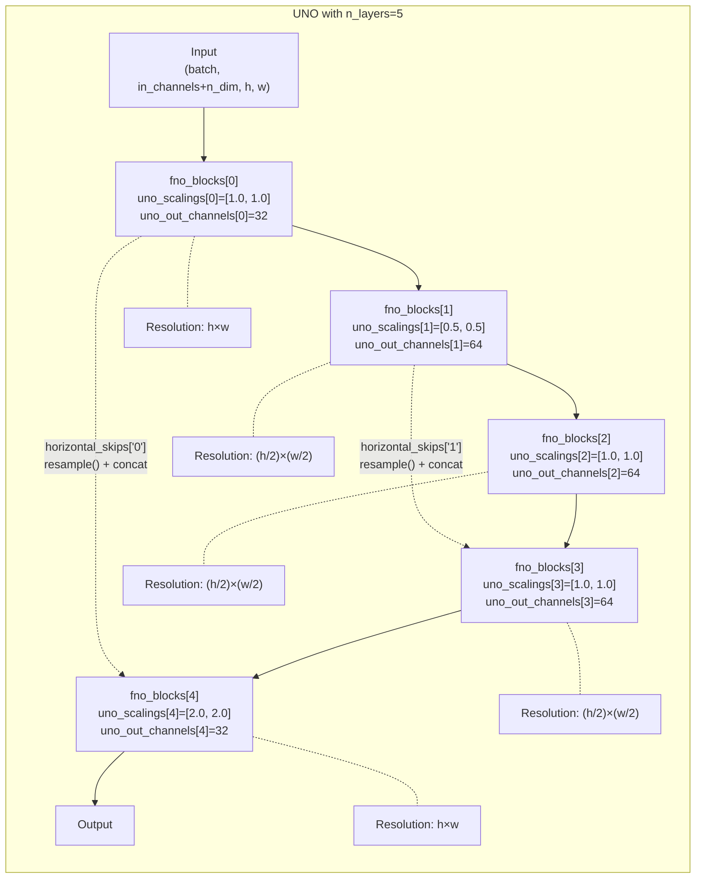
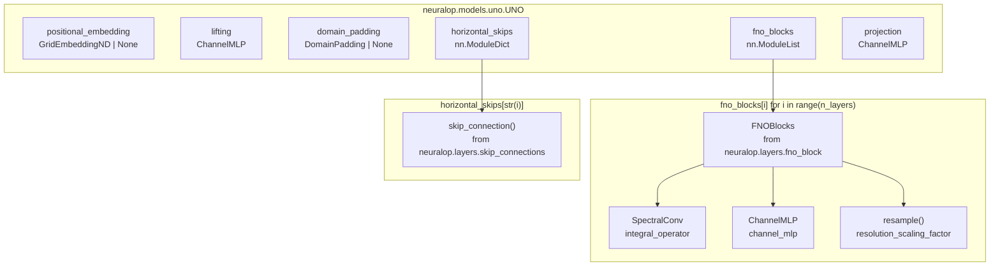
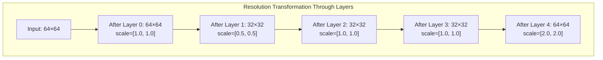
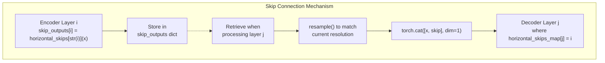

<!-- source: DeepWiki mcp.deepwiki.com · repo neuraloperator/neuraloperator · page 2.2 U-shaped Neural Operators (UNO) · fetched 2026-10-21 -->

# U-shaped Neural Operators (UNO)

<details>
<summary>Relevant source files</summary>

The following files were used as context for generating this wiki page:

- [doc/source/modules/api.rst](doc/source/modules/api.rst)
- [neuralop/models/fnogno.py](neuralop/models/fnogno.py)
- [neuralop/models/gino.py](neuralop/models/gino.py)
- [neuralop/models/tests/test_uno.py](neuralop/models/tests/test_uno.py)
- [neuralop/models/uno.py](neuralop/models/uno.py)

</details>


## Purpose and Scope

This document describes the U-shaped Neural Operator (UNO) architecture implemented in `neuralop.models.uno.UNO`. UNO combines the global spectral representation of Fourier Neural Operators with the multi-resolution approach of U-Net architectures to effectively solve partial differential equations (PDEs). The architecture uses `FNOBlocks` at multiple resolution levels with horizontal skip connections between corresponding encoder-decoder pairs, as introduced in Rahman et al. (2022).

For information about:
- Standard Fourier Neural Operators, see page 2.1
- FNOBlocks implementation, see page 3.2
- Spectral convolution operations, see page 3.1

Sources: [neuralop/models/uno.py:18-99]()

## Architecture Overview

UNO extends the FNO architecture by incorporating a U-Net style structure with multiple resolution levels and skip connections. This design enables the model to capture both fine-grained local details and global dependencies within the solution space.

### High-Level Pipeline

```mermaid
flowchart LR
    Input["Input<br/>shape: (batch, in_channels, h, w)"] --> PE["positional_embedding<br/>GridEmbeddingND"]
    PE --> Lift["lifting<br/>ChannelMLP"]
    Lift --> Pad["domain_padding.pad()"]
    Pad --> Encoder["Encoder Path<br/>FNOBlocks with<br/>downsampling"]
    Encoder --> Decoder["Decoder Path<br/>FNOBlocks with<br/>upsampling"]
    Decoder --> Unpad["domain_padding.unpad()"]
    Unpad --> Proj["projection<br/>ChannelMLP"]
    Proj --> Output["Output<br/>shape: (batch, out_channels, h', w')"]
    
    Encoder -.-> |"horizontal_skips<br/>skip_connection()"| Decoder
```



Sources: [neuralop/models/uno.py:299-348]()

### Multi-Resolution Processing



Sources: [neuralop/models/uno.py:246-288](), [neuralop/models/uno.py:322-341]()

## Key Components

### Component Composition



Sources: [neuralop/models/uno.py:133-298](), [neuralop/models/uno.py:9-15]()

### UNO Class Structure

The `UNO` class inherits from `nn.Module` and contains the following key attributes:

| Attribute | Type | Description |
|-----------|------|-------------|
| `positional_embedding` | `GridEmbeddingND` \| `GridEmbedding2D` \| `None` | Optional positional encoding appended to input |
| `lifting` | `ChannelMLP` | Lifts input from `in_channels+n_dim` to `hidden_channels` |
| `fno_blocks` | `nn.ModuleList[FNOBlocks]` | List of `n_layers` FNO blocks with varying resolutions |
| `horizontal_skips` | `nn.ModuleDict` | Skip connections from encoder to decoder layers |
| `projection` | `ChannelMLP` | Projects from final layer channels to `out_channels` |
| `domain_padding` | `DomainPadding` \| `None` | Optional padding for improved FFT performance |

Sources: [neuralop/models/uno.py:172-297]()

### Resolution Scaling

Each `FNOBlocks` layer applies a scaling factor specified in `uno_scalings[i]`. The `FNOBlocks` internally uses the `resample()` function to change resolution via interpolation.

#### End-to-End Scaling Factor Calculation

The cumulative scaling factor is computed by multiplying all per-layer scaling factors:

```python
# From neuralop/models/uno.py:208-217
self.end_to_end_scaling_factor = [1] * len(self.uno_scalings[0])
for k in self.uno_scalings:
    self.end_to_end_scaling_factor = [
        i * j for (i, j) in zip(self.end_to_end_scaling_factor, k)
    ]
```

For example, with `uno_scalings=[[1.0, 1.0], [0.5, 0.5], [1, 1], [1, 1], [2, 2]]`, the cumulative factor is `[1.0, 1.0]`.

#### Resolution Flow Example



Sources: [neuralop/models/uno.py:208-223](), [neuralop/models/uno.py:315-318](), [neuralop/models/uno.py:337]()

### Horizontal Skip Connections

UNO implements skip connections between corresponding encoder and decoder layers using the `horizontal_skips_map` dictionary.

#### Default Skip Map Construction

If `horizontal_skips_map` is `None`, the constructor creates symmetric skip connections:

```python
# From neuralop/models/uno.py:195-202
if self.horizontal_skips_map is None:
    self.horizontal_skips_map = {}
    for i in range(0, n_layers // 2):
        # Example: if n_layers = 5, then 4:0, 3:1
        self.horizontal_skips_map[n_layers - i - 1] = i
```

For `n_layers=5`, this produces `{4: 0, 3: 1}`, connecting layer 4 to 0 and layer 3 to 1.

#### Skip Connection Processing

During the forward pass, when a layer index appears in `horizontal_skips_map.keys()`:

1. Retrieve stored output from source layer: `skip_val = skip_outputs[self.horizontal_skips_map[layer_idx]]`
2. Compute resolution scaling factors between current and skip feature maps
3. Resample skip features to match current resolution using `resample()`
4. Concatenate along channel dimension: `x = torch.cat([x, t], dim=1)`

The skip features are stored when a layer index appears in `horizontal_skips_map.values()`:

```python
# From neuralop/models/uno.py:339-340
if layer_idx in self.horizontal_skips_map.values():
    skip_outputs[layer_idx] = self.horizontal_skips[str(layer_idx)](x)
```

#### Skip Connection Diagram



Sources: [neuralop/models/uno.py:195-202](), [neuralop/models/uno.py:280-286](), [neuralop/models/uno.py:324-340]()

## Implementation Details

### Class Definition and Inheritance

```python
# neuralop/models/uno.py:18
class UNO(nn.Module):
```

The UNO class inherits from `torch.nn.Module` and implements the U-shaped Neural Operator architecture.

Sources: [neuralop/models/uno.py:18]()

### Constructor Parameters

The `UNO.__init__()` method accepts the following parameters:

#### Required Parameters

| Parameter | Type | Description |
|-----------|------|-------------|
| `in_channels` | int | Number of input channels |
| `out_channels` | int | Number of output channels |
| `hidden_channels` | int | Initial width of the UNO (number of channels after lifting) |
| `uno_out_channels` | list[int] | Output channels for each FNO layer (length must equal `n_layers`) |
| `uno_n_modes` | list[list[int]] | Fourier modes for each layer and dimension, e.g., `[[5,5],[5,5],...]` |
| `uno_scalings` | list[list[float]]  | Resolution scaling factors for each layer, e.g., `[[1.0,1.0],[0.5,0.5],...]` |

#### Optional Parameters

| Parameter | Default | Description |
|-----------|---------|-------------|
| `lifting_channels` | 256 | Hidden channels in the lifting `ChannelMLP` |
| `projection_channels` | 256 | Hidden channels in the projection `ChannelMLP` |
| `positional_embedding` | "grid" | Positional embedding: `"grid"`, `GridEmbedding2D`, `GridEmbeddingND`, or `None` |
| `n_layers` | 4 | Number of FNO layers |
| `horizontal_skips_map` | None | Dict mapping decoder to encoder layers; if `None`, uses default symmetric mapping |
| `channel_mlp_dropout` | 0 | Dropout rate in `ChannelMLP` after each FNO block |
| `channel_mlp_expansion` | 0.5 | Expansion factor for `ChannelMLP` hidden channels |
| `non_linearity` | F.gelu | Activation function |
| `norm` | None | Normalization layer (e.g., `nn.GroupNorm`) |
| `preactivation` | False | If True, use ResNet-style preactivation |
| `fno_skip` | "linear" | Skip connection type for FNO: `"linear"`, `"identity"`, or `"soft-gating"` |
| `horizontal_skip` | "linear" | Skip connection type for horizontal skips |
| `channel_mlp_skip` | "soft-gating" | Skip connection type for `ChannelMLP` |
| `separable` | False | If True, use depthwise separable spectral convolution |
| `factorization` | None | Tensor factorization: `"tucker"`, `"cp"`, `"tt"`, or `None` |
| `rank` | 1.0 | Rank for tensor factorization |
| `fixed_rank_modes` | False | Modes to exclude from factorization |
| `integral_operator` | SpectralConv | Convolution operator class to use |
| `operator_block` | FNOBlocks | Operator block class to use |
| `implementation` | "factorized" | Implementation mode: `"factorized"` or `"reconstructed"` |
| `decomposition_kwargs` | dict() | Additional kwargs for tensor decomposition |
| `domain_padding` | None | Padding percentage (float) or None; improves FFT performance |

Sources: [neuralop/models/uno.py:101-132]()

### Positional Embedding Options

The `positional_embedding` parameter supports multiple configurations:

1. **String `"grid"`**: Creates a `GridEmbeddingND` with default boundaries `[[0., 1.]]` for each dimension
2. **`GridEmbedding2D` instance**: Used directly for 2D data
3. **`GridEmbeddingND` instance**: Used directly for arbitrary dimensions
4. **`None`**: No positional embedding applied

When positional embedding is used, `n_dim` coordinates are appended to the input channels.

Sources: [neuralop/models/uno.py:172-192]()

### Forward Pass

The `forward(x, **kwargs)` method implements the end-to-end transformation:

```mermaid
flowchart TB
    Start["forward(x)"] --> CheckPE{"positional_embedding<br/>is not None?"}
    CheckPE -->|Yes| PE["x = positional_embedding(x)<br/>Append n_dim coordinate channels"]
    CheckPE -->|No| Lift
    PE --> Lift["x = lifting(x)<br/>Transform to hidden_channels"]
    
    Lift --> CheckPad{"domain_padding<br/>is not None?"}
    CheckPad -->|Yes| Pad["x = domain_padding.pad(x)"]
    CheckPad -->|No| CalcShape
    Pad --> CalcShape["Calculate output_shape from<br/>end_to_end_scaling_factor"]
    
    CalcShape --> LoopStart["skip_outputs = {}<br/>layer_idx = 0"]
    
    LoopStart --> CheckSkipIn{"layer_idx in<br/>horizontal_skips_map.keys()?"}
    CheckSkipIn -->|Yes| GetSkip["skip_val = skip_outputs[...]<br/>Resample to match resolution<br/>x = torch.cat([x, skip_val], dim=1)"]
    CheckSkipIn -->|No| CheckLast
    GetSkip --> CheckLast
    
    CheckLast{"layer_idx ==<br/>n_layers - 1?"}
    CheckLast -->|Yes| SetOutput["cur_output = output_shape"]
    CheckLast -->|No| FNOBlock
    SetOutput --> FNOBlock["x = fno_blocks[layer_idx](x, cur_output)"]
    
    FNOBlock --> CheckSkipOut{"layer_idx in<br/>horizontal_skips_map.values()?"}
    CheckSkipOut -->|Yes| SaveSkip["skip_outputs[layer_idx] =<br/>horizontal_skips[str(layer_idx)](x)"]
    CheckSkipOut -->|No| NextLayer
    SaveSkip --> NextLayer["layer_idx += 1"]
    
    NextLayer --> CheckDone{"layer_idx <<br/>n_layers?"}
    CheckDone -->|Yes| CheckSkipIn
    CheckDone -->|No| CheckUnpad
    
    CheckUnpad{"domain_padding<br/>is not None?"}
    CheckUnpad -->|Yes| Unpad["x = domain_padding.unpad(x)"]
    CheckUnpad -->|No| Project
    Unpad --> Project["x = projection(x)"]
    Project --> Return["return x"]
```



Sources: [neuralop/models/uno.py:299-348]()

#### Forward Pass Steps

1. **Positional Embedding** [line 308-309](): If configured, append grid coordinates to input
2. **Lifting** [line 311](): Transform from `in_channels + n_dim` to `hidden_channels`
3. **Domain Padding** [line 313-314](): Optional padding for FFT operations
4. **Output Shape Calculation** [line 315-318](): Compute final output dimensions from cumulative scaling
5. **FNO Blocks Loop** [line 322-341]():
   - Check for incoming skip connections and concatenate if present
   - Pass through `fno_blocks[layer_idx]` with optional `output_shape` argument
   - Store outputs for layers that are skip connection sources
6. **Domain Unpadding** [line 343-344](): Remove padding if applied
7. **Projection** [line 347](): Transform from final layer channels to `out_channels`

Sources: [neuralop/models/uno.py:299-348]()

## Usage Examples

### Basic UNO Instantiation

```python
from neuralop.models import UNO

# Create a 5-layer UNO with U-shaped architecture
model = UNO(
    in_channels=3,              # Input channels
    out_channels=3,             # Output channels
    hidden_channels=5,          # Hidden channel width
    uno_out_channels=[32, 64, 64, 64, 32],  # Channels at each layer
    uno_n_modes=[[5, 5], [5, 5], [5, 5], [5, 5], [5, 5]],  # Modes at each layer
    uno_scalings=[[1.0, 1.0], [0.5, 0.5], [1, 1], [1, 1], [2, 2]],  # Resolution scaling
    horizontal_skips_map={4: 0, 3: 1},  # Layer 4 connected to 0, layer 3 to 1
    n_layers=5,                 # Total number of layers
    domain_padding=0.2,         # 20% padding for FFT operations
    channel_mlp_skip="linear"   # Skip connection type for ChannelMLP
)
```

Sources: [neuralop/models/tests/test_uno.py:11-17]()

### Default Skip Connections

When `horizontal_skips_map=None`, UNO automatically creates symmetric skip connections:

```python
model = UNO(
    in_channels=3,
    out_channels=3,
    hidden_channels=5,
    uno_out_channels=[32, 64, 64, 64, 32],
    uno_n_modes=[[5, 5], [5, 5], [5, 5], [5, 5], [5, 5]],
    uno_scalings=[[1.0, 1.0], [0.5, 0.5], [1, 1], [1, 1], [2, 2]],
    horizontal_skips_map=None,  # Uses default: {4: 0, 3: 1} for 5 layers
    n_layers=5,
    domain_padding=0.2,
)
```

For `n_layers=5`, the default creates `{4: 0, 3: 1}`, connecting the final layer back to the first and the second-to-last to the second.

Sources: [neuralop/models/uno.py:195-202](), [neuralop/models/tests/test_uno.py:37-48]()

### Forward Pass Usage

```python
import torch

# Create input tensor (batch, in_channels, height, width)
x = torch.randn(32, 3, 64, 64)

# Forward pass
output = model(x)

# Output shape matches input spatial dimensions (with end_to_end_scaling_factor applied)
# For the example above: (32, 3, 64, 64)
assert output.shape == (32, 3, 64, 64)
```

Sources: [neuralop/models/tests/test_uno.py:19-25]()

### Asymmetric Resolution Scaling

UNO supports different scaling factors for each spatial dimension:

```python
model = UNO(
    in_channels=3,
    out_channels=3,
    hidden_channels=5,
    uno_out_channels=[32, 64, 64, 64, 32],
    uno_n_modes=[[5, 5], [5, 5], [5, 5], [5, 5], [5, 5]],
    # Different scaling for height and width
    uno_scalings=[[1.0, 1.0], [0.5, 0.25], [1, 1], [1, 1], [2, 4]],
    horizontal_skips_map={4: 0, 3: 1},
    n_layers=5,
    domain_padding=0.2,
)

# Input: (32, 3, 100, 105)
x = torch.randn(32, 3, 100, 105)
output = model(x)
# Output: (32, 3, 100, 105)
```

The cumulative `end_to_end_scaling_factor` is `[1.0, 1.0]` (product of all layer scales), preserving input shape.

Sources: [neuralop/models/tests/test_uno.py:8-14]()

## Implementation Details

### Layer Instantiation

Each FNO block is created with parameters passed through to the `operator_block` class (default: `FNOBlocks`):

```python
# From neuralop/models/uno.py:258-278
self.fno_blocks.append(
    self.operator_block(
        in_channels=prev_out,
        out_channels=self.uno_out_channels[i],
        n_modes=self.uno_n_modes[i],
        channel_mlp_dropout=channel_mlp_dropout,
        channel_mlp_expansion=channel_mlp_expansion,
        resolution_scaling_factor=[self.uno_scalings[i]],
        non_linearity=non_linearity,
        norm=norm,
        preactivation=preactivation,
        fno_skip=fno_skip,
        channel_mlp_skip=channel_mlp_skip,
        rank=rank,
        fixed_rank_modes=fixed_rank_modes,
        implementation=implementation,
        separable=separable,
        factorization=factorization,
        decomposition_kwargs=decomposition_kwargs,
    )
)
```

Note that `in_channels` for each layer accounts for concatenated skip connections: if layer `i` receives a skip connection, its input channels are `prev_out + uno_out_channels[horizontal_skips_map[i]]`.

Sources: [neuralop/models/uno.py:250-278]()

### Domain Padding Integration

When `domain_padding` is specified, a `DomainPadding` instance is created with awareness of the cumulative scaling factor:

```python
# From neuralop/models/uno.py:227-236
if domain_padding is not None and (
    (isinstance(domain_padding, list) and sum(domain_padding) > 0)
    or (isinstance(domain_padding, (float, int)) and domain_padding > 0)
):
    self.domain_padding = DomainPadding(
        domain_padding=domain_padding,
        resolution_scaling_factor=self.end_to_end_scaling_factor,
    )
```

This ensures padding is correctly applied and removed considering the overall resolution transformation.

Sources: [neuralop/models/uno.py:227-236]()

### Channel Dimension Tracking

The model carefully tracks channel dimensions through the architecture:

1. **Input**: `in_channels` (+ `n_dim` if positional embedding is used)
2. **After lifting**: `hidden_channels`
3. **FNO block `i` input**: `prev_out` (possibly + skip connection channels)
4. **FNO block `i` output**: `uno_out_channels[i]`
5. **After projection**: `out_channels`

The `prev_out` variable is updated after each layer to track the current channel count:

```python
# From neuralop/models/uno.py:248-288
prev_out = self.hidden_channels
for i in range(self.n_layers):
    if i in self.horizontal_skips_map.keys():
        prev_out = (
            prev_out + self.uno_out_channels[self.horizontal_skips_map[i]]
        )
    # ... create fno_blocks[i] with in_channels=prev_out ...
    prev_out = self.uno_out_channels[i]
```

Sources: [neuralop/models/uno.py:248-288]()

## Relation to Other Neural Operators

UNO builds upon the Fourier Neural Operator architecture by adding the U-Net style multi-resolution processing and skip connections. This design combines:

1. The global representation power of Fourier Neural Operators
2. The multi-resolution capabilities of U-Net architectures
3. The gradient flow advantages of skip connections

This makes UNO particularly effective for PDE problems with multi-scale features and complex spatial relationships.

Sources: [neuralop/models/uno.py:13-102]()

---

