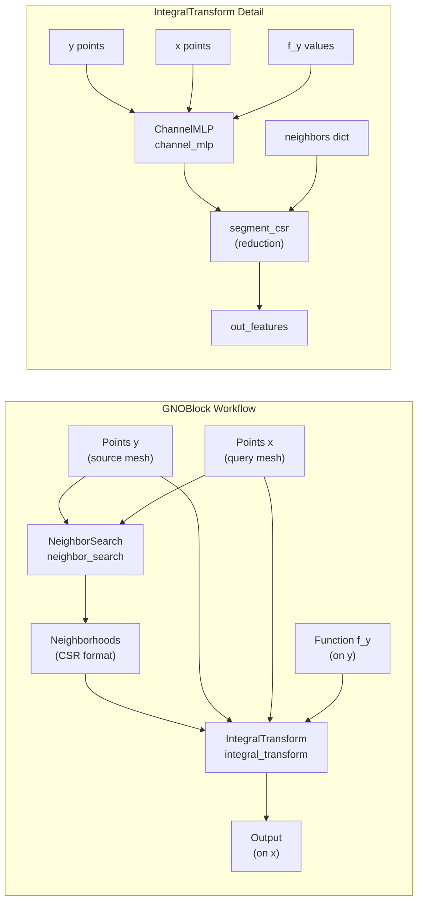
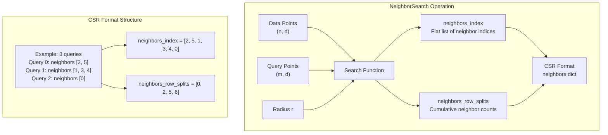
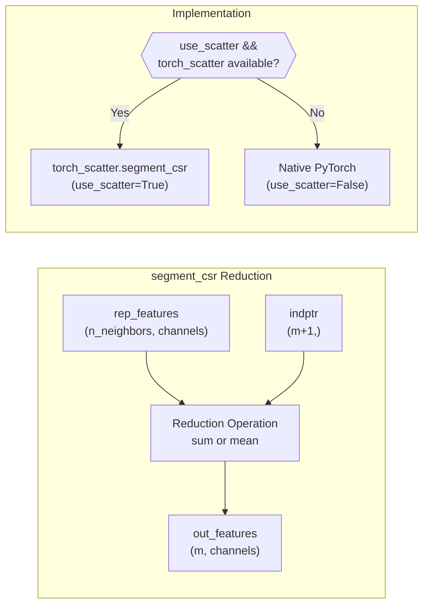
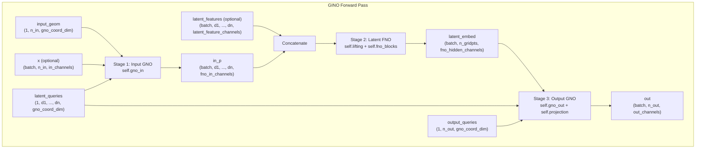
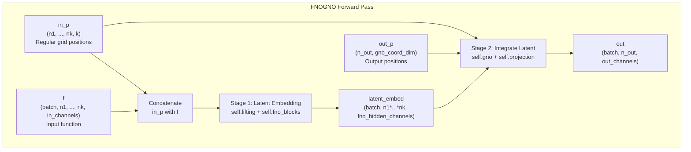
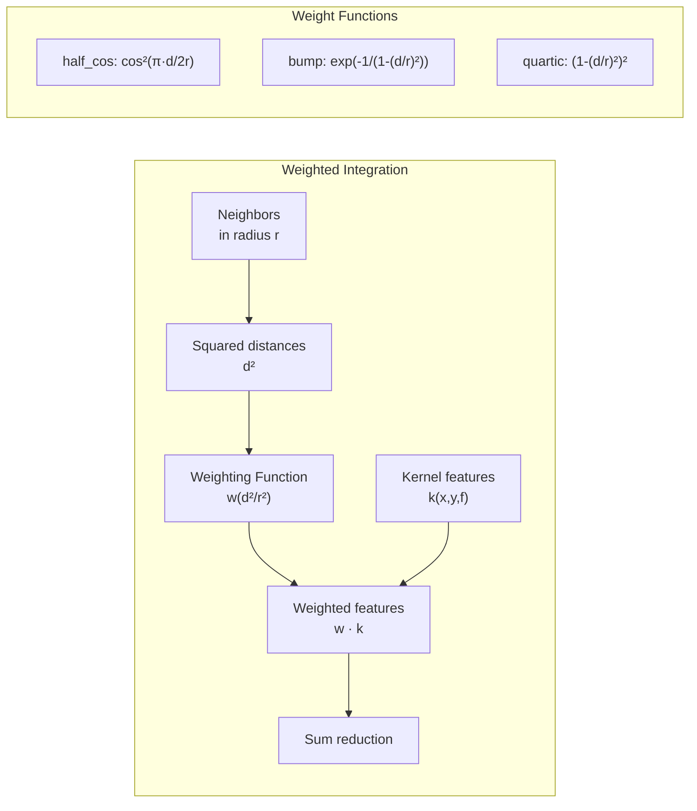
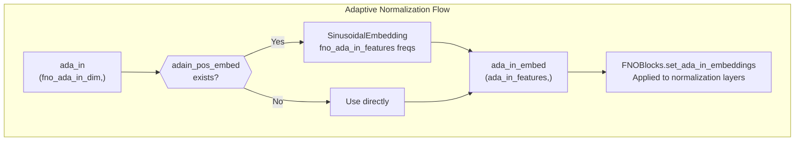

<!-- source: DeepWiki mcp.deepwiki.com · repo neuraloperator/neuraloperator · page 2.3 Geometry-Informed Neural Operators (GINO/FNOGNO) · fetched 2026-10-21 -->

# Geometry-Informed Neural Operators (GINO/FNOGNO)

<details>
<summary>Relevant source files</summary>

The following files were used as context for generating this wiki page:

- [doc/source/modules/api.rst](doc/source/modules/api.rst)
- [neuralop/layers/integral_transform.py](neuralop/layers/integral_transform.py)
- [neuralop/layers/neighbor_search.py](neuralop/layers/neighbor_search.py)
- [neuralop/layers/segment_csr.py](neuralop/layers/segment_csr.py)
- [neuralop/layers/tests/test_neighbor_search.py](neuralop/layers/tests/test_neighbor_search.py)
- [neuralop/models/fnogno.py](neuralop/models/fnogno.py)
- [neuralop/models/gino.py](neuralop/models/gino.py)

</details>


## Purpose and Scope

This document describes the Geometry-Informed Neural Operator models (`GINO` and `FNOGNO`) available in the neuraloperator library. These architectures enable learning mappings between functions defined on **arbitrary coordinate meshes** rather than regular grids. Unlike standard FNO models that operate on structured grids, GINO and FNOGNO handle irregular geometries through kernel integration and graph-based operations.

- **GINO** (`neuralop.models.GINO`): Maps between arbitrary input and output meshes via input GNO → FNO latent processing → output GNO
- **FNOGNO** (`neuralop.models.FNOGNO`): Maps from regular N-d grid to arbitrary query point cloud via lifting → FNO blocks → GNO output

For standard Fourier Neural Operators on regular grids, see [FNO](#2.1). For U-shaped architectures, see [UNO](#2.2).

**Sources:** [neuralop/models/gino.py:1-526](), [neuralop/models/fnogno.py:1-394]()

---

## Architecture Overview

### GINO vs FNOGNO Comparison

Both models bridge irregular geometries and structured processing, but differ in their input/output assumptions:

```mermaid
graph TB
    subgraph "GINO Architecture"
        GINO_In["Input Geometry<br/>(arbitrary mesh)"]
        GINO_Func["Input Function x<br/>(on input geometry)"]
        GINO_InGNO["Input GNOBlock<br/>gno_in"]
        GINO_Latent["Latent Queries<br/>(regular grid)"]
        GINO_Lift["Lifting<br/>ChannelMLP"]
        GINO_FNO["FNOBlocks<br/>(spectral processing)"]
        GINO_LatEmbed["Latent Embedding<br/>(structured)"]
        GINO_OutGNO["Output GNOBlock<br/>gno_out"]
        GINO_OutGeom["Output Queries<br/>(arbitrary mesh)"]
        GINO_Proj["Projection<br/>ChannelMLP"]
        GINO_Out["Output Function"]
        
        GINO_In --> GINO_InGNO
        GINO_Func --> GINO_InGNO
        GINO_Latent --> GINO_InGNO
        GINO_InGNO --> GINO_Lift
        GINO_Lift --> GINO_FNO
        GINO_FNO --> GINO_LatEmbed
        GINO_LatEmbed --> GINO_OutGNO
        GINO_OutGeom --> GINO_OutGNO
        GINO_OutGNO --> GINO_Proj
        GINO_Proj --> GINO_Out
    end
    
    subgraph "FNOGNO Architecture"
        FNOGNO_InGeom["Input Points in_p<br/>(regular grid)"]
        FNOGNO_Func["Input Function f<br/>(on grid)"]
        FNOGNO_Lift["Lifting<br/>ChannelMLP"]
        FNOGNO_FNO["FNOBlocks<br/>(spectral processing)"]
        FNOGNO_LatEmbed["Latent Embedding"]
        FNOGNO_GNO["GNOBlock<br/>gno"]
        FNOGNO_OutGeom["Output Points out_p<br/>(arbitrary mesh)"]
        FNOGNO_Proj["Projection<br/>ChannelMLP"]
        FNOGNO_Out["Output Function"]
        
        FNOGNO_InGeom --> FNOGNO_Lift
        FNOGNO_Func --> FNOGNO_Lift
        FNOGNO_Lift --> FNOGNO_FNO
        FNOGNO_FNO --> FNOGNO_LatEmbed
        FNOGNO_LatEmbed --> FNOGNO_GNO
        FNOGNO_OutGeom --> FNOGNO_GNO
        FNOGNO_GNO --> FNOGNO_Proj
        FNOGNO_Proj --> FNOGNO_Out
    end
```



**Key Differences:**

| Aspect | GINO | FNOGNO |
|--------|------|--------|
| **Input Domain** | Arbitrary mesh | Regular grid |
| **Output Domain** | Arbitrary mesh (single or dict of meshes) | Arbitrary point cloud |
| **Input GNO** | Yes (`gno_in`) | No (direct lifting) |
| **Output GNO** | Yes (`gno_out`) | Yes (`gno`) |
| **Latent Space** | Regular grid (latent_queries) | Same as input grid |
| **Use Case** | Mesh-to-mesh, CAD, irregular CFD | Grid-to-points, downsampling |

**Sources:** [neuralop/models/gino.py:20-166](), [neuralop/models/fnogno.py:18-134]()

---

## Core Components

### GNOBlock and IntegralTransform

The `GNOBlock` is a neural operator layer that performs kernel integration over spatial neighborhoods. It wraps `IntegralTransform` and `NeighborSearch` to compute:

$$\int_{A(x)} k(x, y, f(y)) \cdot f(y) \, dy$$

where $A(x)$ is a neighborhood around point $x$.



**Transform Types:**

The `IntegralTransform` supports four modes controlled by `transform_type`:

| Type | Formula | Kernel Input | Use Case |
|------|---------|--------------|----------|
| `"linear_kernelonly"` | $\int k(x,y) dy$ | $(x, y)$ | Geometry-only integration |
| `"linear"` | $\int k(x,y) \cdot f(y) dy$ | $(x, y)$ | Linear kernel with function |
| `"nonlinear_kernelonly"` | $\int k(x,y,f(y)) dy$ | $(x, y, f(y))$ | Nonlinear geometry-aware |
| `"nonlinear"` | $\int k(x,y,f(y)) \cdot f(y) dy$ | $(x, y, f(y))$ | Full nonlinear transform |

**Sources:** [neuralop/layers/integral_transform.py:9-219](), [doc/source/modules/api.rst:150-176]()

### NeighborSearch and CSR Format

`NeighborSearch` finds all points within a radius $r$ of each query point, returning results in Compressed Sparse Row (CSR) format:



**Implementation Options:**

The library supports two implementations:

1. **Open3D** (default, requires 3D data): `FixedRadiusSearch` from `open3d.ml.torch.layers`
2. **Native PyTorch** (fallback): `native_neighbor_search` using `torch.cdist`

**Sources:** [neuralop/layers/neighbor_search.py:13-113](), [neuralop/layers/tests/test_neighbor_search.py:1-46]()

### Reduction via segment_csr

After kernel integration, `segment_csr` reduces features over neighborhoods:



**Note:** `torch_scatter` is an optional dependency that provides GPU-accelerated reductions but conflicts with newer PyTorch versions. The native implementation is available as a fallback.

**Sources:** [neuralop/layers/segment_csr.py:7-101](), [neuralop/layers/integral_transform.py:217]()

---

## GINO Architecture

### Model Structure

`GINO` (Geometry-Informed Neural Operator) learns mappings between arbitrary coordinate meshes through a three-stage pipeline:



### Stage 1: Input GNO

Maps input function from arbitrary input geometry to structured latent grid:

```python
# From gino.py:468-470
in_p = self.gno_in(y=input_geom,
                   x=latent_queries.view((-1, latent_queries.shape[-1])),
                   f_y=x)
```

**Parameters:**
- `y`: Input geometry points (source)
- `x`: Latent grid points (queries)  
- `f_y`: Input function values (batch, n_in, in_channels)

**Output:** Structured embedding on latent grid (batch, n_gridpts, fno_in_channels)

**Sources:** [neuralop/models/gino.py:281-296](), [neuralop/models/gino.py:468-475]()

### Stage 2: Latent FNO Processing

Applies spectral convolution in structured latent space:

```python
# From gino.py:383-386
in_p = self.lifting(in_p)
for idx in range(self.fno_blocks.n_layers):
    in_p = self.fno_blocks(in_p, idx)
```

The latent embedding can optionally include additional features:

```python
# From gino.py:477-478
if latent_features is not None:
    in_p = torch.cat((in_p, latent_features), dim=-1)
```

**Sources:** [neuralop/models/gino.py:299-331](), [neuralop/models/gino.py:364-388]()

### Stage 3: Output GNO

Maps latent embedding to arbitrary output geometry:

```python
# From gino.py:516-518
out = self.gno_out(y=latent_queries.reshape((-1, latent_queries.shape[-1])), 
                   x=output_queries,
                   f_y=latent_embed)
```

Supports multiple output queries via dictionary:

```python
# From gino.py:497-511
if isinstance(output_queries, dict):
    out = {}
    for key, out_p in output_queries.items():
        sub_output = self.gno_out(y=latent_queries, x=out_p, f_y=latent_embed)
        out[key] = self.projection(sub_output)
```

**Sources:** [neuralop/models/gino.py:338-362](), [neuralop/models/gino.py:390-525]()

### Key Configuration Parameters

| Parameter | Default | Description |
|-----------|---------|-------------|
| `gno_coord_dim` | 3 | Geometric dimension of input/output |
| `in_gno_radius` | 0.033 | Neighborhood radius for input GNO |
| `out_gno_radius` | 0.033 | Neighborhood radius for output GNO |
| `in_gno_transform_type` | `"linear"` | Input kernel type |
| `out_gno_transform_type` | `"linear"` | Output kernel type |
| `gno_weighting_function` | None | Mollified GNO weighting (`"half_cos"`, `"bump"`, etc.) |
| `fno_n_modes` | (16, 16, 16) | Spectral modes in latent FNO |
| `fno_hidden_channels` | 64 | Hidden channels in FNO |
| `fno_n_layers` | 4 | Number of FNO layers |
| `latent_feature_channels` | None | Optional additional latent features |

**Sources:** [neuralop/models/gino.py:28-157]()

---

## FNOGNO Architecture

### Model Structure

`FNOGNO` maps from regular grids to arbitrary point clouds through a simpler two-stage pipeline:



### Stage 1: Latent Embedding

Combines grid positions with function values and applies FNO blocks:

```python
# From fnogno.py:310-331
in_p = torch.cat((f, in_p), dim=-1)  # Concatenate positions
in_p = in_p.permute(-1, *self.in_coord_dim_forward_order)  # Channel-first

in_p = self.lifting(in_p)
for layer_idx in range(self.fno_blocks.n_layers):
    in_p = self.fno_blocks(in_p, layer_idx)
```

**Batching:** The method supports both batched (`gno_batched=True`) and unbatched modes:

```python
# From fnogno.py:306-316
if self.gno_batched:
    batch_size = f.shape[0]
    in_p = in_p.repeat([batch_size] + [1] * (in_p.ndim))
    in_p = in_p.permute(0, -1, *self.in_coord_dim_forward_order)
else:
    in_p = in_p.permute(-1, *self.in_coord_dim_forward_order).unsqueeze(0)
```

**Sources:** [neuralop/models/fnogno.py:229-261](), [neuralop/models/fnogno.py:305-336]()

### Stage 2: Integrate Latent

Maps latent grid embedding to output point cloud via GNO:

```python
# From fnogno.py:343-377
# Reshape to flat point cloud
if self.gno_batched:
    latent_embed = latent_embed.permute(0, *self.in_coord_dim_reverse_order, 1)
    latent_embed = latent_embed.reshape((batch_size, -1, self.fno_hidden_channels))
else:
    latent_embed = latent_embed.permute(*self.in_coord_dim_reverse_order, 0)
    latent_embed = latent_embed.reshape((-1, self.fno_hidden_channels))

# Apply GNO
out = self.gno(y=in_p.reshape(-1, in_p.shape[-1]),
               x=out_p,
               f_y=latent_embed)

# Project to output channels
out = self.projection(out.permute(0, 2, 1))
```

**Sources:** [neuralop/models/fnogno.py:338-377](), [neuralop/models/fnogno.py:263-284]()

### Configuration Differences from GINO

| Parameter | Purpose |
|-----------|---------|
| `gno_coord_dim` | Dimension of output point cloud |
| `gno_radius` | Single radius (no separate in/out) |
| `gno_transform_type` | Single transform type for output GNO |
| `gno_batched` | Whether to batch process (affects tensor shapes) |
| `fno_n_modes` | Defines latent grid resolution |

**Sources:** [neuralop/models/fnogno.py:36-134]()

---

## Forward Pass Mechanics

### GINO Forward Signature

```python
def forward(self, input_geom, latent_queries, output_queries, 
            x=None, latent_features=None, ada_in=None, **kwargs)
```

**Input Shapes:**
- `input_geom`: (1, n_in, gno_coord_dim) - constant across batch
- `latent_queries`: (1, d1, ..., dn, gno_coord_dim) - latent grid
- `output_queries`: (1, n_out, gno_coord_dim) or dict of tensors
- `x`: (batch, n_in, in_channels) - input function values
- `latent_features`: (batch, d1, ..., dn, latent_feature_channels) - optional
- `ada_in`: (fno_ada_in_dim,) - adaptive normalization parameters

**Output Shape:**
- (batch, n_out, out_channels) if `output_queries` is a tensor
- dict of (batch, n_out, out_channels) if `output_queries` is a dict

**Batching Constraint:** Geometry (`input_geom`, `latent_queries`, `output_queries`) must be constant across batch. Only function values (`x`, `latent_features`) can vary.

**Sources:** [neuralop/models/gino.py:390-525]()

### FNOGNO Forward Signature

```python
def forward(self, in_p, out_p, f, ada_in=None, **kwargs)
```

**Input Shapes:**
- `in_p`: (n1, ..., nk, k) - input grid positions
- `out_p`: (n_out, gno_coord_dim) - output positions
- `f`: (batch, n1, ..., nk, in_channels) or (n1, ..., nk, in_channels)
- `ada_in`: (fno_ada_in_dim,) - adaptive normalization

**Output Shape:**
- Batched: (batch, n_out, out_channels)
- Unbatched: (n_out, out_channels)

**Sources:** [neuralop/models/fnogno.py:379-393]()

---

## Mollified GNO and Weighting Functions

Both GINO and FNOGNO support **Mollified Graph Neural Operators** through the `gno_weighting_function` parameter. This applies smooth weighting to neighborhoods:



**Configuration:**

```python
# Enable mollified GNO in output layer
gino = GINO(
    gno_weighting_function='half_cos',  # or 'bump', 'quartic', 'quadr', 'octic'
    gno_weight_function_scale=1.0,      # scaling factor
    out_gno_radius=0.033,
    ...
)
```

The weighting function is only applied to the **output GNO** in GINO (not input GNO) and to the single GNO in FNOGNO.

**Sources:** [neuralop/models/gino.py:49-56](), [neuralop/models/fnogno.py:47-53](), [neuralop/layers/integral_transform.py:196-211]()

---

## Adaptive Normalization (AdaIN)

Both models support adaptive instance normalization for conditioning on scalar parameters:



**Configuration:**

```python
gino = GINO(
    fno_norm='ada_in',           # Enable AdaIN
    fno_ada_in_features=4,       # Embedding dimension (None = no embedding)
    fno_ada_in_dim=1,            # Input scalar dimension
    out_gno_pos_embed_type='transformer',  # Required if ada_in_features is set
    ...
)
```

**Sources:** [neuralop/models/gino.py:258-270](), [neuralop/models/fnogno.py:214-227]()

---

## Usage Examples

### GINO Example

```python
from neuralop.models import GINO
import torch

# Create model
model = GINO(
    in_channels=3,
    out_channels=1,
    gno_coord_dim=3,
    fno_n_modes=(16, 16, 16),
    fno_hidden_channels=64,
    in_gno_radius=0.05,
    out_gno_radius=0.05,
)

# Prepare data
batch_size = 4
input_geom = torch.rand(1, 1000, 3)        # Fixed input mesh
latent_queries = torch.rand(1, 32, 32, 32, 3)  # Latent grid
output_queries = torch.rand(1, 500, 3)     # Fixed output mesh
x = torch.rand(batch_size, 1000, 3)        # Input function (batched)

# Forward pass
output = model(
    input_geom=input_geom,
    latent_queries=latent_queries,
    output_queries=output_queries,
    x=x
)
# output.shape: (4, 500, 1)
```

### FNOGNO Example

```python
from neuralop.models import FNOGNO
import torch

# Create model
model = FNOGNO(
    in_channels=2,
    out_channels=1,
    gno_coord_dim=2,
    fno_n_modes=(32, 32),
    fno_hidden_channels=64,
    gno_radius=0.1,
)

# Prepare data
batch_size = 8
n1, n2 = 64, 64
in_p = torch.rand(n1, n2, 2)              # Grid positions
f = torch.rand(batch_size, n1, n2, 2)    # Function on grid
out_p = torch.rand(200, 2)                # Query points

# Forward pass
output = model(in_p=in_p, out_p=out_p, f=f)
# output.shape: (8, 200, 1)
```

**Sources:** [neuralop/models/gino.py:390-525](), [neuralop/models/fnogno.py:379-393]()

---

## Batching Considerations

### GINO Batching

GINO supports batching **only when geometry is shared** across the batch:

```python
# CORRECT: Geometry is shared, functions vary
input_geom = torch.rand(1, 1000, 3)    # No batch dim
x = torch.rand(batch, 1000, 3)         # Batched function

# INCORRECT: Different geometries per batch item
input_geom = torch.rand(batch, 1000, 3)  # Not supported
```

**Rationale:** Neighbor search is expensive and constant geometry allows it to be computed once.

**Sources:** [neuralop/models/gino.py:403-406]()

### FNOGNO Batching Modes

FNOGNO offers two modes via `gno_batched`:

1. **Unbatched (`gno_batched=False`)**: Geometry has no batch dimension
   ```python
   in_p = torch.rand(n1, n2, 2)      # No batch
   f = torch.rand(n1, n2, 2)         # No batch or single batch
   ```

2. **Batched (`gno_batched=True`)**: All tensors include batch dimension
   ```python
   in_p = torch.rand(batch, n1, n2, 2)   # Batched geometry
   f = torch.rand(batch, n1, n2, 2)      # Batched function
   ```

**Sources:** [neuralop/models/fnogno.py:88-91](), [neuralop/models/fnogno.py:202-212]()

---

## Optional Dependencies

### torch-scatter

Both models can use `torch-scatter` for efficient grouped reductions in `segment_csr`:

```python
gino = GINO(
    gno_use_torch_scatter=True,  # Use torch-scatter if available
    ...
)
```

**Warning:** `torch-scatter` conflicts with newer PyTorch versions. If not available, a native PyTorch fallback is used automatically.

**Sources:** [neuralop/layers/integral_transform.py:58-65](), [neuralop/layers/segment_csr.py:7-101]()

### Open3D

Open3D provides GPU-accelerated neighbor search for 3D data:

```python
gino = GINO(
    gno_use_open3d=True,  # Use Open3D if available (3D only)
    gno_coord_dim=3,      # Required for Open3D
    ...
)
```

If Open3D is unavailable or `gno_coord_dim != 3`, falls back to `native_neighbor_search`.

**Sources:** [neuralop/layers/neighbor_search.py:5-33](), [neuralop/models/gino.py:243-245]()

---

## Model Dispatching

Both models are registered with the model factory:

```python
from neuralop.models import get_model

# Create GINO via factory
model = get_model({
    'name': 'GINO',
    'in_channels': 3,
    'out_channels': 1,
    'gno_coord_dim': 3,
    'fno_n_modes': [16, 16, 16],
    # ... other parameters
})

# Create FNOGNO via factory
model = get_model({
    'name': 'FNOGNO',
    'in_channels': 2,
    'out_channels': 1,
    'gno_coord_dim': 2,
    'fno_n_modes': [32, 32],
    # ... other parameters
})
```

**Sources:** [neuralop/models/gino.py:20](), [neuralop/models/fnogno.py:18](), [doc/source/modules/api.rst:63-72]()

---

## Performance Considerations

### Neighborhood Search Cost

Neighbor search is the bottleneck in GNO operations:

- **Time Complexity:** O(n × m) for naive search, O(n log m) with spatial data structures
- **Memory:** CSR format stores only edges, scales with neighborhood density
- **Recommendation:** Use small radii (0.01-0.1) and ensure points are normalized to [0,1]³

### Spectral Processing Cost

FNO blocks dominate compute in latent space:

- **Grid Resolution:** Latent grid size (n_modes) controls memory and compute
- **Typical:** 16³ to 64³ for 3D problems
- **Scaling:** Memory grows as O(n_modes^d) where d is dimension

### Batching Strategy

- Maximize batch size with **shared geometry** to amortize neighbor search
- For GINO, precompute neighborhoods once per geometry
- For FNOGNO, batch size limited by latent grid size

**Sources:** [neuralop/models/gino.py:468-525](), [neuralop/layers/neighbor_search.py:79-113]()

---

