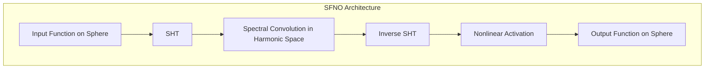
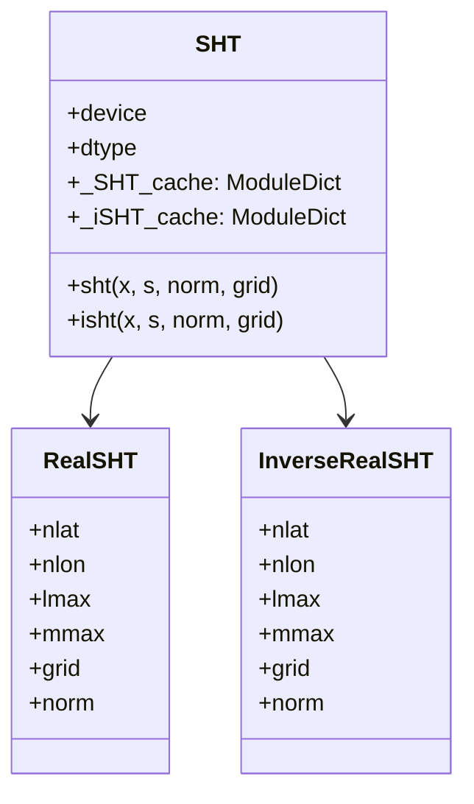
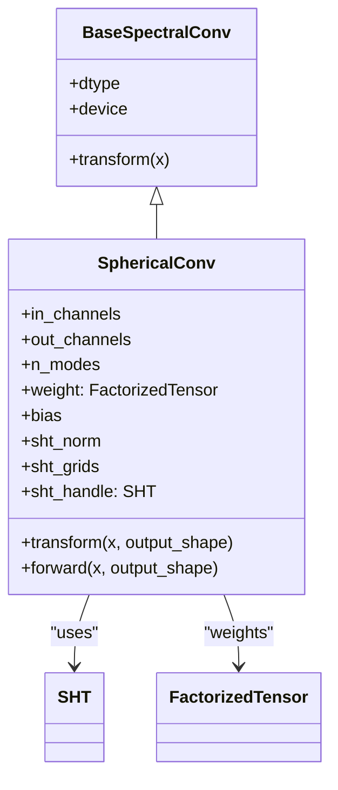
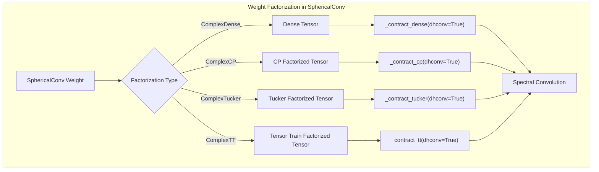
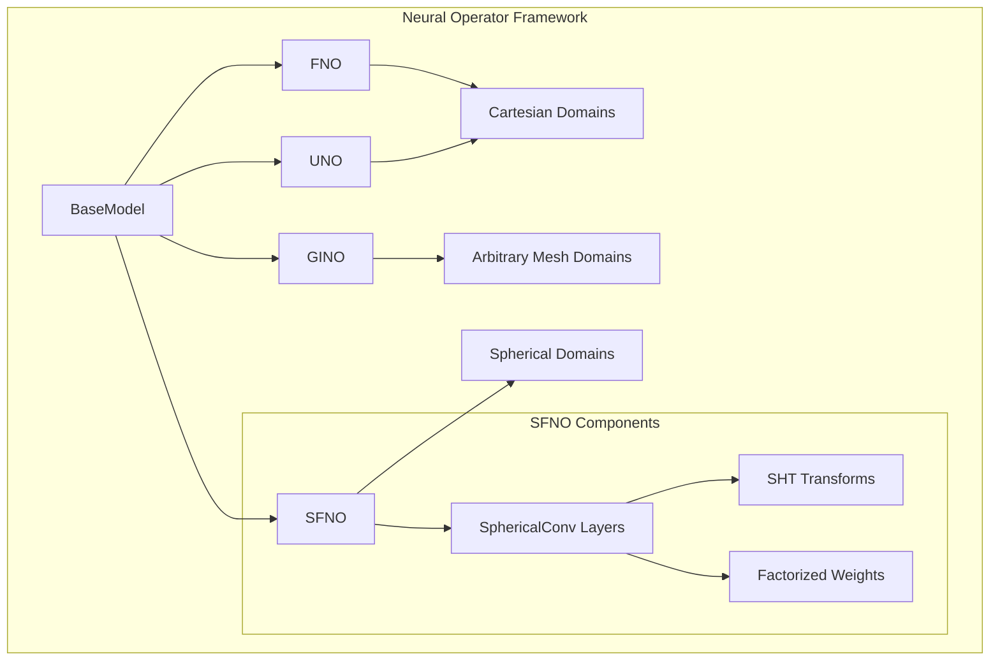
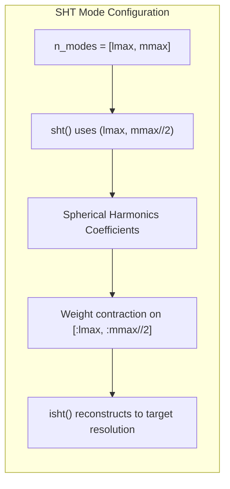
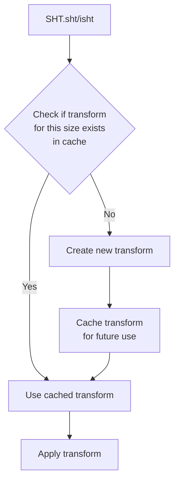

<!-- source: DeepWiki mcp.deepwiki.com · repo neuraloperator/neuraloperator · page 2.4 Spherical Fourier Neural Operators (SFNO) · fetched 2026-10-21 -->

# Spherical Fourier Neural Operators (SFNO)

<details>
<summary>Relevant source files</summary>

The following files were used as context for generating this wiki page:

- [doc/source/modules/api.rst](doc/source/modules/api.rst)
- [neuralop/models/fnogno.py](neuralop/models/fnogno.py)
- [neuralop/models/gino.py](neuralop/models/gino.py)

</details>


## Purpose and Scope

Spherical Fourier Neural Operators (SFNO) are specialized neural operators designed for solving partial differential equations (PDEs) on spherical domains. This page explains the implementation, components, and usage of SFNO in the neuraloperator library. SFNO is particularly useful for global climate modeling, geophysical applications, and any simulation involving data defined on a sphere.

For information about standard Fourier Neural Operators in Cartesian coordinates, see [Fourier Neural Operators (FNO)](#2.1).

Sources: [neuralop/layers/spherical_convolution.py:285-476]()

## Overview of SFNO

SFNO extends the concept of Fourier Neural Operators to spherical domains by replacing the standard Fast Fourier Transform (FFT) with the Spherical Harmonics Transform (SHT). This allows for efficient and accurate convolution operations on spherical data, preserving the mathematical structure of the spherical domain.



Sources: [neuralop/layers/spherical_convolution.py:285-476]()

## Key Components

### Spherical Harmonics Transform (SHT)

The SFNO implementation relies on the `SHT` class which serves as a wrapper for the Spherical Harmonics Transform operations provided by the `torch_harmonics` library. The SHT is a mathematical transformation that decomposes a function on a sphere into a series of spherical harmonics, analogous to how the Fourier transform decomposes a function into a series of sine and cosine functions.



Sources: [neuralop/layers/spherical_convolution.py:207-283]()

### SphericalConv Layer

The `SphericalConv` class is the cornerstone of SFNO, implementing the spherical convolution operation. It extends `BaseSpectralConv` and provides functionality for both forward and transform operations on spherical data.



Sources: [neuralop/layers/spherical_convolution.py:285-476](), [neuralop/layers/base_spectral_conv.py:4-28]()

## Implementation Details

### Key Differences from Standard SpectralConv

SFNO differs from standard `SpectralConv` in several important ways:

| Aspect | SpectralConv | SphericalConv |
|--------|--------------|---------------|
| Transform | FFT/RFFT | Spherical Harmonics Transform |
| Weight Shape | `(in_channels, out_channels, *n_modes)` | `(in_channels, out_channels, *n_modes[:-1])` |
| Contraction Parameter | No `dhconv` | `dhconv=True` |
| Grid Support | Cartesian | Equiangular, Legendre-Gauss |
| Factorization Prefix | Can be non-complex | Must be Complex* |

The weight tensor excludes the last mode dimension because spherical harmonics have a natural truncation in the longitude direction.

Sources: [neuralop/layers/spherical_convolution.py:377-379](), [neuralop/layers/spherical_convolution.py:367-368](), [neuralop/layers/spectral_convolution.py:331-333]()

### Factorized Tensor Weights

SFNO supports various tensor factorization techniques to reduce the number of parameters and improve computational efficiency. Unlike regular `SpectralConv`, SFNO weights exclude the last dimension (longitude in spherical harmonics space):

- ComplexDense: Standard dense representation
- ComplexCP: CP decomposition  
- ComplexTucker: Tucker decomposition
- ComplexTT: Tensor Train decomposition

The weight shape for non-separable convolutions is `(in_channels, out_channels, *self.n_modes[:-1])`, which excludes the last mode dimension specific to spherical harmonics.



The `dhconv=True` parameter in contraction functions indicates spherical harmonics convolution, which affects how tensor dimensions are handled during contraction.

Sources: [neuralop/layers/spherical_convolution.py:20-153](), [neuralop/layers/spherical_convolution.py:377-392](), [neuralop/layers/spherical_convolution.py:450-455]()

### Grid Types and SHT Configuration

SFNO supports two grid types for spherical data:

1. **Equiangular grid**: Standard latitude-longitude grid
2. **Legendre-Gauss grid**: Grid based on Gaussian quadrature points

The `sht_grids` parameter can be a string (same grid for input/output) or a list of two strings (different input/output grids). The `sht_norm` parameter controls the normalization of the spherical harmonics transform.


The `SHT` class caches transform objects using cache keys based on grid dimensions, mode counts, norm, and grid type to avoid repeated initialization overhead.

Sources: [neuralop/layers/spherical_convolution.py:403-406](), [neuralop/layers/spherical_convolution.py:447-458](), [neuralop/layers/spherical_convolution.py:230-248]()

Sources: [neuralop/layers/spherical_convolution.py:408-425]()

## Usage Examples

### Basic Initialization and Usage

To create a spherical convolution layer:

```python
# Create a SphericalConv layer for 3 input channels, 4 output channels, 
# with 6 modes in latitude and longitude directions
spherical_conv = SphericalConv(
    in_channels=3,
    out_channels=4,
    n_modes=(6, 6),
    factorization="ComplexTucker",
    implementation="factorized",
    sht_norm="ortho",
    sht_grids="equiangular"
)

# Apply to input data
# x shape: [batch_size, in_channels, latitude, longitude]
output = spherical_conv(x)
```

### Resolution Scaling

SFNO supports changing the resolution of the output data:

```python
# Downsample output by a factor of 0.5
spherical_conv = SphericalConv(
    in_channels=3,
    out_channels=4,
    n_modes=(6, 6),
    resolution_scaling_factor=0.5
)

# Upsample output by a factor of 2
spherical_conv = SphericalConv(
    in_channels=3,
    out_channels=4,
    n_modes=(6, 6),
    resolution_scaling_factor=2
)
```

Sources: [neuralop/layers/spherical_convolution.py:411-445]()

### Grid Type Conversion

You can also specify different grid types for input and output:

```python
# Convert from equiangular to Legendre-Gauss
spherical_conv1 = SphericalConv(
    in_channels=4,
    out_channels=4,
    n_modes=(6, 6),
    sht_grids=["equiangular", "legendre-gauss"]
)

# Convert from Legendre-Gauss back to equiangular
spherical_conv2 = SphericalConv(
    in_channels=4,
    out_channels=4,
    n_modes=(6, 6),
    sht_grids=["legendre-gauss", "equiangular"]
)
```

Sources: [neuralop/layers/spherical_convolution.py:403-405]()

## SFNO in the Neural Operator Framework

SFNO is part of the broader neural operator framework, specializing in spherical domains. Here's how it fits into the overall architecture:



Sources: [neuralop/layers/spherical_convolution.py:284-469]()

## Technical Details

### Modes in SHT

In the spherical harmonics transform, modes correspond to the degree (l) and order (m) of the spherical harmonics. The `n_modes` parameter in `SphericalConv` specifies the maximum degree and order to use.

| Grid Type | Maximum Order (m) | Maximum Degree (l) |
|-----------|------------------|-------------------|
| Equiangular | height/2 | height |
| Legendre-Gauss | height | height |

Where height is the number of latitude points. The SHT forward pass uses `s=(self.n_modes[0], self.n_modes[1]//2)` for mode specification.



Sources: [neuralop/layers/spherical_convolution.py:219-228](), [neuralop/layers/spherical_convolution.py:447-451]()

### Caching of SHT Transforms

For efficiency, the `SHT` class caches transform objects for different grid sizes and configurations:



Sources: [neuralop/layers/spherical_convolution.py:230-248](), [neuralop/layers/spherical_convolution.py:263-282]()

## Conclusion

Spherical Fourier Neural Operators (SFNO) extend the neural operator framework to spherical domains, making them suitable for global-scale physical simulations. By using the spherical harmonics transform instead of the standard Fourier transform, SFNO preserves the mathematical structure of spherical domains while maintaining the computational advantages of spectral methods.

---

