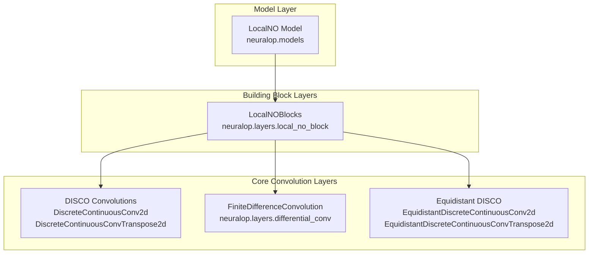
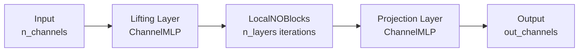
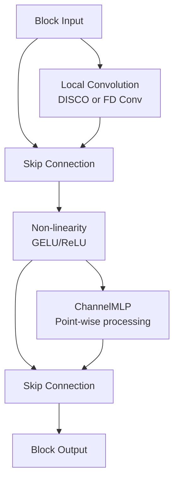
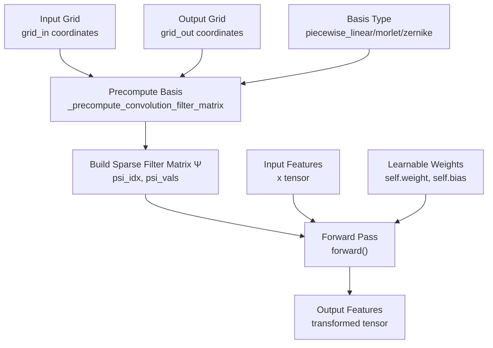
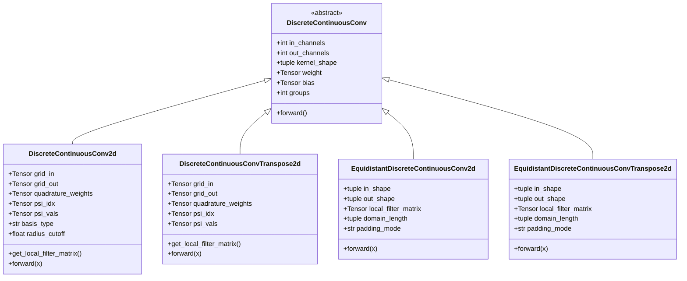
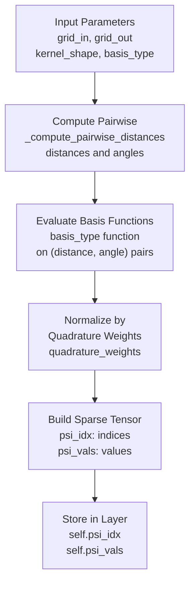

<!-- source: DeepWiki mcp.deepwiki.com · repo neuraloperator/neuraloperator · page 2.5 Local Neural Operators · fetched 2026-10-21 -->

# Local Neural Operators

<details>
<summary>Relevant source files</summary>

The following files were used as context for generating this wiki page:

- [doc/source/modules/api.rst](doc/source/modules/api.rst)
- [neuralop/models/fnogno.py](neuralop/models/fnogno.py)
- [neuralop/models/gino.py](neuralop/models/gino.py)

</details>


Local Neural Operators are neural operator architectures that use localized operations on function spaces, as opposed to global spectral methods like those used in Fourier Neural Operators (see page 2.1). They focus on local spatial neighborhoods and differential operators, making them particularly effective for problems requiring fine-grained local feature capture or explicit differential constraints.

The neuraloperator library provides:
1. **LocalNO model** - Complete architecture using local convolutions
2. **LocalNOBlocks layer** - Building blocks for local neural operator models
3. **DISCO Convolutions** - Discrete-continuous convolution layers
4. **Finite Difference Convolutions** - Learnable differential operators

## Overview of Local Neural Operators

Local Neural Operators differ from global spectral methods by operating on local neighborhoods in the spatial domain rather than transforming to frequency space. This architectural choice provides:

- Direct computation on irregular domains and meshes
- Effective capture of localized features and discontinuities
- Reduced computational cost for sparse or localized problems
- Natural integration with physics-informed differential constraints
- Explicit control over receptive field size

**Local Neural Operator Hierarchy Diagram**


Sources: [doc/source/modules/api.rst:75-84](), [doc/source/modules/api.rst:211-221]()

## LocalNO Model Architecture

The `LocalNO` class is the complete neural operator model that uses local operations. It is analogous to how `FNO` uses spectral convolutions, but instead employs `LocalNOBlocks` for spatially localized processing.

**LocalNO Model Structure**


The model follows a standard encoder-processor-decoder pattern:
1. **Lifting**: Projects input channels to hidden dimension
2. **Local Processing**: Applies `n_layers` of `LocalNOBlocks`
3. **Projection**: Projects hidden dimension to output channels

Sources: [doc/source/modules/api.rst:75-84]()

## LocalNOBlocks Layer

`LocalNOBlocks` is the core building block layer that implements local convolution operations. It is defined in `neuralop.layers.local_no_block` and provides the local spatial processing analogous to how `FNOBlocks` provides spectral processing in FNO models.

**LocalNOBlocks Internal Structure**


Key parameters for `LocalNOBlocks`:
- `in_channels` / `out_channels`: Feature dimensions
- `n_layers`: Number of sequential local blocks
- Convolution type (DISCO or Finite Difference)
- Skip connection configuration
- Non-linearity activation function

Sources: [doc/source/modules/api.rst:211-221]()

## Discrete-Continuous (DISCO) Convolutions

DISCO (Discrete-Continuous) convolutions implement continuous convolution operations in a discretized computational setting. They evaluate kernel functions on pairs of points between input and output grids, creating a localized filter operation that can handle arbitrary point clouds and irregular meshes.

### Theory and Implementation

The DISCO convolution operation computes a continuous convolution between functions defined on discrete point sets. For input points `y` and output points `x`, the operation is:

```
f_out(x) = ∫ ψ(x, y) * K(x, y) * f_in(y) * w(y) dy
```

where:
- `ψ(x, y)` is a basis function evaluated at point pairs
- `K(x, y)` is a learnable kernel
- `f_in(y)` is the input function
- `w(y)` is the quadrature weight

Implementation steps:
1. Precompute basis function evaluations between input and output grid points
2. Build a sparse filter matrix Ψ representing these evaluations
3. Apply this filter matrix during the forward pass with learnable weights

The implementation supports various basis function types:
- `piecewise_linear` (default): Linear interpolation basis
- `morlet`: Morlet wavelet basis
- `zernike`: Zernike polynomial basis

**DISCO Convolution Pipeline**


Sources: [neuralop/layers/discrete_continuous_convolution.py:76-174](), [doc/source/modules/api.rst:194-210]()

### DISCO Convolution Variants

The library provides four DISCO convolution implementations, each optimized for different grid configurations:

**DISCO Convolution Class Hierarchy**


#### DiscreteContinuousConv2d

Implements DISCO convolutions for arbitrary 2D point clouds. This is the most general implementation, supporting irregular meshes and non-uniform grids.

**Key Parameters:**
- `in_channels`, `out_channels`: Number of input/output feature channels
- `grid_in`, `grid_out`: Coordinate tensors shape `[2, n_points]` for input/output points
- `kernel_shape`: Size and shape of the convolution kernel
- `basis_type`: Choice of basis function (`'piecewise_linear'`, `'morlet'`, `'zernike'`)
- `quadrature_weights`: Integration weights for input points, shape `[n_points_in]`
- `radius_cutoff`: Maximum distance for local interactions (default 1.0)

**Usage Pattern:**
```python
# Define arbitrary point clouds
grid_in = torch.stack(regular_grid_2d(spatial_dims=[64, 64])).view(2, -1)  
grid_out = torch.stack(regular_grid_2d(spatial_dims=[48, 48])).view(2, -1)
quadrature_weights = torch.ones(grid_in.shape[1])

# Create DISCO layer
disco_conv = DiscreteContinuousConv2d(
    in_channels=32,
    out_channels=64,
    grid_in=grid_in,
    grid_out=grid_out,
    kernel_shape=3,
    basis_type='piecewise_linear',
    quadrature_weights=quadrature_weights
)

# Forward pass: [batch, in_channels, n_points_in] -> [batch, out_channels, n_points_out]
x = torch.randn(batch_size, 32, grid_in.shape[1])
output = disco_conv(x)  # Shape: [batch_size, 64, grid_out.shape[1]]
```

Sources: [neuralop/layers/discrete_continuous_convolution.py:255-318](), [doc/source/modules/api.rst:202-210]()

#### DiscreteContinuousConvTranspose2d

The transpose (adjoint) variant of DISCO convolutions, useful for upsampling operations or decoder stages that map from coarse to fine grids.

**Key Difference from Forward Convolution:**
- Swaps the roles of `grid_in` and `grid_out`
- Implements the adjoint operation: maps from coarse query points to fine output points
- Useful in encoder-decoder architectures for upsampling

Sources: [neuralop/layers/discrete_continuous_convolution.py:445-626](), [doc/source/modules/api.rst:202-210]()

#### Equidistant Variants

For regular equidistant grids, optimized implementations are available:
- `EquidistantDiscreteContinuousConv2d`
- `EquidistantDiscreteContinuousConvTranspose2d`

These variants:
- Assume uniform grid spacing
- Map operations to standard 2D convolutions for efficiency
- Preserve theoretical properties of DISCO convolutions
- Significantly faster than general point cloud versions

**Key Parameters for Equidistant Variants:**
- `in_shape`, `out_shape`: Tuple specifying grid dimensions `(height, width)`
- `domain_length`: Physical domain size, defaults to `(1.0, 1.0)`
- `padding_mode`: Boundary handling (`'zeros'`, `'circular'`, `'replicate'`)

Sources: [neuralop/layers/discrete_continuous_convolution.py:629-948](), [doc/source/modules/api.rst:202-210]()

## Finite Difference Convolutions

`FiniteDifferenceConvolution` implements learnable directional derivatives using finite difference approximations. The layer learns a weighted combination of local finite differences that converges to true directional derivatives as grid resolution increases.

### Theory and Implementation

The finite difference convolution computes:

```
∂f/∂x ≈ (K * f - mean(K) * f) / Δx
```

where:
- `K` is a learnable kernel
- `mean(K)` is the mean of kernel weights
- `Δx` is the grid spacing (grid_width)

**Implementation Steps:**

1. **Apply Convolution**: Compute `conv = K * f` using standard convolution
2. **Subtract Mean**: Compute `mean_conv = mean(K) * f` to remove constant terms
3. **Scale by Grid Width**: Divide by `Δx` to ensure proper derivative scaling

The subtraction of the mean ensures the operation computes a derivative rather than a weighted average. The grid width scaling ensures convergence to the true derivative as resolution increases.

**Forward Pass Implementation:**
```python
def forward(self, x, grid_width):
    # Standard convolution
    conv = self.conv(x)
    
    # Compute mean of kernel
    conv_sum = torch.sum(self.conv.weight, dim=tuple([i for i in range(2, 2 + self.n_dim)]), keepdim=True)
    conv_sum = self.conv_function(x, conv_sum, groups=self.groups)
    
    # Subtract mean and scale by grid width
    return (conv - conv_sum) / grid_width
```

**Key Parameters:**
- `in_channels`, `out_channels`: Number of input/output feature channels
- `n_dim`: Spatial dimensions (1, 2, or 3)
- `kernel_size`: Size of finite difference stencil (must be odd, typically 3 or 5)
- `padding`: Boundary handling (`'periodic'`, `'replicate'`, `'reflect'`, `'zeros'`)
- `groups`: Number of groups for grouped convolution (default 1)

**Usage Pattern:**
```python
# Create finite difference convolution for 2D inputs
fd_conv = FiniteDifferenceConvolution(
    in_channels=10,
    out_channels=1,
    n_dim=2,
    kernel_size=3,
    padding='periodic'
)

# Forward pass requires grid width for proper scaling
x = torch.randn(batch_size, in_channels, height, width)
grid_width = 1.0 / height  # Assuming unit domain [0,1]
output = fd_conv(x, grid_width)  # Shape: [batch_size, 1, height, width]
```

**Convergence Property:**

The layer is designed to converge to the true directional derivative operator as resolution increases. Tests verify this convergence behavior by measuring that the error decreases proportionally to the grid width.

Sources: [neuralop/layers/differential_conv.py:1-88](), [doc/source/modules/api.rst:180-193]()

## Comparison: Local vs Global Neural Operators

The choice between local and global (spectral) neural operators depends on problem characteristics:

| Feature | Local Neural Operators | Global Neural Operators (FNO) |
|---------|------------------------|-------------------------------|
| **Domain Type** | Arbitrary point clouds, irregular meshes | Regular grids, periodic domains |
| **Receptive Field** | Explicitly controlled, localized | Inherently global via FFT |
| **Feature Capture** | Localized features, discontinuities, boundaries | Smooth global patterns |
| **Computational Cost** | O(n * k) where k is neighborhood size | O(n log n) via FFT |
| **Memory Footprint** | Sparse operations reduce memory | Dense spectral modes |
| **Differential Operators** | Direct implementation via `FiniteDifferenceConvolution` | Requires separate differentiation utilities |
| **Implementation** | More complex, requires neighbor search | Simpler, uses standard FFT |
| **Use Cases** | Complex geometries, physics-informed constraints | Large-scale smooth PDEs on grids |

**When to Use Local Neural Operators:**
- Problem requires explicit differential operators or physics constraints
- Domain has irregular geometry or varying resolution
- Features are highly localized (shocks, boundaries, discontinuities)
- Working with sparse point clouds or meshes

**When to Use Global Neural Operators:**
- Problem involves smooth, periodic phenomena
- Large regular grids with global interactions
- Computational efficiency is critical
- Problem benefits from frequency domain representation

Sources: [neuralop/layers/discrete_continuous_convolution.py](), [neuralop/layers/differential_conv.py](), [doc/source/modules/api.rst:75-84]()

## Technical Implementation Details

### DISCO Filter Matrix Precomputation

The core of DISCO convolutions is the filter matrix Ψ, which is precomputed during layer initialization in `_precompute_convolution_filter_matrix`.

**Filter Matrix Construction Pipeline**


**Precomputation Details:**

The `_precompute_convolution_filter_matrix` function:
1. Computes pairwise distances between all input and output points
2. Identifies pairs within `radius_cutoff` distance
3. Evaluates the chosen basis function at these distances
4. Applies quadrature weight normalization
5. Returns sparse tensor representation (`psi_idx`, `psi_vals`)

**Forward Pass with Precomputed Matrix:**

```python
# Pseudocode of forward pass
def forward(self, x):
    # 1. Apply quadrature weights
    x_weighted = x * self.quadrature_weights
    
    # 2. Sparse matrix multiplication with filter matrix
    psi_matrix = sparse_tensor(self.psi_idx, self.psi_vals)
    x_filtered = psi_matrix @ x_weighted
    
    # 3. Apply learnable convolution weights
    x_conv = einsum('bci,iok->bck', x_filtered, self.weight)
    
    # 4. Add bias if present
    if self.bias is not None:
        x_conv = x_conv + self.bias
    
    return x_conv
```

Sources: [neuralop/layers/discrete_continuous_convolution.py:76-174](), [neuralop/layers/discrete_continuous_convolution.py:395-442]()

### Finite Difference Convergence Behavior

The `FiniteDifferenceConvolution` is designed to converge to true derivatives as resolution increases:

**Mathematical Property:**
```
lim (Δx → 0) [(K * f - mean(K) * f) / Δx] = ∂f/∂x
```

**Implementation Key Points:**

1. **Mean Subtraction**: Ensures zero-mean kernel, which is necessary for derivative approximation
2. **Grid Width Scaling**: Factor of `1/Δx` provides correct dimensional scaling
3. **Learnable Weights**: The kernel `K` is learned, allowing the network to approximate directional derivatives or combinations thereof

**Convergence Validation:**

Testing verifies convergence by:
- Training on a known differentiable function
- Measuring approximation error at different resolutions
- Confirming error decreases proportionally to grid width

The test suite includes convergence tests that validate this theoretical property empirically.

Sources: [neuralop/layers/differential_conv.py:73-87]()

### LocalNOBlocks Implementation Pattern

`LocalNOBlocks` follows a similar pattern to `FNOBlocks` but uses local convolutions:

**Block Structure:**
1. Local convolution (DISCO or Finite Difference)
2. Skip connection from block input
3. Non-linearity activation
4. Point-wise ChannelMLP
5. Skip connection for MLP branch
6. Optional output normalization

Each block processes features while maintaining the spatial structure, allowing the model to learn multi-scale local patterns through the layer stack.

Sources: [doc/source/modules/api.rst:211-221]()

## References

Local Neural Operators are based on the following research papers:

1. Liu-Schiaffini, M., Berner, J., Bonev, B., Kurth, T., Azizzadenesheli, K., Anandkumar, A. (2024). "Neural Operators with Localized Integral and Differential Kernels". ICML 2024, https://arxiv.org/abs/2402.16845

2. Bonev, B., Kurth, T., Hundt, C., Pathak, J., Baust, M., Kashinath, K., Anandkumar, A. (2023). "Spherical Neural Operators: Learning Stable Dynamics on the Sphere". https://arxiv.org/abs/2306.03838

3. Ocampo, J., Price, M.A., McEwen, J.D. (2023). "Scalable and equivariant spherical CNNs by discrete-continuous (DISCO) convolutions". ICLR 2023, https://arxiv.org/abs/2209.13603

---

