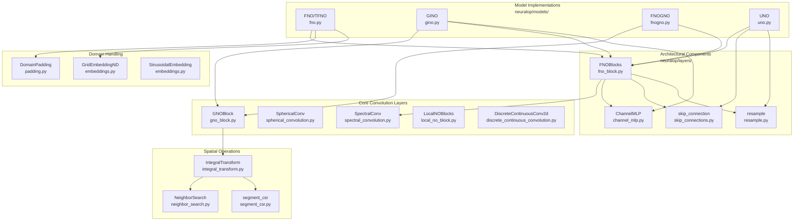
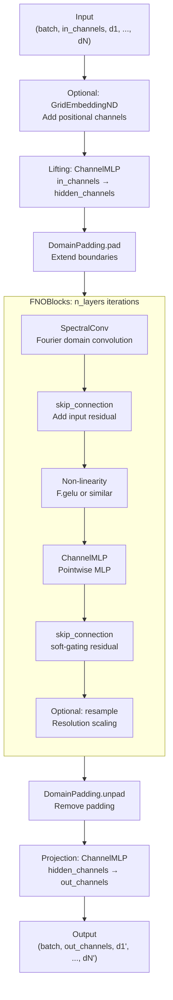
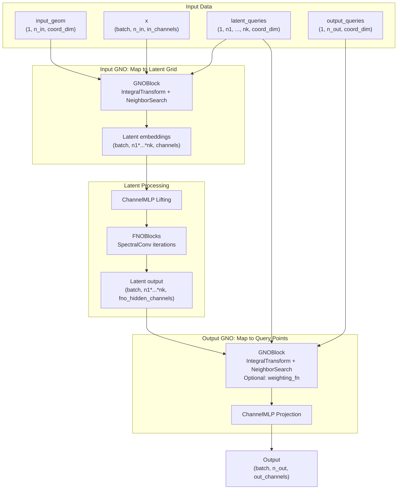

<!-- source: DeepWiki mcp.deepwiki.com · repo neuraloperator/neuraloperator · page 3 Core Layers and Components · fetched 2026-10-21 -->

# Core Layers and Components

<details>
<summary>Relevant source files</summary>

The following files were used as context for generating this wiki page:

- [doc/source/modules/api.rst](doc/source/modules/api.rst)
- [neuralop/layers/base_spectral_conv.py](neuralop/layers/base_spectral_conv.py)
- [neuralop/layers/legacy_spectral_convolution.py](neuralop/layers/legacy_spectral_convolution.py)
- [neuralop/layers/spectral_convolution.py](neuralop/layers/spectral_convolution.py)
- [neuralop/layers/tests/test_legacy_spectral_convolution.py](neuralop/layers/tests/test_legacy_spectral_convolution.py)
- [neuralop/layers/tests/test_spectral_convolution.py](neuralop/layers/tests/test_spectral_convolution.py)
- [neuralop/models/fnogno.py](neuralop/models/fnogno.py)
- [neuralop/models/gino.py](neuralop/models/gino.py)

</details>


**Purpose and Scope**

This page provides an overview of the modular layer system in neuraloperator. These layers are the building blocks that compose neural operator models. Each layer implements a specific operation in the operator learning pipeline, and layers can be combined to create custom architectures.

For complete model architectures that use these components, see [Neural Operator Models](#2). For training workflows that utilize these models, see [Training Infrastructure](#4). For detailed documentation of individual layer types, see the subsections listed below.

## Architecture Philosophy

The neuraloperator library follows a compositional design where complex models are constructed by stacking reusable layer components. This modularity enables:

- **Flexibility**: Mix and match layers to create custom architectures
- **Reusability**: Share components across different model types
- **Extensibility**: Add new layer types without modifying existing models
- **Testability**: Each layer can be tested independently

Models like FNO, GINO, and UNO are implemented as specific compositions of these core layers, but users can also build custom architectures directly from layer primitives.

## Layer Type Hierarchy

The following diagram shows the organization of layer types in the codebase and how they are composed into models:

**Diagram: Layer Component Ecosystem and Model Composition**



Sources: [neuralop/layers/spectral_convolution.py](), [neuralop/layers/gno_block.py](), [neuralop/layers/fno_block.py](), [neuralop/models/fno.py](), [neuralop/models/gino.py](), [neuralop/models/fnogno.py]()

## Layer Categories

### Convolution Layers

Convolution layers perform the core operator learning computation, mapping between function spaces through different mathematical operations.

| Layer Class | Domain | Key Operation | Primary Parameters |
|------------|--------|---------------|-------------------|
| `SpectralConv` | Regular grids | FFT → mode truncation → learned weights → IFFT | `n_modes`, `factorization`, `separable` |
| `SphericalConv` | Spherical surfaces | Spherical harmonic transform → truncation → weights | `n_modes`, `grid_type` |
| `GNOBlock` | Irregular meshes | Neighbor search → kernel integration | `radius`, `transform_type`, `weighting_fn` |
| `LocalNOBlocks` | Regular grids | Local spatial convolution kernels | `kernel_size`, `n_layers` |
| `DiscreteContinuousConv2d` | 2D mixed spaces | Convolution with continuous kernels | `kernel_size`, `in_channels`, `out_channels` |

Sources: [neuralop/layers/spectral_convolution.py:181-508](), [doc/source/modules/api.rst:114-145]()

### Architectural Building Blocks

These components handle data flow, feature transformation, and architectural patterns that are common across models.

| Component | Purpose | Key Functionality |
|-----------|---------|-------------------|
| `FNOBlocks` | Stacked spectral layers | Iterates `SpectralConv` + `ChannelMLP` with skip connections |
| `ChannelMLP` | Pointwise transformation | Linear layers operating on channel dimension |
| `skip_connection` | Residual paths | Adds input to output with optional soft-gating |
| `resample` | Resolution scaling | Interpolation for upsampling/downsampling |
| `IntegralTransform` | Kernel integration | Integrates learned kernel over neighborhoods |

Sources: [neuralop/layers/fno_block.py](), [neuralop/layers/channel_mlp.py](), [neuralop/layers/skip_connections.py]()

### Domain and Embedding Layers

These layers handle boundary conditions, positional encoding, and coordinate transformations.

| Layer | Purpose | Output Type |
|-------|---------|-------------|
| `DomainPadding` | Resolution-dependent boundary padding | Padded tensor with methods `.pad()` and `.unpad()` |
| `GridEmbeddingND` | N-dimensional grid coordinates as channels | Additional channels with coordinate values |
| `GridEmbedding2D` | 2D grid coordinates | Additional 2 channels (x, y coordinates) |
| `SinusoidalEmbedding` | High-frequency positional encoding | Sinusoidal features (transformer or NeRF style) |

Sources: [neuralop/layers/padding.py](), [neuralop/layers/embeddings.py](), [doc/source/modules/api.rst:281-305]()

## Layer Composition Patterns

The following diagrams illustrate how layers are composed in standard architectures. These patterns demonstrate the data flow through layer stacks.

**Diagram: FNO Architecture Layer Flow**



Sources: [neuralop/models/fno.py](), [neuralop/layers/fno_block.py]()

**Diagram: GINO Architecture Layer Flow**



Sources: [neuralop/models/gino.py:390-525](), [neuralop/layers/gno_block.py]()

## Common Layer Interfaces

Most layers in neuraloperator follow standard PyTorch `nn.Module` conventions with some extensions specific to operator learning.

### Standard Methods

All layer classes inherit from `torch.nn.Module` and implement:

- `__init__()`: Initialize parameters and hyperparameters
- `forward()`: Execute the layer's computation

### Operator-Specific Extensions

Some layers implement additional methods for operator learning:

| Method | Purpose | Example Usage |
|--------|---------|---------------|
| `transform()` | Apply same transformation to skip connection | Used in `BaseSpectralConv` for resolution scaling |
| `set_ada_in_embeddings()` | Update adaptive instance normalization | Used in `FNOBlocks` for conditional generation |

Sources: [neuralop/layers/base_spectral_conv.py:4-28](), [neuralop/layers/fno_block.py]()

### Parameter Handling

Layers handle learnable parameters through:

1. **Direct `nn.Parameter`**: Standard PyTorch parameters (e.g., bias terms)
2. **`FactorizedTensor`**: Tensorized parameters for memory efficiency (Tucker, CP, TT decompositions)
3. **`nn.ModuleList`**: Collections of sub-layers (e.g., multiple `SpectralConv` layers)

Example from `SpectralConv`:

```python
# Direct tensor (when factorization=None)
self.weight = torch.tensor(weight_shape, dtype=torch.cfloat)

# Factorized tensor (when factorization='tucker', 'cp', or 'tt')
self.weight = FactorizedTensor.new(
    weight_shape, 
    rank=self.rank,
    factorization=factorization
)
```

Sources: [neuralop/layers/spectral_convolution.py:338-346]()

## Layer Categories Overview

The following subsections provide brief descriptions of each layer category. Detailed documentation is available in the linked pages.

### Spectral Convolution

The `SpectralConv` layer implements Fourier domain convolution, the core operation in Fourier Neural Operators. It transforms inputs to frequency space via FFT, applies learned weights to selected Fourier modes, and transforms back via inverse FFT.

**Key Features**:
- Mode truncation for global receptive field with bounded parameters
- Tensor factorization (Tucker, CP, TT) for parameter compression
- Separable convolution option
- Resolution scaling support
- Real or complex-valued data handling

For details, see [Spectral Convolution](#3.1).

Sources: [neuralop/layers/spectral_convolution.py:181-508]()

### FNO Blocks

`FNOBlocks` stacks multiple Fourier layers with skip connections, activation functions, and optional pointwise MLPs. This component encapsulates the iterative spectral processing that characterizes FNO architectures.

**Key Features**:
- Configurable number of layers
- Multiple skip connection types (linear, soft-gating, identity)
- Adaptive instance normalization support
- Mixed precision training
- Optional stabilization before FFT

For details, see [FNO Blocks](#3.2).

Sources: [neuralop/layers/fno_block.py]()

### Integral Transforms and GNO Blocks

`GNOBlock` and `IntegralTransform` enable neural operators on irregular geometries by integrating learned kernels over spatial neighborhoods. This is the foundation of geometry-informed models like GINO.

**Key Features**:
- Neighbor search (Open3D or native PyTorch)
- Flexible kernel integration (linear, nonlinear, kernel-only)
- Positional embeddings (transformer or NeRF style)
- Weighting functions for mollified operators
- Reduction operations (sum, mean)

For details, see [Integral Transforms and GNO Blocks](#3.3).

Sources: [neuralop/layers/gno_block.py](), [neuralop/layers/integral_transform.py](), [neuralop/models/gino.py:281-296]()

### Domain Padding

`DomainPadding` automatically extends domain boundaries based on input resolution, helping spectral methods handle boundary conditions. It provides symmetric `.pad()` and `.unpad()` operations.

**Key Features**:
- Resolution-dependent padding amounts
- Multiple padding modes (symmetric, circular, replicate)
- Separate padding per dimension
- Automatic tracking of padded regions

For details, see [Domain Padding](#3.4).

Sources: [neuralop/layers/padding.py](), [doc/source/modules/api.rst:294-305]()

### Embedding Layers

Embedding layers add positional information to input functions, enabling models to distinguish between different spatial locations.

**Available Embeddings**:
- `GridEmbeddingND`: Adds coordinate grids as additional channels
- `GridEmbedding2D`: Specialized 2D version
- `SinusoidalEmbedding`: High-frequency sinusoidal features (transformer or NeRF style)

For details, see [Embedding Layers](#3.5).

Sources: [neuralop/layers/embeddings.py](), [doc/source/modules/api.rst:240-252]()

### Discrete-Continuous Convolutions

DISCO (Discrete-Continuous) convolutions handle function spaces that mix discrete and continuous representations, useful for multi-physics problems with heterogeneous discretizations.

**Key Layers**:
- `DiscreteContinuousConv2d`: Standard convolution
- `DiscreteContinuousConvTranspose2d`: Transposed convolution
- `EquidistantDiscreteContinuousConv2d`: Optimized for uniform grids

For details, see [Discrete-Continuous Convolutions](#3.6).

Sources: [neuralop/layers/discrete_continuous_convolution.py](), [doc/source/modules/api.rst:194-210]()

### Fourier Continuation

Fourier continuation layers extend non-periodic functions so that spectral methods can be applied without boundary artifacts. This is critical for problems with non-periodic boundary conditions.

**Available Methods**:
- Legendre-based continuation
- Gram-Schmidt continuation

For details, see [Fourier Continuation](#3.7).

Sources: [neuralop/layers/fourier_continuation.py]()

## Layer Usage Examples

The following table shows which layers are used in each model architecture:

| Model | Convolution | Blocks | Domain | Embedding | Geometry |
|-------|------------|--------|--------|-----------|----------|
| FNO | `SpectralConv` | `FNOBlocks` | `DomainPadding` | `GridEmbeddingND` | - |
| TFNO | `SpectralConv` | `FNOBlocks` | `DomainPadding` | `GridEmbeddingND` | - |
| UNO | `SpectralConv` | `FNOBlocks` | - | - | - |
| GINO | `SpectralConv` | `FNOBlocks` | - | `SinusoidalEmbedding` | `GNOBlock` |
| FNOGNO | `SpectralConv` | `FNOBlocks` | - | `SinusoidalEmbedding` | `GNOBlock` |
| SFNO | `SphericalConv` | Custom | - | - | - |

Sources: [neuralop/models/fno.py](), [neuralop/models/uno.py](), [neuralop/models/gino.py](), [neuralop/models/fnogno.py]()

## Building Custom Architectures

Users can compose layers directly to build custom architectures. Here's the general pattern:

1. **Lifting**: Use `ChannelMLP` to map input channels to hidden dimensions
2. **Processing**: Stack convolution layers (spectral, graph, or local) with skip connections
3. **Projection**: Use `ChannelMLP` to map hidden dimensions to output channels

Optional components:
- Add `DomainPadding` before/after spectral processing
- Add `GridEmbeddingND` to concatenate positional features
- Use `resample` for multi-resolution processing
- Apply `skip_connection` for residual paths

For concrete examples, examine the model implementations in [neuralop/models/]() or refer to specific model documentation in [Neural Operator Models](#2).

Sources: [neuralop/models/fno.py](), [neuralop/models/gino.py](), [neuralop/models/fnogno.py]()

---

