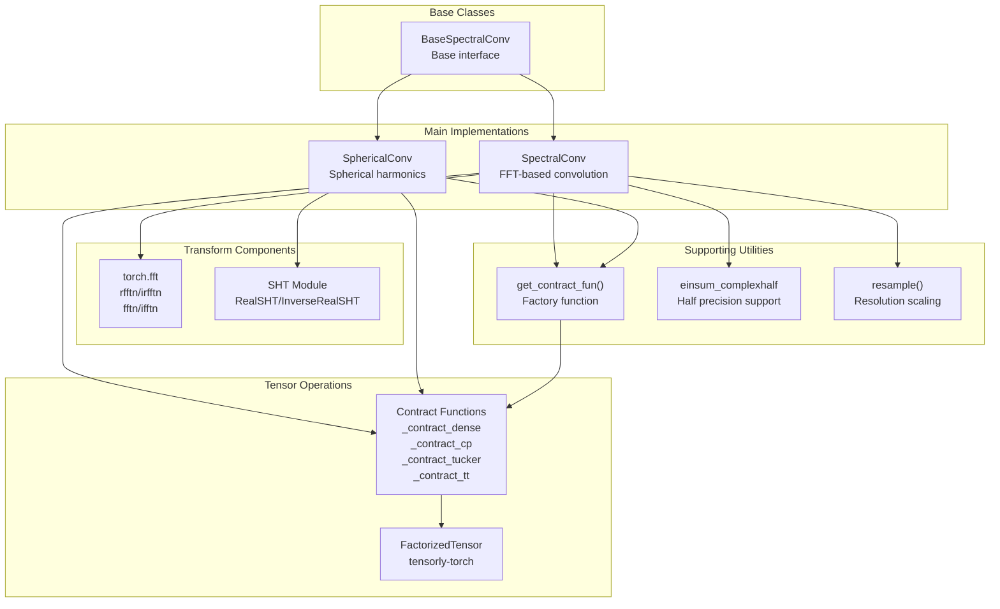
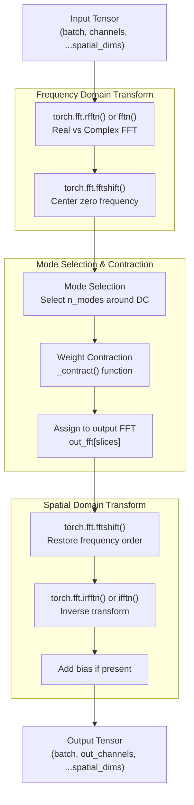
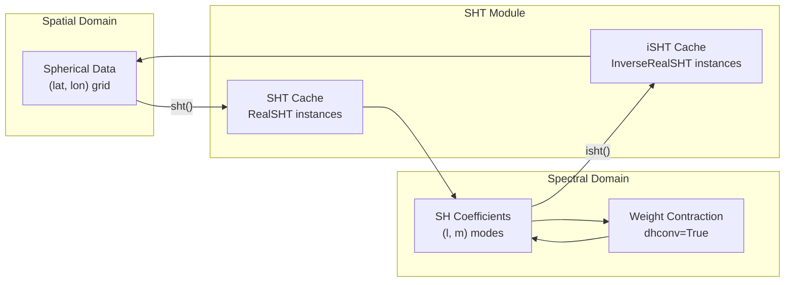
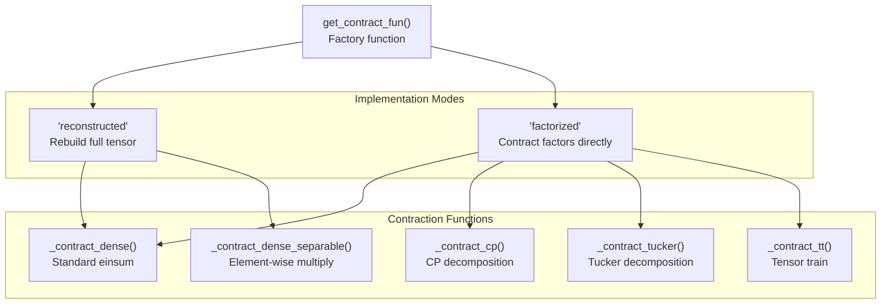
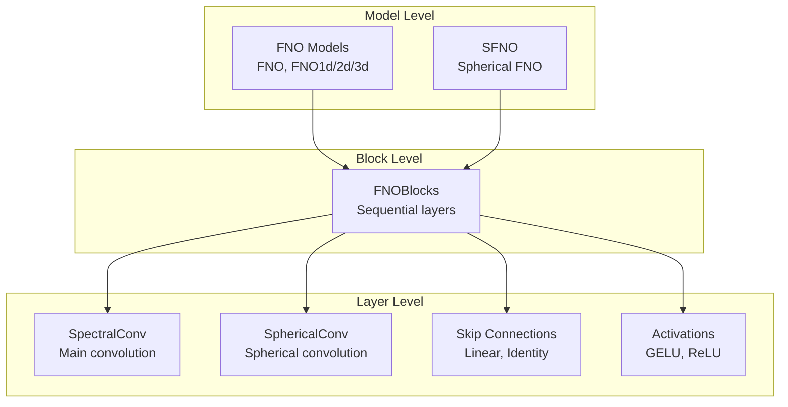

<!-- source: DeepWiki mcp.deepwiki.com · repo neuraloperator/neuraloperator · page 3.1 Spectral Convolution · fetched 2026-10-21 -->

# Spectral Convolution

<details>
<summary>Relevant source files</summary>

The following files were used as context for generating this wiki page:

- [doc/source/modules/api.rst](doc/source/modules/api.rst)
- [neuralop/layers/base_spectral_conv.py](neuralop/layers/base_spectral_conv.py)
- [neuralop/layers/legacy_spectral_convolution.py](neuralop/layers/legacy_spectral_convolution.py)
- [neuralop/layers/spectral_convolution.py](neuralop/layers/spectral_convolution.py)
- [neuralop/layers/tests/test_legacy_spectral_convolution.py](neuralop/layers/tests/test_legacy_spectral_convolution.py)
- [neuralop/layers/tests/test_spectral_convolution.py](neuralop/layers/tests/test_spectral_convolution.py)
- [neuralop/models/fnogno.py](neuralop/models/fnogno.py)
- [neuralop/models/gino.py](neuralop/models/gino.py)

</details>


This document covers the spectral convolution layers that form the core computational building blocks of neural operator models in the neuraloperator library. Spectral convolutions perform convolution operations in the frequency domain using Fourier transforms, enabling efficient global receptive fields for learning operators on function spaces.

For information about complete neural operator models that use these layers, see [Neural Operator Models](#2). For training infrastructure that orchestrates these components, see [Training Infrastructure](#4).

## Overview

Spectral convolution layers implement the fundamental operation of Fourier Neural Operators (FNOs), performing convolution in the Fourier domain rather than spatial domain. This approach provides several advantages:

- **Global receptive field**: Every output location depends on all input locations
- **Resolution invariance**: Can handle inputs of different resolutions 
- **Computational efficiency**: FFT-based operations scale as O(N log N)
- **Mode truncation**: Control complexity by limiting high-frequency modes

The library provides two main spectral convolution implementations:
- `SpectralConv`: General N-dimensional spectral convolution using FFT
- `SphericalConv`: Specialized convolution for spherical data using spherical harmonics

Sources: [neuralop/layers/spectral_convolution.py:181-260](), [neuralop/layers/spherical_convolution.py:285-303]()

## Architecture Overview



Sources: [neuralop/layers/base_spectral_conv.py:4-14](), [neuralop/layers/spectral_convolution.py:133-176](), [neuralop/layers/spherical_convolution.py:155-201]()

## SpectralConv Implementation

### Core Forward Pass

The `SpectralConv` class implements the spectral convolution operation through the following steps:



Sources: [neuralop/layers/spectral_convolution.py:393-507]()

### Key Parameters

| Parameter | Type | Description |
|-----------|------|-------------|
| `in_channels` | int | Number of input channels |
| `out_channels` | int | Number of output channels |
| `n_modes` | int/tuple | Number of Fourier modes to retain per dimension |
| `max_n_modes` | int/tuple | Maximum modes for dynamic mode adjustment |
| `factorization` | str | Tensor factorization method: 'Dense', 'CP', 'Tucker', 'TT' |
| `separable` | bool | Use separable convolution (in_channels == out_channels) |
| `complex_data` | bool | Handle complex-valued spatial domain data |
| `resolution_scaling_factor` | float/list | Scale output resolution |

Sources: [neuralop/layers/spectral_convolution.py:262-281]()

### Mode Truncation Logic

The layer implements intelligent mode truncation to handle the redundancy in real FFTs:

```python
# For real spatial data, last mode dimension is redundant
if not self.complex_data:
    n_modes[-1] = n_modes[-1] // 2 + 1
```

Mode selection creates slices around the zero frequency (DC component) after FFT shift:

```python
center = all_modes // 2
negative_freqs = kept_modes // 2
positive_freqs = kept_modes // 2 + kept_modes % 2
slice(center - negative_freqs, center + positive_freqs)
```

Sources: [neuralop/layers/spectral_convolution.py:386-391](), [neuralop/layers/spectral_convolution.py:470-481]()

## SphericalConv Implementation

### Spherical Harmonics Transform

`SphericalConv` extends spectral convolution to spherical domains using spherical harmonics transforms instead of FFT:



The `SHT` wrapper class caches transform instances for different grid configurations:

```python
cache_key = f"{height}_{width}_{modes_height}_{modes_width}_{norm}_{grid}"
```

Sources: [neuralop/layers/spherical_convolution.py:207-283](), [neuralop/layers/spherical_convolution.py:426-463]()

## Tensor Factorization Support

### Factorization Types

Both spectral convolution classes support multiple tensor factorization methods to reduce parameter count and computational cost:

| Factorization | Weight Shape | Memory Reduction | Use Case |
|---------------|--------------|------------------|----------|
| Dense | Full tensor | None | Baseline, small models |
| CP | Sum of rank-1 tensors | Significant | High compression |
| Tucker | Core + factor matrices | Moderate | Balanced compression |
| TT | Tensor train | High | Very high dimensions |

Sources: [neuralop/layers/spectral_convolution.py:321-350]()

### Contraction Functions

The library provides specialized contraction functions for each factorization type:



Each contraction function uses optimized einsum operations with automatically generated index notation:

```python
eq = f'{"".join(x_syms)},{"".join(weight_syms)}->{"".join(out_syms)}'
return tl.einsum(eq, x, weight)
```

Sources: [neuralop/layers/spectral_convolution.py:21-131](), [neuralop/layers/spectral_convolution.py:133-176]()

## Precision and Performance

### Half-Precision Support

The implementation supports multiple precision modes for performance optimization:

- `"full"`: Full precision (torch.cfloat)
- `"half"`: Half precision throughout (torch.chalf) 
- `"mixed"`: Full precision FFT, half precision computation

The `einsum_complexhalf` utility provides specialized einsum for complex half-precision tensors:

```python
if x.dtype == torch.complex32:
    return einsum_complexhalf(eq, x, weight)
```

Sources: [neuralop/layers/spectral_convolution.py:414-437](), [neuralop/layers/einsum_utils.py]()

### Resolution Scaling

Both convolution types support dynamic resolution scaling through the `resolution_scaling_factor` parameter:

```python
if self.resolution_scaling_factor is not None:
    out_shape = tuple([round(s * r) for (s, r) in zip(in_shape, self.resolution_scaling_factor)])
```

This enables training at one resolution and inference at different resolutions, supporting the resolution-invariant properties of neural operators.

Sources: [neuralop/layers/spectral_convolution.py:359-374](), [neuralop/layers/spectral_convolution.py:490-494]()

## Usage Integration

### Neural Operator Integration

Spectral convolution layers integrate into neural operator architectures through the model hierarchy:



Sources: References to FNO models in [Neural Operator Models](#2)

### Transform Interface

The base class defines a `transform` method that spectral convolutions can override to handle resolution changes in skip connections:

```python
def transform(self, x, output_shape=None):
    # Handle resolution scaling for skip connections
    if in_shape == out_shape:
        return x
    else:
        return resample(x, 1.0, list(range(2, x.ndim)), output_shape=out_shape)
```

This ensures that skip connections are properly scaled when the spectral convolution changes the spatial resolution.

Sources: [neuralop/layers/base_spectral_conv.py:15-27](), [neuralop/layers/spectral_convolution.py:359-374]()

---

