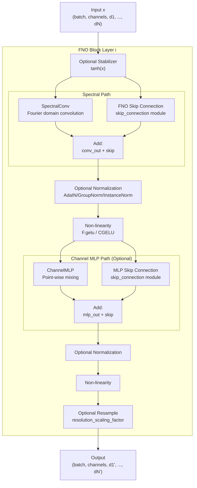
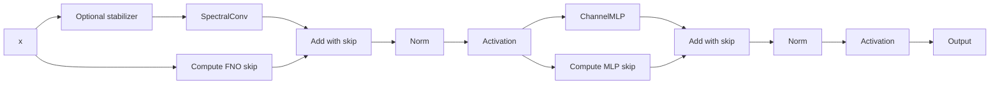
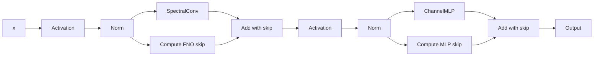
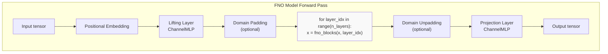
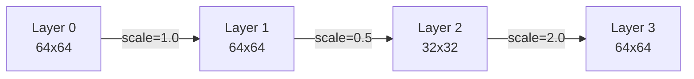

<!-- source: DeepWiki mcp.deepwiki.com · repo neuraloperator/neuraloperator · page 3.2 FNO Blocks · fetched 2026-10-21 -->

# FNO Blocks

<details>
<summary>Relevant source files</summary>

The following files were used as context for generating this wiki page:

- [neuralop/layers/base_spectral_conv.py](neuralop/layers/base_spectral_conv.py)
- [neuralop/layers/fno_block.py](neuralop/layers/fno_block.py)
- [neuralop/layers/legacy_spectral_convolution.py](neuralop/layers/legacy_spectral_convolution.py)
- [neuralop/layers/spectral_convolution.py](neuralop/layers/spectral_convolution.py)
- [neuralop/layers/tests/test_legacy_spectral_convolution.py](neuralop/layers/tests/test_legacy_spectral_convolution.py)
- [neuralop/layers/tests/test_spectral_convolution.py](neuralop/layers/tests/test_spectral_convolution.py)
- [neuralop/models/fno.py](neuralop/models/fno.py)

</details>


## Purpose and Scope

This document describes the `FNOBlocks` class, which implements the core iterative spectral layer stack used in Fourier Neural Operator models. FNOBlocks is a sequence of Fourier layers that perform spectral convolutions in the frequency domain, combined with skip connections, optional channel-mixing MLPs, and normalization layers.

For information about the Fourier convolution operation itself, see [Spectral Convolution](#3.1). For complete FNO model architectures that use FNOBlocks, see [Fourier Neural Operators (FNO)](#2.1) and [U-shaped Neural Operators (UNO)](#2.2).

**Sources:** [neuralop/layers/fno_block.py:18-96]()

---

## Overview

`FNOBlocks` is defined in [neuralop/layers/fno_block.py:18]() and serves as the backbone computational component for FNO-based models. It encapsulates a sequence of `n_layers` Fourier layers, where each layer performs:

1. **Spectral convolution** in the Fourier domain via `SpectralConv`
2. **Skip connections** around the spectral convolution
3. **Non-linear activation** (typically GELU)
4. **Optional channel-mixing MLP** for point-wise feature transformation
5. **Optional normalization** (Instance Norm, Group Norm, Batch Norm, or AdaIN)

The class is designed to be used iteratively, where each layer is accessed sequentially by calling `forward(x, index=layer_idx)`.

**Sources:** [neuralop/layers/fno_block.py:18-96](), [neuralop/models/fno.py:277-302]()

---

## FNO Block Architecture

The following diagram illustrates the flow through a single FNO block iteration:



**Sources:** [neuralop/layers/fno_block.py:291-367]()

---

## Block Components

### SpectralConv Module List

The core convolution operations are stored in `self.convs`, a `ModuleList` containing one `SpectralConv` per layer:

```python
self.convs = nn.ModuleList([
    conv_module(
        self.in_channels,
        self.out_channels,
        self.n_modes,
        resolution_scaling_factor=...,
        # ... other params
    ) 
    for i in range(n_layers)
])
```

Each `SpectralConv` performs the Fourier domain convolution operation. The `conv_module` parameter allows for custom convolution implementations (defaults to `SpectralConv`).

**Sources:** [neuralop/layers/fno_block.py:163-179]()

### Skip Connections

FNOBlocks uses two types of skip connections:

| Skip Type | Purpose | Module Location | Configuration Parameter |
|-----------|---------|-----------------|------------------------|
| **FNO Skip** | Bypasses spectral convolution | `self.fno_skips` | `fno_skip` |
| **MLP Skip** | Bypasses channel MLP | `self.channel_mlp_skips` | `channel_mlp_skip` |

Each skip connection type can be configured as:
- `"linear"`: Applies a learnable linear transformation
- `"identity"`: Direct passthrough (no parameters)
- `"soft-gating"`: Learnable gating mechanism

**Sources:** [neuralop/layers/fno_block.py:181-227]()

### ChannelMLP Modules

When `use_channel_mlp=True`, each layer includes a point-wise channel-mixing MLP:

```python
self.channel_mlp = nn.ModuleList([
    ChannelMLP(
        in_channels=self.out_channels,
        hidden_channels=round(self.out_channels * channel_mlp_expansion),
        dropout=channel_mlp_dropout,
        n_dim=self.n_dim,
    )
    for _ in range(n_layers)
])
```

The expansion factor controls the hidden dimension size, and dropout can be applied for regularization.

**Sources:** [neuralop/layers/fno_block.py:197-227]()

### Normalization Layers

FNOBlocks supports multiple normalization schemes:

| Norm Type | Class | Description |
|-----------|-------|-------------|
| `"instance_norm"` | `InstanceNorm` | Normalizes across spatial dimensions per instance |
| `"group_norm"` | `nn.GroupNorm` | Groups channels and normalizes within groups |
| `"batch_norm"` | `BatchNorm` | Normalizes across batch dimension |
| `"ada_in"` | `AdaIN` | Adaptive instance normalization with learned embeddings |

Each block has 2 normalization layers (one after spectral conv, one after channel MLP).

**Sources:** [neuralop/layers/fno_block.py:229-272]()

---

## Forward Pass Modes

### Post-Activation Mode (Default)

The standard forward pass applies activation functions after convolutions:



**Sources:** [neuralop/layers/fno_block.py:297-331]()

### Pre-Activation Mode

When `preactivation=True`, activation and normalization are applied before the convolution (ResNet-style):



**Sources:** [neuralop/layers/fno_block.py:333-367]()

---

## Usage in FNO Models

The `FNO` model instantiates an `FNOBlocks` instance and iterates through its layers:



The iteration is performed explicitly in the FNO model's forward pass:

```python
for layer_idx in range(self.n_layers):
    x = self.fno_blocks(x, layer_idx, output_shape=output_shape[layer_idx])
```

**Sources:** [neuralop/models/fno.py:395-396](), [neuralop/models/fno.py:277-302]()

---

## Configuration Parameters

### Core Parameters

| Parameter | Type | Default | Description |
|-----------|------|---------|-------------|
| `in_channels` | int | required | Input channels to Fourier layers |
| `out_channels` | int | required | Output channels after Fourier layers |
| `n_modes` | int or List[int] | required | Number of modes to keep in frequency space |
| `n_layers` | int | 1 | Number of Fourier layers in sequence |

### Architectural Options

| Parameter | Type | Default | Description |
|-----------|------|---------|-------------|
| `use_channel_mlp` | bool | True | Whether to use channel-mixing MLP after each block |
| `channel_mlp_expansion` | float | 0.5 | Hidden dimension = `out_channels * expansion` |
| `channel_mlp_dropout` | float | 0 | Dropout probability in ChannelMLP |
| `fno_skip` | str | "linear" | Skip connection type for FNO path |
| `channel_mlp_skip` | str | "soft-gating" | Skip connection type for MLP path |
| `preactivation` | bool | False | Whether to use ResNet-style preactivation |

### Normalization and Activation

| Parameter | Type | Default | Description |
|-----------|------|---------|-------------|
| `norm` | str or None | None | Normalization type: "ada_in", "group_norm", "instance_norm", "batch_norm" |
| `ada_in_features` | int or None | None | Number of features for AdaIN embeddings |
| `non_linearity` | nn.Module | F.gelu | Non-linear activation function |
| `stabilizer` | str or None | None | Stabilizer type (currently only "tanh" supported) |

### Advanced Options

| Parameter | Type | Default | Description |
|-----------|------|---------|-------------|
| `resolution_scaling_factor` | Number or List[Number] | None | Factor by which to scale resolution at each layer |
| `max_n_modes` | int or List[int] | None | Maximum modes to keep (for incremental training) |
| `fno_block_precision` | str | "full" | Precision mode: "full", "half", or "mixed" |
| `complex_data` | bool | False | Whether data is complex-valued in spatial domain |
| `factorization` | str or None | None | Tensor factorization: "Tucker", "CP", "TT", or None |
| `rank` | float | 1.0 | Tensor factorization rank |
| `separable` | bool | False | Whether to use separable convolutions |

**Sources:** [neuralop/layers/fno_block.py:97-124]()

---

## Resolution Scaling

FNOBlocks supports per-layer resolution scaling for super-resolution or multi-grid training:



The scaling factor can be:
- A single number (applied to all layers)
- A list of numbers (one per layer)
- A list of lists (one scale factor per spatial dimension per layer)

The scaling is validated and expanded in `validate_scaling_factor`:

**Sources:** [neuralop/layers/fno_block.py:131-133](), [neuralop/utils.py]()

---

## Precision Control

FNOBlocks supports three precision modes for computational efficiency:

| Mode | FFT Precision | Convolution Precision | Use Case |
|------|---------------|----------------------|----------|
| `"full"` | float32 | float32 | Maximum accuracy |
| `"half"` | float16 | float16 | Maximum speed, less memory |
| `"mixed"` | float32 | float16 | Balanced accuracy and speed |

In mixed precision mode:
1. Input is converted to float32 for FFT
2. FFT output is converted to float16 for convolution
3. IFFT is performed in float16

The stabilizer (e.g., `tanh`) is recommended when using mixed or half precision to prevent numerical instability.

**Sources:** [neuralop/layers/spectral_convolution.py:414-437]()

---

## Complex-Valued Data Support

When `complex_data=True`, FNOBlocks adapts all components for complex-valued inputs:

1. **Non-linearity**: Uses `CGELU` (complex GELU) instead of standard GELU
2. **Skip connections**: Wrapped in `ComplexValued` module
3. **ChannelMLP**: Wrapped in `ComplexValued` module
4. **Normalization**: Wrapped in `ComplexValued` module
5. **FFT**: Uses full FFT (`fftn`) instead of real FFT (`rfftn`)

This enables processing of data with complex values in the spatial domain, such as electromagnetic fields or quantum wavefunctions.

**Sources:** [neuralop/layers/fno_block.py:157-272]()

---

## Dynamic Mode Selection

The `n_modes` property can be updated dynamically during training to implement curriculum learning:

```python
# Initialize with small number of modes
fno_blocks = FNOBlocks(in_channels=64, out_channels=64, 
                       n_modes=(8, 8), max_n_modes=(16, 16), n_layers=4)

# Train for N epochs...

# Increase modes mid-training
fno_blocks.n_modes = (12, 12)

# Train for more epochs...

# Increase to maximum
fno_blocks.n_modes = (16, 16)
```

The setter propagates the change to all `SpectralConv` layers:

```python
@n_modes.setter
def n_modes(self, n_modes):
    for i in range(self.n_layers):
        self.convs[i].n_modes = n_modes
    self._n_modes = n_modes
```

**Sources:** [neuralop/layers/fno_block.py:369-377]()

---

## SubModule Access

For jointly factorized blocks, individual layers can be accessed via indexing:

```python
fno_blocks = FNOBlocks(n_layers=4, ...)

# Get layer 2 as a standalone module
layer_2 = fno_blocks[2]

# Use it directly
output = layer_2(input_tensor)
```

This returns a `SubModule` instance that shares parameters with the main `FNOBlocks` but only calls the specified layer.

**Sources:** [neuralop/layers/fno_block.py:379-411]()

---

## AdaIN Embeddings

When using Adaptive Instance Normalization (`norm="ada_in"`), embeddings must be set before the forward pass:

```python
# Set a single embedding for all norm layers
fno_blocks.set_ada_in_embeddings(embedding_tensor)

# Or set different embeddings per layer
fno_blocks.set_ada_in_embeddings(embed_1, embed_2, embed_3, ...)
```

This allows the normalization to be conditioned on additional input information, such as physical parameters or time steps.

**Sources:** [neuralop/layers/fno_block.py:274-289]()

---

## Summary

`FNOBlocks` is the core iterative layer component in FNO models, providing:

- **Sequential spectral processing** through multiple Fourier layers
- **Flexible skip connections** with multiple configuration options
- **Optional channel mixing** via point-wise MLPs
- **Multiple normalization schemes** including adaptive normalization
- **Resolution scaling** for super-resolution and multi-grid approaches
- **Precision control** for computational efficiency
- **Complex data support** for specialized applications
- **Dynamic mode adjustment** for curriculum learning

The class is designed to be flexible and modular, allowing it to be used in various neural operator architectures including FNO, TFNO, UNO, and GINO models.

**Sources:** [neuralop/layers/fno_block.py:18-411](), [neuralop/models/fno.py:277-302]()

---

