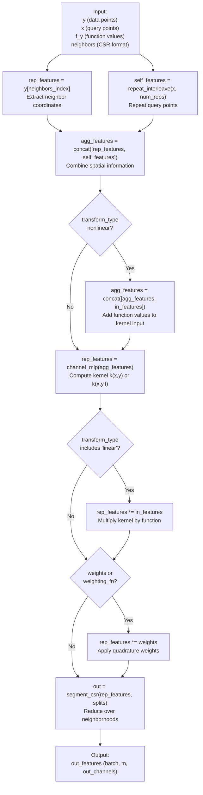
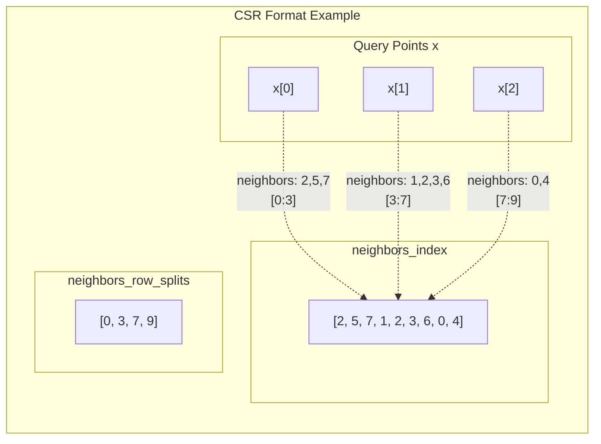
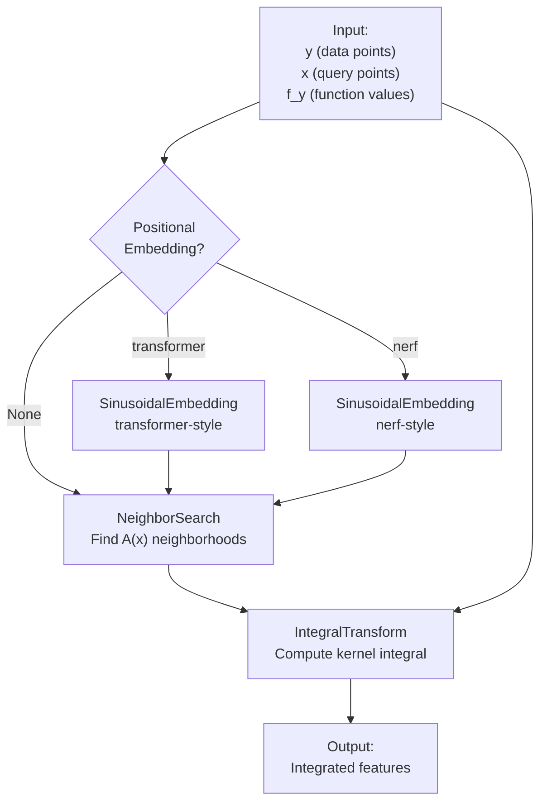
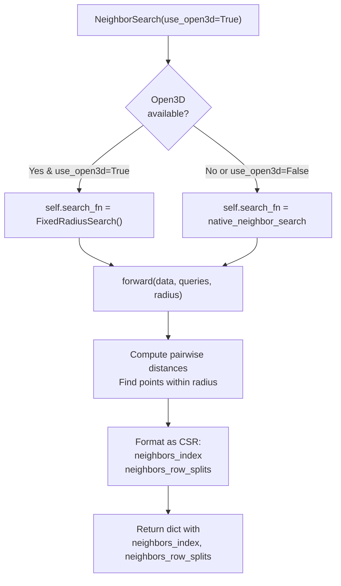
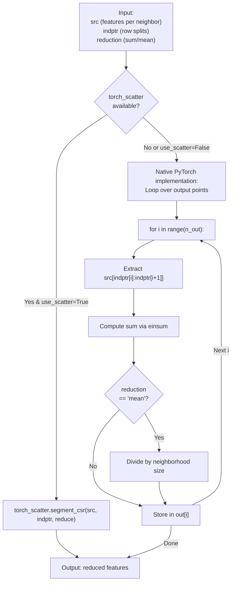
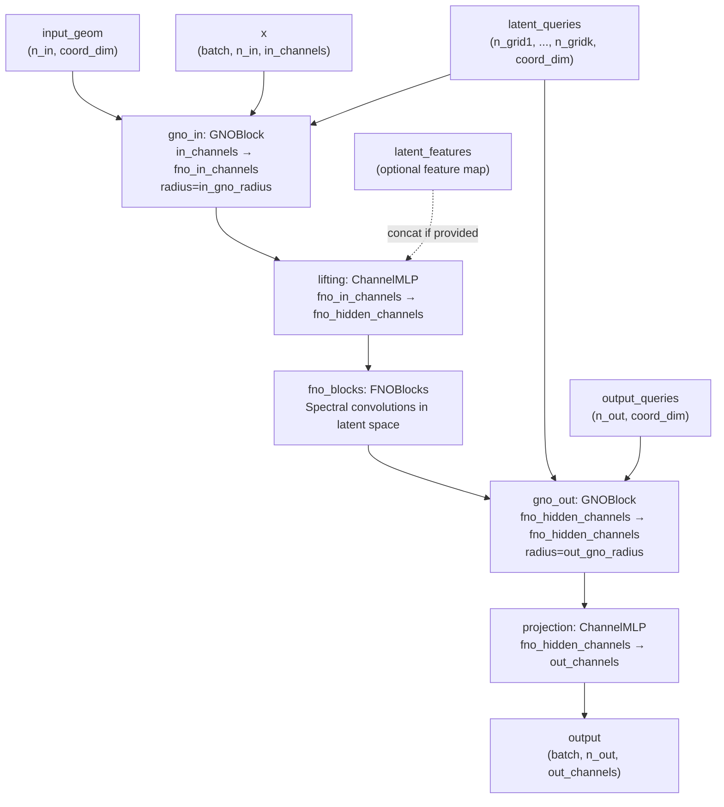
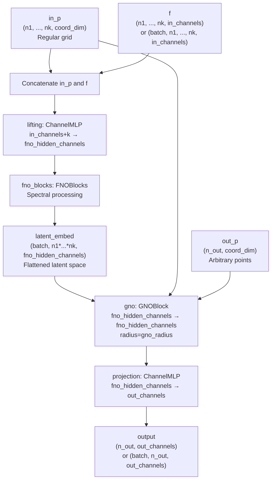

<!-- source: DeepWiki mcp.deepwiki.com · repo neuraloperator/neuraloperator · page 3.3 Integral Transforms and GNO Blocks · fetched 2026-10-21 -->

# Integral Transforms and GNO Blocks

<details>
<summary>Relevant source files</summary>

The following files were used as context for generating this wiki page:

- [doc/source/modules/api.rst](doc/source/modules/api.rst)
- [neuralop/layers/integral_transform.py](neuralop/layers/integral_transform.py)
- [neuralop/layers/neighbor_search.py](neuralop/layers/neighbor_search.py)
- [neuralop/layers/segment_csr.py](neuralop/layers/segment_csr.py)
- [neuralop/layers/tests/test_neighbor_search.py](neuralop/layers/tests/test_neighbor_search.py)
- [neuralop/models/fnogno.py](neuralop/models/fnogno.py)
- [neuralop/models/gino.py](neuralop/models/gino.py)

</details>


This page documents the kernel integration and geometric neural operator (GNO) components that enable neural operators to work with arbitrary coordinate meshes and irregular geometries. These components are the foundation for geometry-informed models like GINO and FNOGNO that map between functions defined on different coordinate spaces.

For spectral convolution operations on regular grids, see [Spectral Convolution](#3.1). For complete model architectures that use these components, see [Geometry-Informed Neural Operators (GINO/FNOGNO)](#2.3).

## Overview

The GNO system enables neural operators to handle irregular geometries by computing kernel integrals over spatial neighborhoods. The core operation computes:

$$\int_{A(x)} k(x, y, f(y)) \cdot f(y) \, dy$$

where $x$ are query points, $y$ are data points, $A(x)$ is a neighborhood around $x$, $k$ is a learnable kernel parametrized by a neural network, and $f$ is the input function.

The system consists of three main components:
- **IntegralTransform**: Computes kernel integrals over neighborhoods
- **GNOBlock**: High-level interface wrapping IntegralTransform with embeddings and neighbor search
- **NeighborSearch**: Finds spatial neighborhoods in arbitrary coordinate meshes

Sources: [neuralop/layers/integral_transform.py:1-219](), [neuralop/layers/gno_block.py:1-163](), [doc/source/modules/api.rst:147-176]()

## Kernel Integral Transforms

### Transform Types

The `IntegralTransform` class supports four types of kernel integrals, controlled by the `transform_type` parameter:

| Transform Type | Mathematical Form | Use Case |
|----------------|-------------------|----------|
| `linear_kernelonly` | $\int_{A(x)} k(x, y) \, dy$ | Pure kernel integration, no input function |
| `linear` | $\int_{A(x)} k(x, y) \cdot f(y) \, dy$ | Standard kernel convolution with input |
| `nonlinear_kernelonly` | $\int_{A(x)} k(x, y, f(y)) \, dy$ | Kernel depends on function values |
| `nonlinear` | $\int_{A(x)} k(x, y, f(y)) \cdot f(y) \, dy$ | Full nonlinear interaction |

The kernel $k$ is parametrized by a `LinearChannelMLP` that operates only across channels to maintain discretization invariance.

Sources: [neuralop/layers/integral_transform.py:10-66](), [neuralop/layers/integral_transform.py:86-94]()

### Integral Transform Computation Flow



**Integral Transform Forward Pass**

Sources: [neuralop/layers/integral_transform.py:103-218]()

### CSR Format for Neighborhoods

Neighborhoods are represented in Compressed Sparse Row (CSR) format, which efficiently stores graph connectivity. The format consists of two arrays:



**CSR Neighborhood Representation**

- `neighbors_index`: Flattened list of all neighbor indices in data space $y$
- `neighbors_row_splits`: Cumulative count of neighbors for each query point $x$
  - Length is `num_queries + 1`
  - `neighbors_row_splits[i]` to `neighbors_row_splits[i+1]` gives neighbors for query $i$

Sources: [neuralop/layers/neighbor_search.py:36-66](), [neuralop/layers/integral_transform.py:120-127]()

## IntegralTransform Class

### Class Definition and Parameters

The `IntegralTransform` class is defined in [neuralop/layers/integral_transform.py:9-101](). Key parameters:

```python
IntegralTransform(
    channel_mlp=None,                    # Pre-built MLP for kernel
    channel_mlp_layers=None,             # Layer sizes for auto-building MLP
    channel_mlp_non_linearity=F.gelu,    # Activation function
    transform_type="linear",              # Type of integral transform
    weighting_fn=None,                    # Optional mollification weights
    reduction='sum',                      # 'sum' or 'mean' reduction
    use_torch_scatter=True               # Use torch_scatter if available
)
```

The kernel is parametrized by a `LinearChannelMLP` that takes input dimension:
- Linear transforms: `dim(x) + dim(y)`
- Nonlinear transforms: `dim(x) + dim(y) + dim(f)`

Sources: [neuralop/layers/integral_transform.py:68-101]()

### Forward Pass

```python
out_features = integral_transform(
    y,          # Data points (n, d1) 
    neighbors,  # CSR neighborhood dict
    x=None,     # Query points (m, d2), defaults to y
    f_y=None,   # Function values (batch, n, d3) or (n, d3)
    weights=None # Optional quadrature weights
)
```

The forward pass:
1. Extracts neighbor features from `y` using `neighbors_index`
2. Repeats query features from `x` based on neighborhood sizes
3. Concatenates spatial features and optionally function values
4. Applies `channel_mlp` to compute kernel values
5. Multiplies by function values for linear transforms
6. Applies optional quadrature weights
7. Reduces over neighborhoods using `segment_csr`

Sources: [neuralop/layers/integral_transform.py:103-218]()

## GNOBlock Class

The `GNOBlock` wraps `IntegralTransform` with additional functionality for geometry-informed neural operators. While the full implementation is in `neuralop/layers/gno_block.py` (not shown in provided files), it is extensively used in [neuralop/models/gino.py]() and [neuralop/models/fnogno.py]().

### GNOBlock Architecture



**GNOBlock Component Flow**

### Key GNOBlock Parameters

Based on usage in GINO and FNOGNO models:

```python
GNOBlock(
    in_channels,                          # Input feature dimension
    out_channels,                         # Output feature dimension
    coord_dim=3,                          # Spatial dimension
    radius=0.033,                         # Neighborhood radius
    pos_embedding_type='transformer',     # 'transformer', 'nerf', or None
    pos_embedding_channels=32,            # Embedding dimension
    pos_embedding_max_positions=10000,    # Max positions for transformer
    channel_mlp_layers=[512, 256],       # MLP hidden layer sizes
    channel_mlp_non_linearity=F.gelu,    # Activation function
    transform_type='linear',              # Kernel integral type
    weighting_fn=None,                    # Mollification weights
    reduction='sum',                      # Reduction type
    use_open3d_neighbor_search=True,      # Use Open3D if available
    use_torch_scatter_reduce=True         # Use torch_scatter if available
)
```

Sources: [neuralop/models/gino.py:281-296](), [neuralop/models/fnogno.py:270-284]()

## NeighborSearch

The `NeighborSearch` class finds spatial neighborhoods for arbitrary coordinate meshes using either Open3D or a native PyTorch fallback implementation.

### NeighborSearch Class



**NeighborSearch Dispatch Logic**

Sources: [neuralop/layers/neighbor_search.py:13-78]()

### Native Neighbor Search Implementation

The fallback implementation in [neuralop/layers/neighbor_search.py:79-113]() computes neighborhoods without external dependencies:

```python
def native_neighbor_search(data, queries, radius, return_norm=False):
    # Compute all pairwise distances: (num_queries, num_data)
    all_dists = torch.cdist(queries, data)
    
    # Keep only distances <= radius
    dists = torch.where(all_dists <= radius, all_dists, 0.)
    
    # Extract neighbor indices (column indices where distance > 0)
    nbr_indices = dists.nonzero()[:,1:].reshape(-1,)
    
    # Compute row splits (cumulative neighbor counts)
    in_nbr = torch.where(dists > 0, 1., 0.)
    nbrhd_sizes = torch.cumsum(torch.sum(in_nbr, dim=1), dim=0)
    splits = torch.cat((torch.tensor([0.]), nbrhd_sizes))
    
    return {
        'neighbors_index': nbr_indices.long(),
        'neighbors_row_splits': splits.long()
    }
```

The native implementation also supports optional weight computation for mollified GNO by setting `return_norm=True`, which adds squared distances as `weights` to the output dictionary.

Sources: [neuralop/layers/neighbor_search.py:79-113]()

## Segment CSR Reduction

The `segment_csr` function reduces features over neighborhoods, supporting both sum and mean reductions. It can use `torch_scatter` for efficiency or fall back to native PyTorch.

### Reduction Algorithm



**segment_csr Reduction Flow**

Sources: [neuralop/layers/segment_csr.py:7-101]()

### Batching Support

Both implementations support batched inputs where feature shape is `(batch, n_neighbors, channels)`:

- For batched inputs, the split indices are repeated across the batch dimension
- Reduction is computed per batch element
- Output shape is `(batch, n_out, channels)`

Sources: [neuralop/layers/segment_csr.py:63-99](), [neuralop/layers/integral_transform.py:214-218]()

## Integration with Models

### GINO Architecture

GINO (Geometry-Informed Neural Operator) uses three GNOBlocks to map between arbitrary meshes through a regular latent space:



**GINO Model Architecture with GNOBlocks**

Key aspects:
- **Input GNO**: Maps irregular input mesh to regular latent grid
- **FNO Blocks**: Process in spectral domain on regular grid (see [FNO Blocks](#3.2))
- **Output GNO**: Maps latent grid to arbitrary output query points

Sources: [neuralop/models/gino.py:167-525]()

### FNOGNO Architecture

FNOGNO maps from a regular grid to arbitrary query points using FNO blocks followed by a single GNO:



**FNOGNO Architecture: Grid to Arbitrary Points**

The FNOGNO model is particularly useful for:
- Super-resolution: querying at finer resolution than training grid
- Irregular geometries: evaluating on arbitrary sensor locations
- Multi-resolution predictions: evaluating at different resolutions simultaneously

Sources: [neuralop/models/fnogno.py:18-394]()

## Usage Patterns

### Basic IntegralTransform Usage

```python
from neuralop.layers.integral_transform import IntegralTransform
from neuralop.layers.neighbor_search import NeighborSearch

# Create neighbor searcher
neighbor_search = NeighborSearch(use_open3d=True)

# Create integral transform
integral_transform = IntegralTransform(
    channel_mlp_layers=[64, 128, 64],
    transform_type='linear',
    use_torch_scatter=True
)

# Find neighborhoods
neighbors = neighbor_search(data_points, query_points, radius=0.1)

# Compute kernel integral
output = integral_transform(
    y=data_points,        # (n_data, coord_dim)
    x=query_points,       # (n_query, coord_dim) 
    f_y=input_features,   # (batch, n_data, in_channels)
    neighbors=neighbors   # CSR format
)
# output shape: (batch, n_query, out_channels)
```

Sources: [neuralop/layers/integral_transform.py:103-218](), [neuralop/layers/neighbor_search.py:36-78]()

### GNOBlock in GINO

The input and output GNO blocks in GINO have different configurations:

**Input GNO** (maps input mesh to latent grid):
```python
gno_in = GNOBlock(
    in_channels=in_channels,
    out_channels=fno_in_channels,
    radius=in_gno_radius,         # Typically 0.033
    transform_type='linear',       # Can be nonlinear
    reduction='mean',              # Averages over neighborhoods
    pos_embedding_type='transformer'
)
```

**Output GNO** (maps latent grid to output queries):
```python
gno_out = GNOBlock(
    in_channels=fno_hidden_channels,
    out_channels=fno_hidden_channels, 
    radius=out_gno_radius,        # Can differ from input
    transform_type='linear',
    reduction='sum',              # Sums over neighborhoods
    weighting_fn=weight_fn,       # Optional mollification
    pos_embedding_type='transformer'
)
```

Sources: [neuralop/models/gino.py:281-353]()

### Mollified GNO with Weighting Functions

For mollified Graph Neural Operators, weights are applied to smooth the integration:

```python
from neuralop.layers.gno_weighting_functions import dispatch_weighting_fn

# Create weighting function
weight_fn = dispatch_weighting_fn(
    'half_cos',                    # Options: 'half_cos', 'bump', 'quartic', etc.
    sq_radius=radius**2,           # Squared radius
    scale=1.0                      # Scaling factor
)

# Use in GNOBlock
gno = GNOBlock(
    ...,
    weighting_fn=weight_fn,
    ...
)
```

When a weighting function is provided, the neighbor search must return weights, which the weighting function then transforms before application in the `IntegralTransform`.

Sources: [neuralop/models/gino.py:334-337](), [neuralop/layers/integral_transform.py:196-209]()

### Batching Considerations

The GNO system has specific batching requirements:

1. **Geometry must be constant across batch**: Input/output geometries are not batched and must be shared across all batch elements
2. **Function values can be batched**: The `f_y` parameter can have shape `(batch, n_points, channels)`
3. **Output is batched**: When input is batched, output has shape `(batch, n_out, channels)`

This design allows efficient processing of multiple functions on the same geometry without redundant neighbor searches.

Sources: [neuralop/layers/integral_transform.py:157-167](), [neuralop/models/gino.py:404-406]()

## Optional Dependencies

The GNO system has two optional dependencies that provide performance improvements:

### torch_scatter

Used in `segment_csr` for efficient grouped reductions:
- Provides `torch_scatter.segment_csr` for GPU-accelerated reduction
- Falls back to native PyTorch implementation if not available
- Controlled by `use_torch_scatter` parameter

**Warning**: `torch_scatter` may conflict with newer PyTorch versions. See installation documentation for compatibility.

Sources: [neuralop/layers/segment_csr.py:50-62](), [neuralop/layers/integral_transform.py:59-65]()

### Open3D

Used in `NeighborSearch` for efficient spatial queries:
- Provides `FixedRadiusSearch` for GPU-accelerated neighbor finding
- Requires 3D coordinate data
- Falls back to native PyTorch implementation if not available or for non-3D data
- Controlled by `use_open3d` parameter

Sources: [neuralop/layers/neighbor_search.py:5-32](), [neuralop/models/gino.py:243-245]()

---

