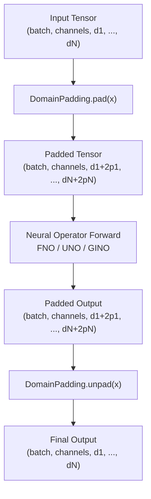
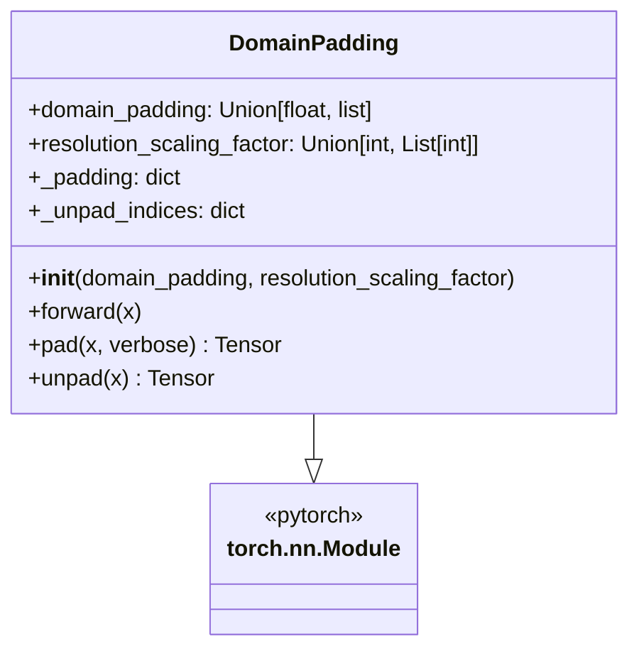
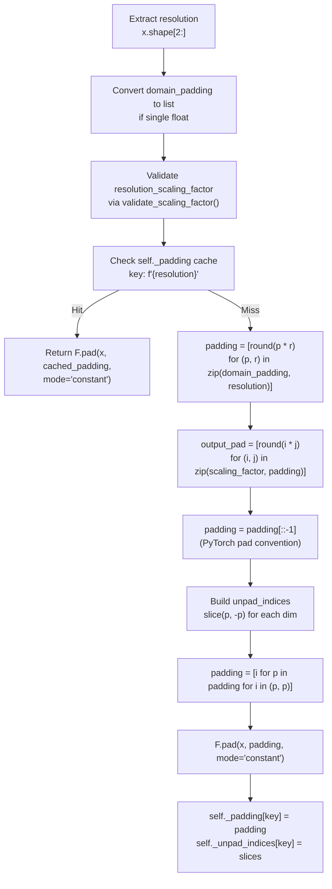
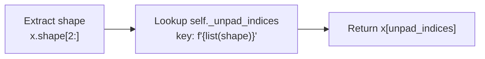

<!-- source: DeepWiki mcp.deepwiki.com · repo neuraloperator/neuraloperator · page 3.4 Domain Padding · fetched 2026-10-21 -->

# Domain Padding

<details>
<summary>Relevant source files</summary>

The following files were used as context for generating this wiki page:

- [neuralop/layers/padding.py](neuralop/layers/padding.py)
- [neuralop/layers/tests/test_padding.py](neuralop/layers/tests/test_padding.py)
- [neuralop/tests/test_config_key.txt](neuralop/tests/test_config_key.txt)
- [neuralop/tests/test_utils.py](neuralop/tests/test_utils.py)
- [neuralop/utils.py](neuralop/utils.py)

</details>


The `DomainPadding` class ([neuralop/layers/padding.py:8-132]()) provides automatic resolution-aware symmetric padding for neural operator inputs. This layer is used to handle boundary conditions in PDE problems by extending the spatial domain, enabling models to maintain accuracy at boundaries while supporting resolution-invariant training across different grid sizes. For information about other core layer components, see [Core Layers and Components](#3).

## Overview

`DomainPadding` extends the spatial dimensions of input tensors by a configurable percentage that scales automatically with input resolution. The layer maintains internal caches for different resolutions to optimize repeated operations and supports resolution scaling factors for multi-grid training scenarios.
</thinking>

Sources: [neuralop/layers/padding.py:8-40]()

**Domain Padding Pipeline in Neural Operator Models**



Sources: [neuralop/layers/padding.py:47-131]()

## DomainPadding Class

### Class Structure

**DomainPadding Class Hierarchy**



Sources: [neuralop/layers/padding.py:8-40]()

### Constructor Parameters

| Parameter | Type | Default | Description |
|-----------|------|---------|-------------|
| `domain_padding` | `float` or `list` | required | Percentage of padding (typically 0-1). If list, per-dimension padding |
| `resolution_scaling_factor` | `int` or `List[int]` | 1 | Scaling factor applied to padding amounts. Validated via `validate_scaling_factor` |

The `resolution_scaling_factor` is processed through [neuralop/utils.py:148-194]() `validate_scaling_factor()` to convert single values into per-dimension lists or per-layer lists of per-dimension scaling.

Sources: [neuralop/layers/padding.py:24-33](), [neuralop/utils.py:148-194]()

## Padding Method: pad()

The `pad()` method ([neuralop/layers/padding.py:47-126]()) implements resolution-aware padding with caching and automatic scaling.

**Padding Algorithm Flow**



Sources: [neuralop/layers/padding.py:47-126](), [neuralop/utils.py:148-194]()

### Padding Calculation Details

The padding computation involves three steps:

1. **Base Padding Per Dimension**: 
   ```python
   padding = [round(p * r) for (p, r) in zip(self.domain_padding, resolution)]
   ```
   At [neuralop/layers/padding.py:76]()

2. **Apply Resolution Scaling**:
   ```python
   output_pad = [round(i * j) for (i, j) in zip(resolution_scaling_factor, output_pad)]
   ```
   At [neuralop/layers/padding.py:86-88]()

3. **PyTorch Padding Format**:
   - Reverse dimension order: `padding = padding[::-1]` ([neuralop/layers/padding.py:92]())
   - Expand to symmetric: `padding = [i for p in padding for i in (p, p)]` ([neuralop/layers/padding.py:112]())
   - PyTorch's `F.pad` applies padding in reverse dimension order

Sources: [neuralop/layers/padding.py:76-116]()

## PyTorch Padding Convention

PyTorch's `F.pad` applies padding in **reverse dimension order**. For a 2D input with shape `(batch, channels, height, width)`:
- `F.pad(x, [pad_w, pad_w, pad_h, pad_h])` pads width first, then height
- The padding list format is `[left, right, top, bottom, ...]` in reverse spatial order

The `DomainPadding.pad()` method handles this by reversing the calculated padding list before calling `F.pad`.

Sources: [neuralop/layers/padding.py:90-99]()

## Unpadding Method: unpad()

The `unpad()` method ([neuralop/layers/padding.py:128-131]()) removes padding by applying cached slice indices.

**Unpadding Implementation**



Sources: [neuralop/layers/padding.py:128-131]()

### Slice Index Construction

During the `pad()` operation, unpad indices are constructed for each spatial dimension:

```python
unpad_list = list()
for p in output_pad:
    if p == 0:
        padding_end = None
        padding_start = None
    else:
        padding_end = p
        padding_start = -p
    unpad_list.append(slice(padding_end, padding_start, None))
unpad_indices = (Ellipsis,) + tuple(unpad_list)
```

At [neuralop/layers/padding.py:101-110]():
- `Ellipsis` preserves batch and channel dimensions
- Each spatial dimension gets `slice(p, -p)` to remove `p` elements from both sides
- If `p == 0`, uses `slice(None, None)` (no cropping)

Sources: [neuralop/layers/padding.py:101-110]()

## Caching Mechanism

`DomainPadding` maintains two dictionaries for caching computed padding configurations:

| Cache Attribute | Type | Key Format | Value Type | Populated At |
|-----------------|------|------------|------------|--------------|
| `self._padding` | `dict` | `f"{resolution}"` | `list[int]` | [neuralop/layers/padding.py:114]() |
| `self._unpad_indices` | `dict` | `f"{list(output_shape)}"` | `tuple` | [neuralop/layers/padding.py:124]() |

**Cache Behavior**:
- First call to `pad(x)` with resolution `(h, w)` computes and caches padding configuration
- Subsequent calls with same resolution use cached values via lookup at [neuralop/layers/padding.py:71-73]()
- Different resolutions create separate cache entries
- `unpad(x)` looks up indices based on the **padded** output shape, not input shape

Sources: [neuralop/layers/padding.py:35-39](), [neuralop/layers/padding.py:71-73](), [neuralop/layers/padding.py:114](), [neuralop/layers/padding.py:124]()

## Testing and Validation

The domain padding functionality is validated through unit tests that verify:

```python
# Example from test suite
data = torch.randn((2, 3, 10, 10))
padder = DomainPadding(0.2)
padded = padder.pad(data)
# 0.2 padding on 10x10 → 14x14 output
assert list(padded.shape) == [2, 3, 14, 14]

unpadded = padder.unpad(padded)
assert unpadded.shape == data.shape
```

Sources: [neuralop/layers/tests/test_padding.py:5-17]()

---

