<!-- source: DeepWiki mcp.deepwiki.com · repo neuraloperator/neuraloperator · page 3.5 Embedding Layers · fetched 2026-10-21 -->

# Embedding Layers

Relevant source files

The following files were used as context for generating this wiki page:

- [doc/source/modules/api.rst](doc/source/modules/api.rst)
- [neuralop/layers/padding.py](neuralop/layers/padding.py)
- [neuralop/layers/tests/test_padding.py](neuralop/layers/tests/test_padding.py)
- [neuralop/models/fnogno.py](neuralop/models/fnogno.py)
- [neuralop/models/gino.py](neuralop/models/gino.py)
- [neuralop/tests/test_config_key.txt](neuralop/tests/test_config_key.txt)
- [neuralop/tests/test_utils.py](neuralop/tests/test_utils.py)
- [neuralop/utils.py](neuralop/utils.py)

## Overview

Embedding layers encode spatial and positional information to enable neural operators to understand geometric structure and achieve resolution invariance. The library provides three main embedding types:

| Embedding Class | Purpose | Primary Use Cases |
|----------------|---------|-------------------|
| `GridEmbedding2D` | Appends 2D coordinate channels to regular grids | FNO models on 2D domains |
| `GridEmbeddingND` | Appends N-D coordinate channels to regular grids | FNO models on arbitrary dimensional grids |
| `SinusoidalEmbedding` | Transformer/NeRF-style positional encoding | GINO/FNOGNO models, adaptive instance normalization |

These embeddings are optional components that enhance model expressiveness by providing explicit positional information to the network.

Sources: [doc/source/modules/api.rst:237-251]()
</thinking>

## Grid Embeddings

Grid embeddings append coordinate information as additional channels to input tensors on regular spatial grids. This enables neural operators to condition on spatial locations and achieve resolution-invariant behavior.
</thinking>

**Grid Embedding Data Flow**
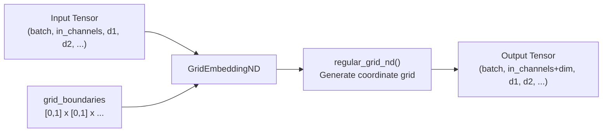

Sources: [doc/source/modules/api.rst:237-292]()
</thinking>

### GridEmbedding2D

`GridEmbedding2D` adds two coordinate channels (x, y) to 2D spatial inputs. The class inherits from an abstract `Embedding` base class and caches generated grids for efficiency across multiple forward passes at the same resolution.

**Key Implementation Details:**
- Generates coordinate grids using `regular_grid_2d()` utility function
- Caches grids in `_grid` attribute, indexed by resolution via `_res`
- Default `grid_boundaries` is `[[0,1], [0,1]]` for unit square domain
- Output has `in_channels + 2` channels (original + x and y coordinates)

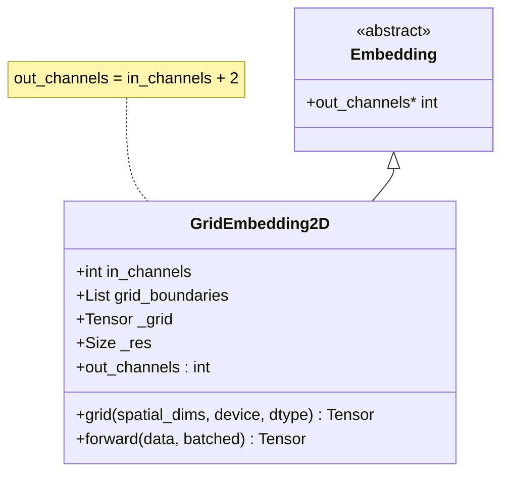

The `forward()` method concatenates coordinate channels to input data along the channel dimension (dim=1), handling both batched and unbatched inputs.

Sources: [doc/source/modules/api.rst:249-250]()

### GridEmbeddingND

`GridEmbeddingND` generalizes grid embeddings to arbitrary spatial dimensions, supporting 1D through N-dimensional domains.

**Constructor Parameters:**
- `in_channels` (int): Number of input channels
- `dim` (int): Number of spatial dimensions (determines output coordinate channels)
- `grid_boundaries` (list): Coordinate ranges for each dimension, default `[[0,1]] * dim`

**Key Implementation:**
- Uses `regular_grid_nd(resolutions, grid_boundaries)` for N-dimensional grid generation
- Returns list of coordinate tensors, one per spatial dimension
- Output has `in_channels + dim` channels
- Supports `batched` parameter in forward pass to handle batch dimensions correctly

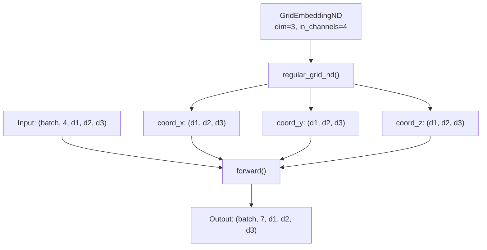

Sources: [doc/source/modules/api.rst:249](), [doc/source/modules/api.rst:281-292]()

## Sinusoidal Embeddings

`SinusoidalEmbedding` provides high-dimensional positional encodings using sinusoidal functions, following architectures from Transformers and Neural Radiance Fields (NeRF). This embedding type is particularly useful for encoding coordinate information in irregular geometries and attention mechanisms.

**Constructor Parameters:**
- `in_channels` (int): Dimensionality of input coordinates
- `num_frequencies` (int): Number of frequency bands for encoding
- `embedding_type` (str): `'transformer'` or `'nerf'` style
- `max_positions` (int): Maximum positions for transformer normalization (default: 10000)

**Output Dimensionality:**
The output has `2 * num_frequencies * in_channels` channels (sine and cosine for each frequency and input channel).

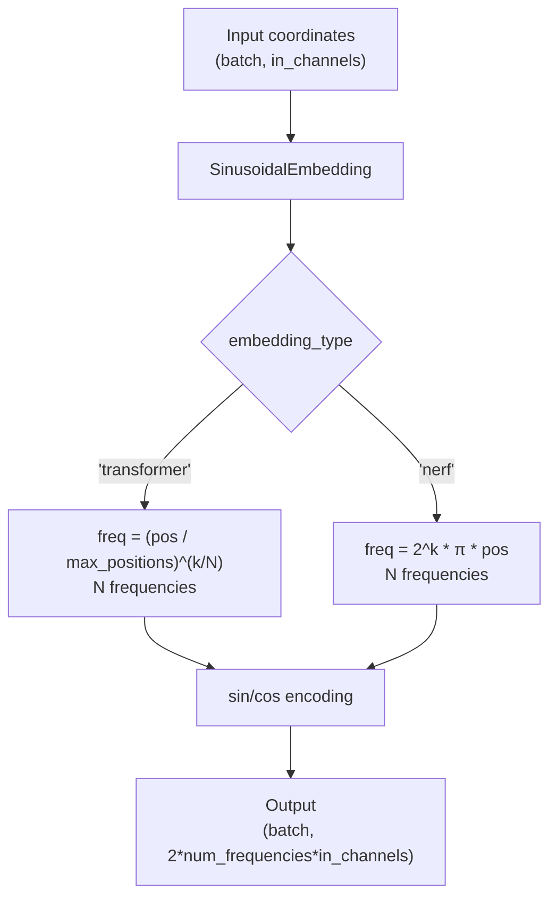

**Embedding Type Comparison:**

| Type | Frequency Formula | Characteristics | Use Case |
|------|------------------|----------------|----------|
| `'transformer'` | `(p / max_positions)^(k/N)` | Logarithmic spacing of frequencies | General positional encoding, longer-range correlations |
| `'nerf'` | `2^k * π * p` | Exponential spacing of frequencies | High-frequency spatial features, fine detail capture |

Sources: [doc/source/modules/api.rst:251]()

## Integration in FNO Models

FNO-based models use grid embeddings as an optional component to provide explicit positional information to the network. The embedding is typically applied before the lifting layer.

### Usage in FNO/TFNO

In the standard FNO architecture, grid embeddings are conditionally added based on initialization parameters:

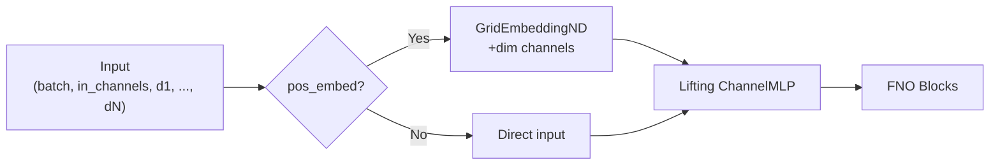

When positional embedding is enabled, the FNO receives `in_channels + dim` channels as input to its lifting layer.

Sources: [neuralop/models/fnogno.py:229-234]()

### Usage in FNOGNO

The FNOGNO architecture uses grid embeddings on the input regular grid before lifting to the latent FNO space:

**FNOGNO Forward Pass with Embeddings:**
1. Concatenate input function `f` with input positions `in_p` along channel dimension
2. Apply lifting ChannelMLP: `in_channels + in_coord_dim → fno_hidden_channels`
3. Process through FNO blocks in latent space
4. Apply GNO integration to output query points

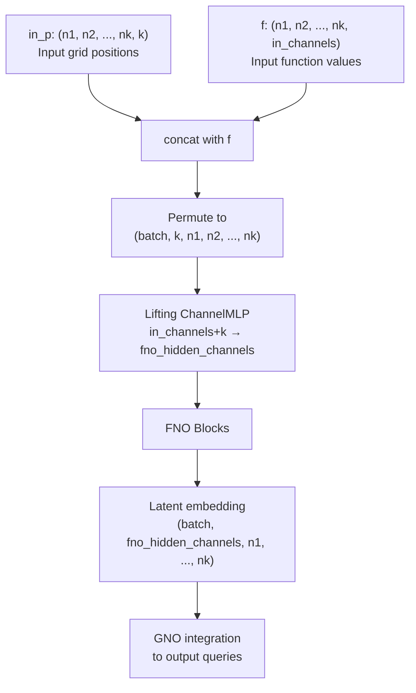

The key lines in FNOGNO that handle this:
- [neuralop/models/fnogno.py:310](): Concatenates function values with position coordinates
- [neuralop/models/fnogno.py:231-234](): Creates lifting layer with `in_channels + self.in_coord_dim` inputs

Sources: [neuralop/models/fnogno.py:229-234](), [neuralop/models/fnogno.py:305-336]()

## Integration in GINO Models

GINO and FNOGNO models use `SinusoidalEmbedding` for two purposes: (1) positional encoding in GNO blocks for irregular geometries, and (2) adaptive instance normalization (AdaIN) embeddings.

### Positional Embeddings in GNO Blocks

`GNOBlock` uses `SinusoidalEmbedding` to encode coordinate positions before kernel integration:

**GNOBlock with Sinusoidal Embedding:**
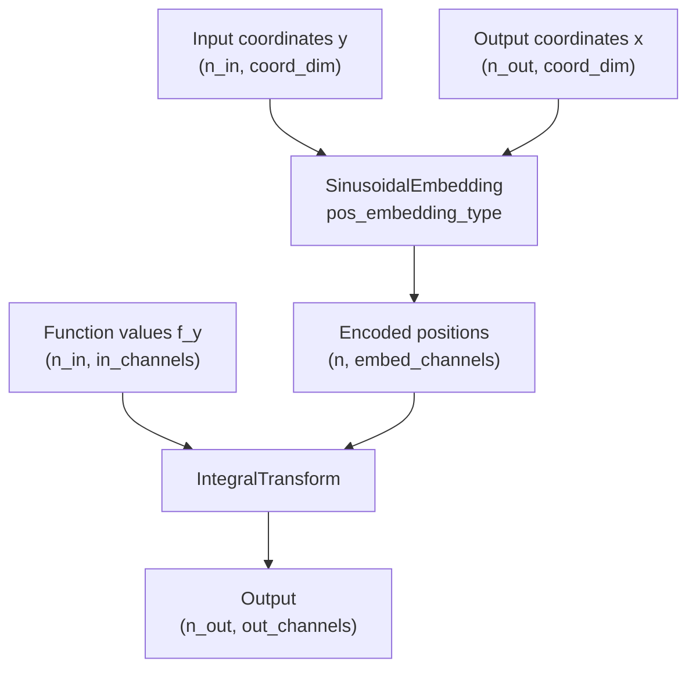

Configuration in GINO/FNOGNO:
- `gno_pos_embed_type`: `'transformer'` or `'nerf'` (default: `'transformer'`)
- `gno_embed_channels`: Embedding dimension (default: 32)
- `gno_embed_max_positions`: Max positions for transformer type (default: 10000)

Sources: [neuralop/models/gino.py:181](), [neuralop/models/fnogno.py:142]()

### AdaIN Positional Embeddings

GINO and FNOGNO support adaptive instance normalization (AdaIN) using sinusoidal embeddings to encode instance-specific parameters (e.g., time, Reynolds number) that modulate the FNO layers.

**AdaIN Embedding Setup in FNOGNO:**
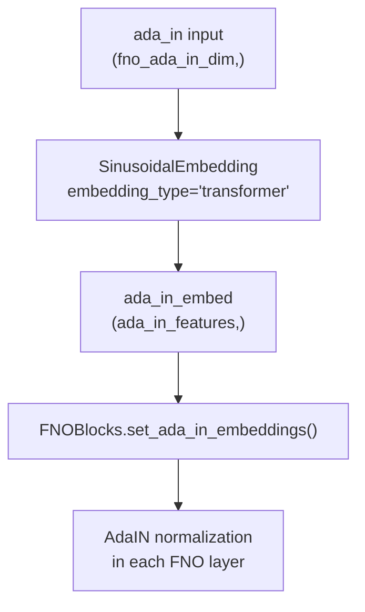

The implementation in FNOGNO:
- [neuralop/models/fnogno.py:216-223](): Creates `adain_pos_embed` if `fno_norm == "ada_in"`
- [neuralop/models/fnogno.py:319-325](): Applies embedding to ada_in parameter in forward pass

Similarly in GINO:
- [neuralop/models/gino.py:260-264](): Creates AdaIN positional embedding
- [neuralop/models/gino.py:372-380](): Processes ada_in through embedding before setting in FNO blocks

Sources: [neuralop/models/fnogno.py:214-227](), [neuralop/models/fnogno.py:319-325](), [neuralop/models/gino.py:258-270](), [neuralop/models/gino.py:372-380]()

## Embedding Layer Usage Patterns

The following table summarizes how different model architectures use embedding layers:

| Model | Embedding Type | Location | Purpose |
|-------|---------------|----------|---------|
| FNO/TFNO | `GridEmbeddingND` (optional) | Before lifting | Add spatial coordinate channels |
| FNOGNO | Input positions concatenated | Lifting layer | Provide position information to FNO |
| FNOGNO | `SinusoidalEmbedding` (optional) | AdaIN | Instance-specific parameter encoding |
| GINO | `SinusoidalEmbedding` | Input/Output GNO blocks | Positional encoding for irregular meshes |
| GINO | `SinusoidalEmbedding` (optional) | AdaIN | Instance-specific parameter encoding |

**Common Pattern:**
1. Grid embeddings (`GridEmbeddingND`) are used for regular grid inputs (FNO)
2. Sinusoidal embeddings (`SinusoidalEmbedding`) are used for:
   - Irregular geometry encoding (GINO/FNOGNO GNO blocks)
   - Adaptive normalization parameters (AdaIN in FNO blocks)

Sources: [neuralop/models/fnogno.py:136-180](), [neuralop/models/gino.py:167-217]()

## API Reference

**GridEmbedding2D**
- Class: `neuralop.layers.embeddings.GridEmbedding2D`
- Input: `(batch, in_channels, height, width)`
- Output: `(batch, in_channels+2, height, width)`
- Parameters: `in_channels`, `grid_boundaries` (default: `[[0,1], [0,1]]`)

**GridEmbeddingND**
- Class: `neuralop.layers.embeddings.GridEmbeddingND`
- Input: `(batch, in_channels, d1, ..., dN)`
- Output: `(batch, in_channels+N, d1, ..., dN)`
- Parameters: `in_channels`, `dim`, `grid_boundaries` (default: `[[0,1]] * dim`)

**SinusoidalEmbedding**
- Class: `neuralop.layers.embeddings.SinusoidalEmbedding`
- Input: `(batch, in_channels)`
- Output: `(batch, 2*num_frequencies*in_channels)`
- Parameters: `in_channels`, `num_frequencies`, `embedding_type` (`'transformer'` or `'nerf'`), `max_positions`

Sources: [doc/source/modules/api.rst:237-251]()

## Grid Embeddings

Grid embeddings add coordinate information to input tensors by appending position channels corresponding to spatial dimensions. These embeddings enable neural operators to understand the spatial structure of regular grids and achieve resolution invariance.

**Grid Embedding Architecture**
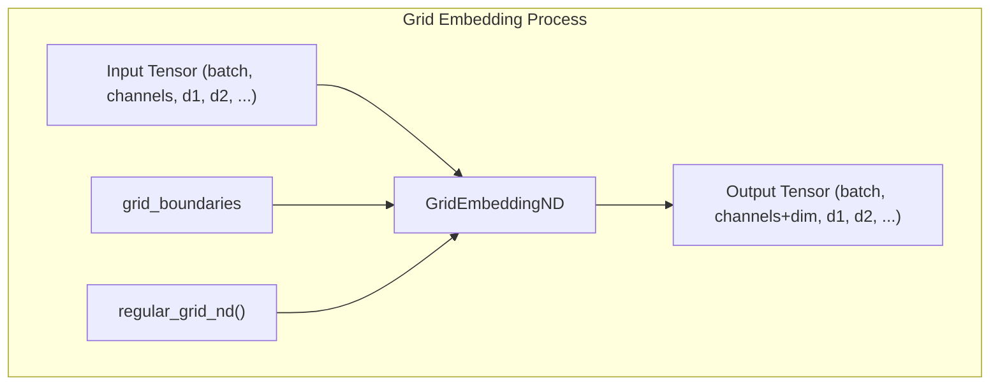

Sources: [neuralop/layers/embeddings.py:86-164](), [neuralop/layers/embeddings.py:327-355]()

### GridEmbedding2D

`GridEmbedding2D` adds coordinate information for 2D spatial grids. It inherits from the base `Embedding` class and implements the `out_channels` property for layer composition.

**Key Implementation Details:**
- Inherits from base `Embedding` class with abstract `out_channels` property
- Caches grid coordinates using `_grid` and `_res` for efficiency across multiple resolutions
- Uses `regular_grid_2d()` utility function to generate coordinate grids
- Supports configurable `grid_boundaries` parameter for coordinate normalization

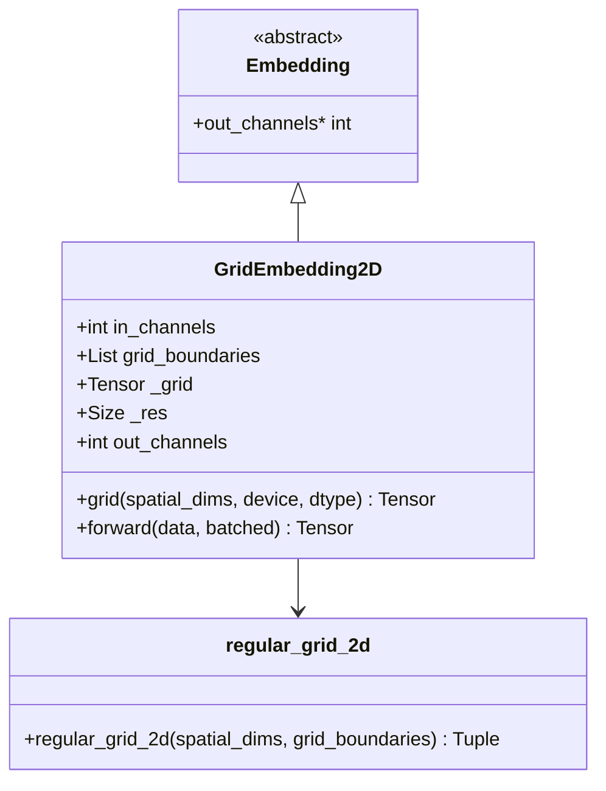

The `forward()` method handles both batched and unbatched inputs, concatenating coordinate channels to the input data along the channel dimension.

Sources: [neuralop/layers/embeddings.py:17-84](), [neuralop/layers/embeddings.py:308-325]()

### GridEmbeddingND

`GridEmbeddingND` generalizes grid embeddings to arbitrary dimensions, supporting 1D through N-dimensional spatial data.

**Key Implementation Details:**
- Takes `dim` parameter to specify number of spatial dimensions
- Validates that `grid_boundaries` length matches `dim`
- Uses `regular_grid_nd()` utility function for N-dimensional grid generation
- Supports both batched and unbatched inputs through `batched` parameter

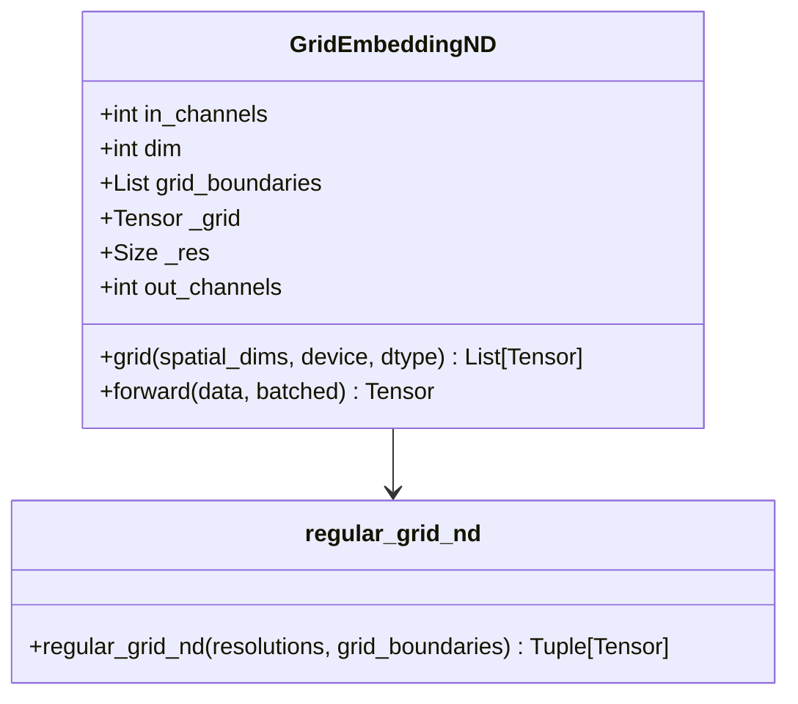

The `out_channels` property returns `in_channels + dim`, indicating that `dim` coordinate channels are added to the input.

Sources: [neuralop/layers/embeddings.py:86-164](), [neuralop/layers/embeddings.py:327-355]()

## Sinusoidal Embeddings

`SinusoidalEmbedding` provides positional encodings in the style of Transformers and Neural Radiance Fields (NeRFs). This embedding type is particularly useful for encoding coordinate information in attention mechanisms and GNO blocks.

**Implementation Features:**
- Supports both `'transformer'` and `'nerf'` embedding types
- Configurable `num_frequencies` parameter for encoding granularity
- `max_positions` parameter for transformer-style normalization
- Returns `2 * num_frequencies * in_channels` output channels

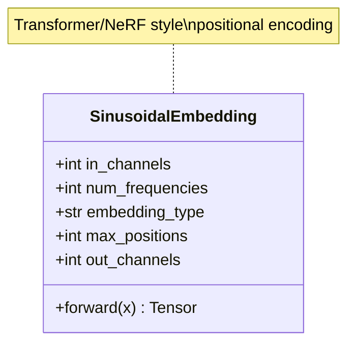

**Embedding Types:**

| Type | Formula | Use Case |
|------|---------|----------|
| `'transformer'` | `sin/cos((p / max_positions)^(k/N))` | General positional encoding |
| `'nerf'` | `sin/cos(2^k * π * p)` | High-frequency spatial features |

Sources: [neuralop/layers/embeddings.py:166-272]()

## Rotary Positional Embeddings

`RotaryEmbedding2D` implements rotary positional embeddings for 2D coordinates, commonly used in attention mechanisms to encode relative positional information.

**Key Implementation Details:**
- Uses inverse frequency computation: `1 / (10000 ** (torch.arange(0, dim, 2) / dim))`
- Supports `min_freq` and `scale` parameters for frequency control
- Provides static methods for applying rotary embeddings to 1D and 2D tensors

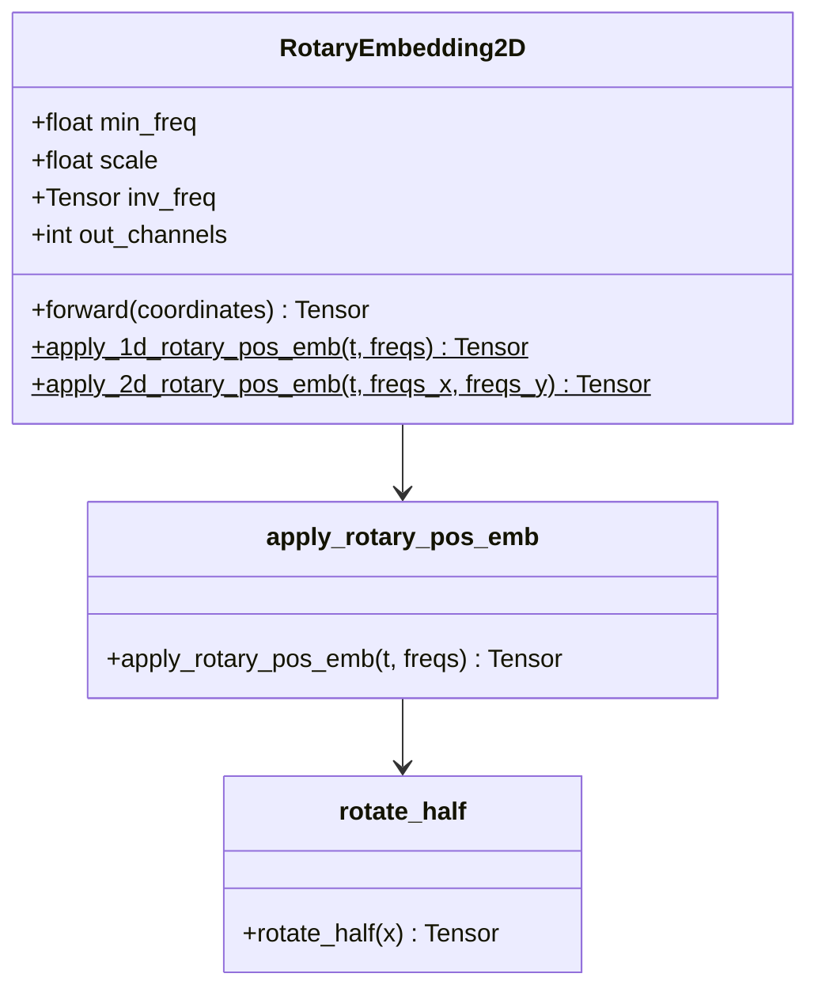

The rotary embedding uses the formula: `(t * freqs.cos()) + (rotate_half(t) * freqs.sin())` where `rotate_half()` splits channels and applies rotation.

Sources: [neuralop/layers/embeddings.py:274-378]()

## Embedding Integration in Attention Mechanisms

Embeddings play a crucial role in attention-based kernel integral transforms. The `AttentionKernelIntegral` class uses positional embeddings to enhance query and key representations.

**AttentionKernelIntegral with Positional Embeddings**
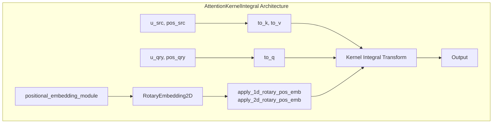

**Key Integration Points:**
- `positional_embedding_module` parameter accepts embedding modules like `RotaryEmbedding2D`
- Supports 1D and 2D positional encoding through `pos_dim` detection
- Applies embeddings to both query and key representations before attention computation

Sources: [neuralop/layers/attention_kernel_integral.py:128-216]()

## Embedding Integration in GNO Blocks

`GNOBlock` uses `SinusoidalEmbedding` for positional encoding of coordinate inputs, enabling geometry-informed neural operators to handle irregular meshes and point clouds.

**GNOBlock Embedding Integration**
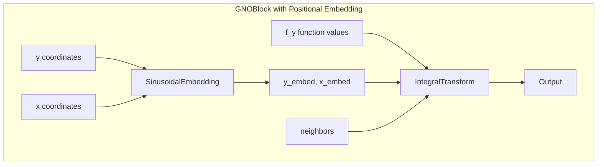

**Configuration Parameters:**
- `pos_embedding_type`: `'transformer'` or `'nerf'` style encoding
- `pos_embedding_channels`: Dimension of positional encoding (default: 32)
- `pos_embedding_max_positions`: Max positions for transformer embedding (default: 10000)

The embedding transforms coordinate dimensions into higher-dimensional representations that capture positional relationships more effectively.

Sources: [neuralop/layers/gno_block.py:133-158](), [neuralop/layers/gno_block.py:237-242]()

## Conclusion

Embedding layers are fundamental components in neural operators that enable these models to process and learn from spatial data. By encoding grid coordinates and other positional information, these layers provide crucial context that allows neural operators to effectively approximate PDE solution operators.

The neuraloperator library provides flexible embedding options through `GridEmbedding2D` and `GridEmbeddingND`, along with adaptive normalization through `AdaIN` and channel modulation through `SoftGating`. These components work together to create powerful neural operator models capable of learning complex PDE solution operators.

---

