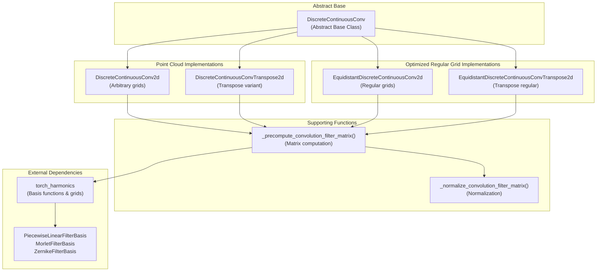
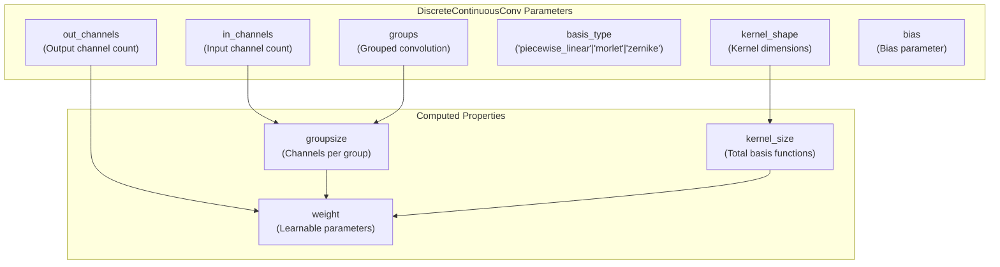
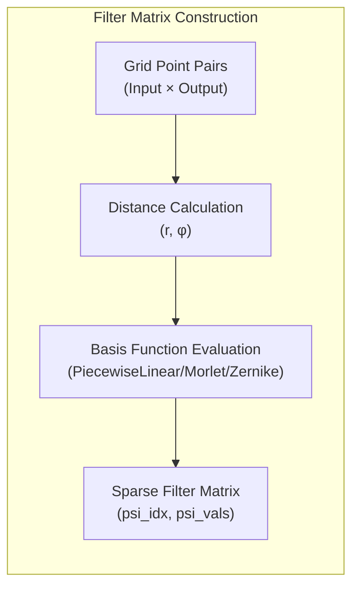
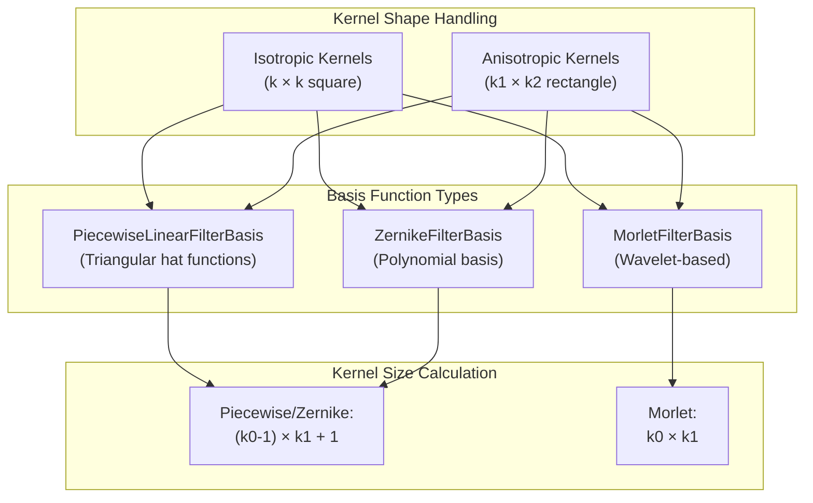
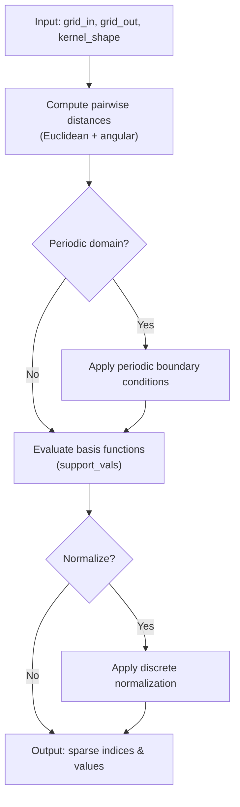
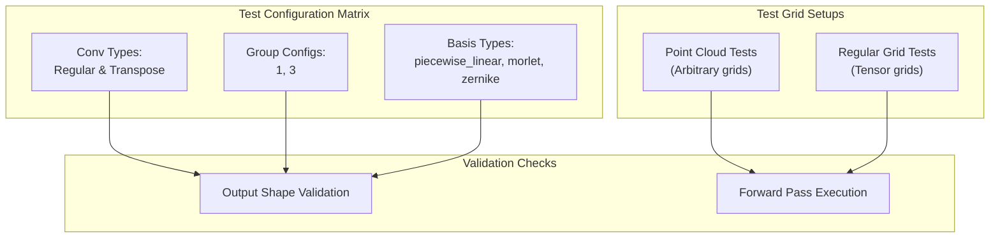

<!-- source: DeepWiki mcp.deepwiki.com · repo neuraloperator/neuraloperator · page 3.6 Discrete-Continuous Convolutions · fetched 2026-10-21 -->

# Discrete-Continuous Convolutions

Relevant source files

The following files were used as context for generating this wiki page:

- [doc/source/modules/api.rst](doc/source/modules/api.rst)
- [neuralop/models/fnogno.py](neuralop/models/fnogno.py)
- [neuralop/models/gino.py](neuralop/models/gino.py)

This document covers the DISCO (Discrete-Continuous) convolution layers in the neuraloperator library, which enable neural operators to work with arbitrary 2D grids using continuous convolution kernels. These layers are the foundation for local neural operators that can handle irregular geometries and non-uniform grids.

For spectral domain convolutions using FFTs, see [Spectral Convolution](#3.1). For integral transforms and attention mechanisms, see [Integral Transforms and Attention](#3.2).

## Overview

DISCO convolutions bridge the gap between continuous mathematical operators and discrete computational implementations by parameterizing convolution kernels using basis functions evaluated on pairs of grid points. This approach enables neural operators to:

- Handle arbitrary 2D point clouds and irregular grids
- Maintain translation equivariance on continuous domains
- Support different basis function types for kernel representation
- Scale efficiently for both structured and unstructured grids

### System Architecture

Sources: [neuralop/layers/discrete_continuous_convolution.py:1-949]()

## Core Classes

### DiscreteContinuousConv (Abstract Base)

The `DiscreteContinuousConv` class serves as the abstract base for all DISCO convolution implementations. It defines the common interface and shared parameters:

The base class handles kernel shape validation and weight initialization at [neuralop/layers/discrete_continuous_convolution.py:210-250]().

Sources: [neuralop/layers/discrete_continuous_convolution.py:176-253]()

### DiscreteContinuousConv2d

The main implementation for arbitrary 2D grids, operating on point clouds:

| Parameter | Type | Description |
|-----------|------|-------------|
| `grid_in` | `torch.Tensor` or `str` | Input grid as point cloud (2, n_in) or grid type |
| `grid_out` | `torch.Tensor` or `str` | Output grid as point cloud (2, n_out) or grid type |
| `quadrature_weights` | `torch.Tensor` | Integration weights for input points |
| `radius_cutoff` | `float` | Kernel support radius |
| `periodic` | `bool` | Whether domain is periodic |

The forward pass expects input of shape `(batch_size, in_channels, n_in)` and produces output of shape `(batch_size, out_channels, n_out)`.

### Key Implementation Details

The layer precomputes a sparse filter matrix `psi` that encodes basis function evaluations:

The forward operation applies this precomputed matrix efficiently using sparse matrix multiplication at [neuralop/layers/discrete_continuous_convolution.py:416-442]().

Sources: [neuralop/layers/discrete_continuous_convolution.py:255-443]()

### Optimized Regular Grid Variants

The `EquidistantDiscreteContinuousConv2d` class provides an optimized implementation for regular grids by mapping to standard 2D convolutions:

| Feature | Point Cloud Implementation | Regular Grid Implementation |
|---------|---------------------------|----------------------------|
| Grid Type | Arbitrary point clouds | Regular tensor grids |
| Kernel Storage | Sparse matrix (COO format) | Dense local filter matrix |
| Forward Operation | Sparse matrix multiplication | `torch.nn.functional.conv2d` |
| Memory Usage | Efficient for sparse connectivity | Efficient for dense regular grids |
| Computational Complexity | O(nnz × channels) | O(kernel_size × grid_size) |

The regular grid variant precomputes a local filter matrix and uses standard convolution operations at [neuralop/layers/discrete_continuous_convolution.py:769-785]().

Sources: [neuralop/layers/discrete_continuous_convolution.py:629-786](), [neuralop/layers/discrete_continuous_convolution.py:787-948]()

## Basis Functions and Grid Handling

### Supported Basis Types

The implementation supports three basis function types through the `torch_harmonics` library:

The basis type selection occurs at [neuralop/layers/discrete_continuous_convolution.py:20-24]() and [neuralop/layers/discrete_continuous_convolution.py:156-161]().

### Grid Construction

The implementation supports both explicit grid tensors and string-based grid generation:

| Grid Type | Description | Usage |
|-----------|-------------|-------|
| `'equidistant'` | Uniform spacing | Standard rectangular grids |
| `'legendre-gauss'` | Gauss-Legendre quadrature | High-accuracy integration |
| `'equiangular'` | Equal angular spacing | Spherical-like domains |
| `'lobatto'` | Gauss-Lobatto quadrature | Boundary-inclusive grids |

Grid generation and quadrature weight computation occurs at [neuralop/layers/discrete_continuous_convolution.py:344-366]().

Sources: [neuralop/layers/discrete_continuous_convolution.py:78-174]()

## Filter Matrix Computation

The core computational routine `_precompute_convolution_filter_matrix` performs the following steps:

The distance computation handles both Euclidean distance and angular coordinates at [neuralop/layers/discrete_continuous_convolution.py:148-155](), while basis function evaluation occurs at [neuralop/layers/discrete_continuous_convolution.py:161-162]().

The normalization ensures proper integration properties by normalizing basis function contributions per output point or input point depending on the transpose flag at [neuralop/layers/discrete_continuous_convolution.py:26-75]().

Sources: [neuralop/layers/discrete_continuous_convolution.py:78-174](), [neuralop/layers/discrete_continuous_convolution.py:26-75]()

## Usage and Testing

The DISCO convolution layers are tested with various configurations in the test suite:

Test configurations cover batch processing, multiple groups, and different basis functions at [neuralop/layers/tests/test_disco_conv.py:26-85]().

The integration with the broader neural operator framework occurs through the embedding layer utilities for grid generation at [neuralop/layers/tests/test_disco_conv.py:15]().

Sources: [neuralop/layers/tests/test_disco_conv.py:1-86]()

---

