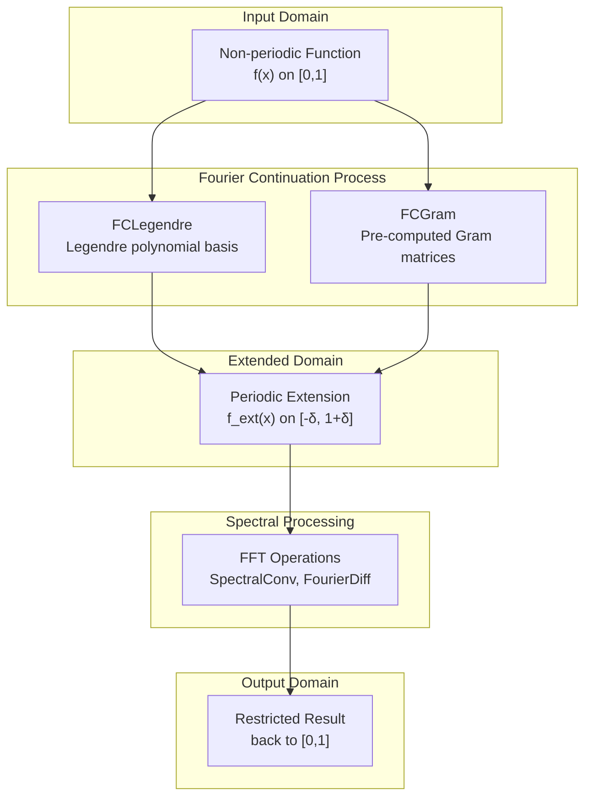
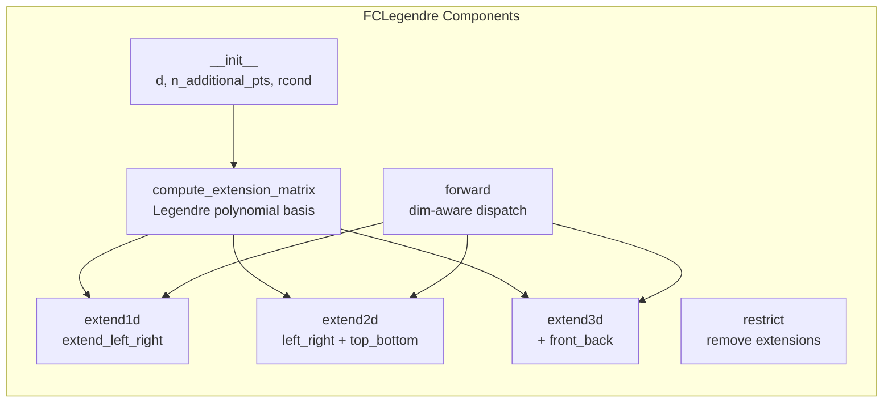
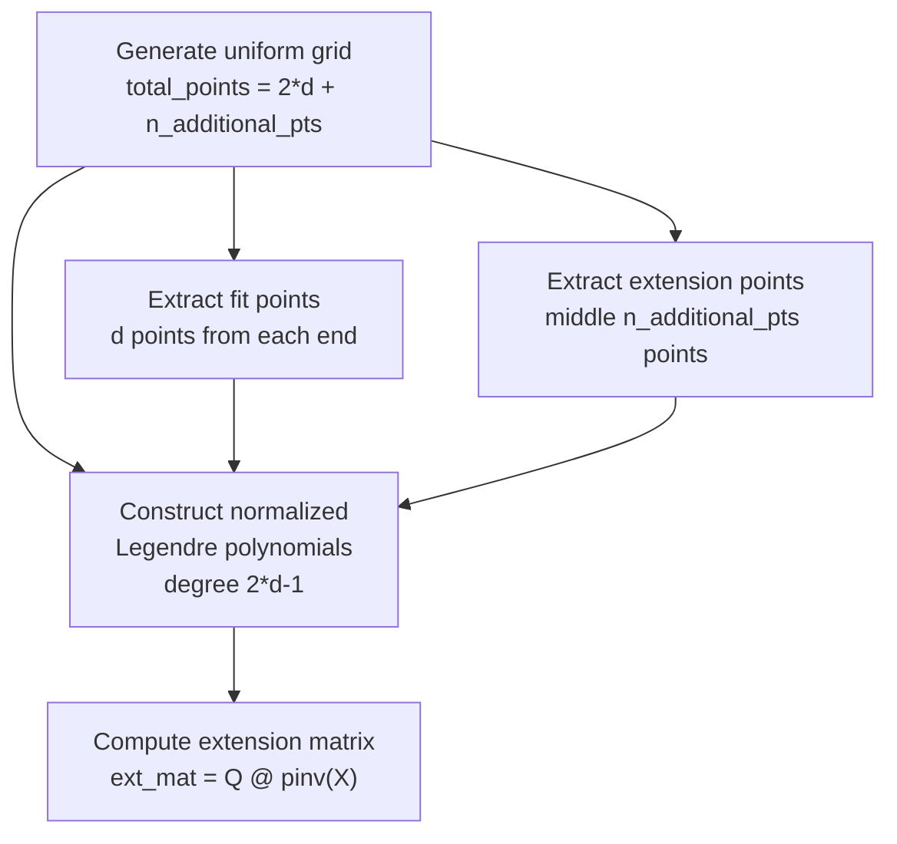
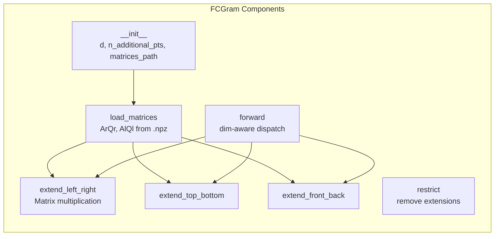
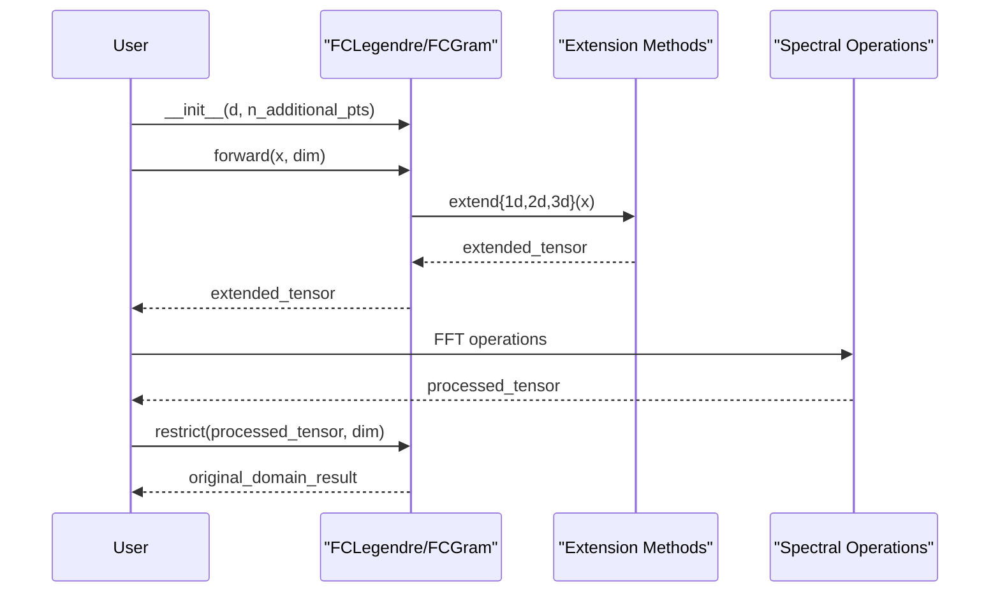
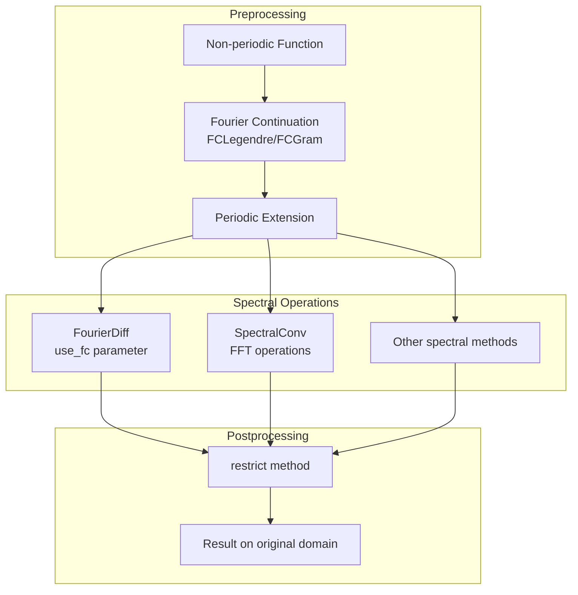

<!-- source: DeepWiki mcp.deepwiki.com · repo neuraloperator/neuraloperator · page 3.7 Fourier Continuation · fetched 2026-10-21 -->

# Fourier Continuation

<details>
<summary>Relevant source files</summary>

The following files were used as context for generating this wiki page:

- [examples/layers/plot_fourier_continuation.py](examples/layers/plot_fourier_continuation.py)
- [examples/layers/plot_fourier_diff.py](examples/layers/plot_fourier_diff.py)
- [neuralop/layers/fourier_continuation.py](neuralop/layers/fourier_continuation.py)
- [neuralop/layers/tests/test_fourier_continuation.py](neuralop/layers/tests/test_fourier_continuation.py)

</details>


Fourier Continuation is a technique for extending non-periodic functions to periodic domains, enabling the use of Fast Fourier Transform (FFT) based spectral methods on functions defined on finite intervals. The neuraloperator library provides two implementations of Fourier Continuation layers that can extend functions in 1D, 2D, and 3D domains.

For information about Fourier-based differentiation that utilizes these continuation methods, see the loss functions documentation in [4.3](#4.3). For spectral convolution layers that benefit from periodic extensions, see [3.1](#3.1).

## Overview

Fourier Continuation addresses the fundamental challenge that many neural operator architectures, particularly Fourier Neural Operators, rely on FFT operations that assume periodic boundary conditions. When working with non-periodic functions on finite domains, direct application of FFT can introduce artificial discontinuities at domain boundaries, leading to spectral pollution and reduced accuracy.

The library provides two distinct approaches to Fourier Continuation:



**Sources**: [neuralop/layers/fourier_continuation.py:1-562](), [examples/layers/plot_fourier_continuation.py:1-343]()

## FCLegendre Implementation

The `FCLegendre` class implements Fourier Continuation using normalized Legendre polynomial basis functions. This approach fits polynomials to boundary values and uses them to generate smooth extensions.



**Sources**: [neuralop/layers/fourier_continuation.py:9-267]()

### Key Parameters

| Parameter | Type | Default | Description |
|-----------|------|---------|-------------|
| `d` | int | 5 | Number of matching points on boundaries, relates to polynomial degree (2d-1) |
| `n_additional_pts` | int | 50 | Number of additional points for continuation |
| `rcond` | float | 1e-15 | Cutoff for singular values in pseudoinverse computation |

The extension matrix is computed using normalized Legendre polynomials on the interval [-1,1]:



**Sources**: [neuralop/layers/fourier_continuation.py:47-83]()

### Extension Methods

The `FCLegendre` class provides dimension-specific extension methods:

- `extend_left_right`: Extends along the last dimension using boundary values from left and right ends [neuralop/layers/fourier_continuation.py:86-110]()
- `extend_top_bottom`: Extends along the second-to-last dimension [neuralop/layers/fourier_continuation.py:113-137]()
- `extend_front_back`: Extends along the third-to-last dimension for 3D tensors [neuralop/layers/fourier_continuation.py:139-168]()

## FCGram Implementation

The `FCGram` class implements the FC-Gram algorithm using pre-computed Gram matrices. This approach typically provides better numerical stability and performance for standard parameter choices.



**Sources**: [neuralop/layers/fourier_continuation.py:271-562]()

### Pre-computed Matrices

The `FCGram` implementation relies on pre-computed matrices stored in `.npz` format:

| Matrix | Purpose | Shape |
|--------|---------|-------|
| `ArQr` | Right boundary continuation | `(C, d)` |
| `AlQl` | Left boundary continuation | `(C, d)` |

Where `C = n_additional_pts // 2` and `d` is the number of boundary points used for fitting.

The matrices are loaded from `FCGram_matrices/FCGram_data_d{d}_C{C}.npz` and can be generated using the MATLAB code from the FCGram repository at https://github.com/neuraloperator/FCGram/.

**Sources**: [neuralop/layers/fourier_continuation.py:334-361]()

## Usage Patterns

Both Fourier Continuation classes follow the same interface pattern:



**Sources**: [examples/layers/plot_fourier_continuation.py:20-46](), [neuralop/layers/tests/test_fourier_continuation.py:1-72]()

### Example Usage

Typical usage for 1D extension:
```python
# Setup
Extension_Legendre = FCLegendre(d=2, n_additional_pts=50)
Extension_Gram = FCGram(d=4, n_additional_pts=50)

# Extend function
f_extended_legendre = Extension_Legendre(f, dim=1)
f_extended_gram = Extension_Gram(f, dim=1)

# After spectral processing
result_original_domain = Extension_Legendre.restrict(processed_result, dim=1)
```

**Sources**: [examples/layers/plot_fourier_continuation.py:41-45]()

## Integration with Spectral Methods

Fourier Continuation layers are commonly used in conjunction with Fourier-based differentiation and spectral convolution operations:



**Sources**: [examples/layers/plot_fourier_diff.py:83-84](), [neuralop/layers/fourier_continuation.py:246-266]()

The `FourierDiff` class in the loss functions module can automatically apply Fourier Continuation when the `use_fc` parameter is set to `'Legendre'` or `'Gram'`, demonstrating the tight integration between these components for handling non-periodic boundary conditions in spectral computations.

**Sources**: [examples/layers/plot_fourier_diff.py:1-284]()

---

