<!-- source: DeepWiki mcp.deepwiki.com · repo neuraloperator/neuraloperator · page 4 Training Infrastructure · fetched 2026-10-21 -->

# Training Infrastructure

<details>
<summary>Relevant source files</summary>

The following files were used as context for generating this wiki page:

- [neuralop/training/__init__.py](neuralop/training/__init__.py)
- [neuralop/training/trainer.py](neuralop/training/trainer.py)
- [scripts/login_wandb.py](scripts/login_wandb.py)
- [scripts/test_from_config.py](scripts/test_from_config.py)
- [scripts/train_burgers.py](scripts/train_burgers.py)
- [scripts/train_burgers_pino.py](scripts/train_burgers_pino.py)
- [scripts/train_darcy.py](scripts/train_darcy.py)
- [scripts/train_fnogno_carcfd.py](scripts/train_fnogno_carcfd.py)
- [scripts/train_gino_carcfd.py](scripts/train_gino_carcfd.py)
- [scripts/train_mhd64.py](scripts/train_mhd64.py)
- [scripts/train_navier_stokes.py](scripts/train_navier_stokes.py)
- [scripts/train_poisson.py](scripts/train_poisson.py)
- [scripts/train_uqno_darcy.py](scripts/train_uqno_darcy.py)

</details>


The training infrastructure provides the core orchestration system for training neural operator models. This page documents the high-level training pipeline, including the `Trainer` class, data flow, optimization loops, evaluation modes, and checkpointing mechanisms. The training system is designed to handle both single-GPU and distributed multi-GPU training, with support for mixed precision, autoregressive evaluation, and experiment tracking via Weights & Biases.

For detailed documentation on specific components:
- Trainer class API and methods: see [Trainer Class](#4.1)
- Dataset classes and data processors: see [Data Processing and Datasets](#4.2)
- Loss functions and differentiation utilities: see [Loss Functions and Differentiation](#4.3)
- Model factory and checkpoint management: see [Model Management and Checkpointing](#4.4)

## Training Pipeline Architecture

The training infrastructure centers around the `Trainer` class, which orchestrates model training, evaluation, and checkpointing. The following diagram shows how components interact during a typical training run.

**Training Pipeline Component Interaction**

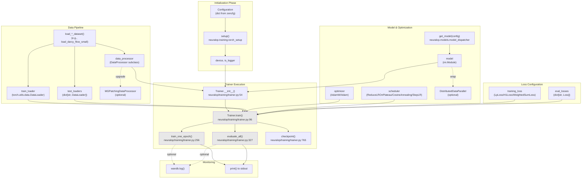

**Sources:** [neuralop/training/trainer.py:25-791](), [scripts/train_darcy.py:1-214](), [scripts/train_navier_stokes.py:1-229]()

## Core Training Components

The training infrastructure consists of several key components that work together to train neural operator models.

**Component Responsibility Table**

| Component | Class/Module | Primary Responsibility | Key Methods |
|-----------|--------------|----------------------|-------------|
| **Trainer** | `neuralop.training.Trainer` | Orchestrates training loop, evaluation, and checkpointing | `train()`, `train_one_epoch()`, `evaluate()` |
| **Data Processor** | `neuralop.data.transforms.data_processors.DataProcessor` | Normalizes inputs/outputs, handles preprocessing/postprocessing | `preprocess()`, `postprocess()` |
| **Data Loader** | `torch.utils.data.DataLoader` | Batches data, handles shuffling and distributed sampling | Standard PyTorch API |
| **Optimizer** | `neuralop.training.AdamW` or `torch.optim.Adam` | Updates model parameters based on gradients | `step()`, `zero_grad()` |
| **Scheduler** | `torch.optim.lr_scheduler.*` | Adjusts learning rate during training | `step()` |
| **Loss Functions** | Various in `neuralop.losses` | Compute training and evaluation metrics | `__call__(out, y, **kwargs)` |
| **Checkpointing** | `neuralop.training.training_state` | Saves/loads model, optimizer, and scheduler state | `save_training_state()`, `load_training_state()` |

**Sources:** [neuralop/training/trainer.py:25-53](), [neuralop/training/__init__.py:1-5]()

## Trainer Class Overview

The `Trainer` class is the central orchestration component. It is initialized with model and training configuration, then its `train()` method executes the full training loop.

**Trainer Initialization Parameters**

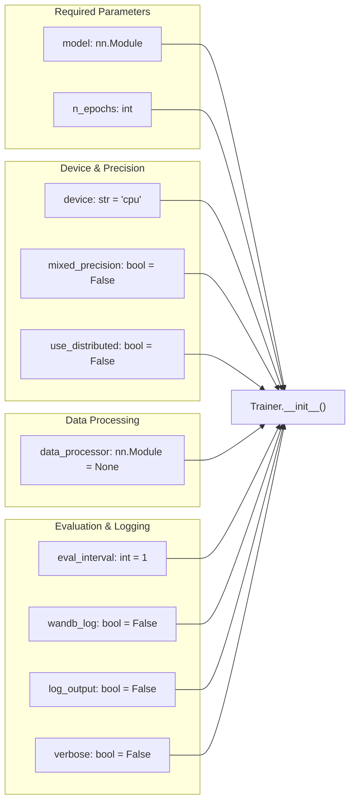

**Sources:** [neuralop/training/trainer.py:54-95]()

**Trainer.train() Method Parameters**

```mermaid
graph TB
    subgraph "Data Loaders"
        TL["train_loader<br/>DataLoader"]
        TLS["test_loaders<br/>dict[str, DataLoader]"]
    end
    
    subgraph "Optimization"
        Opt["optimizer<br/>torch.optim.Optimizer"]
        Sched["scheduler<br/>lr_scheduler"]
        Reg["regularizer<br/>optional"]
    end
    
    subgraph "Loss Functions"
        TrLoss["training_loss<br/>Loss function"]
        EvLosses["eval_losses<br/>dict[str, Loss]"]
        EvModes["eval_modes<br/>dict[str, str]"]
    end
    
    subgraph "Checkpointing"
        SaveEvery["save_every: int<br/>optional"]
        SaveBest["save_best: str<br/>optional"]
        SaveDir["save_dir: str | Path<br/>default './ckpt'"]
        ResumeDir["resume_from_dir: str | Path<br/>optional"]
    end
    
    subgraph "Autoregressive"
        MaxSteps["max_autoregressive_steps: int<br/>optional"]
    end
    
    TrainMethod["Trainer.train()"]
    
    TL --> TrainMethod
    TLS --> TrainMethod
    Opt --> TrainMethod
    Sched --> TrainMethod
    Reg --> TrainMethod
    TrLoss --> TrainMethod
    EvLosses --> TrainMethod
    EvModes --> TrainMethod
    SaveEvery --> TrainMethod
    SaveBest --> TrainMethod
    SaveDir --> TrainMethod
    ResumeDir --> TrainMethod
    MaxSteps --> TrainMethod
```

**Sources:** [neuralop/training/trainer.py:96-254]()

## Training Loop Execution

The training loop follows a hierarchical structure: outer epoch loop, training phase, and evaluation phase.

**Training Loop Flow**

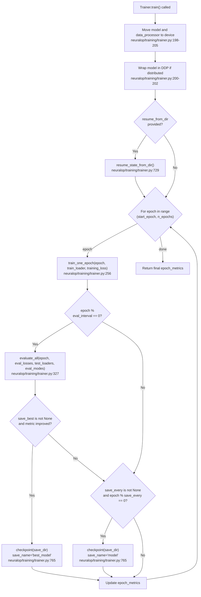

**Sources:** [neuralop/training/trainer.py:96-254]()

## Training One Epoch

Each epoch consists of iterating through all batches in the training loader, computing losses, and updating model parameters.

**train_one_epoch() Workflow**

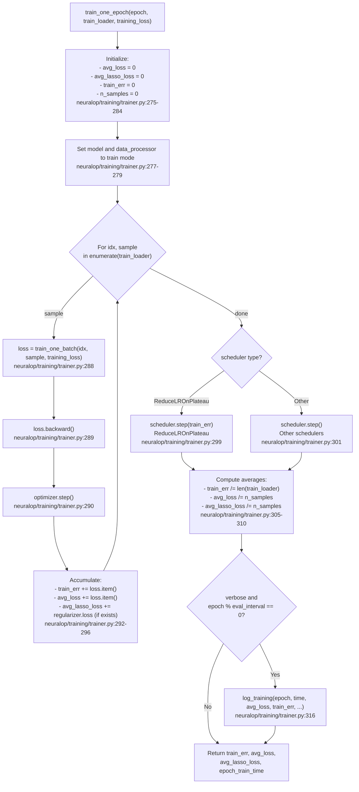

**Sources:** [neuralop/training/trainer.py:256-325]()

## Training One Batch

Each batch goes through preprocessing, model forward pass, postprocessing, and loss computation.

**train_one_batch() Details**

```mermaid
flowchart TD
    Start["train_one_batch(idx, sample, training_loss)"]
    
    ZeroGrad["optimizer.zero_grad(set_to_none=True)<br/>neuralop/training/trainer.py:471"]
    
    ResetReg{"regularizer<br/>exists?"}
    ResetRegCall["regularizer.reset()<br/>neuralop/training/trainer.py:473"]
    
    PreCheck{"data_processor<br/>is not None?"}
    PreProc["sample = data_processor.preprocess(sample)<br/>neuralop/training/trainer.py:475"]
    ToDevice["Move sample tensors to device<br/>neuralop/training/trainer.py:478-482"]
    
    CountSamples["n_samples += sample['y'].shape[0]<br/>neuralop/training/trainer.py:484-487"]
    
    MixedCheck{"mixed_precision<br/>enabled?"}
    ForwardAuto["with torch.autocast(device_type):<br/>    out = model(**sample)<br/>neuralop/training/trainer.py:490-491"]
    ForwardNorm["out = model(**sample)<br/>neuralop/training/trainer.py:493"]
    
    PostCheck{"data_processor<br/>is not None?"}
    PostProc["out, sample = data_processor.postprocess(out, sample)<br/>neuralop/training/trainer.py:499"]
    
    LossMixedCheck{"mixed_precision<br/>enabled?"}
    LossAuto["with torch.autocast(device_type):<br/>    loss = training_loss(out, **sample)<br/>neuralop/training/trainer.py:504-505"]
    LossNorm["loss = training_loss(out, **sample)<br/>neuralop/training/trainer.py:507"]
    
    AddReg{"regularizer<br/>exists?"}
    AddRegLoss["loss += regularizer.loss<br/>neuralop/training/trainer.py:510"]
    
    Return["return loss"]
    
    Start --> ZeroGrad
    ZeroGrad --> ResetReg
    ResetReg -->|Yes| ResetRegCall
    ResetReg -->|No| PreCheck
    ResetRegCall --> PreCheck
    
    PreCheck -->|Yes| PreProc
    PreCheck -->|No| ToDevice
    PreProc --> CountSamples
    ToDevice --> CountSamples
    
    CountSamples --> MixedCheck
    MixedCheck -->|Yes| ForwardAuto
    MixedCheck -->|No| ForwardNorm
    
    ForwardAuto --> PostCheck
    ForwardNorm --> PostCheck
    
    PostCheck -->|Yes| PostProc
    PostCheck -->|No| LossMixedCheck
    PostProc --> LossMixedCheck
    
    LossMixedCheck -->|Yes| LossAuto
    LossMixedCheck -->|No| LossNorm
    
    LossAuto --> AddReg
    LossNorm --> AddReg
    
    AddReg -->|Yes| AddRegLoss
    AddReg -->|No| Return
    AddRegLoss --> Return
```

**Sources:** [neuralop/training/trainer.py:454-512]()

## Evaluation Modes

The training infrastructure supports two evaluation modes: **single-step** and **autoregressive**. The mode determines how the model is evaluated on test data.

**Evaluation Mode Comparison**

| Mode | Description | Use Case | Implementation |
|------|-------------|----------|----------------|
| **single_step** | Evaluates one input-output pair at a time | Standard function approximation, stationary PDEs | `eval_one_batch()` [neuralop/training/trainer.py:514-563]() |
| **autoregressive** | Uses previous output as next input, rolls out for multiple steps | Time-dependent PDEs, trajectory prediction | `eval_one_batch_autoreg()` [neuralop/training/trainer.py:565-646]() |

**Evaluation Flow**

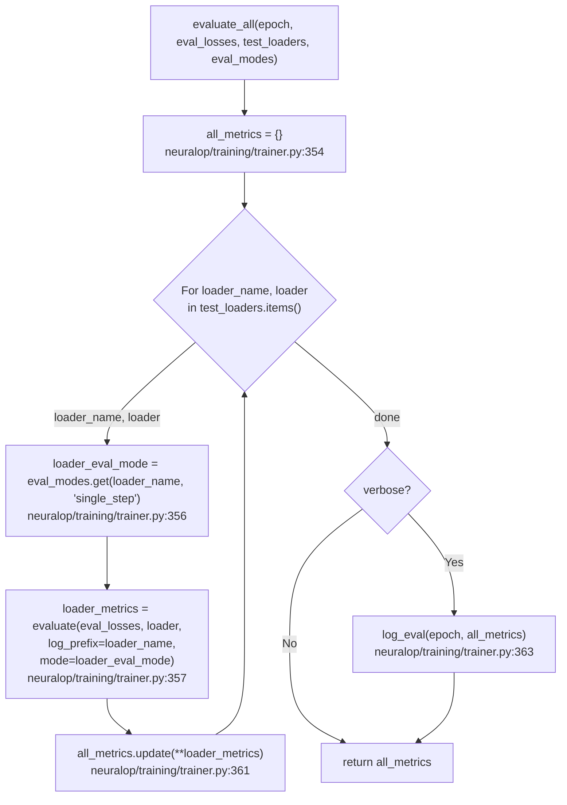

**Sources:** [neuralop/training/trainer.py:327-365]()

**evaluate() Method Structure**

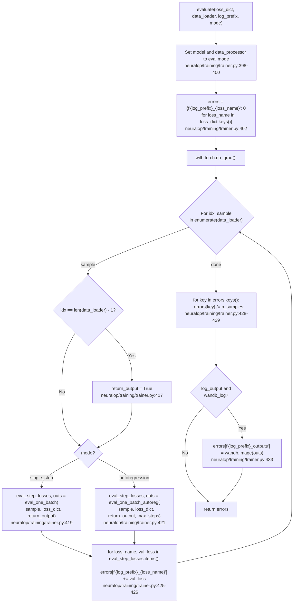

**Sources:** [neuralop/training/trainer.py:367-435]()

## Checkpointing and State Management

The training infrastructure provides checkpointing to save and resume training state. Checkpoints include model parameters, optimizer state, scheduler state, optional regularizer state, and current epoch number.

**Checkpoint Structure**

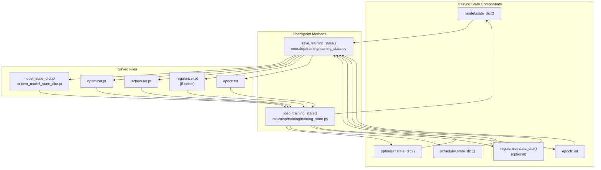

**Sources:** [neuralop/training/trainer.py:765-791](), [neuralop/training/trainer.py:729-763](), [neuralop/training/training_state.py:1]()

**Checkpointing Options**

The `Trainer.train()` method supports two checkpointing strategies:

1. **Periodic Checkpointing** (`save_every`): Save checkpoint every N epochs
2. **Best Model Checkpointing** (`save_best`): Save when a specified metric improves

**Checkpointing Configuration Table**

| Parameter | Type | Description | Example |
|-----------|------|-------------|---------|
| `save_every` | `int` or `None` | Save checkpoint every N epochs | `save_every=10` saves every 10 epochs |
| `save_best` | `str` or `None` | Metric name to monitor for best model | `save_best="test_l2"` saves when test L2 improves |
| `save_dir` | `str` or `Path` | Directory to save checkpoints | `save_dir="./ckpt"` |
| `resume_from_dir` | `str` or `Path` | Directory to resume training from | `resume_from_dir="./ckpt"` |

**Sources:** [neuralop/training/trainer.py:106-110](), [neuralop/training/trainer.py:139-151](), [neuralop/training/trainer.py:192-195]()

## Distributed Training Support

The training infrastructure supports distributed data parallel (DDP) training across multiple GPUs.

**Distributed Training Setup**

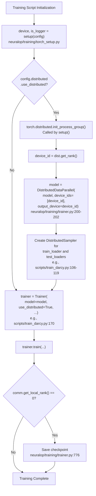

**Sources:** [neuralop/training/trainer.py:200-202](), [neuralop/training/torch_setup.py:1](), [scripts/train_darcy.py:36-37](), [scripts/train_darcy.py:106-119](), [neuralop/training/trainer.py:776-790]()

## Integration with Example Training Scripts

The training infrastructure is used consistently across all example training scripts. Here's how a typical training script integrates with the infrastructure:

**Standard Training Script Structure**

```mermaid
flowchart TD
    Start["Training Script Execution"]
    
    Config["Load configuration from zencfg<br/>e.g., scripts/train_darcy.py:26-34"]
    
    SetupDist["device, is_logger = setup(config)<br/>scripts/train_darcy.py:37"]
    
    WandbInit["Initialize Weights & Biases<br/>(if config.wandb.log)<br/>scripts/train_darcy.py:40-65"]
    
    LoadData["Load dataset using dataset loader<br/>e.g., load_darcy_flow_small()<br/>scripts/train_darcy.py:78-87"]
    
    GetModel["model = get_model(config)<br/>scripts/train_darcy.py:89"]
    
    DataProcCheck{"Patching enabled?<br/>(config.patching.levels > 0)"}
    UpgradeProc["data_processor = MGPatchingDataProcessor(...)<br/>scripts/train_darcy.py:92-102"]
    
    DistSamplerCheck{"Distributed training?"}
    SetupSampler["Setup DistributedSampler for loaders<br/>scripts/train_darcy.py:106-119"]
    
    CreateOpt["optimizer = AdamW(...)<br/>scripts/train_darcy.py:121-125"]
    
    CreateSched["scheduler = torch.optim.lr_scheduler.*<br/>scripts/train_darcy.py:127-143"]
    
    CreateLosses["training_loss = LpLoss(...) or H1Loss(...)<br/>eval_losses = {'h1': h1loss, 'l2': l2loss}<br/>scripts/train_darcy.py:146-158"]
    
    CreateTrainer["trainer = Trainer(<br/>    model=model, n_epochs=...,<br/>    device=device, data_processor=...,<br/>    ...)<br/>scripts/train_darcy.py:170-181"]
    
    LogParams["Log model parameter count to wandb<br/>(if config.wandb.log)<br/>scripts/train_darcy.py:184-198"]
    
    Train["trainer.train(<br/>    train_loader=train_loader,<br/>    test_loaders=test_loaders,<br/>    optimizer=optimizer,<br/>    scheduler=scheduler,<br/>    training_loss=train_loss,<br/>    eval_losses=eval_losses)<br/>scripts/train_darcy.py:201-209"]
    
    Finish["wandb.finish()<br/>(if config.wandb.log)<br/>scripts/train_darcy.py:212-213"]
    
    End["Script Complete"]
    
    Start --> Config
    Config --> SetupDist
    SetupDist --> WandbInit
    WandbInit --> LoadData
    LoadData --> GetModel
    GetModel --> DataProcCheck
    
    DataProcCheck -->|Yes| UpgradeProc
    DataProcCheck -->|No| DistSamplerCheck
    UpgradeProc --> DistSamplerCheck
    
    DistSamplerCheck -->|Yes| SetupSampler
    DistSamplerCheck -->|No| CreateOpt
    SetupSampler --> CreateOpt
    
    CreateOpt --> CreateSched
    CreateSched --> CreateLosses
    CreateLosses --> CreateTrainer
    CreateTrainer --> LogParams
    LogParams --> Train
    Train --> Finish
    Finish --> End
```

**Sources:** [scripts/train_darcy.py:1-214](), [scripts/train_navier_stokes.py:1-229](), [scripts/train_burgers.py:1-226]()

## Mixed Precision Training

The training infrastructure supports mixed precision training using `torch.autocast` to accelerate training and reduce memory usage on compatible hardware.

**Mixed Precision Configuration**

When `mixed_precision=True` is passed to the `Trainer`, forward passes and loss computations are wrapped in `torch.autocast` contexts:

```python
# Forward pass with mixed precision
if self.mixed_precision:
    with torch.autocast(device_type=self.autocast_device_type):
        out = self.model(**sample)
else:
    out = self.model(**sample)

# Loss computation with mixed precision
if self.mixed_precision:
    with torch.autocast(device_type=self.autocast_device_type):
        loss += training_loss(out, **sample)
else:
    loss += training_loss(out, **sample)
```

**Device Type Detection**

The `Trainer` automatically determines the appropriate device type for autocast:
- If device contains "cuda", uses `device_type="cuda"`
- Otherwise, uses `device_type="cpu"`

**Sources:** [neuralop/training/trainer.py:82-91](), [neuralop/training/trainer.py:489-507]()

## Weights & Biases Integration

The training infrastructure integrates with Weights & Biases for experiment tracking and visualization.

**Logged Metrics**

| Metric Type | Examples | Logged By |
|-------------|----------|-----------|
| **Training Metrics** | `train_err`, `avg_loss`, `avg_lasso_loss`, `lr` | `log_training()` [neuralop/training/trainer.py:648-695]() |
| **Evaluation Metrics** | `test_l2`, `test_h1`, `421_l2` (resolution-specific) | `log_eval()` [neuralop/training/trainer.py:697-727]() |
| **Model Info** | `n_params`, `compression_ratio`, `space_savings` | Training scripts [scripts/train_darcy.py:184-198]() |
| **Output Visualizations** | Model output images on last eval batch | `evaluate()` [neuralop/training/trainer.py:432-433]() |

**WandB Logging Flow**

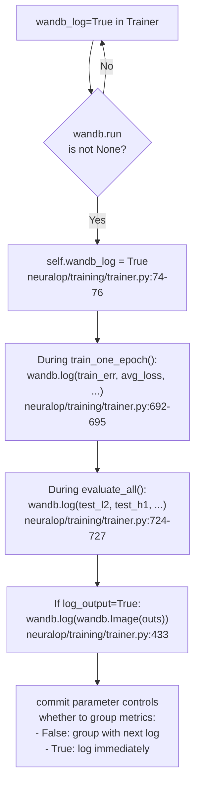

**Sources:** [neuralop/training/trainer.py:73-76](), [neuralop/training/trainer.py:648-727](), [scripts/train_darcy.py:40-65]()

## Common Configuration Patterns

Training scripts typically follow consistent patterns for configuration and initialization. Here are common configuration values:

**Optimizer Configuration**

```python
optimizer = AdamW(
    model.parameters(),
    lr=config.opt.learning_rate,      # e.g., 1e-3
    weight_decay=config.opt.weight_decay,  # e.g., 1e-4
)
```

**Scheduler Configuration**

| Scheduler Type | Configuration | Use Case |
|----------------|---------------|----------|
| `ReduceLROnPlateau` | `factor=0.5, patience=5, mode="min"` | Reduce LR when validation metric plateaus |
| `CosineAnnealingLR` | `T_max=n_epochs` | Smooth LR decay over training |
| `StepLR` | `step_size=50, gamma=0.5` | Fixed LR decay every N epochs |

**Loss Configuration**

```python
# Data losses
l2loss = LpLoss(d=2, p=2)
h1loss = H1Loss(d=2)

# Training loss selection
if config.opt.training_loss == "l2":
    train_loss = l2loss
elif config.opt.training_loss == "h1":
    train_loss = h1loss

# Evaluation losses
eval_losses = {"h1": h1loss, "l2": l2loss}
```

**Sources:** [scripts/train_darcy.py:121-158](), [scripts/train_navier_stokes.py:130-167](), [scripts/train_burgers.py:98-157]()

---

