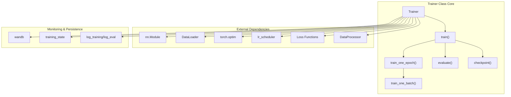
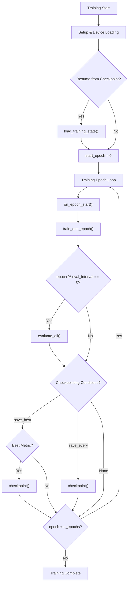
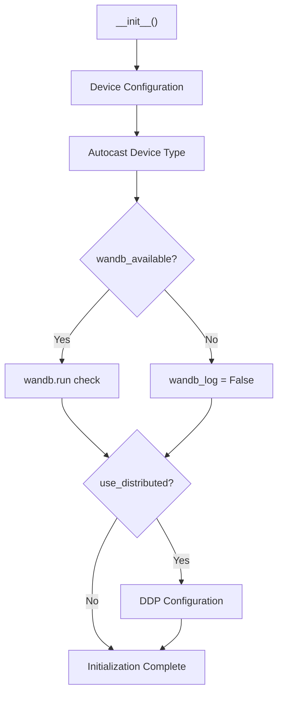
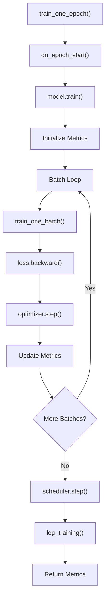
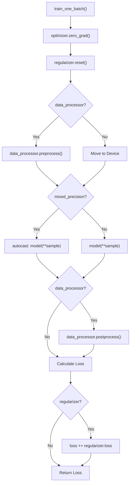
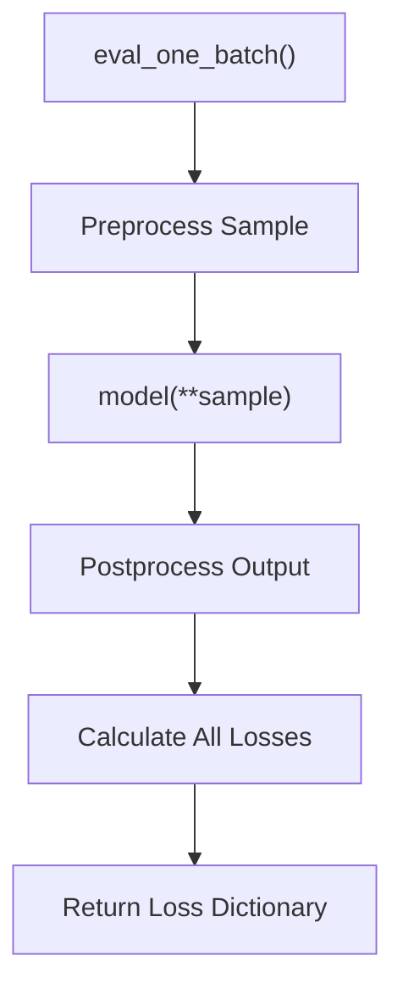
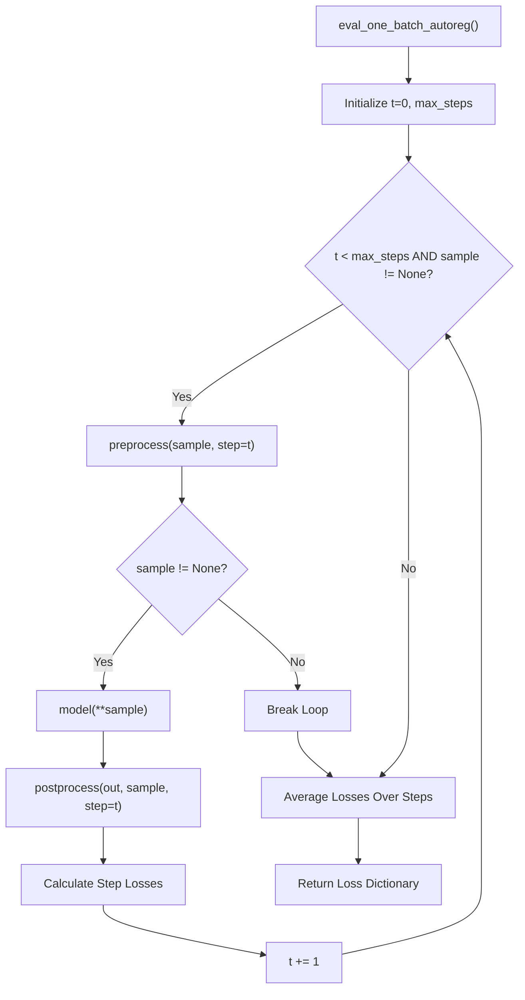
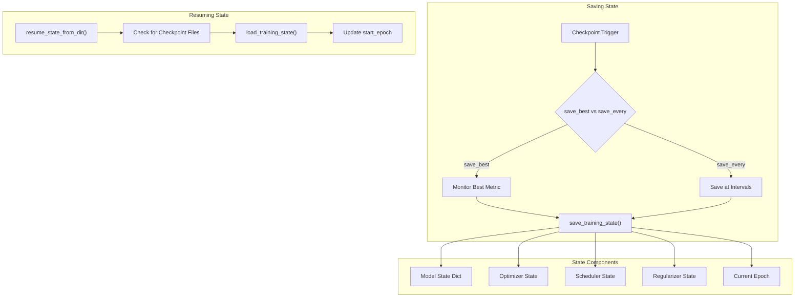
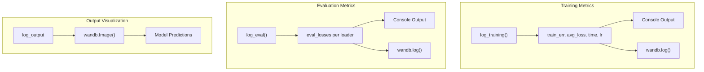

<!-- source: DeepWiki mcp.deepwiki.com · repo neuraloperator/neuraloperator · page 4.1 Trainer Class · fetched 2026-10-21 -->

# Trainer Class

Relevant source files

The following files were used as context for generating this wiki page:

- [neuralop/training/__init__.py](neuralop/training/__init__.py)
- [neuralop/training/trainer.py](neuralop/training/trainer.py)

The `Trainer` class serves as the main orchestrator for training neural operator models in the neuraloperator library. It provides a comprehensive training framework that handles the complete training lifecycle, from data loading and model training to evaluation, checkpointing, and logging. The class supports advanced features like distributed training, mixed precision computation, autoregressive evaluation, and integration with Weights & Biases for experiment tracking.

For information about specific data processing components used with the Trainer, see [Data Processing](#4.2). For details about loss functions and training objectives, see [Loss Functions and Differentiation](#4.3). For model management and configuration details, see [Model Management and Checkpointing](#4.4).

## Overview

The `Trainer` class is implemented in [neuralop/training/trainer.py:25-792]() and provides a unified interface for training all neural operator models in the library. It abstracts away the complexity of the training process while offering flexibility for different training scenarios and configurations.

**Sources:** [neuralop/training/trainer.py:25-792]()

## Core Training Pipeline

The training pipeline follows a structured approach with clear separation of concerns between training, evaluation, and state management:

**Training Pipeline Flow**

**Sources:** [neuralop/training/trainer.py:225-254]()

## Training Configuration and Initialization

The `Trainer` class is initialized with comprehensive configuration options that control all aspects of the training process:

### Key Initialization Parameters

| Parameter | Type | Default | Description |
|-----------|------|---------|-------------|
| `model` | `nn.Module` | Required | Neural operator model to train |
| `n_epochs` | `int` | Required | Number of training epochs |
| `device` | `str` | `'cpu'` | Training device ('cpu', 'cuda', etc.) |
| `mixed_precision` | `bool` | `False` | Enable torch.autocast for mixed precision |
| `wandb_log` | `bool` | `False` | Enable Weights & Biases logging |
| `data_processor` | `nn.Module` | `None` | Data preprocessing/postprocessing module |
| `eval_interval` | `int` | `1` | Frequency of evaluation epochs |
| `use_distributed` | `bool` | `False` | Enable DistributedDataParallel |
| `verbose` | `bool` | `False` | Enable verbose logging output |

The initialization process includes device handling, distributed training setup, and autocast configuration:

**Sources:** [neuralop/training/trainer.py:54-95]()

## Training Loop Implementation

### Single Epoch Training

The `train_one_epoch` method orchestrates training for a complete epoch, handling batch processing, optimization steps, and metric collection:

**Sources:** [neuralop/training/trainer.py:256-325]()

### Single Batch Training

The `train_one_batch` method handles individual batch processing with support for mixed precision and data preprocessing:

**Sources:** [neuralop/training/trainer.py:454-512]()

## Evaluation Modes

The `Trainer` supports two distinct evaluation modes to handle different types of temporal dynamics and prediction scenarios:

### Single-Step Evaluation

Standard evaluation where each input-output pair is processed independently:

**Sources:** [neuralop/training/trainer.py:514-563]()

### Autoregressive Evaluation

For time-dependent problems where model outputs become inputs for subsequent time steps:

**Sources:** [neuralop/training/trainer.py:565-646]()

## Checkpointing and State Management

The `Trainer` provides comprehensive state management capabilities for training resumption and model persistence:

### Checkpoint Operations

**Sources:** [neuralop/training/trainer.py:729-791]()

### Checkpoint File Management

The system handles two types of checkpoint files:
- `model_state_dict.pt`: Regular interval checkpoints
- `best_model_state_dict.pt`: Best performing model checkpoints

**Sources:** [neuralop/training/trainer.py:742-749]()

## Logging and Monitoring

The `Trainer` integrates with multiple logging systems for comprehensive experiment tracking:

### Logging Components

**Sources:** [neuralop/training/trainer.py:648-728]()

## Integration with Other Components

The `Trainer` class seamlessly integrates with various components of the neuraloperator ecosystem:

### Component Dependencies

```mermaid
graph TB
    subgraph "Model Components"
        Models["FNO, UNO, GINO, etc."]
        BaseModel["BaseModel Registry"]
    end
    
    subgraph "Data Pipeline"
        DataLoaders["DataLoaders"]
        DataProcessors["MGPatching, Normalizers"]
        Datasets["Darcy, NavierStokes, etc."]
    end
    
    subgraph "Training Components"
        Losses["LpLoss, H1Loss, etc."]
        Optimizers["AdamW, Adam"]
        Schedulers["lr_scheduler"]
        Regularizers["Regularization"]
    end
    
    subgraph "Infrastructure"
        MPU["neuralop.mpu.comm"]
        TrainingState["training_state module"]
        TorchSetup["torch_setup"]
    end
    
    Trainer --> Models
    Trainer --> DataLoaders
    Trainer --> DataProcessors
    Trainer --> Losses
    Trainer --> Optimizers
    Trainer --> Schedulers
    Trainer --> MPU
    Trainer --> TrainingState
```

**Sources:** [neuralop/training/trainer.py:1-23](), [neuralop/training/__init__.py:1-5]()

The `Trainer` class serves as the central coordination point for neural operator training, providing a robust and flexible framework that supports the diverse requirements of physics-informed machine learning applications while maintaining ease of use and comprehensive monitoring capabilities.

---

