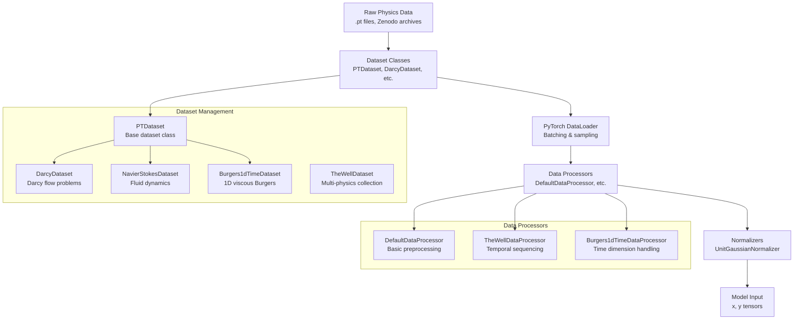
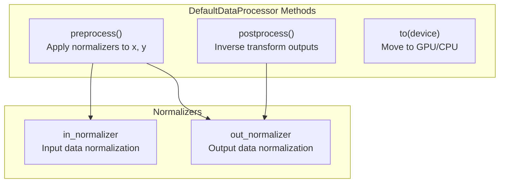
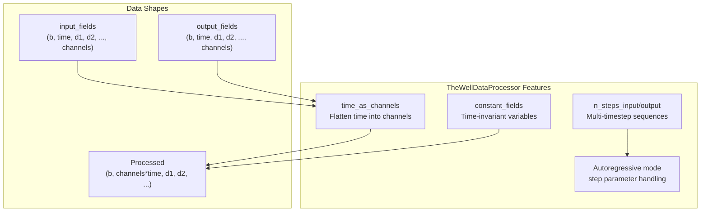
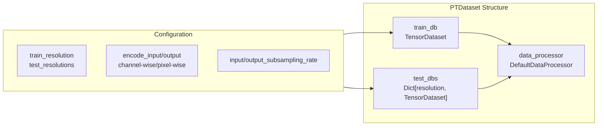
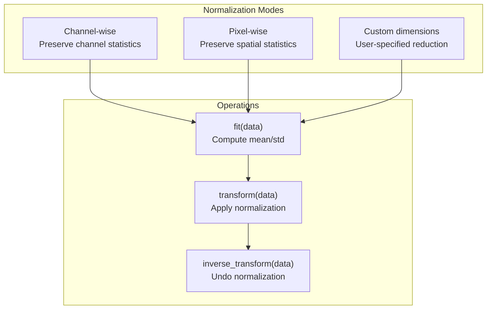
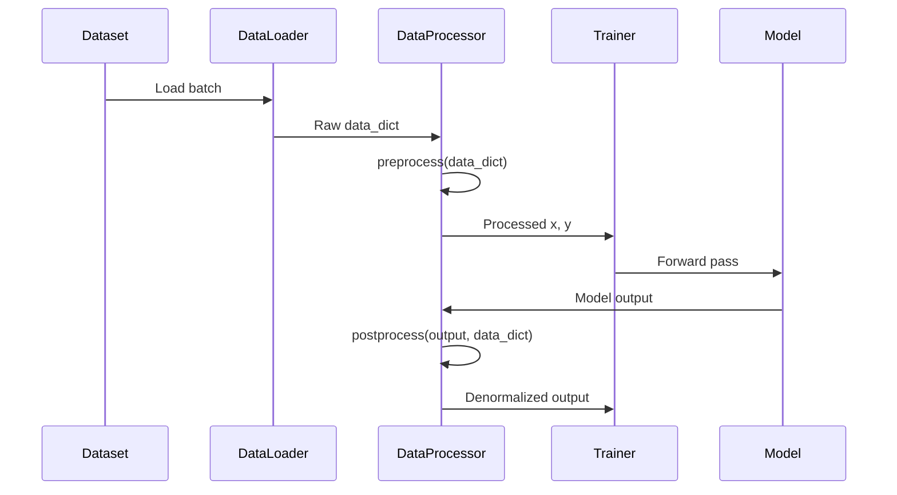

<!-- source: DeepWiki mcp.deepwiki.com · repo neuraloperator/neuraloperator · page 4.2 Data Processing and Datasets · fetched 2026-10-21 -->

# Data Processing

Relevant source files

The following files were used as context for generating this wiki page:

- [config/the_well/mhd_64_config.py](config/the_well/mhd_64_config.py)
- [neuralop/data/datasets/__init__.py](neuralop/data/datasets/__init__.py)
- [neuralop/data/datasets/burgers.py](neuralop/data/datasets/burgers.py)
- [neuralop/data/datasets/darcy.py](neuralop/data/datasets/darcy.py)
- [neuralop/data/datasets/navier_stokes.py](neuralop/data/datasets/navier_stokes.py)
- [neuralop/data/datasets/pt_dataset.py](neuralop/data/datasets/pt_dataset.py)
- [neuralop/data/datasets/the_well_dataset.py](neuralop/data/datasets/the_well_dataset.py)
- [neuralop/data/transforms/the_well_data_processors.py](neuralop/data/transforms/the_well_data_processors.py)
- [neuralop/training/__init__.py](neuralop/training/__init__.py)
- [neuralop/training/trainer.py](neuralop/training/trainer.py)

This page documents the data processing infrastructure in the neuraloperator library, which transforms raw physics simulation data into the format required by neural operator models. The data processing system handles normalization, temporal sequencing, geometry handling, and batch preparation for various PDE problems.

For information about the training loop that consumes processed data, see [Trainer Class](#4.1). For details about loss functions applied to processed outputs, see [Loss Functions and Differentiation](#4.3).

## Overview

The data processing system consists of three main components: datasets that load raw simulation data, data processors that transform the data for model consumption, and normalizers that handle statistical preprocessing. The system supports various physics problems including Darcy flow, Navier-Stokes equations, Burgers equation, and datasets from TheWell collection.

## Data Processing Pipeline

**Sources:** [neuralop/data/datasets/pt_dataset.py:1-235](), [neuralop/data/transforms/the_well_data_processors.py:1-182](), [neuralop/data/datasets/darcy.py:1-214]()

## Core Data Processors

### DefaultDataProcessor

The `DefaultDataProcessor` class provides basic data preprocessing functionality including normalization and tensor formatting. It serves as the base class for specialized processors.

The processor handles the standard workflow of applying input/output normalizers during preprocessing and inverse transforms during postprocessing.

**Sources:** [neuralop/data/transforms/data_processors.py](), [neuralop/data/datasets/pt_dataset.py:188-190]()

### TheWellDataProcessor

The `TheWellDataProcessor` extends `DefaultDataProcessor` to handle temporal data from TheWell physics simulation collection. It manages time-series data with multiple timesteps for input and output.

Key features include:
- **Time flattening**: Converts `(b, c, t, ...)` to `(b, t*c, ...)` when `time_as_channels=True`
- **Autoregressive support**: Handles step-by-step prediction by rolling input windows
- **Constant fields**: Concatenates time-invariant variables after normalization

**Sources:** [neuralop/data/transforms/the_well_data_processors.py:34-181]()

### Burgers1dTimeDataProcessor

Specialized processor for the 1D viscous Burgers equation that handles temporal evolution by repeating input conditions across time steps.

The processor extends the input tensor by repeating it along the temporal dimension to match the output shape: `x.unsqueeze(-2).repeat([1, 1, temporal_len, 1])`.

**Sources:** [neuralop/data/datasets/burgers.py:8-34]()

## Dataset Management

### PTDataset Base Class

The `PTDataset` class provides the foundation for all physics dataset implementations. It handles:

- **Data loading**: Loads `.pt` files with `x` and `y` tensors
- **Subsampling**: Configurable spatial/temporal subsampling rates  
- **Normalization setup**: Fits normalizers to training data
- **Multi-resolution**: Supports different resolutions for train/test splits

**Sources:** [neuralop/data/datasets/pt_dataset.py:28-235]()

### Problem-Specific Datasets

#### DarcyDataset
Handles Darcy flow problems with coefficient functions as input and flow fields as output. Supports automatic download from Zenodo archives and multiple resolutions (16, 32, 64, 128, 421).

#### NavierStokesDataset  
Manages 2D incompressible Navier-Stokes data with vorticity fields. Available at resolutions 128 and 1024.

#### TheWellDataset
Interfaces with TheWell multi-physics simulation collection, supporting both next-step prediction and autoregressive evaluation tasks.

**Sources:** [neuralop/data/datasets/darcy.py:15-126](), [neuralop/data/datasets/navier_stokes.py:14-125](), [neuralop/data/datasets/the_well_dataset.py:14-169]()

## Normalization and Transforms

### UnitGaussianNormalizer

The primary normalization strategy normalizes data to unit Gaussian distribution with configurable reduction dimensions:

- **Channel-wise**: Normalize each channel independently
- **Pixel-wise**: Normalize across spatial locations
- **Custom dimensions**: Specify reduction dimensions explicitly

The normalizer provides `transform()` and `inverse_transform()` methods for forward and backward normalization.

**Sources:** [neuralop/data/datasets/pt_dataset.py:164-180](), [neuralop/data/transforms/normalizers.py]()

## Data Flow in Training

The complete data processing workflow integrates with the training system:

During training:
1. **Dataset** loads raw simulation data from `.pt` files
2. **DataLoader** creates batches and handles sampling
3. **DataProcessor** normalizes inputs and formats tensors
4. **Model** processes the data and produces outputs
5. **DataProcessor** denormalizes outputs for loss computation

**Sources:** [neuralop/data/transforms/the_well_data_processors.py:143-181](), [neuralop/data/datasets/pt_dataset.py:183-190]()

---

