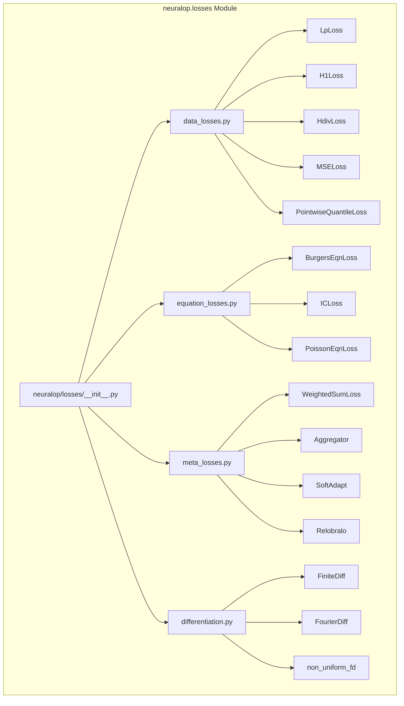
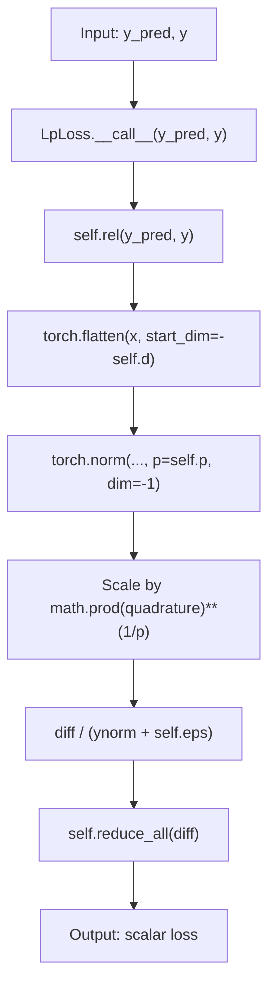
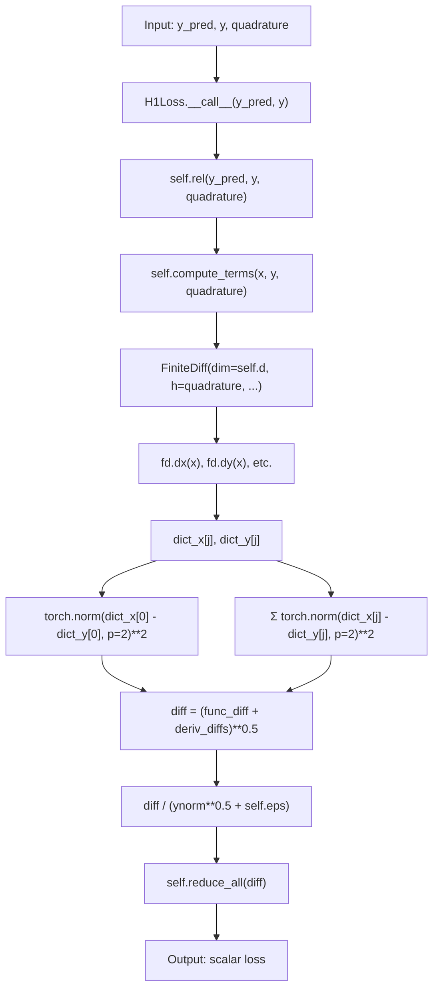
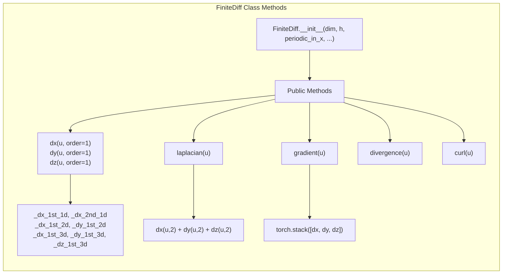
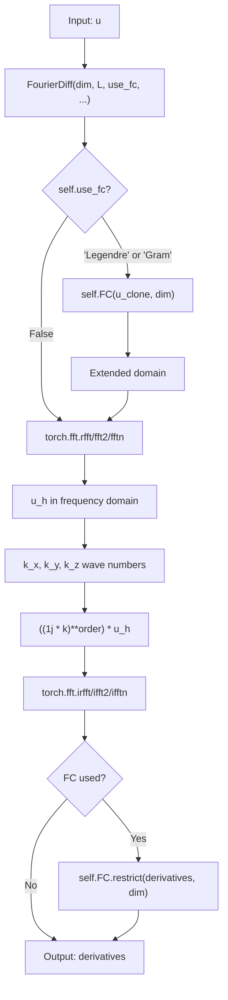
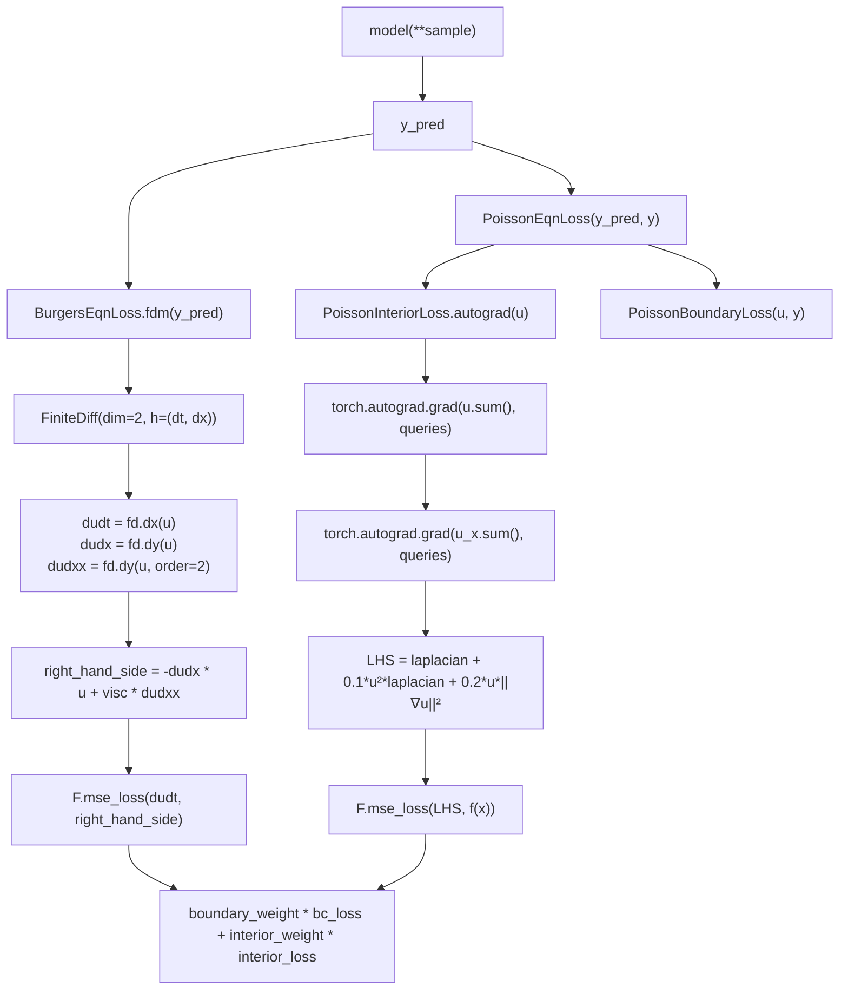
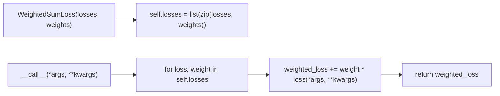
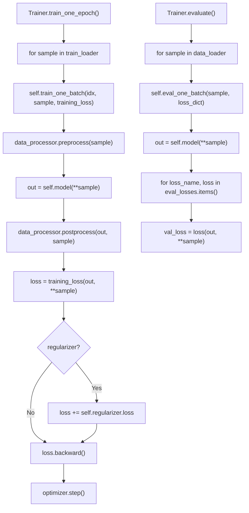

<!-- source: DeepWiki mcp.deepwiki.com · repo neuraloperator/neuraloperator · page 4.3 Loss Functions and Differentiation · fetched 2026-10-21 -->

# Loss Functions and Differentiation

<details>
<summary>Relevant source files</summary>

The following files were used as context for generating this wiki page:

- [neuralop/__init__.py](neuralop/__init__.py)
- [neuralop/losses/__init__.py](neuralop/losses/__init__.py)
- [neuralop/losses/data_losses.py](neuralop/losses/data_losses.py)
- [neuralop/losses/differentiation.py](neuralop/losses/differentiation.py)
- [neuralop/losses/equation_losses.py](neuralop/losses/equation_losses.py)
- [neuralop/losses/meta_losses.py](neuralop/losses/meta_losses.py)
- [neuralop/losses/tests/test_losses.py](neuralop/losses/tests/test_losses.py)
- [neuralop/training/__init__.py](neuralop/training/__init__.py)
- [neuralop/training/trainer.py](neuralop/training/trainer.py)

</details>


This document provides comprehensive documentation of loss functions, Sobolev norms, and numerical differentiation utilities available in the Neural Operator library. These components are essential for training neural operator models and computing derivatives for physics-informed constraints. For information about the training infrastructure that uses these components, see [Trainer Class](#4.1).

## 1. Overview

The Neural Operator library provides specialized loss functions and differentiation utilities designed for partial differential equations (PDEs) and operator learning tasks. The components fall into four main categories:

1. **Data-driven losses** - Measure the discrepancy between predictions and ground truth
2. **Physics-informed losses** - Enforce physical laws and constraints  
3. **Meta losses** - Combine multiple losses with adaptive weighting strategies
4. **Differentiation utilities** - Compute derivatives using finite differences and Fourier methods

**Diagram: Loss Functions and Differentiation Module Structure**



Sources: [neuralop/losses/__init__.py:1-4](), [neuralop/losses/data_losses.py:1-777](), [neuralop/losses/differentiation.py:1-1385](), [neuralop/losses/meta_losses.py:1-434]()

## 2. Data-Driven Losses

### 2.1 LpLoss

The `LpLoss` class implements the Lp-norm between two discretized functions. It is commonly used with `p=2` (L2 loss) for training Neural Operators.

**Key features:**
- Supports functions in 1D, 2D, or 3D domains via the `d` parameter
- Provides both absolute (`abs` method) and relative (`rel` method) error calculations
- Properly handles function space norms by scaling with quadrature weights via `uniform_quadrature` method
- Always averages over spatial dimensions, with configurable reduction across batch dimensions via `reduction` parameter

**Diagram: LpLoss Computation Flow**



**Configuration parameters:**
- `d` (int): Dimension of data (1, 2, or 3)
- `p` (int): Order of Lp-norm (default: 2)
- `measure` (float or list): Domain measure for quadrature (default: 1.0)
- `reduction` (str): 'sum' or 'mean' across batch/channel dims (default: 'sum')
- `eps` (float): Numerical stability constant (default: 1e-8)

Sources: [neuralop/losses/data_losses.py:21-187]()

### 2.2 H1Loss (Sobolev Norm)

The `H1Loss` class computes the H1 Sobolev norm, which measures both the function values and their derivatives. This is particularly useful for PDEs where the solution's derivatives are also important.

**Key features:**
- Computes finite difference derivatives in 1D, 2D, or 3D using the `FiniteDiff` class internally
- Combines function value differences and derivative differences
- Provides both absolute (`abs` method) and relative (`rel` method) error calculations
- Configurable boundary conditions (periodic/non-periodic) via `periodic_in_x`, `periodic_in_y` parameters

**Diagram: H1Loss Computation Flow**



**Configuration parameters:**
- `d` (int): Dimension of input functions (1, 2, or 3)
- `measure` (float or list): Domain measure for quadrature (default: 1.0)
- `reduction` (str): 'sum' or 'mean' across batch/channel dims (default: 'sum')
- `eps` (float): Numerical stability constant (default: 1e-8)
- `periodic_in_x` (bool): Periodic BC in x-direction (default: True)
- `periodic_in_y` (bool): Periodic BC in y-direction (default: True)

Sources: [neuralop/losses/data_losses.py:189-447](), [neuralop/losses/differentiation.py:11-668]()

### 2.3 HdivLoss

The `HdivLoss` class implements the Hdiv Sobolev norm, which is useful for vector-valued functions where the divergence is important (e.g., fluid dynamics).

**Key features:**
- Computes finite difference derivatives to calculate divergence using `FiniteDiff` class
- Combines function value differences and divergence differences via `compute_terms` method
- Provides both absolute (`abs` method) and relative (`rel` method) error calculations
- Configurable boundary conditions for each spatial dimension via `periodic_in_x`, `periodic_in_y`, `periodic_in_z` parameters

**H¹(div) norm computation:**
- **1D**: `||u||² + ||∂u/∂x||²`
- **2D**: `||u||² + ||∂u₁/∂x + ∂u₂/∂y||²` 
- **3D**: `||u||² + ||∂u₁/∂x + ∂u₂/∂y + ∂u₃/∂z||²`

**Configuration parameters:**
- `d` (int): Dimension of input functions (1, 2, or 3)
- `measure` (float or list): Domain measure for quadrature (default: 1.0)
- `reduction` (str): 'sum' or 'mean' across batch/channel dims (default: 'sum')
- `eps` (float): Numerical stability constant (default: 1e-8)
- `periodic_in_x`, `periodic_in_y`, `periodic_in_z` (bool): Periodic BCs (default: True)

Sources: [neuralop/losses/data_losses.py:449-704]()

### 2.4 Other Data Losses

**PointwiseQuantileLoss**:
- Used for uncertainty quantification with conformal prediction
- Computes quantile loss as described in literature
- Takes a parameter `alpha` representing the expected proportion of points within predicted quantiles

**MSELoss**:
- Simple mean squared error implementation
- Allows specifying dimensions across which to compute MSE

Sources: [neuralop/losses/data_losses.py:668-764]()

## 3. Numerical Differentiation Utilities

The library provides comprehensive utilities for computing derivatives using both finite difference and Fourier spectral methods. These are essential for computing Sobolev norms and physics-informed losses.

### 3.1 FiniteDiff Class

The `FiniteDiff` class provides unified finite difference methods for 1D, 2D, and 3D functions with configurable boundary conditions.

**Finite Difference Methods:**
- **Interior points**: Second-order central differences
- **Periodic boundaries**: Uses `torch.roll` for seamless wrapping  
- **Non-periodic boundaries**: Third-order one-sided differences

**Diagram: FiniteDiff Class API**



**Mathematical Formulas:**
- **First derivative (interior)**: `(f_{i+1} - f_{i-1})/(2h)`
- **Second derivative (interior)**: `(f_{i+1} - 2f_i + f_{i-1})/(h²)`
- **Left boundary (non-periodic)**: `(-11f_0 + 18f_1 - 9f_2 + 2f_3)/(6h)`
- **Right boundary (non-periodic)**: `(-2f_{n-4} + 9f_{n-3} - 18f_{n-2} + 11f_{n-1})/(6h)`

**Configuration parameters:**
- `dim` (int): Dimension (1, 2, or 3)
- `h` (float or tuple): Grid spacing(s) (default: 1.0)
- `periodic_in_x`, `periodic_in_y`, `periodic_in_z` (bool): Periodic BCs (default: True)

Sources: [neuralop/losses/differentiation.py:11-668]()

### 3.2 FourierDiff Class  

The `FourierDiff` class implements spectral differentiation using FFT with optional Fourier continuation for non-periodic functions.

**Key Features:**
- **Periodic functions**: Direct Fourier differentiation using `torch.fft.rfft`, `torch.fft.fft2`, `torch.fft.fftn`
- **Non-periodic functions**: Fourier continuation extends domain to make functions periodic via `FCLegendre` or `FCGram`
- **Multiple derivatives**: Efficient computation of multiple derivatives in single FFT call via `compute_multiple_derivatives`
- **Vector operations**: `gradient`, `divergence`, `curl`, and `laplacian` methods

**Diagram: FourierDiff Computation Flow**



**Mathematical Background:**
For periodic functions: `(∂ⁿu/∂xⁿ)^_k = (ik)ⁿ * û_k` where `û_k = FFT(u)`

**Configuration parameters:**
- `dim` (int): Dimension (1, 2, or 3)
- `L` (float or tuple): Domain length(s) (default: 2π)
- `use_fc` (str or False): Fourier continuation type: False, 'Legendre', 'Gram' (default: False)
- `fc_degree` (int): Polynomial matching degree (default: 4)
- `fc_n_additional_pts` (int): Additional points for FC (default: 50)
- `low_pass_filter_ratio` (float or None): Low-pass filter cutoff (default: None)

Sources: [neuralop/losses/differentiation.py:877-1378]()

### 3.3 Non-uniform Finite Differences

The `non_uniform_fd` function computes derivatives on irregular grids using weighted least squares.

**Features:**
- Works on unstructured point clouds  
- Configurable number of neighbors in stencil via `num_neighbors` parameter
- Radius-based neighbor selection via `radius` parameter
- Optional regularization for stability via `regularize_lstsq` parameter

**Diagram: non_uniform_fd Algorithm Flow**


**Function parameters:**
- `points` (torch.Tensor): Coordinates of shape `(N, d)`
- `values` (torch.Tensor): Function values of shape `(N,)`
- `num_neighbors` (int): Number of neighbors in stencil (default: 5)
- `derivative_indices` (list): Which derivatives to compute, e.g., `[0]` for ∂/∂x (default: `[0]`)
- `radius` (float or None): Cutoff distance for neighbors (default: None)
- `regularize_lstsq` (bool): Add regularization to least squares (default: False)

Sources: [neuralop/losses/differentiation.py:834-874]()

## 4. Physics-Informed Losses

Physics-informed losses enforce physical constraints directly in the loss function, guiding the model to respect the underlying physical laws regardless of the available training data. These losses compute PDE residuals using differentiation utilities.

### 4.1 BurgersEqnLoss

The `BurgersEqnLoss` enforces the Burgers equation, a fundamental PDE in fluid dynamics:

```
∂u/∂t + u∂u/∂x = ν∂²u/∂x²
```

**Implementation details:**
- Uses `FiniteDiff` class to compute `dudt`, `dudx`, and `dudxx`
- Computes residual: `dudt - (-dudx * u + self.visc * dudxx)`
- Returns loss via `self.loss(dudt, right_hand_side)` (default: `F.mse_loss`)

**Configuration parameters:**
- `visc` (float): Viscosity coefficient (default: 0.01)
- `method` (str): Differentiation method, currently only 'fdm' supported (default: 'fdm')
- `loss` (callable): Base loss function (default: `F.mse_loss`)
- `domain_length` (float or list): Domain length(s) (default: 1.0)

### 4.2 ICLoss

The `ICLoss` enforces initial condition constraints, ensuring that the model's predictions at the initial time step match the provided initial conditions.

**Implementation details:**
- Extracts boundary values: `boundary_true = x[:, 0, 0, :]` and `boundary_pred = y_pred[:, 0, 0, :]`
- Returns loss via `self.loss(boundary_pred, boundary_true)` (default: `F.mse_loss`)

### 4.3 PoissonEqnLoss

The `PoissonEqnLoss` enforces Poisson's equation for nonlinear diffusion problems. It combines interior equation loss and boundary condition loss.

**Implementation details:**
- `PoissonInteriorLoss`: Computes equation residual `∇·((1 + 0.1u²)∇u(x)) = f(x)` using `torch.autograd.grad`
- `PoissonBoundaryLoss`: Enforces boundary conditions
- `PoissonEqnLoss`: Combines both with configurable weights

**Diagram: Physics-Informed Loss Computation**



Sources: [neuralop/losses/equation_losses.py:14-258]()

## 5. Meta Losses and Adaptive Weighting

The library provides several strategies for combining multiple losses, including static weighting and adaptive weighting algorithms.

### 5.1 WeightedSumLoss

The `WeightedSumLoss` allows combining multiple losses with fixed weights. This is useful for physics-informed neural operators (PINOs) where you want to balance data-fitting and physics-informed constraints.

**Diagram: WeightedSumLoss Structure**



**Example usage:**
```python
from neuralop.losses import LpLoss, H1Loss, BurgersEqnLoss, WeightedSumLoss

l2_loss = LpLoss(d=2, p=2)
h1_loss = H1Loss(d=2)
eq_loss = BurgersEqnLoss(visc=0.01)

# Combine with weights
training_loss = WeightedSumLoss(
    losses=[l2_loss, eq_loss],
    weights=[1.0, 0.1]
)
```

Sources: [neuralop/losses/meta_losses.py:80-103]()

### 5.2 Adaptive Loss Weighting

The library includes advanced adaptive loss weighting algorithms that automatically balance multiple objectives during training.

**SoftAdapt**: Adjusts weights based on loss ratios with exponential weighting
- Algorithm: `λ[i] = exp(loss[i] / (prev_losses[i] + eps) - normalizer)`
- Normalizes: `loss = Σ λ[i] * losses[i] * num_losses / Σλ[i]`
- Gives higher importance to losses that are not decreasing
- At step 0, simply sums all losses with equal weights

**ReLoBRaLo**: Relative Loss Balancing with Random Lookback
- Combines two weight computations: `λ_prev` (from previous losses) and `λ_init` (from initial losses)
- Random lookback: `ρ ~ Bernoulli(β)` determines which to use
- Uses exponential moving average: `λ_ema[i] = α * (ρ * λ_ema[i] + (1-ρ) * λ_init[i]) + (1-α) * λ_prev[i]`
- More stable than SoftAdapt for physics-informed problems

**Diagram: Adaptive Loss Weighting Flow**

```mermaid
flowchart TD
    subgraph "Aggregator Base Class"
        Init["Aggregator.__init__(params, num_losses, weights)"]
        Init --> Device["self.device from params"]
        Init --> Buffers["Register buffers: prev_losses, init_losses"]
    end
    
    subgraph "SoftAdapt Algorithm"
        Forward1["SoftAdapt.forward(losses, step)"]
        Forward1 --> Check1{"step == 0?"}
        Check1 -->|"Yes"| Sum1["loss = Σ losses[key]"]
        Check1 -->|"No"| Ratio1["losses_stacked / self.prev_losses"]
        Ratio1 --> Exp1["λ[i] = exp(ratio - normalizer)"]
        Exp1 --> Weight1["loss = Σ λ[i] * losses[i] * num_losses / Σλ[i]"]
    end
    
    subgraph "Relobralo Algorithm"
        Forward2["Relobralo.forward(losses, step)"]
        Forward2 --> Check2{"step == 0?"}
        Check2 -->|"Yes"| Sum2["loss = Σ losses[key]"]
        Check2 -->|"No"| Compute2["Compute λ_prev, λ_init"]
        Compute2 --> Sample["ρ = torch.bernoulli(β)"]
        Sample --> EMA["λ_ema = α * (ρ * λ_ema + (1-ρ) * λ_init) + (1-α) * λ_prev"]
        EMA --> Weight2["loss = Σ λ_ema[i] * losses[i]"]
    end
```



**Key Parameters:**
- `SoftAdapt`: 
  - `eps` (float): Numerical stability constant (default: 1e-8)
  - `weights` (dict or None): Optional static weights (default: None)
- `Relobralo`: 
  - `alpha` (float): EMA smoothing factor, higher = more inertia (default: 0.95)
  - `beta` (float): Random lookback probability (default: 0.99)
  - `tau` (float): Temperature parameter, higher = more uniform weights (default: 1.0)
  - `eps` (float): Numerical stability constant (default: 1e-8)
  - `weights` (dict or None): Optional static weights (default: None)

Sources: [neuralop/losses/meta_losses.py:112-446]()

## 5. Using Loss Functions in Training

### 5.1 Basic Usage

Loss functions are typically created during the setup phase of training and passed to the trainer:

```python
# Creating the losses
l2loss = LpLoss(d=2, p=2)
h1loss = H1Loss(d=2)

# Selecting the training loss
if config.opt.training_loss == "l2":
    train_loss = l2loss
elif config.opt.training_loss == "h1":
    train_loss = h1loss

# Defining evaluation losses
eval_losses = {"h1": h1loss, "l2": l2loss}

# Passing to trainer
trainer.train(
    train_loader,
    test_loaders,
    optimizer,
    scheduler,
    training_loss=train_loss,
    eval_losses=eval_losses,
)
```

**Advanced Usage with Adaptive Weighting**:
```python
# For multi-objective optimization with adaptive weighting
from neuralop.losses import SoftAdapt

# Create adaptive aggregator
aggregator = SoftAdapt(
    params=model.parameters(),
    num_losses=3,
    eps=1e-8
)

# In training loop
losses_dict = {
    'data': l2loss(pred, target),
    'physics': equation_loss(pred),
    'ic': ic_loss(pred[:, 0])
}
total_loss, weights = aggregator(losses_dict, step)
```

Sources: [neuralop/losses/meta_losses.py:208-272]()

### 5.2 Using Physics-Informed Losses

For physics-informed neural operators (PINOs), you can combine data-driven and physics-informed losses:

```python
# Create individual losses
l2loss = LpLoss(d=2, p=2)
h1loss = H1Loss(d=2)
ic_loss = ICLoss()
equation_loss = BurgersEqnLoss(method=config.opt.pino_method, visc=0.01)

# Combine losses with weights
losses = []
weights = []
for loss in training_loss:
    if loss == 'l2':
        losses.append(l2loss)
    elif loss == 'h1':
        losses.append(h1loss)
    elif loss == 'equation':
        losses.append(equation_loss)
    elif loss == 'ic':
        losses.append(ic_loss)
    
    weights.append(config.opt.loss_weights.get(loss, 1.))

train_loss = WeightedSumLoss(losses=losses, weights=weights)
```

Sources: [scripts/train_burgers.py:117-148]()

## 6. Implementation Details

### 6.1 Integration with Training

Loss functions and differentiation utilities integrate seamlessly with the training infrastructure via the `Trainer` class. The training loop uses these losses to compute gradients and update model parameters.

**Diagram: Loss Functions in Training Pipeline**



**Usage in H1Loss:**
```python
# H1Loss.compute_terms creates FiniteDiff internally
fd2d = FiniteDiff(dim=2, h=quadrature, 
                  periodic_in_x=self.periodic_in_x,
                  periodic_in_y=self.periodic_in_y)
x_x, x_y = fd2d.dx(x), fd2d.dy(x)
y_x, y_y = fd2d.dx(y), fd2d.dy(y)
```

**Backward Compatibility Functions (deprecated):**
- `central_diff_1d`, `central_diff_2d`, `central_diff_3d`: Legacy wrapper functions
- These create `FiniteDiff` instances internally and are maintained for backward compatibility
- **Recommendation**: Use `FiniteDiff` class directly for new code

Sources: [neuralop/training/trainer.py:256-325](), [neuralop/training/trainer.py:454-512](), [neuralop/losses/differentiation.py:670-738](), [neuralop/losses/data_losses.py:285-298]()

### 6.2 Loss Function Customization

All loss functions in the library follow a similar interface with a `__call__` method that takes `y_pred` and `y` as arguments, making them compatible with the PyTorch training ecosystem.

Many loss functions provide both absolute error (`abs` method) and relative error (`rel` method) calculations, with relative error typically used by default.

Sources: [neuralop/losses/data_losses.py:173-175](), [neuralop/losses/data_losses.py:414-425]()

---

