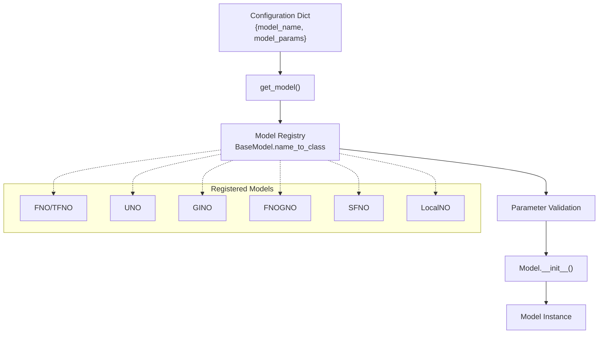
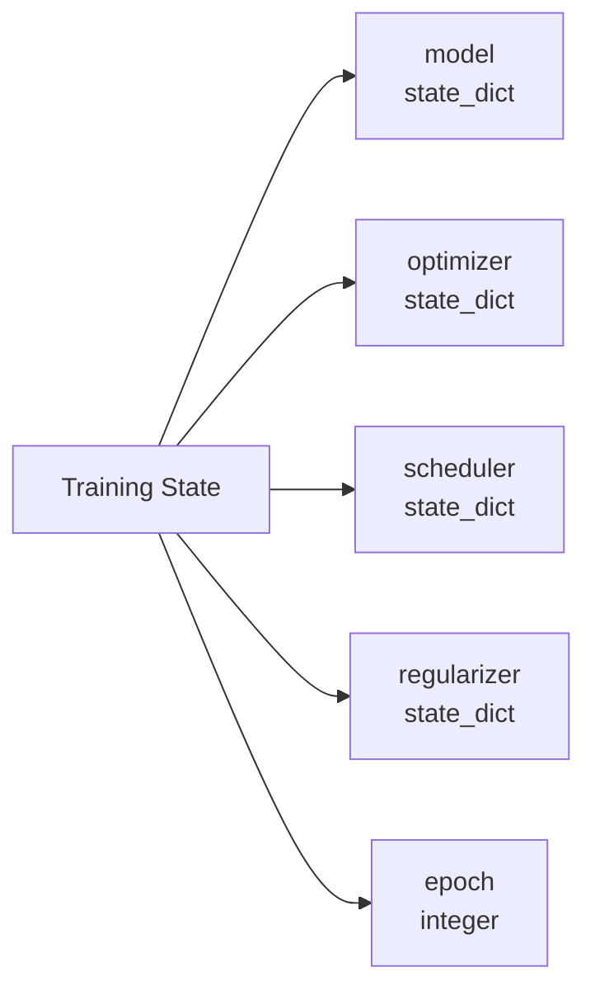
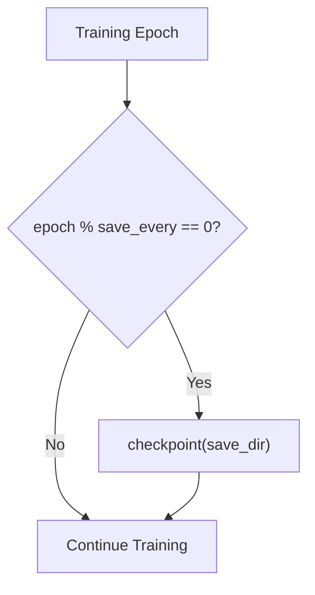
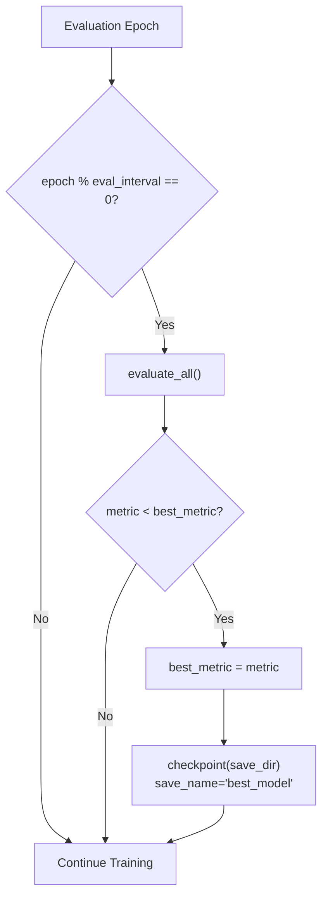
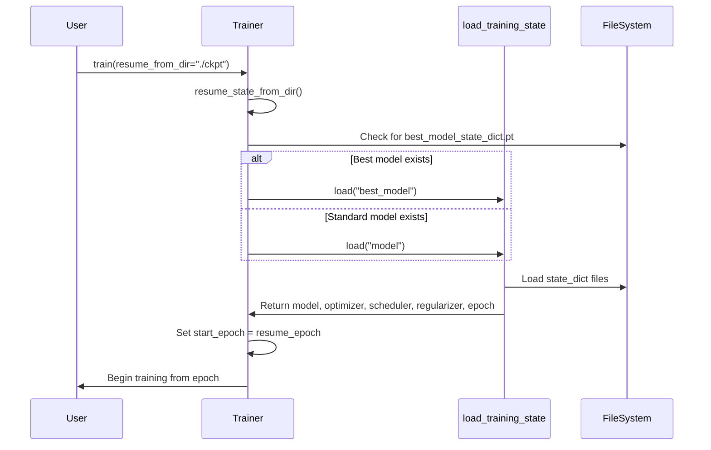
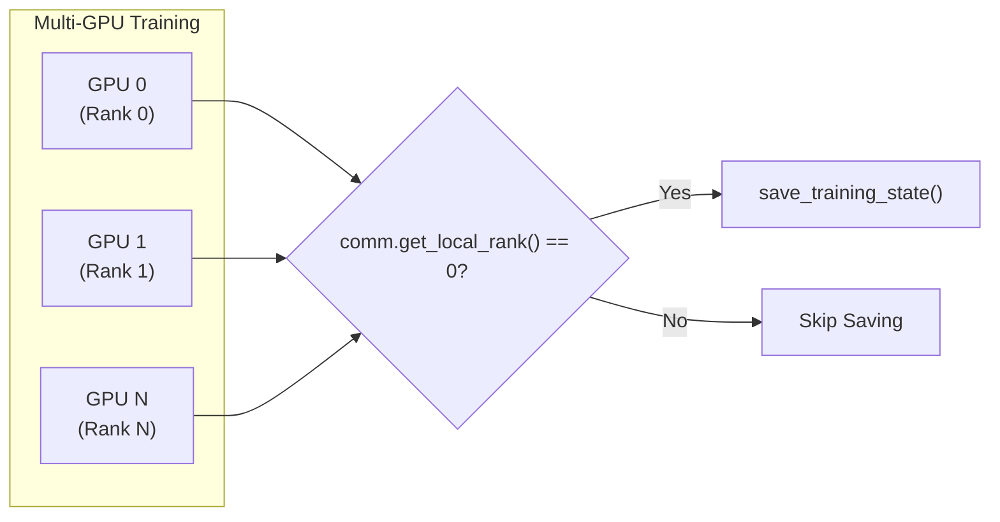
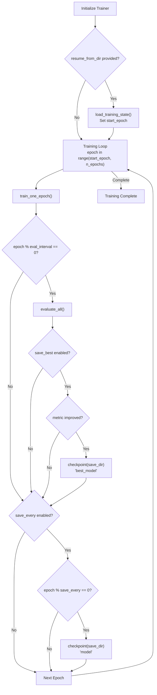

<!-- source: DeepWiki mcp.deepwiki.com · repo neuraloperator/neuraloperator · page 4.4 Model Management and Checkpointing · fetched 2026-10-21 -->

# Model Management and Checkpointing

<details>
<summary>Relevant source files</summary>

The following files were used as context for generating this wiki page:

- [doc/source/modules/api.rst](doc/source/modules/api.rst)
- [neuralop/models/fnogno.py](neuralop/models/fnogno.py)
- [neuralop/models/gino.py](neuralop/models/gino.py)
- [neuralop/training/__init__.py](neuralop/training/__init__.py)
- [neuralop/training/trainer.py](neuralop/training/trainer.py)

</details>


This page documents the model management and checkpointing systems in neuraloperator. It covers model instantiation via the factory pattern, saving and loading training state, and checkpoint management during training.

For information about the `Trainer` class and training loop, see [Trainer Class](#4.1). For dataset and data processing setup, see [Data Processing and Datasets](#4.2).

## Purpose and Scope

The model management system provides:
- **Model Dispatching**: Factory functions to instantiate models from configuration
- **Checkpointing**: Saving training state (model, optimizer, scheduler, regularizer, epoch) to disk
- **Resuming**: Loading saved state to continue interrupted training
- **Best Model Tracking**: Monitoring metrics and saving the best-performing model

All checkpoint operations are handled through the `Trainer` class, which delegates to utility functions in `neuralop.training.training_state`.

---

## Model Dispatching

### get_model Factory Function

The `get_model()` function instantiates neural operator models from configuration dictionaries. It provides a centralized interface for model creation with parameter validation.

**Model Dispatching Flow**



Sources: [doc/source/modules/api.rst:327-342]()

### Usage Pattern

Models are registered through the `BaseModel` class hierarchy. Each model class registers itself using the `name` parameter in the class definition:

```python
class FNOGNO(BaseModel, name="FNOGNO"):
    ...
```

The factory function looks up models by name and instantiates them with provided parameters:

```python
from neuralop.models import get_model

model = get_model({
    'model_name': 'FNO',
    'n_modes': (16, 16),
    'hidden_channels': 64,
    'in_channels': 3,
    'out_channels': 1,
    # ... other parameters
})
```

Sources: [neuralop/models/fnogno.py:18](), [doc/source/modules/api.rst:332-341]()

### Available Models

The `available_models()` function returns a list of registered model names. This is useful for configuration validation and documentation generation.

| Model Name | Class | Description |
|------------|-------|-------------|
| `"FNO"` | `FNO` | Fourier Neural Operator |
| `"TFNO"` | `TFNO` | Tensorized FNO |
| `"UNO"` | `UNO` | U-shaped Neural Operator |
| `"GINO"` | `GINO` | Geometry-Informed Neural Operator |
| `"FNOGNO"` | `FNOGNO` | FNO-GNO Hybrid |
| `"SFNO"` | `SFNO` | Spherical Fourier Neural Operator |
| `"LocalNO"` | `LocalNO` | Local Neural Operator |

Sources: [doc/source/modules/api.rst:16-97]()

---

## Training State Management

### State Components

The training state includes all components necessary to resume training:



Sources: [neuralop/training/trainer.py:751-757]()

### save_training_state Function

The `save_training_state()` function saves all training components to a directory. It handles both standard models and DDP-wrapped models.

**Function Signature:**
```python
save_training_state(
    save_dir: Union[str, Path],
    save_name: str,
    model: nn.Module,
    optimizer: torch.optim.Optimizer,
    scheduler: torch.optim.lr_scheduler._LRScheduler,
    regularizer: Optional[Regularizer],
    epoch: int
)
```

**Saved Files:**
- `{save_name}_state_dict.pt` - Model state dictionary
- `optimizer_state_dict.pt` - Optimizer state
- `scheduler_state_dict.pt` - Scheduler state (if provided)
- `regularizer_state_dict.pt` - Regularizer state (if provided)
- `epoch.pt` - Current epoch number

Sources: [neuralop/training/trainer.py:781-788]()

### load_training_state Function

The `load_training_state()` function restores training state from a checkpoint directory.

**Function Signature:**
```python
load_training_state(
    save_dir: Union[str, Path],
    save_name: str,
    model: nn.Module,
    optimizer: Optional[torch.optim.Optimizer] = None,
    scheduler: Optional[torch.optim.lr_scheduler._LRScheduler] = None,
    regularizer: Optional[Regularizer] = None
) -> Tuple[nn.Module, Optional[Optimizer], Optional[Scheduler], Optional[Regularizer], Optional[int]]
```

**Return Values:**
- `model` - Model with loaded state
- `optimizer` - Optimizer with loaded state (if provided)
- `scheduler` - Scheduler with loaded state (if provided)
- `regularizer` - Regularizer with loaded state (if provided)
- `epoch` - Epoch number from checkpoint (if available)

Sources: [neuralop/training/trainer.py:751-757](), [neuralop/training/__init__.py:3]()

---

## Checkpoint Management in Trainer

The `Trainer` class provides three checkpointing strategies: periodic saving, best model tracking, and manual resuming.

### Checkpointing Parameters

| Parameter | Type | Default | Description |
|-----------|------|---------|-------------|
| `save_every` | `int` | `None` | Save checkpoint every N epochs |
| `save_best` | `str` | `None` | Metric to monitor for best model (e.g., `"test_l2"`) |
| `save_dir` | `str` or `Path` | `"./ckpt"` | Directory to save checkpoints |
| `resume_from_dir` | `str` or `Path` | `None` | Directory to resume training from |

Sources: [neuralop/training/trainer.py:106-151]()

### Periodic Checkpointing

When `save_every` is set, the trainer saves checkpoints at regular intervals:



**Implementation:**
```python
trainer.train(
    train_loader=train_loader,
    test_loaders=test_loaders,
    optimizer=optimizer,
    scheduler=scheduler,
    save_every=10,  # Save every 10 epochs
    save_dir="./checkpoints"
)
```

Sources: [neuralop/training/trainer.py:249-252]()

### Best Model Tracking

When `save_best` is set, the trainer monitors a specific metric and saves only when it improves:



**Implementation:**
```python
trainer.train(
    train_loader=train_loader,
    test_loaders={'test': test_loader},
    optimizer=optimizer,
    scheduler=scheduler,
    eval_losses={'l2': LpLoss(d=2)},
    save_best='test_l2',  # Monitor test L2 loss
    save_dir="./checkpoints"
)
```

**File Naming:**
- `save_best=None`: Files named `model_state_dict.pt`, `optimizer_state_dict.pt`, etc.
- `save_best` is set: Files named `best_model_state_dict.pt`, `optimizer_state_dict.pt`, etc.

Sources: [neuralop/training/trainer.py:208-218](), [neuralop/training/trainer.py:244-247](), [neuralop/training/trainer.py:777-780]()

### Resuming Training

The `resume_from_dir` parameter loads a saved training state before starting the training loop:



**Implementation:**
```python
trainer = Trainer(
    model=model,
    n_epochs=100,
    device='cuda',
)

trainer.train(
    train_loader=train_loader,
    test_loaders=test_loaders,
    optimizer=optimizer,
    scheduler=scheduler,
    resume_from_dir="./checkpoints",  # Resume from saved state
    save_every=10
)
```

The trainer automatically detects whether to load from `best_model_state_dict.pt` or `model_state_dict.pt` and sets `self.start_epoch` accordingly.

Sources: [neuralop/training/trainer.py:194-195](), [neuralop/training/trainer.py:729-763]()

---

## Checkpoint File Structure

### Directory Layout

A typical checkpoint directory contains:

```
checkpoints/
├── model_state_dict.pt              # or best_model_state_dict.pt
├── optimizer_state_dict.pt
├── scheduler_state_dict.pt          # Optional
├── regularizer_state_dict.pt        # Optional
└── epoch.pt
```

### State Dictionary Contents

| File | Content | Format |
|------|---------|--------|
| `*_model_state_dict.pt` | Model parameters and buffers | `OrderedDict[str, Tensor]` |
| `optimizer_state_dict.pt` | Optimizer state (momentum, learning rate, etc.) | `dict` |
| `scheduler_state_dict.pt` | Scheduler state (step count, last epoch, etc.) | `dict` |
| `regularizer_state_dict.pt` | Regularizer state | `dict` |
| `epoch.pt` | Epoch number | `int` |

Sources: [neuralop/training/trainer.py:781-788]()

### Distributed Training Considerations

When using Distributed Data Parallel (DDP), only rank 0 saves checkpoints to avoid race conditions:



The checkpoint method checks the local rank before saving:

```python
def checkpoint(self, save_dir):
    if comm.get_local_rank() == 0:
        save_training_state(...)
```

Sources: [neuralop/training/trainer.py:776-790]()

---

## Complete Checkpointing Workflow

### Training with Checkpoints



Sources: [neuralop/training/trainer.py:96-254]()

### Example: Complete Training Script

```python
from neuralop.models import get_model
from neuralop.training import Trainer
from neuralop.losses import LpLoss
import torch

# Create model
model = get_model({
    'model_name': 'FNO',
    'n_modes': (16, 16),
    'hidden_channels': 64,
    'in_channels': 3,
    'out_channels': 1,
})

# Setup training components
optimizer = torch.optim.AdamW(model.parameters(), lr=1e-3)
scheduler = torch.optim.lr_scheduler.StepLR(optimizer, step_size=50, gamma=0.5)
training_loss = LpLoss(d=2, reduce_dims=[0,1])
eval_losses = {'l2': LpLoss(d=2, reduce_dims=[0,1])}

# Create trainer
trainer = Trainer(
    model=model,
    n_epochs=200,
    device='cuda',
    verbose=True,
)

# Train with checkpointing
metrics = trainer.train(
    train_loader=train_loader,
    test_loaders={'test': test_loader},
    optimizer=optimizer,
    scheduler=scheduler,
    training_loss=training_loss,
    eval_losses=eval_losses,
    save_best='test_l2',          # Save best model based on test L2 loss
    save_dir='./checkpoints',     # Checkpoint directory
    resume_from_dir=None,         # Set to './checkpoints' to resume
)
```

Sources: [neuralop/training/trainer.py:54-254]()

---

## State Dictionary Access

### Manual Checkpoint Saving

For custom checkpointing logic, you can manually access state dictionaries:

```python
# Save model state
torch.save(model.state_dict(), 'model.pt')

# Save optimizer state
torch.save(optimizer.state_dict(), 'optimizer.pt')

# Load model state
model.load_state_dict(torch.load('model.pt'))

# Load optimizer state
optimizer.load_state_dict(torch.load('optimizer.pt'))
```

### DDP Model Unwrapping

When using DDP, access the underlying model with `.module`:

```python
if isinstance(model, torch.nn.parallel.DistributedDataParallel):
    state_dict = model.module.state_dict()
else:
    state_dict = model.state_dict()
```

Sources: [neuralop/training/trainer.py:200-202]()

---

## Best Practices

### Checkpoint Strategy Selection

| Scenario | Recommended Strategy | Configuration |
|----------|---------------------|---------------|
| **Long training runs** | Periodic + Best | `save_every=50, save_best='test_l2'` |
| **Hyperparameter tuning** | Best only | `save_best='test_l2'` |
| **Debugging** | Periodic | `save_every=10` |
| **Production training** | Best + Resume | `save_best='test_l2', resume_from_dir=...` |

### Metric Selection for save_best

The `save_best` parameter expects a metric key in the format `"{loader_name}_{loss_name}"`:

- `"test_l2"` - L2 loss on test loader
- `"val_h1"` - H1 loss on validation loader  
- `"train_err"` - Training error (not recommended for best model)

The metric must be computed during evaluation. The trainer validates this constraint at initialization.

Sources: [neuralop/training/trainer.py:208-218]()

### Storage Management

Checkpoints can consume significant disk space. Consider:

1. **Save only best model**: Use `save_best` instead of `save_every`
2. **Clean up old checkpoints**: Implement custom logic to remove outdated checkpoints
3. **Monitor disk usage**: Especially for large models or frequent checkpointing

### Resume Training Robustness

When resuming training:

1. **Verify checkpoint integrity**: Check that all required files exist
2. **Match architecture**: Ensure model architecture matches checkpoint
3. **Consistent configuration**: Use same data preprocessing, loss functions, etc.
4. **Learning rate warmup**: Consider reducing learning rate after resume

Sources: [neuralop/training/trainer.py:729-763]()

---

