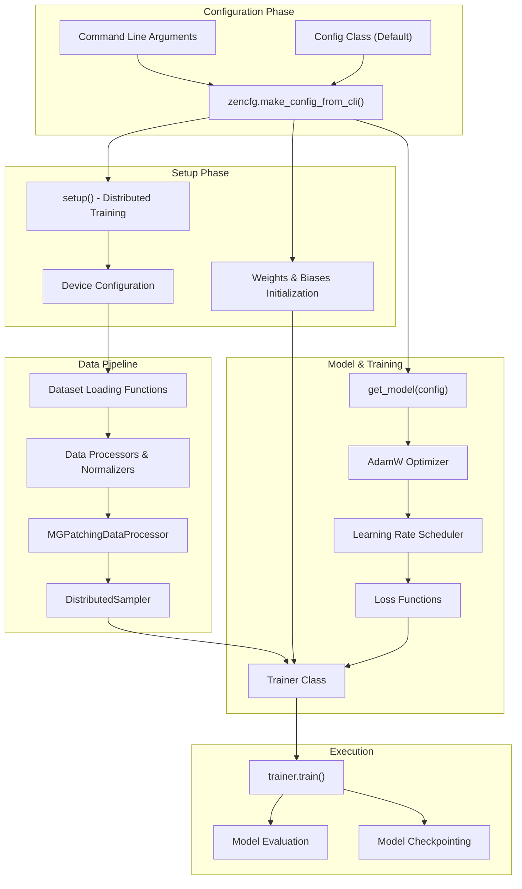
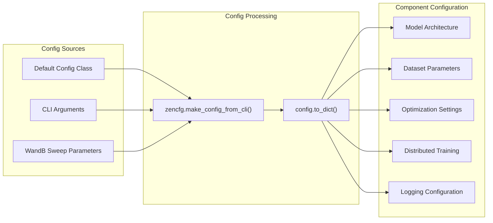
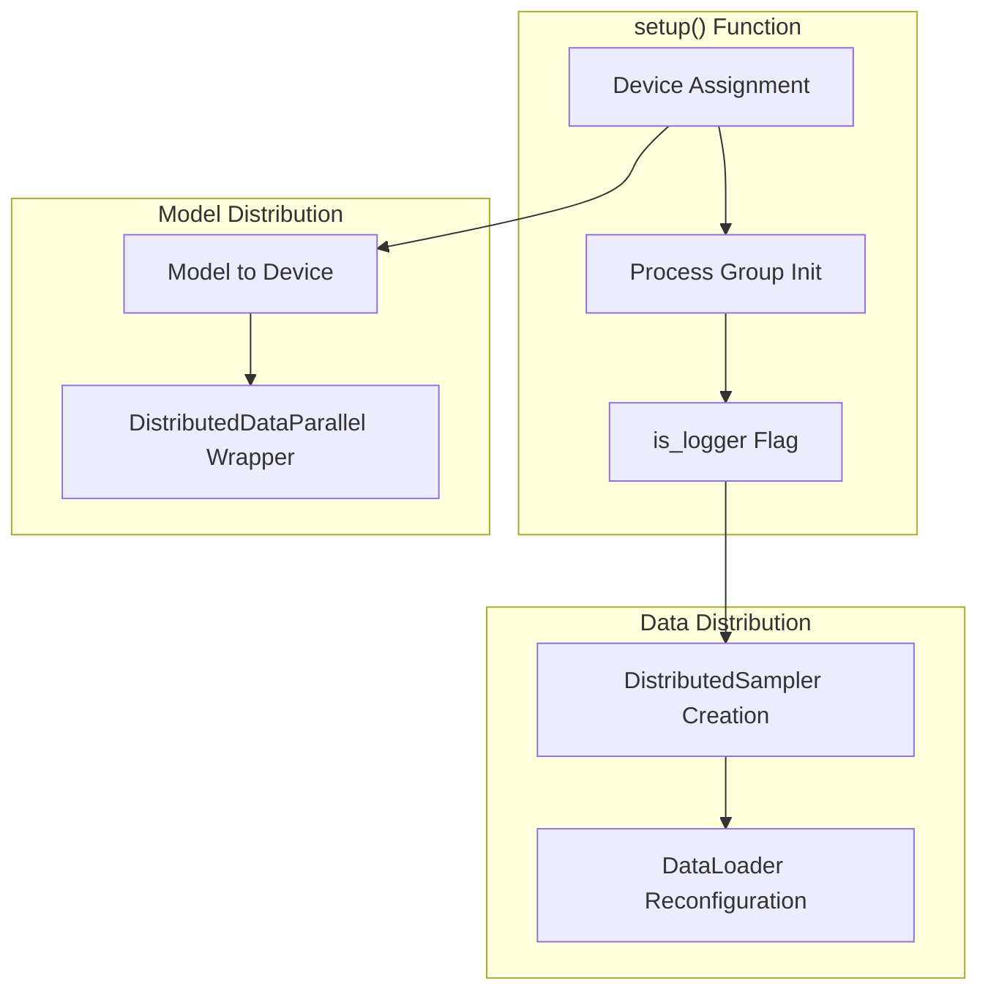
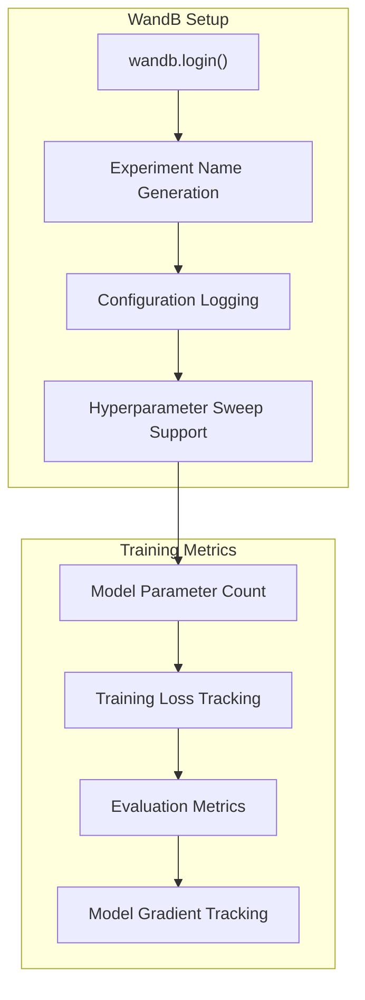
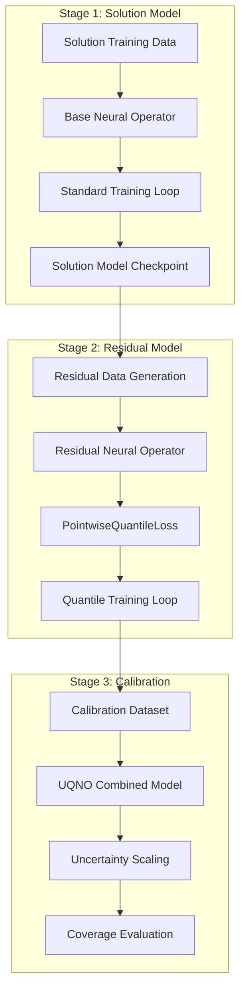

<!-- source: DeepWiki mcp.deepwiki.com · repo neuraloperator/neuraloperator · page 5 Example Training Scripts · fetched 2026-10-21 -->

# Example Training Scripts

<details>
<summary>Relevant source files</summary>

The following files were used as context for generating this wiki page:

- [scripts/login_wandb.py](scripts/login_wandb.py)
- [scripts/test_from_config.py](scripts/test_from_config.py)
- [scripts/train_burgers.py](scripts/train_burgers.py)
- [scripts/train_burgers_pino.py](scripts/train_burgers_pino.py)
- [scripts/train_darcy.py](scripts/train_darcy.py)
- [scripts/train_fnogno_carcfd.py](scripts/train_fnogno_carcfd.py)
- [scripts/train_gino_carcfd.py](scripts/train_gino_carcfd.py)
- [scripts/train_mhd64.py](scripts/train_mhd64.py)
- [scripts/train_navier_stokes.py](scripts/train_navier_stokes.py)
- [scripts/train_poisson.py](scripts/train_poisson.py)
- [scripts/train_uqno_darcy.py](scripts/train_uqno_darcy.py)

</details>


This page provides a comprehensive walkthrough of the complete training scripts included in the neuraloperator library. These scripts demonstrate end-to-end training workflows for different partial differential equation (PDE) problems and serve as reference implementations for training neural operators on physics simulation data.

For detailed information about the core training infrastructure, see [Training Infrastructure](#4). For model-specific configurations, see [Configuration System](#6).

## Overview and Common Patterns

All training scripts in the `scripts/` directory follow a standardized workflow that integrates the library's configuration system, distributed training capabilities, experiment tracking, and core training components. The scripts demonstrate complete pipelines from data loading through model training and evaluation.

### Training Script Architecture



Sources: [scripts/train_darcy.py:17-28](), [scripts/train_navier_stokes.py:18-28](), [scripts/train_burgers.py:14-27]()

### Core Components Integration

The training scripts integrate several key library components in a standardized pattern:

| Component | Purpose | Implementation |
|-----------|---------|----------------|
| **Configuration Management** | CLI argument parsing and config loading | `zencfg.make_config_from_cli()` with config classes |
| **Distributed Training** | Multi-GPU and multi-node setup | `setup()` function from `neuralop.training` |
| **Data Processing** | Normalization and preprocessing | `DataProcessor` and `MGPatchingDataProcessor` |
| **Model Factory** | Model instantiation from config | `get_model()` function |
| **Training Orchestration** | Main training loop and evaluation | `Trainer` class |
| **Experiment Tracking** | Logging and monitoring | Weights & Biases integration |

## Configuration System Integration



Sources: [scripts/train_darcy.py:18-26](), [scripts/train_navier_stokes.py:19-25](), [scripts/train_burgers.py:17-24]()

All training scripts use the `zencfg` library to merge default configurations with command-line overrides. The configuration objects are imported from the `config/` directory and provide type-safe parameter management.

```python
# Standard configuration loading pattern
from zencfg import make_config_from_cli
from config.darcy_config import Default

config = make_config_from_cli(Default)
config = config.to_dict()
```

## Distributed Training Setup

Each script includes standardized distributed training initialization through the `setup()` function, which handles device assignment, process group initialization, and logging coordination.



Sources: [scripts/train_darcy.py:27-28, 94-107](), [scripts/train_navier_stokes.py:28, 103-116](), [scripts/train_burgers.py:26-27, 79-82]()

The distributed setup automatically configures `DistributedSampler` instances for both training and test dataloaders when `config.distributed.use_distributed` is enabled.

## Data Processing Pipeline

### Standard Data Loading

The scripts use specialized dataset loading functions that return configured dataloaders and data processors:

| Function | Dataset | Features |
|----------|---------|----------|
| `load_darcy_flow_small()` | Darcy flow equations | Multiple test resolutions, configurable sample sizes |
| `load_navier_stokes_pt()` | 2D Navier-Stokes | PyTorch format, resolution-independent |
| `load_mini_burgers_1dtime()` | 1D Burgers equation | Time evolution, temporal/spatial subsampling |

Sources: [scripts/train_darcy.py:69-78](), [scripts/train_navier_stokes.py:74-84](), [scripts/train_burgers.py:69-74]()

### Multi-Grid Patching Integration

When `config.patching.levels > 0`, the scripts automatically upgrade the basic data processor to an `MGPatchingDataProcessor`:

```python
if config.patching.levels > 0:
    data_processor = MGPatchingDataProcessor(
        model=model,
        in_normalizer=data_processor.in_normalizer,
        out_normalizer=data_processor.out_normalizer,
        padding_fraction=config.patching.padding,
        stitching=config.patching.stitching,
        levels=config.patching.levels,
        use_distributed=config.distributed.use_distributed,
        device=device
    )
```

Sources: [scripts/train_darcy.py:82-90](), [scripts/train_navier_stokes.py:89-96](), [scripts/train_burgers.py:156-163]()

## Optimization and Scheduling

### Optimizer Configuration

All scripts use the `AdamW` optimizer from `neuralop.training` with configurable learning rate and weight decay:

```python
optimizer = AdamW(
    model.parameters(),
    lr=config.opt.learning_rate,
    weight_decay=config.opt.weight_decay,
)
```

Sources: [scripts/train_darcy.py:109-113](), [scripts/train_navier_stokes.py:119-123](), [scripts/train_burgers.py:85-89]()

### Learning Rate Scheduling

The scripts support multiple scheduler types based on configuration:

| Scheduler Type | Configuration | Use Case |
|----------------|---------------|----------|
| `ReduceLROnPlateau` | `factor`, `patience`, `mode` | Adaptive reduction on validation plateaus |
| `CosineAnnealingLR` | `T_max` | Smooth annealing over training epochs |
| `StepLR` | `step_size`, `gamma` | Fixed-interval learning rate decay |

Sources: [scripts/train_darcy.py:115-131](), [scripts/train_navier_stokes.py:125-141](), [scripts/train_burgers.py:91-107]()

## Loss Function Configuration

### Standard Loss Functions

The scripts configure loss functions based on the training problem requirements:

```python
# Standard L2 and H1 losses
l2loss = LpLoss(d=2, p=2)
h1loss = H1Loss(d=2)

# Training loss selection
if config.opt.training_loss == "l2":
    train_loss = l2loss
elif config.opt.training_loss == "h1":
    train_loss = h1loss
```

Sources: [scripts/train_darcy.py:135-146](), [scripts/train_navier_stokes.py:145-156]()

### Physics-Informed Loss Functions

The Burgers equation script demonstrates physics-informed training with multiple loss components:

```python
# Physics-specific losses
ic_loss = ICLoss()
equation_loss = BurgersEqnLoss(method=config.opt.get('pino_method', 'fdm'), 
                               visc=0.01, loss=F.mse_loss)

# Weighted combination
train_loss = WeightedSumLoss(losses=losses, weights=weights)
```

Sources: [scripts/train_burgers.py:113-142]()

## Training Execution

### Trainer Instantiation

All scripts use the `Trainer` class with consistent parameter configuration:

```python
trainer = Trainer(
    model=model,
    n_epochs=config.opt.n_epochs,
    device=device,
    data_processor=data_processor,
    mixed_precision=config.opt.mixed_precision,
    wandb_log=config.wandb.log,
    eval_interval=config.opt.eval_interval,
    log_output=config.wandb.log_output,
    use_distributed=config.distributed.use_distributed,
    verbose=config.verbose and is_logger,
)
```

Sources: [scripts/train_darcy.py:158-169](), [scripts/train_navier_stokes.py:169-180](), [scripts/train_burgers.py:165-176]()

### Training Loop Execution

The training process is initiated through the `trainer.train()` method with all configured components:

```python
trainer.train(
    train_loader=train_loader,
    test_loaders=test_loaders,
    optimizer=optimizer,
    scheduler=scheduler,
    regularizer=False,
    training_loss=train_loss,
    eval_losses=eval_losses,
)
```

Sources: [scripts/train_darcy.py:189-197](), [scripts/train_navier_stokes.py:200-208](), [scripts/train_burgers.py:196-204]()

## Experiment Tracking and Monitoring

### Weights & Biases Integration

The scripts include comprehensive experiment tracking setup:



Sources: [scripts/train_darcy.py:30-56, 171-186](), [scripts/train_navier_stokes.py:29-61, 182-197]()

### Parameter Counting and Compression Metrics

Scripts automatically log model statistics and compression ratios when baseline parameter counts are provided:

```python
n_params = count_model_params(model)
to_log = {"n_params": n_params}
if config.n_params_baseline is not None:
    to_log["compression_ratio"] = (config.n_params_baseline / n_params,)
    to_log["space_savings"] = 1 - (n_params / config.n_params_baseline)
wandb.log(to_log, commit=False)
```

Sources: [scripts/train_darcy.py:172-185](), [scripts/train_navier_stokes.py:183-196](), [scripts/train_burgers.py:179-193]()

## Specialized Training: Uncertainty Quantification

The `train_uqno_darcy.py` script demonstrates advanced two-stage training for uncertainty quantification:

### Two-Stage Training Architecture



Sources: [scripts/train_uqno_darcy.py:96-219, 388-465, 498-576]()

### Residual Data Processing

The UQNO training includes specialized data processing for converting solution predictions to residual training data:

```python
def loader_to_residual_db(model, data_processor, loader, device, train_val_split=True):
    """
    Converts dataset of x: a(x), y: u(x) to x: a(x), y: G(a,x) - u(x)
    for training the residual model.
    """
```

Sources: [scripts/train_uqno_darcy.py:225-276]()

The script demonstrates advanced uncertainty quantification workflows including conformal prediction calibration and coverage evaluation across multiple confidence levels.

## Usage Patterns and Best Practices

### Command Line Execution

Training scripts are designed to be executed with configuration overrides:

```bash
# Basic training
python train_darcy.py

# With configuration overrides
python train_darcy.py --model.n_modes 32 --opt.learning_rate 1e-4

# Distributed training
torchrun --nproc_per_node=4 train_darcy.py --distributed.use_distributed=True
```

### Configuration Inheritance

Scripts leverage configuration inheritance for different experimental setups while maintaining reproducible defaults. The configuration system supports nested parameter overrides and automatic type validation.

Sources: [scripts/train_darcy.py:17-25](), [scripts/train_navier_stokes.py:18-25](), [scripts/train_burgers.py:16-24](), [scripts/train_uqno_darcy.py:21-28]()

---

