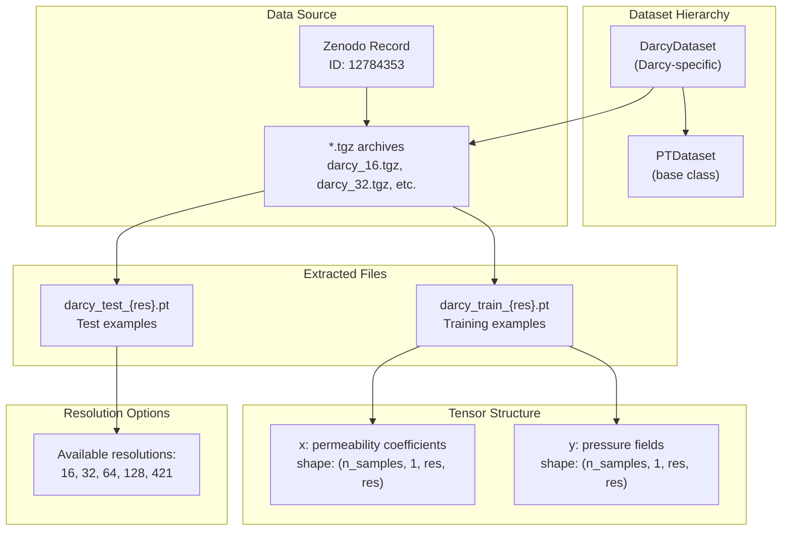
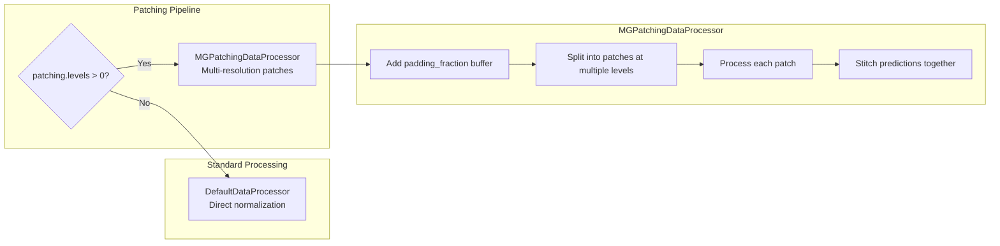
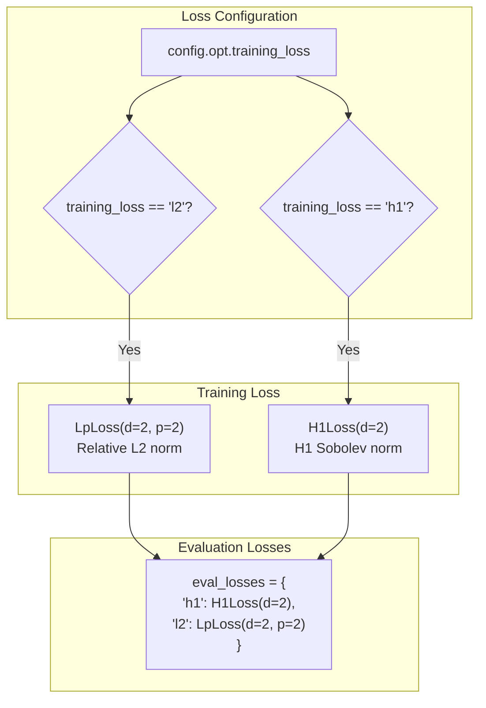
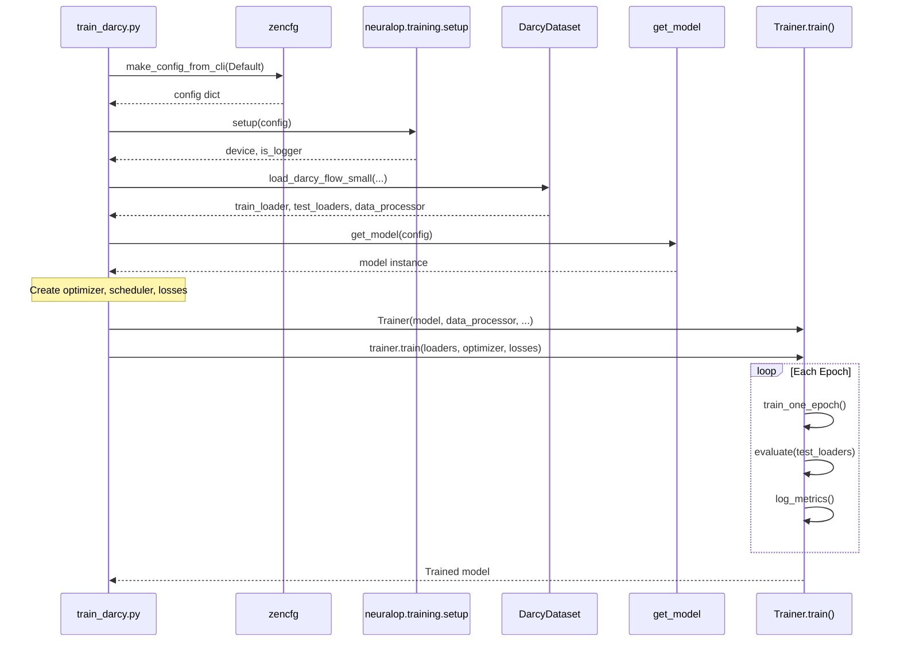

<!-- source: DeepWiki mcp.deepwiki.com · repo neuraloperator/neuraloperator · page 5.1 Darcy Flow · fetched 2026-10-21 -->

# Darcy Flow

<details>
<summary>Relevant source files</summary>

The following files were used as context for generating this wiki page:

- [neuralop/data/datasets/__init__.py](neuralop/data/datasets/__init__.py)
- [neuralop/data/datasets/burgers.py](neuralop/data/datasets/burgers.py)
- [neuralop/data/datasets/darcy.py](neuralop/data/datasets/darcy.py)
- [neuralop/data/datasets/navier_stokes.py](neuralop/data/datasets/navier_stokes.py)
- [neuralop/data/datasets/pt_dataset.py](neuralop/data/datasets/pt_dataset.py)
- [scripts/login_wandb.py](scripts/login_wandb.py)
- [scripts/test_from_config.py](scripts/test_from_config.py)
- [scripts/train_burgers.py](scripts/train_burgers.py)
- [scripts/train_burgers_pino.py](scripts/train_burgers_pino.py)
- [scripts/train_darcy.py](scripts/train_darcy.py)
- [scripts/train_fnogno_carcfd.py](scripts/train_fnogno_carcfd.py)
- [scripts/train_gino_carcfd.py](scripts/train_gino_carcfd.py)
- [scripts/train_mhd64.py](scripts/train_mhd64.py)
- [scripts/train_navier_stokes.py](scripts/train_navier_stokes.py)
- [scripts/train_poisson.py](scripts/train_poisson.py)
- [scripts/train_uqno_darcy.py](scripts/train_uqno_darcy.py)

</details>


This page documents training neural operators on the **Darcy flow equation**, a fundamental problem in modeling fluid flow through porous media. This example demonstrates the standard training pipeline used throughout the neuraloperator library, including dataset loading, model initialization, loss configuration, and distributed training support.

For information about training on other PDE problems, see [Navier-Stokes](#5.2), [Burgers Equation](#5.3), or [The Well Datasets](#5.5). For details on the underlying training infrastructure, see [Trainer Class](#4.1) and [Data Processing and Datasets](#4.2).

## Problem Overview

The Darcy flow equation models steady-state fluid flow through porous media:

```
-∇·(a(x)∇u(x)) = f(x)
```

Where:
- `a(x)` is the **permeability coefficient** (input)
- `u(x)` is the **pressure field** (output to predict)
- `f(x)` is the forcing function

The neural operator learns the mapping `a(x) → u(x)`, enabling fast approximation of solutions for new permeability coefficients.

**Sources:** [neuralop/data/datasets/darcy.py:15-20]()

## Dataset Structure

### DarcyDataset Class

The `DarcyDataset` class inherits from `PTDataset` and provides access to pre-generated Darcy flow data stored in PyTorch tensor format.



**Sources:** [neuralop/data/datasets/darcy.py:15-126](), [neuralop/data/datasets/pt_dataset.py:11-235]()

### Data Loading Function

The `load_darcy_flow_small` function provides a convenient interface for loading Darcy data:

| Parameter | Type | Description |
|-----------|------|-------------|
| `n_train` | int | Number of training samples |
| `n_tests` | List[int] | Number of test samples per resolution |
| `batch_size` | int | Training batch size |
| `test_batch_sizes` | List[int] | Test batch sizes per resolution |
| `data_root` | Path | Root directory for data files |
| `test_resolutions` | List[int] | Resolutions for test sets (default: [16, 32]) |
| `encode_input` | bool | Whether to normalize inputs (default: False) |
| `encode_output` | bool | Whether to normalize outputs (default: True) |

**Returns:** `(train_loader, test_loaders, data_processor)`

**Sources:** [neuralop/data/datasets/darcy.py:129-169]()

## Training Pipeline

### High-Level Flow

```mermaid
flowchart TB
    subgraph "Configuration"
        ConfigFile["config/darcy_config.py<br/>Default class"]
        CLI["Command-line args<br/>zencfg.make_config_from_cli"]
        ConfigFile --> CLI
    end
    
    subgraph "Setup"
        Setup["neuralop.training.setup()<br/>Returns: device, is_logger"]
        WandB["wandb.init()<br/>Experiment tracking"]
        CLI --> Setup
        Setup --> WandB
    end
    
    subgraph "Data Loading"
        LoadFunc["load_darcy_flow_small()<br/>from neuralop.data.datasets"]
        TrainLoader["train_loader<br/>DataLoader"]
        TestLoaders["test_loaders<br/>Dict[resolution -> DataLoader]"]
        DataProc["data_processor<br/>DefaultDataProcessor or MGPatchingDataProcessor"]
        LoadFunc --> TrainLoader
        LoadFunc --> TestLoaders
        LoadFunc --> DataProc
    end
    
    subgraph "Model Setup"
        GetModel["get_model(config)<br/>Factory function"]
        Model["model<br/>FNO/TFNO/UNO/etc."]
        Patching{"patching.levels > 0?"}
        MGProc["MGPatchingDataProcessor<br/>Multi-grid patching"]
        GetModel --> Model
        DataProc --> Patching
        Patching -->|Yes| MGProc
        Patching -->|No| DataProc
    end
    
    subgraph "Training Components"
        Optimizer["AdamW optimizer"]
        Scheduler["LR Scheduler<br/>ReduceLROnPlateau/CosineAnnealingLR/StepLR"]
        TrainLoss["Training Loss<br/>LpLoss or H1Loss"]
        EvalLosses["Evaluation Losses<br/>{h1: H1Loss, l2: LpLoss}"]
    end
    
    subgraph "Training Execution"
        Trainer["Trainer class"]
        TrainMethod["trainer.train()"]
        Trainer --> TrainMethod
    end
    
    Setup --> LoadFunc
    Model --> Trainer
    MGProc --> Trainer
    Optimizer --> TrainMethod
    Scheduler --> TrainMethod
    TrainLoss --> TrainMethod
    EvalLosses --> TrainMethod
    TrainLoader --> TrainMethod
    TestLoaders --> TrainMethod
```

**Sources:** [scripts/train_darcy.py:1-214]()

### Key Training Script Components

#### 1. Configuration Loading

```python
# Load configuration from CLI and config file
from zencfg import make_config_from_cli
from config.darcy_config import Default

config = make_config_from_cli(Default)
config = config.to_dict()
```

**Sources:** [scripts/train_darcy.py:25-34]()

#### 2. Distributed Training Setup

```python
# Setup device and determine if this process should log
from neuralop.training import setup

device, is_logger = setup(config)
```

The `setup` function handles:
- Device selection (CPU/GPU)
- Distributed data parallel initialization
- Logger process identification

**Sources:** [scripts/train_darcy.py:36-37]()

#### 3. Data Loading

```python
from neuralop.data.datasets import load_darcy_flow_small

train_loader, test_loaders, data_processor = load_darcy_flow_small(
    data_root=data_root,
    n_train=config.data.n_train,
    batch_size=config.data.batch_size,
    test_resolutions=config.data.test_resolutions,
    n_tests=config.data.n_tests,
    test_batch_sizes=config.data.test_batch_sizes,
    encode_input=False,
    encode_output=False,
)
```

**Sources:** [scripts/train_darcy.py:76-87]()

#### 4. Model Initialization

```python
from neuralop import get_model

model = get_model(config)
```

The `get_model` factory function creates the appropriate model architecture based on `config.model.model_arch` (e.g., "fno", "tfno", "uno").

**Sources:** [scripts/train_darcy.py:89]()

#### 5. Multi-Grid Patching (Optional)



```python
from neuralop.data.transforms.data_processors import MGPatchingDataProcessor

if config.patching.levels > 0:
    data_processor = MGPatchingDataProcessor(
        model=model,
        in_normalizer=data_processor.in_normalizer,
        out_normalizer=data_processor.out_normalizer,
        padding_fraction=config.patching.padding,
        stitching=config.patching.stitching,
        levels=config.patching.levels,
        use_distributed=config.distributed.use_distributed,
        device=device,
    )
```

**Sources:** [scripts/train_darcy.py:91-102]()

#### 6. Distributed Sampler (Optional)

When using distributed training, `DistributedSampler` ensures each process gets different data:

```python
from torch.utils.data import DataLoader, DistributedSampler
from neuralop.mpu.comm import get_local_rank

if config.distributed.use_distributed:
    train_db = train_loader.dataset
    train_sampler = DistributedSampler(train_db, rank=get_local_rank())
    train_loader = DataLoader(
        dataset=train_db, 
        batch_size=config.data.batch_size, 
        sampler=train_sampler
    )
```

**Sources:** [scripts/train_darcy.py:104-111]()

#### 7. Optimizer and Scheduler

```python
from neuralop.training import AdamW

optimizer = AdamW(
    model.parameters(),
    lr=config.opt.learning_rate,
    weight_decay=config.opt.weight_decay,
)

# Scheduler options: ReduceLROnPlateau, CosineAnnealingLR, StepLR
if config.opt.scheduler == "ReduceLROnPlateau":
    scheduler = torch.optim.lr_scheduler.ReduceLROnPlateau(
        optimizer,
        factor=config.opt.gamma,
        patience=config.opt.scheduler_patience,
        mode="min",
    )
```

**Sources:** [scripts/train_darcy.py:121-143]()

#### 8. Loss Functions



```python
from neuralop import H1Loss, LpLoss

l2loss = LpLoss(d=2, p=2)
h1loss = H1Loss(d=2)

if config.opt.training_loss == "l2":
    train_loss = l2loss
elif config.opt.training_loss == "h1":
    train_loss = h1loss

eval_losses = {"h1": h1loss, "l2": l2loss}
```

**Sources:** [scripts/train_darcy.py:146-158]()

#### 9. Trainer Initialization and Training

```python
from neuralop import Trainer

trainer = Trainer(
    model=model,
    n_epochs=config.opt.n_epochs,
    device=device,
    data_processor=data_processor,
    mixed_precision=config.opt.mixed_precision,
    wandb_log=config.wandb.log,
    eval_interval=config.opt.eval_interval,
    log_output=config.wandb.log_output,
    use_distributed=config.distributed.use_distributed,
    verbose=config.verbose and is_logger,
)

trainer.train(
    train_loader=train_loader,
    test_loaders=test_loaders,
    optimizer=optimizer,
    scheduler=scheduler,
    regularizer=False,
    training_loss=train_loss,
    eval_losses=eval_losses,
)
```

**Sources:** [scripts/train_darcy.py:170-209]()

## Configuration Structure

The Darcy flow training script expects a configuration object with the following structure:

```mermaid
graph TB
    subgraph "config (Root)"
        Config["Config Dictionary"]
    end
    
    subgraph "config.data"
        DataFolder["folder: Path to data directory"]
        DataNTrain["n_train: Number of training samples"]
        DataBatch["batch_size: Training batch size"]
        DataTestRes["test_resolutions: List[int]"]
        DataNTests["n_tests: List[int]"]
        DataTestBatch["test_batch_sizes: List[int]"]
    end
    
    subgraph "config.model"
        ModelArch["model_arch: 'fno'/'tfno'/'uno'/etc."]
        ModelLayers["n_layers: Number of FNO blocks"]
        ModelModes["n_modes: Fourier modes to keep"]
        ModelHidden["hidden_channels: Width"]
        ModelFactor["factorization: None/'tucker'/'cp'/'tt'"]
        ModelRank["rank: Factorization rank"]
    end
    
    subgraph "config.opt"
        OptEpochs["n_epochs: Training epochs"]
        OptLR["learning_rate: Initial LR"]
        OptDecay["weight_decay: Weight decay"]
        OptLoss["training_loss: 'l2' or 'h1'"]
        OptScheduler["scheduler: Scheduler type"]
        OptMixed["mixed_precision: bool"]
        OptEval["eval_interval: Evaluation frequency"]
    end
    
    subgraph "config.patching"
        PatchLevels["levels: Multi-grid levels (0=off)"]
        PatchPadding["padding: Padding fraction"]
        PatchStitch["stitching: Stitching method"]
    end
    
    subgraph "config.distributed"
        DistUse["use_distributed: Enable DDP"]
    end
    
    subgraph "config.wandb"
        WandbLog["log: Enable WandB"]
        WandbName["name: Run name"]
        WandbProject["project: WandB project"]
        WandbEntity["entity: WandB entity"]
        WandbGroup["group: Run group"]
        WandbOutput["log_output: Log predictions"]
    end
    
    Config --> DataFolder
    Config --> ModelArch
    Config --> OptEpochs
    Config --> PatchLevels
    Config --> DistUse
    Config --> WandbLog
```



**Sources:** [scripts/train_darcy.py:26-34](), [scripts/train_darcy.py:46-65]()

## Data Normalization

The `data_processor` applies normalization transformations:

| Component | Default Behavior | Purpose |
|-----------|------------------|---------|
| `in_normalizer` | `None` (`encode_input=False`) | Input normalization disabled by default |
| `out_normalizer` | `UnitGaussianNormalizer` (`encode_output=True`) | Normalize outputs to zero mean, unit variance |
| Encoding mode | `"channel-wise"` | Compute statistics across spatial dimensions, preserve channel structure |

During training:
- **Preprocess:** Apply normalization before model forward pass
- **Postprocess:** Apply inverse normalization after forward pass for evaluation

**Sources:** [neuralop/data/datasets/pt_dataset.py:154-180](), [neuralop/data/datasets/darcy.py:135-151]()

## Running the Training Script

### Basic Usage

```bash
# From the scripts directory
python train_darcy.py
```

### With Configuration Overrides

```bash
# Override specific config parameters via CLI
python train_darcy.py \
    --data.n_train 1000 \
    --data.batch_size 16 \
    --model.n_layers 4 \
    --model.n_modes 12 \
    --opt.learning_rate 1e-3 \
    --opt.n_epochs 100
```

### With Multi-Grid Patching

```bash
python train_darcy.py \
    --patching.levels 2 \
    --patching.padding 0.25 \
    --patching.stitching 'average'
```

### With Distributed Training

```bash
# Launch with torchrun for distributed training
torchrun --nproc_per_node=4 train_darcy.py \
    --distributed.use_distributed True
```

**Sources:** [scripts/train_darcy.py:25-34]()

## Expected Results

The training script logs metrics to console and optionally to Weights & Biases:

### Logged Metrics

| Metric | Description |
|--------|-------------|
| `train_loss` | Training loss (L2 or H1) |
| `{resolution}_h1` | H1 loss on test set at given resolution |
| `{resolution}_l2` | L2 loss on test set at given resolution |
| `n_params` | Model parameter count |
| `learning_rate` | Current learning rate |

### Resolution Invariance

The Darcy flow example demonstrates **resolution invariance** - a key property of neural operators. The model can be:
- **Trained** on data at one resolution (e.g., 16×16)
- **Evaluated** on data at higher resolutions (e.g., 32×32, 64×64) without retraining

This is enabled by the spectral convolution layers in FNO/TFNO models, which operate in frequency space.

**Sources:** [scripts/train_darcy.py:76-87]()

## Code Flow Summary



**Sources:** [scripts/train_darcy.py:1-214]()

## Related Components

For deeper understanding of components used in this training script:

- **Model Architectures:** [FNO](#2.1), [UNO](#2.2)
- **Training Loop:** [Trainer Class](#4.1)
- **Data Processing:** [Data Processing and Datasets](#4.2)
- **Loss Functions:** [Loss Functions and Differentiation](#4.3)
- **Multi-Grid Patching:** [Data Processing and Datasets](#4.2)

**Sources:** [scripts/train_darcy.py:17-22]()

---

