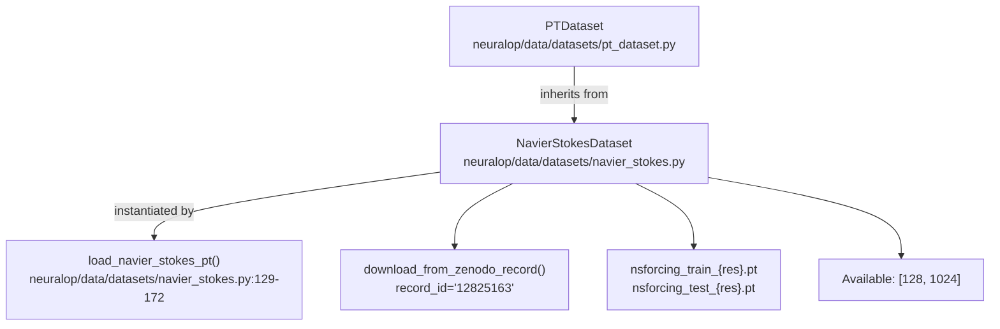
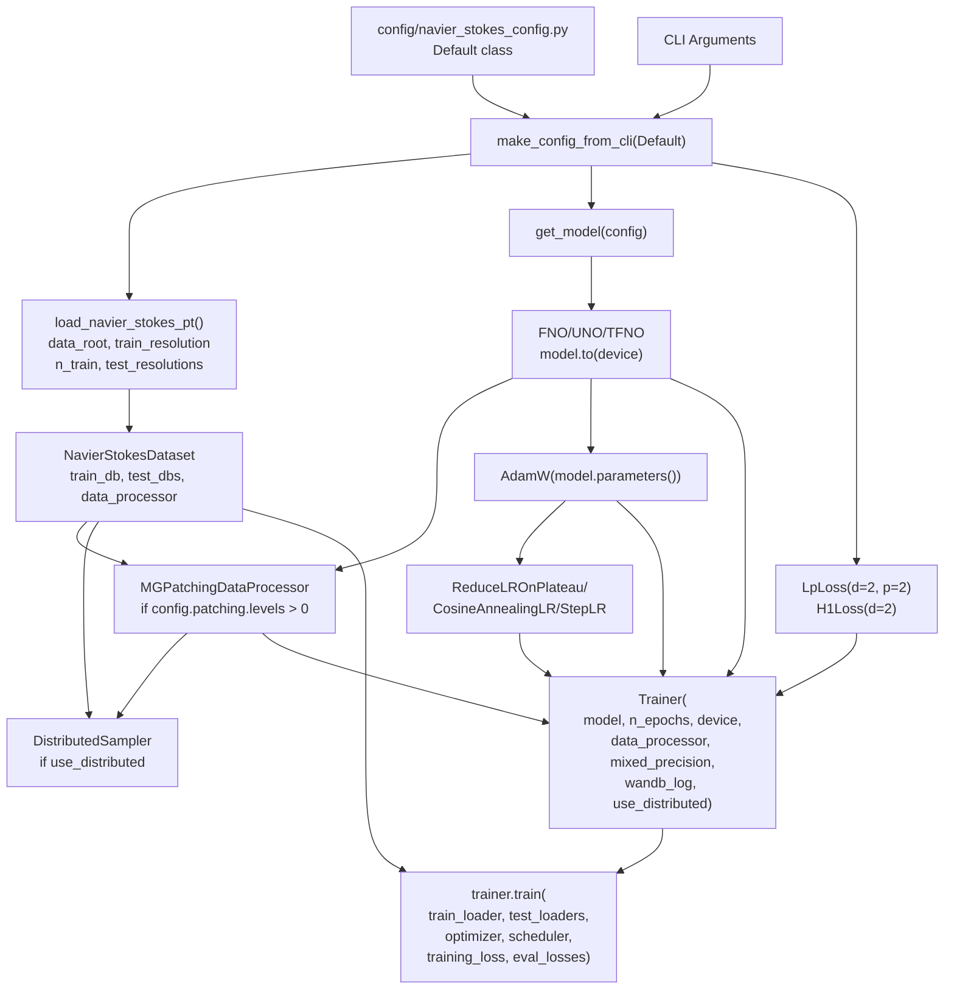
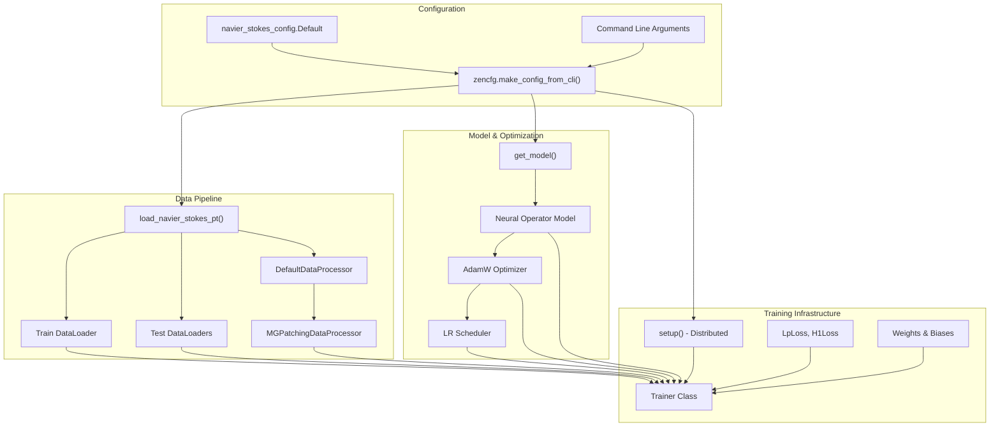
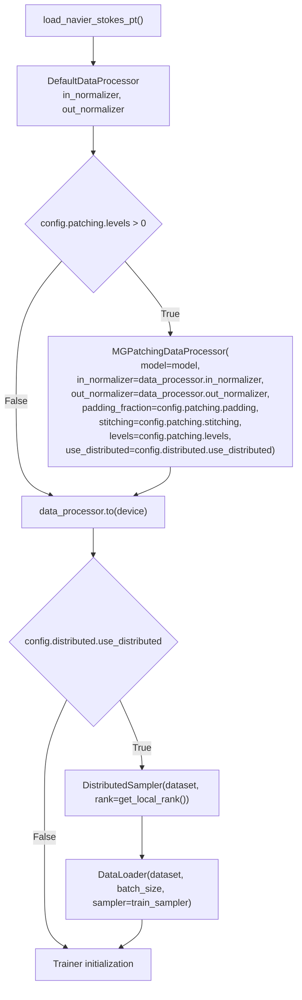
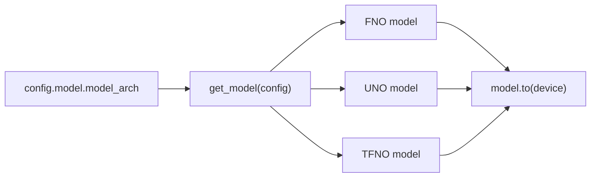
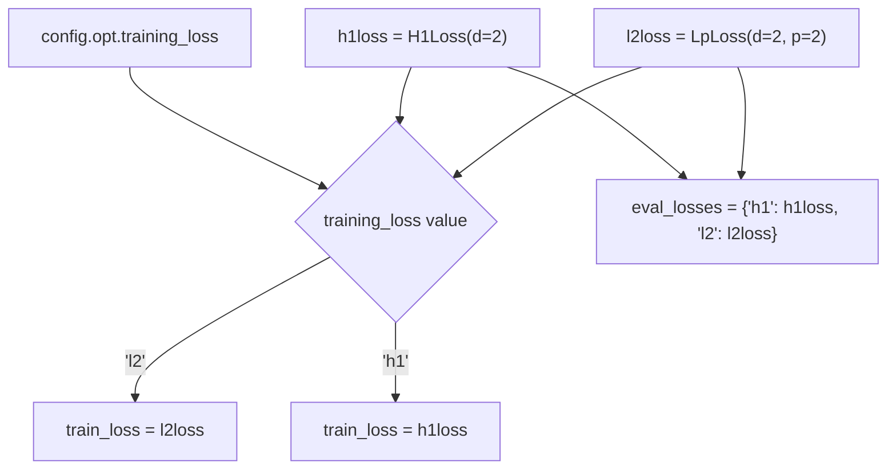
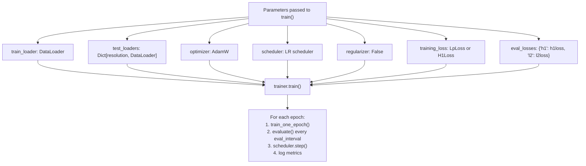
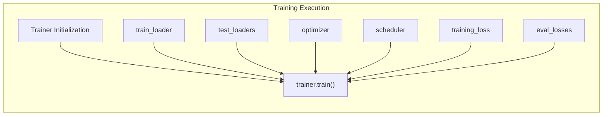

<!-- source: DeepWiki mcp.deepwiki.com · repo neuraloperator/neuraloperator · page 5.2 Navier-Stokes Equation · fetched 2026-10-21 -->

# Navier-Stokes Equation

<details>
<summary>Relevant source files</summary>

The following files were used as context for generating this wiki page:

- [neuralop/data/datasets/__init__.py](neuralop/data/datasets/__init__.py)
- [neuralop/data/datasets/burgers.py](neuralop/data/datasets/burgers.py)
- [neuralop/data/datasets/darcy.py](neuralop/data/datasets/darcy.py)
- [neuralop/data/datasets/navier_stokes.py](neuralop/data/datasets/navier_stokes.py)
- [neuralop/data/datasets/pt_dataset.py](neuralop/data/datasets/pt_dataset.py)
- [scripts/login_wandb.py](scripts/login_wandb.py)
- [scripts/test_from_config.py](scripts/test_from_config.py)
- [scripts/train_burgers.py](scripts/train_burgers.py)
- [scripts/train_burgers_pino.py](scripts/train_burgers_pino.py)
- [scripts/train_darcy.py](scripts/train_darcy.py)
- [scripts/train_fnogno_carcfd.py](scripts/train_fnogno_carcfd.py)
- [scripts/train_gino_carcfd.py](scripts/train_gino_carcfd.py)
- [scripts/train_mhd64.py](scripts/train_mhd64.py)
- [scripts/train_navier_stokes.py](scripts/train_navier_stokes.py)
- [scripts/train_poisson.py](scripts/train_poisson.py)
- [scripts/train_uqno_darcy.py](scripts/train_uqno_darcy.py)

</details>


This document covers training neural operators on 2D incompressible Navier-Stokes equations. The training pipeline uses the `NavierStokesDataset` class for data loading and supports temporal prediction of vorticity fields. The implementation is found in [scripts/train_navier_stokes.py:1-229]() with dataset management in [neuralop/data/datasets/navier_stokes.py:1-173]().

The Navier-Stokes dataset represents fluid dynamics through vorticity fields, where both input and output are 2D spatial fields describing flow evolution. The training script supports multi-resolution evaluation and distributed training with multi-grid patching.

For related PDE training examples, see Darcy Flow (page 5.1) and Burgers Equation (page 5.3). For Trainer architecture details, see page 4.1.
</old_str>

<old_str>
## Configuration System

Configuration uses the `zencfg` library with `config.navier_stokes_config.Default` class. The configuration is parsed at [scripts/train_navier_stokes.py:26-33]() using `make_config_from_cli(Default)`.

**Configuration Namespace Structure**

```mermaid
graph TD
    Default["config.navier_stokes_config.Default"]
    
    Model["config.model"]
    Data["config.data"]
    Opt["config.opt"]
    Patching["config.patching"]
    Distributed["config.distributed"]
    WandB["config.wandb"]
    
    Default --> Model
    Default --> Data
    Default --> Opt
    Default --> Patching
    Default --> Distributed
    Default --> WandB
    
    Model --> MA["model_arch: 'FNO'/'UNO'/'TFNO'"]
    Model --> NL["n_layers: int"]
    Model --> NM["n_modes: int or List[int]"]
    Model --> HC["hidden_channels: int"]
    Model --> Fact["factorization: str or None"]
    Model --> Rank["rank: float"]
    
    Data --> Folder["folder: str (data directory)"]
    Data --> TrainRes["train_resolution: 128 or 1024"]
    Data --> NTrain["n_train: int"]
    Data --> BS["batch_size: int"]
    Data --> TestRes["test_resolutions: List[int]"]
    Data --> NTests["n_tests: List[int]"]
    Data --> TBS["test_batch_sizes: List[int]"]
    Data --> EI["encode_input: bool"]
    Data --> EO["encode_output: bool"]
    
    Opt --> LR["learning_rate: float"]
    Opt --> NE["n_epochs: int"]
    Opt --> WD["weight_decay: float"]
    Opt --> Sched["scheduler: str"]
    Opt --> TL["training_loss: 'l2'/'h1'"]
    Opt --> MP["mixed_precision: bool"]
    Opt --> EvalInt["eval_interval: int"]
    
    Patching --> Levels["levels: int (0 = disabled)"]
    Patching --> Padding["padding: float"]
    Patching --> Stitch["stitching: str"]
```


The configuration dictionary is accessed after conversion with `config.to_dict()` at [scripts/train_navier_stokes.py:33](). Runtime overrides are supported via command line arguments parsed by `zencfg`.

**Sources:** [scripts/train_navier_stokes.py:24-33](), [scripts/train_navier_stokes.py:40-70]()
</old_str>
<new_str>
## Dataset Structure

The `NavierStokesDataset` class loads 2D incompressible Navier-Stokes simulation data from PyTorch tensor files. Data is stored as vorticity fields representing fluid flow evolution.

**Dataset Class Hierarchy**


**Sources:** [neuralop/data/datasets/navier_stokes.py:14-126]()

### Data Format

| Property | Value |
|----------|-------|
| Dataset Name | `"nsforcing"` |
| Data Type | 2D vorticity fields (incompressible NS) |
| Channels | 1 (vorticity) |
| Available Resolutions | 128, 1024 |
| Zenodo Record | `12825163` |
| Channel Dimension | 1 |

Each data sample contains:
- `x`: Input vorticity field at time t (shape: `[batch, 1, height, width]`)
- `y`: Output vorticity field at time t+Δt (shape: `[batch, 1, height, width]`)

The dataset supports temporal prediction by learning the mapping from current vorticity to future vorticity under forced Navier-Stokes dynamics.

**Sources:** [neuralop/data/datasets/navier_stokes.py:14-28](), [neuralop/data/datasets/navier_stokes.py:88-110]()

## Training Pipeline Overview

The training script at [scripts/train_navier_stokes.py]() implements the standard neural operator training workflow with Navier-Stokes specific data handling.

**Pipeline Component Flow**


**Sources:** [scripts/train_navier_stokes.py:1-229]()

## Training Pipeline Overview

The Navier-Stokes training script implements a comprehensive neural operator training pipeline that handles 2D incompressible flow data with support for distributed training, multi-grid patching, and various neural operator architectures.



**Sources:** [scripts/train_navier_stokes.py:1-215]()

## Data Loading and Preprocessing

Data loading uses `load_navier_stokes_pt()` from [neuralop/data/datasets/navier_stokes.py:129-172](), which internally creates a `NavierStokesDataset` instance and returns DataLoaders with a `DefaultDataProcessor`.

### Loading Function Parameters

| Parameter | Type | Purpose | Example |
|-----------|------|---------|---------|
| `data_root` | Path or str | Directory containing NS data files | `Path("~/data/navier_stokes")` |
| `train_resolution` | int | Spatial resolution for training | `128` or `1024` |
| `n_train` | int | Number of training samples | `1000` |
| `batch_size` | int | Training batch size | `32` |
| `test_resolutions` | List[int] | Resolutions for evaluation | `[128]` or `[128, 1024]` |
| `n_tests` | List[int] | Test samples per resolution | `[100]` |
| `test_batch_sizes` | List[int] | Batch sizes per test set | `[32]` |
| `encode_input` | bool | Normalize inputs | `False` |
| `encode_output` | bool | Normalize outputs | `True` |
| `subsampling_rate` | int or None | Spatial subsampling factor | `None` |

**Data Loading Call in Training Script**
```python
# From scripts/train_navier_stokes.py:84-94
train_loader, test_loaders, data_processor = load_navier_stokes_pt(
    data_root=data_dir,
    train_resolution=config.data.train_resolution,
    n_train=config.data.n_train,
    batch_size=config.data.batch_size,
    test_resolutions=config.data.test_resolutions,
    n_tests=config.data.n_tests,
    test_batch_sizes=config.data.test_batch_sizes,
    encode_input=config.data.encode_input,
    encode_output=config.data.encode_output,
)
```

### Data Processing Pipeline

**Data Processor Enhancement Flow**


The `MGPatchingDataProcessor` enables training on higher-resolution data by dividing inputs into overlapping patches, processing them independently, and stitching results together. This is configured at [scripts/train_navier_stokes.py:100-110]().

Distributed training reconfigures DataLoaders with `DistributedSampler` at [scripts/train_navier_stokes.py:114-127]() to partition data across multiple GPUs.

**Sources:** [scripts/train_navier_stokes.py:81-127](), [neuralop/data/datasets/navier_stokes.py:129-172]()

## Model Instantiation

Model creation uses `get_model(config)` from [neuralop/__init__.py]() at [scripts/train_navier_stokes.py:97](). The function dispatches to the appropriate model class based on `config.model.model_arch`.

**Model Creation and Device Placement**


Typical model architectures for Navier-Stokes:
- **FNO**: Fourier Neural Operator with spectral convolutions
- **TFNO**: Tensorized FNO with factorized weight tensors
- **UNO**: U-shaped Neural Operator with encoder-decoder structure

The model is moved to the device (CPU/GPU) determined by `setup(config)` at [scripts/train_navier_stokes.py:36](), which handles distributed training initialization via `neuralop.training.setup`.

**Sources:** [scripts/train_navier_stokes.py:36](), [scripts/train_navier_stokes.py:97-98]()

## Optimization Configuration

The training uses `AdamW` optimizer from [neuralop/training/__init__.py]() with configurable learning rate schedulers.

**Optimizer Instantiation**
```python
# From scripts/train_navier_stokes.py:130-134
optimizer = AdamW(
    model.parameters(),
    lr=config.opt.learning_rate,
    weight_decay=config.opt.weight_decay,
)
```

### Learning Rate Schedulers

Three scheduler types are supported, selected by `config.opt.scheduler`:

| Scheduler | Configuration Parameters | Behavior |
|-----------|-------------------------|----------|
| `ReduceLROnPlateau` | `factor`, `patience`, `mode='min'` | Reduces LR when metric plateaus |
| `CosineAnnealingLR` | `T_max` | Cosine annealing schedule |
| `StepLR` | `step_size`, `gamma` | Multiply LR by gamma every step_size epochs |

Scheduler instantiation logic is at [scripts/train_navier_stokes.py:136-152]().

## Loss Functions

Two primary loss functions are used for Navier-Stokes training, both instantiated at [scripts/train_navier_stokes.py:156-167]():

**Loss Function Configuration**


### Loss Function Details

- **LpLoss(d=2, p=2)**: Relative L² norm in 2D spatial domain. Measures normalized error between predicted and true vorticity fields. Formula: `||y_pred - y_true||_L2 / ||y_true||_L2`

- **H1Loss(d=2)**: H¹ Sobolev norm in 2D, includes both function values and spatial gradients. More stringent than L² as it penalizes gradient errors. Used when smoother solutions are desired.

Both training and evaluation use the same loss types, but evaluation always computes both metrics for comprehensive assessment.

**Sources:** [scripts/train_navier_stokes.py:156-167]()

## Training Execution

The `Trainer` class from [neuralop/training/trainer.py]() manages the training loop, evaluation, and checkpointing. Initialization occurs at [scripts/train_navier_stokes.py:180-191]().

**Trainer Initialization Parameters**
```python
# From scripts/train_navier_stokes.py:180-191
trainer = Trainer(
    model=model,
    n_epochs=config.opt.n_epochs,
    data_processor=data_processor,
    device=device,
    mixed_precision=config.opt.mixed_precision,
    eval_interval=config.opt.eval_interval,
    log_output=config.wandb.log_output,
    use_distributed=config.distributed.use_distributed,
    verbose=config.verbose,
    wandb_log=config.wandb.log,
)
```

### Training Loop Execution

The training process is launched by calling `trainer.train()` at [scripts/train_navier_stokes.py:212-220]():

**Training Call Flow**


The `test_loaders` dictionary maps resolution identifiers to DataLoader instances, enabling multi-resolution evaluation. For example, if `test_resolutions=[128, 1024]`, the dictionary contains keys `128` and `1024` with corresponding DataLoaders.

**Sources:** [scripts/train_navier_stokes.py:180-220]()

## Training Orchestration

The `Trainer` class coordinates the entire training process with comprehensive configuration options.

```python
trainer = Trainer(
    model=model,
    n_epochs=config.opt.n_epochs,
    data_processor=data_processor,
    device=device,
    mixed_precision=config.opt.mixed_precision,
    eval_interval=config.opt.eval_interval,
    log_output=config.wandb.log_output,
    use_distributed=config.distributed.use_distributed,
    verbose=config.verbose,
    wandb_log=config.wandb.log
)
```

The training execution follows a standard pattern with support for regularization, multiple loss functions, and comprehensive logging.



**Sources:** [scripts/train_navier_stokes.py:169-180](), [scripts/train_navier_stokes.py:200-208]()

## Monitoring and Evaluation

The script integrates Weights & Biases for experiment tracking and includes comprehensive parameter counting and performance monitoring.

| Monitoring Component | Purpose | Configuration |
|---------------------|---------|---------------|
| WandB Integration | Experiment tracking | `config.wandb.log`, `config.wandb.project` |
| Parameter Counting | Model size metrics | `count_model_params()` |
| Evaluation Metrics | Multiple loss computation | `{"h1": h1loss, "l2": l2loss}` |
| Verbose Logging | Training progress | `config.verbose` |

The training process includes automatic best model tracking and supports compression ratio calculations when baseline parameter counts are provided.

**Sources:** [scripts/train_navier_stokes.py:31-61](), [scripts/train_navier_stokes.py:183-197](), [scripts/train_navier_stokes.py:210-214]()

---

