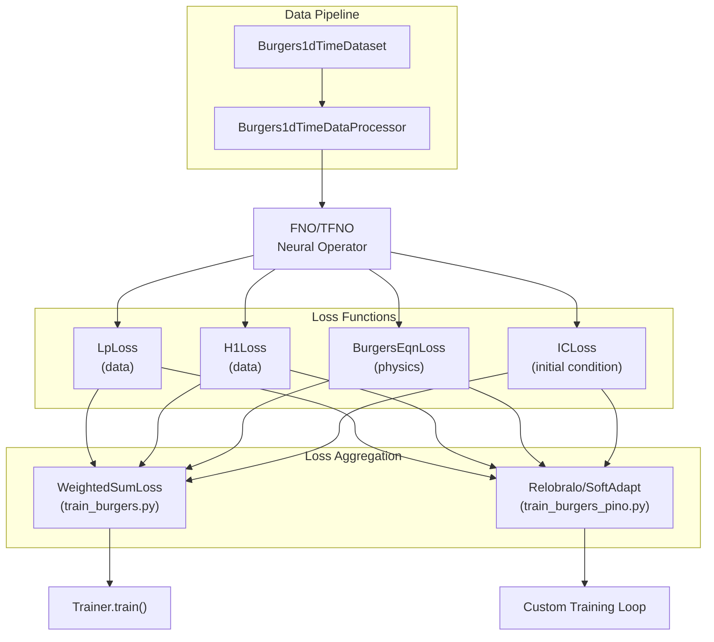
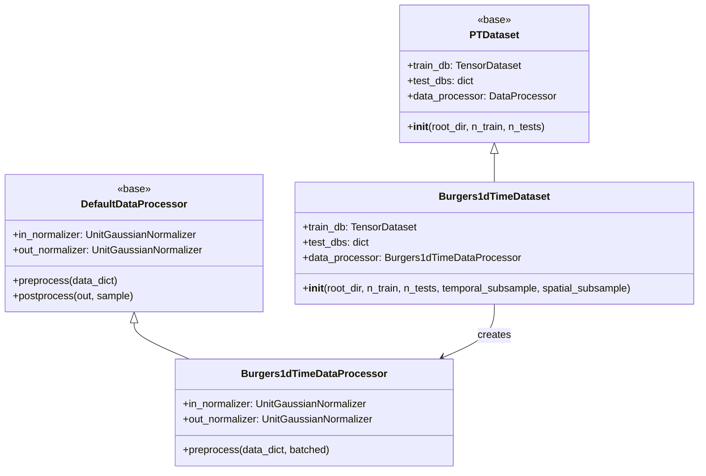
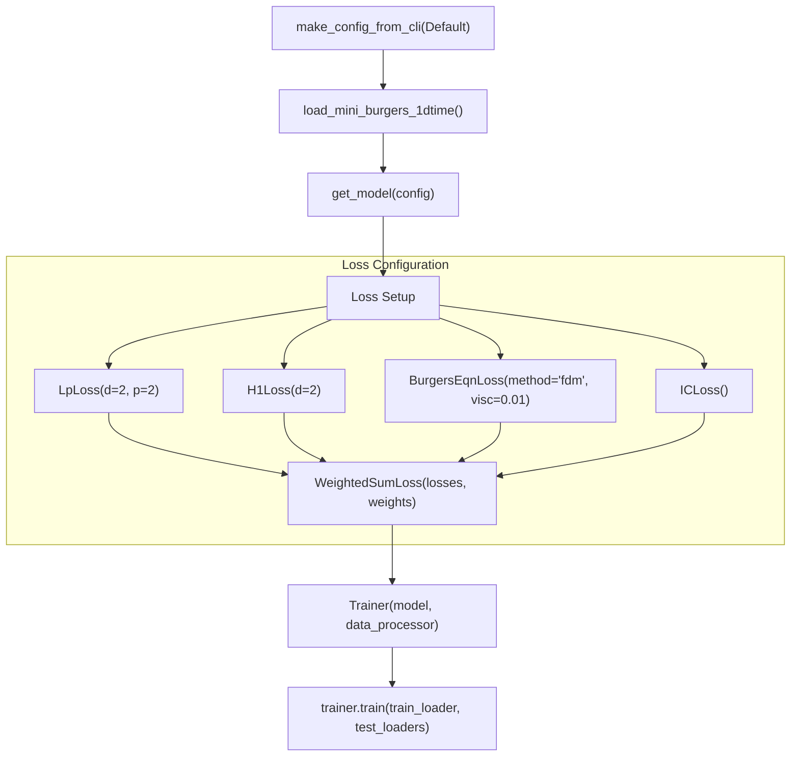
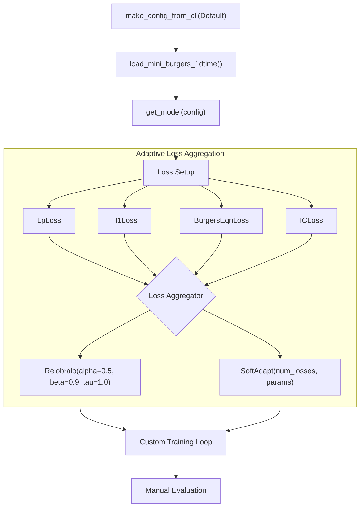
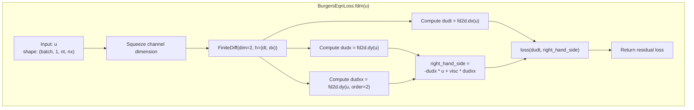
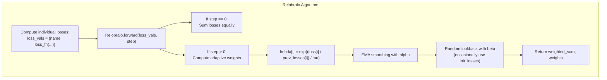
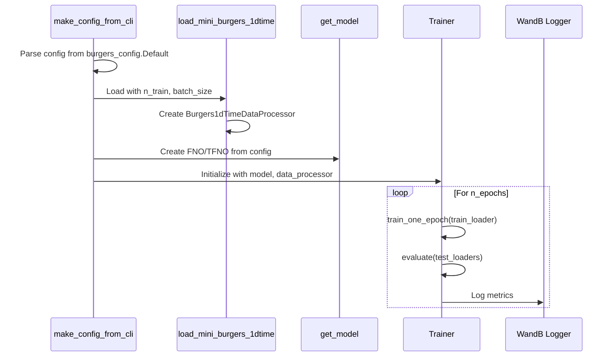

<!-- source: DeepWiki mcp.deepwiki.com · repo neuraloperator/neuraloperator · page 5.3 Burgers Equation · fetched 2026-10-21 -->

# Burgers Equation

<details>
<summary>Relevant source files</summary>

The following files were used as context for generating this wiki page:

- [neuralop/__init__.py](neuralop/__init__.py)
- [neuralop/data/datasets/__init__.py](neuralop/data/datasets/__init__.py)
- [neuralop/data/datasets/burgers.py](neuralop/data/datasets/burgers.py)
- [neuralop/data/datasets/darcy.py](neuralop/data/datasets/darcy.py)
- [neuralop/data/datasets/navier_stokes.py](neuralop/data/datasets/navier_stokes.py)
- [neuralop/data/datasets/pt_dataset.py](neuralop/data/datasets/pt_dataset.py)
- [neuralop/losses/__init__.py](neuralop/losses/__init__.py)
- [neuralop/losses/data_losses.py](neuralop/losses/data_losses.py)
- [neuralop/losses/differentiation.py](neuralop/losses/differentiation.py)
- [neuralop/losses/equation_losses.py](neuralop/losses/equation_losses.py)
- [neuralop/losses/meta_losses.py](neuralop/losses/meta_losses.py)
- [neuralop/losses/tests/test_losses.py](neuralop/losses/tests/test_losses.py)
- [scripts/login_wandb.py](scripts/login_wandb.py)
- [scripts/test_from_config.py](scripts/test_from_config.py)
- [scripts/train_burgers.py](scripts/train_burgers.py)
- [scripts/train_burgers_pino.py](scripts/train_burgers_pino.py)
- [scripts/train_darcy.py](scripts/train_darcy.py)
- [scripts/train_fnogno_carcfd.py](scripts/train_fnogno_carcfd.py)
- [scripts/train_gino_carcfd.py](scripts/train_gino_carcfd.py)
- [scripts/train_mhd64.py](scripts/train_mhd64.py)
- [scripts/train_navier_stokes.py](scripts/train_navier_stokes.py)
- [scripts/train_poisson.py](scripts/train_poisson.py)
- [scripts/train_uqno_darcy.py](scripts/train_uqno_darcy.py)

</details>


This document describes the training scripts, dataset, and configuration options for the Burgers equation within the neuraloperator library. The Burgers equation is a fundamental nonlinear PDE that serves as a simplified model for fluid dynamics and is a common benchmark for neural operator methods.

## 1. Overview

The Burgers equation is a one-dimensional, time-dependent partial differential equation that demonstrates interesting behaviors like shock formation. The neuraloperator library provides two training approaches:

1. **Standard Training** (`train_burgers.py`): Supervised learning with optional physics-informed losses using fixed weights
2. **PINO Training** (`train_burgers_pino.py`): Advanced physics-informed training with adaptive loss aggregation via `Relobralo` or `SoftAdapt`

### Burgers Equation Training Architecture



Sources: [scripts/train_burgers.py:1-226](), [scripts/train_burgers_pino.py:1-283](), [neuralop/data/datasets/burgers.py:1-155]()

## 2. Dataset Structure

The Burgers equation dataset is implemented in `Burgers1dTimeDataset` class and loaded via the `load_mini_burgers_1dtime` function. This dataset represents the viscous Burgers equation in 1 spatial dimension, evolving over time.

### Dataset Class Hierarchy



### Data Format

| Property | Description | Shape |
|----------|-------------|-------|
| Input (x) | Initial condition at t=0 | `(batch, 1, spatial_len)` |
| Output (y) | Time evolution of solution | `(batch, 1, temporal_len, spatial_len)` |
| Subsampling | Temporal and spatial subsampling | Configurable |
| Resolutions | Available spatial resolutions | 16, 128 |

The `Burgers1dTimeDataProcessor.preprocess()` method performs a critical transformation:
1. Takes input x with shape `(batch, 1, spatial_len)`
2. Unsqueezes along temporal dimension and repeats to match y's temporal length
3. Results in x with shape `(batch, 1, temporal_len, spatial_len)`

Sources: [neuralop/data/datasets/burgers.py:8-155]()

## 3. Training Scripts

The neuraloperator library provides two training scripts for the Burgers equation with different loss aggregation strategies.

### 3.1 Standard Training (train_burgers.py)

The standard training script uses fixed-weight loss aggregation with the `Trainer` class.

#### Standard Training Pipeline



**Key Features:**
- Uses `WeightedSumLoss` with fixed weights from config
- Supports standard `Trainer` class orchestration
- Optional multi-grid patching via `MGPatchingDataProcessor`
- Configurable loss combinations via `config.opt.training_loss` list

Sources: [scripts/train_burgers.py:1-226]()

### 3.2 PINO Training (train_burgers_pino.py)

The PINO training script uses adaptive loss aggregation with `Relobralo` or `SoftAdapt` for dynamic loss balancing.

#### PINO Training Pipeline



**Key Features:**
- Custom training loop (not using `Trainer` class)
- Adaptive loss weighting via `Relobralo` or `SoftAdapt`
- Loss weights updated dynamically each epoch based on loss magnitudes
- Manual forward/backward passes and evaluation

Sources: [scripts/train_burgers_pino.py:1-283]()

## 4. Configuration System

The Burgers equation training can be configured using YAML configuration files. There are two primary configuration files:

1. **Standard configuration** (`burgers_config.yaml`): For training with standard supervised learning
2. **Physics-informed configuration** (`burgers_pino_config.yaml`): For training with physics-informed constraints

### 4.1 Standard Configuration

The standard configuration includes settings for:

| Configuration Category | Key Parameters |
|------------------------|----------------|
| Model Architecture | `arch`, `hidden_channels`, `n_layers`, etc. |
| Optimization | `learning_rate`, `n_epochs`, `scheduler` |
| Data | `n_train`, `batch_size`, `spatial_length` |
| Training | `training_loss` (typically 'l2') |

Sources: [config/burgers_config.yaml:1-91]()

### 4.2 Physics-Informed Configuration

The physics-informed configuration extends the standard configuration with:

| Additional Parameters | Description |
|------------------------|----------------|
| `training_loss` | Array of losses: `['equation', 'ic']` |
| `pino_method` | Method for computing derivatives (e.g., 'fdm') |
| `loss_weights` | Weighting for different loss components |

Example loss weights from the config:
```
loss_weights:
  'l2': 0.0
  'equation': .2
  'ic': .8
```

Sources: [config/burgers_pino_config.yaml:1-98]()

## 5. Physics-Informed Neural Operators (PINO)

Physics-informed neural operators incorporate the PDE itself into the loss function, enforcing physical constraints during training.

### 5.1 Physics Loss Components

#### BurgersEqnLoss Implementation



The `BurgersEqnLoss` class enforces the Burgers equation:
```
∂u/∂t + u ∂u/∂x = ν ∂²u/∂x²
```

**Implementation Details:**
- Uses `FiniteDiff` class with finite difference method (FDM)
- Default viscosity: ν = 0.01
- Computes derivatives via central differences
- Returns MSE loss between left-hand side (∂u/∂t) and right-hand side (-u ∂u/∂x + ν ∂²u/∂x²)

Sources: [neuralop/losses/equation_losses.py:14-61]()

#### ICLoss Implementation

The `ICLoss` enforces initial condition matching:

```python
# From ICLoss.initial_condition_loss
boundary_true = x[:, 0, 0, :]  # Initial condition from input
boundary_pred = y_pred[:, 0, 0, :]  # Model prediction at t=0
return loss(boundary_pred, boundary_true)
```

Sources: [neuralop/losses/equation_losses.py:63-86]()

### 5.2 Loss Aggregation Strategies

#### Fixed Weight Aggregation (train_burgers.py)

```python
# Example from train_burgers.py
losses = []
weights = []
for loss_name in config.opt.training_loss:  # e.g., ['l2', 'equation', 'ic']
    losses.append(loss_map[loss_name])
    weights.append(config.opt.loss_weights.get(loss_name, 1.0))

train_loss = WeightedSumLoss(losses=losses, weights=weights)
```

Sources: [scripts/train_burgers.py:123-156]()

#### Adaptive Aggregation (train_burgers_pino.py)



**Relobralo Parameters:**
- `alpha`: Smoothing factor for exponential moving average (default: 0.5)
- `beta`: Random lookback probability (default: 0.9)
- `tau`: Temperature parameter for weight sharpness (default: 1.0)

**SoftAdapt Parameters:**
- Computes weights based on ratio of current to previous losses
- No hyperparameters beyond `eps` for numerical stability

Sources: [scripts/train_burgers_pino.py:128-144](), [neuralop/losses/meta_losses.py:287-430]()

## 6. Example Usage

### 6.1 Standard Training Example

```bash
# Using command-line configuration
python scripts/train_burgers.py \
    --data.n_train 1000 \
    --model.n_layers 4 \
    --opt.training_loss l2 equation ic \
    --opt.loss_weights.l2 0.5 \
    --opt.loss_weights.equation 0.3 \
    --opt.loss_weights.ic 0.2
```

#### Standard Training Workflow



Sources: [scripts/train_burgers.py:1-226]()

### 6.2 PINO Training Example

```bash
# Using PINO with Relobralo
python scripts/train_burgers_pino.py \
    --opt.training_loss l2 equation ic \
    --opt.loss_aggregator relobralo \
    --opt.n_epochs 500
```

#### PINO Training Workflow

```mermaid
sequenceDiagram
    participant Loop as Training Loop
    participant Model as Neural Operator
    participant Losses as Loss Functions
    participant Agg as Relobralo/SoftAdapt
    participant WandB as WandB Logger
    
    Loop->>Model: Forward pass
    Model->>Losses: Compute loss_vals dict
    Losses->>Agg: Pass {l2: val, equation: val, ic: val}
    Agg->>Agg: Compute adaptive weights
    Agg->>Loop: Return total_loss, weights
    Loop->>Model: Backward pass
    Loop->>WandB: Log losses and weights
    
    alt Evaluation Interval
        Loop->>Model: Evaluate on test set
        Loop->>WandB: Log test metrics
    end
```

Sources: [scripts/train_burgers_pino.py:169-283]()

## 7. Key Components Reference

### 7.1 Dataset Loading Function

The `load_mini_burgers_1dtime()` function provides a simplified interface:

```python
# Function signature
def load_mini_burgers_1dtime(
    data_path: Union[Path, str],
    n_train: int, 
    n_test: int, 
    batch_size: int, 
    test_batch_size: int,
    temporal_subsample: int = 1,
    spatial_subsample: int = 1
) -> Tuple[DataLoader, Dict[int, DataLoader], Burgers1dTimeDataProcessor]
```

**Returns:**
- `train_loader`: DataLoader for training data
- `test_loaders`: Dictionary mapping resolution to test DataLoader
- `data_processor`: Burgers1dTimeDataProcessor instance

Sources: [neuralop/data/datasets/burgers.py:111-155]()

### 7.2 Loss Function Classes

| Loss Class | Purpose | Key Parameters | Source File |
|------------|---------|----------------|-------------|
| `LpLoss` | Data-driven loss (L2 norm) | `d=2, p=2, reduction='sum'` | [neuralop/losses/data_losses.py:21-188]() |
| `H1Loss` | Sobolev space loss | `d=2, reduction='sum'` | [neuralop/losses/data_losses.py:189-448]() |
| `BurgersEqnLoss` | Physics residual | `visc=0.01, method='fdm'` | [neuralop/losses/equation_losses.py:14-61]() |
| `ICLoss` | Initial condition | `loss=F.mse_loss` | [neuralop/losses/equation_losses.py:63-86]() |
| `WeightedSumLoss` | Fixed weight aggregation | `losses, weights` | [neuralop/losses/meta_losses.py:80-104]() |
| `Relobralo` | Adaptive aggregation | `alpha, beta, tau` | [neuralop/losses/meta_losses.py:287-430]() |
| `SoftAdapt` | Adaptive aggregation | `eps=1e-8` | [neuralop/losses/meta_losses.py:182-285]() |

### 7.3 BurgersEqnLoss Details

The `BurgersEqnLoss.fdm()` method computes derivatives using `FiniteDiff`:

```python
# From BurgersEqnLoss implementation
fd2d = FiniteDiff(dim=2, h=(dt, dx), periodic_in_x=False, periodic_in_y=False)
dudt = fd2d.dx(u)  # Time derivative
dudx = fd2d.dy(u)  # Spatial first derivative
dudxx = fd2d.dy(u, order=2)  # Spatial second derivative

# Burgers equation right-hand side
right_hand_side = -dudx * u + self.visc * dudxx

# Loss is MSE between dudt and RHS
return self.loss(dudt, right_hand_side)
```

Sources: [neuralop/losses/equation_losses.py:28-49]()

## 8. Configuration Options

### 8.1 Standard Training Configuration

Key configuration sections for `train_burgers.py`:

| Section | Parameters | Example Values |
|---------|------------|----------------|
| `model` | `model_arch`, `n_layers`, `n_modes`, `hidden_channels` | `'fno'`, `4`, `[16]`, `64` |
| `data` | `n_train`, `batch_size`, `spatial_subsample`, `temporal_subsample` | `1000`, `32`, `1`, `1` |
| `opt` | `learning_rate`, `n_epochs`, `scheduler`, `training_loss` | `0.001`, `500`, `'StepLR'`, `['l2', 'equation']` |
| `opt.loss_weights` | Individual loss weights | `{'l2': 0.5, 'equation': 0.3, 'ic': 0.2}` |
| `patching` | `levels`, `padding`, `stitching` | `0`, `0.0`, `None` |

Sources: [scripts/train_burgers.py:22-33]()

### 8.2 PINO Configuration

Additional configuration for `train_burgers_pino.py`:

| Parameter | Description | Default |
|-----------|-------------|---------|
| `opt.loss_aggregator` | Aggregation method | `'relobralo'` or `'softadapt'` |
| `opt.training_loss` | List of loss names | `['l2', 'h1', 'ic', 'equation']` |
| `opt.pino_method` | Derivative computation method | `'fdm'` |

Sources: [scripts/train_burgers_pino.py:20-29]()

### 8.3 Multi-Grid Patching

For larger domains, use `MGPatchingDataProcessor`:

```python
# From train_burgers.py
if config.patching.levels > 0:
    data_processor = MGPatchingDataProcessor(
        model=model,
        levels=config.patching.levels,
        padding_fraction=config.patching.padding,
        stitching=config.patching.stitching,
        device=device,
        in_normalizer=data_processor.in_normalizer,
        out_normalizer=data_processor.out_normalizer
    )
```

This enables training on larger spatial resolutions by:
1. Decomposing the domain into patches at multiple scales
2. Processing each patch independently
3. Stitching results together to form final prediction

Sources: [scripts/train_burgers.py:170-179]()

## 9. Comparison with Other PDE Training Scripts

The Burgers equation training script shares many similarities with the Navier-Stokes and Darcy Flow scripts, but differs in:

1. Dataset structure (1D with time dimension vs. 2D spatial)
2. Support for physics-informed losses
3. Different default model architectures and configurations

For information about related PDE training scripts, see:
- [Navier-Stokes Equation](#5.1)
- [Darcy Flow](#5.2)

Sources: [scripts/train_burgers.py:1-214](), [scripts/train_navier_stokes.py:1-220](), [scripts/train_darcy.py:1-207]()

---

