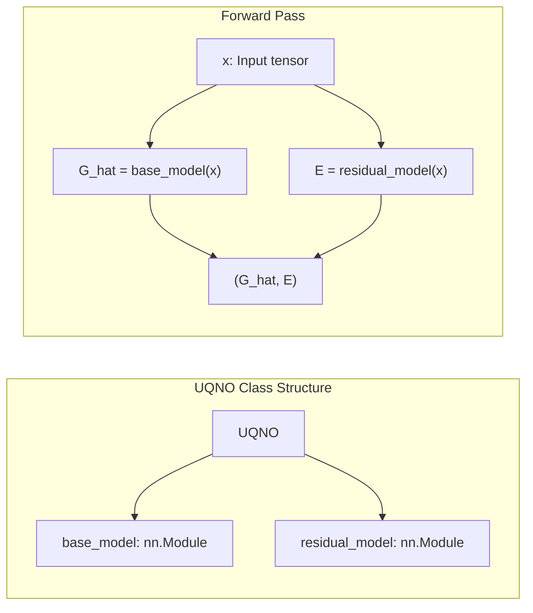
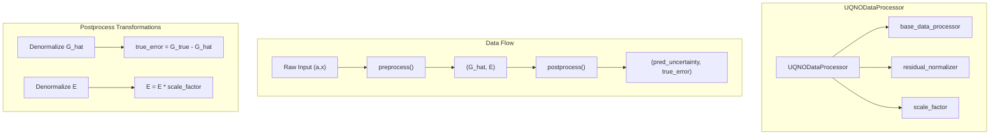
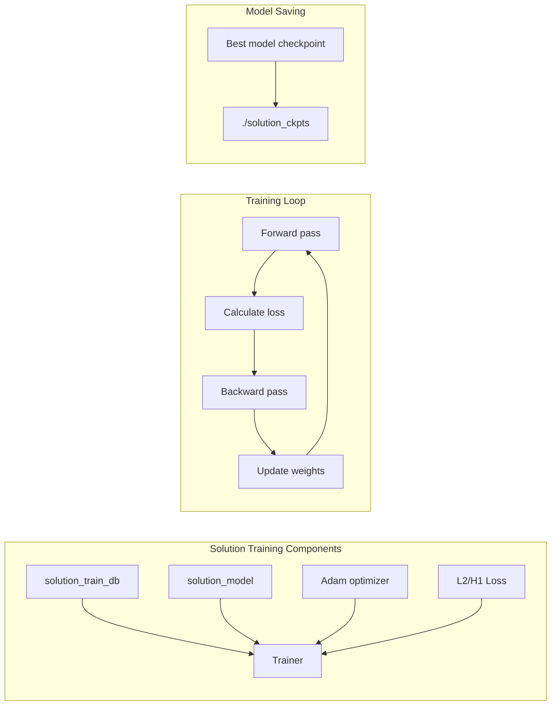
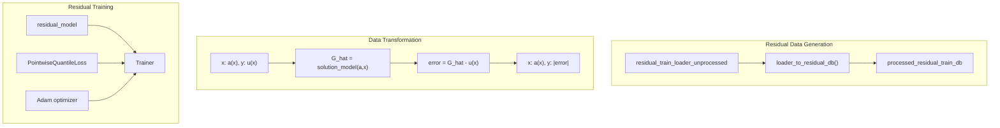
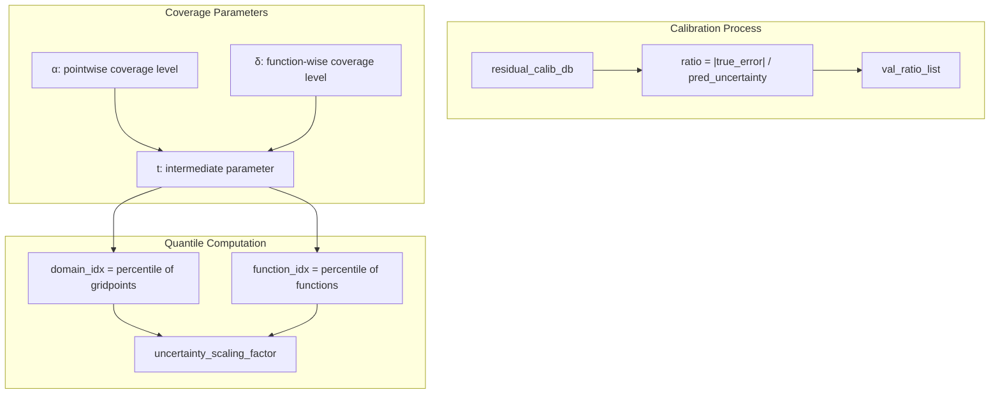
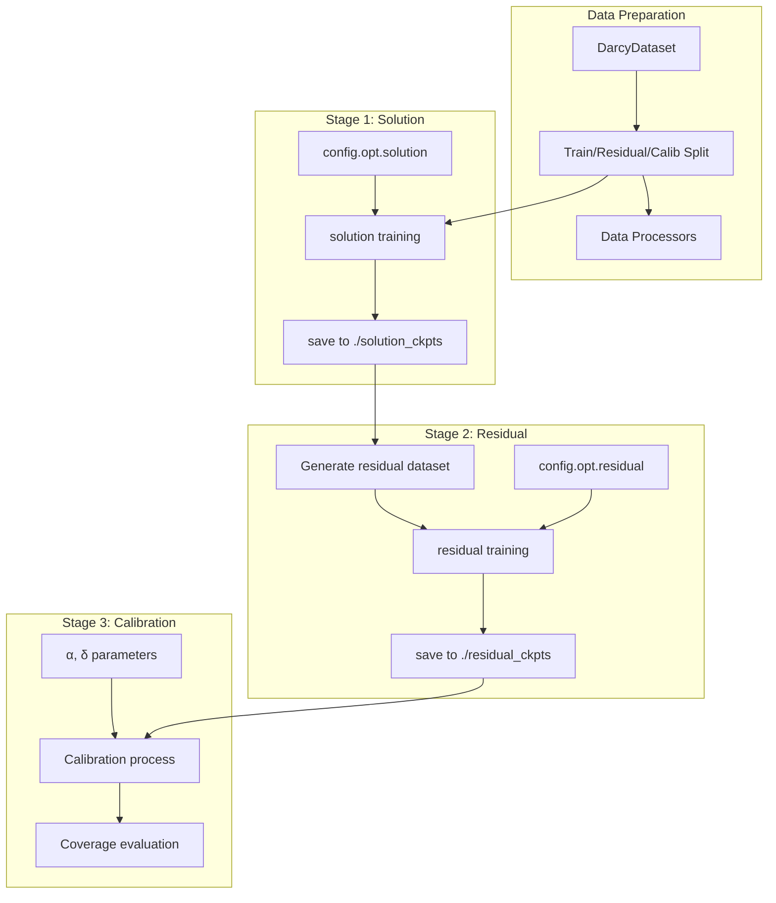

<!-- source: DeepWiki mcp.deepwiki.com · repo neuraloperator/neuraloperator · page 5.4 Uncertainty Quantification (UQNO) · fetched 2026-10-21 -->

# Uncertainty Quantification (UQNO)

Relevant source files

The following files were used as context for generating this wiki page:

- [scripts/login_wandb.py](scripts/login_wandb.py)
- [scripts/test_from_config.py](scripts/test_from_config.py)
- [scripts/train_burgers.py](scripts/train_burgers.py)
- [scripts/train_burgers_pino.py](scripts/train_burgers_pino.py)
- [scripts/train_darcy.py](scripts/train_darcy.py)
- [scripts/train_fnogno_carcfd.py](scripts/train_fnogno_carcfd.py)
- [scripts/train_gino_carcfd.py](scripts/train_gino_carcfd.py)
- [scripts/train_mhd64.py](scripts/train_mhd64.py)
- [scripts/train_navier_stokes.py](scripts/train_navier_stokes.py)
- [scripts/train_poisson.py](scripts/train_poisson.py)
- [scripts/train_uqno_darcy.py](scripts/train_uqno_darcy.py)

This document covers the uncertainty quantification capabilities of the neuraloperator library, specifically the UQNO (Uncertainty Quantification Neural Operator) implementation. UQNO provides a two-stage training approach to quantify prediction uncertainty in neural operators, combining a base solution model with a residual uncertainty model.

For standard neural operator training without uncertainty quantification, see [Darcy Flow](#5.1), [Navier-Stokes](#5.2), and [Burgers Equation](#5.3).

## Overview

UQNO implements a probabilistic approach to uncertainty quantification in neural operators through a two-stage training process:

1. **Solution Stage**: Train a standard neural operator to predict solutions
2. **Residual Stage**: Train a second model to predict the magnitude of prediction errors
3. **Calibration**: Calibrate uncertainty bounds using conformal prediction techniques

The approach provides pointwise uncertainty estimates with theoretical coverage guarantees.

## UQNO Architecture

```mermaid
graph TB
    subgraph "Stage 1: Solution Training"
        Input1["Input a(x)"]
        SolutionModel["Solution Model G_θ"]
        TrueOutput1["True Output u(x)"]
        L2Loss1["L2/H1 Loss"]
        
        Input1 --> SolutionModel
        SolutionModel --> PredOutput1["Predicted G_hat(a,x)"]
        PredOutput1 --> L2Loss1
        TrueOutput1 --> L2Loss1
    end
    
    subgraph "Stage 2: Residual Training"
        Input2["Input a(x)"]
        ResidualModel["Residual Model E_φ"]
        ResidualTarget["Residual |G_hat - u|"]
        QuantileLoss["PointwiseQuantileLoss"]
        
        Input2 --> ResidualModel
        ResidualModel --> UncertaintyPred["Uncertainty E(a,x)"]
        UncertaintyPred --> QuantileLoss
        ResidualTarget --> QuantileLoss
    end
    
    subgraph "UQNO Combined Model"
        UQNOInput["Input a(x)"]
        UQNOBase["Solution Model G_θ"]
        UQNOResid["Residual Model E_φ"]
        UQNOOutput["(G_hat(a,x), E(a,x))"]
        
        UQNOInput --> UQNOBase
        UQNOInput --> UQNOResid
        UQNOBase --> UQNOOutput
        UQNOResid --> UQNOOutput
    end
    
    subgraph "Calibration Process"
        CalibData["Calibration Dataset"]
        ScaleFactor["Uncertainty Scale Factor"]
        CoverageEval["Coverage Evaluation"]
        
        CalibData --> ScaleFactor
        ScaleFactor --> CoverageEval
    end
```

Sources: [scripts/train_uqno_darcy.py:225-276](), [scripts/train_uqno_darcy.py:498-503]()

## Key Components

### UQNO Model Class

The `UQNO` class combines a base solution model with a residual uncertainty model:

Sources: [scripts/train_uqno_darcy.py:499](), [neuralop/models/__init__.py]()

### UQNODataProcessor

The `UQNODataProcessor` handles the complex data transformations required for uncertainty quantification:

Sources: [scripts/train_uqno_darcy.py:279-359]()

### PointwiseQuantileLoss

The quantile loss function trains the residual model to predict uncertainty bounds:

| Parameter | Description | Usage |
|-----------|-------------|-------|
| `alpha` | Confidence level (1-α coverage) | Controls uncertainty interval width |
| Pointwise application | Applied at each spatial location | Enables spatially-varying uncertainty |

Sources: [scripts/train_uqno_darcy.py:374](), [neuralop/losses/data_losses.py]()

## Two-Stage Training Process

### Stage 1: Solution Model Training

The first stage trains a standard neural operator on the prediction task:

Sources: [scripts/train_uqno_darcy.py:188-219]()

### Stage 2: Residual Model Training

The second stage trains a model to predict the magnitude of errors from the solution model:

Sources: [scripts/train_uqno_darcy.py:225-276](), [scripts/train_uqno_darcy.py:442-464]()

## Calibration Methodology

UQNO uses conformal prediction techniques to calibrate uncertainty bounds:

### Calibration Function Implementation

The calibration process computes scaling factors to achieve target coverage levels:

Sources: [scripts/train_uqno_darcy.py:471-496](), [scripts/train_uqno_darcy.py:507-519](), [scripts/train_uqno_darcy.py:559-576]()

### Coverage Evaluation

The framework evaluates both pointwise and function-wise coverage:

| Metric | Description | Implementation |
|--------|-------------|----------------|
| Pointwise Coverage | Fraction of points within uncertainty bounds | `(|true_error| < |pred_uncertainty|).mean()` |
| Function Coverage | Fraction of functions meeting pointwise target | `(pointwise_coverage >= 1-α).mean()` |
| Bandwidth | Average uncertainty interval width | `abs(pred_uncertainty).mean()` |

Sources: [scripts/train_uqno_darcy.py:522-557]()

## Complete Training Example

The complete UQNO training workflow combines all components:

Sources: [scripts/train_uqno_darcy.py:70-103](), [scripts/train_uqno_darcy.py:200-219](), [scripts/train_uqno_darcy.py:440-464](), [scripts/train_uqno_darcy.py:559-576]()

### Configuration Structure

The training script uses a hierarchical configuration structure:

| Configuration Section | Purpose | Key Parameters |
|----------------------|---------|----------------|
| `config.opt.solution` | Solution model training | `n_epochs`, `learning_rate`, `training_loss` |
| `config.opt.residual` | Residual model training | `n_epochs`, `learning_rate`, scheduler settings |
| `config.data` | Dataset configuration | `n_train_solution`, `n_train_residual`, `n_calib_residual` |
| `config.opt.alpha` | Coverage target | Confidence level for uncertainty quantification |

Sources: [config/uqno_config.py](), [scripts/train_uqno_darcy.py:22-28]()

## Usage Example

To train a UQNO model on Darcy flow data:

1. **Configure the training**: Set up the configuration file with solution and residual training parameters
2. **Run the training script**: Execute `python scripts/train_uqno_darcy.py` with appropriate config overrides
3. **Monitor training**: Use WandB logging to track both solution and residual model performance
4. **Evaluate coverage**: The script automatically evaluates coverage for multiple α and δ values

The training produces uncertainty-aware predictions with theoretical coverage guarantees, suitable for safety-critical applications requiring reliable uncertainty estimates.

Sources: [scripts/train_uqno_darcy.py:1-579]()

---

