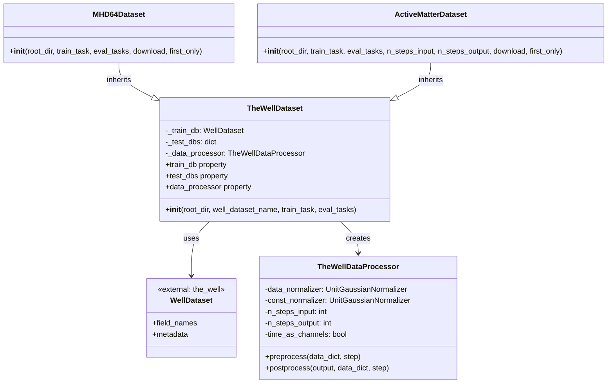
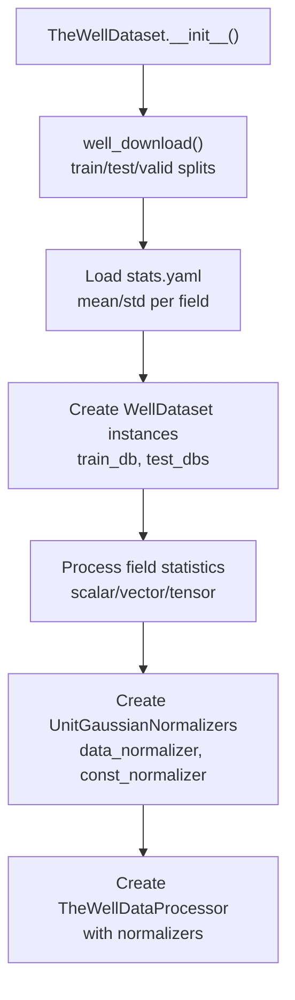
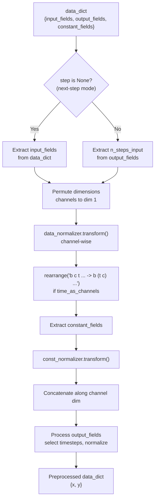
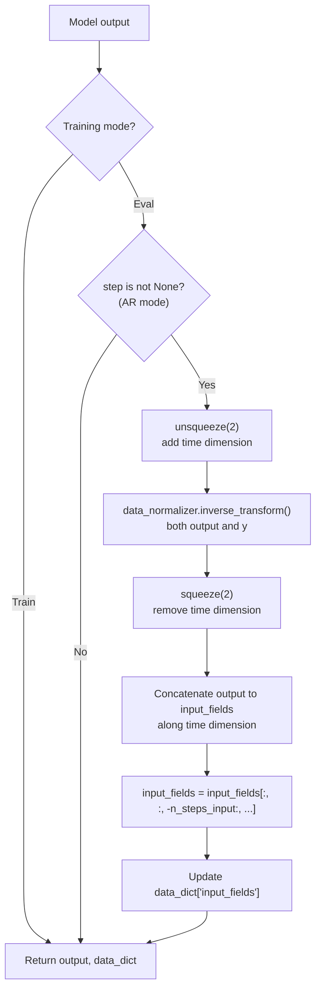
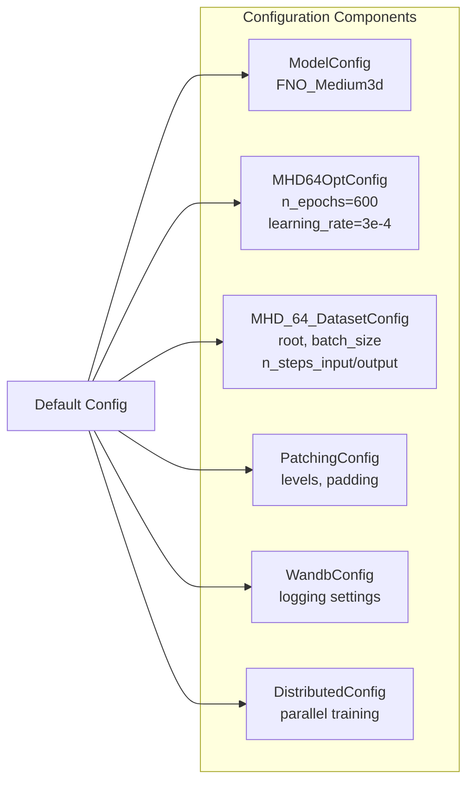
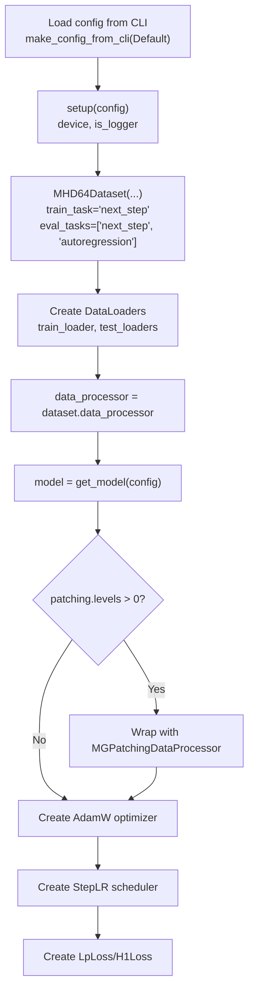
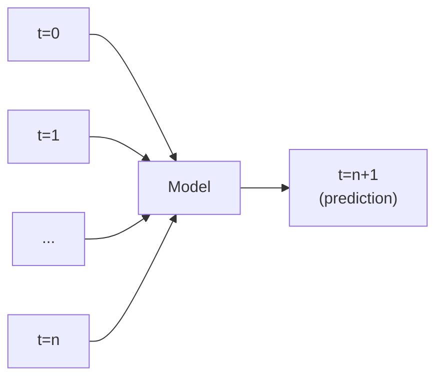
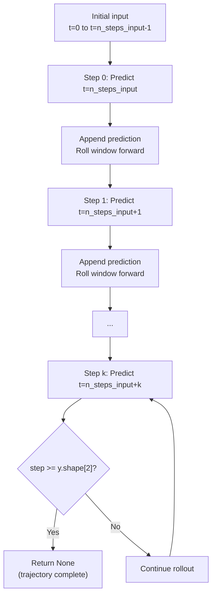
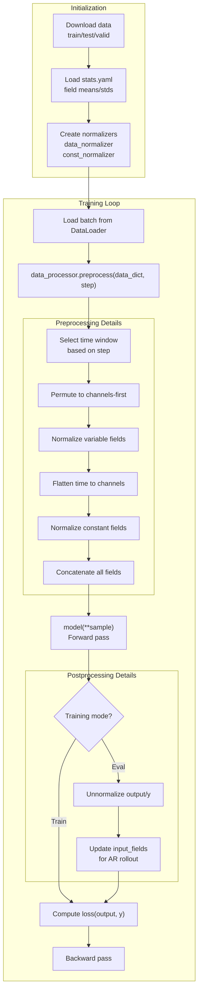

<!-- source: DeepWiki mcp.deepwiki.com · repo neuraloperator/neuraloperator · page 5.5 The Well Datasets · fetched 2026-10-21 -->

# The Well Datasets

<details>
<summary>Relevant source files</summary>

The following files were used as context for generating this wiki page:

- [config/the_well/mhd_64_config.py](config/the_well/mhd_64_config.py)
- [neuralop/data/datasets/the_well_dataset.py](neuralop/data/datasets/the_well_dataset.py)
- [neuralop/data/transforms/the_well_data_processors.py](neuralop/data/transforms/the_well_data_processors.py)
- [scripts/login_wandb.py](scripts/login_wandb.py)
- [scripts/test_from_config.py](scripts/test_from_config.py)
- [scripts/train_burgers.py](scripts/train_burgers.py)
- [scripts/train_burgers_pino.py](scripts/train_burgers_pino.py)
- [scripts/train_darcy.py](scripts/train_darcy.py)
- [scripts/train_fnogno_carcfd.py](scripts/train_fnogno_carcfd.py)
- [scripts/train_gino_carcfd.py](scripts/train_gino_carcfd.py)
- [scripts/train_mhd64.py](scripts/train_mhd64.py)
- [scripts/train_navier_stokes.py](scripts/train_navier_stokes.py)
- [scripts/train_poisson.py](scripts/train_poisson.py)
- [scripts/train_uqno_darcy.py](scripts/train_uqno_darcy.py)

</details>


## Purpose and Scope

This page documents the integration of **The Well** physics simulation datasets into the neuraloperator library, including dataset classes, data processors, and training configurations. The Well is a large-scale collection of diverse physics simulations designed for machine learning applications. For general dataset usage patterns, see [Data Processing and Datasets](#4.2). For standard PDE datasets like Darcy and Navier-Stokes, see [Darcy Flow](#5.1) and [Navier-Stokes Equation](#5.2).

## Overview of The Well Integration

The Well datasets provide time-series physics simulations across various domains including magnetohydrodynamics (MHD) and active matter. The neuraloperator library integrates these datasets through specialized classes that handle:

- **Time-series prediction**: Both next-step and autoregressive rollout evaluation
- **Multi-channel data**: Support for scalar, vector, and tensor fields
- **Normalization**: Channel-wise statistics loaded from YAML metadata
- **Constant fields**: Separate handling of time-invariant spatial features

Sources: [neuralop/data/datasets/the_well_dataset.py:1-199](), [scripts/train_mhd64.py:1-224]()

## Dataset Class Hierarchy



**Class Responsibilities**

| Class | Purpose | Key Methods |
|-------|---------|-------------|
| `TheWellDataset` | Base class for all Well datasets | Dataset initialization, statistics loading, normalizer creation |
| `MHD64Dataset` | 3D magnetohydrodynamics at 64³ resolution | Wraps base with `well_dataset_name="MHD_64"` |
| `ActiveMatterDataset` | Active matter simulation data | Wraps base with `well_dataset_name="active_matter"` |
| `TheWellDataProcessor` | Time-series preprocessing | Temporal windowing, normalization, AR support |

Sources: [neuralop/data/datasets/the_well_dataset.py:14-199](), [neuralop/data/transforms/the_well_data_processors.py:11-182]()

## Dataset Initialization and Statistics Loading

### Initialization Flow



### Statistics Processing

The Well datasets include pre-computed statistics in `stats.yaml` files. The initialization process extracts channel-wise means and standard deviations for different field types:

**Field Type Processing Table**

| Field Type | Structure | Processing | Output Shape |
|------------|-----------|------------|--------------|
| Scalar | Single value per point | Direct append | `(1, n_scalar_fields, 1, 1, ..., 1)` |
| Vector | List of components | Extend with all components | `(1, n_vector_dims, 1, 1, ..., 1)` |
| Tensor | Nested lists | Flatten nested structure | `(1, n_tensor_components, 1, 1, ..., 1)` |

The statistics are reshaped to include batch and temporal dimensions, then expanded with spatial dimensions matching the dataset dimensionality.

Sources: [neuralop/data/datasets/the_well_dataset.py:87-157]()

## TheWellDataProcessor

### Preprocessing Pipeline

The `TheWellDataProcessor` handles time-series data with separate normalization for variable and constant fields:



**Key Parameters**

- `n_steps_input`: Number of timesteps in input sequence
- `n_steps_output`: Number of timesteps to predict (forced to 1 if `time_as_channels=True`)
- `time_as_channels`: Whether to flatten time dimension into channels
- `data_normalizer`: Normalizer for time-varying fields (shared between input/output)
- `const_normalizer`: Optional normalizer for constant fields

Sources: [neuralop/data/transforms/the_well_data_processors.py:34-141]()

### Postprocessing for Autoregressive Rollout

The postprocessor handles both evaluation (unnormalization) and autoregressive state updates:



The autoregressive mechanism works by:
1. Appending the model's prediction to the input sequence
2. Rolling the temporal window forward by discarding old timesteps
3. Using the updated input for the next prediction step

Sources: [neuralop/data/transforms/the_well_data_processors.py:143-182]()

## Training Configuration

### MHD64 Configuration Example

The Well datasets use hierarchical configuration structures:



**MHD_64_DatasetConfig Parameters**

| Parameter | Default | Description |
|-----------|---------|-------------|
| `root` | `"~/data/the_well"` | Root directory for The Well datasets |
| `n_train` | 10 | Number of training trajectories |
| `n_test` | 10 | Number of test trajectories |
| `n_steps_input` | 1 | Input sequence length |
| `n_steps_output` | 1 | Output sequence length |
| `batch_size` | 1 | Training batch size |
| `test_batch_size` | 1 | Evaluation batch size |
| `max_rollout_len` | 100 | Maximum AR rollout steps |

**MHD64OptConfig Parameters**

| Parameter | Default | Description |
|-----------|---------|-------------|
| `n_epochs` | 600 | Training epochs |
| `learning_rate` | 3e-4 | Initial learning rate |
| `training_loss` | `"h1"` | Loss function (h1 or l2) |
| `scheduler` | `"StepLR"` | LR scheduler type |
| `step_size` | 100 | Scheduler step size |
| `gamma` | 0.5 | LR decay factor |

Sources: [config/the_well/mhd_64_config.py:1-40]()

## Training Workflow

### Setup and Data Loading



Sources: [scripts/train_mhd64.py:34-167]()

### Trainer Initialization with Evaluation Modes

The Well datasets support dual evaluation modes through the `eval_modes` parameter:

```python
# From train_mhd64.py
trainer = Trainer(
    model=model,
    n_epochs=config.opt.n_epochs,
    device=device,
    data_processor=data_processor,
    mixed_precision=config.opt.mixed_precision,
    wandb_log=config.wandb.log,
    eval_interval=config.opt.eval_interval,
    log_output=config.wandb.log_output,
    use_distributed=config.distributed.use_distributed,
    verbose=config.verbose and is_logger,
)

# Training with autoregressive evaluation
trainer.train(
    train_loader=train_loader,
    test_loaders=test_loaders,
    eval_modes={"autoregression": "autoregression"},  # Key feature
    optimizer=optimizer,
    scheduler=scheduler,
    regularizer=False,
    training_loss=train_loss,
    eval_losses=eval_losses,
)
```

The `eval_modes` dictionary maps test loader names to evaluation modes:
- `"next_step"`: Standard single-step prediction (default)
- `"autoregression"`: Multi-step rollout using model outputs as subsequent inputs

Sources: [scripts/train_mhd64.py:179-219]()

## Evaluation Modes

### Next-Step Prediction Mode

In next-step mode, the model predicts a single future timestep from input timesteps:



**Data Flow**: 
- Input: `input_fields` shape `(batch, channels, n_steps_input, height, width, ...)`
- Output: `output_fields` shape `(batch, channels, 1, height, width, ...)`
- Loss: Computed between prediction and ground truth at `t=n+1`

### Autoregressive Rollout Mode

In autoregressive mode, the model predicts multiple timesteps by feeding predictions back as inputs:



**Implementation Details**:
- The `step` parameter tracks current timestep in rollout
- `TheWellDataProcessor.preprocess()` extracts appropriate input window
- `TheWellDataProcessor.postprocess()` updates `input_fields` with new prediction
- Rollout terminates when `step >= y.shape[2]` (no more ground truth available)

Sources: [neuralop/data/transforms/the_well_data_processors.py:58-141](), [neuralop/data/transforms/the_well_data_processors.py:143-182]()

## Complete Data Processing Flow



Sources: [neuralop/data/datasets/the_well_dataset.py:40-158](), [neuralop/data/transforms/the_well_data_processors.py:58-182](), [scripts/train_mhd64.py:76-219]()

## Example Usage

### Basic Training Script Structure

```python
# Import dataset class
from neuralop.data.datasets.the_well_dataset import MHD64Dataset

# Initialize dataset with training and evaluation tasks
dataset = MHD64Dataset(
    root_dir=Path("~/data/the_well").expanduser(),
    train_task="next_step",
    eval_tasks=["next_step", "autoregression"],
    first_only=True,  # Download only first trajectory for testing
)

# Access components
train_loader = DataLoader(dataset.train_db, batch_size=1)
test_loaders = {
    "next_step": DataLoader(dataset.test_dbs["next_step"], batch_size=1),
    "autoregression": DataLoader(dataset.test_dbs["autoregression"], batch_size=1)
}
data_processor = dataset.data_processor

# Initialize model and trainer
model = get_model(config)
trainer = Trainer(
    model=model,
    data_processor=data_processor,
    device=device,
    # ... other parameters
)

# Train with autoregressive evaluation
trainer.train(
    train_loader=train_loader,
    test_loaders=test_loaders,
    eval_modes={"autoregression": "autoregression"},
    optimizer=optimizer,
    scheduler=scheduler,
    training_loss=train_loss,
    eval_losses=eval_losses,
)
```

Sources: [scripts/train_mhd64.py:76-219]()

### Available Datasets

| Dataset Class | Well Name | Spatial Dims | Typical Resolution | Description |
|---------------|-----------|--------------|-------------------|-------------|
| `MHD64Dataset` | `"MHD_64"` | 3D | 64³ | Magnetohydrodynamics simulation |
| `ActiveMatterDataset` | `"active_matter"` | Varies | Varies | Active matter particle systems |

To add a new Well dataset, subclass `TheWellDataset` and specify the `well_dataset_name`:

```python
class MyWellDataset(TheWellDataset):
    def __init__(self, root_dir, **kwargs):
        super().__init__(
            root_dir, 
            well_dataset_name="my_dataset_name",
            **kwargs
        )
```

Sources: [neuralop/data/datasets/the_well_dataset.py:171-199]()

## Integration with Multi-Grid Patching

The Well datasets can be combined with multi-grid patching for high-resolution training:

```python
# After creating data_processor from dataset
if config.patching.levels > 0:
    data_processor = MGPatchingDataProcessor(
        model=model,
        in_normalizer=data_processor.data_normalizer,  # Reuse Well normalizer
        out_normalizer=data_processor.data_normalizer,
        padding_fraction=config.patching.padding,
        stitching=config.patching.stitching,
        levels=config.patching.levels,
        use_distributed=config.distributed.use_distributed,
        device=device,
    )
```

This wraps the `TheWellDataProcessor` with patching capabilities while preserving the time-series preprocessing and normalization logic.

Sources: [scripts/train_mhd64.py:101-113]()

---

