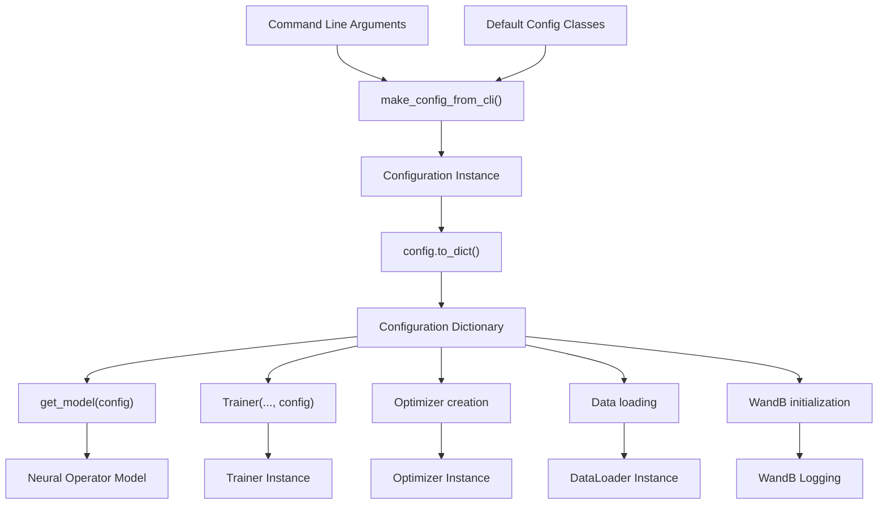
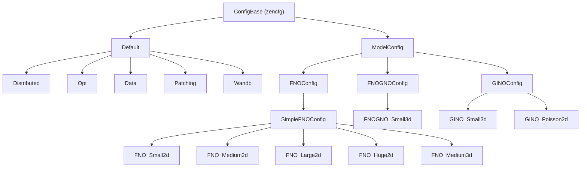
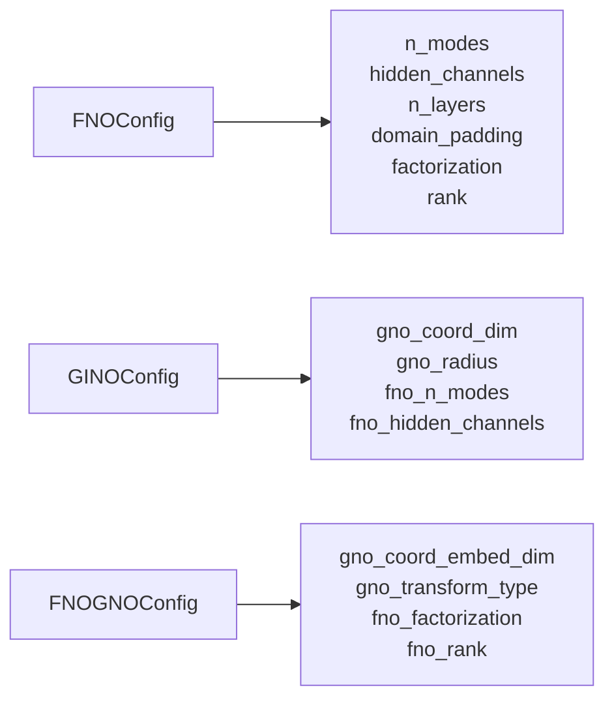
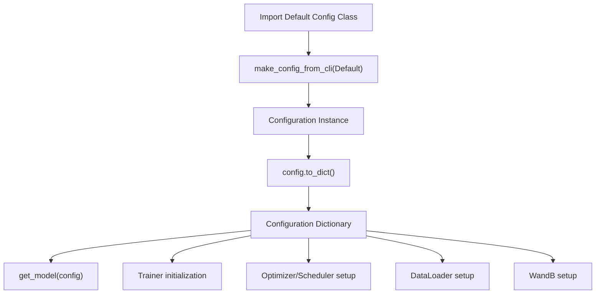
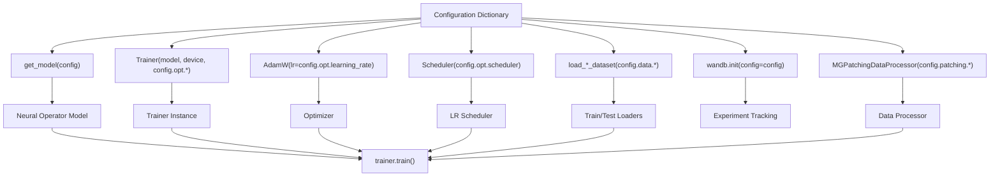
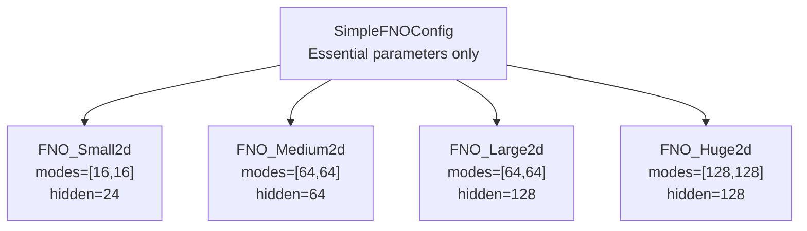
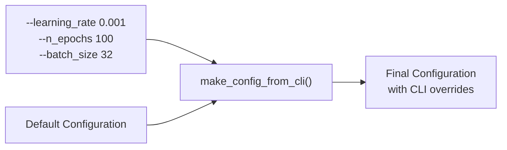
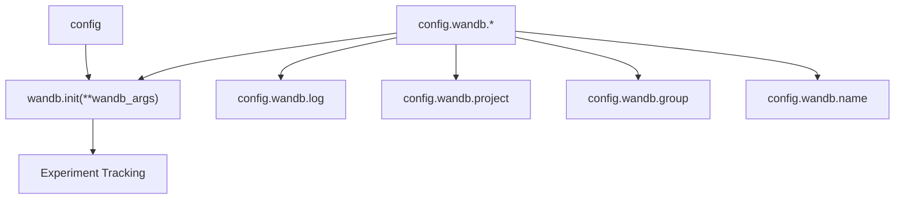

<!-- source: DeepWiki mcp.deepwiki.com · repo neuraloperator/neuraloperator · page 6 Configuration System · fetched 2026-10-21 -->

# Configuration System

Relevant source files

The following files were used as context for generating this wiki page:

- [scripts/login_wandb.py](scripts/login_wandb.py)
- [scripts/test_from_config.py](scripts/test_from_config.py)
- [scripts/train_burgers.py](scripts/train_burgers.py)
- [scripts/train_burgers_pino.py](scripts/train_burgers_pino.py)
- [scripts/train_darcy.py](scripts/train_darcy.py)
- [scripts/train_fnogno_carcfd.py](scripts/train_fnogno_carcfd.py)
- [scripts/train_gino_carcfd.py](scripts/train_gino_carcfd.py)
- [scripts/train_mhd64.py](scripts/train_mhd64.py)
- [scripts/train_navier_stokes.py](scripts/train_navier_stokes.py)
- [scripts/train_poisson.py](scripts/train_poisson.py)
- [scripts/train_uqno_darcy.py](scripts/train_uqno_darcy.py)

## Purpose and Scope

The Configuration System provides a structured approach to managing training parameters, model hyperparameters, and runtime settings across the neuraloperator library. This system enables users to configure experiments through both default configuration classes and command-line overrides, ensuring reproducible and flexible model training workflows.

For information about training infrastructure that uses these configurations, see [Training Infrastructure](#4). For details about model-specific parameters and architectures, see [Neural Operator Models](#2).

## Configuration Architecture Overview

The configuration system is built on top of the `zencfg` library and follows a hierarchical structure where different aspects of the training pipeline have their own configuration classes.

Sources: [scripts/train_darcy.py:18-25](), [scripts/train_navier_stokes.py:19-25](), [scripts/train_burgers.py:17-24]()

## Configuration Class Hierarchy

The configuration system uses a nested class structure inheriting from `ConfigBase` to organize parameters by functional area:

Sources: [config/default_config.py:84-94](), [config/models.py:4-8](), [config/models.py:9-33]()

## Core Configuration Classes

### Base Configuration Structure

The `Default` configuration class serves as the primary configuration container:

| Configuration Section | Purpose | Key Parameters |
|----------------------|---------|----------------|
| `Distributed` | Multi-GPU training settings | `use_distributed`, `model_parallel_size`, `wireup_info` |
| `Opt` | Training optimization | `learning_rate`, `n_epochs`, `scheduler`, `mixed_precision` |
| `Data` | Dataset and loading | `batch_size`, `n_train`, `test_resolutions`, `folder` |
| `Patching` | Multi-grid patching | `levels`, `padding`, `stitching` |
| `Wandb` | Experiment tracking | `log`, `name`, `group`, `project` |

Sources: [config/default_config.py:10-16](), [config/default_config.py:38-49](), [config/default_config.py:51-64]()

### Model Configuration Classes

Model-specific configurations extend `ModelConfig` to provide architecture-specific parameters:

Sources: [config/models.py:9-33](), [config/models.py:132-155](), [config/models.py:99-118]()

## Configuration Loading and Usage

### Loading Process

The configuration loading follows a standard pattern across all training scripts:

The typical usage pattern in training scripts:

1. **Import configuration**: `from config.darcy_config import Default`
2. **Create from CLI**: `config = make_config_from_cli(Default)`
3. **Convert to dict**: `config = config.to_dict()`
4. **Pass to components**: Used throughout the training pipeline

Sources: [scripts/train_darcy.py:18-25](), [scripts/train_navier_stokes.py:19-25](), [scripts/train_burgers.py:17-24]()

### Configuration Flow Through Training Pipeline

Sources: [scripts/train_darcy.py:79-197](), [scripts/train_navier_stokes.py:86-208]()

## Model-Specific Configuration Usage

### FNO Configuration Example

The `FNOConfig` class provides comprehensive parameters for Fourier Neural Operators:

| Parameter Category | Configuration Fields | Purpose |
|-------------------|---------------------|---------|
| Architecture | `n_modes`, `hidden_channels`, `n_layers` | Core FNO structure |
| Domain Handling | `domain_padding`, `resolution_scaling_factor` | Input preprocessing |
| Optimization | `factorization`, `rank`, `joint_factorization` | Memory/computation efficiency |
| Regularization | `dropout`, `norm`, `stabilizer` | Training stability |

### Configuration Inheritance

Pre-defined model configurations provide sensible defaults:

Sources: [config/models.py:45-88]()

## CLI Override System

The `make_config_from_cli` function automatically handles command-line argument parsing and overrides:

This enables flexible experimentation without modifying configuration files, supporting hyperparameter sweeps and ablation studies.

Sources: [scripts/train_darcy.py:24](), [scripts/train_navier_stokes.py:24](), [scripts/train_burgers.py:23]()

## WandB Integration

The configuration system seamlessly integrates with Weights & Biases for experiment tracking:

The system automatically generates experiment names from configuration parameters and logs the entire configuration for reproducibility.

Sources: [scripts/train_darcy.py:31-56](), [scripts/train_navier_stokes.py:31-61]()

---

