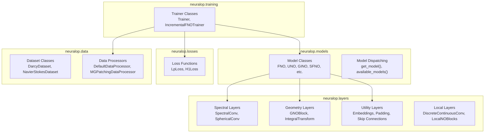
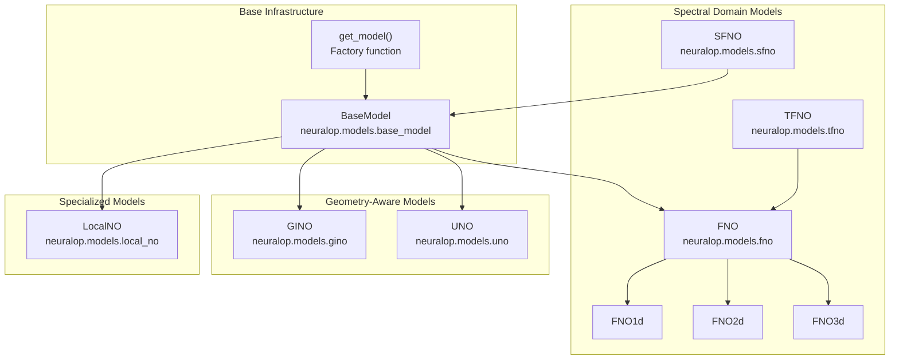
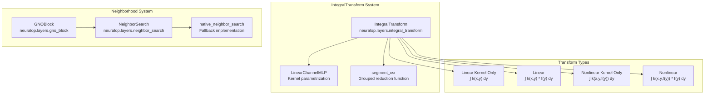
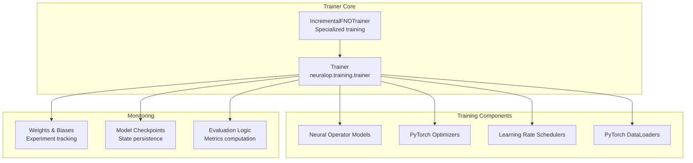

<!-- source: DeepWiki mcp.deepwiki.com · repo neuraloperator/neuraloperator · page 7 API Reference · fetched 2026-10-21 -->

# API Reference

Relevant source files

The following files were used as context for generating this wiki page:

- [doc/source/modules/api.rst](doc/source/modules/api.rst)
- [neuralop/__init__.py](neuralop/__init__.py)
- [neuralop/losses/__init__.py](neuralop/losses/__init__.py)
- [neuralop/losses/data_losses.py](neuralop/losses/data_losses.py)
- [neuralop/losses/differentiation.py](neuralop/losses/differentiation.py)
- [neuralop/losses/equation_losses.py](neuralop/losses/equation_losses.py)
- [neuralop/losses/meta_losses.py](neuralop/losses/meta_losses.py)
- [neuralop/losses/tests/test_losses.py](neuralop/losses/tests/test_losses.py)
- [neuralop/models/fnogno.py](neuralop/models/fnogno.py)
- [neuralop/models/gino.py](neuralop/models/gino.py)

This page provides a comprehensive reference for all public interfaces available in the neuraloperator library. The API is organized into models, layers, training infrastructure, data management, and utilities. 

For detailed usage examples and tutorials, see the [Quickstart Guide](#1.2). For complete training workflows, see [Example Training Scripts](#5). For configuration management, see [Configuration System](#6).

## API Organization Overview

The neuraloperator library exposes its functionality through several main modules, each containing related classes and functions:

**API Module Structure**

**Sources:** [doc/source/modules/api.rst:1-489]()

## Models

The `neuralop.models` module provides complete neural operator architectures ready for training and inference.

### Model Classes

| Model Class | Description | Key Features |
|-------------|-------------|--------------|
| `FNO` | N-dimensional Fourier Neural Operator | Generic interface, dimension inferred from n_modes |
| `FNO1d`, `FNO2d`, `FNO3d` | Dimension-specific FNO implementations | Optimized for specific dimensions |
| `TFNO`, `TFNO1d`, `TFNO2d`, `TFNO3d` | Tensorized FNO with factorized spectral convolutions | Memory-efficient for high dimensions |
| `SFNO` | Spherical Fourier Neural Operator | Uses spherical harmonics for spherical data |
| `GINO` | Geometry-Informed Neural Operator | Handles irregular geometries and meshes |
| `UNO` | U-shaped Neural Operator | U-Net-like architecture with skip connections |
| `LocalNO` | Local Neural Operator | Local operations without global transforms |

**Model Architecture Relationships**

**Sources:** [doc/source/modules/api.rst:15-118]()

### Model Dispatching Functions

| Function | Purpose | Return Type |
|----------|---------|-------------|
| `get_model(cfg)` | Create model instance from configuration | Model instance |
| `available_models()` | List all registered model names | List of strings |

**Sources:** [doc/source/modules/api.rst:347-362]()

## Core Layers and Components

The `neuralop.layers` module provides building blocks for constructing neural operators.

### Spectral Convolution Layers

| Layer Class | Purpose | Domain |
|-------------|---------|---------|
| `SpectralConv` | General spectral convolution in Fourier domain | Cartesian grids |
| `SphericalConv` | Spherical harmonic convolution | Spherical surfaces |

**Sources:** [doc/source/modules/api.rst:134-164]()

### Geometry and Integration Layers

**Kernel Integration Architecture**

| Layer Class | Purpose | Integration Type |
|-------------|---------|------------------|
| `GNOBlock` | Graph neural operator block | Neighborhood-based |
| `IntegralTransform` | Kernel integral computation | Configurable transform types |

The `IntegralTransform` class supports four types of kernel integrals:
- **linear_kernelonly**: `∫_{A(x)} k(x, y) dy`
- **linear**: `∫_{A(x)} k(x, y) * f(y) dy` 
- **nonlinear_kernelonly**: `∫_{A(x)} k(x, y, f(y)) dy`
- **nonlinear**: `∫_{A(x)} k(x, y, f(y)) * f(y) dy`

**Sources:** [doc/source/modules/api.rst:167-195](), [neuralop/layers/integral_transform.py:9-66]()

### Neighbor Search System

| Component | Purpose | Implementation |
|-----------|---------|----------------|
| `NeighborSearch` | Find neighbors within radius | Open3D or native PyTorch |
| `native_neighbor_search` | Fallback neighbor search | Pure PyTorch implementation |

The neighbor search returns results in Compressed Row Storage (CRS) format with:
- `neighbors_index`: Indices of neighbors in data array
- `neighbors_row_splits`: Cumulative neighbor counts per query point

**Sources:** [doc/source/modules/api.rst:275-295](), [neuralop/layers/neighbor_search.py:13-113]()

### Local and Specialized Convolutions

| Layer Class | Purpose | Domain |
|-------------|---------|---------|
| `DiscreteContinuousConv2d` | DISCO convolution with continuous kernels | Arbitrary 2D grids |
| `DiscreteContinuousConvTranspose2d` | Transpose DISCO convolution | Arbitrary 2D grids |
| `EquidistantDiscreteContinuousConv2d` | Optimized DISCO for equidistant grids | Regular 2D grids |
| `FiniteDifferenceConvolution` | Local differential operators | Cartesian grids |
| `LocalNOBlocks` | Local neural operator blocks | Local neighborhoods |

**Sources:** [doc/source/modules/api.rst:200-242]()

### Embedding and Utility Layers

| Layer Class | Purpose | Features |
|-------------|---------|----------|
| `GridEmbeddingND` | N-dimensional grid embeddings | Learnable positional encoding |
| `GridEmbedding2D` | 2D grid embeddings | Specialized for 2D domains |
| `SinusoidalEmbedding` | Sinusoidal positional embeddings | Fixed trigonometric encoding |
| `DomainPadding` | Resolution-dependent padding | Automatic boundary handling |
| `SoftGating` | Soft gating skip connections | Learnable connection weights |

**Sources:** [doc/source/modules/api.rst:257-343]()

## Training Infrastructure

The `neuralop.training` module provides classes for training neural operators.

### Trainer Classes

| Class | Purpose | Features |
|-------|---------|----------|
| `Trainer` | Main training orchestrator | Single-step and autoregressive training |
| `IncrementalFNOTrainer` | Specialized FNO trainer | Incremental training capabilities |

**Training System Architecture**

**Sources:** [doc/source/modules/api.rst:365-380]()

### Loss Functions

The `neuralop.losses` module provides loss functions tailored for PDE problems.

| Loss Class | Purpose | Norm Type |
|------------|---------|-----------|
| `LpLoss` | Lp norm loss | Configurable p-norm |
| `H1Loss` | H1 Sobolev norm loss | First-order derivatives |

**Sources:** [doc/source/modules/api.rst:382-393]()

## Data Management

The `neuralop.data` module provides datasets and data processing utilities.

### Dataset Classes

| Dataset Class | Problem Type | Data Format |
|---------------|--------------|-------------|
| `DarcyDataset` | Darcy flow equation | Permeability to pressure |
| `NavierStokesDataset` | Incompressible Navier-Stokes | Velocity field evolution |
| `CarCFDDataset` | Airflow over car surfaces | CFD simulation data |
| `TensorDataset` | General tensor data | Arbitrary input-output pairs |

**Sources:** [doc/source/modules/api.rst:396-467]()

### Data Processing

| Processor Class | Purpose | Features |
|-----------------|---------|----------|
| `DefaultDataProcessor` | Basic data preprocessing | Normalization and batching |
| `MGPatchingDataProcessor` | Multi-grid patching | Hierarchical data structure |

### Utility Functions

| Function | Purpose | Return Type |
|----------|---------|-------------|
| `load_darcy_flow_small()` | Load small test dataset | Dataset instance |

**Sources:** [doc/source/modules/api.rst:469-487]()

## Attention and Advanced Layers

### Specialized Attention Mechanisms

| Layer Class | Purpose | Architecture |
|-------------|---------|--------------|
| `CODALayer` | Codomain attention (transformer) | Self-attention in output space |

**Sources:** [doc/source/modules/api.rst:243-254]()

This API reference covers all public interfaces in the neuraloperator library. Each component is designed to be modular and composable, allowing users to build custom neural operator architectures while leveraging the provided building blocks.

---

