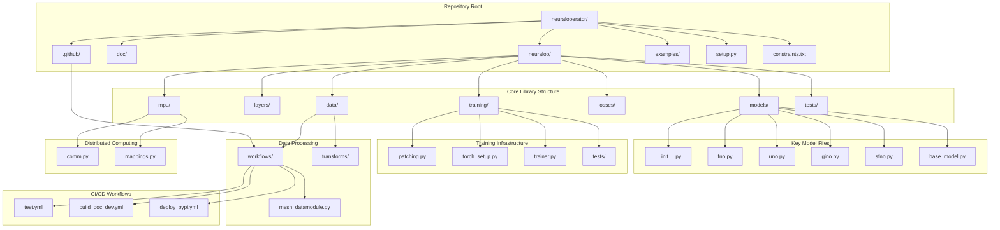
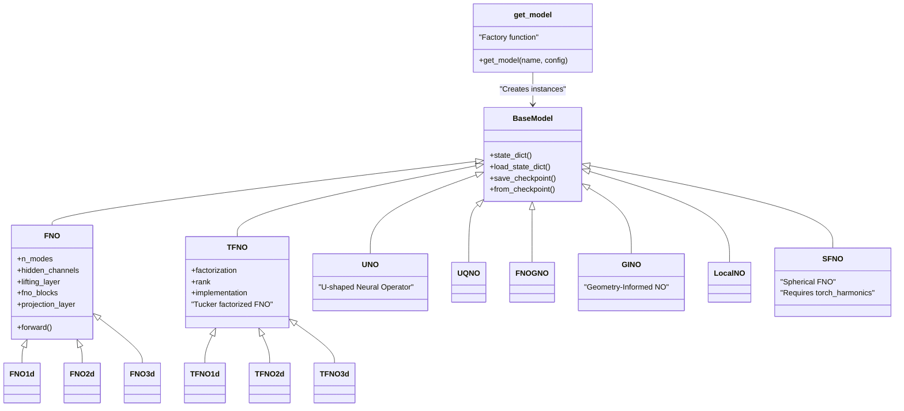
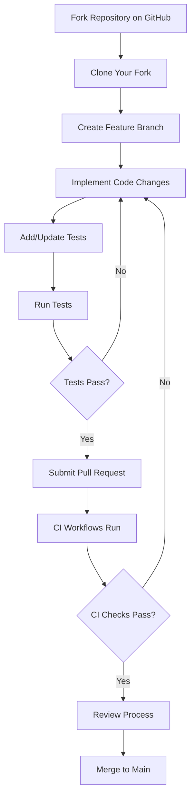
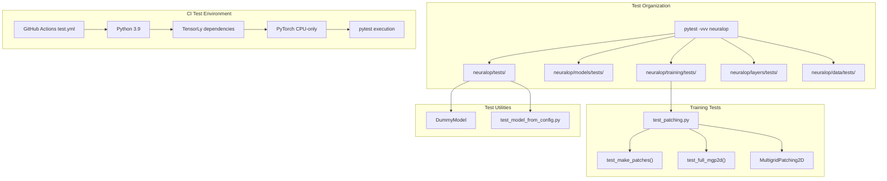
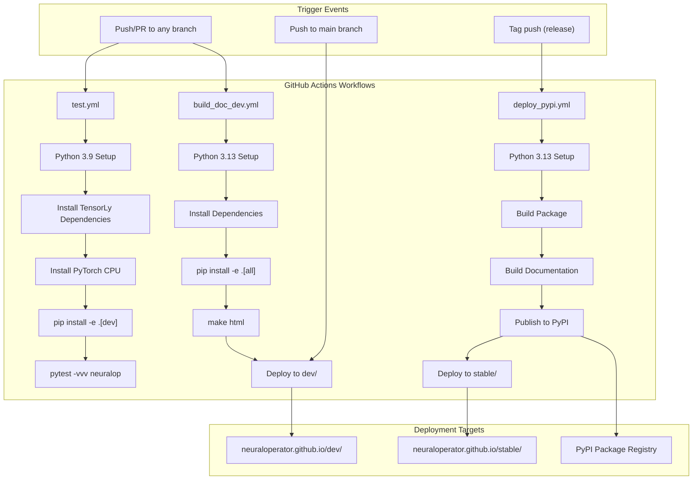
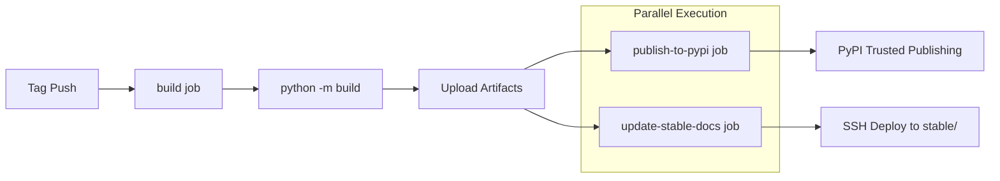

<!-- source: DeepWiki mcp.deepwiki.com · repo neuraloperator/neuraloperator · page 8 Developer Guide · fetched 2026-10-21 -->

# Developer Guide

<details>
<summary>Relevant source files</summary>

The following files were used as context for generating this wiki page:

- [.github/workflows/build_doc_dev.yml](.github/workflows/build_doc_dev.yml)
- [.github/workflows/deploy_pypi.yml](.github/workflows/deploy_pypi.yml)
- [.github/workflows/test.yml](.github/workflows/test.yml)
- [README.rst](README.rst)
- [constraints.txt](constraints.txt)
- [doc/source/conf.py](doc/source/conf.py)
- [doc/source/index.rst](doc/source/index.rst)
- [doc/source/install.rst](doc/source/install.rst)

</details>


This guide provides essential information for developers who want to contribute to the neuraloperator library. It covers development environment setup, code structure, contribution workflows, testing procedures, and the CI/CD pipeline. For information about using the library to solve PDE problems, see [Overview](#1).

## Development Environment Setup

To set up your development environment for contributing to neuraloperator:

```bash
# Clone the repository
git clone https://github.com/neuraloperator/neuraloperator
cd neuraloperator

# Install in development mode with all dependencies
pip install -e .[dev]
```

This installs the package in editable mode, so changes to the code are immediately reflected without reinstallation.

### Dependencies and Constraints

The library has specific version constraints defined in [constraints.txt:1-2]() for critical dependencies:

| Dependency | Minimum Version | Purpose |
|------------|----------------|---------|
| `numpy` | >=1.26.4 | Core numerical operations |
| `torch_harmonics` | >=0.7 | Spherical harmonic transforms for SFNO |

Additional development dependencies are automatically installed with the `[dev]` extra, including testing frameworks and documentation tools.

Sources: [constraints.txt:1-2]()

## Code Structure

The neuraloperator codebase follows a modular organization that aligns with key functional components.

### Repository Structure Diagram



Sources: [neuralop/models/__init__.py:1-14](), [neuralop/training/patching.py:1-374](), [neuralop/data/datasets/mesh_datamodule.py:1-321](), [neuralop/mpu/comm.py:1-194](), [.github/workflows/test.yml:1-41]()

### Neural Operator Model Registry and Hierarchy



The model registry system allows conditional imports - models like `SFNO` and `LocalNO` are only available when their dependencies (like `torch_harmonics`) are installed.

Sources: [neuralop/models/__init__.py:1-14]()

## Code Style Guidelines

To maintain code quality and consistency, follow these style guidelines:

### Formatting

Use `black` to automatically format your code:

```bash
black .
```

### Docstrings

Follow the NumPy docstring format:

```python
def function(arg1: type1, arg2: type2=default):
    """
    Parameters
    ----------
    arg1 : type1
        description of what arg1 means
    arg2 : type2, optional
        description arg2
        by default default
    """
```

For classes, place the docstring immediately after class declaration:

```python
class MyClass(Superclass):
    """
    Class docstring goes here
    """
    def __init__(self, ...):
        # Implementation
```

Sources: [doc/source/dev_guide.rst:24-61]()

## Contributing Workflow

Follow these steps to contribute to the neuraloperator library:



### Steps in Detail

1. Create a new branch for your feature or bugfix:
   ```bash
   git checkout -b feature-branch
   ```

2. Make code changes and ensure they follow the style guidelines.

3. Add or update tests in the appropriate directory. For example, if adding a model in `neuralop/models/mymodel.py`, add tests in `neuralop/models/tests/test_mymodel.py`.

4. Run the test suite to ensure all tests pass:
   ```bash
   pytest -vvv neuralop
   ```

5. Submit a pull request on GitHub from your branch to the upstream main branch.

Sources: [doc/source/dev_guide.rst:64-86](), [README.rst:88-108]()

## Extending the Library

The neuraloperator library is designed for extensibility. Here's how to add new components:

### Adding a New Neural Operator Model

1. **Create model file**: Add your model in `neuralop/models/mymodel.py`
2. **Inherit from BaseModel**: Extend the base class for consistent interface
3. **Implement required methods**: Ensure `forward()` and other core methods
4. **Register in __init__.py**: Add import to [neuralop/models/__init__.py]()
5. **Handle optional dependencies**: Use try/except blocks for conditional imports

Example structure for conditional model registration:

```python
# In neuralop/models/__init__.py
try:
    from .mymodel import MyModel
except ImportError:
    pass  # Skip if dependencies not available
```

### Adding Training Infrastructure Components

For training-related extensions like new patching strategies:

1. **Follow existing patterns**: See [neuralop/training/patching.py]() for `MultigridPatching2D` implementation
2. **Add comprehensive tests**: Include parametrized tests like [neuralop/training/tests/test_patching.py:12-67]()
3. **Consider distributed support**: Use `neuralop.mpu.comm` for multi-GPU scenarios

### Adding Data Processing Components

For new dataset types or transforms:

1. **Extend existing classes**: Follow patterns in [neuralop/data/datasets/mesh_datamodule.py]()
2. **Handle optional dependencies**: Use conditional imports for specialized libraries like `open3d`
3. **Include normalization**: Provide `UnitGaussianNormalizer` integration

### Distributed Computing Extensions

When adding distributed computing features:

1. **Use mpu module**: Leverage [neuralop/mpu/comm.py]() communication primitives
2. **Test with model parallelism**: Ensure compatibility with `get_model_parallel_size()`
3. **Handle process groups**: Use proper `_DATA_PARALLEL_GROUP` and `_MODEL_PARALLEL_GROUP` management

Sources: [neuralop/models/__init__.py:4-8](), [neuralop/training/patching.py:12-77](), [neuralop/data/datasets/mesh_datamodule.py:56-58](), [neuralop/mpu/comm.py:99-194]()

## Testing

The testing infrastructure uses pytest to ensure code correctness across the entire library.

### Running Tests

To run the complete test suite:

```bash
pytest -vvv neuralop
```

To run tests for a specific module:

```bash
pytest -vvv neuralop/models
pytest -vvv neuralop/training
```

### Test Infrastructure Overview



### Key Test Examples

The training infrastructure includes comprehensive tests for multi-grid patching:

| Test Function | Purpose | File |
|---------------|---------|------|
| `test_make_patches` | Tests patch creation with various levels and padding | [neuralop/training/tests/test_patching.py:14-22]() |
| `test_full_mgp2d` | Tests complete MultigridPatching2D workflow | [neuralop/training/tests/test_patching.py:29-67]() |

### Test Parameters and Coverage

Tests use pytest parametrization for comprehensive coverage:

```python
@pytest.mark.parametrize('levels', [1, 2, 3])
@pytest.mark.parametrize('padding_fraction', [0, 0.1, 0.2])
@pytest.mark.parametrize('stitching', [True, False])
```

This ensures testing across different patching configurations, padding settings, and stitching modes.

Sources: [.github/workflows/test.yml:38-40](), [neuralop/training/tests/test_patching.py:12-67]()

## CI/CD Pipeline

The neuraloperator repository uses GitHub Actions for continuous integration and deployment with three main workflows.

### CI/CD Workflow Architecture



### Workflow Details

#### Test Workflow (`test.yml`)

The testing workflow provides comprehensive CI validation:

| Step | Action | Purpose |
|------|--------|---------|
| Setup | Python 3.9, Ubuntu latest | [.github/workflows/test.yml:12-17]() |
| Dependencies | Install TensorLy from source | [.github/workflows/test.yml:16-29]() |
| PyTorch | CPU-only installation | [.github/workflows/test.yml:30-33]() |
| Package | Development mode installation | [.github/workflows/test.yml:34-37]() |
| Testing | `pytest -vvv neuralop` | [.github/workflows/test.yml:38-40]() |

#### Documentation Workflow (`build_doc_dev.yml`)

Builds and deploys development documentation:

| Step | Action | Configuration |
|------|--------|---------------|
| Python | 3.13 setup | [.github/workflows/build_doc_dev.yml:14-17]() |
| Dependencies | PyTorch CPU, full package | [.github/workflows/build_doc_dev.yml:32-39]() |
| Build | `make html` in doc/ | [.github/workflows/build_doc_dev.yml:40-44]() |
| Deploy | SSH deployment to dev/ | [.github/workflows/build_doc_dev.yml:45-68]() |

#### PyPI Deployment Workflow (`deploy_pypi.yml`)

Handles package releases and stable documentation:



The deployment uses PyPI's trusted publishing mechanism for secure package uploads without API tokens.

### Environment Configuration

Each workflow uses specific Python versions and dependency installation strategies:

- **Testing**: Python 3.9 with TensorLy development versions
- **Documentation**: Python 3.13 with `[all]` extras
- **Deployment**: Python 3.13 with production build tools

Sources: [.github/workflows/test.yml:1-41](), [.github/workflows/build_doc_dev.yml:1-69](), [.github/workflows/deploy_pypi.yml:1-114]()

## Building Documentation

Documentation is built using Sphinx. To build the documentation locally:

```bash
# Install documentation dependencies
pip install -e .[dev]

# Build the HTML documentation
cd doc
make html

# View the documentation
cd build/html
python -m http.server 8000
```

Then open a browser to `http://localhost:8000` to view the documentation.

### Documentation Structure

- `doc/source/index.rst` - Main landing page
- `doc/source/user_guide/` - User guide content
- `doc/source/modules/api` - API reference documentation
- `doc/source/auto_examples/` - Gallery examples

Sources: [README.rst:132-153](), [doc/source/index.rst:1-223](), [doc/source/conf.py:1-120]()

## Debugging Tips

When developing neural operators, consider these debugging strategies:

- Use `torch.set_detect_anomaly(True)` to help identify operations that produce NaN gradients
- Monitor GPU memory usage with `nvidia-smi`
- Keep dependencies up to date with `pip list --outdated`
- For tensor operations, add shape annotations in comments to improve readability

Sources: [doc/source/dev_guide.rst:109-115]()

## Contact and Support

For questions or issues:
- Create a GitHub issue in the repository
- Participate in the discussion forum
- Check the existing documentation in the wiki

Sources: [doc/source/dev_guide.rst:118-122](), [README.rst:88-96]()

---

