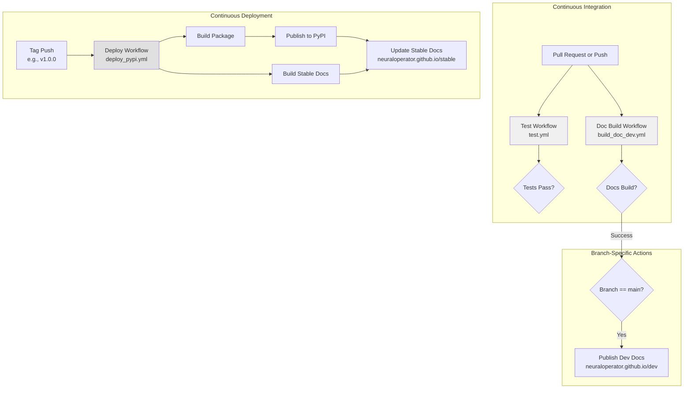
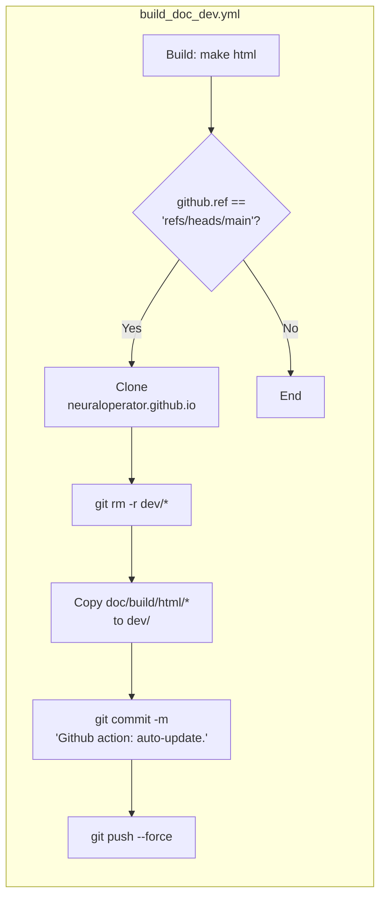
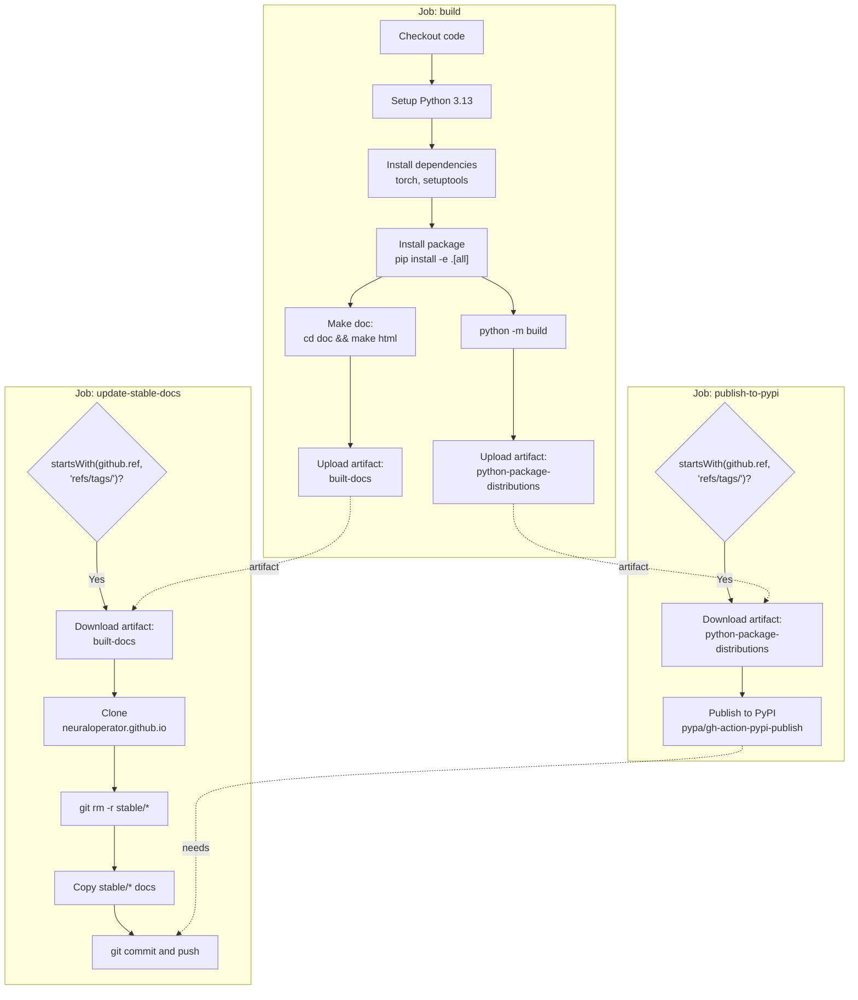
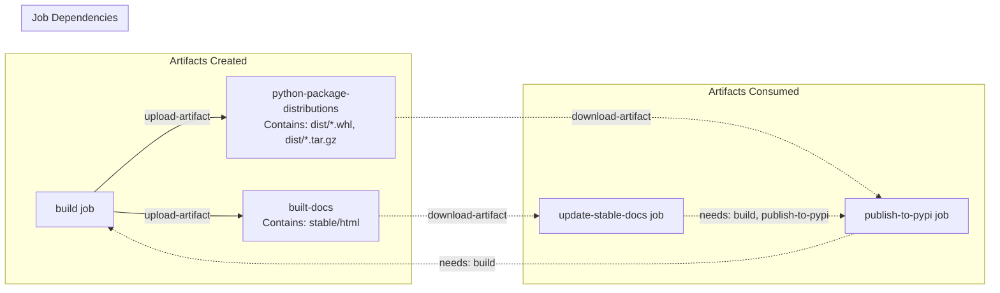

<!-- source: DeepWiki mcp.deepwiki.com · repo neuraloperator/neuraloperator · page 8.1 CI/CD Pipeline · fetched 2026-10-21 -->

# CI/CD Pipeline

<details>
<summary>Relevant source files</summary>

The following files were used as context for generating this wiki page:

- [.github/workflows/build_doc_dev.yml](.github/workflows/build_doc_dev.yml)
- [.github/workflows/deploy_pypi.yml](.github/workflows/deploy_pypi.yml)
- [.github/workflows/test.yml](.github/workflows/test.yml)
- [constraints.txt](constraints.txt)

</details>


## Purpose and Scope

This document describes the Continuous Integration and Continuous Deployment (CI/CD) infrastructure for the neuraloperator repository. The CI/CD system consists of three GitHub Actions workflows that automate testing, documentation building, and package deployment to PyPI. These workflows ensure code quality, maintain up-to-date documentation, and streamline the release process.

For information about testing infrastructure and running tests locally, see [Testing](#8.3). For information about the project structure and repository organization, see [Project Structure](#8.2).

## Overview of CI/CD Workflows

The neuraloperator repository uses three primary GitHub Actions workflows:

| Workflow | File | Trigger | Purpose |
|----------|------|---------|---------|
| Test neuralop | `.github/workflows/test.yml` | Push, Pull Request | Run pytest suite on all code changes |
| Build documentation | `.github/workflows/build_doc_dev.yml` | Push, Pull Request | Build Sphinx docs; publish dev docs on main |
| Deploy to PyPI | `.github/workflows/deploy_pypi.yml` | Tag push | Build package, publish to PyPI, update stable docs |

All workflows run on `ubuntu-latest` runners and use Python 3.9 (testing) or 3.13 (documentation and deployment).

**High-Level CI/CD Pipeline Flow**



Sources: [.github/workflows/test.yml:1-41](), [.github/workflows/build_doc_dev.yml:1-69](), [.github/workflows/deploy_pypi.yml:1-114]()

## Testing Workflow

**Workflow Name:** Test neuralop  
**File:** `.github/workflows/test.yml`  
**Triggers:** `push`, `pull_request`

The testing workflow validates code changes by running the pytest test suite. It ensures that all new contributions maintain code quality and do not introduce regressions.

### Workflow Steps

1. **Checkout code** - Uses `actions/checkout@v3` to retrieve repository contents
2. **Setup Python 3.9** - Uses `actions/setup-python@v4` with Python 3.9
3. **Install TensorLy dependencies** - Clones and installs development versions of `tensorly` and `tensorly/torch` from GitHub
4. **Install PyTorch** - Installs CPU-only PyTorch via `pip` with index URL `https://download.pytorch.org/whl/cpu`
5. **Install package** - Installs neuraloperator in editable mode with `[dev]` extras: `pip install -e .[dev]`
6. **Run pytest** - Executes `pytest -vvv neuralop` with verbose output

### Key Implementation Details

The workflow installs TensorLy from source rather than PyPI to ensure compatibility with the latest development versions:

```yaml
# Lines 16-29 of test.yml
- name: Install TensorLy and TensorLy-Torch dev
  run: |
    CWD=`pwd`
    echo 'Cloning repos in ${CWD}'
    mkdir git_repos
    cd git_repos
    git clone https://github.com/tensorly/tensorly
    cd tensorly
    python -m pip install -e .
    cd ..
    git clone https://github.com/tensorly/torch
    cd torch
    python -m pip install -e .
    cd ../..
```

The test command runs pytest with triple-verbose output (`-vvv`) to provide detailed test execution information in the GitHub Actions logs.

Sources: [.github/workflows/test.yml:1-41]()

## Documentation Building Workflow

**Workflow Name:** Build documentation  
**File:** `.github/workflows/build_doc_dev.yml`  
**Triggers:** `push`, `pull_request`

This workflow builds the Sphinx documentation on every code change and conditionally publishes the "dev" documentation to `neuraloperator.github.io` when changes are pushed to the `main` branch.

### Workflow Steps

1. **Checkout code** - Uses `actions/checkout@v3`
2. **Setup Python 3.13** - Uses `actions/setup-python@v4` with Python 3.13
3. **Install dependencies** - Installs `setuptools` and CPU-only PyTorch
4. **Install package** - Installs neuraloperator with all extras: `pip install -e .[all]`
5. **Build documentation** - Runs `make html` in the `doc/` directory to generate HTML documentation
6. **Publish dev docs (conditional)** - If successful and `github.ref == 'refs/heads/main'`, pushes built docs to the `dev/` directory of `neuraloperator.github.io`

### Documentation Publishing Flow



The workflow uses SSH authentication with a deploy key stored in the `DOC_DEPLOY_PRIVATE_KEY` secret [.github/workflows/build_doc_dev.yml:51]():

```yaml
eval "$(ssh-agent -s)"
mkdir ~/.ssh
echo "${{ secrets.DOC_DEPLOY_PRIVATE_KEY }}" > ~/.ssh/id_rsa
chmod 600 ~/.ssh/id_rsa
ssh-keyscan -t rsa github.com
```

The bot commits are attributed to the GitHub Actions bot with the email `41898282+github-actions[bot]@users.noreply.github.com` [.github/workflows/build_doc_dev.yml:56]().

Sources: [.github/workflows/build_doc_dev.yml:1-69]()

## PyPI Deployment Workflow

**Workflow Name:** Deploy neuraloperator to Test-Pypi and Pypi 🐍  
**File:** `.github/workflows/deploy_pypi.yml`  
**Triggers:** Tag push (any tag matching `'*'`)

This workflow handles the release process when a new version tag is pushed. It builds the package, publishes to PyPI, builds stable documentation, and updates the `stable/` directory on the documentation website.

### Workflow Jobs

The deployment workflow consists of three sequential jobs:

1. **`build`** - Builds the Python package and documentation
2. **`publish-to-pypi`** - Publishes the distribution to PyPI (depends on `build`)
3. **`update-stable-docs`** - Updates the stable documentation website (depends on `build` and `publish-to-pypi`)

**Job Dependency and Artifact Flow**



### Build Job Details

The `build` job [.github/workflows/deploy_pypi.yml:9-51]() performs the following steps:

1. **Install dependencies** - Installs PyTorch CPU version and build tools
2. **Install package with all extras** - `pip install -e .[all]` to ensure all dependencies are available
3. **Build distributions** - Uses `python -m build` to create both wheel (`.whl`) and source distribution (`.tar.gz`) in the `dist/` directory [.github/workflows/deploy_pypi.yml:28-30]()
4. **Upload package artifacts** - Stores distributions for later jobs using `actions/upload-artifact@v4` with name `python-package-distributions`
5. **Build documentation** - Runs `make html` in `doc/` and copies output to `stable/` directory
6. **Upload doc artifacts** - Stores built docs with name `built-docs`

### PyPI Publishing Job

The `publish-to-pypi` job [.github/workflows/deploy_pypi.yml:53-73]() uses trusted publishing for secure deployment:

- **Condition:** Only runs when `github.ref` starts with `refs/tags/` [.github/workflows/deploy_pypi.yml:56]()
- **Environment:** Uses the `pypi` environment with URL `https://pypi.org/p/neuraloperator`
- **Permissions:** Requires `id-token: write` for OIDC-based trusted publishing [.github/workflows/deploy_pypi.yml:64]()
- **Action:** Uses `pypa/gh-action-pypi-publish@release/v1` to publish the downloaded distribution artifacts

This workflow uses PyPI's trusted publishing feature, which eliminates the need to store PyPI API tokens as secrets. Instead, GitHub's OIDC token is used to authenticate.

### Stable Documentation Update Job

The `update-stable-docs` job [.github/workflows/deploy_pypi.yml:75-113]() publishes the stable documentation:

1. **Download built docs** - Retrieves the `built-docs` artifact
2. **Clone documentation repository** - Clones `neuraloperator.github.io` via SSH
3. **Update stable directory** - Removes existing `stable/*` contents and copies new documentation
4. **Commit and push** - Commits with message "Github action: auto-update." and force-pushes to the main branch

The job uses the same SSH deploy key pattern as the dev documentation workflow.

Sources: [.github/workflows/deploy_pypi.yml:1-114]()

## Workflow Triggers and Conditions

The following table summarizes when each workflow runs and what conditions gate specific actions:

| Workflow | Trigger | Conditional Actions | Condition |
|----------|---------|---------------------|-----------|
| `test.yml` | Every push, PR | None | - |
| `build_doc_dev.yml` | Every push, PR | Publish to dev docs | `github.ref == 'refs/heads/main'` |
| `deploy_pypi.yml` | Tag push only | Build job runs | Always on tag |
| `deploy_pypi.yml` | Tag push only | Publish to PyPI | `startsWith(github.ref, 'refs/tags/')` |
| `deploy_pypi.yml` | Tag push only | Update stable docs | `startsWith(github.ref, 'refs/tags/')` |

**Trigger Syntax:**

- Push events: `.github/workflows/test.yml:3` uses `on: [push, pull_request]`
- Tag-specific push: `.github/workflows/deploy_pypi.yml:3-6` uses:
  ```yaml
  on:
    push:
      tags:
      - '*'
  ```

Sources: [.github/workflows/test.yml:3](), [.github/workflows/build_doc_dev.yml:4](), [.github/workflows/deploy_pypi.yml:3-6]()

## Artifacts and Job Dependencies

The deployment workflow demonstrates GitHub Actions artifact management for passing data between jobs:

**Artifact Flow:**



**Artifact Upload:**
- [.github/workflows/deploy_pypi.yml:32-35]() - Package distributions
- [.github/workflows/deploy_pypi.yml:48-51]() - Built documentation

**Artifact Download:**
- [.github/workflows/deploy_pypi.yml:67-71]() - Download distributions for PyPI publishing
- [.github/workflows/deploy_pypi.yml:84-88]() - Download docs for stable site update

**Job Dependencies:**
- `publish-to-pypi` depends on `build` [.github/workflows/deploy_pypi.yml:57-58]()
- `update-stable-docs` depends on both `build` and `publish-to-pypi` [.github/workflows/deploy_pypi.yml:79-81]()

Sources: [.github/workflows/deploy_pypi.yml:32-35](), [.github/workflows/deploy_pypi.yml:48-51](), [.github/workflows/deploy_pypi.yml:67-71](), [.github/workflows/deploy_pypi.yml:84-88]()

## Secrets and Permissions

The CI/CD workflows require specific secrets and permissions:

### Required Secrets

| Secret Name | Used In | Purpose |
|-------------|---------|---------|
| `DOC_DEPLOY_PRIVATE_KEY` | `build_doc_dev.yml`, `deploy_pypi.yml` | SSH private key for pushing to `neuraloperator.github.io` repository |

The deploy key must be configured in the `neuraloperator.github.io` repository settings to allow write access.

### Permission Requirements

The PyPI publishing job uses OIDC-based trusted publishing and requires specific permissions [.github/workflows/deploy_pypi.yml:63-64]():

```yaml
permissions:
  id-token: write  # IMPORTANT: mandatory for trusted publishing
```

This permission allows GitHub Actions to generate an OIDC token that PyPI accepts for authentication, eliminating the need for API tokens.

### GitHub Actions Bot Configuration

All automated commits use the GitHub Actions bot identity [.github/workflows/build_doc_dev.yml:56-57]():

```yaml
git config --global user.email "41898282+github-actions[bot]@users.noreply.github.com"
git config --global user.name "github-actions"
```

Sources: [.github/workflows/build_doc_dev.yml:51](), [.github/workflows/deploy_pypi.yml:94](), [.github/workflows/deploy_pypi.yml:63-64]()

## Python and Dependency Setup

All workflows follow similar patterns for dependency installation, with version-specific considerations:

### Python Versions

- **Testing:** Python 3.9 [.github/workflows/test.yml:15]()
- **Documentation and Deployment:** Python 3.13 [.github/workflows/build_doc_dev.yml:17](), [.github/workflows/deploy_pypi.yml:18]()

### PyTorch Installation

All workflows install CPU-only PyTorch to avoid unnecessary GPU dependencies in CI:

```bash
python -m pip install torch torchvision --extra-index-url https://download.pytorch.org/whl/cpu
```

### Package Installation Modes

- **Testing:** `pip install -e .[dev]` - Includes testing dependencies
- **Documentation/Deployment:** `pip install -e .[all]` - Includes all optional dependencies for complete documentation build

### TensorLy Dependencies

The testing workflow installs development versions of TensorLy from source [.github/workflows/test.yml:16-29]() to ensure compatibility with the latest changes. Documentation and deployment workflows rely on the versions specified in package dependencies.

### Constraints File

The repository includes a `constraints.txt` file [constraints.txt:1-2]() specifying minimum versions:

```
numpy>=1.26.4
torch_harmonics>=0.7
```

These constraints ensure compatibility across different installation scenarios.

Sources: [.github/workflows/test.yml:15](), [.github/workflows/build_doc_dev.yml:17](), [.github/workflows/deploy_pypi.yml:18](), [.github/workflows/test.yml:16-29](), [constraints.txt:1-2]()

---

