<!-- source: DeepWiki mcp.deepwiki.com · repo neuraloperator/neuraloperator · page 8.2 Project Structure · fetched 2026-10-21 -->

# Project Structure

<details>
<summary>Relevant source files</summary>

The following files were used as context for generating this wiki page:

- [README.rst](README.rst)
- [doc/source/conf.py](doc/source/conf.py)
- [doc/source/index.rst](doc/source/index.rst)
- [doc/source/install.rst](doc/source/install.rst)
- [neuralop/__init__.py](neuralop/__init__.py)
- [neuralop/losses/__init__.py](neuralop/losses/__init__.py)
- [neuralop/losses/data_losses.py](neuralop/losses/data_losses.py)
- [neuralop/losses/differentiation.py](neuralop/losses/differentiation.py)
- [neuralop/losses/equation_losses.py](neuralop/losses/equation_losses.py)
- [neuralop/losses/meta_losses.py](neuralop/losses/meta_losses.py)
- [neuralop/losses/tests/test_losses.py](neuralop/losses/tests/test_losses.py)

</details>


This page explains the organization of the neuraloperator repository, including the package layout, module purposes, and how to navigate the codebase. For information about setting up a development environment, see [Developer Guide](#8). For information about the CI/CD pipeline, see [CI/CD Pipeline](#8.1). For testing infrastructure, see [Testing](#8.3).

## Repository Overview

The neuraloperator repository follows a standard Python package structure with the main library code in the `neuralop/` directory, documentation in `doc/`, example scripts in `examples/`, and configuration files at the root level.

### Top-Level Directory Structure

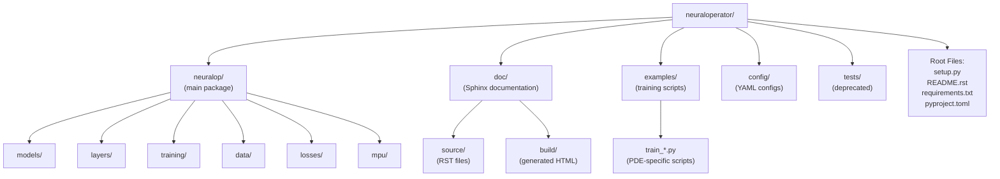

**Key Directories:**

| Directory | Purpose |
|-----------|---------|
| `neuralop/` | Main Python package containing all library code |
| `doc/` | Sphinx documentation source and build output |
| `examples/` | Training scripts demonstrating usage on various PDEs |
| `config/` | YAML configuration files for experiments |
| `tests/` | Legacy test directory (tests now colocated with code) |

**Sources:** [neuralop/__init__.py:1-8](), [doc/source/conf.py:1-122](), [README.rst:1-210]()

## Core Package Structure

The `neuralop` package (imported as `neuralop`) is organized into functional modules. The main entry point [neuralop/__init__.py:1-8]() exposes the most commonly used classes and functions.

### Package-Level Imports

The top-level `__init__.py` provides convenient access to key components:

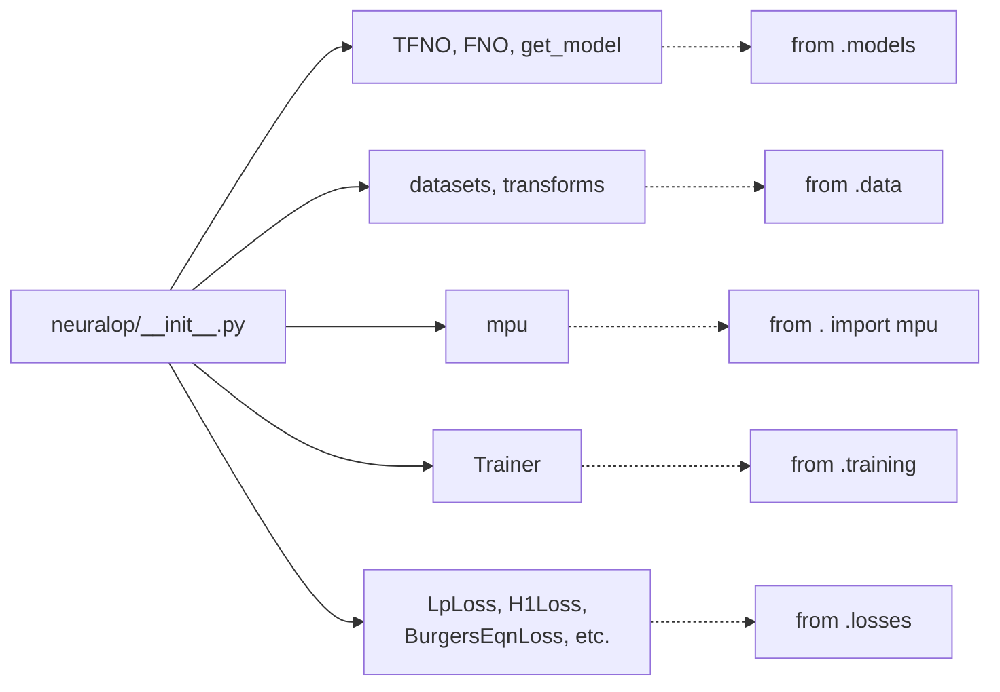

**Sources:** [neuralop/__init__.py:1-8]()

### Module Hierarchy

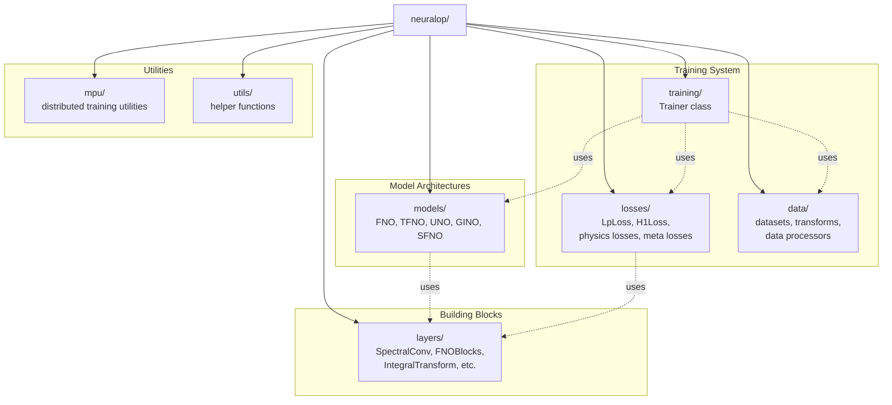

**Sources:** [neuralop/__init__.py:1-8](), [doc/source/index.rst:32-143]()

## Models Module

The `models/` directory contains implementations of neural operator architectures. Each model is typically defined in its own file and implements a common interface.

### Models Directory Structure

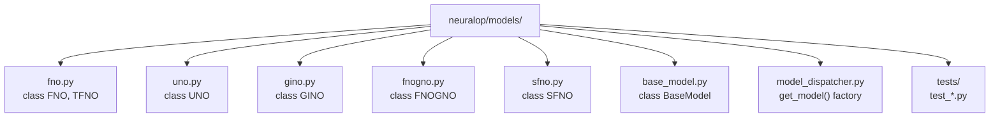

**Key Files:**

| File | Primary Classes/Functions | Purpose |
|------|--------------------------|---------|
| `fno.py` | `FNO`, `TFNO` | Fourier Neural Operator with optional tensorization |
| `uno.py` | `UNO` | U-shaped Neural Operator with encoder-decoder structure |
| `gino.py` | `GINO` | Geometry-Informed Neural Operator for irregular meshes |
| `fnogno.py` | `FNOGNO` | Hybrid FNO-GNO architecture |
| `sfno.py` | `SFNO` | Spherical Fourier Neural Operator |
| `base_model.py` | `BaseModel` | Abstract base class with common functionality |
| `model_dispatcher.py` | `get_model()` | Factory function for model instantiation |

**Sources:** [neuralop/__init__.py:3]()

## Layers Module

The `layers/` directory contains the building blocks used to construct neural operator models. These include spectral convolutions, integral transforms, embeddings, and domain handling utilities.

### Layers Module Organization

```mermaid
graph TB
    layers_dir["neuralop/layers/"]
    
    subgraph "Core Convolution Layers"
        spectral["spectral_convolution.py<br/>SpectralConv"]
        fno_block["fno_block.py<br/>FNOBlocks"]
        integral["integral_transform.py<br/>IntegralTransform"]
        gno["gno_block.py<br/>GNOBlock"]
    end
    
    subgraph "Signal Processing"
        fc["fourier_continuation.py<br/>FCLegendre, FCGram"]
        neighbor["neighbor_search.py<br/>NeighborSearch"]
    end
    
    subgraph "Architectural Components"
        mlp["mlp.py<br/>ChannelMLP"]
        skip["skip_connections.py<br/>skip_connection()"]
        padding["padding.py<br/>DomainPadding"]
    end
    
    subgraph "Embeddings & Utilities"
        embeddings["embeddings.py<br/>GridEmbedding*"]
        resample["resample.py<br/>resample()"]
    end
    
    layers_dir --> spectral
    layers_dir --> fno_block
    layers_dir --> integral
    layers_dir --> gno
    layers_dir --> fc
    layers_dir --> neighbor
    layers_dir --> mlp
    layers_dir --> skip
    layers_dir --> padding
    layers_dir --> embeddings
    layers_dir --> resample
    
    tests["tests/<br/>test_*.py"]
    layers_dir --> tests
```

**Key Layer Components:**

| Component | File | Purpose |
|-----------|------|---------|
| `SpectralConv` | `spectral_convolution.py` | Fourier domain convolutions with mode selection |
| `FNOBlocks` | `fno_block.py` | Stacked spectral layers with skip connections |
| `IntegralTransform` | `integral_transform.py` | Kernel integration for GNO |
| `GNOBlock` | `gno_block.py` | Graph neural operator block |
| `ChannelMLP` | `mlp.py` | Point-wise channel mixing |
| `DomainPadding` | `padding.py` | Boundary padding for spectral methods |
| `GridEmbedding*` | `embeddings.py` | Positional encodings |
| `NeighborSearch` | `neighbor_search.py` | Spatial queries for irregular geometries |

**Sources:** Based on high-level system architecture diagrams and component relationships

## Training Infrastructure

The training infrastructure is split across three main modules: `training/`, `losses/`, and `data/`.

### Training Module Structure

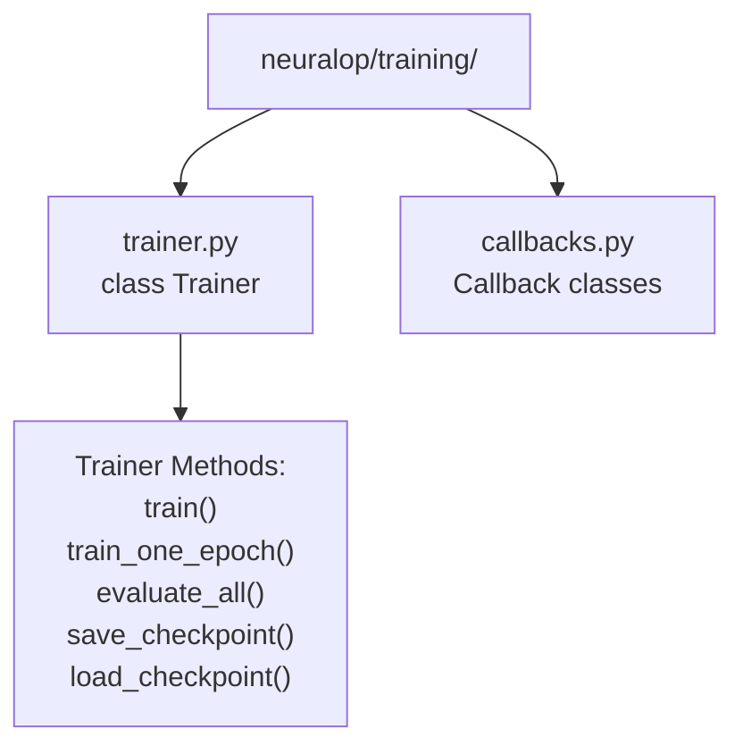

### Losses Module Structure

The losses module [neuralop/losses/__init__.py:1-4]() is organized into three categories:

```mermaid
graph TB
    losses_dir["neuralop/losses/"]
    
    subgraph "Data-Driven Losses"
        data_losses["data_losses.py"]
        lploss["LpLoss"]
        h1loss["H1Loss"]
        hdivloss["HdivLoss"]
        mseloss["MSELoss"]
        quantile["PointwiseQuantileLoss"]
        
        data_losses --> lploss
        data_losses --> h1loss
        data_losses --> hdivloss
        data_losses --> mseloss
        data_losses --> quantile
    end
    
    subgraph "Physics-Informed Losses"
        eqn_losses["equation_losses.py"]
        burgers["BurgersEqnLoss"]
        ic["ICLoss"]
        poisson["PoissonEqnLoss"]
        
        eqn_losses --> burgers
        eqn_losses --> ic
        eqn_losses --> poisson
    end
    
    subgraph "Meta Losses"
        meta_losses["meta_losses.py"]
        weighted["WeightedSumLoss"]
        softadapt["SoftAdapt"]
        relobralo["Relobralo"]
        aggregator["Aggregator"]
        
        meta_losses --> weighted
        meta_losses --> softadapt
        meta_losses --> relobralo
        meta_losses --> aggregator
    end
    
    subgraph "Differentiation Utilities"
        diff["differentiation.py"]
        finitediff["FiniteDiff"]
        fourierdiff["FourierDiff"]
        nonuniform["non_uniform_fd()"]
        
        diff --> finitediff
        diff --> fourierdiff
        diff --> nonuniform
    end
    
    losses_dir --> data_losses
    losses_dir --> eqn_losses
    losses_dir --> meta_losses
    losses_dir --> diff
    
    tests_dir["tests/<br/>test_losses.py"]
    losses_dir --> tests_dir
    
    data_losses -.uses.-> diff
    eqn_losses -.uses.-> diff
```

**Loss Module Files:**

| File | Key Classes | Purpose |
|------|-------------|---------|
| `data_losses.py` | `LpLoss`, `H1Loss`, `HdivLoss`, `MSELoss` | Standard supervised learning losses |
| `equation_losses.py` | `BurgersEqnLoss`, `ICLoss`, `PoissonEqnLoss` | PDE residual losses for physics-informed training |
| `meta_losses.py` | `WeightedSumLoss`, `SoftAdapt`, `Relobralo` | Adaptive loss weighting algorithms |
| `differentiation.py` | `FiniteDiff`, `FourierDiff`, `non_uniform_fd()` | Numerical differentiation for computing derivatives |

**Sources:** [neuralop/losses/__init__.py:1-4](), [neuralop/losses/data_losses.py:1-817](), [neuralop/losses/equation_losses.py:1-259](), [neuralop/losses/meta_losses.py:1-446](), [neuralop/losses/differentiation.py:1-1548]()

### Data Module Structure

The data module provides dataset classes and data processing utilities:

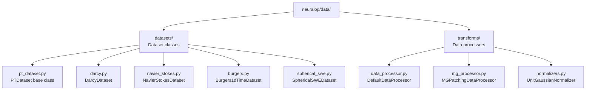

**Sources:** [neuralop/__init__.py:4]()

## Supporting Infrastructure

### MPU Module (Distributed Training)

The `mpu/` (Model Parallel Utilities) module provides distributed training capabilities:

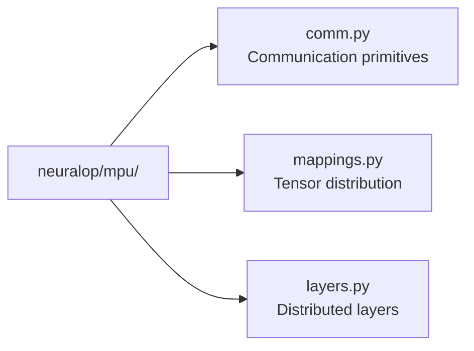

**Sources:** [neuralop/__init__.py:5]()

### Utils Module

The `utils/` directory contains miscellaneous helper functions and utilities that don't fit into the main module categories.

## Example Scripts and Configuration

### Examples Directory

The `examples/` directory contains training scripts organized by PDE problem:

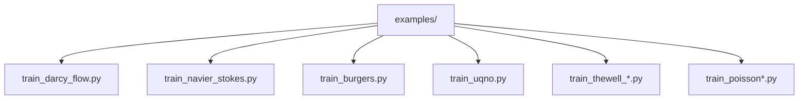

Each training script follows a similar pattern:
1. Load configuration from YAML
2. Initialize dataset and data loaders
3. Create model via `get_model()`
4. Set up optimizer, scheduler, and losses
5. Initialize `Trainer` and call `train()`

**Common Script Structure:**

| Component | Typical Implementation |
|-----------|----------------------|
| Configuration | `zencfg` library for YAML parsing |
| Data Loading | Dataset class + PyTorch `DataLoader` |
| Model Creation | `get_model()` factory function |
| Training Loop | `Trainer.train()` method |
| Logging | Weights & Biases integration |

**Sources:** Based on documentation references to training pipeline

### Configuration Directory

The `config/` directory contains YAML configuration files for reproducible experiments:

```
config/
├── darcy/
│   └── default.yaml
├── navier_stokes/
│   └── default.yaml
├── burgers/
│   └── default.yaml
└── ...
```

Configuration files specify:
- Model architecture parameters
- Training hyperparameters
- Dataset paths and preprocessing
- Logging and checkpointing settings

## Documentation Structure

### Sphinx Documentation

The `doc/` directory contains Sphinx documentation source and build configuration:

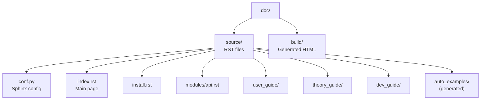

**Documentation Organization:**

| Directory | Content |
|-----------|---------|
| `source/` | RST source files for documentation |
| `source/modules/` | API reference (auto-generated from docstrings) |
| `source/user_guide/` | Usage tutorials and guides |
| `source/theory_guide/` | Mathematical background |
| `source/dev_guide/` | Development and contribution guidelines |
| `source/auto_examples/` | Gallery examples (auto-generated from `examples/`) |
| `build/html/` | Rendered HTML documentation |

**Sources:** [doc/source/conf.py:1-122](), [doc/source/index.rst:1-224]()

## Test Organization

Tests are colocated with the code they test, following pytest conventions. Each module directory contains a `tests/` subdirectory:

```
neuralop/
├── models/
│   └── tests/
│       ├── test_fno.py
│       ├── test_uno.py
│       └── ...
├── layers/
│   └── tests/
│       ├── test_spectral_conv.py
│       ├── test_fno_block.py
│       └── ...
└── losses/
    └── tests/
        └── test_losses.py
```

**Test File Naming Convention:**
- Test files are named `test_<module>.py`
- Test functions are named `test_<functionality>()`
- Parametrized tests use `@pytest.mark.parametrize` decorators

**Sources:** [neuralop/losses/tests/test_losses.py:1-476]()

## Navigation Guide

### Finding Model Implementations

To find a model implementation:
1. Start with `neuralop/models/`
2. Look for `<model_name>.py` (e.g., `fno.py`, `uno.py`)
3. Main class is typically named after the model (e.g., `class FNO`)

### Finding Layer Components

To find layer implementations:
1. Navigate to `neuralop/layers/`
2. Common naming: `<layer_name>.py` contains `class <LayerName>`
3. For spectral operations: `spectral_convolution.py`
4. For building blocks: `fno_block.py`, `mlp.py`

### Finding Loss Functions

To find loss implementations:
1. Navigate to `neuralop/losses/`
2. Data losses: `data_losses.py` (LpLoss, H1Loss)
3. Physics losses: `equation_losses.py` (BurgersEqnLoss, etc.)
4. Meta losses: `meta_losses.py` (SoftAdapt, Relobralo)
5. Differentiation utilities: `differentiation.py`

### Finding Training Scripts

To find example training scripts:
1. Navigate to `examples/`
2. Scripts are named `train_<problem>.py`
3. Corresponding configs in `config/<problem>/`

### Finding Tests

Tests are colocated with code:
1. Navigate to the module directory (e.g., `neuralop/losses/`)
2. Look for `tests/` subdirectory
3. Test file naming: `test_<module>.py`

### Finding Documentation

Documentation sources:
1. Navigate to `doc/source/`
2. API docs: `modules/api.rst`
3. User guides: `user_guide/`
4. Developer guides: `dev_guide/`
5. Built HTML: `doc/build/html/`

**Sources:** [README.rst:1-210](), [doc/source/install.rst:1-179]()

## Package Import Structure

### Typical Import Patterns

```python
# Top-level imports (recommended)
from neuralop.models import FNO, TFNO, get_model
from neuralop.training import Trainer
from neuralop.losses import LpLoss, H1Loss

# Direct module imports (when needed)
from neuralop.layers import SpectralConv, FNOBlocks
from neuralop.data.datasets import DarcyDataset
from neuralop.data.transforms import UnitGaussianNormalizer
```

### Module Dependencies

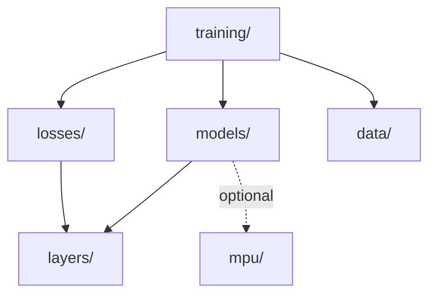

Key dependency relationships:
- **models** depend on **layers** (models compose layers)
- **training** depends on **models**, **losses**, **data** (orchestrates training)
- **losses** depend on **layers** (for differentiation utilities)
- **mpu** is optional (only for distributed training)

**Sources:** [neuralop/__init__.py:1-8]()

---

