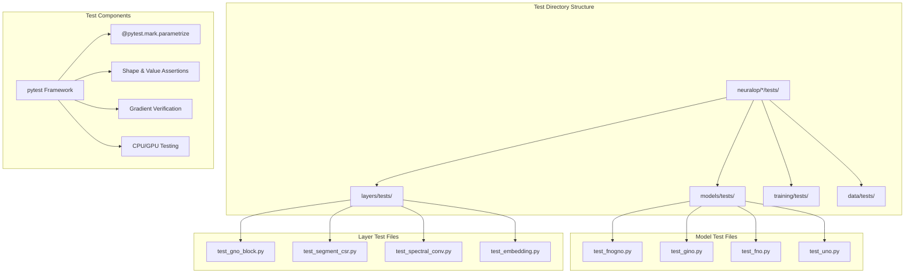
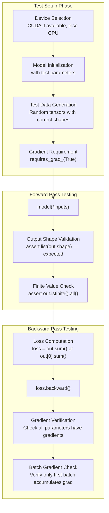
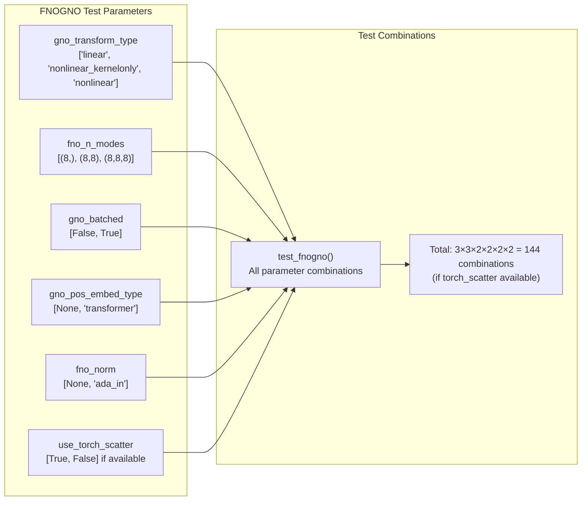
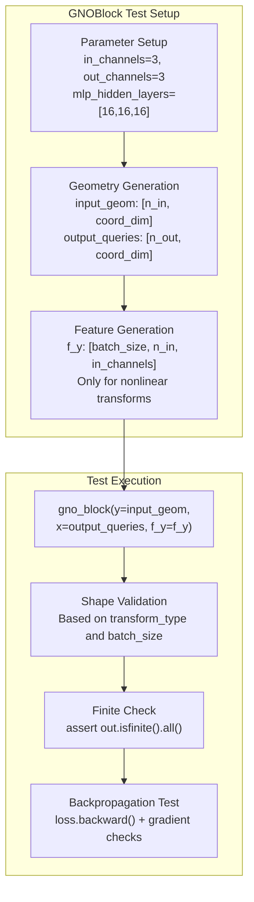

<!-- source: DeepWiki mcp.deepwiki.com · repo neuraloperator/neuraloperator · page 8.3 Testing · fetched 2026-10-21 -->

# Testing

<details>
<summary>Relevant source files</summary>

The following files were used as context for generating this wiki page:

- [.github/workflows/build_doc_dev.yml](.github/workflows/build_doc_dev.yml)
- [.github/workflows/deploy_pypi.yml](.github/workflows/deploy_pypi.yml)
- [.github/workflows/test.yml](.github/workflows/test.yml)
- [constraints.txt](constraints.txt)
- [neuralop/layers/padding.py](neuralop/layers/padding.py)
- [neuralop/layers/tests/test_padding.py](neuralop/layers/tests/test_padding.py)
- [neuralop/tests/test_config_key.txt](neuralop/tests/test_config_key.txt)
- [neuralop/tests/test_utils.py](neuralop/tests/test_utils.py)
- [neuralop/utils.py](neuralop/utils.py)

</details>


## Purpose and Scope

This document covers the testing infrastructure and patterns used in the neuraloperator library. The testing system ensures correctness of neural operator models, layers, and utilities through comprehensive unit tests that verify forward passes, backward passes, gradient computation, and shape consistency across different configurations.

For information about the training infrastructure that these tests validate, see [Training Infrastructure](#4). For details about the specific models being tested, see [Neural Operator Models](#2) and [Core Layers and Components](#3).

## Testing Infrastructure Overview

The neuraloperator library uses `pytest` as its primary testing framework with extensive parametrized testing to cover multiple model configurations, device types, and optional dependencies. Tests are organized in a hierarchical structure mirroring the main codebase organization.

### Test Organization Structure



Sources: [neuralop/models/tests/test_fnogno.py:1-99](), [neuralop/models/tests/test_gino.py:1-119](), [neuralop/layers/tests/test_gno_block.py:1-104](), [neuralop/layers/tests/test_segment_csr.py:1-45]()

## Model Testing Patterns

### Core Model Test Structure

Model tests in the neuraloperator library follow a consistent pattern that validates both the mathematical correctness and implementation robustness of neural operator architectures.

#### Test Execution Flow for Models



Sources: [neuralop/models/tests/test_fnogno.py:26-99](), [neuralop/models/tests/test_gino.py:38-119]()

### Device Testing

Tests automatically detect and utilize available hardware, falling back gracefully when CUDA is unavailable:

```python
# Device selection pattern used across all tests
if torch.has_cuda:  # or torch.backends.cuda.is_built()
    device = torch.device("cuda:0")
else:
    device = torch.device("cpu:0")
```

Sources: [neuralop/models/tests/test_fnogno.py:27-30](), [neuralop/models/tests/test_gino.py:39-42](), [neuralop/layers/tests/test_gno_block.py:46-49]()

### Gradient Verification

All model tests include comprehensive gradient verification to ensure backpropagation works correctly:

```python
# Gradient verification pattern
n_unused_params = 0
for param in model.parameters():
    if param.grad is None:
        n_unused_params += 1
assert n_unused_params == 0, f"{n_unused_params} parameters were unused!"
```

This pattern ensures that all model parameters participate in the computation graph and receive gradients during backpropagation.

Sources: [neuralop/models/tests/test_fnogno.py:91-95](), [neuralop/models/tests/test_gino.py:110-115]()

## Parametrized Testing

### Comprehensive Parameter Coverage

The testing framework uses extensive parametrization to test models across different configurations, ensuring robustness across the parameter space.

#### FNOGNO Test Parametrization



Sources: [neuralop/models/tests/test_fnogno.py:18-26]()

#### GINO Test Parametrization

The GINO model tests cover an even broader parameter space:

```python
@pytest.mark.parametrize("batch_size", [1,4])
@pytest.mark.parametrize("gno_coord_dim", [2,3])
@pytest.mark.parametrize("gno_pos_embed_type", [None, 'transformer'])
@pytest.mark.parametrize("fno_norm", [None, "ada_in"])
@pytest.mark.parametrize("gno_transform_type", ["linear", "nonlinear_kernelonly", "nonlinear"])
@pytest.mark.parametrize("latent_feature_dim", [None, 2])
@pytest.mark.parametrize("use_torch_scatter", use_torch_scatter)
```

Sources: [neuralop/models/tests/test_gino.py:29-37]()

## Layer Testing Patterns

### GNOBlock Testing

Layer tests focus on validating individual components that compose larger models:

#### GNOBlock Test Structure



Sources: [neuralop/layers/tests/test_gno_block.py:45-104]()

### Segment CSR Testing

The `segment_csr` function tests demonstrate utility function testing patterns:

```python
def test_native_segcsr_shapes(batch_size):
    # Generate test data
    src = torch.randn((batch_size, n_pts, n_channels))
    indptr = torch.cumsum(torch.tensor(nbrhd_sizes, dtype=torch.long), dim=0)
    
    # Test reduction operation
    out = segment_csr(src, indptr, reduction='sum', use_scatter=False)
    
    # Validate output shape
    if batch_size == 1:
        assert out.shape == (len(indptr) - 1, n_channels)
    else:
        assert out.shape == (batch_size, indptr.shape[1] - 1, n_channels)
```

Sources: [neuralop/layers/tests/test_segment_csr.py:6-30]()

## Optional Dependency Handling

### Conditional Testing Based on Available Libraries

The testing framework gracefully handles optional dependencies like `torch_scatter` and `open3d`:

#### Torch Scatter Detection

```python
try: 
    from torch_scatter import segment_csr
    use_torch_scatter = [True, False]
except:
    use_torch_scatter = [False]
```

#### Open3D Detection

```python
try:
    from neighbor_search import FixedRadiusSearch
    open3d_built = True
except:
    open3d_built = False

if open3d_built:
    use_open3d_parametrize = [True, False]
else:
    use_open3d_parametrize = [False]
```

This pattern ensures tests run with available functionality while skipping configurations that require unavailable dependencies.

Sources: [neuralop/models/tests/test_fnogno.py:10-15](), [neuralop/layers/tests/test_gno_block.py:25-35]()

## Batch Processing Testing

### Batch-Aware Gradient Checking

For models supporting batched inputs, tests verify that gradients are correctly isolated to the active batch elements:

```python
if batch_size > 1:
    loss = out[0].sum()  # Only compute loss on first batch element
else:
    loss = out.sum()
loss.backward()

if batch_size > 1 and gno_batched:
    # Verify that unused batch elements don't accumulate gradients
    assert not f.grad[1:].nonzero().any()
```

This pattern ensures that when processing batches, gradients only flow through the elements actually used in the loss computation.

Sources: [neuralop/models/tests/test_fnogno.py:86-98](), [neuralop/models/tests/test_gino.py:105-118]()

## Test Data Generation

### Tensor Shape Management

Tests generate appropriately shaped tensors based on model dimensionality and configuration:

```python
# Adaptive shape generation based on model parameters
in_p_shape = [32,] * n_dim  # Base spatial dimensions
in_p_shape.append(n_dim)    # Coordinate dimension
in_p = torch.randn(*in_p_shape, device=device)

f_shape = [32,] * n_dim     # Spatial dimensions
f_shape.append(in_channels) # Feature channels

# Add batch dimension if model supports batching
if gno_batched:
    f_shape = [batch_size] + f_shape
```

This pattern ensures test data matches the expected input format for each model configuration.

Sources: [neuralop/models/tests/test_fnogno.py:52-69](), [neuralop/models/tests/test_gino.py:67-85]()