# Page: Overview

# Overview

<details>
<summary>Relevant source files</summary>

The following files were used as context for generating this wiki page:

- [README.rst](README.rst)
- [doc/source/conf.py](doc/source/conf.py)
- [doc/source/index.rst](doc/source/index.rst)
- [doc/source/install.rst](doc/source/install.rst)
- [neuralop/__init__.py](neuralop/__init__.py)
- [neuralop/losses/__init__.py](neuralop/losses/__init__.py)
- [neuralop/losses/data_losses.py](neuralop/losses/data_losses.py)
- [neuralop/losses/differentiation.py](neuralop/losses/differentiation.py)
- [neuralop/losses/equation_losses.py](neuralop/losses/equation_losses.py)
- [neuralop/losses/meta_losses.py](neuralop/losses/meta_losses.py)
- [neuralop/losses/tests/test_losses.py](neuralop/losses/tests/test_losses.py)

</details>


## Purpose and Scope

This document introduces the `neuraloperator` library and its core concepts. It explains what neural operators are, how they differ from standard neural networks, and provides an architectural overview of the library's main capabilities and components.

For detailed installation instructions, see [Installation](#1.1). For a hands-on tutorial on using the library, see [Quickstart Guide](#1.2). For detailed documentation of specific model architectures, see [Neural Operator Models](#2). For training infrastructure details, see [Training Infrastructure](#4).

**Sources:** [doc/source/index.rst:32-43](), [README.rst:13-24]()

---

## What are Neural Operators?

Neural operators are neural networks that learn mappings between **function spaces** rather than finite-dimensional vector spaces. Unlike traditional neural networks that map vectors to vectors (e.g., ℝⁿ → ℝᵐ), neural operators learn to map entire functions to functions (e.g., L²(Ω) → L²(Ω)).

### Conceptual Comparison

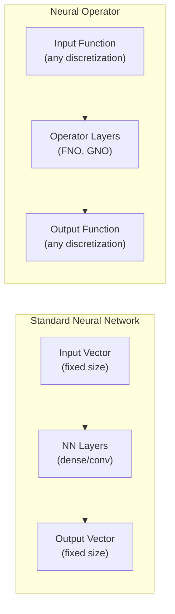

### Key Advantages

| Standard Neural Networks | Neural Operators |
|-------------------------|------------------|
| Fixed input/output resolution | **Resolution invariant** |
| Require retraining for different discretizations | Same model works across resolutions |
| Local receptive fields | **Global receptive fields** (via spectral methods) |
| Grid-dependent | Can handle irregular geometries (via GNO) |

**Example Use Case:** A neural operator trained on 64×64 grids can be directly evaluated on 128×128 or 256×256 grids without retraining. This is achieved through spectral convolutions that operate in the frequency domain, independent of spatial resolution.

**Sources:** [doc/source/index.rst:37-42](), [README.rst:18-23]()

---

## Resolution Invariance

Resolution invariance is a fundamental property of neural operators that distinguishes them from traditional convolutional neural networks.

### How Resolution Invariance Works

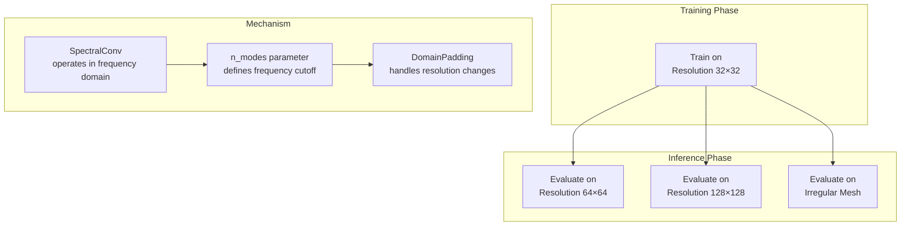

**Key Implementation Details:**

- **SpectralConv** ([neuralop/layers/spectral_convolution.py]()): Operates in frequency domain via FFT. The `n_modes` parameter specifies how many Fourier modes to retain, independent of input resolution.

- **DomainPadding** ([neuralop/layers/padding.py]()): Automatically adjusts padding based on input resolution to maintain consistent behavior across different discretizations.

- **Mode Selection**: The `n_modes` parameter (e.g., `n_modes=(16, 16)`) determines the frequency cutoff. This is resolution-independent—the same modes can be extracted from any resolution input.

**Sources:** [doc/source/index.rst:41-42](), [neuralop/__init__.py:3-4]()

---

## Library Architecture

The `neuraloperator` library is organized into five main functional layers:

### Component Hierarchy

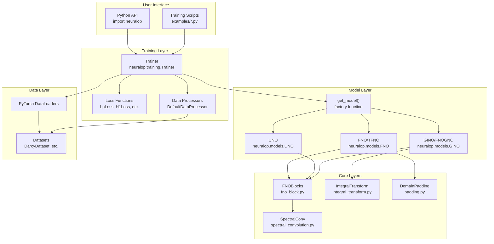

**Sources:** [neuralop/__init__.py:1-8](), [doc/source/index.rst:32-43]()

---

## Main Library Capabilities

### 1. Model Architectures

The library provides multiple neural operator architectures for different problem types:

| Architecture | Class | Use Case | Key Feature |
|-------------|-------|----------|-------------|
| Fourier Neural Operator | `FNO`, `TFNO` | Regular grids, periodic domains | Spectral convolutions |
| U-shaped Neural Operator | `UNO` | Multi-scale problems | U-Net architecture with FNO blocks |
| Geometry-Informed NO | `GINO`, `FNOGNO` | Irregular meshes | Kernel integration on point clouds |
| Spherical FNO | `SFNO` | Spherical domains | Spherical harmonics |
| Local Neural Operator | `LocalNO` | Localized phenomena | Local convolutions |

All architectures share a common interface through the `BaseModel` class and can be instantiated via the `get_model()` factory function.

**Sources:** [neuralop/__init__.py:3](), [doc/source/index.rst:52-73]()

### 2. Training Infrastructure

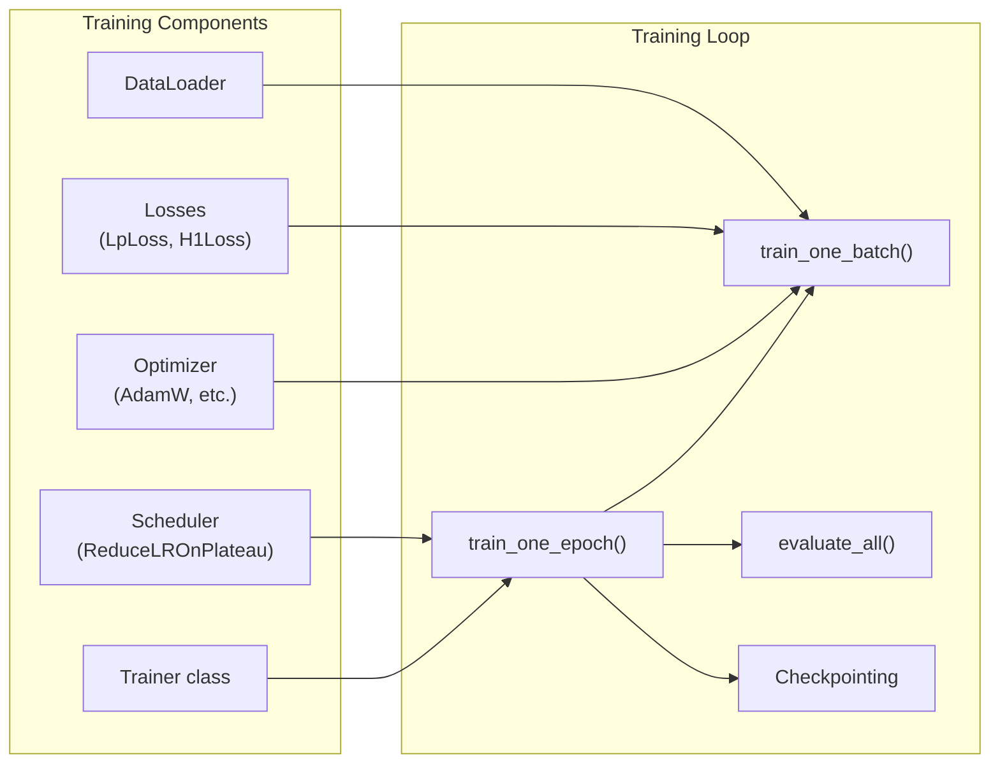

The `Trainer` class ([neuralop/training/trainer.py]()) orchestrates the training process:
- Training loop with automatic batching
- Multi-resolution evaluation
- Mixed precision training
- Distributed data parallel support
- Checkpoint management
- Weights & Biases integration

**Sources:** [neuralop/__init__.py:6](), [doc/source/index.rst:97-111]()

### 3. Loss Functions

The library provides three categories of loss functions:

**Data Losses** (compare predictions to ground truth):
- `LpLoss`: Lp norm in function space with proper quadrature weights
- `H1Loss`: H1 Sobolev norm (includes derivatives)
- `HdivLoss`: Hdiv Sobolev norm (for vector fields)
- `MSELoss`: Mean squared error

**Physics-Informed Losses** (enforce PDE constraints):
- `BurgersEqnLoss`: Burgers' equation residual
- `ICLoss`: Initial condition loss
- `PoissonEqnLoss`: Poisson equation residual

**Meta Losses** (combine multiple objectives):
- `WeightedSumLoss`: Static weighted combination
- `SoftAdapt`: Adaptive weighting based on loss magnitudes
- `Relobralo`: Relative loss balancing with random lookback

**Sources:** [neuralop/__init__.py:7](), [neuralop/losses/__init__.py:1-4](), [neuralop/losses/data_losses.py:20-68]()

### 4. Differentiation Utilities

The library provides multiple methods for computing derivatives:

| Utility | Class | Method | Use Case |
|---------|-------|--------|----------|
| Finite Differences | `FiniteDiff` | Central/forward/backward differences | General purpose, any boundary conditions |
| Fourier Differentiation | `FourierDiff` | FFT-based spectral derivatives | Smooth functions, periodic/non-periodic |
| Non-uniform FD | `non_uniform_fd()` | Weighted least squares | Irregular grids, point clouds |

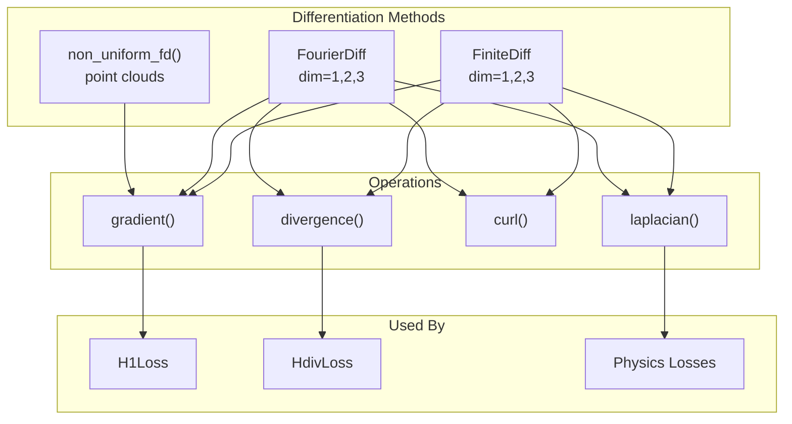

These utilities are used internally by loss functions (e.g., `H1Loss` uses `FiniteDiff` to compute gradients) and are also available for users to implement custom physics-informed losses.

**Sources:** [neuralop/losses/__init__.py:4](), [neuralop/losses/differentiation.py:11-91](), [neuralop/losses/data_losses.py:14]()

### 5. Data Management

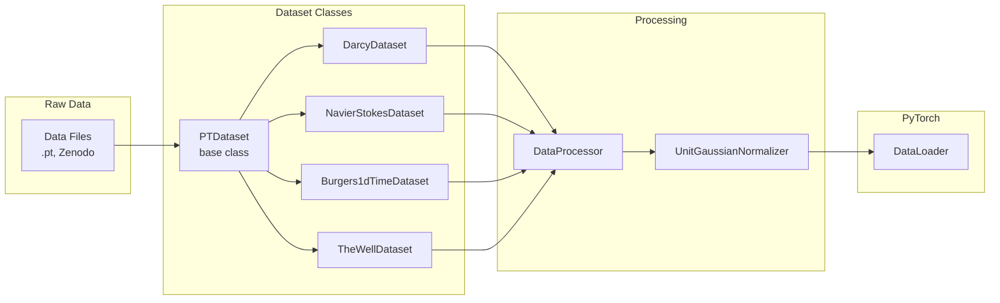

Dataset classes inherit from `PTDataset` and provide:
- Automatic data loading from disk or Zenodo
- Train/test splitting
- Resolution subsampling
- Integration with `DataProcessor` for normalization

Example datasets include:
- `DarcyDataset`: 2D Darcy flow (permeability → pressure)
- `NavierStokesDataset`: 2D incompressible Navier-Stokes
- `Burgers1dTimeDataset`: 1D Burgers' equation time evolution
- `TheWellDataset`: Various physics simulations (MHD, active matter, etc.)

**Sources:** [neuralop/__init__.py:4](), [doc/source/index.rst:75-91]()

---

## Entry Points and Main Exports

The library can be imported as `neuralop` after installation. The main exports from [neuralop/__init__.py:1-8]() are:

```python
from neuralop import (
    # Models
    FNO, TFNO, get_model,
    
    # Training
    Trainer,
    
    # Losses
    LpLoss, H1Loss, 
    BurgersEqnLoss, ICLoss,
    WeightedSumLoss, Aggregator, Relobralo, SoftAdapt,
    
    # Differentiation
    FourierDiff, non_uniform_fd, FiniteDiff,
    
    # Data
    datasets, transforms
)
```

### Typical Usage Pattern

```python
# 1. Load data
train_loader, test_loaders, data_processor = load_darcy_flow_small(
    n_train=1000, batch_size=32
)

# 2. Create model
model = FNO(n_modes=(16, 16), hidden_channels=64,
            in_channels=3, out_channels=1)

# 3. Setup training
trainer = Trainer(model=model, n_epochs=20, 
                  data_processor=data_processor)

# 4. Train
trainer.train(train_loader=train_loader,
              test_loaders=test_loaders,
              optimizer=optimizer,
              training_loss=LpLoss(d=2))

# 5. Save model
model.save_checkpoint(save_folder='./checkpoints/', 
                      save_name='my_fno')
```

**Sources:** [doc/source/index.rst:52-111](), [README.rst:51-79]()

---

## Version and Citation

The library is currently at version 1.0.2 ([neuralop/__init__.py:1]()). When using this library in academic work, please cite:

1. Kossaifi, J., et al. (2024). "A Library for Learning Neural Operators", ArXiv 2412.10354.
2. Kovachki, N., et al. (2021). "Neural Operator: Learning Maps Between Function Spaces", JMLR.

**Sources:** [doc/source/index.rst:164-209](), [README.rst:174-209]()

---

# Page: Installation

# Installation

<details>
<summary>Relevant source files</summary>

The following files were used as context for generating this wiki page:

- [.github/workflows/build_doc_dev.yml](.github/workflows/build_doc_dev.yml)
- [.github/workflows/deploy_pypi.yml](.github/workflows/deploy_pypi.yml)
- [.github/workflows/test.yml](.github/workflows/test.yml)
- [README.rst](README.rst)
- [constraints.txt](constraints.txt)
- [doc/source/conf.py](doc/source/conf.py)
- [doc/source/index.rst](doc/source/index.rst)
- [doc/source/install.rst](doc/source/install.rst)

</details>


This page provides instructions for installing the `neuraloperator` library for both standard use and development. It covers basic installation via pip, building from source, and optional dependencies for advanced features.

For information on getting started with the library after installation, see [Quickstart Guide](#1.2). For details on the development workflow and testing, see [Developer Guide](#8).

---

## Installation Overview

The `neuraloperator` library is distributed as a Python package named `neuraloperator` and imported as `neuralop`. Installation can be accomplished through multiple methods depending on your use case.

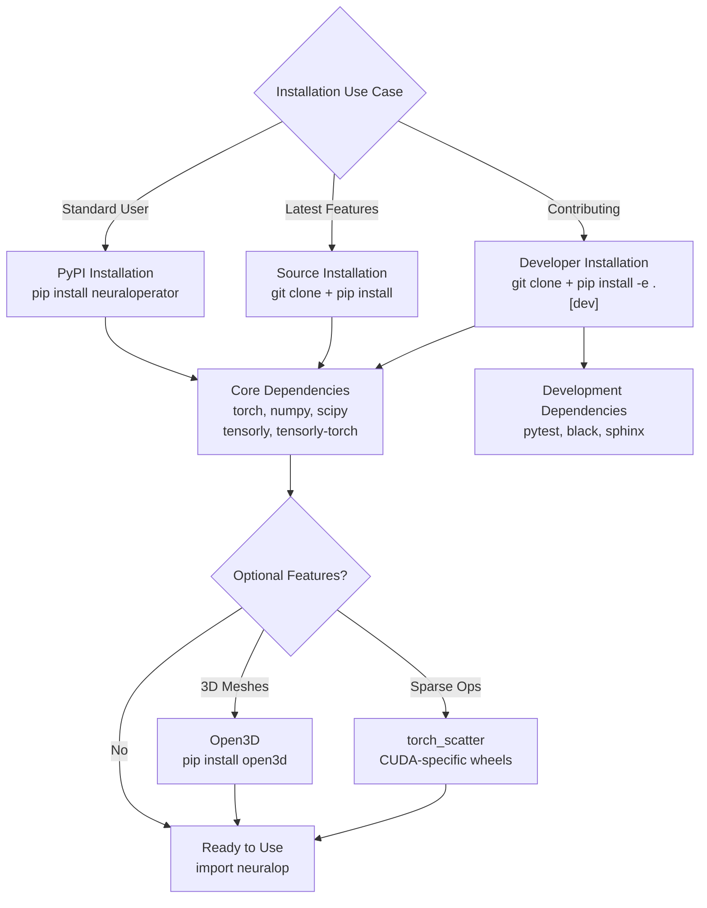

**Diagram: Installation pathways and dependencies**

Sources: [doc/source/install.rst:1-179](), [README.rst:26-46]()

---

## Basic Installation

### Prerequisites

The library requires Python 3.9 or higher and the following core dependencies:

| Dependency | Purpose | Installation Method |
|------------|---------|---------------------|
| `torch` | Deep learning framework | See PyTorch website for platform-specific instructions |
| `numpy` | Numerical computing | Automatically installed with PyTorch |
| `scipy` | Scientific computing | `pip install scipy` |
| `tensorly` | Tensor operations | `pip install tensorly` |
| `tensorly-torch` | PyTorch tensor backends | `pip install tensorly-torch` |
| `torch_harmonics` | Spherical harmonics (>=0.7) | `pip install torch_harmonics>=0.7` |

Sources: [doc/source/install.rst:16-22](), [constraints.txt:1-2]()

### Installation via pip

The simplest installation method uses the PyPI release:

```bash
pip install neuraloperator
```

This installs the most recent stable release. The package is imported as `neuralop`:

```python
import neuralop
from neuralop.models import FNO
```

To upgrade an existing installation:

```bash
pip install -U neuraloperator
```

Sources: [doc/source/install.rst:25-36](), [README.rst:39-45]()

### Installation from Source

For the latest development features or to contribute to the project, install from the GitHub repository:

```bash
git clone https://github.com/neuraloperator/neuraloperator
cd neuraloperator
pip install -r requirements.txt
pip install -e .
```

The `-e` flag installs in editable mode, meaning changes to the source code are immediately reflected without reinstallation.

Sources: [doc/source/install.rst:39-57](), [README.rst:29-37]()

---

## Package Structure After Installation

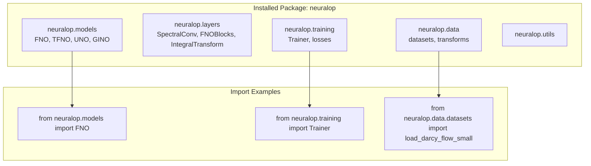

**Diagram: Installed package structure and import paths**

Sources: [doc/source/install.rst:1-9](), [README.rst:56-59]()

---

## Optional Dependencies

### Open3D for 3D Spatial Computing

The `Open3D` library accelerates spatial operations for 3D mesh applications, including fast neighbor search and mesh file I/O. It is used by geometry-informed neural operators (GINO/FNOGNO).

**Installation:**

```bash
pip install open3d
```

**Compatibility Note:** Open3D requires specific PyTorch and CUDA builds. Consult the [Open3D-ML documentation](https://github.com/isl-org/Open3D-ML) for compatibility details.

**Code Usage:** Open3D enables features in [neuralop/layers/neighbor_search.py]() for 3D neighbor queries in `IntegralTransform` layers.

Sources: [doc/source/install.rst:63-76]()

### torch_scatter for Efficient Sparse Operations

The `torch_scatter` package provides compiled CUDA kernels for efficient scatter/gather operations used in `IntegralTransform` during graph-based reductions.

**Installation Challenges:**

`torch_scatter` wheels are precompiled for specific OS/PyTorch/CUDA combinations. Installation requires matching your environment exactly.

1. **Check your PyTorch version:**
   ```bash
   python -c "import torch; print(torch.__version__)"
   ```

2. **Downgrade if necessary** (torch_scatter only supports up to PyTorch 2.5.1 as of early 2025):
   ```bash
   pip install -U torch==2.5.1
   ```

3. **Install matching torch_scatter wheel** from [https://data.pyg.org/whl/](https://data.pyg.org/whl/):
   ```bash
   pip install torch-scatter -f https://data.pyg.org/whl/torch-2.5.1+cu121.html
   ```
   
   Replace `torch-2.5.1+cu121` with your specific PyTorch and CUDA versions.

**Code Usage:** torch_scatter accelerates the `segment_csr` function in [neuralop/layers/integral_transform.py]() used by `GNOBlock`.

Sources: [doc/source/install.rst:79-103]()

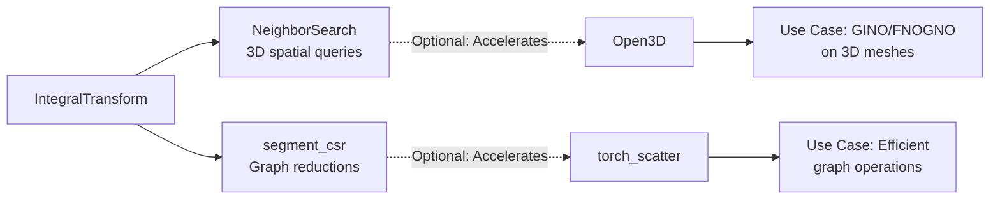

**Diagram: Optional dependencies and their use in the codebase**

Sources: [doc/source/install.rst:63-103]()

---

## Developer Installation

### Setting Up a Development Environment

For contributors, we recommend using a virtual environment to isolate dependencies:

```bash
# Clone your fork
git clone https://github.com/YOURNAME/neuraloperator.git
cd neuraloperator

# Create and activate virtual environment
python -m venv .venv
source .venv/bin/activate  # On Windows: .venv\Scripts\activate

# Install PyTorch (adjust for your CUDA version)
pip install torch torchvision --extra-index-url https://download.pytorch.org/whl/cu121

# Install package with development dependencies
pip install -e .[dev]
```

The `[dev]` extra includes testing and documentation tools:

| Package | Purpose |
|---------|---------|
| `pytest` | Unit testing framework |
| `black` | Code formatting |
| `sphinx` | Documentation generation |
| Additional doc dependencies | `sphinx-gallery`, `tensorly-sphinx-theme`, etc. |

Sources: [doc/source/install.rst:106-154](), [README.rst:111-122]()

### Verification

After installation, verify the package is correctly installed:

```bash
python -c "import neuralop; print(neuralop.__version__)"
```

Expected output: Version string (e.g., `0.3.0`)

To run the test suite:

```bash
pytest -v neuralop
```

Sources: [doc/source/install.rst:143-153](), [README.rst:136-147]()

---

## CI/CD Installation Process

The GitHub Actions workflows demonstrate the complete installation process used in continuous integration:

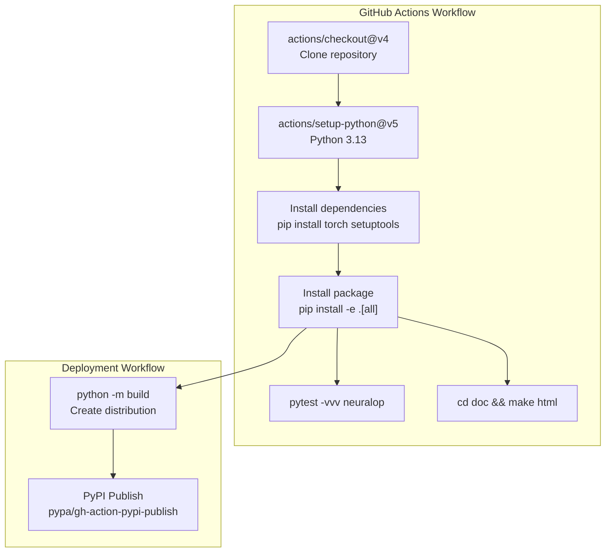

**Diagram: CI/CD installation and deployment pipeline**

The workflows install dependencies and the package using the following sequence:

1. **Core Dependencies:** [.github/workflows/test.yml:32-33]()
   ```yaml
   python -m pip install torch torchvision torchaudio
   ```

2. **Package Installation:** [.github/workflows/test.yml:36-37]()
   ```yaml
   python -m pip install -e .[dev]
   ```

3. **Building for PyPI:** [.github/workflows/deploy_pypi.yml:28-30]()
   ```yaml
   python -m build
   ```

Sources: [.github/workflows/test.yml:1-41](), [.github/workflows/deploy_pypi.yml:1-114](), [.github/workflows/build_doc_dev.yml:1-69]()

---

## Installation Troubleshooting

### Common Issues

| Issue | Solution |
|-------|----------|
| **Import error: `No module named 'neuralop'`** | The package is imported as `neuralop`, not `neuraloperator` |
| **PyTorch version mismatch** | Ensure PyTorch is installed before `neuraloperator`: `pip install torch` then `pip install neuraloperator` |
| **torch_scatter installation fails** | Check PyTorch version compatibility and use correct wheel from [https://data.pyg.org/whl/](https://data.pyg.org/whl/) |
| **Open3D conflicts** | Open3D requires specific PyTorch/CUDA builds; see [Open3D-ML compatibility](https://github.com/isl-org/Open3D-ML) |
| **Documentation build fails** | Install doc dependencies: `cd doc && pip install -r requirements_doc.txt` |

Sources: [doc/source/install.rst:1-179](), [README.rst:26-122]()

---

## Summary

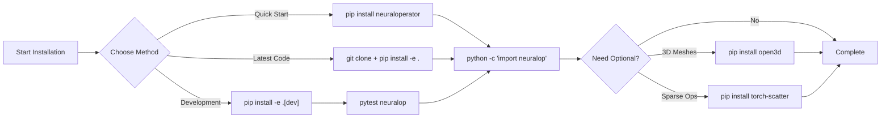

**Diagram: Installation decision tree**

After completing installation, proceed to the [Quickstart Guide](#1.2) to begin using the library, or consult the [API Reference](#7) for detailed module documentation.

Sources: [doc/source/install.rst:1-179](), [README.rst:26-122](), [doc/source/index.rst:44-112]()

---

# Page: Quickstart Guide

# Quickstart Guide

<details>
<summary>Relevant source files</summary>

The following files were used as context for generating this wiki page:

- [README.rst](README.rst)
- [doc/source/conf.py](doc/source/conf.py)
- [doc/source/index.rst](doc/source/index.rst)
- [doc/source/install.rst](doc/source/install.rst)
- [neuralop/layers/fno_block.py](neuralop/layers/fno_block.py)
- [neuralop/models/fno.py](neuralop/models/fno.py)
- [neuralop/training/__init__.py](neuralop/training/__init__.py)
- [neuralop/training/trainer.py](neuralop/training/trainer.py)

</details>


This guide walks through a minimal, complete example of training a Fourier Neural Operator (FNO) on PDE data using the neuraloperator library. You will learn how to load data, create a model, train it, and save/load checkpoints.

For installation instructions, see [Installation](#1.1). For more examples, see [Example Training Scripts](#5).

## Installation Reminder

Before starting, ensure you have installed the library:

```bash
pip install neuraloperator
```

Or install from source for the latest version (see [Installation](#1.1) for details).

## Minimal Training Example

This example demonstrates the complete workflow for training an FNO on the Darcy flow problem, a standard benchmark in operator learning.

**Minimal Training Pipeline**

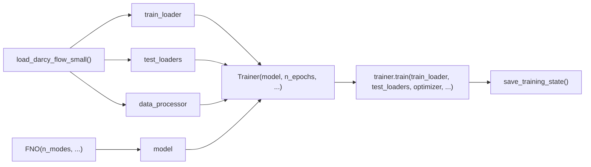

Sources: [neuralop/training/trainer.py:25-67](), [neuralop/models/fno.py:24-167](), [doc/source/index.rst:44-112]()

### Step 1: Import Required Modules

```python
import torch
from neuralop.models import FNO
from neuralop.data.datasets import load_darcy_flow_small
from neuralop.training import Trainer
from neuralop.losses import LpLoss, H1Loss
```

Sources: [neuralop/models/fno.py:1-22](), [neuralop/training/__init__.py:1-5]()

### Step 2: Load Data

The library provides a built-in Darcy flow dataset loader that returns PyTorch `DataLoader` objects and a `DataProcessor` for normalization:

```python
train_loader, test_loaders, data_processor = load_darcy_flow_small(
    n_train=1000,           # Number of training samples
    batch_size=32,          # Training batch size
    test_resolutions=[32],  # Test at resolution 32x32
    n_tests=[100],          # 100 test samples
    test_batch_sizes=[32],  # Test batch size
)
```

The function returns:
- `train_loader`: A `torch.utils.data.DataLoader` for training data
- `test_loaders`: A dictionary of test loaders (keyed by resolution)
- `data_processor`: Handles normalization/denormalization automatically

Sources: [doc/source/index.rst:75-88](), [README.rst:48-60]()

### Step 3: Create an FNO Model

Create a 2D Fourier Neural Operator:

```python
model = FNO(
    n_modes=(16, 16),       # Number of Fourier modes to keep in each dimension
    hidden_channels=64,     # Width of hidden layers
    in_channels=3,          # Input channels (2 coords + 1 coefficient field)
    out_channels=1,         # Output channels (solution field)
    n_layers=4              # Number of FNO layers
)
```

Key parameters:
- `n_modes`: Controls frequency resolution; higher values capture finer details but increase computation
- `hidden_channels`: Width of the network; affects model capacity
- `in_channels`/`out_channels`: Match your data dimensions
- `n_layers`: Depth of the FNO; typically 4-8 layers

Sources: [neuralop/models/fno.py:24-200](), [doc/source/index.rst:52-60]()

### Step 4: Setup Training

Configure the optimizer and loss functions:

```python
# Optimizer
optimizer = torch.optim.AdamW(
    model.parameters(),
    lr=1e-3,
    weight_decay=1e-4
)

# Learning rate scheduler
scheduler = torch.optim.lr_scheduler.CosineAnnealingLR(
    optimizer, T_max=50
)

# Loss functions
train_loss = LpLoss(d=2, p=2)  # L2 loss for training
eval_losses = {
    'l2': LpLoss(d=2, p=2),    # L2 error
    'h1': H1Loss(d=2)          # H1 error (includes derivatives)
}
```

Sources: [neuralop/training/trainer.py:171-182]()

### Step 5: Create Trainer and Run Training

Initialize the `Trainer` class and call `train()`:

```python
# Create trainer
trainer = Trainer(
    model=model,
    n_epochs=20,
    data_processor=data_processor,
    device='cuda',           # or 'cpu'
    verbose=True
)

# Train the model
trainer.train(
    train_loader=train_loader,
    test_loaders=test_loaders,
    optimizer=optimizer,
    scheduler=scheduler,
    training_loss=train_loss,
    eval_losses=eval_losses
)
```

The `Trainer.train()` method handles:
- Training loop over epochs
- Forward/backward passes
- Optimizer and scheduler steps
- Evaluation on test sets
- Progress logging

Sources: [neuralop/training/trainer.py:96-254](), [doc/source/index.rst:95-112]()

### Step 6: Save and Load Checkpoints

Save the trained model:

```python
from neuralop.training import save_training_state

save_training_state(
    save_dir='./checkpoints',
    save_name='my_fno_model',
    model=model,
    optimizer=optimizer,
    scheduler=scheduler,
    epoch=trainer.epoch
)
```

Load the model later:

```python
from neuralop.training import load_training_state

model, optimizer, scheduler, _, resume_epoch = load_training_state(
    save_dir='./checkpoints',
    save_name='my_fno_model',
    model=model,
    optimizer=optimizer,
    scheduler=scheduler
)
```

The checkpoint includes the full training state, allowing you to resume training from where you left off.

Sources: [neuralop/training/trainer.py:729-791](), [neuralop/training/__init__.py:3]()

## Understanding the Core Components

The training workflow involves several key classes that work together:

**Component Interaction Diagram**

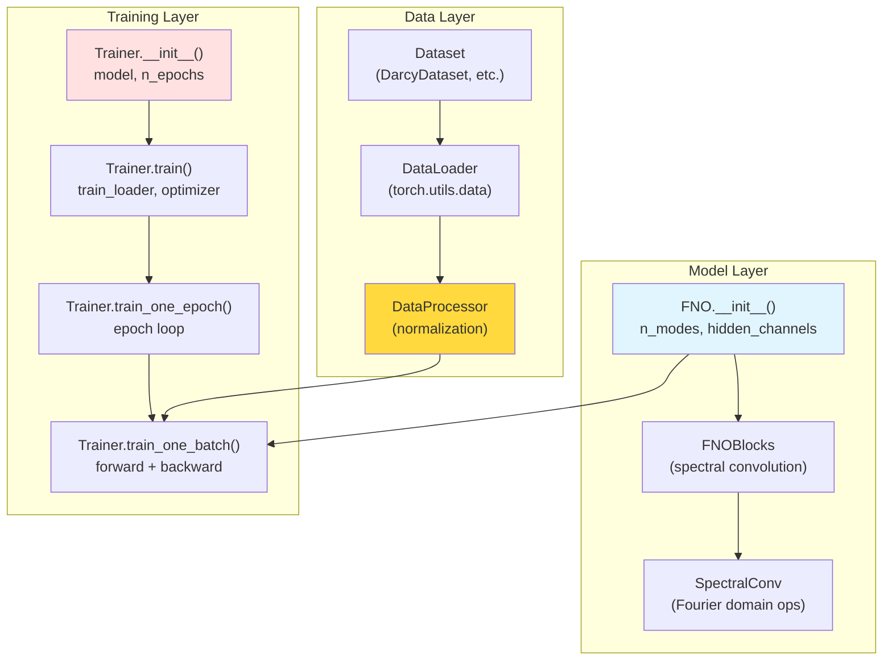

Sources: [neuralop/training/trainer.py:25-67](), [neuralop/models/fno.py:24-167](), [neuralop/layers/fno_block.py:18-96]()

### Trainer Class

The `Trainer` class ([neuralop/training/trainer.py:25-791]()) orchestrates the training process. Key methods:

| Method | Purpose | Key Parameters |
|--------|---------|----------------|
| `__init__()` | Initialize trainer | `model`, `n_epochs`, `data_processor`, `device` |
| `train()` | Main training loop | `train_loader`, `test_loaders`, `optimizer`, `scheduler`, `training_loss`, `eval_losses` |
| `train_one_epoch()` | Single epoch training | `epoch`, `train_loader`, `training_loss` |
| `evaluate()` | Model evaluation | `loss_dict`, `data_loader` |
| `checkpoint()` | Save training state | `save_dir` |

The trainer handles:
- Epoch loops and batch processing ([neuralop/training/trainer.py:225-254]())
- Automatic mixed precision training ([neuralop/training/trainer.py:489-507]())
- Data preprocessing/postprocessing ([neuralop/training/trainer.py:474-499]())
- Evaluation across multiple test sets ([neuralop/training/trainer.py:327-365]())
- Checkpoint management ([neuralop/training/trainer.py:765-791]())

Sources: [neuralop/training/trainer.py:25-791]()

### FNO Model

The `FNO` class ([neuralop/models/fno.py:24-413]()) implements the Fourier Neural Operator architecture:

**FNO Forward Pass**

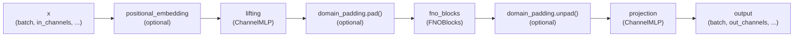

Components:
- `positional_embedding`: Adds grid coordinates ([neuralop/models/fno.py:235-257]())
- `lifting`: Projects input to hidden dimension ([neuralop/models/fno.py:305-331]())
- `domain_padding`: Pads domain for better boundary handling ([neuralop/models/fno.py:259-268]())
- `fno_blocks`: Core Fourier layers ([neuralop/models/fno.py:277-302]())
- `projection`: Projects to output dimension ([neuralop/models/fno.py:333-342]())

Sources: [neuralop/models/fno.py:344-403](), [neuralop/layers/fno_block.py:18-378]()

### FNOBlocks

The `FNOBlocks` class ([neuralop/layers/fno_block.py:18-411]()) implements the sequence of Fourier layers:

Each block performs:
1. Spectral convolution in Fourier domain ([neuralop/layers/fno_block.py:311-312]())
2. Skip connection ([neuralop/layers/fno_block.py:298-317]())
3. Non-linear activation ([neuralop/layers/fno_block.py:319-320]())
4. Optional channel MLP ([neuralop/layers/fno_block.py:322-323]())

Sources: [neuralop/layers/fno_block.py:291-331]()

### DataProcessor

The `DataProcessor` handles normalization:
- `preprocess()`: Normalizes inputs before model forward pass ([neuralop/training/trainer.py:474-475]())
- `postprocess()`: Denormalizes outputs for evaluation ([neuralop/training/trainer.py:498-499]())

This ensures the model trains on standardized data while evaluations occur in the original scale.

Sources: [neuralop/training/trainer.py:44-45](), [neuralop/training/trainer.py:474-499]()

## Complete Working Example

Here is a complete, runnable script that ties everything together:

```python
import torch
from neuralop.models import FNO
from neuralop.data.datasets import load_darcy_flow_small
from neuralop.training import Trainer
from neuralop.losses import LpLoss, H1Loss

# Set device
device = 'cuda' if torch.cuda.is_available() else 'cpu'

# Load data
train_loader, test_loaders, data_processor = load_darcy_flow_small(
    n_train=1000,
    batch_size=32,
    test_resolutions=[32],
    n_tests=[100],
    test_batch_sizes=[32]
)

# Create model
model = FNO(
    n_modes=(16, 16),
    hidden_channels=64,
    in_channels=3,
    out_channels=1,
    n_layers=4
).to(device)

# Setup training
optimizer = torch.optim.AdamW(model.parameters(), lr=1e-3, weight_decay=1e-4)
scheduler = torch.optim.lr_scheduler.CosineAnnealingLR(optimizer, T_max=20)
train_loss = LpLoss(d=2, p=2)
eval_losses = {'l2': LpLoss(d=2, p=2), 'h1': H1Loss(d=2)}

# Create trainer and train
trainer = Trainer(
    model=model,
    n_epochs=20,
    data_processor=data_processor,
    device=device,
    verbose=True
)

trainer.train(
    train_loader=train_loader,
    test_loaders=test_loaders,
    optimizer=optimizer,
    scheduler=scheduler,
    training_loss=train_loss,
    eval_losses=eval_losses
)

# Save checkpoint
from neuralop.training import save_training_state
save_training_state(
    save_dir='./checkpoints',
    save_name='fno_darcy',
    model=model,
    optimizer=optimizer,
    scheduler=scheduler,
    epoch=trainer.epoch
)
```

This script trains an FNO on the Darcy flow problem for 20 epochs and saves the final checkpoint.

Sources: [doc/source/index.rst:44-131](), [README.rst:48-78]()

## Next Steps

- Explore different neural operator architectures in [Neural Operator Models](#2)
- Learn about advanced training configurations in [Training Infrastructure](#4)
- Study complete examples for specific PDEs in [Example Training Scripts](#5)
- Understand the core building blocks in [Core Layers and Components](#3)

---

# Page: Neural Operator Models

# Neural Operator Models

<details>
<summary>Relevant source files</summary>

The following files were used as context for generating this wiki page:

- [doc/source/modules/api.rst](doc/source/modules/api.rst)
- [neuralop/layers/fno_block.py](neuralop/layers/fno_block.py)
- [neuralop/models/fno.py](neuralop/models/fno.py)
- [neuralop/models/fnogno.py](neuralop/models/fnogno.py)
- [neuralop/models/gino.py](neuralop/models/gino.py)

</details>


This page provides an overview of all neural operator architectures available in the neuraloperator library. Neural operators are deep learning models that learn mappings between function spaces, providing resolution-invariant solutions to parametric partial differential equations (PDEs).

For detailed implementation of individual model architectures, see [FNO Models](#2.1), [UNO Models](#2.2), [GINO/FNOGNO Models](#2.3), [SFNO Models](#2.4), and [Local Neural Operators](#2.5). For information about the core building blocks these models use, see [Core Layers and Components](#3). For training these models, see [Training Infrastructure](#4).

## Model Architecture Overview

The neuraloperator library implements several neural operator architectures, all inheriting from `BaseModel` and sharing common building blocks. The models differ primarily in their approach to handling geometry, domain structure, and multi-scale processing.

### Core Model Hierarchy

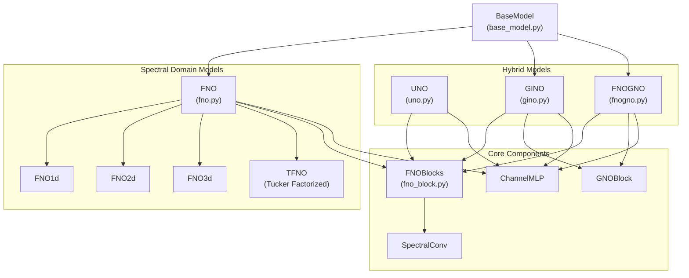

Sources: [neuralop/models/fno.py:18-161](), [neuralop/models/uno.py:13-101](), [neuralop/models/gino.py:15-165](), [neuralop/models/fnogno.py:13-133](), [neuralop/layers/fno_block.py:18-96]()

## Forward Pass Architecture

All neural operator models in the library follow a common forward pass pattern that can be broken down into standardized stages. This design enables consistent behavior across different architectures while allowing for model-specific customizations.

### Standard Forward Pass Pipeline

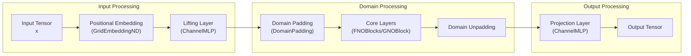

Sources: [neuralop/models/fno.py:336-388](), [neuralop/models/uno.py:305-346](), [neuralop/models/gino.py:398-525]()

## Model Characteristics and Use Cases

### FNO Family
The Fourier Neural Operator (`FNO`) class and its dimensional variants (`FNO1d`, `FNO2d`, `FNO3d`) operate in the frequency domain using `SpectralConv` layers. These models excel at problems with periodic or quasi-periodic structure.

**Key Parameters:**
- `n_modes`: Number of Fourier modes to retain per dimension
- `hidden_channels`: Width of the network
- `n_layers`: Number of spectral convolution layers
- `factorization`: Optional tensor decomposition (`"Tucker"` for `TFNO`)

### UNO (U-shaped Neural Operator)
The `UNO` class implements a U-Net-like architecture with multi-resolution processing through horizontal skip connections and scaling factors.

**Key Parameters:**
- `uno_out_channels`: Channel progression through layers
- `uno_n_modes`: Mode configuration per layer
- `uno_scalings`: Resolution scaling factors per layer
- `horizontal_skips_map`: Skip connection configuration

### GINO (Geometry-Informed Neural Operator)
The `GINO` class handles irregular geometries by combining GNO (Graph Neural Operator) blocks with FNO processing in a latent space.

**Key Architecture:**
- Input GNO: Maps irregular input geometry to regular latent grid
- FNO Blocks: Process in regular latent space
- Output GNO: Maps from latent grid to irregular output queries

### FNOGNO (Fourier/Geometry Neural Operator)
The `FNOGNO` class maps from regular grids to arbitrary point clouds, combining the efficiency of FNO with the flexibility of GNO for output queries.

## Model Registration and Factory

All models register with the `BaseModel` system using the `name` parameter in class definitions. The library provides a factory function for model instantiation:

```python
# Model registration examples from the codebase:
class FNO(BaseModel, name='FNO')  # neuralop/models/fno.py:18
class FNOGNO(BaseModel, name="FNOGNO")  # neuralop/models/fnogno.py:13
```

The `get_model()` dispatcher function (referenced in the high-level architecture) enables dynamic model creation based on configuration.

Sources: [neuralop/models/fno.py:18](), [neuralop/models/fnogno.py:13](), [neuralop/models/base_model.py]()

## Shared Configuration Patterns

All models share common configuration patterns for:

**Lifting and Projection:**
- `lifting_channels` / `lifting_channel_ratio`: Input dimension expansion
- `projection_channels` / `projection_channel_ratio`: Output dimension reduction

**Training Behavior:**
- `channel_mlp_dropout`: Regularization in channel mixing layers
- `non_linearity`: Activation function (typically `F.gelu`)
- `complex_data`: Enable complex-valued computation

**Advanced Features:**
- `factorization`: Tensor compression techniques
- `domain_padding`: Boundary condition handling  
- `resolution_scaling_factor`: Multi-resolution support

Sources: [neuralop/models/fno.py:163-195](), [neuralop/models/uno.py:103-136](), [neuralop/models/gino.py:166-219](), [neuralop/models/fnogno.py:135-182]()

---

# Page: Fourier Neural Operators (FNO)

# Fourier Neural Operators (FNO)

<details>
<summary>Relevant source files</summary>

The following files were used as context for generating this wiki page:

- [doc/source/modules/api.rst](doc/source/modules/api.rst)
- [neuralop/layers/fno_block.py](neuralop/layers/fno_block.py)
- [neuralop/models/fno.py](neuralop/models/fno.py)
- [neuralop/models/fnogno.py](neuralop/models/fnogno.py)
- [neuralop/models/gino.py](neuralop/models/gino.py)

</details>


## Purpose and Scope

This document provides comprehensive documentation of Fourier Neural Operators (FNO) and Tensor-Factorized Neural Operators (TFNO), including architecture details, implementation specifics, and usage examples. FNOs learn mappings between function spaces using spectral convolutions in the Fourier domain, enabling resolution-invariant learning for partial differential equations (PDEs). TFNOs extend FNOs with tensor factorization for improved parameter efficiency.

## Introduction to Fourier Neural Operators

Fourier Neural Operators (FNOs) learn operators that map between infinite-dimensional function spaces using spectral convolutions. The `FNO` class implements N-dimensional FNOs that discretize functions over regular grids and perform convolutions in the Fourier domain via the `SpectralConv` layer.

Key capabilities of FNOs:

1. **Resolution Invariance**: Learn operators that generalize across different grid resolutions
2. **Global Information Processing**: Fourier domain operations capture long-range dependencies
3. **Computational Efficiency**: Fast inference compared to traditional numerical solvers
4. **Parameter Sharing**: Same operator can be applied to different discretization resolutions

The FNO architecture centers around the `SpectralConv` layer, which transforms inputs to frequency domain, applies learned linear transformations, and transforms back to spatial domain. This allows global convolution operations with computational complexity independent of kernel size.

Sources: [neuralop/models/fno.py:18-161]()

## FNO Architecture Overview

FNO Architecture Components

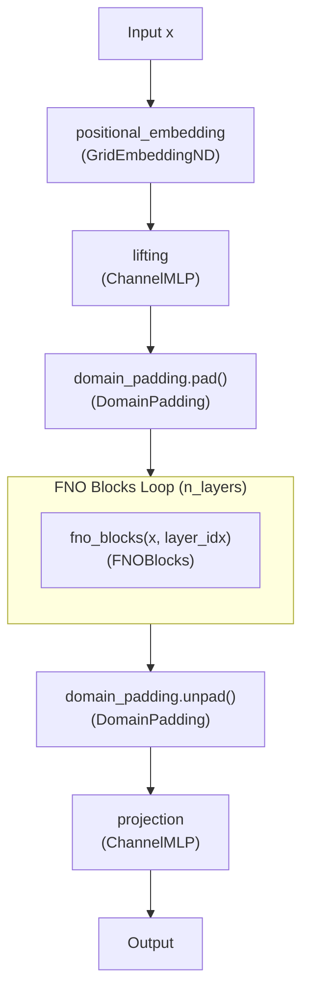

The `FNO.forward()` method implements this processing pipeline:

1. **`positional_embedding`**: Optional `GridEmbeddingND` adds spatial coordinates to input channels
2. **`lifting`**: `ChannelMLP` projects input to `hidden_channels` dimensional latent space  
3. **`domain_padding.pad()`**: Optional `DomainPadding` to mitigate boundary artifacts
4. **`fno_blocks`**: Sequence of `FNOBlocks` performing spectral convolutions and skip connections
5. **`domain_padding.unpad()`**: Removes padding if applied
6. **`projection`**: `ChannelMLP` maps latent representation to `out_channels`

The dimensionality is inferred from `len(n_modes)`, making the implementation flexible for 1D, 2D, 3D, and higher-dimensional problems.

Sources: [neuralop/models/fno.py:336-388]()

## Key Components

### Spectral Convolution Layer

The `SpectralConv` layer implements the core Fourier domain convolutions used in FNO blocks.

SpectralConv Operation Flow

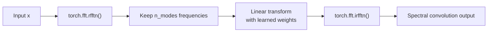

The `SpectralConv` performs global convolution in Fourier domain:

1. **FFT Transform**: Convert input to frequency domain using `torch.fft.rfftn()`
2. **Mode Truncation**: Retain only the first `n_modes` frequencies in each dimension
3. **Linear Transform**: Apply learned weight matrices to frequency coefficients
4. **Inverse FFT**: Transform back to spatial domain using `torch.fft.irfftn()`

This enables global receptive fields with O(N log N) complexity instead of O(N²) for spatial convolutions. The `n_modes` parameter controls the frequency bandwidth and model capacity.

Sources: [neuralop/models/fno.py:24-25](), [neuralop/layers/fno_block.py:164-180]()

### FNO Blocks

The `FNOBlocks` class implements sequences of Fourier layers with skip connections and optional channel mixing.

FNO Block Forward Pass (Post-activation)

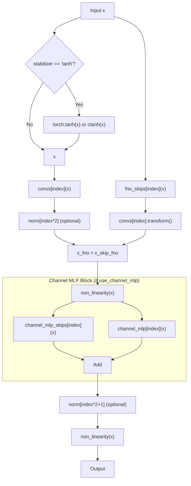

Key `FNOBlocks` components:

1. **`convs`**: `ModuleList` of `SpectralConv` layers for Fourier domain operations
2. **`fno_skips`**: Skip connections for residual learning (`linear`, `identity`, or `soft-gating`)
3. **`channel_mlp`**: Optional `ChannelMLP` for additional channel mixing
4. **`norm`**: Optional normalization (`instance_norm`, `group_norm`, `batch_norm`, `ada_in`)
5. **`stabilizer`**: Optional `tanh` stabilization for numerical stability

The block supports both post-activation (default) and pre-activation modes via the `preactivation` parameter.

Sources: [neuralop/layers/fno_block.py:18-96](), [neuralop/layers/fno_block.py:293-327]()

### Domain Padding

The `DomainPadding` class mitigates boundary artifacts from Fourier transforms for non-periodic domains.

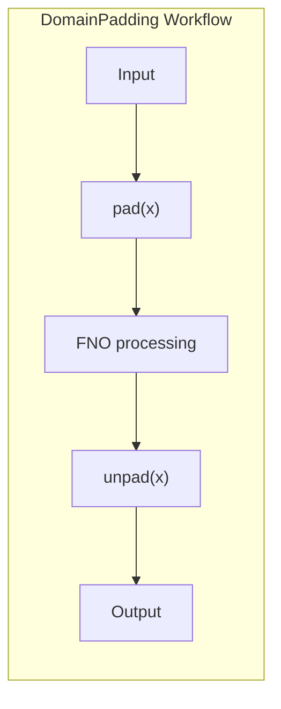

Domain padding configuration:
- **`domain_padding`**: Percentage of padding per dimension (float or list)
- **`resolution_scaling_factor`**: Coordinates padding with resolution changes
- Applied when `domain_padding > 0` in FNO constructor

The padding is particularly important for non-periodic boundary conditions where Fourier transforms can introduce artifacts.

### Positional Embedding

The `positional_embedding` parameter configures spatial coordinate information:

| Configuration | Behavior |
|---------------|----------|
| `"grid"` (default) | Creates `GridEmbeddingND` with boundaries `[[0,1]] * n_dim` |
| `GridEmbeddingND` instance | Uses provided embedding module |
| `GridEmbedding2D` instance | Uses for 2D problems only |
| `None` | No positional embedding |

The embedding appends `n_dim` coordinate channels to the input, which are processed by the lifting layer.

Sources: [neuralop/models/fno.py:231-247](), [neuralop/models/fno.py:249-259](), [neuralop/models/fno.py:377-384]()

## FNO Variants by Dimensionality

The library provides dimension-specific FNO subclasses and tensor-factorized variants:

### Standard FNO Variants

| Class | Dimensions | Parameters | Use Cases |
|-------|------------|------------|-----------|
| `FNO1d` | 1D | `n_modes_height` | Burgers equation, 1D advection |
| `FNO2d` | 2D | `n_modes_height`, `n_modes_width` | Darcy flow, 2D Navier-Stokes |
| `FNO3d` | 3D | `n_modes_height`, `n_modes_width`, `n_modes_depth` | 3D problems, 2D+time evolution |

### Tensor-Factorized FNO Variants

Tensor-factorized variants use Tucker decomposition for parameter efficiency:

| Class | Base Class | Factorization |
|-------|------------|---------------|
| `TFNO` | `FNO` | `factorization="Tucker"` |
| `TFNO1d` | `FNO1d` | `factorization="Tucker"` |
| `TFNO2d` | `FNO2d` | `factorization="Tucker"` |
| `TFNO3d` | `FNO3d` | `factorization="Tucker"` |

All variants inherit from the base `FNO` class and configure `n_modes` appropriately. TFNO variants are created using `partialclass()` to set default `factorization="Tucker"`.

Sources: [neuralop/models/fno.py:400-654]()

## Implementation Details

### Class Hierarchy and Component Relationships

FNO Class Structure

```mermaid
classDiagram
    BaseModel <|-- FNO : "inherits model registry"
    FNO <|-- FNO1d : "n_modes=(n_modes_height,)"
    FNO <|-- FNO2d : "n_modes=(n_modes_height, n_modes_width)"
    FNO <|-- FNO3d : "n_modes=(n_modes_height, n_modes_width, n_modes_depth)"
    
    FNO *-- GridEmbeddingND : "positional_embedding"
    FNO *-- ChannelMLP : "lifting"
    FNO *-- ChannelMLP : "projection"
    FNO *-- DomainPadding : "domain_padding (optional)"
    FNO *-- FNOBlocks : "fno_blocks"
    
    FNOBlocks *-- SpectralConv : "convs[0..n_layers-1]"
    FNOBlocks *-- ChannelMLP : "channel_mlp[0..n_layers-1] (optional)"
    
    class BaseModel {
        +name: str
        +from_checkpoint()
        +save_checkpoint()
    }
    
    class FNO {
        -_n_modes: Tuple[int]
        +hidden_channels: int
        +in_channels: int
        +out_channels: int
        +n_layers: int
        +lifting_channels: int
        +projection_channels: int
        +forward(x, output_shape)
        +n_modes: property
    }
    
    class FNOBlocks {
        +convs: ModuleList[SpectralConv]
        +fno_skips: ModuleList
        +channel_mlp: ModuleList[ChannelMLP]
        +norm: ModuleList
        +forward(x, index, output_shape)
    }
```

### Key Implementation Features

#### Channel Configuration
The FNO uses ratio-based channel sizing:
- `lifting_channels = lifting_channel_ratio * hidden_channels`
- `projection_channels = projection_channel_ratio * hidden_channels`

#### Complex Data Support
When `complex_data=True`:
- `lifting` and `projection` wrapped in `ComplexValued`
- `FNOBlocks` uses `CGELU` instead of standard activation
- Skip connections wrapped in `ComplexValued`

#### Dynamic n_modes Property
The `n_modes` property enables dynamic mode adjustment:
```python
@property
def n_modes(self):
    return self._n_modes

@n_modes.setter
def n_modes(self, n_modes):
    self.fno_blocks.n_modes = n_modes
    self._n_modes = n_modes
```

This propagates mode changes to all `SpectralConv` layers in `fno_blocks.convs`.

#### Tensor Factorization Support
TFNO variants are implemented using `partialclass()`:
- `TFNO = partialclass("TFNO", FNO, factorization="Tucker")`
- Reduces parameters through tensor decomposition in `SpectralConv` weights

Sources: [neuralop/models/fno.py:163-398](), [neuralop/models/fno.py:390-397](), [neuralop/models/fno.py:651-654]()

## Configuration and Parameters

### Core Architecture Parameters

| Parameter | Type | Default | Description |
|-----------|------|---------|-------------|
| `n_modes` | `Tuple[int, ...]` | Required | Fourier modes to keep per dimension |
| `in_channels` | `int` | Required | Input function channels |
| `out_channels` | `int` | Required | Output function channels |
| `hidden_channels` | `int` | Required | Width of latent representation |
| `n_layers` | `int` | `4` | Number of FNO blocks |

### Channel Configuration

| Parameter | Type | Default | Description |
|-----------|------|---------|-------------|
| `lifting_channel_ratio` | `Number` | `2` | Lifting layer hidden channels ratio |
| `projection_channel_ratio` | `Number` | `2` | Projection layer hidden channels ratio |

### Embeddings and Preprocessing

| Parameter | Type | Default | Description |
|-----------|------|---------|-------------|
| `positional_embedding` | `Union[str, nn.Module]` | `"grid"` | Spatial coordinate embedding |
| `domain_padding` | `Union[Number, List[Number]]` | `None` | Padding percentage per dimension |

### FNO Block Configuration

| Parameter | Type | Default | Description |
|-----------|------|---------|-------------|
| `use_channel_mlp` | `bool` | `True` | Enable channel MLP in blocks |
| `channel_mlp_dropout` | `float` | `0` | Dropout in channel MLP |
| `channel_mlp_expansion` | `float` | `0.5` | Channel MLP expansion ratio |
| `channel_mlp_skip` | `Literal` | `"soft-gating"` | Channel MLP skip connection type |
| `fno_skip` | `Literal` | `"linear"` | FNO layer skip connection type |

### Advanced Options

| Parameter | Type | Default | Description |
|-----------|------|---------|-------------|
| `non_linearity` | `nn.Module` | `F.gelu` | Activation function |
| `norm` | `Literal` | `None` | Normalization (`"instance_norm"`, `"group_norm"`, etc.) |
| `complex_data` | `bool` | `False` | Enable complex-valued processing |
| `fno_block_precision` | `str` | `"full"` | Precision mode (`"full"`, `"half"`, `"mixed"`) |
| `stabilizer` | `str` | `None` | Stabilization method (`"tanh"`) |

### Tensor Factorization Parameters

| Parameter | Type | Default | Description |
|-----------|------|---------|-------------|
| `factorization` | `str` | `None` | Factorization method (`"Tucker"`, `"CP"`, etc.) |
| `rank` | `float` | `1.0` | Tensor rank for factorization |
| `fixed_rank_modes` | `bool` | `False` | Whether to factorize all modes |
| `implementation` | `str` | `"factorized"` | Implementation type |

### Dynamic Training Parameters

| Parameter | Type | Default | Description |
|-----------|------|---------|-------------|
| `max_n_modes` | `Tuple[int, ...]` | `None` | Maximum modes for incremental training |
| `resolution_scaling_factor` | `Union[Number, List[Number]]` | `None` | Layer-wise resolution scaling |

Sources: [neuralop/models/fno.py:29-136](), [neuralop/models/fno.py:163-194]()

## Usage Examples

### Basic FNO Creation

```python
from neuralop.models import FNO

# General N-dimensional FNO
model = FNO(
    n_modes=(12, 12),           # 2D with 12 modes per dimension
    in_channels=1,              # Single input channel
    out_channels=1,             # Single output channel  
    hidden_channels=64,         # 64 latent channels
    n_layers=4                  # 4 FNO blocks
)

# Forward pass
output = model(x)  # x shape: (batch, in_channels, height, width)
```

### Dimension-Specific Models

```python
from neuralop.models import FNO1d, FNO2d, FNO3d

# 1D Burgers equation
model_1d = FNO1d(
    n_modes_height=16,
    hidden_channels=64,
    in_channels=3,              # [u(x), x, t] 
    out_channels=1              # u(x, t+1)
)

# 2D Darcy flow
model_2d = FNO2d(
    n_modes_height=12,
    n_modes_width=12,
    hidden_channels=64,
    in_channels=1,              # permeability field
    out_channels=1              # pressure field
)

# 3D or 2D+time Navier-Stokes
model_3d = FNO3d(
    n_modes_height=12,
    n_modes_width=12, 
    n_modes_depth=4,
    hidden_channels=64,
    in_channels=10,             # velocity + forcing for multiple timesteps
    out_channels=2              # [u_x, u_y] velocity components
)
```

### Tensor-Factorized FNO (TFNO)

```python
from neuralop.models import TFNO2d

# Memory-efficient TFNO with Tucker decomposition
model_tfno = TFNO2d(
    n_modes_height=16,
    n_modes_width=16,
    hidden_channels=128,        # Can use more channels due to factorization
    rank=0.5,                   # 50% of full rank
    in_channels=1,
    out_channels=1
)
```

### Advanced Configuration

```python
# FNO with custom configurations
model_advanced = FNO(
    n_modes=(16, 16),
    in_channels=3,
    out_channels=1,
    hidden_channels=128,
    n_layers=6,
    
    # Channel configuration
    lifting_channel_ratio=3,     # 3 * 128 = 384 lifting channels
    projection_channel_ratio=2,  # 2 * 128 = 256 projection channels
    
    # Block configuration  
    use_channel_mlp=True,
    channel_mlp_expansion=0.5,
    fno_skip="soft-gating",
    
    # Boundary handling
    domain_padding=0.1,          # 10% padding
    
    # Normalization and regularization
    norm="group_norm",
    stabilizer="tanh",
    
    # Precision control
    fno_block_precision="mixed"
)
```

### Dynamic Mode Training

```python
# Incremental mode training
model = FNO(
    n_modes=(8, 8),             # Start with 8 modes
    max_n_modes=(16, 16),       # Can increase up to 16 modes
    hidden_channels=64,
    in_channels=1,
    out_channels=1
)

# During training, increase modes
model.n_modes = (12, 12)       # Dynamically increase to 12 modes
```

Sources: [neuralop/models/fno.py:138-154](), [neuralop/models/fno.py:400-467](), [neuralop/models/fno.py:651-654]()

## Performance and Applications

FNOs have been successfully applied to various PDE problems, including:

1. **Burgers' Equation**: 1D non-linear PDE for modeling fluid dynamics
2. **Darcy Flow**: 2D elliptic PDE for modeling subsurface flow
3. **Navier-Stokes**: 2D/3D non-linear PDE for modeling fluid dynamics

FNOs consistently outperform traditional methods and other deep learning approaches in terms of:

- Accuracy (lower error rates)
- Inference speed (up to 1000x faster than traditional solvers)
- Resolution invariance (can be evaluated on different resolutions than training)

For example, on Navier-Stokes with high Reynolds number (turbulent regime), FNO achieves up to 30% lower error rates compared to other deep learning methods while being orders of magnitude faster than traditional numerical solvers.

Sources: [doc/source/user_guide/fno.rst:250-350](), [doc/source/user_guide/fno.rst:399-417]()

---

# Page: U-shaped Neural Operators (UNO)

# U-shaped Neural Operators (UNO)

<details>
<summary>Relevant source files</summary>

The following files were used as context for generating this wiki page:

- [doc/source/modules/api.rst](doc/source/modules/api.rst)
- [neuralop/models/fnogno.py](neuralop/models/fnogno.py)
- [neuralop/models/gino.py](neuralop/models/gino.py)
- [neuralop/models/tests/test_uno.py](neuralop/models/tests/test_uno.py)
- [neuralop/models/uno.py](neuralop/models/uno.py)

</details>


## Purpose and Scope

This document describes the U-shaped Neural Operator (UNO) architecture implemented in `neuralop.models.uno.UNO`. UNO combines the global spectral representation of Fourier Neural Operators with the multi-resolution approach of U-Net architectures to effectively solve partial differential equations (PDEs). The architecture uses `FNOBlocks` at multiple resolution levels with horizontal skip connections between corresponding encoder-decoder pairs, as introduced in Rahman et al. (2022).

For information about:
- Standard Fourier Neural Operators, see page 2.1
- FNOBlocks implementation, see page 3.2
- Spectral convolution operations, see page 3.1

Sources: [neuralop/models/uno.py:18-99]()

## Architecture Overview

UNO extends the FNO architecture by incorporating a U-Net style structure with multiple resolution levels and skip connections. This design enables the model to capture both fine-grained local details and global dependencies within the solution space.

### High-Level Pipeline

```mermaid
flowchart LR
    Input["Input<br/>shape: (batch, in_channels, h, w)"] --> PE["positional_embedding<br/>GridEmbeddingND"]
    PE --> Lift["lifting<br/>ChannelMLP"]
    Lift --> Pad["domain_padding.pad()"]
    Pad --> Encoder["Encoder Path<br/>FNOBlocks with<br/>downsampling"]
    Encoder --> Decoder["Decoder Path<br/>FNOBlocks with<br/>upsampling"]
    Decoder --> Unpad["domain_padding.unpad()"]
    Unpad --> Proj["projection<br/>ChannelMLP"]
    Proj --> Output["Output<br/>shape: (batch, out_channels, h', w')"]
    
    Encoder -.-> |"horizontal_skips<br/>skip_connection()"| Decoder
```

Sources: [neuralop/models/uno.py:299-348]()

### Multi-Resolution Processing

```mermaid
flowchart TB
    subgraph "UNO with n_layers=5"
        direction TB
        Input["Input<br/>(batch, in_channels+n_dim, h, w)"] --> L0["fno_blocks[0]<br/>uno_scalings[0]=[1.0, 1.0]<br/>uno_out_channels[0]=32"]
        L0 --> L1["fno_blocks[1]<br/>uno_scalings[1]=[0.5, 0.5]<br/>uno_out_channels[1]=64"]
        L1 --> L2["fno_blocks[2]<br/>uno_scalings[2]=[1.0, 1.0]<br/>uno_out_channels[2]=64"]
        L2 --> L3["fno_blocks[3]<br/>uno_scalings[3]=[1.0, 1.0]<br/>uno_out_channels[3]=64"]
        L3 --> L4["fno_blocks[4]<br/>uno_scalings[4]=[2.0, 2.0]<br/>uno_out_channels[4]=32"]
        L4 --> Output["Output"]
        
        L0 -.-> |"horizontal_skips['0']<br/>resample() + concat"| L4
        L1 -.-> |"horizontal_skips['1']<br/>resample() + concat"| L3
        
        L0 -.- R0["Resolution: h×w"]
        L1 -.- R1["Resolution: (h/2)×(w/2)"]
        L2 -.- R2["Resolution: (h/2)×(w/2)"]
        L3 -.- R3["Resolution: (h/2)×(w/2)"]
        L4 -.- R4["Resolution: h×w"]
    end
```

Sources: [neuralop/models/uno.py:246-288](), [neuralop/models/uno.py:322-341]()

## Key Components

### Component Composition

```mermaid
graph TB
    subgraph UNO["neuralop.models.uno.UNO"]
        PE["positional_embedding<br/>GridEmbeddingND | None"]
        Lift["lifting<br/>ChannelMLP"]
        Pad["domain_padding<br/>DomainPadding | None"]
        Blocks["fno_blocks<br/>nn.ModuleList"]
        Skips["horizontal_skips<br/>nn.ModuleDict"]
        Proj["projection<br/>ChannelMLP"]
    end
    
    subgraph FNOBlocks["fno_blocks[i] for i in range(n_layers)"]
        FB["FNOBlocks<br/>from neuralop.layers.fno_block"]
        SC["SpectralConv<br/>integral_operator"]
        CMLP["ChannelMLP<br/>channel_mlp"]
        RS["resample()<br/>resolution_scaling_factor"]
    end
    
    subgraph SkipConn["horizontal_skips[str(i)]"]
        SCFunc["skip_connection()<br/>from neuralop.layers.skip_connections"]
    end
    
    Blocks --> FB
    FB --> SC
    FB --> CMLP
    FB --> RS
    Skips --> SCFunc
```

Sources: [neuralop/models/uno.py:133-298](), [neuralop/models/uno.py:9-15]()

### UNO Class Structure

The `UNO` class inherits from `nn.Module` and contains the following key attributes:

| Attribute | Type | Description |
|-----------|------|-------------|
| `positional_embedding` | `GridEmbeddingND` \| `GridEmbedding2D` \| `None` | Optional positional encoding appended to input |
| `lifting` | `ChannelMLP` | Lifts input from `in_channels+n_dim` to `hidden_channels` |
| `fno_blocks` | `nn.ModuleList[FNOBlocks]` | List of `n_layers` FNO blocks with varying resolutions |
| `horizontal_skips` | `nn.ModuleDict` | Skip connections from encoder to decoder layers |
| `projection` | `ChannelMLP` | Projects from final layer channels to `out_channels` |
| `domain_padding` | `DomainPadding` \| `None` | Optional padding for improved FFT performance |

Sources: [neuralop/models/uno.py:172-297]()

### Resolution Scaling

Each `FNOBlocks` layer applies a scaling factor specified in `uno_scalings[i]`. The `FNOBlocks` internally uses the `resample()` function to change resolution via interpolation.

#### End-to-End Scaling Factor Calculation

The cumulative scaling factor is computed by multiplying all per-layer scaling factors:

```python
# From neuralop/models/uno.py:208-217
self.end_to_end_scaling_factor = [1] * len(self.uno_scalings[0])
for k in self.uno_scalings:
    self.end_to_end_scaling_factor = [
        i * j for (i, j) in zip(self.end_to_end_scaling_factor, k)
    ]
```

For example, with `uno_scalings=[[1.0, 1.0], [0.5, 0.5], [1, 1], [1, 1], [2, 2]]`, the cumulative factor is `[1.0, 1.0]`.

#### Resolution Flow Example

```mermaid
flowchart TB
    subgraph ResFlow["Resolution Transformation Through Layers"]
        In["Input: 64×64"] --> L0Out["After Layer 0: 64×64<br/>scale=[1.0, 1.0]"]
        L0Out --> L1Out["After Layer 1: 32×32<br/>scale=[0.5, 0.5]"]
        L1Out --> L2Out["After Layer 2: 32×32<br/>scale=[1.0, 1.0]"]
        L2Out --> L3Out["After Layer 3: 32×32<br/>scale=[1.0, 1.0]"]
        L3Out --> L4Out["After Layer 4: 64×64<br/>scale=[2.0, 2.0]"]
    end
```

Sources: [neuralop/models/uno.py:208-223](), [neuralop/models/uno.py:315-318](), [neuralop/models/uno.py:337]()

### Horizontal Skip Connections

UNO implements skip connections between corresponding encoder and decoder layers using the `horizontal_skips_map` dictionary.

#### Default Skip Map Construction

If `horizontal_skips_map` is `None`, the constructor creates symmetric skip connections:

```python
# From neuralop/models/uno.py:195-202
if self.horizontal_skips_map is None:
    self.horizontal_skips_map = {}
    for i in range(0, n_layers // 2):
        # Example: if n_layers = 5, then 4:0, 3:1
        self.horizontal_skips_map[n_layers - i - 1] = i
```

For `n_layers=5`, this produces `{4: 0, 3: 1}`, connecting layer 4 to 0 and layer 3 to 1.

#### Skip Connection Processing

During the forward pass, when a layer index appears in `horizontal_skips_map.keys()`:

1. Retrieve stored output from source layer: `skip_val = skip_outputs[self.horizontal_skips_map[layer_idx]]`
2. Compute resolution scaling factors between current and skip feature maps
3. Resample skip features to match current resolution using `resample()`
4. Concatenate along channel dimension: `x = torch.cat([x, t], dim=1)`

The skip features are stored when a layer index appears in `horizontal_skips_map.values()`:

```python
# From neuralop/models/uno.py:339-340
if layer_idx in self.horizontal_skips_map.values():
    skip_outputs[layer_idx] = self.horizontal_skips[str(layer_idx)](x)
```

#### Skip Connection Diagram

```mermaid
flowchart TB
    subgraph SkipMech["Skip Connection Mechanism"]
        direction LR
        Enc["Encoder Layer i<br/>skip_outputs[i] = horizontal_skips[str(i)](x)"]
        Dec["Decoder Layer j<br/>where horizontal_skips_map[j] = i"]
        
        Enc --> Store["Store in<br/>skip_outputs dict"]
        Store -.-> Retrieve["Retrieve when<br/>processing layer j"]
        Retrieve --> Resample["resample() to match<br/>current resolution"]
        Resample --> Concat["torch.cat([x, skip], dim=1)"]
        Concat --> Dec
    end
```

Sources: [neuralop/models/uno.py:195-202](), [neuralop/models/uno.py:280-286](), [neuralop/models/uno.py:324-340]()

## Implementation Details

### Class Definition and Inheritance

```python
# neuralop/models/uno.py:18
class UNO(nn.Module):
```

The UNO class inherits from `torch.nn.Module` and implements the U-shaped Neural Operator architecture.

Sources: [neuralop/models/uno.py:18]()

### Constructor Parameters

The `UNO.__init__()` method accepts the following parameters:

#### Required Parameters

| Parameter | Type | Description |
|-----------|------|-------------|
| `in_channels` | int | Number of input channels |
| `out_channels` | int | Number of output channels |
| `hidden_channels` | int | Initial width of the UNO (number of channels after lifting) |
| `uno_out_channels` | list[int] | Output channels for each FNO layer (length must equal `n_layers`) |
| `uno_n_modes` | list[list[int]] | Fourier modes for each layer and dimension, e.g., `[[5,5],[5,5],...]` |
| `uno_scalings` | list[list[float]]  | Resolution scaling factors for each layer, e.g., `[[1.0,1.0],[0.5,0.5],...]` |

#### Optional Parameters

| Parameter | Default | Description |
|-----------|---------|-------------|
| `lifting_channels` | 256 | Hidden channels in the lifting `ChannelMLP` |
| `projection_channels` | 256 | Hidden channels in the projection `ChannelMLP` |
| `positional_embedding` | "grid" | Positional embedding: `"grid"`, `GridEmbedding2D`, `GridEmbeddingND`, or `None` |
| `n_layers` | 4 | Number of FNO layers |
| `horizontal_skips_map` | None | Dict mapping decoder to encoder layers; if `None`, uses default symmetric mapping |
| `channel_mlp_dropout` | 0 | Dropout rate in `ChannelMLP` after each FNO block |
| `channel_mlp_expansion` | 0.5 | Expansion factor for `ChannelMLP` hidden channels |
| `non_linearity` | F.gelu | Activation function |
| `norm` | None | Normalization layer (e.g., `nn.GroupNorm`) |
| `preactivation` | False | If True, use ResNet-style preactivation |
| `fno_skip` | "linear" | Skip connection type for FNO: `"linear"`, `"identity"`, or `"soft-gating"` |
| `horizontal_skip` | "linear" | Skip connection type for horizontal skips |
| `channel_mlp_skip` | "soft-gating" | Skip connection type for `ChannelMLP` |
| `separable` | False | If True, use depthwise separable spectral convolution |
| `factorization` | None | Tensor factorization: `"tucker"`, `"cp"`, `"tt"`, or `None` |
| `rank` | 1.0 | Rank for tensor factorization |
| `fixed_rank_modes` | False | Modes to exclude from factorization |
| `integral_operator` | SpectralConv | Convolution operator class to use |
| `operator_block` | FNOBlocks | Operator block class to use |
| `implementation` | "factorized" | Implementation mode: `"factorized"` or `"reconstructed"` |
| `decomposition_kwargs` | dict() | Additional kwargs for tensor decomposition |
| `domain_padding` | None | Padding percentage (float) or None; improves FFT performance |

Sources: [neuralop/models/uno.py:101-132]()

### Positional Embedding Options

The `positional_embedding` parameter supports multiple configurations:

1. **String `"grid"`**: Creates a `GridEmbeddingND` with default boundaries `[[0., 1.]]` for each dimension
2. **`GridEmbedding2D` instance**: Used directly for 2D data
3. **`GridEmbeddingND` instance**: Used directly for arbitrary dimensions
4. **`None`**: No positional embedding applied

When positional embedding is used, `n_dim` coordinates are appended to the input channels.

Sources: [neuralop/models/uno.py:172-192]()

### Forward Pass

The `forward(x, **kwargs)` method implements the end-to-end transformation:

```mermaid
flowchart TB
    Start["forward(x)"] --> CheckPE{"positional_embedding<br/>is not None?"}
    CheckPE -->|Yes| PE["x = positional_embedding(x)<br/>Append n_dim coordinate channels"]
    CheckPE -->|No| Lift
    PE --> Lift["x = lifting(x)<br/>Transform to hidden_channels"]
    
    Lift --> CheckPad{"domain_padding<br/>is not None?"}
    CheckPad -->|Yes| Pad["x = domain_padding.pad(x)"]
    CheckPad -->|No| CalcShape
    Pad --> CalcShape["Calculate output_shape from<br/>end_to_end_scaling_factor"]
    
    CalcShape --> LoopStart["skip_outputs = {}<br/>layer_idx = 0"]
    
    LoopStart --> CheckSkipIn{"layer_idx in<br/>horizontal_skips_map.keys()?"}
    CheckSkipIn -->|Yes| GetSkip["skip_val = skip_outputs[...]<br/>Resample to match resolution<br/>x = torch.cat([x, skip_val], dim=1)"]
    CheckSkipIn -->|No| CheckLast
    GetSkip --> CheckLast
    
    CheckLast{"layer_idx ==<br/>n_layers - 1?"}
    CheckLast -->|Yes| SetOutput["cur_output = output_shape"]
    CheckLast -->|No| FNOBlock
    SetOutput --> FNOBlock["x = fno_blocks[layer_idx](x, cur_output)"]
    
    FNOBlock --> CheckSkipOut{"layer_idx in<br/>horizontal_skips_map.values()?"}
    CheckSkipOut -->|Yes| SaveSkip["skip_outputs[layer_idx] =<br/>horizontal_skips[str(layer_idx)](x)"]
    CheckSkipOut -->|No| NextLayer
    SaveSkip --> NextLayer["layer_idx += 1"]
    
    NextLayer --> CheckDone{"layer_idx <<br/>n_layers?"}
    CheckDone -->|Yes| CheckSkipIn
    CheckDone -->|No| CheckUnpad
    
    CheckUnpad{"domain_padding<br/>is not None?"}
    CheckUnpad -->|Yes| Unpad["x = domain_padding.unpad(x)"]
    CheckUnpad -->|No| Project
    Unpad --> Project["x = projection(x)"]
    Project --> Return["return x"]
```

Sources: [neuralop/models/uno.py:299-348]()

#### Forward Pass Steps

1. **Positional Embedding** [line 308-309](): If configured, append grid coordinates to input
2. **Lifting** [line 311](): Transform from `in_channels + n_dim` to `hidden_channels`
3. **Domain Padding** [line 313-314](): Optional padding for FFT operations
4. **Output Shape Calculation** [line 315-318](): Compute final output dimensions from cumulative scaling
5. **FNO Blocks Loop** [line 322-341]():
   - Check for incoming skip connections and concatenate if present
   - Pass through `fno_blocks[layer_idx]` with optional `output_shape` argument
   - Store outputs for layers that are skip connection sources
6. **Domain Unpadding** [line 343-344](): Remove padding if applied
7. **Projection** [line 347](): Transform from final layer channels to `out_channels`

Sources: [neuralop/models/uno.py:299-348]()

## Usage Examples

### Basic UNO Instantiation

```python
from neuralop.models import UNO

# Create a 5-layer UNO with U-shaped architecture
model = UNO(
    in_channels=3,              # Input channels
    out_channels=3,             # Output channels
    hidden_channels=5,          # Hidden channel width
    uno_out_channels=[32, 64, 64, 64, 32],  # Channels at each layer
    uno_n_modes=[[5, 5], [5, 5], [5, 5], [5, 5], [5, 5]],  # Modes at each layer
    uno_scalings=[[1.0, 1.0], [0.5, 0.5], [1, 1], [1, 1], [2, 2]],  # Resolution scaling
    horizontal_skips_map={4: 0, 3: 1},  # Layer 4 connected to 0, layer 3 to 1
    n_layers=5,                 # Total number of layers
    domain_padding=0.2,         # 20% padding for FFT operations
    channel_mlp_skip="linear"   # Skip connection type for ChannelMLP
)
```

Sources: [neuralop/models/tests/test_uno.py:11-17]()

### Default Skip Connections

When `horizontal_skips_map=None`, UNO automatically creates symmetric skip connections:

```python
model = UNO(
    in_channels=3,
    out_channels=3,
    hidden_channels=5,
    uno_out_channels=[32, 64, 64, 64, 32],
    uno_n_modes=[[5, 5], [5, 5], [5, 5], [5, 5], [5, 5]],
    uno_scalings=[[1.0, 1.0], [0.5, 0.5], [1, 1], [1, 1], [2, 2]],
    horizontal_skips_map=None,  # Uses default: {4: 0, 3: 1} for 5 layers
    n_layers=5,
    domain_padding=0.2,
)
```

For `n_layers=5`, the default creates `{4: 0, 3: 1}`, connecting the final layer back to the first and the second-to-last to the second.

Sources: [neuralop/models/uno.py:195-202](), [neuralop/models/tests/test_uno.py:37-48]()

### Forward Pass Usage

```python
import torch

# Create input tensor (batch, in_channels, height, width)
x = torch.randn(32, 3, 64, 64)

# Forward pass
output = model(x)

# Output shape matches input spatial dimensions (with end_to_end_scaling_factor applied)
# For the example above: (32, 3, 64, 64)
assert output.shape == (32, 3, 64, 64)
```

Sources: [neuralop/models/tests/test_uno.py:19-25]()

### Asymmetric Resolution Scaling

UNO supports different scaling factors for each spatial dimension:

```python
model = UNO(
    in_channels=3,
    out_channels=3,
    hidden_channels=5,
    uno_out_channels=[32, 64, 64, 64, 32],
    uno_n_modes=[[5, 5], [5, 5], [5, 5], [5, 5], [5, 5]],
    # Different scaling for height and width
    uno_scalings=[[1.0, 1.0], [0.5, 0.25], [1, 1], [1, 1], [2, 4]],
    horizontal_skips_map={4: 0, 3: 1},
    n_layers=5,
    domain_padding=0.2,
)

# Input: (32, 3, 100, 105)
x = torch.randn(32, 3, 100, 105)
output = model(x)
# Output: (32, 3, 100, 105)
```

The cumulative `end_to_end_scaling_factor` is `[1.0, 1.0]` (product of all layer scales), preserving input shape.

Sources: [neuralop/models/tests/test_uno.py:8-14]()

## Implementation Details

### Layer Instantiation

Each FNO block is created with parameters passed through to the `operator_block` class (default: `FNOBlocks`):

```python
# From neuralop/models/uno.py:258-278
self.fno_blocks.append(
    self.operator_block(
        in_channels=prev_out,
        out_channels=self.uno_out_channels[i],
        n_modes=self.uno_n_modes[i],
        channel_mlp_dropout=channel_mlp_dropout,
        channel_mlp_expansion=channel_mlp_expansion,
        resolution_scaling_factor=[self.uno_scalings[i]],
        non_linearity=non_linearity,
        norm=norm,
        preactivation=preactivation,
        fno_skip=fno_skip,
        channel_mlp_skip=channel_mlp_skip,
        rank=rank,
        fixed_rank_modes=fixed_rank_modes,
        implementation=implementation,
        separable=separable,
        factorization=factorization,
        decomposition_kwargs=decomposition_kwargs,
    )
)
```

Note that `in_channels` for each layer accounts for concatenated skip connections: if layer `i` receives a skip connection, its input channels are `prev_out + uno_out_channels[horizontal_skips_map[i]]`.

Sources: [neuralop/models/uno.py:250-278]()

### Domain Padding Integration

When `domain_padding` is specified, a `DomainPadding` instance is created with awareness of the cumulative scaling factor:

```python
# From neuralop/models/uno.py:227-236
if domain_padding is not None and (
    (isinstance(domain_padding, list) and sum(domain_padding) > 0)
    or (isinstance(domain_padding, (float, int)) and domain_padding > 0)
):
    self.domain_padding = DomainPadding(
        domain_padding=domain_padding,
        resolution_scaling_factor=self.end_to_end_scaling_factor,
    )
```

This ensures padding is correctly applied and removed considering the overall resolution transformation.

Sources: [neuralop/models/uno.py:227-236]()

### Channel Dimension Tracking

The model carefully tracks channel dimensions through the architecture:

1. **Input**: `in_channels` (+ `n_dim` if positional embedding is used)
2. **After lifting**: `hidden_channels`
3. **FNO block `i` input**: `prev_out` (possibly + skip connection channels)
4. **FNO block `i` output**: `uno_out_channels[i]`
5. **After projection**: `out_channels`

The `prev_out` variable is updated after each layer to track the current channel count:

```python
# From neuralop/models/uno.py:248-288
prev_out = self.hidden_channels
for i in range(self.n_layers):
    if i in self.horizontal_skips_map.keys():
        prev_out = (
            prev_out + self.uno_out_channels[self.horizontal_skips_map[i]]
        )
    # ... create fno_blocks[i] with in_channels=prev_out ...
    prev_out = self.uno_out_channels[i]
```

Sources: [neuralop/models/uno.py:248-288]()

## Relation to Other Neural Operators

UNO builds upon the Fourier Neural Operator architecture by adding the U-Net style multi-resolution processing and skip connections. This design combines:

1. The global representation power of Fourier Neural Operators
2. The multi-resolution capabilities of U-Net architectures
3. The gradient flow advantages of skip connections

This makes UNO particularly effective for PDE problems with multi-scale features and complex spatial relationships.

Sources: [neuralop/models/uno.py:13-102]()

---

# Page: Geometry-Informed Neural Operators (GINO/FNOGNO)

# Geometry-Informed Neural Operators (GINO/FNOGNO)

<details>
<summary>Relevant source files</summary>

The following files were used as context for generating this wiki page:

- [doc/source/modules/api.rst](doc/source/modules/api.rst)
- [neuralop/layers/integral_transform.py](neuralop/layers/integral_transform.py)
- [neuralop/layers/neighbor_search.py](neuralop/layers/neighbor_search.py)
- [neuralop/layers/segment_csr.py](neuralop/layers/segment_csr.py)
- [neuralop/layers/tests/test_neighbor_search.py](neuralop/layers/tests/test_neighbor_search.py)
- [neuralop/models/fnogno.py](neuralop/models/fnogno.py)
- [neuralop/models/gino.py](neuralop/models/gino.py)

</details>


## Purpose and Scope

This document describes the Geometry-Informed Neural Operator models (`GINO` and `FNOGNO`) available in the neuraloperator library. These architectures enable learning mappings between functions defined on **arbitrary coordinate meshes** rather than regular grids. Unlike standard FNO models that operate on structured grids, GINO and FNOGNO handle irregular geometries through kernel integration and graph-based operations.

- **GINO** (`neuralop.models.GINO`): Maps between arbitrary input and output meshes via input GNO → FNO latent processing → output GNO
- **FNOGNO** (`neuralop.models.FNOGNO`): Maps from regular N-d grid to arbitrary query point cloud via lifting → FNO blocks → GNO output

For standard Fourier Neural Operators on regular grids, see [FNO](#2.1). For U-shaped architectures, see [UNO](#2.2).

**Sources:** [neuralop/models/gino.py:1-526](), [neuralop/models/fnogno.py:1-394]()

---

## Architecture Overview

### GINO vs FNOGNO Comparison

Both models bridge irregular geometries and structured processing, but differ in their input/output assumptions:

```mermaid
graph TB
    subgraph "GINO Architecture"
        GINO_In["Input Geometry<br/>(arbitrary mesh)"]
        GINO_Func["Input Function x<br/>(on input geometry)"]
        GINO_InGNO["Input GNOBlock<br/>gno_in"]
        GINO_Latent["Latent Queries<br/>(regular grid)"]
        GINO_Lift["Lifting<br/>ChannelMLP"]
        GINO_FNO["FNOBlocks<br/>(spectral processing)"]
        GINO_LatEmbed["Latent Embedding<br/>(structured)"]
        GINO_OutGNO["Output GNOBlock<br/>gno_out"]
        GINO_OutGeom["Output Queries<br/>(arbitrary mesh)"]
        GINO_Proj["Projection<br/>ChannelMLP"]
        GINO_Out["Output Function"]
        
        GINO_In --> GINO_InGNO
        GINO_Func --> GINO_InGNO
        GINO_Latent --> GINO_InGNO
        GINO_InGNO --> GINO_Lift
        GINO_Lift --> GINO_FNO
        GINO_FNO --> GINO_LatEmbed
        GINO_LatEmbed --> GINO_OutGNO
        GINO_OutGeom --> GINO_OutGNO
        GINO_OutGNO --> GINO_Proj
        GINO_Proj --> GINO_Out
    end
    
    subgraph "FNOGNO Architecture"
        FNOGNO_InGeom["Input Points in_p<br/>(regular grid)"]
        FNOGNO_Func["Input Function f<br/>(on grid)"]
        FNOGNO_Lift["Lifting<br/>ChannelMLP"]
        FNOGNO_FNO["FNOBlocks<br/>(spectral processing)"]
        FNOGNO_LatEmbed["Latent Embedding"]
        FNOGNO_GNO["GNOBlock<br/>gno"]
        FNOGNO_OutGeom["Output Points out_p<br/>(arbitrary mesh)"]
        FNOGNO_Proj["Projection<br/>ChannelMLP"]
        FNOGNO_Out["Output Function"]
        
        FNOGNO_InGeom --> FNOGNO_Lift
        FNOGNO_Func --> FNOGNO_Lift
        FNOGNO_Lift --> FNOGNO_FNO
        FNOGNO_FNO --> FNOGNO_LatEmbed
        FNOGNO_LatEmbed --> FNOGNO_GNO
        FNOGNO_OutGeom --> FNOGNO_GNO
        FNOGNO_GNO --> FNOGNO_Proj
        FNOGNO_Proj --> FNOGNO_Out
    end
```

**Key Differences:**

| Aspect | GINO | FNOGNO |
|--------|------|--------|
| **Input Domain** | Arbitrary mesh | Regular grid |
| **Output Domain** | Arbitrary mesh (single or dict of meshes) | Arbitrary point cloud |
| **Input GNO** | Yes (`gno_in`) | No (direct lifting) |
| **Output GNO** | Yes (`gno_out`) | Yes (`gno`) |
| **Latent Space** | Regular grid (latent_queries) | Same as input grid |
| **Use Case** | Mesh-to-mesh, CAD, irregular CFD | Grid-to-points, downsampling |

**Sources:** [neuralop/models/gino.py:20-166](), [neuralop/models/fnogno.py:18-134]()

---

## Core Components

### GNOBlock and IntegralTransform

The `GNOBlock` is a neural operator layer that performs kernel integration over spatial neighborhoods. It wraps `IntegralTransform` and `NeighborSearch` to compute:

$$\int_{A(x)} k(x, y, f(y)) \cdot f(y) \, dy$$

where $A(x)$ is a neighborhood around point $x$.

```mermaid
graph LR
    subgraph "GNOBlock Workflow"
        Input_y["Points y<br/>(source mesh)"]
        Input_x["Points x<br/>(query mesh)"]
        Input_f["Function f_y<br/>(on y)"]
        NS["NeighborSearch<br/>neighbor_search"]
        Nbrs["Neighborhoods<br/>(CSR format)"]
        IT["IntegralTransform<br/>integral_transform"]
        Output["Output<br/>(on x)"]
        
        Input_y --> NS
        Input_x --> NS
        NS --> Nbrs
        Nbrs --> IT
        Input_y --> IT
        Input_x --> IT
        Input_f --> IT
        IT --> Output
    end
    
    subgraph "IntegralTransform Detail"
        IT_y["y points"]
        IT_x["x points"]
        IT_f["f_y values"]
        IT_nbrs["neighbors dict"]
        IT_mlp["ChannelMLP<br/>channel_mlp"]
        IT_seg["segment_csr<br/>(reduction)"]
        IT_out["out_features"]
        
        IT_y --> IT_mlp
        IT_x --> IT_mlp
        IT_f --> IT_mlp
        IT_mlp --> IT_seg
        IT_nbrs --> IT_seg
        IT_seg --> IT_out
    end
```

**Transform Types:**

The `IntegralTransform` supports four modes controlled by `transform_type`:

| Type | Formula | Kernel Input | Use Case |
|------|---------|--------------|----------|
| `"linear_kernelonly"` | $\int k(x,y) dy$ | $(x, y)$ | Geometry-only integration |
| `"linear"` | $\int k(x,y) \cdot f(y) dy$ | $(x, y)$ | Linear kernel with function |
| `"nonlinear_kernelonly"` | $\int k(x,y,f(y)) dy$ | $(x, y, f(y))$ | Nonlinear geometry-aware |
| `"nonlinear"` | $\int k(x,y,f(y)) \cdot f(y) dy$ | $(x, y, f(y))$ | Full nonlinear transform |

**Sources:** [neuralop/layers/integral_transform.py:9-219](), [doc/source/modules/api.rst:150-176]()

### NeighborSearch and CSR Format

`NeighborSearch` finds all points within a radius $r$ of each query point, returning results in Compressed Sparse Row (CSR) format:

```mermaid
graph TB
    subgraph "NeighborSearch Operation"
        Data["Data Points<br/>(n, d)"]
        Queries["Query Points<br/>(m, d)"]
        Radius["Radius r"]
        
        Search["Search Function"]
        
        Data --> Search
        Queries --> Search
        Radius --> Search
        
        Search --> Index["neighbors_index<br/>Flat list of neighbor indices"]
        Search --> Splits["neighbors_row_splits<br/>Cumulative neighbor counts"]
        
        Index --> CSR["CSR Format<br/>neighbors dict"]
        Splits --> CSR
    end
    
    subgraph "CSR Format Structure"
        CSR_Ex["Example: 3 queries<br/>Query 0: neighbors [2, 5]<br/>Query 1: neighbors [1, 3, 4]<br/>Query 2: neighbors [0]"]
        CSR_Index["neighbors_index = [2, 5, 1, 3, 4, 0]"]
        CSR_Splits["neighbors_row_splits = [0, 2, 5, 6]"]
        
        CSR_Ex --> CSR_Index
        CSR_Ex --> CSR_Splits
    end
```

**Implementation Options:**

The library supports two implementations:

1. **Open3D** (default, requires 3D data): `FixedRadiusSearch` from `open3d.ml.torch.layers`
2. **Native PyTorch** (fallback): `native_neighbor_search` using `torch.cdist`

**Sources:** [neuralop/layers/neighbor_search.py:13-113](), [neuralop/layers/tests/test_neighbor_search.py:1-46]()

### Reduction via segment_csr

After kernel integration, `segment_csr` reduces features over neighborhoods:

```mermaid
graph LR
    subgraph "segment_csr Reduction"
        Features["rep_features<br/>(n_neighbors, channels)"]
        Splits["indptr<br/>(m+1,)"]
        
        Reduce["Reduction Operation<br/>sum or mean"]
        
        Features --> Reduce
        Splits --> Reduce
        
        Reduce --> Output["out_features<br/>(m, channels)"]
    end
    
    subgraph "Implementation"
        TorchScatter["torch_scatter.segment_csr<br/>(use_scatter=True)"]
        Native["Native PyTorch<br/>(use_scatter=False)"]
        
        Decision{{"use_scatter &&<br/>torch_scatter available?"}}
        Decision -->|Yes| TorchScatter
        Decision -->|No| Native
    end
```

**Note:** `torch_scatter` is an optional dependency that provides GPU-accelerated reductions but conflicts with newer PyTorch versions. The native implementation is available as a fallback.

**Sources:** [neuralop/layers/segment_csr.py:7-101](), [neuralop/layers/integral_transform.py:217]()

---

## GINO Architecture

### Model Structure

`GINO` (Geometry-Informed Neural Operator) learns mappings between arbitrary coordinate meshes through a three-stage pipeline:

```mermaid
graph TB
    subgraph "GINO Forward Pass"
        IG["input_geom<br/>(1, n_in, gno_coord_dim)"]
        X["x (optional)<br/>(batch, n_in, in_channels)"]
        LQ["latent_queries<br/>(1, d1, ..., dn, gno_coord_dim)"]
        LF["latent_features (optional)<br/>(batch, d1, ..., dn, latent_feature_channels)"]
        OQ["output_queries<br/>(1, n_out, gno_coord_dim)"]
        
        Stage1["Stage 1: Input GNO<br/>self.gno_in"]
        Stage2["Stage 2: Latent FNO<br/>self.lifting + self.fno_blocks"]
        Stage3["Stage 3: Output GNO<br/>self.gno_out + self.projection"]
        
        IG --> Stage1
        X --> Stage1
        LQ --> Stage1
        
        Stage1 --> Embed1["in_p<br/>(batch, d1, ..., dn, fno_in_channels)"]
        
        LF --> Concat["Concatenate"]
        Embed1 --> Concat
        Concat --> Stage2
        
        Stage2 --> Embed2["latent_embed<br/>(batch, n_gridpts, fno_hidden_channels)"]
        
        Embed2 --> Stage3
        LQ --> Stage3
        OQ --> Stage3
        
        Stage3 --> Out["out<br/>(batch, n_out, out_channels)"]
    end
```

### Stage 1: Input GNO

Maps input function from arbitrary input geometry to structured latent grid:

```python
# From gino.py:468-470
in_p = self.gno_in(y=input_geom,
                   x=latent_queries.view((-1, latent_queries.shape[-1])),
                   f_y=x)
```

**Parameters:**
- `y`: Input geometry points (source)
- `x`: Latent grid points (queries)  
- `f_y`: Input function values (batch, n_in, in_channels)

**Output:** Structured embedding on latent grid (batch, n_gridpts, fno_in_channels)

**Sources:** [neuralop/models/gino.py:281-296](), [neuralop/models/gino.py:468-475]()

### Stage 2: Latent FNO Processing

Applies spectral convolution in structured latent space:

```python
# From gino.py:383-386
in_p = self.lifting(in_p)
for idx in range(self.fno_blocks.n_layers):
    in_p = self.fno_blocks(in_p, idx)
```

The latent embedding can optionally include additional features:

```python
# From gino.py:477-478
if latent_features is not None:
    in_p = torch.cat((in_p, latent_features), dim=-1)
```

**Sources:** [neuralop/models/gino.py:299-331](), [neuralop/models/gino.py:364-388]()

### Stage 3: Output GNO

Maps latent embedding to arbitrary output geometry:

```python
# From gino.py:516-518
out = self.gno_out(y=latent_queries.reshape((-1, latent_queries.shape[-1])), 
                   x=output_queries,
                   f_y=latent_embed)
```

Supports multiple output queries via dictionary:

```python
# From gino.py:497-511
if isinstance(output_queries, dict):
    out = {}
    for key, out_p in output_queries.items():
        sub_output = self.gno_out(y=latent_queries, x=out_p, f_y=latent_embed)
        out[key] = self.projection(sub_output)
```

**Sources:** [neuralop/models/gino.py:338-362](), [neuralop/models/gino.py:390-525]()

### Key Configuration Parameters

| Parameter | Default | Description |
|-----------|---------|-------------|
| `gno_coord_dim` | 3 | Geometric dimension of input/output |
| `in_gno_radius` | 0.033 | Neighborhood radius for input GNO |
| `out_gno_radius` | 0.033 | Neighborhood radius for output GNO |
| `in_gno_transform_type` | `"linear"` | Input kernel type |
| `out_gno_transform_type` | `"linear"` | Output kernel type |
| `gno_weighting_function` | None | Mollified GNO weighting (`"half_cos"`, `"bump"`, etc.) |
| `fno_n_modes` | (16, 16, 16) | Spectral modes in latent FNO |
| `fno_hidden_channels` | 64 | Hidden channels in FNO |
| `fno_n_layers` | 4 | Number of FNO layers |
| `latent_feature_channels` | None | Optional additional latent features |

**Sources:** [neuralop/models/gino.py:28-157]()

---

## FNOGNO Architecture

### Model Structure

`FNOGNO` maps from regular grids to arbitrary point clouds through a simpler two-stage pipeline:

```mermaid
graph TB
    subgraph "FNOGNO Forward Pass"
        InP["in_p<br/>(n1, ..., nk, k)<br/>Regular grid positions"]
        F["f<br/>(batch, n1, ..., nk, in_channels)<br/>Input function"]
        OutP["out_p<br/>(n_out, gno_coord_dim)<br/>Output positions"]
        
        Concat["Concatenate<br/>in_p with f"]
        
        InP --> Concat
        F --> Concat
        
        Concat --> Stage1["Stage 1: Latent Embedding<br/>self.lifting + self.fno_blocks"]
        
        Stage1 --> LatEmbed["latent_embed<br/>(batch, n1*...*nk, fno_hidden_channels)"]
        
        LatEmbed --> Stage2["Stage 2: Integrate Latent<br/>self.gno + self.projection"]
        InP --> Stage2
        OutP --> Stage2
        
        Stage2 --> Out["out<br/>(batch, n_out, out_channels)"]
    end
```

### Stage 1: Latent Embedding

Combines grid positions with function values and applies FNO blocks:

```python
# From fnogno.py:310-331
in_p = torch.cat((f, in_p), dim=-1)  # Concatenate positions
in_p = in_p.permute(-1, *self.in_coord_dim_forward_order)  # Channel-first

in_p = self.lifting(in_p)
for layer_idx in range(self.fno_blocks.n_layers):
    in_p = self.fno_blocks(in_p, layer_idx)
```

**Batching:** The method supports both batched (`gno_batched=True`) and unbatched modes:

```python
# From fnogno.py:306-316
if self.gno_batched:
    batch_size = f.shape[0]
    in_p = in_p.repeat([batch_size] + [1] * (in_p.ndim))
    in_p = in_p.permute(0, -1, *self.in_coord_dim_forward_order)
else:
    in_p = in_p.permute(-1, *self.in_coord_dim_forward_order).unsqueeze(0)
```

**Sources:** [neuralop/models/fnogno.py:229-261](), [neuralop/models/fnogno.py:305-336]()

### Stage 2: Integrate Latent

Maps latent grid embedding to output point cloud via GNO:

```python
# From fnogno.py:343-377
# Reshape to flat point cloud
if self.gno_batched:
    latent_embed = latent_embed.permute(0, *self.in_coord_dim_reverse_order, 1)
    latent_embed = latent_embed.reshape((batch_size, -1, self.fno_hidden_channels))
else:
    latent_embed = latent_embed.permute(*self.in_coord_dim_reverse_order, 0)
    latent_embed = latent_embed.reshape((-1, self.fno_hidden_channels))

# Apply GNO
out = self.gno(y=in_p.reshape(-1, in_p.shape[-1]),
               x=out_p,
               f_y=latent_embed)

# Project to output channels
out = self.projection(out.permute(0, 2, 1))
```

**Sources:** [neuralop/models/fnogno.py:338-377](), [neuralop/models/fnogno.py:263-284]()

### Configuration Differences from GINO

| Parameter | Purpose |
|-----------|---------|
| `gno_coord_dim` | Dimension of output point cloud |
| `gno_radius` | Single radius (no separate in/out) |
| `gno_transform_type` | Single transform type for output GNO |
| `gno_batched` | Whether to batch process (affects tensor shapes) |
| `fno_n_modes` | Defines latent grid resolution |

**Sources:** [neuralop/models/fnogno.py:36-134]()

---

## Forward Pass Mechanics

### GINO Forward Signature

```python
def forward(self, input_geom, latent_queries, output_queries, 
            x=None, latent_features=None, ada_in=None, **kwargs)
```

**Input Shapes:**
- `input_geom`: (1, n_in, gno_coord_dim) - constant across batch
- `latent_queries`: (1, d1, ..., dn, gno_coord_dim) - latent grid
- `output_queries`: (1, n_out, gno_coord_dim) or dict of tensors
- `x`: (batch, n_in, in_channels) - input function values
- `latent_features`: (batch, d1, ..., dn, latent_feature_channels) - optional
- `ada_in`: (fno_ada_in_dim,) - adaptive normalization parameters

**Output Shape:**
- (batch, n_out, out_channels) if `output_queries` is a tensor
- dict of (batch, n_out, out_channels) if `output_queries` is a dict

**Batching Constraint:** Geometry (`input_geom`, `latent_queries`, `output_queries`) must be constant across batch. Only function values (`x`, `latent_features`) can vary.

**Sources:** [neuralop/models/gino.py:390-525]()

### FNOGNO Forward Signature

```python
def forward(self, in_p, out_p, f, ada_in=None, **kwargs)
```

**Input Shapes:**
- `in_p`: (n1, ..., nk, k) - input grid positions
- `out_p`: (n_out, gno_coord_dim) - output positions
- `f`: (batch, n1, ..., nk, in_channels) or (n1, ..., nk, in_channels)
- `ada_in`: (fno_ada_in_dim,) - adaptive normalization

**Output Shape:**
- Batched: (batch, n_out, out_channels)
- Unbatched: (n_out, out_channels)

**Sources:** [neuralop/models/fnogno.py:379-393]()

---

## Mollified GNO and Weighting Functions

Both GINO and FNOGNO support **Mollified Graph Neural Operators** through the `gno_weighting_function` parameter. This applies smooth weighting to neighborhoods:

```mermaid
graph LR
    subgraph "Weighted Integration"
        Neighbors["Neighbors<br/>in radius r"]
        Distances["Squared distances<br/>d²"]
        WeightFn["Weighting Function<br/>w(d²/r²)"]
        Features["Kernel features<br/>k(x,y,f)"]
        Weighted["Weighted features<br/>w · k"]
        Sum["Sum reduction"]
        
        Neighbors --> Distances
        Distances --> WeightFn
        WeightFn --> Weighted
        Features --> Weighted
        Weighted --> Sum
    end
    
    subgraph "Weight Functions"
        HalfCos["half_cos: cos²(π·d/2r)"]
        Bump["bump: exp(-1/(1-(d/r)²))"]
        Quartic["quartic: (1-(d/r)²)²"]
    end
```

**Configuration:**

```python
# Enable mollified GNO in output layer
gino = GINO(
    gno_weighting_function='half_cos',  # or 'bump', 'quartic', 'quadr', 'octic'
    gno_weight_function_scale=1.0,      # scaling factor
    out_gno_radius=0.033,
    ...
)
```

The weighting function is only applied to the **output GNO** in GINO (not input GNO) and to the single GNO in FNOGNO.

**Sources:** [neuralop/models/gino.py:49-56](), [neuralop/models/fnogno.py:47-53](), [neuralop/layers/integral_transform.py:196-211]()

---

## Adaptive Normalization (AdaIN)

Both models support adaptive instance normalization for conditioning on scalar parameters:

```mermaid
graph TB
    subgraph "Adaptive Normalization Flow"
        AdaIn["ada_in<br/>(fno_ada_in_dim,)"]
        
        PosEmbed{{"adain_pos_embed<br/>exists?"}}
        
        AdaIn --> PosEmbed
        PosEmbed -->|Yes| Embed["SinusoidalEmbedding<br/>fno_ada_in_features freqs"]
        PosEmbed -->|No| Direct["Use directly"]
        
        Embed --> AdaEmbed["ada_in_embed<br/>(ada_in_features,)"]
        Direct --> AdaEmbed
        
        AdaEmbed --> FNO["FNOBlocks.set_ada_in_embeddings<br/>Applied to normalization layers"]
    end
```

**Configuration:**

```python
gino = GINO(
    fno_norm='ada_in',           # Enable AdaIN
    fno_ada_in_features=4,       # Embedding dimension (None = no embedding)
    fno_ada_in_dim=1,            # Input scalar dimension
    out_gno_pos_embed_type='transformer',  # Required if ada_in_features is set
    ...
)
```

**Sources:** [neuralop/models/gino.py:258-270](), [neuralop/models/fnogno.py:214-227]()

---

## Usage Examples

### GINO Example

```python
from neuralop.models import GINO
import torch

# Create model
model = GINO(
    in_channels=3,
    out_channels=1,
    gno_coord_dim=3,
    fno_n_modes=(16, 16, 16),
    fno_hidden_channels=64,
    in_gno_radius=0.05,
    out_gno_radius=0.05,
)

# Prepare data
batch_size = 4
input_geom = torch.rand(1, 1000, 3)        # Fixed input mesh
latent_queries = torch.rand(1, 32, 32, 32, 3)  # Latent grid
output_queries = torch.rand(1, 500, 3)     # Fixed output mesh
x = torch.rand(batch_size, 1000, 3)        # Input function (batched)

# Forward pass
output = model(
    input_geom=input_geom,
    latent_queries=latent_queries,
    output_queries=output_queries,
    x=x
)
# output.shape: (4, 500, 1)
```

### FNOGNO Example

```python
from neuralop.models import FNOGNO
import torch

# Create model
model = FNOGNO(
    in_channels=2,
    out_channels=1,
    gno_coord_dim=2,
    fno_n_modes=(32, 32),
    fno_hidden_channels=64,
    gno_radius=0.1,
)

# Prepare data
batch_size = 8
n1, n2 = 64, 64
in_p = torch.rand(n1, n2, 2)              # Grid positions
f = torch.rand(batch_size, n1, n2, 2)    # Function on grid
out_p = torch.rand(200, 2)                # Query points

# Forward pass
output = model(in_p=in_p, out_p=out_p, f=f)
# output.shape: (8, 200, 1)
```

**Sources:** [neuralop/models/gino.py:390-525](), [neuralop/models/fnogno.py:379-393]()

---

## Batching Considerations

### GINO Batching

GINO supports batching **only when geometry is shared** across the batch:

```python
# CORRECT: Geometry is shared, functions vary
input_geom = torch.rand(1, 1000, 3)    # No batch dim
x = torch.rand(batch, 1000, 3)         # Batched function

# INCORRECT: Different geometries per batch item
input_geom = torch.rand(batch, 1000, 3)  # Not supported
```

**Rationale:** Neighbor search is expensive and constant geometry allows it to be computed once.

**Sources:** [neuralop/models/gino.py:403-406]()

### FNOGNO Batching Modes

FNOGNO offers two modes via `gno_batched`:

1. **Unbatched (`gno_batched=False`)**: Geometry has no batch dimension
   ```python
   in_p = torch.rand(n1, n2, 2)      # No batch
   f = torch.rand(n1, n2, 2)         # No batch or single batch
   ```

2. **Batched (`gno_batched=True`)**: All tensors include batch dimension
   ```python
   in_p = torch.rand(batch, n1, n2, 2)   # Batched geometry
   f = torch.rand(batch, n1, n2, 2)      # Batched function
   ```

**Sources:** [neuralop/models/fnogno.py:88-91](), [neuralop/models/fnogno.py:202-212]()

---

## Optional Dependencies

### torch-scatter

Both models can use `torch-scatter` for efficient grouped reductions in `segment_csr`:

```python
gino = GINO(
    gno_use_torch_scatter=True,  # Use torch-scatter if available
    ...
)
```

**Warning:** `torch-scatter` conflicts with newer PyTorch versions. If not available, a native PyTorch fallback is used automatically.

**Sources:** [neuralop/layers/integral_transform.py:58-65](), [neuralop/layers/segment_csr.py:7-101]()

### Open3D

Open3D provides GPU-accelerated neighbor search for 3D data:

```python
gino = GINO(
    gno_use_open3d=True,  # Use Open3D if available (3D only)
    gno_coord_dim=3,      # Required for Open3D
    ...
)
```

If Open3D is unavailable or `gno_coord_dim != 3`, falls back to `native_neighbor_search`.

**Sources:** [neuralop/layers/neighbor_search.py:5-33](), [neuralop/models/gino.py:243-245]()

---

## Model Dispatching

Both models are registered with the model factory:

```python
from neuralop.models import get_model

# Create GINO via factory
model = get_model({
    'name': 'GINO',
    'in_channels': 3,
    'out_channels': 1,
    'gno_coord_dim': 3,
    'fno_n_modes': [16, 16, 16],
    # ... other parameters
})

# Create FNOGNO via factory
model = get_model({
    'name': 'FNOGNO',
    'in_channels': 2,
    'out_channels': 1,
    'gno_coord_dim': 2,
    'fno_n_modes': [32, 32],
    # ... other parameters
})
```

**Sources:** [neuralop/models/gino.py:20](), [neuralop/models/fnogno.py:18](), [doc/source/modules/api.rst:63-72]()

---

## Performance Considerations

### Neighborhood Search Cost

Neighbor search is the bottleneck in GNO operations:

- **Time Complexity:** O(n × m) for naive search, O(n log m) with spatial data structures
- **Memory:** CSR format stores only edges, scales with neighborhood density
- **Recommendation:** Use small radii (0.01-0.1) and ensure points are normalized to [0,1]³

### Spectral Processing Cost

FNO blocks dominate compute in latent space:

- **Grid Resolution:** Latent grid size (n_modes) controls memory and compute
- **Typical:** 16³ to 64³ for 3D problems
- **Scaling:** Memory grows as O(n_modes^d) where d is dimension

### Batching Strategy

- Maximize batch size with **shared geometry** to amortize neighbor search
- For GINO, precompute neighborhoods once per geometry
- For FNOGNO, batch size limited by latent grid size

**Sources:** [neuralop/models/gino.py:468-525](), [neuralop/layers/neighbor_search.py:79-113]()

---

# Page: Spherical Fourier Neural Operators (SFNO)

# Spherical Fourier Neural Operators (SFNO)

<details>
<summary>Relevant source files</summary>

The following files were used as context for generating this wiki page:

- [doc/source/modules/api.rst](doc/source/modules/api.rst)
- [neuralop/models/fnogno.py](neuralop/models/fnogno.py)
- [neuralop/models/gino.py](neuralop/models/gino.py)

</details>


## Purpose and Scope

Spherical Fourier Neural Operators (SFNO) are specialized neural operators designed for solving partial differential equations (PDEs) on spherical domains. This page explains the implementation, components, and usage of SFNO in the neuraloperator library. SFNO is particularly useful for global climate modeling, geophysical applications, and any simulation involving data defined on a sphere.

For information about standard Fourier Neural Operators in Cartesian coordinates, see [Fourier Neural Operators (FNO)](#2.1).

Sources: [neuralop/layers/spherical_convolution.py:285-476]()

## Overview of SFNO

SFNO extends the concept of Fourier Neural Operators to spherical domains by replacing the standard Fast Fourier Transform (FFT) with the Spherical Harmonics Transform (SHT). This allows for efficient and accurate convolution operations on spherical data, preserving the mathematical structure of the spherical domain.

```mermaid
graph TD
    subgraph "SFNO Architecture"
        A["Input Function on Sphere"] --> B["SHT"]
        B --> C["Spectral Convolution in Harmonic Space"]
        C --> D["Inverse SHT"]
        D --> E["Nonlinear Activation"]
        E --> F["Output Function on Sphere"]
    end
```

Sources: [neuralop/layers/spherical_convolution.py:285-476]()

## Key Components

### Spherical Harmonics Transform (SHT)

The SFNO implementation relies on the `SHT` class which serves as a wrapper for the Spherical Harmonics Transform operations provided by the `torch_harmonics` library. The SHT is a mathematical transformation that decomposes a function on a sphere into a series of spherical harmonics, analogous to how the Fourier transform decomposes a function into a series of sine and cosine functions.

```mermaid
classDiagram
    class SHT {
        +device
        +dtype
        +_SHT_cache: ModuleDict
        +_iSHT_cache: ModuleDict
        +sht(x, s, norm, grid)
        +isht(x, s, norm, grid)
    }
    SHT --> RealSHT
    SHT --> InverseRealSHT
    
    class RealSHT {
        +nlat
        +nlon
        +lmax
        +mmax
        +grid
        +norm
    }
    
    class InverseRealSHT {
        +nlat
        +nlon
        +lmax
        +mmax
        +grid
        +norm
    }
```

Sources: [neuralop/layers/spherical_convolution.py:207-283]()

### SphericalConv Layer

The `SphericalConv` class is the cornerstone of SFNO, implementing the spherical convolution operation. It extends `BaseSpectralConv` and provides functionality for both forward and transform operations on spherical data.

```mermaid
classDiagram
    BaseSpectralConv <|-- SphericalConv
    
    class BaseSpectralConv {
        +dtype
        +device
        +transform(x)
    }
    
    class SphericalConv {
        +in_channels
        +out_channels
        +n_modes
        +weight: FactorizedTensor
        +bias
        +sht_norm
        +sht_grids
        +sht_handle: SHT
        +transform(x, output_shape)
        +forward(x, output_shape)
    }
    
    SphericalConv --> SHT: "uses"
    SphericalConv --> FactorizedTensor: "weights"
```

Sources: [neuralop/layers/spherical_convolution.py:285-476](), [neuralop/layers/base_spectral_conv.py:4-28]()

## Implementation Details

### Key Differences from Standard SpectralConv

SFNO differs from standard `SpectralConv` in several important ways:

| Aspect | SpectralConv | SphericalConv |
|--------|--------------|---------------|
| Transform | FFT/RFFT | Spherical Harmonics Transform |
| Weight Shape | `(in_channels, out_channels, *n_modes)` | `(in_channels, out_channels, *n_modes[:-1])` |
| Contraction Parameter | No `dhconv` | `dhconv=True` |
| Grid Support | Cartesian | Equiangular, Legendre-Gauss |
| Factorization Prefix | Can be non-complex | Must be Complex* |

The weight tensor excludes the last mode dimension because spherical harmonics have a natural truncation in the longitude direction.

Sources: [neuralop/layers/spherical_convolution.py:377-379](), [neuralop/layers/spherical_convolution.py:367-368](), [neuralop/layers/spectral_convolution.py:331-333]()

### Factorized Tensor Weights

SFNO supports various tensor factorization techniques to reduce the number of parameters and improve computational efficiency. Unlike regular `SpectralConv`, SFNO weights exclude the last dimension (longitude in spherical harmonics space):

- ComplexDense: Standard dense representation
- ComplexCP: CP decomposition  
- ComplexTucker: Tucker decomposition
- ComplexTT: Tensor Train decomposition

The weight shape for non-separable convolutions is `(in_channels, out_channels, *self.n_modes[:-1])`, which excludes the last mode dimension specific to spherical harmonics.

```mermaid
graph TD
    subgraph "Weight Factorization in SphericalConv"
        A["SphericalConv Weight"] --> B{"Factorization Type"}
        B -->|"ComplexDense"| C["Dense Tensor"]
        B -->|"ComplexCP"| D["CP Factorized Tensor"]
        B -->|"ComplexTucker"| E["Tucker Factorized Tensor"]
        B -->|"ComplexTT"| F["Tensor Train Factorized Tensor"]
        
        C --> G["_contract_dense(dhconv=True)"]
        D --> H["_contract_cp(dhconv=True)"]
        E --> I["_contract_tucker(dhconv=True)"]
        F --> J["_contract_tt(dhconv=True)"]
        
        G --> K["Spectral Convolution"]
        H --> K
        I --> K
        J --> K
    end
```

The `dhconv=True` parameter in contraction functions indicates spherical harmonics convolution, which affects how tensor dimensions are handled during contraction.

Sources: [neuralop/layers/spherical_convolution.py:20-153](), [neuralop/layers/spherical_convolution.py:377-392](), [neuralop/layers/spherical_convolution.py:450-455]()

### Grid Types and SHT Configuration

SFNO supports two grid types for spherical data:

1. **Equiangular grid**: Standard latitude-longitude grid
2. **Legendre-Gauss grid**: Grid based on Gaussian quadrature points

The `sht_grids` parameter can be a string (same grid for input/output) or a list of two strings (different input/output grids). The `sht_norm` parameter controls the normalization of the spherical harmonics transform.

```mermaid
graph TD
    subgraph "Grid Transformations in SFNO"
        A["Input Data (Equiangular Grid)"] --> B["sht_handle.sht()"]
        B --> C["Spherical Harmonics Coefficients"]
        C --> D["_contract() with dhconv=True"]
        D --> E["Transformed Coefficients"]
        E --> F["sht_handle.isht()"]
        F --> G["Output Data (Target Grid)"]
    end
```

The `SHT` class caches transform objects using cache keys based on grid dimensions, mode counts, norm, and grid type to avoid repeated initialization overhead.

Sources: [neuralop/layers/spherical_convolution.py:403-406](), [neuralop/layers/spherical_convolution.py:447-458](), [neuralop/layers/spherical_convolution.py:230-248]()

Sources: [neuralop/layers/spherical_convolution.py:408-425]()

## Usage Examples

### Basic Initialization and Usage

To create a spherical convolution layer:

```python
# Create a SphericalConv layer for 3 input channels, 4 output channels, 
# with 6 modes in latitude and longitude directions
spherical_conv = SphericalConv(
    in_channels=3,
    out_channels=4,
    n_modes=(6, 6),
    factorization="ComplexTucker",
    implementation="factorized",
    sht_norm="ortho",
    sht_grids="equiangular"
)

# Apply to input data
# x shape: [batch_size, in_channels, latitude, longitude]
output = spherical_conv(x)
```

### Resolution Scaling

SFNO supports changing the resolution of the output data:

```python
# Downsample output by a factor of 0.5
spherical_conv = SphericalConv(
    in_channels=3,
    out_channels=4,
    n_modes=(6, 6),
    resolution_scaling_factor=0.5
)

# Upsample output by a factor of 2
spherical_conv = SphericalConv(
    in_channels=3,
    out_channels=4,
    n_modes=(6, 6),
    resolution_scaling_factor=2
)
```

Sources: [neuralop/layers/spherical_convolution.py:411-445]()

### Grid Type Conversion

You can also specify different grid types for input and output:

```python
# Convert from equiangular to Legendre-Gauss
spherical_conv1 = SphericalConv(
    in_channels=4,
    out_channels=4,
    n_modes=(6, 6),
    sht_grids=["equiangular", "legendre-gauss"]
)

# Convert from Legendre-Gauss back to equiangular
spherical_conv2 = SphericalConv(
    in_channels=4,
    out_channels=4,
    n_modes=(6, 6),
    sht_grids=["legendre-gauss", "equiangular"]
)
```

Sources: [neuralop/layers/spherical_convolution.py:403-405]()

## SFNO in the Neural Operator Framework

SFNO is part of the broader neural operator framework, specializing in spherical domains. Here's how it fits into the overall architecture:

```mermaid
graph TD
    subgraph "Neural Operator Framework"
        A["BaseModel"] --> B["FNO"]
        A --> C["UNO"]
        A --> D["GINO"]
        A --> E["SFNO"]
        
        B --> F["Cartesian Domains"]
        C --> F
        D --> G["Arbitrary Mesh Domains"]
        E --> H["Spherical Domains"]
        
        subgraph "SFNO Components"
            E --> I["SphericalConv Layers"]
            I --> J["SHT Transforms"]
            I --> K["Factorized Weights"]
        end
    end
```

Sources: [neuralop/layers/spherical_convolution.py:284-469]()

## Technical Details

### Modes in SHT

In the spherical harmonics transform, modes correspond to the degree (l) and order (m) of the spherical harmonics. The `n_modes` parameter in `SphericalConv` specifies the maximum degree and order to use.

| Grid Type | Maximum Order (m) | Maximum Degree (l) |
|-----------|------------------|-------------------|
| Equiangular | height/2 | height |
| Legendre-Gauss | height | height |

Where height is the number of latitude points. The SHT forward pass uses `s=(self.n_modes[0], self.n_modes[1]//2)` for mode specification.

```mermaid
graph LR
    subgraph "SHT Mode Configuration"
        A["n_modes = [lmax, mmax]"] --> B["sht() uses (lmax, mmax//2)"]
        B --> C["Spherical Harmonics Coefficients"]
        C --> D["Weight contraction on [:lmax, :mmax//2]"]
        D --> E["isht() reconstructs to target resolution"]
    end
```

Sources: [neuralop/layers/spherical_convolution.py:219-228](), [neuralop/layers/spherical_convolution.py:447-451]()

### Caching of SHT Transforms

For efficiency, the `SHT` class caches transform objects for different grid sizes and configurations:

```mermaid
graph TD
    A["SHT.sht/isht"] --> B{"Check if transform\nfor this size exists\nin cache"}
    B -->|"Yes"| C["Use cached transform"]
    B -->|"No"| D["Create new transform"]
    D --> E["Cache transform\nfor future use"]
    E --> C
    C --> F["Apply transform"]
```

Sources: [neuralop/layers/spherical_convolution.py:230-248](), [neuralop/layers/spherical_convolution.py:263-282]()

## Conclusion

Spherical Fourier Neural Operators (SFNO) extend the neural operator framework to spherical domains, making them suitable for global-scale physical simulations. By using the spherical harmonics transform instead of the standard Fourier transform, SFNO preserves the mathematical structure of spherical domains while maintaining the computational advantages of spectral methods.

---

# Page: Local Neural Operators

# Local Neural Operators

<details>
<summary>Relevant source files</summary>

The following files were used as context for generating this wiki page:

- [doc/source/modules/api.rst](doc/source/modules/api.rst)
- [neuralop/models/fnogno.py](neuralop/models/fnogno.py)
- [neuralop/models/gino.py](neuralop/models/gino.py)

</details>


Local Neural Operators are neural operator architectures that use localized operations on function spaces, as opposed to global spectral methods like those used in Fourier Neural Operators (see page 2.1). They focus on local spatial neighborhoods and differential operators, making them particularly effective for problems requiring fine-grained local feature capture or explicit differential constraints.

The neuraloperator library provides:
1. **LocalNO model** - Complete architecture using local convolutions
2. **LocalNOBlocks layer** - Building blocks for local neural operator models
3. **DISCO Convolutions** - Discrete-continuous convolution layers
4. **Finite Difference Convolutions** - Learnable differential operators

## Overview of Local Neural Operators

Local Neural Operators differ from global spectral methods by operating on local neighborhoods in the spatial domain rather than transforming to frequency space. This architectural choice provides:

- Direct computation on irregular domains and meshes
- Effective capture of localized features and discontinuities
- Reduced computational cost for sparse or localized problems
- Natural integration with physics-informed differential constraints
- Explicit control over receptive field size

**Local Neural Operator Hierarchy Diagram**
```mermaid
graph TB
    subgraph "Model Layer"
        LocalNO["LocalNO Model<br/>neuralop.models"]
    end
    
    subgraph "Building Block Layers"
        LocalNOBlocks["LocalNOBlocks<br/>neuralop.layers.local_no_block"]
    end
    
    subgraph "Core Convolution Layers"
        DISCO["DISCO Convolutions<br/>DiscreteContinuousConv2d<br/>DiscreteContinuousConvTranspose2d"]
        FDConv["FiniteDifferenceConvolution<br/>neuralop.layers.differential_conv"]
        Equidist["Equidistant DISCO<br/>EquidistantDiscreteContinuousConv2d<br/>EquidistantDiscreteContinuousConvTranspose2d"]
    end
    
    LocalNO --> LocalNOBlocks
    LocalNOBlocks --> DISCO
    LocalNOBlocks --> FDConv
    LocalNOBlocks --> Equidist
```

Sources: [doc/source/modules/api.rst:75-84](), [doc/source/modules/api.rst:211-221]()

## LocalNO Model Architecture

The `LocalNO` class is the complete neural operator model that uses local operations. It is analogous to how `FNO` uses spectral convolutions, but instead employs `LocalNOBlocks` for spatially localized processing.

**LocalNO Model Structure**
```mermaid
flowchart LR
    Input["Input<br/>n_channels"] --> Lifting["Lifting Layer<br/>ChannelMLP"]
    Lifting --> LocalBlocks["LocalNOBlocks<br/>n_layers iterations"]
    LocalBlocks --> Projection["Projection Layer<br/>ChannelMLP"]
    Projection --> Output["Output<br/>out_channels"]
```

The model follows a standard encoder-processor-decoder pattern:
1. **Lifting**: Projects input channels to hidden dimension
2. **Local Processing**: Applies `n_layers` of `LocalNOBlocks`
3. **Projection**: Projects hidden dimension to output channels

Sources: [doc/source/modules/api.rst:75-84]()

## LocalNOBlocks Layer

`LocalNOBlocks` is the core building block layer that implements local convolution operations. It is defined in `neuralop.layers.local_no_block` and provides the local spatial processing analogous to how `FNOBlocks` provides spectral processing in FNO models.

**LocalNOBlocks Internal Structure**
```mermaid
graph TD
    BlockIn["Block Input"] --> LocalConv["Local Convolution<br/>DISCO or FD Conv"]
    BlockIn --> Skip1["Skip Connection"]
    LocalConv --> Skip1
    Skip1 --> NonLin["Non-linearity<br/>GELU/ReLU"]
    NonLin --> MLP["ChannelMLP<br/>Point-wise processing"]
    NonLin --> Skip2["Skip Connection"]
    MLP --> Skip2
    Skip2 --> BlockOut["Block Output"]
```

Key parameters for `LocalNOBlocks`:
- `in_channels` / `out_channels`: Feature dimensions
- `n_layers`: Number of sequential local blocks
- Convolution type (DISCO or Finite Difference)
- Skip connection configuration
- Non-linearity activation function

Sources: [doc/source/modules/api.rst:211-221]()

## Discrete-Continuous (DISCO) Convolutions

DISCO (Discrete-Continuous) convolutions implement continuous convolution operations in a discretized computational setting. They evaluate kernel functions on pairs of points between input and output grids, creating a localized filter operation that can handle arbitrary point clouds and irregular meshes.

### Theory and Implementation

The DISCO convolution operation computes a continuous convolution between functions defined on discrete point sets. For input points `y` and output points `x`, the operation is:

```
f_out(x) = ∫ ψ(x, y) * K(x, y) * f_in(y) * w(y) dy
```

where:
- `ψ(x, y)` is a basis function evaluated at point pairs
- `K(x, y)` is a learnable kernel
- `f_in(y)` is the input function
- `w(y)` is the quadrature weight

Implementation steps:
1. Precompute basis function evaluations between input and output grid points
2. Build a sparse filter matrix Ψ representing these evaluations
3. Apply this filter matrix during the forward pass with learnable weights

The implementation supports various basis function types:
- `piecewise_linear` (default): Linear interpolation basis
- `morlet`: Morlet wavelet basis
- `zernike`: Zernike polynomial basis

**DISCO Convolution Pipeline**
```mermaid
flowchart TD
    GridIn["Input Grid<br/>grid_in coordinates"] --> Precomp["Precompute Basis<br/>_precompute_convolution_filter_matrix"]
    GridOut["Output Grid<br/>grid_out coordinates"] --> Precomp
    BasisType["Basis Type<br/>piecewise_linear/morlet/zernike"] --> Precomp
    Precomp --> FilterMatrix["Build Sparse Filter Matrix Ψ<br/>psi_idx, psi_vals"]
    FilterMatrix --> Forward["Forward Pass<br/>forward()"]
    InputFeatures["Input Features<br/>x tensor"] --> Forward
    LearnableWeights["Learnable Weights<br/>self.weight, self.bias"] --> Forward
    Forward --> OutputFeatures["Output Features<br/>transformed tensor"]
```

Sources: [neuralop/layers/discrete_continuous_convolution.py:76-174](), [doc/source/modules/api.rst:194-210]()

### DISCO Convolution Variants

The library provides four DISCO convolution implementations, each optimized for different grid configurations:

**DISCO Convolution Class Hierarchy**
```mermaid
classDiagram
    class DiscreteContinuousConv {
        <<abstract>>
        +int in_channels
        +int out_channels
        +tuple kernel_shape
        +Tensor weight
        +Tensor bias
        +int groups
        +forward()
    }
    
    class DiscreteContinuousConv2d {
        +Tensor grid_in
        +Tensor grid_out
        +Tensor quadrature_weights
        +Tensor psi_idx
        +Tensor psi_vals
        +str basis_type
        +float radius_cutoff
        +get_local_filter_matrix()
        +forward(x)
    }
    
    class DiscreteContinuousConvTranspose2d {
        +Tensor grid_in
        +Tensor grid_out
        +Tensor quadrature_weights
        +Tensor psi_idx
        +Tensor psi_vals
        +get_local_filter_matrix()
        +forward(x)
    }
    
    class EquidistantDiscreteContinuousConv2d {
        +tuple in_shape
        +tuple out_shape
        +Tensor local_filter_matrix
        +tuple domain_length
        +str padding_mode
        +forward(x)
    }
    
    class EquidistantDiscreteContinuousConvTranspose2d {
        +tuple in_shape
        +tuple out_shape
        +Tensor local_filter_matrix
        +tuple domain_length
        +str padding_mode
        +forward(x)
    }
    
    DiscreteContinuousConv <|-- DiscreteContinuousConv2d
    DiscreteContinuousConv <|-- DiscreteContinuousConvTranspose2d
    DiscreteContinuousConv <|-- EquidistantDiscreteContinuousConv2d
    DiscreteContinuousConv <|-- EquidistantDiscreteContinuousConvTranspose2d
```

#### DiscreteContinuousConv2d

Implements DISCO convolutions for arbitrary 2D point clouds. This is the most general implementation, supporting irregular meshes and non-uniform grids.

**Key Parameters:**
- `in_channels`, `out_channels`: Number of input/output feature channels
- `grid_in`, `grid_out`: Coordinate tensors shape `[2, n_points]` for input/output points
- `kernel_shape`: Size and shape of the convolution kernel
- `basis_type`: Choice of basis function (`'piecewise_linear'`, `'morlet'`, `'zernike'`)
- `quadrature_weights`: Integration weights for input points, shape `[n_points_in]`
- `radius_cutoff`: Maximum distance for local interactions (default 1.0)

**Usage Pattern:**
```python
# Define arbitrary point clouds
grid_in = torch.stack(regular_grid_2d(spatial_dims=[64, 64])).view(2, -1)  
grid_out = torch.stack(regular_grid_2d(spatial_dims=[48, 48])).view(2, -1)
quadrature_weights = torch.ones(grid_in.shape[1])

# Create DISCO layer
disco_conv = DiscreteContinuousConv2d(
    in_channels=32,
    out_channels=64,
    grid_in=grid_in,
    grid_out=grid_out,
    kernel_shape=3,
    basis_type='piecewise_linear',
    quadrature_weights=quadrature_weights
)

# Forward pass: [batch, in_channels, n_points_in] -> [batch, out_channels, n_points_out]
x = torch.randn(batch_size, 32, grid_in.shape[1])
output = disco_conv(x)  # Shape: [batch_size, 64, grid_out.shape[1]]
```

Sources: [neuralop/layers/discrete_continuous_convolution.py:255-318](), [doc/source/modules/api.rst:202-210]()

#### DiscreteContinuousConvTranspose2d

The transpose (adjoint) variant of DISCO convolutions, useful for upsampling operations or decoder stages that map from coarse to fine grids.

**Key Difference from Forward Convolution:**
- Swaps the roles of `grid_in` and `grid_out`
- Implements the adjoint operation: maps from coarse query points to fine output points
- Useful in encoder-decoder architectures for upsampling

Sources: [neuralop/layers/discrete_continuous_convolution.py:445-626](), [doc/source/modules/api.rst:202-210]()

#### Equidistant Variants

For regular equidistant grids, optimized implementations are available:
- `EquidistantDiscreteContinuousConv2d`
- `EquidistantDiscreteContinuousConvTranspose2d`

These variants:
- Assume uniform grid spacing
- Map operations to standard 2D convolutions for efficiency
- Preserve theoretical properties of DISCO convolutions
- Significantly faster than general point cloud versions

**Key Parameters for Equidistant Variants:**
- `in_shape`, `out_shape`: Tuple specifying grid dimensions `(height, width)`
- `domain_length`: Physical domain size, defaults to `(1.0, 1.0)`
- `padding_mode`: Boundary handling (`'zeros'`, `'circular'`, `'replicate'`)

Sources: [neuralop/layers/discrete_continuous_convolution.py:629-948](), [doc/source/modules/api.rst:202-210]()

## Finite Difference Convolutions

`FiniteDifferenceConvolution` implements learnable directional derivatives using finite difference approximations. The layer learns a weighted combination of local finite differences that converges to true directional derivatives as grid resolution increases.

### Theory and Implementation

The finite difference convolution computes:

```
∂f/∂x ≈ (K * f - mean(K) * f) / Δx
```

where:
- `K` is a learnable kernel
- `mean(K)` is the mean of kernel weights
- `Δx` is the grid spacing (grid_width)

**Implementation Steps:**

1. **Apply Convolution**: Compute `conv = K * f` using standard convolution
2. **Subtract Mean**: Compute `mean_conv = mean(K) * f` to remove constant terms
3. **Scale by Grid Width**: Divide by `Δx` to ensure proper derivative scaling

The subtraction of the mean ensures the operation computes a derivative rather than a weighted average. The grid width scaling ensures convergence to the true derivative as resolution increases.

**Forward Pass Implementation:**
```python
def forward(self, x, grid_width):
    # Standard convolution
    conv = self.conv(x)
    
    # Compute mean of kernel
    conv_sum = torch.sum(self.conv.weight, dim=tuple([i for i in range(2, 2 + self.n_dim)]), keepdim=True)
    conv_sum = self.conv_function(x, conv_sum, groups=self.groups)
    
    # Subtract mean and scale by grid width
    return (conv - conv_sum) / grid_width
```

**Key Parameters:**
- `in_channels`, `out_channels`: Number of input/output feature channels
- `n_dim`: Spatial dimensions (1, 2, or 3)
- `kernel_size`: Size of finite difference stencil (must be odd, typically 3 or 5)
- `padding`: Boundary handling (`'periodic'`, `'replicate'`, `'reflect'`, `'zeros'`)
- `groups`: Number of groups for grouped convolution (default 1)

**Usage Pattern:**
```python
# Create finite difference convolution for 2D inputs
fd_conv = FiniteDifferenceConvolution(
    in_channels=10,
    out_channels=1,
    n_dim=2,
    kernel_size=3,
    padding='periodic'
)

# Forward pass requires grid width for proper scaling
x = torch.randn(batch_size, in_channels, height, width)
grid_width = 1.0 / height  # Assuming unit domain [0,1]
output = fd_conv(x, grid_width)  # Shape: [batch_size, 1, height, width]
```

**Convergence Property:**

The layer is designed to converge to the true directional derivative operator as resolution increases. Tests verify this convergence behavior by measuring that the error decreases proportionally to the grid width.

Sources: [neuralop/layers/differential_conv.py:1-88](), [doc/source/modules/api.rst:180-193]()

## Comparison: Local vs Global Neural Operators

The choice between local and global (spectral) neural operators depends on problem characteristics:

| Feature | Local Neural Operators | Global Neural Operators (FNO) |
|---------|------------------------|-------------------------------|
| **Domain Type** | Arbitrary point clouds, irregular meshes | Regular grids, periodic domains |
| **Receptive Field** | Explicitly controlled, localized | Inherently global via FFT |
| **Feature Capture** | Localized features, discontinuities, boundaries | Smooth global patterns |
| **Computational Cost** | O(n * k) where k is neighborhood size | O(n log n) via FFT |
| **Memory Footprint** | Sparse operations reduce memory | Dense spectral modes |
| **Differential Operators** | Direct implementation via `FiniteDifferenceConvolution` | Requires separate differentiation utilities |
| **Implementation** | More complex, requires neighbor search | Simpler, uses standard FFT |
| **Use Cases** | Complex geometries, physics-informed constraints | Large-scale smooth PDEs on grids |

**When to Use Local Neural Operators:**
- Problem requires explicit differential operators or physics constraints
- Domain has irregular geometry or varying resolution
- Features are highly localized (shocks, boundaries, discontinuities)
- Working with sparse point clouds or meshes

**When to Use Global Neural Operators:**
- Problem involves smooth, periodic phenomena
- Large regular grids with global interactions
- Computational efficiency is critical
- Problem benefits from frequency domain representation

Sources: [neuralop/layers/discrete_continuous_convolution.py](), [neuralop/layers/differential_conv.py](), [doc/source/modules/api.rst:75-84]()

## Technical Implementation Details

### DISCO Filter Matrix Precomputation

The core of DISCO convolutions is the filter matrix Ψ, which is precomputed during layer initialization in `_precompute_convolution_filter_matrix`.

**Filter Matrix Construction Pipeline**
```mermaid
flowchart TD
    Input["Input Parameters<br/>grid_in, grid_out<br/>kernel_shape, basis_type"] --> Distances["Compute Pairwise<br/>_compute_pairwise_distances<br/>distances and angles"]
    Distances --> Basis["Evaluate Basis Functions<br/>basis_type function<br/>on (distance, angle) pairs"]
    Basis --> Normalize["Normalize by<br/>Quadrature Weights<br/>quadrature_weights"]
    Normalize --> Sparse["Build Sparse Tensor<br/>psi_idx: indices<br/>psi_vals: values"]
    Sparse --> Store["Store in Layer<br/>self.psi_idx<br/>self.psi_vals"]
```

**Precomputation Details:**

The `_precompute_convolution_filter_matrix` function:
1. Computes pairwise distances between all input and output points
2. Identifies pairs within `radius_cutoff` distance
3. Evaluates the chosen basis function at these distances
4. Applies quadrature weight normalization
5. Returns sparse tensor representation (`psi_idx`, `psi_vals`)

**Forward Pass with Precomputed Matrix:**

```python
# Pseudocode of forward pass
def forward(self, x):
    # 1. Apply quadrature weights
    x_weighted = x * self.quadrature_weights
    
    # 2. Sparse matrix multiplication with filter matrix
    psi_matrix = sparse_tensor(self.psi_idx, self.psi_vals)
    x_filtered = psi_matrix @ x_weighted
    
    # 3. Apply learnable convolution weights
    x_conv = einsum('bci,iok->bck', x_filtered, self.weight)
    
    # 4. Add bias if present
    if self.bias is not None:
        x_conv = x_conv + self.bias
    
    return x_conv
```

Sources: [neuralop/layers/discrete_continuous_convolution.py:76-174](), [neuralop/layers/discrete_continuous_convolution.py:395-442]()

### Finite Difference Convergence Behavior

The `FiniteDifferenceConvolution` is designed to converge to true derivatives as resolution increases:

**Mathematical Property:**
```
lim (Δx → 0) [(K * f - mean(K) * f) / Δx] = ∂f/∂x
```

**Implementation Key Points:**

1. **Mean Subtraction**: Ensures zero-mean kernel, which is necessary for derivative approximation
2. **Grid Width Scaling**: Factor of `1/Δx` provides correct dimensional scaling
3. **Learnable Weights**: The kernel `K` is learned, allowing the network to approximate directional derivatives or combinations thereof

**Convergence Validation:**

Testing verifies convergence by:
- Training on a known differentiable function
- Measuring approximation error at different resolutions
- Confirming error decreases proportionally to grid width

The test suite includes convergence tests that validate this theoretical property empirically.

Sources: [neuralop/layers/differential_conv.py:73-87]()

### LocalNOBlocks Implementation Pattern

`LocalNOBlocks` follows a similar pattern to `FNOBlocks` but uses local convolutions:

**Block Structure:**
1. Local convolution (DISCO or Finite Difference)
2. Skip connection from block input
3. Non-linearity activation
4. Point-wise ChannelMLP
5. Skip connection for MLP branch
6. Optional output normalization

Each block processes features while maintaining the spatial structure, allowing the model to learn multi-scale local patterns through the layer stack.

Sources: [doc/source/modules/api.rst:211-221]()

## References

Local Neural Operators are based on the following research papers:

1. Liu-Schiaffini, M., Berner, J., Bonev, B., Kurth, T., Azizzadenesheli, K., Anandkumar, A. (2024). "Neural Operators with Localized Integral and Differential Kernels". ICML 2024, https://arxiv.org/abs/2402.16845

2. Bonev, B., Kurth, T., Hundt, C., Pathak, J., Baust, M., Kashinath, K., Anandkumar, A. (2023). "Spherical Neural Operators: Learning Stable Dynamics on the Sphere". https://arxiv.org/abs/2306.03838

3. Ocampo, J., Price, M.A., McEwen, J.D. (2023). "Scalable and equivariant spherical CNNs by discrete-continuous (DISCO) convolutions". ICLR 2023, https://arxiv.org/abs/2209.13603

---

# Page: Core Layers and Components

# Core Layers and Components

<details>
<summary>Relevant source files</summary>

The following files were used as context for generating this wiki page:

- [doc/source/modules/api.rst](doc/source/modules/api.rst)
- [neuralop/layers/base_spectral_conv.py](neuralop/layers/base_spectral_conv.py)
- [neuralop/layers/legacy_spectral_convolution.py](neuralop/layers/legacy_spectral_convolution.py)
- [neuralop/layers/spectral_convolution.py](neuralop/layers/spectral_convolution.py)
- [neuralop/layers/tests/test_legacy_spectral_convolution.py](neuralop/layers/tests/test_legacy_spectral_convolution.py)
- [neuralop/layers/tests/test_spectral_convolution.py](neuralop/layers/tests/test_spectral_convolution.py)
- [neuralop/models/fnogno.py](neuralop/models/fnogno.py)
- [neuralop/models/gino.py](neuralop/models/gino.py)

</details>


**Purpose and Scope**

This page provides an overview of the modular layer system in neuraloperator. These layers are the building blocks that compose neural operator models. Each layer implements a specific operation in the operator learning pipeline, and layers can be combined to create custom architectures.

For complete model architectures that use these components, see [Neural Operator Models](#2). For training workflows that utilize these models, see [Training Infrastructure](#4). For detailed documentation of individual layer types, see the subsections listed below.

## Architecture Philosophy

The neuraloperator library follows a compositional design where complex models are constructed by stacking reusable layer components. This modularity enables:

- **Flexibility**: Mix and match layers to create custom architectures
- **Reusability**: Share components across different model types
- **Extensibility**: Add new layer types without modifying existing models
- **Testability**: Each layer can be tested independently

Models like FNO, GINO, and UNO are implemented as specific compositions of these core layers, but users can also build custom architectures directly from layer primitives.

## Layer Type Hierarchy

The following diagram shows the organization of layer types in the codebase and how they are composed into models:

**Diagram: Layer Component Ecosystem and Model Composition**

```mermaid
graph TB
    subgraph CoreConv["Core Convolution Layers<br/>neuralop/layers/"]
        SC["SpectralConv<br/>spectral_convolution.py"]
        SphConv["SphericalConv<br/>spherical_convolution.py"]
        GNOBlk["GNOBlock<br/>gno_block.py"]
        LocalBlk["LocalNOBlocks<br/>local_no_block.py"]
        DISCO["DiscreteContinuousConv2d<br/>discrete_continuous_convolution.py"]
    end
    
    subgraph Spatial["Spatial Operations<br/>neuralop/layers/"]
        IT["IntegralTransform<br/>integral_transform.py"]
        NS["NeighborSearch<br/>neighbor_search.py"]
        SegCSR["segment_csr<br/>segment_csr.py"]
    end
    
    subgraph Arch["Architectural Components<br/>neuralop/layers/"]
        FNOBlocks["FNOBlocks<br/>fno_block.py"]
        CMLP["ChannelMLP<br/>channel_mlp.py"]
        Skip["skip_connection<br/>skip_connections.py"]
        Resamp["resample<br/>resample.py"]
    end
    
    subgraph Domain["Domain Handling<br/>neuralop/layers/"]
        Pad["DomainPadding<br/>padding.py"]
        Embed["GridEmbeddingND<br/>embeddings.py"]
        SinEmbed["SinusoidalEmbedding<br/>embeddings.py"]
    end
    
    subgraph Models["Model Implementations<br/>neuralop/models/"]
        FNO_M["FNO/TFNO<br/>fno.py"]
        GINO_M["GINO<br/>gino.py"]
        FNOGNO_M["FNOGNO<br/>fnogno.py"]
        UNO_M["UNO<br/>uno.py"]
    end
    
    GNOBlk --> IT
    IT --> NS
    IT --> SegCSR
    
    FNOBlocks --> SC
    FNOBlocks --> CMLP
    FNOBlocks --> Skip
    FNOBlocks --> Resamp
    
    FNO_M --> FNOBlocks
    FNO_M --> Pad
    FNO_M --> Embed
    
    UNO_M --> FNOBlocks
    UNO_M --> Skip
    UNO_M --> Resamp
    
    GINO_M --> GNOBlk
    GINO_M --> FNOBlocks
    GINO_M --> CMLP
    
    FNOGNO_M --> GNOBlk
    FNOGNO_M --> FNOBlocks
```

Sources: [neuralop/layers/spectral_convolution.py](), [neuralop/layers/gno_block.py](), [neuralop/layers/fno_block.py](), [neuralop/models/fno.py](), [neuralop/models/gino.py](), [neuralop/models/fnogno.py]()

## Layer Categories

### Convolution Layers

Convolution layers perform the core operator learning computation, mapping between function spaces through different mathematical operations.

| Layer Class | Domain | Key Operation | Primary Parameters |
|------------|--------|---------------|-------------------|
| `SpectralConv` | Regular grids | FFT → mode truncation → learned weights → IFFT | `n_modes`, `factorization`, `separable` |
| `SphericalConv` | Spherical surfaces | Spherical harmonic transform → truncation → weights | `n_modes`, `grid_type` |
| `GNOBlock` | Irregular meshes | Neighbor search → kernel integration | `radius`, `transform_type`, `weighting_fn` |
| `LocalNOBlocks` | Regular grids | Local spatial convolution kernels | `kernel_size`, `n_layers` |
| `DiscreteContinuousConv2d` | 2D mixed spaces | Convolution with continuous kernels | `kernel_size`, `in_channels`, `out_channels` |

Sources: [neuralop/layers/spectral_convolution.py:181-508](), [doc/source/modules/api.rst:114-145]()

### Architectural Building Blocks

These components handle data flow, feature transformation, and architectural patterns that are common across models.

| Component | Purpose | Key Functionality |
|-----------|---------|-------------------|
| `FNOBlocks` | Stacked spectral layers | Iterates `SpectralConv` + `ChannelMLP` with skip connections |
| `ChannelMLP` | Pointwise transformation | Linear layers operating on channel dimension |
| `skip_connection` | Residual paths | Adds input to output with optional soft-gating |
| `resample` | Resolution scaling | Interpolation for upsampling/downsampling |
| `IntegralTransform` | Kernel integration | Integrates learned kernel over neighborhoods |

Sources: [neuralop/layers/fno_block.py](), [neuralop/layers/channel_mlp.py](), [neuralop/layers/skip_connections.py]()

### Domain and Embedding Layers

These layers handle boundary conditions, positional encoding, and coordinate transformations.

| Layer | Purpose | Output Type |
|-------|---------|-------------|
| `DomainPadding` | Resolution-dependent boundary padding | Padded tensor with methods `.pad()` and `.unpad()` |
| `GridEmbeddingND` | N-dimensional grid coordinates as channels | Additional channels with coordinate values |
| `GridEmbedding2D` | 2D grid coordinates | Additional 2 channels (x, y coordinates) |
| `SinusoidalEmbedding` | High-frequency positional encoding | Sinusoidal features (transformer or NeRF style) |

Sources: [neuralop/layers/padding.py](), [neuralop/layers/embeddings.py](), [doc/source/modules/api.rst:281-305]()

## Layer Composition Patterns

The following diagrams illustrate how layers are composed in standard architectures. These patterns demonstrate the data flow through layer stacks.

**Diagram: FNO Architecture Layer Flow**

```mermaid
graph TB
    Input["Input<br/>(batch, in_channels, d1, ..., dN)"]
    
    PE["Optional: GridEmbeddingND<br/>Add positional channels"]
    
    Lift["Lifting: ChannelMLP<br/>in_channels → hidden_channels"]
    
    Pad1["DomainPadding.pad<br/>Extend boundaries"]
    
    subgraph FNOStack["FNOBlocks: n_layers iterations"]
        direction TB
        SC["SpectralConv<br/>Fourier domain convolution"]
        SkipFNO["skip_connection<br/>Add input residual"]
        NL["Non-linearity<br/>F.gelu or similar"]
        CMLP["ChannelMLP<br/>Pointwise MLP"]
        SkipMLP["skip_connection<br/>soft-gating residual"]
        RS["Optional: resample<br/>Resolution scaling"]
        
        SC --> SkipFNO --> NL --> CMLP --> SkipMLP --> RS
    end
    
    Pad2["DomainPadding.unpad<br/>Remove padding"]
    
    Proj["Projection: ChannelMLP<br/>hidden_channels → out_channels"]
    
    Output["Output<br/>(batch, out_channels, d1', ..., dN')"]
    
    Input --> PE --> Lift --> Pad1 --> FNOStack --> Pad2 --> Proj --> Output
```

Sources: [neuralop/models/fno.py](), [neuralop/layers/fno_block.py]()

**Diagram: GINO Architecture Layer Flow**

```mermaid
graph TB
    subgraph Inputs["Input Data"]
        InGeom["input_geom<br/>(1, n_in, coord_dim)"]
        InFunc["x<br/>(batch, n_in, in_channels)"]
        LatGeom["latent_queries<br/>(1, n1, ..., nk, coord_dim)"]
        OutGeom["output_queries<br/>(1, n_out, coord_dim)"]
    end
    
    subgraph InputGNO["Input GNO: Map to Latent Grid"]
        InGNOBlock["GNOBlock<br/>IntegralTransform + NeighborSearch"]
        InGNOOut["Latent embeddings<br/>(batch, n1*...*nk, channels)"]
    end
    
    subgraph LatentFNO["Latent Processing"]
        LiftFNO["ChannelMLP Lifting"]
        FNOLoop["FNOBlocks<br/>SpectralConv iterations"]
        LatOut["Latent output<br/>(batch, n1*...*nk, fno_hidden_channels)"]
    end
    
    subgraph OutputGNO["Output GNO: Map to Query Points"]
        OutGNOBlock["GNOBlock<br/>IntegralTransform + NeighborSearch<br/>Optional: weighting_fn"]
        OutGNOProj["ChannelMLP Projection"]
    end
    
    Output["Output<br/>(batch, n_out, out_channels)"]
    
    InGeom --> InGNOBlock
    InFunc --> InGNOBlock
    LatGeom --> InGNOBlock
    InGNOBlock --> InGNOOut --> LiftFNO --> FNOLoop --> LatOut
    
    LatOut --> OutGNOBlock
    LatGeom --> OutGNOBlock
    OutGeom --> OutGNOBlock
    OutGNOBlock --> OutGNOProj --> Output
```

Sources: [neuralop/models/gino.py:390-525](), [neuralop/layers/gno_block.py]()

## Common Layer Interfaces

Most layers in neuraloperator follow standard PyTorch `nn.Module` conventions with some extensions specific to operator learning.

### Standard Methods

All layer classes inherit from `torch.nn.Module` and implement:

- `__init__()`: Initialize parameters and hyperparameters
- `forward()`: Execute the layer's computation

### Operator-Specific Extensions

Some layers implement additional methods for operator learning:

| Method | Purpose | Example Usage |
|--------|---------|---------------|
| `transform()` | Apply same transformation to skip connection | Used in `BaseSpectralConv` for resolution scaling |
| `set_ada_in_embeddings()` | Update adaptive instance normalization | Used in `FNOBlocks` for conditional generation |

Sources: [neuralop/layers/base_spectral_conv.py:4-28](), [neuralop/layers/fno_block.py]()

### Parameter Handling

Layers handle learnable parameters through:

1. **Direct `nn.Parameter`**: Standard PyTorch parameters (e.g., bias terms)
2. **`FactorizedTensor`**: Tensorized parameters for memory efficiency (Tucker, CP, TT decompositions)
3. **`nn.ModuleList`**: Collections of sub-layers (e.g., multiple `SpectralConv` layers)

Example from `SpectralConv`:

```python
# Direct tensor (when factorization=None)
self.weight = torch.tensor(weight_shape, dtype=torch.cfloat)

# Factorized tensor (when factorization='tucker', 'cp', or 'tt')
self.weight = FactorizedTensor.new(
    weight_shape, 
    rank=self.rank,
    factorization=factorization
)
```

Sources: [neuralop/layers/spectral_convolution.py:338-346]()

## Layer Categories Overview

The following subsections provide brief descriptions of each layer category. Detailed documentation is available in the linked pages.

### Spectral Convolution

The `SpectralConv` layer implements Fourier domain convolution, the core operation in Fourier Neural Operators. It transforms inputs to frequency space via FFT, applies learned weights to selected Fourier modes, and transforms back via inverse FFT.

**Key Features**:
- Mode truncation for global receptive field with bounded parameters
- Tensor factorization (Tucker, CP, TT) for parameter compression
- Separable convolution option
- Resolution scaling support
- Real or complex-valued data handling

For details, see [Spectral Convolution](#3.1).

Sources: [neuralop/layers/spectral_convolution.py:181-508]()

### FNO Blocks

`FNOBlocks` stacks multiple Fourier layers with skip connections, activation functions, and optional pointwise MLPs. This component encapsulates the iterative spectral processing that characterizes FNO architectures.

**Key Features**:
- Configurable number of layers
- Multiple skip connection types (linear, soft-gating, identity)
- Adaptive instance normalization support
- Mixed precision training
- Optional stabilization before FFT

For details, see [FNO Blocks](#3.2).

Sources: [neuralop/layers/fno_block.py]()

### Integral Transforms and GNO Blocks

`GNOBlock` and `IntegralTransform` enable neural operators on irregular geometries by integrating learned kernels over spatial neighborhoods. This is the foundation of geometry-informed models like GINO.

**Key Features**:
- Neighbor search (Open3D or native PyTorch)
- Flexible kernel integration (linear, nonlinear, kernel-only)
- Positional embeddings (transformer or NeRF style)
- Weighting functions for mollified operators
- Reduction operations (sum, mean)

For details, see [Integral Transforms and GNO Blocks](#3.3).

Sources: [neuralop/layers/gno_block.py](), [neuralop/layers/integral_transform.py](), [neuralop/models/gino.py:281-296]()

### Domain Padding

`DomainPadding` automatically extends domain boundaries based on input resolution, helping spectral methods handle boundary conditions. It provides symmetric `.pad()` and `.unpad()` operations.

**Key Features**:
- Resolution-dependent padding amounts
- Multiple padding modes (symmetric, circular, replicate)
- Separate padding per dimension
- Automatic tracking of padded regions

For details, see [Domain Padding](#3.4).

Sources: [neuralop/layers/padding.py](), [doc/source/modules/api.rst:294-305]()

### Embedding Layers

Embedding layers add positional information to input functions, enabling models to distinguish between different spatial locations.

**Available Embeddings**:
- `GridEmbeddingND`: Adds coordinate grids as additional channels
- `GridEmbedding2D`: Specialized 2D version
- `SinusoidalEmbedding`: High-frequency sinusoidal features (transformer or NeRF style)

For details, see [Embedding Layers](#3.5).

Sources: [neuralop/layers/embeddings.py](), [doc/source/modules/api.rst:240-252]()

### Discrete-Continuous Convolutions

DISCO (Discrete-Continuous) convolutions handle function spaces that mix discrete and continuous representations, useful for multi-physics problems with heterogeneous discretizations.

**Key Layers**:
- `DiscreteContinuousConv2d`: Standard convolution
- `DiscreteContinuousConvTranspose2d`: Transposed convolution
- `EquidistantDiscreteContinuousConv2d`: Optimized for uniform grids

For details, see [Discrete-Continuous Convolutions](#3.6).

Sources: [neuralop/layers/discrete_continuous_convolution.py](), [doc/source/modules/api.rst:194-210]()

### Fourier Continuation

Fourier continuation layers extend non-periodic functions so that spectral methods can be applied without boundary artifacts. This is critical for problems with non-periodic boundary conditions.

**Available Methods**:
- Legendre-based continuation
- Gram-Schmidt continuation

For details, see [Fourier Continuation](#3.7).

Sources: [neuralop/layers/fourier_continuation.py]()

## Layer Usage Examples

The following table shows which layers are used in each model architecture:

| Model | Convolution | Blocks | Domain | Embedding | Geometry |
|-------|------------|--------|--------|-----------|----------|
| FNO | `SpectralConv` | `FNOBlocks` | `DomainPadding` | `GridEmbeddingND` | - |
| TFNO | `SpectralConv` | `FNOBlocks` | `DomainPadding` | `GridEmbeddingND` | - |
| UNO | `SpectralConv` | `FNOBlocks` | - | - | - |
| GINO | `SpectralConv` | `FNOBlocks` | - | `SinusoidalEmbedding` | `GNOBlock` |
| FNOGNO | `SpectralConv` | `FNOBlocks` | - | `SinusoidalEmbedding` | `GNOBlock` |
| SFNO | `SphericalConv` | Custom | - | - | - |

Sources: [neuralop/models/fno.py](), [neuralop/models/uno.py](), [neuralop/models/gino.py](), [neuralop/models/fnogno.py]()

## Building Custom Architectures

Users can compose layers directly to build custom architectures. Here's the general pattern:

1. **Lifting**: Use `ChannelMLP` to map input channels to hidden dimensions
2. **Processing**: Stack convolution layers (spectral, graph, or local) with skip connections
3. **Projection**: Use `ChannelMLP` to map hidden dimensions to output channels

Optional components:
- Add `DomainPadding` before/after spectral processing
- Add `GridEmbeddingND` to concatenate positional features
- Use `resample` for multi-resolution processing
- Apply `skip_connection` for residual paths

For concrete examples, examine the model implementations in [neuralop/models/]() or refer to specific model documentation in [Neural Operator Models](#2).

Sources: [neuralop/models/fno.py](), [neuralop/models/gino.py](), [neuralop/models/fnogno.py]()

---

# Page: Spectral Convolution

# Spectral Convolution

<details>
<summary>Relevant source files</summary>

The following files were used as context for generating this wiki page:

- [doc/source/modules/api.rst](doc/source/modules/api.rst)
- [neuralop/layers/base_spectral_conv.py](neuralop/layers/base_spectral_conv.py)
- [neuralop/layers/legacy_spectral_convolution.py](neuralop/layers/legacy_spectral_convolution.py)
- [neuralop/layers/spectral_convolution.py](neuralop/layers/spectral_convolution.py)
- [neuralop/layers/tests/test_legacy_spectral_convolution.py](neuralop/layers/tests/test_legacy_spectral_convolution.py)
- [neuralop/layers/tests/test_spectral_convolution.py](neuralop/layers/tests/test_spectral_convolution.py)
- [neuralop/models/fnogno.py](neuralop/models/fnogno.py)
- [neuralop/models/gino.py](neuralop/models/gino.py)

</details>


This document covers the spectral convolution layers that form the core computational building blocks of neural operator models in the neuraloperator library. Spectral convolutions perform convolution operations in the frequency domain using Fourier transforms, enabling efficient global receptive fields for learning operators on function spaces.

For information about complete neural operator models that use these layers, see [Neural Operator Models](#2). For training infrastructure that orchestrates these components, see [Training Infrastructure](#4).

## Overview

Spectral convolution layers implement the fundamental operation of Fourier Neural Operators (FNOs), performing convolution in the Fourier domain rather than spatial domain. This approach provides several advantages:

- **Global receptive field**: Every output location depends on all input locations
- **Resolution invariance**: Can handle inputs of different resolutions 
- **Computational efficiency**: FFT-based operations scale as O(N log N)
- **Mode truncation**: Control complexity by limiting high-frequency modes

The library provides two main spectral convolution implementations:
- `SpectralConv`: General N-dimensional spectral convolution using FFT
- `SphericalConv`: Specialized convolution for spherical data using spherical harmonics

Sources: [neuralop/layers/spectral_convolution.py:181-260](), [neuralop/layers/spherical_convolution.py:285-303]()

## Architecture Overview

```mermaid
graph TB
    subgraph "Base Classes"
        BaseSpectralConv["BaseSpectralConv<br/>Base interface"]
    end
    
    subgraph "Main Implementations"
        SpectralConv["SpectralConv<br/>FFT-based convolution"]
        SphericalConv["SphericalConv<br/>Spherical harmonics"]
    end
    
    subgraph "Tensor Operations"
        ContractFunctions["Contract Functions<br/>_contract_dense<br/>_contract_cp<br/>_contract_tucker<br/>_contract_tt"]
        FactorizedTensor["FactorizedTensor<br/>tensorly-torch"]
    end
    
    subgraph "Transform Components"
        FFT["torch.fft<br/>rfftn/irfftn<br/>fftn/ifftn"]
        SHT["SHT Module<br/>RealSHT/InverseRealSHT"]
    end
    
    subgraph "Supporting Utilities"
        GetContractFun["get_contract_fun()<br/>Factory function"]
        EinsumUtils["einsum_complexhalf<br/>Half precision support"]
        Resample["resample()<br/>Resolution scaling"]
    end
    
    BaseSpectralConv --> SpectralConv
    BaseSpectralConv --> SphericalConv
    
    SpectralConv --> ContractFunctions
    SpectralConv --> FFT
    SpectralConv --> GetContractFun
    SpectralConv --> EinsumUtils
    SpectralConv --> Resample
    
    SphericalConv --> ContractFunctions
    SphericalConv --> SHT
    SphericalConv --> GetContractFun
    
    ContractFunctions --> FactorizedTensor
    GetContractFun --> ContractFunctions
```

Sources: [neuralop/layers/base_spectral_conv.py:4-14](), [neuralop/layers/spectral_convolution.py:133-176](), [neuralop/layers/spherical_convolution.py:155-201]()

## SpectralConv Implementation

### Core Forward Pass

The `SpectralConv` class implements the spectral convolution operation through the following steps:

```mermaid
flowchart TD
    Input["Input Tensor<br/>(batch, channels, ...spatial_dims)"]
    
    subgraph "Frequency Domain Transform"
        FFTForward["torch.fft.rfftn() or fftn()<br/>Real vs Complex FFT"]
        FFTShift["torch.fft.fftshift()<br/>Center zero frequency"]
    end
    
    subgraph "Mode Selection & Contraction"
        ModeSelect["Mode Selection<br/>Select n_modes around DC"]
        WeightContract["Weight Contraction<br/>_contract() function"]
        ModeAssign["Assign to output FFT<br/>out_fft[slices]"]
    end
    
    subgraph "Spatial Domain Transform"
        IFFTShift["torch.fft.fftshift()<br/>Restore frequency order"]
        IFFTInverse["torch.fft.irfftn() or ifftn()<br/>Inverse transform"]
        BiasAdd["Add bias if present"]
    end
    
    Output["Output Tensor<br/>(batch, out_channels, ...spatial_dims)"]
    
    Input --> FFTForward
    FFTForward --> FFTShift
    FFTShift --> ModeSelect
    ModeSelect --> WeightContract
    WeightContract --> ModeAssign
    ModeAssign --> IFFTShift
    IFFTShift --> IFFTInverse
    IFFTInverse --> BiasAdd
    BiasAdd --> Output
```

Sources: [neuralop/layers/spectral_convolution.py:393-507]()

### Key Parameters

| Parameter | Type | Description |
|-----------|------|-------------|
| `in_channels` | int | Number of input channels |
| `out_channels` | int | Number of output channels |
| `n_modes` | int/tuple | Number of Fourier modes to retain per dimension |
| `max_n_modes` | int/tuple | Maximum modes for dynamic mode adjustment |
| `factorization` | str | Tensor factorization method: 'Dense', 'CP', 'Tucker', 'TT' |
| `separable` | bool | Use separable convolution (in_channels == out_channels) |
| `complex_data` | bool | Handle complex-valued spatial domain data |
| `resolution_scaling_factor` | float/list | Scale output resolution |

Sources: [neuralop/layers/spectral_convolution.py:262-281]()

### Mode Truncation Logic

The layer implements intelligent mode truncation to handle the redundancy in real FFTs:

```python
# For real spatial data, last mode dimension is redundant
if not self.complex_data:
    n_modes[-1] = n_modes[-1] // 2 + 1
```

Mode selection creates slices around the zero frequency (DC component) after FFT shift:

```python
center = all_modes // 2
negative_freqs = kept_modes // 2
positive_freqs = kept_modes // 2 + kept_modes % 2
slice(center - negative_freqs, center + positive_freqs)
```

Sources: [neuralop/layers/spectral_convolution.py:386-391](), [neuralop/layers/spectral_convolution.py:470-481]()

## SphericalConv Implementation

### Spherical Harmonics Transform

`SphericalConv` extends spectral convolution to spherical domains using spherical harmonics transforms instead of FFT:

```mermaid
graph LR
    subgraph "Spatial Domain"
        SphericalData["Spherical Data<br/>(lat, lon) grid"]
    end
    
    subgraph "SHT Module"
        SHTCache["SHT Cache<br/>RealSHT instances"]
        ISHTCache["iSHT Cache<br/>InverseRealSHT instances"]
    end
    
    subgraph "Spectral Domain"
        SHCoeffs["SH Coefficients<br/>(l, m) modes"]
        WeightContract["Weight Contraction<br/>dhconv=True"]
    end
    
    SphericalData -->|"sht()"| SHTCache
    SHTCache --> SHCoeffs
    SHCoeffs --> WeightContract
    WeightContract --> SHCoeffs
    SHCoeffs -->|"isht()"| ISHTCache
    ISHTCache --> SphericalData
```

The `SHT` wrapper class caches transform instances for different grid configurations:

```python
cache_key = f"{height}_{width}_{modes_height}_{modes_width}_{norm}_{grid}"
```

Sources: [neuralop/layers/spherical_convolution.py:207-283](), [neuralop/layers/spherical_convolution.py:426-463]()

## Tensor Factorization Support

### Factorization Types

Both spectral convolution classes support multiple tensor factorization methods to reduce parameter count and computational cost:

| Factorization | Weight Shape | Memory Reduction | Use Case |
|---------------|--------------|------------------|----------|
| Dense | Full tensor | None | Baseline, small models |
| CP | Sum of rank-1 tensors | Significant | High compression |
| Tucker | Core + factor matrices | Moderate | Balanced compression |
| TT | Tensor train | High | Very high dimensions |

Sources: [neuralop/layers/spectral_convolution.py:321-350]()

### Contraction Functions

The library provides specialized contraction functions for each factorization type:

```mermaid
graph TD
    GetContractFun["get_contract_fun()<br/>Factory function"]
    
    subgraph "Implementation Modes"
        Reconstructed["'reconstructed'<br/>Rebuild full tensor"]
        Factorized["'factorized'<br/>Contract factors directly"]
    end
    
    subgraph "Contraction Functions"
        ContractDense["_contract_dense()<br/>Standard einsum"]
        ContractCP["_contract_cp()<br/>CP decomposition"]
        ContractTucker["_contract_tucker()<br/>Tucker decomposition"]
        ContractTT["_contract_tt()<br/>Tensor train"]
        ContractSeparable["_contract_dense_separable()<br/>Element-wise multiply"]
    end
    
    GetContractFun --> Reconstructed
    GetContractFun --> Factorized
    
    Reconstructed --> ContractDense
    Reconstructed --> ContractSeparable
    
    Factorized --> ContractDense
    Factorized --> ContractCP
    Factorized --> ContractTucker
    Factorized --> ContractTT
```

Each contraction function uses optimized einsum operations with automatically generated index notation:

```python
eq = f'{"".join(x_syms)},{"".join(weight_syms)}->{"".join(out_syms)}'
return tl.einsum(eq, x, weight)
```

Sources: [neuralop/layers/spectral_convolution.py:21-131](), [neuralop/layers/spectral_convolution.py:133-176]()

## Precision and Performance

### Half-Precision Support

The implementation supports multiple precision modes for performance optimization:

- `"full"`: Full precision (torch.cfloat)
- `"half"`: Half precision throughout (torch.chalf) 
- `"mixed"`: Full precision FFT, half precision computation

The `einsum_complexhalf` utility provides specialized einsum for complex half-precision tensors:

```python
if x.dtype == torch.complex32:
    return einsum_complexhalf(eq, x, weight)
```

Sources: [neuralop/layers/spectral_convolution.py:414-437](), [neuralop/layers/einsum_utils.py]()

### Resolution Scaling

Both convolution types support dynamic resolution scaling through the `resolution_scaling_factor` parameter:

```python
if self.resolution_scaling_factor is not None:
    out_shape = tuple([round(s * r) for (s, r) in zip(in_shape, self.resolution_scaling_factor)])
```

This enables training at one resolution and inference at different resolutions, supporting the resolution-invariant properties of neural operators.

Sources: [neuralop/layers/spectral_convolution.py:359-374](), [neuralop/layers/spectral_convolution.py:490-494]()

## Usage Integration

### Neural Operator Integration

Spectral convolution layers integrate into neural operator architectures through the model hierarchy:

```mermaid
graph TB
    subgraph "Model Level"
        FNO["FNO Models<br/>FNO, FNO1d/2d/3d"]
        SFNO["SFNO<br/>Spherical FNO"]
    end
    
    subgraph "Block Level"
        FNOBlocks["FNOBlocks<br/>Sequential layers"]
    end
    
    subgraph "Layer Level"
        SpectralConvMain["SpectralConv<br/>Main convolution"]
        SphericalConvMain["SphericalConv<br/>Spherical convolution"]
        SkipConnections["Skip Connections<br/>Linear, Identity"]
        Activations["Activations<br/>GELU, ReLU"]
    end
    
    FNO --> FNOBlocks
    SFNO --> FNOBlocks
    FNOBlocks --> SpectralConvMain
    FNOBlocks --> SphericalConvMain
    FNOBlocks --> SkipConnections
    FNOBlocks --> Activations
```

Sources: References to FNO models in [Neural Operator Models](#2)

### Transform Interface

The base class defines a `transform` method that spectral convolutions can override to handle resolution changes in skip connections:

```python
def transform(self, x, output_shape=None):
    # Handle resolution scaling for skip connections
    if in_shape == out_shape:
        return x
    else:
        return resample(x, 1.0, list(range(2, x.ndim)), output_shape=out_shape)
```

This ensures that skip connections are properly scaled when the spectral convolution changes the spatial resolution.

Sources: [neuralop/layers/base_spectral_conv.py:15-27](), [neuralop/layers/spectral_convolution.py:359-374]()

---

# Page: FNO Blocks

# FNO Blocks

<details>
<summary>Relevant source files</summary>

The following files were used as context for generating this wiki page:

- [neuralop/layers/base_spectral_conv.py](neuralop/layers/base_spectral_conv.py)
- [neuralop/layers/fno_block.py](neuralop/layers/fno_block.py)
- [neuralop/layers/legacy_spectral_convolution.py](neuralop/layers/legacy_spectral_convolution.py)
- [neuralop/layers/spectral_convolution.py](neuralop/layers/spectral_convolution.py)
- [neuralop/layers/tests/test_legacy_spectral_convolution.py](neuralop/layers/tests/test_legacy_spectral_convolution.py)
- [neuralop/layers/tests/test_spectral_convolution.py](neuralop/layers/tests/test_spectral_convolution.py)
- [neuralop/models/fno.py](neuralop/models/fno.py)

</details>


## Purpose and Scope

This document describes the `FNOBlocks` class, which implements the core iterative spectral layer stack used in Fourier Neural Operator models. FNOBlocks is a sequence of Fourier layers that perform spectral convolutions in the frequency domain, combined with skip connections, optional channel-mixing MLPs, and normalization layers.

For information about the Fourier convolution operation itself, see [Spectral Convolution](#3.1). For complete FNO model architectures that use FNOBlocks, see [Fourier Neural Operators (FNO)](#2.1) and [U-shaped Neural Operators (UNO)](#2.2).

**Sources:** [neuralop/layers/fno_block.py:18-96]()

---

## Overview

`FNOBlocks` is defined in [neuralop/layers/fno_block.py:18]() and serves as the backbone computational component for FNO-based models. It encapsulates a sequence of `n_layers` Fourier layers, where each layer performs:

1. **Spectral convolution** in the Fourier domain via `SpectralConv`
2. **Skip connections** around the spectral convolution
3. **Non-linear activation** (typically GELU)
4. **Optional channel-mixing MLP** for point-wise feature transformation
5. **Optional normalization** (Instance Norm, Group Norm, Batch Norm, or AdaIN)

The class is designed to be used iteratively, where each layer is accessed sequentially by calling `forward(x, index=layer_idx)`.

**Sources:** [neuralop/layers/fno_block.py:18-96](), [neuralop/models/fno.py:277-302]()

---

## FNO Block Architecture

The following diagram illustrates the flow through a single FNO block iteration:

```mermaid
graph TB
    Input["Input x<br/>(batch, channels, d1, ..., dN)"]
    
    subgraph "FNO Block Layer i"
        Stabilizer["Optional Stabilizer<br/>tanh(x)"]
        
        subgraph "Spectral Path"
            SpectralConv["SpectralConv<br/>Fourier domain convolution"]
            FNOSkip["FNO Skip Connection<br/>skip_connection module"]
            FNOAdd["Add:<br/>conv_out + skip"]
        end
        
        Norm1["Optional Normalization<br/>AdaIN/GroupNorm/InstanceNorm"]
        NonLin1["Non-linearity<br/>F.gelu / CGELU"]
        
        subgraph "Channel MLP Path (Optional)"
            ChannelMLP["ChannelMLP<br/>Point-wise mixing"]
            MLPSkip["MLP Skip Connection<br/>skip_connection module"]
            MLPAdd["Add:<br/>mlp_out + skip"]
        end
        
        Norm2["Optional Normalization"]
        NonLin2["Non-linearity"]
        Resample["Optional Resample<br/>resolution_scaling_factor"]
    end
    
    Output["Output<br/>(batch, channels, d1', ..., dN')"]
    
    Input --> Stabilizer
    Stabilizer --> SpectralConv
    Stabilizer --> FNOSkip
    SpectralConv --> FNOAdd
    FNOSkip --> FNOAdd
    FNOAdd --> Norm1
    Norm1 --> NonLin1
    
    NonLin1 --> ChannelMLP
    NonLin1 --> MLPSkip
    ChannelMLP --> MLPAdd
    MLPSkip --> MLPAdd
    MLPAdd --> Norm2
    Norm2 --> NonLin2
    
    NonLin2 --> Resample
    Resample --> Output
```

**Sources:** [neuralop/layers/fno_block.py:291-367]()

---

## Block Components

### SpectralConv Module List

The core convolution operations are stored in `self.convs`, a `ModuleList` containing one `SpectralConv` per layer:

```python
self.convs = nn.ModuleList([
    conv_module(
        self.in_channels,
        self.out_channels,
        self.n_modes,
        resolution_scaling_factor=...,
        # ... other params
    ) 
    for i in range(n_layers)
])
```

Each `SpectralConv` performs the Fourier domain convolution operation. The `conv_module` parameter allows for custom convolution implementations (defaults to `SpectralConv`).

**Sources:** [neuralop/layers/fno_block.py:163-179]()

### Skip Connections

FNOBlocks uses two types of skip connections:

| Skip Type | Purpose | Module Location | Configuration Parameter |
|-----------|---------|-----------------|------------------------|
| **FNO Skip** | Bypasses spectral convolution | `self.fno_skips` | `fno_skip` |
| **MLP Skip** | Bypasses channel MLP | `self.channel_mlp_skips` | `channel_mlp_skip` |

Each skip connection type can be configured as:
- `"linear"`: Applies a learnable linear transformation
- `"identity"`: Direct passthrough (no parameters)
- `"soft-gating"`: Learnable gating mechanism

**Sources:** [neuralop/layers/fno_block.py:181-227]()

### ChannelMLP Modules

When `use_channel_mlp=True`, each layer includes a point-wise channel-mixing MLP:

```python
self.channel_mlp = nn.ModuleList([
    ChannelMLP(
        in_channels=self.out_channels,
        hidden_channels=round(self.out_channels * channel_mlp_expansion),
        dropout=channel_mlp_dropout,
        n_dim=self.n_dim,
    )
    for _ in range(n_layers)
])
```

The expansion factor controls the hidden dimension size, and dropout can be applied for regularization.

**Sources:** [neuralop/layers/fno_block.py:197-227]()

### Normalization Layers

FNOBlocks supports multiple normalization schemes:

| Norm Type | Class | Description |
|-----------|-------|-------------|
| `"instance_norm"` | `InstanceNorm` | Normalizes across spatial dimensions per instance |
| `"group_norm"` | `nn.GroupNorm` | Groups channels and normalizes within groups |
| `"batch_norm"` | `BatchNorm` | Normalizes across batch dimension |
| `"ada_in"` | `AdaIN` | Adaptive instance normalization with learned embeddings |

Each block has 2 normalization layers (one after spectral conv, one after channel MLP).

**Sources:** [neuralop/layers/fno_block.py:229-272]()

---

## Forward Pass Modes

### Post-Activation Mode (Default)

The standard forward pass applies activation functions after convolutions:

```mermaid
graph LR
    x["x"] --> skip1["Compute FNO skip"]
    x --> stab["Optional stabilizer"]
    stab --> conv["SpectralConv"]
    conv --> add1["Add with skip"]
    skip1 --> add1
    add1 --> norm1["Norm"]
    norm1 --> act1["Activation"]
    act1 --> skip2["Compute MLP skip"]
    act1 --> mlp["ChannelMLP"]
    mlp --> add2["Add with skip"]
    skip2 --> add2
    add2 --> norm2["Norm"]
    norm2 --> act2["Activation"]
    act2 --> out["Output"]
```

**Sources:** [neuralop/layers/fno_block.py:297-331]()

### Pre-Activation Mode

When `preactivation=True`, activation and normalization are applied before the convolution (ResNet-style):

```mermaid
graph LR
    x["x"] --> act1["Activation"]
    act1 --> norm1["Norm"]
    norm1 --> skip1["Compute FNO skip"]
    norm1 --> conv["SpectralConv"]
    conv --> add1["Add with skip"]
    skip1 --> add1
    add1 --> act2["Activation"]
    act2 --> norm2["Norm"]
    norm2 --> skip2["Compute MLP skip"]
    norm2 --> mlp["ChannelMLP"]
    mlp --> add2["Add with skip"]
    skip2 --> add2
    add2 --> out["Output"]
```

**Sources:** [neuralop/layers/fno_block.py:333-367]()

---

## Usage in FNO Models

The `FNO` model instantiates an `FNOBlocks` instance and iterates through its layers:

```mermaid
graph TB
    subgraph "FNO Model Forward Pass"
        Input["Input tensor"]
        PE["Positional Embedding"]
        Lift["Lifting Layer<br/>ChannelMLP"]
        Pad1["Domain Padding<br/>(optional)"]
        
        Loop["for layer_idx in range(n_layers):<br/>x = fno_blocks(x, layer_idx)"]
        
        Pad2["Domain Unpadding<br/>(optional)"]
        Proj["Projection Layer<br/>ChannelMLP"]
        Output["Output tensor"]
    end
    
    Input --> PE
    PE --> Lift
    Lift --> Pad1
    Pad1 --> Loop
    Loop --> Pad2
    Pad2 --> Proj
    Proj --> Output
    
    style Loop fill:#f9f9f9
```

The iteration is performed explicitly in the FNO model's forward pass:

```python
for layer_idx in range(self.n_layers):
    x = self.fno_blocks(x, layer_idx, output_shape=output_shape[layer_idx])
```

**Sources:** [neuralop/models/fno.py:395-396](), [neuralop/models/fno.py:277-302]()

---

## Configuration Parameters

### Core Parameters

| Parameter | Type | Default | Description |
|-----------|------|---------|-------------|
| `in_channels` | int | required | Input channels to Fourier layers |
| `out_channels` | int | required | Output channels after Fourier layers |
| `n_modes` | int or List[int] | required | Number of modes to keep in frequency space |
| `n_layers` | int | 1 | Number of Fourier layers in sequence |

### Architectural Options

| Parameter | Type | Default | Description |
|-----------|------|---------|-------------|
| `use_channel_mlp` | bool | True | Whether to use channel-mixing MLP after each block |
| `channel_mlp_expansion` | float | 0.5 | Hidden dimension = `out_channels * expansion` |
| `channel_mlp_dropout` | float | 0 | Dropout probability in ChannelMLP |
| `fno_skip` | str | "linear" | Skip connection type for FNO path |
| `channel_mlp_skip` | str | "soft-gating" | Skip connection type for MLP path |
| `preactivation` | bool | False | Whether to use ResNet-style preactivation |

### Normalization and Activation

| Parameter | Type | Default | Description |
|-----------|------|---------|-------------|
| `norm` | str or None | None | Normalization type: "ada_in", "group_norm", "instance_norm", "batch_norm" |
| `ada_in_features` | int or None | None | Number of features for AdaIN embeddings |
| `non_linearity` | nn.Module | F.gelu | Non-linear activation function |
| `stabilizer` | str or None | None | Stabilizer type (currently only "tanh" supported) |

### Advanced Options

| Parameter | Type | Default | Description |
|-----------|------|---------|-------------|
| `resolution_scaling_factor` | Number or List[Number] | None | Factor by which to scale resolution at each layer |
| `max_n_modes` | int or List[int] | None | Maximum modes to keep (for incremental training) |
| `fno_block_precision` | str | "full" | Precision mode: "full", "half", or "mixed" |
| `complex_data` | bool | False | Whether data is complex-valued in spatial domain |
| `factorization` | str or None | None | Tensor factorization: "Tucker", "CP", "TT", or None |
| `rank` | float | 1.0 | Tensor factorization rank |
| `separable` | bool | False | Whether to use separable convolutions |

**Sources:** [neuralop/layers/fno_block.py:97-124]()

---

## Resolution Scaling

FNOBlocks supports per-layer resolution scaling for super-resolution or multi-grid training:

```mermaid
graph LR
    Layer0["Layer 0<br/>64x64"] -->|"scale=1.0"| Layer1["Layer 1<br/>64x64"]
    Layer1 -->|"scale=0.5"| Layer2["Layer 2<br/>32x32"]
    Layer2 -->|"scale=2.0"| Layer3["Layer 3<br/>64x64"]
```

The scaling factor can be:
- A single number (applied to all layers)
- A list of numbers (one per layer)
- A list of lists (one scale factor per spatial dimension per layer)

The scaling is validated and expanded in `validate_scaling_factor`:

**Sources:** [neuralop/layers/fno_block.py:131-133](), [neuralop/utils.py]()

---

## Precision Control

FNOBlocks supports three precision modes for computational efficiency:

| Mode | FFT Precision | Convolution Precision | Use Case |
|------|---------------|----------------------|----------|
| `"full"` | float32 | float32 | Maximum accuracy |
| `"half"` | float16 | float16 | Maximum speed, less memory |
| `"mixed"` | float32 | float16 | Balanced accuracy and speed |

In mixed precision mode:
1. Input is converted to float32 for FFT
2. FFT output is converted to float16 for convolution
3. IFFT is performed in float16

The stabilizer (e.g., `tanh`) is recommended when using mixed or half precision to prevent numerical instability.

**Sources:** [neuralop/layers/spectral_convolution.py:414-437]()

---

## Complex-Valued Data Support

When `complex_data=True`, FNOBlocks adapts all components for complex-valued inputs:

1. **Non-linearity**: Uses `CGELU` (complex GELU) instead of standard GELU
2. **Skip connections**: Wrapped in `ComplexValued` module
3. **ChannelMLP**: Wrapped in `ComplexValued` module
4. **Normalization**: Wrapped in `ComplexValued` module
5. **FFT**: Uses full FFT (`fftn`) instead of real FFT (`rfftn`)

This enables processing of data with complex values in the spatial domain, such as electromagnetic fields or quantum wavefunctions.

**Sources:** [neuralop/layers/fno_block.py:157-272]()

---

## Dynamic Mode Selection

The `n_modes` property can be updated dynamically during training to implement curriculum learning:

```python
# Initialize with small number of modes
fno_blocks = FNOBlocks(in_channels=64, out_channels=64, 
                       n_modes=(8, 8), max_n_modes=(16, 16), n_layers=4)

# Train for N epochs...

# Increase modes mid-training
fno_blocks.n_modes = (12, 12)

# Train for more epochs...

# Increase to maximum
fno_blocks.n_modes = (16, 16)
```

The setter propagates the change to all `SpectralConv` layers:

```python
@n_modes.setter
def n_modes(self, n_modes):
    for i in range(self.n_layers):
        self.convs[i].n_modes = n_modes
    self._n_modes = n_modes
```

**Sources:** [neuralop/layers/fno_block.py:369-377]()

---

## SubModule Access

For jointly factorized blocks, individual layers can be accessed via indexing:

```python
fno_blocks = FNOBlocks(n_layers=4, ...)

# Get layer 2 as a standalone module
layer_2 = fno_blocks[2]

# Use it directly
output = layer_2(input_tensor)
```

This returns a `SubModule` instance that shares parameters with the main `FNOBlocks` but only calls the specified layer.

**Sources:** [neuralop/layers/fno_block.py:379-411]()

---

## AdaIN Embeddings

When using Adaptive Instance Normalization (`norm="ada_in"`), embeddings must be set before the forward pass:

```python
# Set a single embedding for all norm layers
fno_blocks.set_ada_in_embeddings(embedding_tensor)

# Or set different embeddings per layer
fno_blocks.set_ada_in_embeddings(embed_1, embed_2, embed_3, ...)
```

This allows the normalization to be conditioned on additional input information, such as physical parameters or time steps.

**Sources:** [neuralop/layers/fno_block.py:274-289]()

---

## Summary

`FNOBlocks` is the core iterative layer component in FNO models, providing:

- **Sequential spectral processing** through multiple Fourier layers
- **Flexible skip connections** with multiple configuration options
- **Optional channel mixing** via point-wise MLPs
- **Multiple normalization schemes** including adaptive normalization
- **Resolution scaling** for super-resolution and multi-grid approaches
- **Precision control** for computational efficiency
- **Complex data support** for specialized applications
- **Dynamic mode adjustment** for curriculum learning

The class is designed to be flexible and modular, allowing it to be used in various neural operator architectures including FNO, TFNO, UNO, and GINO models.

**Sources:** [neuralop/layers/fno_block.py:18-411](), [neuralop/models/fno.py:277-302]()

---

# Page: Integral Transforms and GNO Blocks

# Integral Transforms and GNO Blocks

<details>
<summary>Relevant source files</summary>

The following files were used as context for generating this wiki page:

- [doc/source/modules/api.rst](doc/source/modules/api.rst)
- [neuralop/layers/integral_transform.py](neuralop/layers/integral_transform.py)
- [neuralop/layers/neighbor_search.py](neuralop/layers/neighbor_search.py)
- [neuralop/layers/segment_csr.py](neuralop/layers/segment_csr.py)
- [neuralop/layers/tests/test_neighbor_search.py](neuralop/layers/tests/test_neighbor_search.py)
- [neuralop/models/fnogno.py](neuralop/models/fnogno.py)
- [neuralop/models/gino.py](neuralop/models/gino.py)

</details>


This page documents the kernel integration and geometric neural operator (GNO) components that enable neural operators to work with arbitrary coordinate meshes and irregular geometries. These components are the foundation for geometry-informed models like GINO and FNOGNO that map between functions defined on different coordinate spaces.

For spectral convolution operations on regular grids, see [Spectral Convolution](#3.1). For complete model architectures that use these components, see [Geometry-Informed Neural Operators (GINO/FNOGNO)](#2.3).

## Overview

The GNO system enables neural operators to handle irregular geometries by computing kernel integrals over spatial neighborhoods. The core operation computes:

$$\int_{A(x)} k(x, y, f(y)) \cdot f(y) \, dy$$

where $x$ are query points, $y$ are data points, $A(x)$ is a neighborhood around $x$, $k$ is a learnable kernel parametrized by a neural network, and $f$ is the input function.

The system consists of three main components:
- **IntegralTransform**: Computes kernel integrals over neighborhoods
- **GNOBlock**: High-level interface wrapping IntegralTransform with embeddings and neighbor search
- **NeighborSearch**: Finds spatial neighborhoods in arbitrary coordinate meshes

Sources: [neuralop/layers/integral_transform.py:1-219](), [neuralop/layers/gno_block.py:1-163](), [doc/source/modules/api.rst:147-176]()

## Kernel Integral Transforms

### Transform Types

The `IntegralTransform` class supports four types of kernel integrals, controlled by the `transform_type` parameter:

| Transform Type | Mathematical Form | Use Case |
|----------------|-------------------|----------|
| `linear_kernelonly` | $\int_{A(x)} k(x, y) \, dy$ | Pure kernel integration, no input function |
| `linear` | $\int_{A(x)} k(x, y) \cdot f(y) \, dy$ | Standard kernel convolution with input |
| `nonlinear_kernelonly` | $\int_{A(x)} k(x, y, f(y)) \, dy$ | Kernel depends on function values |
| `nonlinear` | $\int_{A(x)} k(x, y, f(y)) \cdot f(y) \, dy$ | Full nonlinear interaction |

The kernel $k$ is parametrized by a `LinearChannelMLP` that operates only across channels to maintain discretization invariance.

Sources: [neuralop/layers/integral_transform.py:10-66](), [neuralop/layers/integral_transform.py:86-94]()

### Integral Transform Computation Flow

```mermaid
graph TB
    Input["Input:<br/>y (data points)<br/>x (query points)<br/>f_y (function values)<br/>neighbors (CSR format)"]
    
    RepFeatures["rep_features = y[neighbors_index]<br/>Extract neighbor coordinates"]
    SelfFeatures["self_features = repeat_interleave(x, num_reps)<br/>Repeat query points"]
    
    Concat["agg_features = concat([rep_features, self_features])<br/>Combine spatial information"]
    
    NonlinearCheck{"transform_type<br/>nonlinear?"}
    AddFunction["agg_features = concat([agg_features, in_features])<br/>Add function values to kernel input"]
    
    MLP["rep_features = channel_mlp(agg_features)<br/>Compute kernel k(x,y) or k(x,y,f)"]
    
    LinearCheck{"transform_type<br/>includes 'linear'?"}
    Multiply["rep_features *= in_features<br/>Multiply kernel by function"]
    
    WeightCheck{"weights or<br/>weighting_fn?"}
    ApplyWeights["rep_features *= weights<br/>Apply quadrature weights"]
    
    Reduce["out = segment_csr(rep_features, splits)<br/>Reduce over neighborhoods"]
    
    Output["Output:<br/>out_features (batch, m, out_channels)"]
    
    Input --> RepFeatures
    Input --> SelfFeatures
    RepFeatures --> Concat
    SelfFeatures --> Concat
    
    Concat --> NonlinearCheck
    NonlinearCheck -->|Yes| AddFunction
    NonlinearCheck -->|No| MLP
    AddFunction --> MLP
    
    MLP --> LinearCheck
    LinearCheck -->|Yes| Multiply
    LinearCheck -->|No| WeightCheck
    Multiply --> WeightCheck
    
    WeightCheck -->|Yes| ApplyWeights
    WeightCheck -->|No| Reduce
    ApplyWeights --> Reduce
    
    Reduce --> Output
```

**Integral Transform Forward Pass**

Sources: [neuralop/layers/integral_transform.py:103-218]()

### CSR Format for Neighborhoods

Neighborhoods are represented in Compressed Sparse Row (CSR) format, which efficiently stores graph connectivity. The format consists of two arrays:

```mermaid
graph LR
    subgraph "CSR Format Example"
        subgraph "Query Points x"
            x0["x[0]"]
            x1["x[1]"]
            x2["x[2]"]
        end
        
        subgraph "neighbors_index"
            idx["[2, 5, 7, 1, 2, 3, 6, 0, 4]"]
        end
        
        subgraph "neighbors_row_splits"
            splits["[0, 3, 7, 9]"]
        end
        
        x0 -.->|"neighbors: 2,5,7<br/>[0:3]"| idx
        x1 -.->|"neighbors: 1,2,3,6<br/>[3:7]"| idx
        x2 -.->|"neighbors: 0,4<br/>[7:9]"| idx
    end
```

**CSR Neighborhood Representation**

- `neighbors_index`: Flattened list of all neighbor indices in data space $y$
- `neighbors_row_splits`: Cumulative count of neighbors for each query point $x$
  - Length is `num_queries + 1`
  - `neighbors_row_splits[i]` to `neighbors_row_splits[i+1]` gives neighbors for query $i$

Sources: [neuralop/layers/neighbor_search.py:36-66](), [neuralop/layers/integral_transform.py:120-127]()

## IntegralTransform Class

### Class Definition and Parameters

The `IntegralTransform` class is defined in [neuralop/layers/integral_transform.py:9-101](). Key parameters:

```python
IntegralTransform(
    channel_mlp=None,                    # Pre-built MLP for kernel
    channel_mlp_layers=None,             # Layer sizes for auto-building MLP
    channel_mlp_non_linearity=F.gelu,    # Activation function
    transform_type="linear",              # Type of integral transform
    weighting_fn=None,                    # Optional mollification weights
    reduction='sum',                      # 'sum' or 'mean' reduction
    use_torch_scatter=True               # Use torch_scatter if available
)
```

The kernel is parametrized by a `LinearChannelMLP` that takes input dimension:
- Linear transforms: `dim(x) + dim(y)`
- Nonlinear transforms: `dim(x) + dim(y) + dim(f)`

Sources: [neuralop/layers/integral_transform.py:68-101]()

### Forward Pass

```python
out_features = integral_transform(
    y,          # Data points (n, d1) 
    neighbors,  # CSR neighborhood dict
    x=None,     # Query points (m, d2), defaults to y
    f_y=None,   # Function values (batch, n, d3) or (n, d3)
    weights=None # Optional quadrature weights
)
```

The forward pass:
1. Extracts neighbor features from `y` using `neighbors_index`
2. Repeats query features from `x` based on neighborhood sizes
3. Concatenates spatial features and optionally function values
4. Applies `channel_mlp` to compute kernel values
5. Multiplies by function values for linear transforms
6. Applies optional quadrature weights
7. Reduces over neighborhoods using `segment_csr`

Sources: [neuralop/layers/integral_transform.py:103-218]()

## GNOBlock Class

The `GNOBlock` wraps `IntegralTransform` with additional functionality for geometry-informed neural operators. While the full implementation is in `neuralop/layers/gno_block.py` (not shown in provided files), it is extensively used in [neuralop/models/gino.py]() and [neuralop/models/fnogno.py]().

### GNOBlock Architecture

```mermaid
graph TB
    Input["Input:<br/>y (data points)<br/>x (query points)<br/>f_y (function values)"]
    
    PosEmbed{"Positional<br/>Embedding?"}
    TransformerEmbed["SinusoidalEmbedding<br/>transformer-style"]
    NerfEmbed["SinusoidalEmbedding<br/>nerf-style"]
    
    NeighborSearch["NeighborSearch<br/>Find A(x) neighborhoods"]
    
    IntegralTransform["IntegralTransform<br/>Compute kernel integral"]
    
    Output["Output:<br/>Integrated features"]
    
    Input --> PosEmbed
    PosEmbed -->|transformer| TransformerEmbed
    PosEmbed -->|nerf| NerfEmbed
    PosEmbed -->|None| NeighborSearch
    TransformerEmbed --> NeighborSearch
    NerfEmbed --> NeighborSearch
    
    NeighborSearch --> IntegralTransform
    Input --> IntegralTransform
    IntegralTransform --> Output
```

**GNOBlock Component Flow**

### Key GNOBlock Parameters

Based on usage in GINO and FNOGNO models:

```python
GNOBlock(
    in_channels,                          # Input feature dimension
    out_channels,                         # Output feature dimension
    coord_dim=3,                          # Spatial dimension
    radius=0.033,                         # Neighborhood radius
    pos_embedding_type='transformer',     # 'transformer', 'nerf', or None
    pos_embedding_channels=32,            # Embedding dimension
    pos_embedding_max_positions=10000,    # Max positions for transformer
    channel_mlp_layers=[512, 256],       # MLP hidden layer sizes
    channel_mlp_non_linearity=F.gelu,    # Activation function
    transform_type='linear',              # Kernel integral type
    weighting_fn=None,                    # Mollification weights
    reduction='sum',                      # Reduction type
    use_open3d_neighbor_search=True,      # Use Open3D if available
    use_torch_scatter_reduce=True         # Use torch_scatter if available
)
```

Sources: [neuralop/models/gino.py:281-296](), [neuralop/models/fnogno.py:270-284]()

## NeighborSearch

The `NeighborSearch` class finds spatial neighborhoods for arbitrary coordinate meshes using either Open3D or a native PyTorch fallback implementation.

### NeighborSearch Class

```mermaid
graph TB
    Init["NeighborSearch(use_open3d=True)"]
    
    CheckOpen3D{"Open3D<br/>available?"}
    UseOpen3D["self.search_fn = FixedRadiusSearch()"]
    UseFallback["self.search_fn = native_neighbor_search"]
    
    Forward["forward(data, queries, radius)"]
    
    Search["Compute pairwise distances<br/>Find points within radius"]
    
    Format["Format as CSR:<br/>neighbors_index<br/>neighbors_row_splits"]
    
    Return["Return dict with<br/>neighbors_index, neighbors_row_splits"]
    
    Init --> CheckOpen3D
    CheckOpen3D -->|Yes & use_open3d=True| UseOpen3D
    CheckOpen3D -->|No or use_open3d=False| UseFallback
    
    UseOpen3D --> Forward
    UseFallback --> Forward
    Forward --> Search
    Search --> Format
    Format --> Return
```

**NeighborSearch Dispatch Logic**

Sources: [neuralop/layers/neighbor_search.py:13-78]()

### Native Neighbor Search Implementation

The fallback implementation in [neuralop/layers/neighbor_search.py:79-113]() computes neighborhoods without external dependencies:

```python
def native_neighbor_search(data, queries, radius, return_norm=False):
    # Compute all pairwise distances: (num_queries, num_data)
    all_dists = torch.cdist(queries, data)
    
    # Keep only distances <= radius
    dists = torch.where(all_dists <= radius, all_dists, 0.)
    
    # Extract neighbor indices (column indices where distance > 0)
    nbr_indices = dists.nonzero()[:,1:].reshape(-1,)
    
    # Compute row splits (cumulative neighbor counts)
    in_nbr = torch.where(dists > 0, 1., 0.)
    nbrhd_sizes = torch.cumsum(torch.sum(in_nbr, dim=1), dim=0)
    splits = torch.cat((torch.tensor([0.]), nbrhd_sizes))
    
    return {
        'neighbors_index': nbr_indices.long(),
        'neighbors_row_splits': splits.long()
    }
```

The native implementation also supports optional weight computation for mollified GNO by setting `return_norm=True`, which adds squared distances as `weights` to the output dictionary.

Sources: [neuralop/layers/neighbor_search.py:79-113]()

## Segment CSR Reduction

The `segment_csr` function reduces features over neighborhoods, supporting both sum and mean reductions. It can use `torch_scatter` for efficiency or fall back to native PyTorch.

### Reduction Algorithm

```mermaid
graph TB
    Input["Input:<br/>src (features per neighbor)<br/>indptr (row splits)<br/>reduction (sum/mean)"]
    
    TorchScatter{"torch_scatter<br/>available?"}
    
    UseTorchScatter["torch_scatter.segment_csr(src, indptr, reduce)"]
    
    Native["Native PyTorch implementation:<br/>Loop over output points"]
    
    ForLoop["for i in range(n_out):"]
    Slice["Extract src[indptr[i]:indptr[i+1]]"]
    Sum["Compute sum via einsum"]
    Mean{"reduction<br/>== 'mean'?"}
    Divide["Divide by neighborhood size"]
    Store["Store in out[i]"]
    
    Output["Output: reduced features"]
    
    Input --> TorchScatter
    TorchScatter -->|Yes & use_scatter=True| UseTorchScatter
    TorchScatter -->|No or use_scatter=False| Native
    
    UseTorchScatter --> Output
    Native --> ForLoop
    ForLoop --> Slice
    Slice --> Sum
    Sum --> Mean
    Mean -->|Yes| Divide
    Mean -->|No| Store
    Divide --> Store
    Store -->|Next i| ForLoop
    Store -->|Done| Output
```

**segment_csr Reduction Flow**

Sources: [neuralop/layers/segment_csr.py:7-101]()

### Batching Support

Both implementations support batched inputs where feature shape is `(batch, n_neighbors, channels)`:

- For batched inputs, the split indices are repeated across the batch dimension
- Reduction is computed per batch element
- Output shape is `(batch, n_out, channels)`

Sources: [neuralop/layers/segment_csr.py:63-99](), [neuralop/layers/integral_transform.py:214-218]()

## Integration with Models

### GINO Architecture

GINO (Geometry-Informed Neural Operator) uses three GNOBlocks to map between arbitrary meshes through a regular latent space:

```mermaid
graph TB
    InputGeom["input_geom<br/>(n_in, coord_dim)"]
    InputFunc["x<br/>(batch, n_in, in_channels)"]
    
    LatentQueries["latent_queries<br/>(n_grid1, ..., n_gridk, coord_dim)"]
    LatentFeatures["latent_features<br/>(optional feature map)"]
    
    OutputQueries["output_queries<br/>(n_out, coord_dim)"]
    
    GNOIn["gno_in: GNOBlock<br/>in_channels → fno_in_channels<br/>radius=in_gno_radius"]
    
    Lifting["lifting: ChannelMLP<br/>fno_in_channels → fno_hidden_channels"]
    
    FNOBlocks["fno_blocks: FNOBlocks<br/>Spectral convolutions in latent space"]
    
    GNOOut["gno_out: GNOBlock<br/>fno_hidden_channels → fno_hidden_channels<br/>radius=out_gno_radius"]
    
    Projection["projection: ChannelMLP<br/>fno_hidden_channels → out_channels"]
    
    Output["output<br/>(batch, n_out, out_channels)"]
    
    InputGeom --> GNOIn
    InputFunc --> GNOIn
    LatentQueries --> GNOIn
    
    GNOIn --> Lifting
    LatentFeatures -.->|concat if provided| Lifting
    Lifting --> FNOBlocks
    
    FNOBlocks --> GNOOut
    LatentQueries --> GNOOut
    OutputQueries --> GNOOut
    
    GNOOut --> Projection
    Projection --> Output
```

**GINO Model Architecture with GNOBlocks**

Key aspects:
- **Input GNO**: Maps irregular input mesh to regular latent grid
- **FNO Blocks**: Process in spectral domain on regular grid (see [FNO Blocks](#3.2))
- **Output GNO**: Maps latent grid to arbitrary output query points

Sources: [neuralop/models/gino.py:167-525]()

### FNOGNO Architecture

FNOGNO maps from a regular grid to arbitrary query points using FNO blocks followed by a single GNO:

```mermaid
graph TB
    InputGrid["in_p<br/>(n1, ..., nk, coord_dim)<br/>Regular grid"]
    InputFunc["f<br/>(n1, ..., nk, in_channels)<br/>or (batch, n1, ..., nk, in_channels)"]
    
    OutputQueries["out_p<br/>(n_out, coord_dim)<br/>Arbitrary points"]
    
    Concat["Concatenate in_p and f"]
    
    Lifting["lifting: ChannelMLP<br/>in_channels+k → fno_hidden_channels"]
    
    FNOBlocks["fno_blocks: FNOBlocks<br/>Spectral processing"]
    
    LatentEmbed["latent_embed<br/>(batch, n1*...*nk, fno_hidden_channels)<br/>Flattened latent space"]
    
    GNO["gno: GNOBlock<br/>fno_hidden_channels → fno_hidden_channels<br/>radius=gno_radius"]
    
    Projection["projection: ChannelMLP<br/>fno_hidden_channels → out_channels"]
    
    Output["output<br/>(n_out, out_channels)<br/>or (batch, n_out, out_channels)"]
    
    InputGrid --> Concat
    InputFunc --> Concat
    Concat --> Lifting
    Lifting --> FNOBlocks
    FNOBlocks --> LatentEmbed
    
    LatentEmbed --> GNO
    InputGrid --> GNO
    OutputQueries --> GNO
    
    GNO --> Projection
    Projection --> Output
```

**FNOGNO Architecture: Grid to Arbitrary Points**

The FNOGNO model is particularly useful for:
- Super-resolution: querying at finer resolution than training grid
- Irregular geometries: evaluating on arbitrary sensor locations
- Multi-resolution predictions: evaluating at different resolutions simultaneously

Sources: [neuralop/models/fnogno.py:18-394]()

## Usage Patterns

### Basic IntegralTransform Usage

```python
from neuralop.layers.integral_transform import IntegralTransform
from neuralop.layers.neighbor_search import NeighborSearch

# Create neighbor searcher
neighbor_search = NeighborSearch(use_open3d=True)

# Create integral transform
integral_transform = IntegralTransform(
    channel_mlp_layers=[64, 128, 64],
    transform_type='linear',
    use_torch_scatter=True
)

# Find neighborhoods
neighbors = neighbor_search(data_points, query_points, radius=0.1)

# Compute kernel integral
output = integral_transform(
    y=data_points,        # (n_data, coord_dim)
    x=query_points,       # (n_query, coord_dim) 
    f_y=input_features,   # (batch, n_data, in_channels)
    neighbors=neighbors   # CSR format
)
# output shape: (batch, n_query, out_channels)
```

Sources: [neuralop/layers/integral_transform.py:103-218](), [neuralop/layers/neighbor_search.py:36-78]()

### GNOBlock in GINO

The input and output GNO blocks in GINO have different configurations:

**Input GNO** (maps input mesh to latent grid):
```python
gno_in = GNOBlock(
    in_channels=in_channels,
    out_channels=fno_in_channels,
    radius=in_gno_radius,         # Typically 0.033
    transform_type='linear',       # Can be nonlinear
    reduction='mean',              # Averages over neighborhoods
    pos_embedding_type='transformer'
)
```

**Output GNO** (maps latent grid to output queries):
```python
gno_out = GNOBlock(
    in_channels=fno_hidden_channels,
    out_channels=fno_hidden_channels, 
    radius=out_gno_radius,        # Can differ from input
    transform_type='linear',
    reduction='sum',              # Sums over neighborhoods
    weighting_fn=weight_fn,       # Optional mollification
    pos_embedding_type='transformer'
)
```

Sources: [neuralop/models/gino.py:281-353]()

### Mollified GNO with Weighting Functions

For mollified Graph Neural Operators, weights are applied to smooth the integration:

```python
from neuralop.layers.gno_weighting_functions import dispatch_weighting_fn

# Create weighting function
weight_fn = dispatch_weighting_fn(
    'half_cos',                    # Options: 'half_cos', 'bump', 'quartic', etc.
    sq_radius=radius**2,           # Squared radius
    scale=1.0                      # Scaling factor
)

# Use in GNOBlock
gno = GNOBlock(
    ...,
    weighting_fn=weight_fn,
    ...
)
```

When a weighting function is provided, the neighbor search must return weights, which the weighting function then transforms before application in the `IntegralTransform`.

Sources: [neuralop/models/gino.py:334-337](), [neuralop/layers/integral_transform.py:196-209]()

### Batching Considerations

The GNO system has specific batching requirements:

1. **Geometry must be constant across batch**: Input/output geometries are not batched and must be shared across all batch elements
2. **Function values can be batched**: The `f_y` parameter can have shape `(batch, n_points, channels)`
3. **Output is batched**: When input is batched, output has shape `(batch, n_out, channels)`

This design allows efficient processing of multiple functions on the same geometry without redundant neighbor searches.

Sources: [neuralop/layers/integral_transform.py:157-167](), [neuralop/models/gino.py:404-406]()

## Optional Dependencies

The GNO system has two optional dependencies that provide performance improvements:

### torch_scatter

Used in `segment_csr` for efficient grouped reductions:
- Provides `torch_scatter.segment_csr` for GPU-accelerated reduction
- Falls back to native PyTorch implementation if not available
- Controlled by `use_torch_scatter` parameter

**Warning**: `torch_scatter` may conflict with newer PyTorch versions. See installation documentation for compatibility.

Sources: [neuralop/layers/segment_csr.py:50-62](), [neuralop/layers/integral_transform.py:59-65]()

### Open3D

Used in `NeighborSearch` for efficient spatial queries:
- Provides `FixedRadiusSearch` for GPU-accelerated neighbor finding
- Requires 3D coordinate data
- Falls back to native PyTorch implementation if not available or for non-3D data
- Controlled by `use_open3d` parameter

Sources: [neuralop/layers/neighbor_search.py:5-32](), [neuralop/models/gino.py:243-245]()

---

# Page: Domain Padding

# Domain Padding

<details>
<summary>Relevant source files</summary>

The following files were used as context for generating this wiki page:

- [neuralop/layers/padding.py](neuralop/layers/padding.py)
- [neuralop/layers/tests/test_padding.py](neuralop/layers/tests/test_padding.py)
- [neuralop/tests/test_config_key.txt](neuralop/tests/test_config_key.txt)
- [neuralop/tests/test_utils.py](neuralop/tests/test_utils.py)
- [neuralop/utils.py](neuralop/utils.py)

</details>


The `DomainPadding` class ([neuralop/layers/padding.py:8-132]()) provides automatic resolution-aware symmetric padding for neural operator inputs. This layer is used to handle boundary conditions in PDE problems by extending the spatial domain, enabling models to maintain accuracy at boundaries while supporting resolution-invariant training across different grid sizes. For information about other core layer components, see [Core Layers and Components](#3).

## Overview

`DomainPadding` extends the spatial dimensions of input tensors by a configurable percentage that scales automatically with input resolution. The layer maintains internal caches for different resolutions to optimize repeated operations and supports resolution scaling factors for multi-grid training scenarios.
</thinking>

Sources: [neuralop/layers/padding.py:8-40]()

**Domain Padding Pipeline in Neural Operator Models**

```mermaid
graph TB
    Input["Input Tensor<br/>(batch, channels, d1, ..., dN)"]
    PadMethod["DomainPadding.pad(x)"]
    PaddedTensor["Padded Tensor<br/>(batch, channels, d1+2p1, ..., dN+2pN)"]
    Model["Neural Operator Forward<br/>FNO / UNO / GINO"]
    OutputPadded["Padded Output<br/>(batch, channels, d1+2p1, ..., dN+2pN)"]
    UnpadMethod["DomainPadding.unpad(x)"]
    FinalOutput["Final Output<br/>(batch, channels, d1, ..., dN)"]
    
    Input --> PadMethod
    PadMethod --> PaddedTensor
    PaddedTensor --> Model
    Model --> OutputPadded
    OutputPadded --> UnpadMethod
    UnpadMethod --> FinalOutput
```

Sources: [neuralop/layers/padding.py:47-131]()

## DomainPadding Class

### Class Structure

**DomainPadding Class Hierarchy**

```mermaid
classDiagram
    class DomainPadding {
        +domain_padding: Union[float, list]
        +resolution_scaling_factor: Union[int, List[int]]
        +_padding: dict
        +_unpad_indices: dict
        +__init__(domain_padding, resolution_scaling_factor)
        +forward(x)
        +pad(x, verbose) Tensor
        +unpad(x) Tensor
    }
    
    class nn_Module["torch.nn.Module"] {
        <<pytorch>>
    }
    
    DomainPadding --|> nn_Module
```

Sources: [neuralop/layers/padding.py:8-40]()

### Constructor Parameters

| Parameter | Type | Default | Description |
|-----------|------|---------|-------------|
| `domain_padding` | `float` or `list` | required | Percentage of padding (typically 0-1). If list, per-dimension padding |
| `resolution_scaling_factor` | `int` or `List[int]` | 1 | Scaling factor applied to padding amounts. Validated via `validate_scaling_factor` |

The `resolution_scaling_factor` is processed through [neuralop/utils.py:148-194]() `validate_scaling_factor()` to convert single values into per-dimension lists or per-layer lists of per-dimension scaling.

Sources: [neuralop/layers/padding.py:24-33](), [neuralop/utils.py:148-194]()

## Padding Method: pad()

The `pad()` method ([neuralop/layers/padding.py:47-126]()) implements resolution-aware padding with caching and automatic scaling.

**Padding Algorithm Flow**

```mermaid
graph TD
    ExtractResolution["Extract resolution<br/>x.shape[2:]"]
    ConvertPadding["Convert domain_padding to list<br/>if single float"]
    ValidateScaling["Validate resolution_scaling_factor<br/>via validate_scaling_factor()"]
    CheckCache["Check self._padding cache<br/>key: f'{resolution}'"]
    CacheHit["Return F.pad(x, cached_padding,<br/>mode='constant')"]
    CalcBasePadding["padding = [round(p * r)<br/>for (p, r) in zip(domain_padding, resolution)]"]
    ApplyScaling["output_pad = [round(i * j)<br/>for (i, j) in zip(scaling_factor, padding)]"]
    ReversePadding["padding = padding[::-1]<br/>(PyTorch pad convention)"]
    CreateSlices["Build unpad_indices<br/>slice(p, -p) for each dim"]
    SymmetricExpand["padding = [i for p in padding for i in (p, p)]"]
    PadTensor["F.pad(x, padding, mode='constant')"]
    UpdateCaches["self._padding[key] = padding<br/>self._unpad_indices[key] = slices"]
    
    ExtractResolution --> ConvertPadding
    ConvertPadding --> ValidateScaling
    ValidateScaling --> CheckCache
    CheckCache -->|Hit| CacheHit
    CheckCache -->|Miss| CalcBasePadding
    CalcBasePadding --> ApplyScaling
    ApplyScaling --> ReversePadding
    ReversePadding --> CreateSlices
    CreateSlices --> SymmetricExpand
    SymmetricExpand --> PadTensor
    PadTensor --> UpdateCaches
```

Sources: [neuralop/layers/padding.py:47-126](), [neuralop/utils.py:148-194]()

### Padding Calculation Details

The padding computation involves three steps:

1. **Base Padding Per Dimension**: 
   ```python
   padding = [round(p * r) for (p, r) in zip(self.domain_padding, resolution)]
   ```
   At [neuralop/layers/padding.py:76]()

2. **Apply Resolution Scaling**:
   ```python
   output_pad = [round(i * j) for (i, j) in zip(resolution_scaling_factor, output_pad)]
   ```
   At [neuralop/layers/padding.py:86-88]()

3. **PyTorch Padding Format**:
   - Reverse dimension order: `padding = padding[::-1]` ([neuralop/layers/padding.py:92]())
   - Expand to symmetric: `padding = [i for p in padding for i in (p, p)]` ([neuralop/layers/padding.py:112]())
   - PyTorch's `F.pad` applies padding in reverse dimension order

Sources: [neuralop/layers/padding.py:76-116]()

## PyTorch Padding Convention

PyTorch's `F.pad` applies padding in **reverse dimension order**. For a 2D input with shape `(batch, channels, height, width)`:
- `F.pad(x, [pad_w, pad_w, pad_h, pad_h])` pads width first, then height
- The padding list format is `[left, right, top, bottom, ...]` in reverse spatial order

The `DomainPadding.pad()` method handles this by reversing the calculated padding list before calling `F.pad`.

Sources: [neuralop/layers/padding.py:90-99]()

## Unpadding Method: unpad()

The `unpad()` method ([neuralop/layers/padding.py:128-131]()) removes padding by applying cached slice indices.

**Unpadding Implementation**

```mermaid
graph LR
    InputShape["Extract shape<br/>x.shape[2:]"]
    LookupCache["Lookup self._unpad_indices<br/>key: f'{list(shape)}'"]
    ApplySlices["Return x[unpad_indices]"]
    
    InputShape --> LookupCache
    LookupCache --> ApplySlices
```

Sources: [neuralop/layers/padding.py:128-131]()

### Slice Index Construction

During the `pad()` operation, unpad indices are constructed for each spatial dimension:

```python
unpad_list = list()
for p in output_pad:
    if p == 0:
        padding_end = None
        padding_start = None
    else:
        padding_end = p
        padding_start = -p
    unpad_list.append(slice(padding_end, padding_start, None))
unpad_indices = (Ellipsis,) + tuple(unpad_list)
```

At [neuralop/layers/padding.py:101-110]():
- `Ellipsis` preserves batch and channel dimensions
- Each spatial dimension gets `slice(p, -p)` to remove `p` elements from both sides
- If `p == 0`, uses `slice(None, None)` (no cropping)

Sources: [neuralop/layers/padding.py:101-110]()

## Caching Mechanism

`DomainPadding` maintains two dictionaries for caching computed padding configurations:

| Cache Attribute | Type | Key Format | Value Type | Populated At |
|-----------------|------|------------|------------|--------------|
| `self._padding` | `dict` | `f"{resolution}"` | `list[int]` | [neuralop/layers/padding.py:114]() |
| `self._unpad_indices` | `dict` | `f"{list(output_shape)}"` | `tuple` | [neuralop/layers/padding.py:124]() |

**Cache Behavior**:
- First call to `pad(x)` with resolution `(h, w)` computes and caches padding configuration
- Subsequent calls with same resolution use cached values via lookup at [neuralop/layers/padding.py:71-73]()
- Different resolutions create separate cache entries
- `unpad(x)` looks up indices based on the **padded** output shape, not input shape

Sources: [neuralop/layers/padding.py:35-39](), [neuralop/layers/padding.py:71-73](), [neuralop/layers/padding.py:114](), [neuralop/layers/padding.py:124]()

## Testing and Validation

The domain padding functionality is validated through unit tests that verify:

```python
# Example from test suite
data = torch.randn((2, 3, 10, 10))
padder = DomainPadding(0.2)
padded = padder.pad(data)
# 0.2 padding on 10x10 → 14x14 output
assert list(padded.shape) == [2, 3, 14, 14]

unpadded = padder.unpad(padded)
assert unpadded.shape == data.shape
```

Sources: [neuralop/layers/tests/test_padding.py:5-17]()

---

# Page: Embedding Layers

# Embedding Layers

<details>
<summary>Relevant source files</summary>

The following files were used as context for generating this wiki page:

- [doc/source/modules/api.rst](doc/source/modules/api.rst)
- [neuralop/layers/padding.py](neuralop/layers/padding.py)
- [neuralop/layers/tests/test_padding.py](neuralop/layers/tests/test_padding.py)
- [neuralop/models/fnogno.py](neuralop/models/fnogno.py)
- [neuralop/models/gino.py](neuralop/models/gino.py)
- [neuralop/tests/test_config_key.txt](neuralop/tests/test_config_key.txt)
- [neuralop/tests/test_utils.py](neuralop/tests/test_utils.py)
- [neuralop/utils.py](neuralop/utils.py)

</details>


## Overview

Embedding layers encode spatial and positional information to enable neural operators to understand geometric structure and achieve resolution invariance. The library provides three main embedding types:

| Embedding Class | Purpose | Primary Use Cases |
|----------------|---------|-------------------|
| `GridEmbedding2D` | Appends 2D coordinate channels to regular grids | FNO models on 2D domains |
| `GridEmbeddingND` | Appends N-D coordinate channels to regular grids | FNO models on arbitrary dimensional grids |
| `SinusoidalEmbedding` | Transformer/NeRF-style positional encoding | GINO/FNOGNO models, adaptive instance normalization |

These embeddings are optional components that enhance model expressiveness by providing explicit positional information to the network.

Sources: [doc/source/modules/api.rst:237-251]()
</thinking>

## Grid Embeddings

Grid embeddings append coordinate information as additional channels to input tensors on regular spatial grids. This enables neural operators to condition on spatial locations and achieve resolution-invariant behavior.
</thinking>

**Grid Embedding Data Flow**
```mermaid
graph LR
    A["Input Tensor<br/>(batch, in_channels, d1, d2, ...)"] --> B["GridEmbeddingND"]
    C["grid_boundaries<br/>[0,1] x [0,1] x ..."] --> B
    B --> D["regular_grid_nd()<br/>Generate coordinate grid"]
    D --> E["Output Tensor<br/>(batch, in_channels+dim, d1, d2, ...)"]
```

Sources: [doc/source/modules/api.rst:237-292]()
</thinking>

### GridEmbedding2D

`GridEmbedding2D` adds two coordinate channels (x, y) to 2D spatial inputs. The class inherits from an abstract `Embedding` base class and caches generated grids for efficiency across multiple forward passes at the same resolution.

**Key Implementation Details:**
- Generates coordinate grids using `regular_grid_2d()` utility function
- Caches grids in `_grid` attribute, indexed by resolution via `_res`
- Default `grid_boundaries` is `[[0,1], [0,1]]` for unit square domain
- Output has `in_channels + 2` channels (original + x and y coordinates)

```mermaid
classDiagram
    class Embedding {
        <<abstract>>
        +out_channels* int
    }
    class GridEmbedding2D {
        +int in_channels
        +List grid_boundaries
        +Tensor _grid
        +Size _res
        +out_channels : int
        +grid(spatial_dims, device, dtype) Tensor
        +forward(data, batched) Tensor
    }
    
    Embedding <|-- GridEmbedding2D
    
    note for GridEmbedding2D "out_channels = in_channels + 2"
```

The `forward()` method concatenates coordinate channels to input data along the channel dimension (dim=1), handling both batched and unbatched inputs.

Sources: [doc/source/modules/api.rst:249-250]()

### GridEmbeddingND

`GridEmbeddingND` generalizes grid embeddings to arbitrary spatial dimensions, supporting 1D through N-dimensional domains.

**Constructor Parameters:**
- `in_channels` (int): Number of input channels
- `dim` (int): Number of spatial dimensions (determines output coordinate channels)
- `grid_boundaries` (list): Coordinate ranges for each dimension, default `[[0,1]] * dim`

**Key Implementation:**
- Uses `regular_grid_nd(resolutions, grid_boundaries)` for N-dimensional grid generation
- Returns list of coordinate tensors, one per spatial dimension
- Output has `in_channels + dim` channels
- Supports `batched` parameter in forward pass to handle batch dimensions correctly

```mermaid
graph TD
    A["GridEmbeddingND<br/>dim=3, in_channels=4"] --> B["regular_grid_nd()"]
    B --> C["coord_x: (d1, d2, d3)"]
    B --> D["coord_y: (d1, d2, d3)"]
    B --> E["coord_z: (d1, d2, d3)"]
    F["Input: (batch, 4, d1, d2, d3)"] --> G["forward()"]
    C --> G
    D --> G
    E --> G
    G --> H["Output: (batch, 7, d1, d2, d3)"]
```

Sources: [doc/source/modules/api.rst:249](), [doc/source/modules/api.rst:281-292]()

## Sinusoidal Embeddings

`SinusoidalEmbedding` provides high-dimensional positional encodings using sinusoidal functions, following architectures from Transformers and Neural Radiance Fields (NeRF). This embedding type is particularly useful for encoding coordinate information in irregular geometries and attention mechanisms.

**Constructor Parameters:**
- `in_channels` (int): Dimensionality of input coordinates
- `num_frequencies` (int): Number of frequency bands for encoding
- `embedding_type` (str): `'transformer'` or `'nerf'` style
- `max_positions` (int): Maximum positions for transformer normalization (default: 10000)

**Output Dimensionality:**
The output has `2 * num_frequencies * in_channels` channels (sine and cosine for each frequency and input channel).

```mermaid
graph TD
    A["Input coordinates<br/>(batch, in_channels)"] --> B["SinusoidalEmbedding"]
    B --> C{"embedding_type"}
    C -->|"'transformer'"| D["freq = (pos / max_positions)^(k/N)<br/>N frequencies"]
    C -->|"'nerf'"| E["freq = 2^k * π * pos<br/>N frequencies"]
    D --> F["sin/cos encoding"]
    E --> F
    F --> G["Output<br/>(batch, 2*num_frequencies*in_channels)"]
```

**Embedding Type Comparison:**

| Type | Frequency Formula | Characteristics | Use Case |
|------|------------------|----------------|----------|
| `'transformer'` | `(p / max_positions)^(k/N)` | Logarithmic spacing of frequencies | General positional encoding, longer-range correlations |
| `'nerf'` | `2^k * π * p` | Exponential spacing of frequencies | High-frequency spatial features, fine detail capture |

Sources: [doc/source/modules/api.rst:251]()

## Integration in FNO Models

FNO-based models use grid embeddings as an optional component to provide explicit positional information to the network. The embedding is typically applied before the lifting layer.

### Usage in FNO/TFNO

In the standard FNO architecture, grid embeddings are conditionally added based on initialization parameters:

```mermaid
graph LR
    A["Input<br/>(batch, in_channels, d1, ..., dN)"] --> B{"pos_embed?"}
    B -->|"Yes"| C["GridEmbeddingND<br/>+dim channels"]
    B -->|"No"| D["Direct input"]
    C --> E["Lifting ChannelMLP"]
    D --> E
    E --> F["FNO Blocks"]
```

When positional embedding is enabled, the FNO receives `in_channels + dim` channels as input to its lifting layer.

Sources: [neuralop/models/fnogno.py:229-234]()

### Usage in FNOGNO

The FNOGNO architecture uses grid embeddings on the input regular grid before lifting to the latent FNO space:

**FNOGNO Forward Pass with Embeddings:**
1. Concatenate input function `f` with input positions `in_p` along channel dimension
2. Apply lifting ChannelMLP: `in_channels + in_coord_dim → fno_hidden_channels`
3. Process through FNO blocks in latent space
4. Apply GNO integration to output query points

```mermaid
graph TD
    A["in_p: (n1, n2, ..., nk, k)<br/>Input grid positions"] --> B["concat with f"]
    C["f: (n1, n2, ..., nk, in_channels)<br/>Input function values"] --> B
    B --> D["Permute to<br/>(batch, k, n1, n2, ..., nk)"]
    D --> E["Lifting ChannelMLP<br/>in_channels+k → fno_hidden_channels"]
    E --> F["FNO Blocks"]
    F --> G["Latent embedding<br/>(batch, fno_hidden_channels, n1, ..., nk)"]
    G --> H["GNO integration<br/>to output queries"]
```

The key lines in FNOGNO that handle this:
- [neuralop/models/fnogno.py:310](): Concatenates function values with position coordinates
- [neuralop/models/fnogno.py:231-234](): Creates lifting layer with `in_channels + self.in_coord_dim` inputs

Sources: [neuralop/models/fnogno.py:229-234](), [neuralop/models/fnogno.py:305-336]()

## Integration in GINO Models

GINO and FNOGNO models use `SinusoidalEmbedding` for two purposes: (1) positional encoding in GNO blocks for irregular geometries, and (2) adaptive instance normalization (AdaIN) embeddings.

### Positional Embeddings in GNO Blocks

`GNOBlock` uses `SinusoidalEmbedding` to encode coordinate positions before kernel integration:

**GNOBlock with Sinusoidal Embedding:**
```mermaid
graph TD
    A["Input coordinates y<br/>(n_in, coord_dim)"] --> B["SinusoidalEmbedding<br/>pos_embedding_type"]
    C["Output coordinates x<br/>(n_out, coord_dim)"] --> B
    B --> D["Encoded positions<br/>(n, embed_channels)"]
    E["Function values f_y<br/>(n_in, in_channels)"] --> F["IntegralTransform"]
    D --> F
    F --> G["Output<br/>(n_out, out_channels)"]
```

Configuration in GINO/FNOGNO:
- `gno_pos_embed_type`: `'transformer'` or `'nerf'` (default: `'transformer'`)
- `gno_embed_channels`: Embedding dimension (default: 32)
- `gno_embed_max_positions`: Max positions for transformer type (default: 10000)

Sources: [neuralop/models/gino.py:181](), [neuralop/models/fnogno.py:142]()

### AdaIN Positional Embeddings

GINO and FNOGNO support adaptive instance normalization (AdaIN) using sinusoidal embeddings to encode instance-specific parameters (e.g., time, Reynolds number) that modulate the FNO layers.

**AdaIN Embedding Setup in FNOGNO:**
```mermaid
graph TD
    A["ada_in input<br/>(fno_ada_in_dim,)"] --> B["SinusoidalEmbedding<br/>embedding_type='transformer'"]
    B --> C["ada_in_embed<br/>(ada_in_features,)"]
    C --> D["FNOBlocks.set_ada_in_embeddings()"]
    D --> E["AdaIN normalization<br/>in each FNO layer"]
```

The implementation in FNOGNO:
- [neuralop/models/fnogno.py:216-223](): Creates `adain_pos_embed` if `fno_norm == "ada_in"`
- [neuralop/models/fnogno.py:319-325](): Applies embedding to ada_in parameter in forward pass

Similarly in GINO:
- [neuralop/models/gino.py:260-264](): Creates AdaIN positional embedding
- [neuralop/models/gino.py:372-380](): Processes ada_in through embedding before setting in FNO blocks

Sources: [neuralop/models/fnogno.py:214-227](), [neuralop/models/fnogno.py:319-325](), [neuralop/models/gino.py:258-270](), [neuralop/models/gino.py:372-380]()

## Embedding Layer Usage Patterns

The following table summarizes how different model architectures use embedding layers:

| Model | Embedding Type | Location | Purpose |
|-------|---------------|----------|---------|
| FNO/TFNO | `GridEmbeddingND` (optional) | Before lifting | Add spatial coordinate channels |
| FNOGNO | Input positions concatenated | Lifting layer | Provide position information to FNO |
| FNOGNO | `SinusoidalEmbedding` (optional) | AdaIN | Instance-specific parameter encoding |
| GINO | `SinusoidalEmbedding` | Input/Output GNO blocks | Positional encoding for irregular meshes |
| GINO | `SinusoidalEmbedding` (optional) | AdaIN | Instance-specific parameter encoding |

**Common Pattern:**
1. Grid embeddings (`GridEmbeddingND`) are used for regular grid inputs (FNO)
2. Sinusoidal embeddings (`SinusoidalEmbedding`) are used for:
   - Irregular geometry encoding (GINO/FNOGNO GNO blocks)
   - Adaptive normalization parameters (AdaIN in FNO blocks)

Sources: [neuralop/models/fnogno.py:136-180](), [neuralop/models/gino.py:167-217]()

## API Reference

**GridEmbedding2D**
- Class: `neuralop.layers.embeddings.GridEmbedding2D`
- Input: `(batch, in_channels, height, width)`
- Output: `(batch, in_channels+2, height, width)`
- Parameters: `in_channels`, `grid_boundaries` (default: `[[0,1], [0,1]]`)

**GridEmbeddingND**
- Class: `neuralop.layers.embeddings.GridEmbeddingND`
- Input: `(batch, in_channels, d1, ..., dN)`
- Output: `(batch, in_channels+N, d1, ..., dN)`
- Parameters: `in_channels`, `dim`, `grid_boundaries` (default: `[[0,1]] * dim`)

**SinusoidalEmbedding**
- Class: `neuralop.layers.embeddings.SinusoidalEmbedding`
- Input: `(batch, in_channels)`
- Output: `(batch, 2*num_frequencies*in_channels)`
- Parameters: `in_channels`, `num_frequencies`, `embedding_type` (`'transformer'` or `'nerf'`), `max_positions`

Sources: [doc/source/modules/api.rst:237-251]()

## Grid Embeddings

Grid embeddings add coordinate information to input tensors by appending position channels corresponding to spatial dimensions. These embeddings enable neural operators to understand the spatial structure of regular grids and achieve resolution invariance.

**Grid Embedding Architecture**
```mermaid
graph TD
    subgraph "Grid Embedding Process"
        A["Input Tensor (batch, channels, d1, d2, ...)"] --> B["GridEmbeddingND"]
        C["grid_boundaries"] --> B
        B --> D["Output Tensor (batch, channels+dim, d1, d2, ...)"]
        E["regular_grid_nd()"] --> B
    end
```

Sources: [neuralop/layers/embeddings.py:86-164](), [neuralop/layers/embeddings.py:327-355]()

### GridEmbedding2D

`GridEmbedding2D` adds coordinate information for 2D spatial grids. It inherits from the base `Embedding` class and implements the `out_channels` property for layer composition.

**Key Implementation Details:**
- Inherits from base `Embedding` class with abstract `out_channels` property
- Caches grid coordinates using `_grid` and `_res` for efficiency across multiple resolutions
- Uses `regular_grid_2d()` utility function to generate coordinate grids
- Supports configurable `grid_boundaries` parameter for coordinate normalization

```mermaid
classDiagram
    class Embedding {
        <<abstract>>
        +out_channels* int
    }
    class GridEmbedding2D {
        +int in_channels
        +List grid_boundaries
        +Tensor _grid
        +Size _res
        +int out_channels
        +grid(spatial_dims, device, dtype) Tensor
        +forward(data, batched) Tensor
    }
    class regular_grid_2d {
        +regular_grid_2d(spatial_dims, grid_boundaries) Tuple
    }
    
    Embedding <|-- GridEmbedding2D
    GridEmbedding2D --> regular_grid_2d
```

The `forward()` method handles both batched and unbatched inputs, concatenating coordinate channels to the input data along the channel dimension.

Sources: [neuralop/layers/embeddings.py:17-84](), [neuralop/layers/embeddings.py:308-325]()

### GridEmbeddingND

`GridEmbeddingND` generalizes grid embeddings to arbitrary dimensions, supporting 1D through N-dimensional spatial data.

**Key Implementation Details:**
- Takes `dim` parameter to specify number of spatial dimensions
- Validates that `grid_boundaries` length matches `dim`
- Uses `regular_grid_nd()` utility function for N-dimensional grid generation
- Supports both batched and unbatched inputs through `batched` parameter

```mermaid
classDiagram
    class GridEmbeddingND {
        +int in_channels
        +int dim
        +List grid_boundaries
        +Tensor _grid
        +Size _res
        +int out_channels
        +grid(spatial_dims, device, dtype) List[Tensor]
        +forward(data, batched) Tensor
    }
    class regular_grid_nd {
        +regular_grid_nd(resolutions, grid_boundaries) Tuple[Tensor]
    }
    
    GridEmbeddingND --> regular_grid_nd
```

The `out_channels` property returns `in_channels + dim`, indicating that `dim` coordinate channels are added to the input.

Sources: [neuralop/layers/embeddings.py:86-164](), [neuralop/layers/embeddings.py:327-355]()

## Sinusoidal Embeddings

`SinusoidalEmbedding` provides positional encodings in the style of Transformers and Neural Radiance Fields (NeRFs). This embedding type is particularly useful for encoding coordinate information in attention mechanisms and GNO blocks.

**Implementation Features:**
- Supports both `'transformer'` and `'nerf'` embedding types
- Configurable `num_frequencies` parameter for encoding granularity
- `max_positions` parameter for transformer-style normalization
- Returns `2 * num_frequencies * in_channels` output channels

```mermaid
classDiagram
    class SinusoidalEmbedding {
        +int in_channels
        +int num_frequencies
        +str embedding_type
        +int max_positions
        +int out_channels
        +forward(x) Tensor
    }
    
    note for SinusoidalEmbedding "Transformer/NeRF style\npositional encoding"
```

**Embedding Types:**

| Type | Formula | Use Case |
|------|---------|----------|
| `'transformer'` | `sin/cos((p / max_positions)^(k/N))` | General positional encoding |
| `'nerf'` | `sin/cos(2^k * π * p)` | High-frequency spatial features |

Sources: [neuralop/layers/embeddings.py:166-272]()

## Rotary Positional Embeddings

`RotaryEmbedding2D` implements rotary positional embeddings for 2D coordinates, commonly used in attention mechanisms to encode relative positional information.

**Key Implementation Details:**
- Uses inverse frequency computation: `1 / (10000 ** (torch.arange(0, dim, 2) / dim))`
- Supports `min_freq` and `scale` parameters for frequency control
- Provides static methods for applying rotary embeddings to 1D and 2D tensors

```mermaid
classDiagram
    class RotaryEmbedding2D {
        +float min_freq
        +float scale
        +Tensor inv_freq
        +int out_channels
        +forward(coordinates) Tensor
        +apply_1d_rotary_pos_emb(t, freqs)$ Tensor
        +apply_2d_rotary_pos_emb(t, freqs_x, freqs_y)$ Tensor
    }
    class apply_rotary_pos_emb {
        +apply_rotary_pos_emb(t, freqs) Tensor
    }
    class rotate_half {
        +rotate_half(x) Tensor
    }
    
    RotaryEmbedding2D --> apply_rotary_pos_emb
    apply_rotary_pos_emb --> rotate_half
```

The rotary embedding uses the formula: `(t * freqs.cos()) + (rotate_half(t) * freqs.sin())` where `rotate_half()` splits channels and applies rotation.

Sources: [neuralop/layers/embeddings.py:274-378]()

## Embedding Integration in Attention Mechanisms

Embeddings play a crucial role in attention-based kernel integral transforms. The `AttentionKernelIntegral` class uses positional embeddings to enhance query and key representations.

**AttentionKernelIntegral with Positional Embeddings**
```mermaid
graph TD
    subgraph "AttentionKernelIntegral Architecture"
        A["u_src, pos_src"] --> B["to_k, to_v"]
        C["u_qry, pos_qry"] --> D["to_q"]
        E["positional_embedding_module"] --> F["RotaryEmbedding2D"]
        F --> G["apply_1d_rotary_pos_emb<br/>apply_2d_rotary_pos_emb"]
        B --> H["Kernel Integral Transform"]
        D --> H
        G --> H
        H --> I["Output"]
    end
```

**Key Integration Points:**
- `positional_embedding_module` parameter accepts embedding modules like `RotaryEmbedding2D`
- Supports 1D and 2D positional encoding through `pos_dim` detection
- Applies embeddings to both query and key representations before attention computation

Sources: [neuralop/layers/attention_kernel_integral.py:128-216]()

## Embedding Integration in GNO Blocks

`GNOBlock` uses `SinusoidalEmbedding` for positional encoding of coordinate inputs, enabling geometry-informed neural operators to handle irregular meshes and point clouds.

**GNOBlock Embedding Integration**
```mermaid
graph TD
    subgraph "GNOBlock with Positional Embedding"
        A["y coordinates"] --> B["SinusoidalEmbedding"]
        C["x coordinates"] --> B
        B --> D["y_embed, x_embed"]
        E["f_y function values"] --> F["IntegralTransform"]
        D --> F
        G["neighbors"] --> F
        F --> H["Output"]
    end
```

**Configuration Parameters:**
- `pos_embedding_type`: `'transformer'` or `'nerf'` style encoding
- `pos_embedding_channels`: Dimension of positional encoding (default: 32)
- `pos_embedding_max_positions`: Max positions for transformer embedding (default: 10000)

The embedding transforms coordinate dimensions into higher-dimensional representations that capture positional relationships more effectively.

Sources: [neuralop/layers/gno_block.py:133-158](), [neuralop/layers/gno_block.py:237-242]()

## Conclusion

Embedding layers are fundamental components in neural operators that enable these models to process and learn from spatial data. By encoding grid coordinates and other positional information, these layers provide crucial context that allows neural operators to effectively approximate PDE solution operators.

The neuraloperator library provides flexible embedding options through `GridEmbedding2D` and `GridEmbeddingND`, along with adaptive normalization through `AdaIN` and channel modulation through `SoftGating`. These components work together to create powerful neural operator models capable of learning complex PDE solution operators.

---

# Page: Discrete-Continuous Convolutions

# Discrete-Continuous Convolutions

<details>
<summary>Relevant source files</summary>

The following files were used as context for generating this wiki page:

- [doc/source/modules/api.rst](doc/source/modules/api.rst)
- [neuralop/models/fnogno.py](neuralop/models/fnogno.py)
- [neuralop/models/gino.py](neuralop/models/gino.py)

</details>


This document covers the DISCO (Discrete-Continuous) convolution layers in the neuraloperator library, which enable neural operators to work with arbitrary 2D grids using continuous convolution kernels. These layers are the foundation for local neural operators that can handle irregular geometries and non-uniform grids.

For spectral domain convolutions using FFTs, see [Spectral Convolution](#3.1). For integral transforms and attention mechanisms, see [Integral Transforms and Attention](#3.2).

## Overview

DISCO convolutions bridge the gap between continuous mathematical operators and discrete computational implementations by parameterizing convolution kernels using basis functions evaluated on pairs of grid points. This approach enables neural operators to:

- Handle arbitrary 2D point clouds and irregular grids
- Maintain translation equivariance on continuous domains
- Support different basis function types for kernel representation
- Scale efficiently for both structured and unstructured grids

### System Architecture

```mermaid
graph TB
    subgraph "Abstract Base"
        DiscreteContinuousConv["DiscreteContinuousConv<br/>(Abstract Base Class)"]
    end
    
    subgraph "Point Cloud Implementations"
        DiscreteContinuousConv2d["DiscreteContinuousConv2d<br/>(Arbitrary grids)"]
        DiscreteContinuousConvTranspose2d["DiscreteContinuousConvTranspose2d<br/>(Transpose variant)"]
    end
    
    subgraph "Optimized Regular Grid Implementations"
        EquidistantDiscreteContinuousConv2d["EquidistantDiscreteContinuousConv2d<br/>(Regular grids)"]
        EquidistantDiscreteContinuousConvTranspose2d["EquidistantDiscreteContinuousConvTranspose2d<br/>(Transpose regular)"]
    end
    
    subgraph "Supporting Functions"
        precompute_filter["_precompute_convolution_filter_matrix()<br/>(Matrix computation)"]
        normalize_filter["_normalize_convolution_filter_matrix()<br/>(Normalization)"]
    end
    
    subgraph "External Dependencies"
        torch_harmonics["torch_harmonics<br/>(Basis functions & grids)"]
        basis_classes["PiecewiseLinearFilterBasis<br/>MorletFilterBasis<br/>ZernikeFilterBasis"]
    end
    
    DiscreteContinuousConv --> DiscreteContinuousConv2d
    DiscreteContinuousConv --> DiscreteContinuousConvTranspose2d
    DiscreteContinuousConv --> EquidistantDiscreteContinuousConv2d
    DiscreteContinuousConv --> EquidistantDiscreteContinuousConvTranspose2d
    
    DiscreteContinuousConv2d --> precompute_filter
    DiscreteContinuousConvTranspose2d --> precompute_filter
    EquidistantDiscreteContinuousConv2d --> precompute_filter
    EquidistantDiscreteContinuousConvTranspose2d --> precompute_filter
    
    precompute_filter --> normalize_filter
    precompute_filter --> torch_harmonics
    torch_harmonics --> basis_classes
```

Sources: [neuralop/layers/discrete_continuous_convolution.py:1-949]()

## Core Classes

### DiscreteContinuousConv (Abstract Base)

The `DiscreteContinuousConv` class serves as the abstract base for all DISCO convolution implementations. It defines the common interface and shared parameters:

```mermaid
graph TB
    subgraph "DiscreteContinuousConv Parameters"
        in_channels["in_channels<br/>(Input channel count)"]
        out_channels["out_channels<br/>(Output channel count)"]
        kernel_shape["kernel_shape<br/>(Kernel dimensions)"]
        basis_type["basis_type<br/>('piecewise_linear'|'morlet'|'zernike')"]
        groups["groups<br/>(Grouped convolution)"]
        bias["bias<br/>(Bias parameter)"]
    end
    
    subgraph "Computed Properties"
        kernel_size["kernel_size<br/>(Total basis functions)"]
        groupsize["groupsize<br/>(Channels per group)"]
        weight["weight<br/>(Learnable parameters)"]
    end
    
    kernel_shape --> kernel_size
    in_channels --> groupsize
    groups --> groupsize
    out_channels --> weight
    groupsize --> weight
    kernel_size --> weight
```

The base class handles kernel shape validation and weight initialization at [neuralop/layers/discrete_continuous_convolution.py:210-250]().

Sources: [neuralop/layers/discrete_continuous_convolution.py:176-253]()

### DiscreteContinuousConv2d

The main implementation for arbitrary 2D grids, operating on point clouds:

| Parameter | Type | Description |
|-----------|------|-------------|
| `grid_in` | `torch.Tensor` or `str` | Input grid as point cloud (2, n_in) or grid type |
| `grid_out` | `torch.Tensor` or `str` | Output grid as point cloud (2, n_out) or grid type |
| `quadrature_weights` | `torch.Tensor` | Integration weights for input points |
| `radius_cutoff` | `float` | Kernel support radius |
| `periodic` | `bool` | Whether domain is periodic |

The forward pass expects input of shape `(batch_size, in_channels, n_in)` and produces output of shape `(batch_size, out_channels, n_out)`.

### Key Implementation Details

The layer precomputes a sparse filter matrix `psi` that encodes basis function evaluations:

```mermaid
graph LR
    subgraph "Filter Matrix Construction"
        grid_pairs["Grid Point Pairs<br/>(Input × Output)"]
        distance_calc["Distance Calculation<br/>(r, φ)"]
        basis_eval["Basis Function Evaluation<br/>(PiecewiseLinear/Morlet/Zernike)"]
        sparse_matrix["Sparse Filter Matrix<br/>(psi_idx, psi_vals)"]
    end
    
    grid_pairs --> distance_calc
    distance_calc --> basis_eval
    basis_eval --> sparse_matrix
```

The forward operation applies this precomputed matrix efficiently using sparse matrix multiplication at [neuralop/layers/discrete_continuous_convolution.py:416-442]().

Sources: [neuralop/layers/discrete_continuous_convolution.py:255-443]()

### Optimized Regular Grid Variants

The `EquidistantDiscreteContinuousConv2d` class provides an optimized implementation for regular grids by mapping to standard 2D convolutions:

| Feature | Point Cloud Implementation | Regular Grid Implementation |
|---------|---------------------------|----------------------------|
| Grid Type | Arbitrary point clouds | Regular tensor grids |
| Kernel Storage | Sparse matrix (COO format) | Dense local filter matrix |
| Forward Operation | Sparse matrix multiplication | `torch.nn.functional.conv2d` |
| Memory Usage | Efficient for sparse connectivity | Efficient for dense regular grids |
| Computational Complexity | O(nnz × channels) | O(kernel_size × grid_size) |

The regular grid variant precomputes a local filter matrix and uses standard convolution operations at [neuralop/layers/discrete_continuous_convolution.py:769-785]().

Sources: [neuralop/layers/discrete_continuous_convolution.py:629-786](), [neuralop/layers/discrete_continuous_convolution.py:787-948]()

## Basis Functions and Grid Handling

### Supported Basis Types

The implementation supports three basis function types through the `torch_harmonics` library:

```mermaid
graph TB
    subgraph "Basis Function Types"
        piecewise["PiecewiseLinearFilterBasis<br/>(Triangular hat functions)"]
        morlet["MorletFilterBasis<br/>(Wavelet-based)"]
        zernike["ZernikeFilterBasis<br/>(Polynomial basis)"]
    end
    
    subgraph "Kernel Shape Handling"
        isotropic["Isotropic Kernels<br/>(k × k square)"]
        anisotropic["Anisotropic Kernels<br/>(k1 × k2 rectangle)"]
    end
    
    subgraph "Kernel Size Calculation"
        piecewise_size["Piecewise/Zernike:<br/>(k0-1) × k1 + 1"]
        morlet_size["Morlet:<br/>k0 × k1"]
    end
    
    piecewise --> piecewise_size
    zernike --> piecewise_size
    morlet --> morlet_size
    
    isotropic --> piecewise
    isotropic --> morlet
    isotropic --> zernike
    anisotropic --> piecewise
    anisotropic --> morlet
    anisotropic --> zernike
```

The basis type selection occurs at [neuralop/layers/discrete_continuous_convolution.py:20-24]() and [neuralop/layers/discrete_continuous_convolution.py:156-161]().

### Grid Construction

The implementation supports both explicit grid tensors and string-based grid generation:

| Grid Type | Description | Usage |
|-----------|-------------|-------|
| `'equidistant'` | Uniform spacing | Standard rectangular grids |
| `'legendre-gauss'` | Gauss-Legendre quadrature | High-accuracy integration |
| `'equiangular'` | Equal angular spacing | Spherical-like domains |
| `'lobatto'` | Gauss-Lobatto quadrature | Boundary-inclusive grids |

Grid generation and quadrature weight computation occurs at [neuralop/layers/discrete_continuous_convolution.py:344-366]().

Sources: [neuralop/layers/discrete_continuous_convolution.py:78-174]()

## Filter Matrix Computation

The core computational routine `_precompute_convolution_filter_matrix` performs the following steps:

```mermaid
graph TD
    start["Input: grid_in, grid_out, kernel_shape"]
    distances["Compute pairwise distances<br/>(Euclidean + angular)"]
    periodic_check{"Periodic domain?"}
    periodic_adjust["Apply periodic boundary conditions"]
    basis_eval["Evaluate basis functions<br/>(support_vals)"]
    normalize_check{"Normalize?"}
    normalization["Apply discrete normalization"]
    output["Output: sparse indices & values"]
    
    start --> distances
    distances --> periodic_check
    periodic_check -->|Yes| periodic_adjust
    periodic_check -->|No| basis_eval
    periodic_adjust --> basis_eval
    basis_eval --> normalize_check
    normalize_check -->|Yes| normalization
    normalize_check -->|No| output
    normalization --> output
```

The distance computation handles both Euclidean distance and angular coordinates at [neuralop/layers/discrete_continuous_convolution.py:148-155](), while basis function evaluation occurs at [neuralop/layers/discrete_continuous_convolution.py:161-162]().

The normalization ensures proper integration properties by normalizing basis function contributions per output point or input point depending on the transpose flag at [neuralop/layers/discrete_continuous_convolution.py:26-75]().

Sources: [neuralop/layers/discrete_continuous_convolution.py:78-174](), [neuralop/layers/discrete_continuous_convolution.py:26-75]()

## Usage and Testing

The DISCO convolution layers are tested with various configurations in the test suite:

```mermaid
graph TB
    subgraph "Test Configuration Matrix"
        conv_types["Conv Types:<br/>Regular & Transpose"]
        group_configs["Group Configs:<br/>1, 3"]
        basis_types["Basis Types:<br/>piecewise_linear, morlet, zernike"]
    end
    
    subgraph "Test Grid Setups"
        point_cloud["Point Cloud Tests<br/>(Arbitrary grids)"]
        regular_grid["Regular Grid Tests<br/>(Tensor grids)"]
    end
    
    subgraph "Validation Checks"
        shape_check["Output Shape Validation"]
        forward_pass["Forward Pass Execution"]
    end
    
    conv_types --> shape_check
    group_configs --> shape_check
    basis_types --> shape_check
    point_cloud --> forward_pass
    regular_grid --> forward_pass
```

Test configurations cover batch processing, multiple groups, and different basis functions at [neuralop/layers/tests/test_disco_conv.py:26-85]().

The integration with the broader neural operator framework occurs through the embedding layer utilities for grid generation at [neuralop/layers/tests/test_disco_conv.py:15]().

Sources: [neuralop/layers/tests/test_disco_conv.py:1-86]()

---

# Page: Fourier Continuation

# Fourier Continuation

<details>
<summary>Relevant source files</summary>

The following files were used as context for generating this wiki page:

- [examples/layers/plot_fourier_continuation.py](examples/layers/plot_fourier_continuation.py)
- [examples/layers/plot_fourier_diff.py](examples/layers/plot_fourier_diff.py)
- [neuralop/layers/fourier_continuation.py](neuralop/layers/fourier_continuation.py)
- [neuralop/layers/tests/test_fourier_continuation.py](neuralop/layers/tests/test_fourier_continuation.py)

</details>


Fourier Continuation is a technique for extending non-periodic functions to periodic domains, enabling the use of Fast Fourier Transform (FFT) based spectral methods on functions defined on finite intervals. The neuraloperator library provides two implementations of Fourier Continuation layers that can extend functions in 1D, 2D, and 3D domains.

For information about Fourier-based differentiation that utilizes these continuation methods, see the loss functions documentation in [4.3](#4.3). For spectral convolution layers that benefit from periodic extensions, see [3.1](#3.1).

## Overview

Fourier Continuation addresses the fundamental challenge that many neural operator architectures, particularly Fourier Neural Operators, rely on FFT operations that assume periodic boundary conditions. When working with non-periodic functions on finite domains, direct application of FFT can introduce artificial discontinuities at domain boundaries, leading to spectral pollution and reduced accuracy.

The library provides two distinct approaches to Fourier Continuation:

```mermaid
graph TB
    subgraph "Input Domain"
        OrigFunc["Non-periodic Function<br/>f(x) on [0,1]"]
    end
    
    subgraph "Fourier Continuation Process"
        FCLegendre["FCLegendre<br/>Legendre polynomial basis"]
        FCGram["FCGram<br/>Pre-computed Gram matrices"]
    end
    
    subgraph "Extended Domain"
        ExtFunc["Periodic Extension<br/>f_ext(x) on [-δ, 1+δ]"]
    end
    
    subgraph "Spectral Processing"
        FFT["FFT Operations<br/>SpectralConv, FourierDiff"]
    end
    
    subgraph "Output Domain"
        RestrictFunc["Restricted Result<br/>back to [0,1]"]
    end
    
    OrigFunc --> FCLegendre
    OrigFunc --> FCGram
    FCLegendre --> ExtFunc
    FCGram --> ExtFunc
    ExtFunc --> FFT
    FFT --> RestrictFunc
```

**Sources**: [neuralop/layers/fourier_continuation.py:1-562](), [examples/layers/plot_fourier_continuation.py:1-343]()

## FCLegendre Implementation

The `FCLegendre` class implements Fourier Continuation using normalized Legendre polynomial basis functions. This approach fits polynomials to boundary values and uses them to generate smooth extensions.

```mermaid
graph LR
    subgraph "FCLegendre Components"
        Constructor["__init__<br/>d, n_additional_pts, rcond"]
        ExtMatrix["compute_extension_matrix<br/>Legendre polynomial basis"]
        Extend1D["extend1d<br/>extend_left_right"]
        Extend2D["extend2d<br/>left_right + top_bottom"]
        Extend3D["extend3d<br/>+ front_back"]
        Forward["forward<br/>dim-aware dispatch"]
        Restrict["restrict<br/>remove extensions"]
    end
    
    Constructor --> ExtMatrix
    ExtMatrix --> Extend1D
    ExtMatrix --> Extend2D
    ExtMatrix --> Extend3D
    Forward --> Extend1D
    Forward --> Extend2D
    Forward --> Extend3D
```

**Sources**: [neuralop/layers/fourier_continuation.py:9-267]()

### Key Parameters

| Parameter | Type | Default | Description |
|-----------|------|---------|-------------|
| `d` | int | 5 | Number of matching points on boundaries, relates to polynomial degree (2d-1) |
| `n_additional_pts` | int | 50 | Number of additional points for continuation |
| `rcond` | float | 1e-15 | Cutoff for singular values in pseudoinverse computation |

The extension matrix is computed using normalized Legendre polynomials on the interval [-1,1]:

```mermaid
flowchart TD
    GridGen["Generate uniform grid<br/>total_points = 2*d + n_additional_pts"]
    FitGrid["Extract fit points<br/>d points from each end"]
    ExtGrid["Extract extension points<br/>middle n_additional_pts points"]
    LegPoly["Construct normalized<br/>Legendre polynomials<br/>degree 2*d-1"]
    MatrixComp["Compute extension matrix<br/>ext_mat = Q @ pinv(X)"]
    
    GridGen --> FitGrid
    GridGen --> ExtGrid
    GridGen --> LegPoly
    FitGrid --> LegPoly
    ExtGrid --> LegPoly
    LegPoly --> MatrixComp
```

**Sources**: [neuralop/layers/fourier_continuation.py:47-83]()

### Extension Methods

The `FCLegendre` class provides dimension-specific extension methods:

- `extend_left_right`: Extends along the last dimension using boundary values from left and right ends [neuralop/layers/fourier_continuation.py:86-110]()
- `extend_top_bottom`: Extends along the second-to-last dimension [neuralop/layers/fourier_continuation.py:113-137]()
- `extend_front_back`: Extends along the third-to-last dimension for 3D tensors [neuralop/layers/fourier_continuation.py:139-168]()

## FCGram Implementation

The `FCGram` class implements the FC-Gram algorithm using pre-computed Gram matrices. This approach typically provides better numerical stability and performance for standard parameter choices.

```mermaid
graph LR
    subgraph "FCGram Components"
        Constructor["__init__<br/>d, n_additional_pts, matrices_path"]
        LoadMat["load_matrices<br/>ArQr, AlQl from .npz"]
        ExtLR["extend_left_right<br/>Matrix multiplication"]
        ExtTB["extend_top_bottom"]
        ExtFB["extend_front_back"]
        Forward["forward<br/>dim-aware dispatch"]
        Restrict["restrict<br/>remove extensions"]
    end
    
    Constructor --> LoadMat
    LoadMat --> ExtLR
    LoadMat --> ExtTB
    LoadMat --> ExtFB
    Forward --> ExtLR
    Forward --> ExtTB
    Forward --> ExtFB
```

**Sources**: [neuralop/layers/fourier_continuation.py:271-562]()

### Pre-computed Matrices

The `FCGram` implementation relies on pre-computed matrices stored in `.npz` format:

| Matrix | Purpose | Shape |
|--------|---------|-------|
| `ArQr` | Right boundary continuation | `(C, d)` |
| `AlQl` | Left boundary continuation | `(C, d)` |

Where `C = n_additional_pts // 2` and `d` is the number of boundary points used for fitting.

The matrices are loaded from `FCGram_matrices/FCGram_data_d{d}_C{C}.npz` and can be generated using the MATLAB code from the FCGram repository at https://github.com/neuraloperator/FCGram/.

**Sources**: [neuralop/layers/fourier_continuation.py:334-361]()

## Usage Patterns

Both Fourier Continuation classes follow the same interface pattern:

```mermaid
sequenceDiagram
    participant User
    participant FCLayer as "FCLegendre/FCGram"
    participant Extension as "Extension Methods"
    participant Spectral as "Spectral Operations"
    
    User->>FCLayer: __init__(d, n_additional_pts)
    User->>FCLayer: forward(x, dim)
    FCLayer->>Extension: extend{1d,2d,3d}(x)
    Extension-->>FCLayer: extended_tensor
    FCLayer-->>User: extended_tensor
    User->>Spectral: FFT operations
    Spectral-->>User: processed_tensor
    User->>FCLayer: restrict(processed_tensor, dim)
    FCLayer-->>User: original_domain_result
```

**Sources**: [examples/layers/plot_fourier_continuation.py:20-46](), [neuralop/layers/tests/test_fourier_continuation.py:1-72]()

### Example Usage

Typical usage for 1D extension:
```python
# Setup
Extension_Legendre = FCLegendre(d=2, n_additional_pts=50)
Extension_Gram = FCGram(d=4, n_additional_pts=50)

# Extend function
f_extended_legendre = Extension_Legendre(f, dim=1)
f_extended_gram = Extension_Gram(f, dim=1)

# After spectral processing
result_original_domain = Extension_Legendre.restrict(processed_result, dim=1)
```

**Sources**: [examples/layers/plot_fourier_continuation.py:41-45]()

## Integration with Spectral Methods

Fourier Continuation layers are commonly used in conjunction with Fourier-based differentiation and spectral convolution operations:

```mermaid
graph TB
    subgraph "Preprocessing"
        NonPeriodic["Non-periodic Function"]
        FCExt["Fourier Continuation<br/>FCLegendre/FCGram"]
        Periodic["Periodic Extension"]
    end
    
    subgraph "Spectral Operations"
        FourierDiff["FourierDiff<br/>use_fc parameter"]
        SpectralConv["SpectralConv<br/>FFT operations"]
        OtherSpectral["Other spectral methods"]
    end
    
    subgraph "Postprocessing"
        Restrict["restrict method"]
        OrigDomain["Result on original domain"]
    end
    
    NonPeriodic --> FCExt
    FCExt --> Periodic
    Periodic --> FourierDiff
    Periodic --> SpectralConv
    Periodic --> OtherSpectral
    FourierDiff --> Restrict
    SpectralConv --> Restrict
    OtherSpectral --> Restrict
    Restrict --> OrigDomain
```

**Sources**: [examples/layers/plot_fourier_diff.py:83-84](), [neuralop/layers/fourier_continuation.py:246-266]()

The `FourierDiff` class in the loss functions module can automatically apply Fourier Continuation when the `use_fc` parameter is set to `'Legendre'` or `'Gram'`, demonstrating the tight integration between these components for handling non-periodic boundary conditions in spectral computations.

**Sources**: [examples/layers/plot_fourier_diff.py:1-284]()

---

# Page: Training Infrastructure

# Training Infrastructure

<details>
<summary>Relevant source files</summary>

The following files were used as context for generating this wiki page:

- [neuralop/training/__init__.py](neuralop/training/__init__.py)
- [neuralop/training/trainer.py](neuralop/training/trainer.py)
- [scripts/login_wandb.py](scripts/login_wandb.py)
- [scripts/test_from_config.py](scripts/test_from_config.py)
- [scripts/train_burgers.py](scripts/train_burgers.py)
- [scripts/train_burgers_pino.py](scripts/train_burgers_pino.py)
- [scripts/train_darcy.py](scripts/train_darcy.py)
- [scripts/train_fnogno_carcfd.py](scripts/train_fnogno_carcfd.py)
- [scripts/train_gino_carcfd.py](scripts/train_gino_carcfd.py)
- [scripts/train_mhd64.py](scripts/train_mhd64.py)
- [scripts/train_navier_stokes.py](scripts/train_navier_stokes.py)
- [scripts/train_poisson.py](scripts/train_poisson.py)
- [scripts/train_uqno_darcy.py](scripts/train_uqno_darcy.py)

</details>


The training infrastructure provides the core orchestration system for training neural operator models. This page documents the high-level training pipeline, including the `Trainer` class, data flow, optimization loops, evaluation modes, and checkpointing mechanisms. The training system is designed to handle both single-GPU and distributed multi-GPU training, with support for mixed precision, autoregressive evaluation, and experiment tracking via Weights & Biases.

For detailed documentation on specific components:
- Trainer class API and methods: see [Trainer Class](#4.1)
- Dataset classes and data processors: see [Data Processing and Datasets](#4.2)
- Loss functions and differentiation utilities: see [Loss Functions and Differentiation](#4.3)
- Model factory and checkpoint management: see [Model Management and Checkpointing](#4.4)

## Training Pipeline Architecture

The training infrastructure centers around the `Trainer` class, which orchestrates model training, evaluation, and checkpointing. The following diagram shows how components interact during a typical training run.

**Training Pipeline Component Interaction**

```mermaid
graph TB
    subgraph "Initialization Phase"
        Config["Configuration<br/>(dict from zencfg)"]
        Setup["setup()<br/>neuralop.training.torch_setup"]
        Device["device, is_logger"]
        
        Config --> Setup
        Setup --> Device
    end
    
    subgraph "Data Pipeline"
        LoadData["load_*_dataset()<br/>(e.g., load_darcy_flow_small)"]
        TrainLoader["train_loader<br/>(torch.utils.data.DataLoader)"]
        TestLoaders["test_loaders<br/>(dict[str, DataLoader])"]
        DataProc["data_processor<br/>(DataProcessor subclass)"]
        MGPatch["MGPatchingDataProcessor<br/>(optional)"]
        
        LoadData --> TrainLoader
        LoadData --> TestLoaders
        LoadData --> DataProc
        DataProc -.upgrade.-> MGPatch
    end
    
    subgraph "Model & Optimization"
        GetModel["get_model(config)<br/>neuralop.models.model_dispatcher"]
        Model["model<br/>(nn.Module)"]
        Optimizer["optimizer<br/>(AdamW/Adam)"]
        Scheduler["scheduler<br/>(ReduceLROnPlateau/CosineAnnealing/StepLR)"]
        DDP["DistributedDataParallel<br/>(optional)"]
        
        GetModel --> Model
        Model -.wrap.-> DDP
    end
    
    subgraph "Loss Configuration"
        TrainLoss["training_loss<br/>(LpLoss/H1Loss/WeightedSumLoss)"]
        EvalLosses["eval_losses<br/>(dict[str, Loss])"]
    end
    
    subgraph "Trainer Execution"
        TrainerInit["Trainer.__init__()<br/>neuralop/training/trainer.py:54"]
        TrainerTrain["Trainer.train()<br/>neuralop/training/trainer.py:96"]
        TrainEpoch["train_one_epoch()<br/>neuralop/training/trainer.py:256"]
        EvalAll["evaluate_all()<br/>neuralop/training/trainer.py:327"]
        Checkpoint["checkpoint()<br/>neuralop/training/trainer.py:765"]
        
        TrainerInit --> TrainerTrain
        TrainerTrain --> TrainEpoch
        TrainerTrain --> EvalAll
        TrainerTrain --> Checkpoint
    end
    
    subgraph "Monitoring"
        WandbLog["wandb.log()"]
        ConsoleLog["print() to stdout"]
        
        TrainEpoch --> ConsoleLog
        EvalAll --> ConsoleLog
        TrainEpoch -.optional.-> WandbLog
        EvalAll -.optional.-> WandbLog
    end
    
    Device --> TrainerInit
    Model --> TrainerInit
    DataProc --> TrainerInit
    
    TrainLoader --> TrainerTrain
    TestLoaders --> TrainerTrain
    Optimizer --> TrainerTrain
    Scheduler --> TrainerTrain
    TrainLoss --> TrainerTrain
    EvalLosses --> TrainerTrain
    
    style TrainerTrain fill:#e8e8e8
    style TrainEpoch fill:#e8e8e8
    style EvalAll fill:#e8e8e8
```

**Sources:** [neuralop/training/trainer.py:25-791](), [scripts/train_darcy.py:1-214](), [scripts/train_navier_stokes.py:1-229]()

## Core Training Components

The training infrastructure consists of several key components that work together to train neural operator models.

**Component Responsibility Table**

| Component | Class/Module | Primary Responsibility | Key Methods |
|-----------|--------------|----------------------|-------------|
| **Trainer** | `neuralop.training.Trainer` | Orchestrates training loop, evaluation, and checkpointing | `train()`, `train_one_epoch()`, `evaluate()` |
| **Data Processor** | `neuralop.data.transforms.data_processors.DataProcessor` | Normalizes inputs/outputs, handles preprocessing/postprocessing | `preprocess()`, `postprocess()` |
| **Data Loader** | `torch.utils.data.DataLoader` | Batches data, handles shuffling and distributed sampling | Standard PyTorch API |
| **Optimizer** | `neuralop.training.AdamW` or `torch.optim.Adam` | Updates model parameters based on gradients | `step()`, `zero_grad()` |
| **Scheduler** | `torch.optim.lr_scheduler.*` | Adjusts learning rate during training | `step()` |
| **Loss Functions** | Various in `neuralop.losses` | Compute training and evaluation metrics | `__call__(out, y, **kwargs)` |
| **Checkpointing** | `neuralop.training.training_state` | Saves/loads model, optimizer, and scheduler state | `save_training_state()`, `load_training_state()` |

**Sources:** [neuralop/training/trainer.py:25-53](), [neuralop/training/__init__.py:1-5]()

## Trainer Class Overview

The `Trainer` class is the central orchestration component. It is initialized with model and training configuration, then its `train()` method executes the full training loop.

**Trainer Initialization Parameters**

```mermaid
graph LR
    subgraph "Required Parameters"
        Model["model: nn.Module"]
        NEpochs["n_epochs: int"]
    end
    
    subgraph "Device & Precision"
        Device["device: str = 'cpu'"]
        MixedPrec["mixed_precision: bool = False"]
        UseDist["use_distributed: bool = False"]
    end
    
    subgraph "Data Processing"
        DataProc["data_processor: nn.Module = None"]
    end
    
    subgraph "Evaluation & Logging"
        EvalInterval["eval_interval: int = 1"]
        WandbLog["wandb_log: bool = False"]
        LogOutput["log_output: bool = False"]
        Verbose["verbose: bool = False"]
    end
    
    TrainerInit["Trainer.__init__()"]
    
    Model --> TrainerInit
    NEpochs --> TrainerInit
    Device --> TrainerInit
    MixedPrec --> TrainerInit
    UseDist --> TrainerInit
    DataProc --> TrainerInit
    EvalInterval --> TrainerInit
    WandbLog --> TrainerInit
    LogOutput --> TrainerInit
    Verbose --> TrainerInit
```

**Sources:** [neuralop/training/trainer.py:54-95]()

**Trainer.train() Method Parameters**

```mermaid
graph TB
    subgraph "Data Loaders"
        TL["train_loader<br/>DataLoader"]
        TLS["test_loaders<br/>dict[str, DataLoader]"]
    end
    
    subgraph "Optimization"
        Opt["optimizer<br/>torch.optim.Optimizer"]
        Sched["scheduler<br/>lr_scheduler"]
        Reg["regularizer<br/>optional"]
    end
    
    subgraph "Loss Functions"
        TrLoss["training_loss<br/>Loss function"]
        EvLosses["eval_losses<br/>dict[str, Loss]"]
        EvModes["eval_modes<br/>dict[str, str]"]
    end
    
    subgraph "Checkpointing"
        SaveEvery["save_every: int<br/>optional"]
        SaveBest["save_best: str<br/>optional"]
        SaveDir["save_dir: str | Path<br/>default './ckpt'"]
        ResumeDir["resume_from_dir: str | Path<br/>optional"]
    end
    
    subgraph "Autoregressive"
        MaxSteps["max_autoregressive_steps: int<br/>optional"]
    end
    
    TrainMethod["Trainer.train()"]
    
    TL --> TrainMethod
    TLS --> TrainMethod
    Opt --> TrainMethod
    Sched --> TrainMethod
    Reg --> TrainMethod
    TrLoss --> TrainMethod
    EvLosses --> TrainMethod
    EvModes --> TrainMethod
    SaveEvery --> TrainMethod
    SaveBest --> TrainMethod
    SaveDir --> TrainMethod
    ResumeDir --> TrainMethod
    MaxSteps --> TrainMethod
```

**Sources:** [neuralop/training/trainer.py:96-254]()

## Training Loop Execution

The training loop follows a hierarchical structure: outer epoch loop, training phase, and evaluation phase.

**Training Loop Flow**

```mermaid
flowchart TD
    Start["Trainer.train() called"]
    
    LoadDevice["Move model and data_processor to device<br/>neuralop/training/trainer.py:198-205"]
    WrapDDP["Wrap model in DDP if distributed<br/>neuralop/training/trainer.py:200-202"]
    ResumeCheck{"resume_from_dir<br/>provided?"}
    Resume["resume_state_from_dir()<br/>neuralop/training/trainer.py:729"]
    
    EpochLoop{"For epoch in range<br/>(start_epoch, n_epochs)"}
    
    TrainPhase["train_one_epoch(epoch, train_loader, training_loss)<br/>neuralop/training/trainer.py:256"]
    
    EvalCheck{"epoch %<br/>eval_interval == 0?"}
    EvalPhase["evaluate_all(epoch, eval_losses, test_loaders, eval_modes)<br/>neuralop/training/trainer.py:327"]
    
    SaveBestCheck{"save_best is not None<br/>and metric improved?"}
    SaveBestCkpt["checkpoint(save_dir)<br/>save_name='best_model'<br/>neuralop/training/trainer.py:765"]
    
    SaveEveryCheck{"save_every is not None<br/>and epoch % save_every == 0?"}
    SaveEveryCkpt["checkpoint(save_dir)<br/>save_name='model'<br/>neuralop/training/trainer.py:765"]
    
    EpochEnd["Update epoch_metrics"]
    
    End["Return final epoch_metrics"]
    
    Start --> LoadDevice
    LoadDevice --> WrapDDP
    WrapDDP --> ResumeCheck
    ResumeCheck -->|Yes| Resume
    ResumeCheck -->|No| EpochLoop
    Resume --> EpochLoop
    
    EpochLoop -->|epoch| TrainPhase
    TrainPhase --> EvalCheck
    
    EvalCheck -->|Yes| EvalPhase
    EvalCheck -->|No| SaveEveryCheck
    
    EvalPhase --> SaveBestCheck
    SaveBestCheck -->|Yes| SaveBestCkpt
    SaveBestCheck -->|No| SaveEveryCheck
    
    SaveEveryCheck -->|Yes| SaveEveryCkpt
    SaveEveryCheck -->|No| EpochEnd
    SaveBestCkpt --> EpochEnd
    SaveEveryCkpt --> EpochEnd
    
    EpochEnd --> EpochLoop
    EpochLoop -->|done| End
```

**Sources:** [neuralop/training/trainer.py:96-254]()

## Training One Epoch

Each epoch consists of iterating through all batches in the training loader, computing losses, and updating model parameters.

**train_one_epoch() Workflow**

```mermaid
flowchart TD
    Start["train_one_epoch(epoch, train_loader, training_loss)"]
    
    Init["Initialize:<br/>- avg_loss = 0<br/>- avg_lasso_loss = 0<br/>- train_err = 0<br/>- n_samples = 0<br/>neuralop/training/trainer.py:275-284"]
    
    SetTrain["Set model and data_processor to train mode<br/>neuralop/training/trainer.py:277-279"]
    
    BatchLoop{"For idx, sample<br/>in enumerate(train_loader)"}
    
    TrainBatch["loss = train_one_batch(idx, sample, training_loss)<br/>neuralop/training/trainer.py:288"]
    
    Backward["loss.backward()<br/>neuralop/training/trainer.py:289"]
    
    OptStep["optimizer.step()<br/>neuralop/training/trainer.py:290"]
    
    Accumulate["Accumulate:<br/>- train_err += loss.item()<br/>- avg_loss += loss.item()<br/>- avg_lasso_loss += regularizer.loss (if exists)<br/>neuralop/training/trainer.py:292-296"]
    
    SchedCheck{"scheduler type?"}
    SchedPlateau["scheduler.step(train_err)<br/>ReduceLROnPlateau<br/>neuralop/training/trainer.py:299"]
    SchedOther["scheduler.step()<br/>Other schedulers<br/>neuralop/training/trainer.py:301"]
    
    ComputeAvg["Compute averages:<br/>- train_err /= len(train_loader)<br/>- avg_loss /= n_samples<br/>- avg_lasso_loss /= n_samples<br/>neuralop/training/trainer.py:305-310"]
    
    LogCheck{"verbose and<br/>epoch % eval_interval == 0?"}
    Log["log_training(epoch, time, avg_loss, train_err, ...)<br/>neuralop/training/trainer.py:316"]
    
    Return["Return train_err, avg_loss,<br/>avg_lasso_loss, epoch_train_time"]
    
    Start --> Init
    Init --> SetTrain
    SetTrain --> BatchLoop
    
    BatchLoop -->|sample| TrainBatch
    TrainBatch --> Backward
    Backward --> OptStep
    OptStep --> Accumulate
    Accumulate --> BatchLoop
    
    BatchLoop -->|done| SchedCheck
    SchedCheck -->|ReduceLROnPlateau| SchedPlateau
    SchedCheck -->|Other| SchedOther
    SchedPlateau --> ComputeAvg
    SchedOther --> ComputeAvg
    
    ComputeAvg --> LogCheck
    LogCheck -->|Yes| Log
    LogCheck -->|No| Return
    Log --> Return
```

**Sources:** [neuralop/training/trainer.py:256-325]()

## Training One Batch

Each batch goes through preprocessing, model forward pass, postprocessing, and loss computation.

**train_one_batch() Details**

```mermaid
flowchart TD
    Start["train_one_batch(idx, sample, training_loss)"]
    
    ZeroGrad["optimizer.zero_grad(set_to_none=True)<br/>neuralop/training/trainer.py:471"]
    
    ResetReg{"regularizer<br/>exists?"}
    ResetRegCall["regularizer.reset()<br/>neuralop/training/trainer.py:473"]
    
    PreCheck{"data_processor<br/>is not None?"}
    PreProc["sample = data_processor.preprocess(sample)<br/>neuralop/training/trainer.py:475"]
    ToDevice["Move sample tensors to device<br/>neuralop/training/trainer.py:478-482"]
    
    CountSamples["n_samples += sample['y'].shape[0]<br/>neuralop/training/trainer.py:484-487"]
    
    MixedCheck{"mixed_precision<br/>enabled?"}
    ForwardAuto["with torch.autocast(device_type):<br/>    out = model(**sample)<br/>neuralop/training/trainer.py:490-491"]
    ForwardNorm["out = model(**sample)<br/>neuralop/training/trainer.py:493"]
    
    PostCheck{"data_processor<br/>is not None?"}
    PostProc["out, sample = data_processor.postprocess(out, sample)<br/>neuralop/training/trainer.py:499"]
    
    LossMixedCheck{"mixed_precision<br/>enabled?"}
    LossAuto["with torch.autocast(device_type):<br/>    loss = training_loss(out, **sample)<br/>neuralop/training/trainer.py:504-505"]
    LossNorm["loss = training_loss(out, **sample)<br/>neuralop/training/trainer.py:507"]
    
    AddReg{"regularizer<br/>exists?"}
    AddRegLoss["loss += regularizer.loss<br/>neuralop/training/trainer.py:510"]
    
    Return["return loss"]
    
    Start --> ZeroGrad
    ZeroGrad --> ResetReg
    ResetReg -->|Yes| ResetRegCall
    ResetReg -->|No| PreCheck
    ResetRegCall --> PreCheck
    
    PreCheck -->|Yes| PreProc
    PreCheck -->|No| ToDevice
    PreProc --> CountSamples
    ToDevice --> CountSamples
    
    CountSamples --> MixedCheck
    MixedCheck -->|Yes| ForwardAuto
    MixedCheck -->|No| ForwardNorm
    
    ForwardAuto --> PostCheck
    ForwardNorm --> PostCheck
    
    PostCheck -->|Yes| PostProc
    PostCheck -->|No| LossMixedCheck
    PostProc --> LossMixedCheck
    
    LossMixedCheck -->|Yes| LossAuto
    LossMixedCheck -->|No| LossNorm
    
    LossAuto --> AddReg
    LossNorm --> AddReg
    
    AddReg -->|Yes| AddRegLoss
    AddReg -->|No| Return
    AddRegLoss --> Return
```

**Sources:** [neuralop/training/trainer.py:454-512]()

## Evaluation Modes

The training infrastructure supports two evaluation modes: **single-step** and **autoregressive**. The mode determines how the model is evaluated on test data.

**Evaluation Mode Comparison**

| Mode | Description | Use Case | Implementation |
|------|-------------|----------|----------------|
| **single_step** | Evaluates one input-output pair at a time | Standard function approximation, stationary PDEs | `eval_one_batch()` [neuralop/training/trainer.py:514-563]() |
| **autoregressive** | Uses previous output as next input, rolls out for multiple steps | Time-dependent PDEs, trajectory prediction | `eval_one_batch_autoreg()` [neuralop/training/trainer.py:565-646]() |

**Evaluation Flow**

```mermaid
flowchart TD
    Start["evaluate_all(epoch, eval_losses, test_loaders, eval_modes)"]
    
    Init["all_metrics = {}<br/>neuralop/training/trainer.py:354"]
    
    LoaderLoop{"For loader_name, loader<br/>in test_loaders.items()"}
    
    GetMode["loader_eval_mode = eval_modes.get(loader_name, 'single_step')<br/>neuralop/training/trainer.py:356"]
    
    Evaluate["loader_metrics = evaluate(eval_losses, loader,<br/>    log_prefix=loader_name, mode=loader_eval_mode)<br/>neuralop/training/trainer.py:357"]
    
    UpdateMetrics["all_metrics.update(**loader_metrics)<br/>neuralop/training/trainer.py:361"]
    
    VerboseCheck{"verbose?"}
    LogEval["log_eval(epoch, all_metrics)<br/>neuralop/training/trainer.py:363"]
    
    Return["return all_metrics"]
    
    Start --> Init
    Init --> LoaderLoop
    
    LoaderLoop -->|loader_name, loader| GetMode
    GetMode --> Evaluate
    Evaluate --> UpdateMetrics
    UpdateMetrics --> LoaderLoop
    
    LoaderLoop -->|done| VerboseCheck
    VerboseCheck -->|Yes| LogEval
    VerboseCheck -->|No| Return
    LogEval --> Return
```

**Sources:** [neuralop/training/trainer.py:327-365]()

**evaluate() Method Structure**

```mermaid
flowchart TD
    Start["evaluate(loss_dict, data_loader, log_prefix, mode)"]
    
    SetEval["Set model and data_processor to eval mode<br/>neuralop/training/trainer.py:398-400"]
    
    InitErrors["errors = {f'{log_prefix}_{loss_name}': 0<br/>    for loss_name in loss_dict.keys()}<br/>neuralop/training/trainer.py:402"]
    
    NoGrad["with torch.no_grad():"]
    
    BatchLoop{"For idx, sample<br/>in enumerate(data_loader)"}
    
    ReturnCheck{"idx == len(data_loader) - 1?"}
    SetReturn["return_output = True<br/>neuralop/training/trainer.py:417"]
    
    ModeCheck{"mode?"}
    SingleStep["eval_step_losses, outs = eval_one_batch(<br/>    sample, loss_dict, return_output)<br/>neuralop/training/trainer.py:419"]
    AutoReg["eval_step_losses, outs = eval_one_batch_autoreg(<br/>    sample, loss_dict, return_output, max_steps)<br/>neuralop/training/trainer.py:421"]
    
    AccumLosses["for loss_name, val_loss in eval_step_losses.items():<br/>    errors[f'{log_prefix}_{loss_name}'] += val_loss<br/>neuralop/training/trainer.py:425-426"]
    
    AvgErrors["for key in errors.keys():<br/>    errors[key] /= n_samples<br/>neuralop/training/trainer.py:428-429"]
    
    LogOutputCheck{"log_output and<br/>wandb_log?"}
    LogImg["errors[f'{log_prefix}_outputs'] = wandb.Image(outs)<br/>neuralop/training/trainer.py:433"]
    
    Return["return errors"]
    
    Start --> SetEval
    SetEval --> InitErrors
    InitErrors --> NoGrad
    NoGrad --> BatchLoop
    
    BatchLoop -->|sample| ReturnCheck
    ReturnCheck -->|Yes| SetReturn
    ReturnCheck -->|No| ModeCheck
    SetReturn --> ModeCheck
    
    ModeCheck -->|single_step| SingleStep
    ModeCheck -->|autoregression| AutoReg
    
    SingleStep --> AccumLosses
    AutoReg --> AccumLosses
    AccumLosses --> BatchLoop
    
    BatchLoop -->|done| AvgErrors
    AvgErrors --> LogOutputCheck
    LogOutputCheck -->|Yes| LogImg
    LogOutputCheck -->|No| Return
    LogImg --> Return
```

**Sources:** [neuralop/training/trainer.py:367-435]()

## Checkpointing and State Management

The training infrastructure provides checkpointing to save and resume training state. Checkpoints include model parameters, optimizer state, scheduler state, optional regularizer state, and current epoch number.

**Checkpoint Structure**

```mermaid
graph TB
    subgraph "Training State Components"
        Model["model.state_dict()"]
        Optimizer["optimizer.state_dict()"]
        Scheduler["scheduler.state_dict()"]
        Regularizer["regularizer.state_dict()<br/>(optional)"]
        Epoch["epoch: int"]
    end
    
    subgraph "Checkpoint Methods"
        Save["save_training_state()<br/>neuralop/training/training_state.py"]
        Load["load_training_state()<br/>neuralop/training/training_state.py"]
    end
    
    subgraph "Saved Files"
        ModelFile["model_state_dict.pt<br/>or best_model_state_dict.pt"]
        OptFile["optimizer.pt"]
        SchedFile["scheduler.pt"]
        RegFile["regularizer.pt<br/>(if exists)"]
        EpochFile["epoch.txt"]
    end
    
    Model --> Save
    Optimizer --> Save
    Scheduler --> Save
    Regularizer --> Save
    Epoch --> Save
    
    Save --> ModelFile
    Save --> OptFile
    Save --> SchedFile
    Save --> RegFile
    Save --> EpochFile
    
    ModelFile --> Load
    OptFile --> Load
    SchedFile --> Load
    RegFile --> Load
    EpochFile --> Load
    
    Load --> Model
    Load --> Optimizer
    Load --> Scheduler
    Load --> Regularizer
    Load --> Epoch
```

**Sources:** [neuralop/training/trainer.py:765-791](), [neuralop/training/trainer.py:729-763](), [neuralop/training/training_state.py:1]()

**Checkpointing Options**

The `Trainer.train()` method supports two checkpointing strategies:

1. **Periodic Checkpointing** (`save_every`): Save checkpoint every N epochs
2. **Best Model Checkpointing** (`save_best`): Save when a specified metric improves

**Checkpointing Configuration Table**

| Parameter | Type | Description | Example |
|-----------|------|-------------|---------|
| `save_every` | `int` or `None` | Save checkpoint every N epochs | `save_every=10` saves every 10 epochs |
| `save_best` | `str` or `None` | Metric name to monitor for best model | `save_best="test_l2"` saves when test L2 improves |
| `save_dir` | `str` or `Path` | Directory to save checkpoints | `save_dir="./ckpt"` |
| `resume_from_dir` | `str` or `Path` | Directory to resume training from | `resume_from_dir="./ckpt"` |

**Sources:** [neuralop/training/trainer.py:106-110](), [neuralop/training/trainer.py:139-151](), [neuralop/training/trainer.py:192-195]()

## Distributed Training Support

The training infrastructure supports distributed data parallel (DDP) training across multiple GPUs.

**Distributed Training Setup**

```mermaid
flowchart TD
    Start["Training Script Initialization"]
    
    Setup["device, is_logger = setup(config)<br/>neuralop/training/torch_setup.py"]
    
    DistCheck{"config.distributed<br/>.use_distributed?"}
    
    InitDist["torch.distributed.init_process_group()<br/>Called by setup()"]
    
    GetRank["device_id = dist.get_rank()"]
    
    ModelDDP["model = DistributedDataParallel(<br/>    model, device_ids=[device_id],<br/>    output_device=device_id)<br/>neuralop/training/trainer.py:200-202"]
    
    SamplerSetup["Create DistributedSampler for<br/>train_loader and test_loaders<br/>e.g., scripts/train_darcy.py:106-119"]
    
    TrainerInit["trainer = Trainer(<br/>    model=model,<br/>    use_distributed=True,<br/>    ...)<br/>e.g., scripts/train_darcy.py:170"]
    
    Training["trainer.train(...)"]
    
    CheckpointCheck{"comm.get_local_rank() == 0?"}
    SaveCkpt["Save checkpoint<br/>neuralop/training/trainer.py:776"]
    
    End["Training Complete"]
    
    Start --> Setup
    Setup --> DistCheck
    
    DistCheck -->|Yes| InitDist
    DistCheck -->|No| TrainerInit
    
    InitDist --> GetRank
    GetRank --> ModelDDP
    ModelDDP --> SamplerSetup
    SamplerSetup --> TrainerInit
    
    TrainerInit --> Training
    Training --> CheckpointCheck
    
    CheckpointCheck -->|Yes| SaveCkpt
    CheckpointCheck -->|No| End
    SaveCkpt --> End
```

**Sources:** [neuralop/training/trainer.py:200-202](), [neuralop/training/torch_setup.py:1](), [scripts/train_darcy.py:36-37](), [scripts/train_darcy.py:106-119](), [neuralop/training/trainer.py:776-790]()

## Integration with Example Training Scripts

The training infrastructure is used consistently across all example training scripts. Here's how a typical training script integrates with the infrastructure:

**Standard Training Script Structure**

```mermaid
flowchart TD
    Start["Training Script Execution"]
    
    Config["Load configuration from zencfg<br/>e.g., scripts/train_darcy.py:26-34"]
    
    SetupDist["device, is_logger = setup(config)<br/>scripts/train_darcy.py:37"]
    
    WandbInit["Initialize Weights & Biases<br/>(if config.wandb.log)<br/>scripts/train_darcy.py:40-65"]
    
    LoadData["Load dataset using dataset loader<br/>e.g., load_darcy_flow_small()<br/>scripts/train_darcy.py:78-87"]
    
    GetModel["model = get_model(config)<br/>scripts/train_darcy.py:89"]
    
    DataProcCheck{"Patching enabled?<br/>(config.patching.levels > 0)"}
    UpgradeProc["data_processor = MGPatchingDataProcessor(...)<br/>scripts/train_darcy.py:92-102"]
    
    DistSamplerCheck{"Distributed training?"}
    SetupSampler["Setup DistributedSampler for loaders<br/>scripts/train_darcy.py:106-119"]
    
    CreateOpt["optimizer = AdamW(...)<br/>scripts/train_darcy.py:121-125"]
    
    CreateSched["scheduler = torch.optim.lr_scheduler.*<br/>scripts/train_darcy.py:127-143"]
    
    CreateLosses["training_loss = LpLoss(...) or H1Loss(...)<br/>eval_losses = {'h1': h1loss, 'l2': l2loss}<br/>scripts/train_darcy.py:146-158"]
    
    CreateTrainer["trainer = Trainer(<br/>    model=model, n_epochs=...,<br/>    device=device, data_processor=...,<br/>    ...)<br/>scripts/train_darcy.py:170-181"]
    
    LogParams["Log model parameter count to wandb<br/>(if config.wandb.log)<br/>scripts/train_darcy.py:184-198"]
    
    Train["trainer.train(<br/>    train_loader=train_loader,<br/>    test_loaders=test_loaders,<br/>    optimizer=optimizer,<br/>    scheduler=scheduler,<br/>    training_loss=train_loss,<br/>    eval_losses=eval_losses)<br/>scripts/train_darcy.py:201-209"]
    
    Finish["wandb.finish()<br/>(if config.wandb.log)<br/>scripts/train_darcy.py:212-213"]
    
    End["Script Complete"]
    
    Start --> Config
    Config --> SetupDist
    SetupDist --> WandbInit
    WandbInit --> LoadData
    LoadData --> GetModel
    GetModel --> DataProcCheck
    
    DataProcCheck -->|Yes| UpgradeProc
    DataProcCheck -->|No| DistSamplerCheck
    UpgradeProc --> DistSamplerCheck
    
    DistSamplerCheck -->|Yes| SetupSampler
    DistSamplerCheck -->|No| CreateOpt
    SetupSampler --> CreateOpt
    
    CreateOpt --> CreateSched
    CreateSched --> CreateLosses
    CreateLosses --> CreateTrainer
    CreateTrainer --> LogParams
    LogParams --> Train
    Train --> Finish
    Finish --> End
```

**Sources:** [scripts/train_darcy.py:1-214](), [scripts/train_navier_stokes.py:1-229](), [scripts/train_burgers.py:1-226]()

## Mixed Precision Training

The training infrastructure supports mixed precision training using `torch.autocast` to accelerate training and reduce memory usage on compatible hardware.

**Mixed Precision Configuration**

When `mixed_precision=True` is passed to the `Trainer`, forward passes and loss computations are wrapped in `torch.autocast` contexts:

```python
# Forward pass with mixed precision
if self.mixed_precision:
    with torch.autocast(device_type=self.autocast_device_type):
        out = self.model(**sample)
else:
    out = self.model(**sample)

# Loss computation with mixed precision
if self.mixed_precision:
    with torch.autocast(device_type=self.autocast_device_type):
        loss += training_loss(out, **sample)
else:
    loss += training_loss(out, **sample)
```

**Device Type Detection**

The `Trainer` automatically determines the appropriate device type for autocast:
- If device contains "cuda", uses `device_type="cuda"`
- Otherwise, uses `device_type="cpu"`

**Sources:** [neuralop/training/trainer.py:82-91](), [neuralop/training/trainer.py:489-507]()

## Weights & Biases Integration

The training infrastructure integrates with Weights & Biases for experiment tracking and visualization.

**Logged Metrics**

| Metric Type | Examples | Logged By |
|-------------|----------|-----------|
| **Training Metrics** | `train_err`, `avg_loss`, `avg_lasso_loss`, `lr` | `log_training()` [neuralop/training/trainer.py:648-695]() |
| **Evaluation Metrics** | `test_l2`, `test_h1`, `421_l2` (resolution-specific) | `log_eval()` [neuralop/training/trainer.py:697-727]() |
| **Model Info** | `n_params`, `compression_ratio`, `space_savings` | Training scripts [scripts/train_darcy.py:184-198]() |
| **Output Visualizations** | Model output images on last eval batch | `evaluate()` [neuralop/training/trainer.py:432-433]() |

**WandB Logging Flow**

```mermaid
flowchart TD
    Start["wandb_log=True in Trainer"]
    
    CheckActive{"wandb.run<br/>is not None?"}
    
    SetFlag["self.wandb_log = True<br/>neuralop/training/trainer.py:74-76"]
    
    TrainLog["During train_one_epoch():<br/>wandb.log(train_err, avg_loss, ...)<br/>neuralop/training/trainer.py:692-695"]
    
    EvalLog["During evaluate_all():<br/>wandb.log(test_l2, test_h1, ...)<br/>neuralop/training/trainer.py:724-727"]
    
    OutputLog["If log_output=True:<br/>wandb.log(wandb.Image(outs))<br/>neuralop/training/trainer.py:433"]
    
    Commit["commit parameter controls<br/>whether to group metrics:<br/>- False: group with next log<br/>- True: log immediately"]
    
    Start --> CheckActive
    CheckActive -->|Yes| SetFlag
    CheckActive -->|No| Start
    
    SetFlag --> TrainLog
    TrainLog --> EvalLog
    EvalLog --> OutputLog
    OutputLog --> Commit
```

**Sources:** [neuralop/training/trainer.py:73-76](), [neuralop/training/trainer.py:648-727](), [scripts/train_darcy.py:40-65]()

## Common Configuration Patterns

Training scripts typically follow consistent patterns for configuration and initialization. Here are common configuration values:

**Optimizer Configuration**

```python
optimizer = AdamW(
    model.parameters(),
    lr=config.opt.learning_rate,      # e.g., 1e-3
    weight_decay=config.opt.weight_decay,  # e.g., 1e-4
)
```

**Scheduler Configuration**

| Scheduler Type | Configuration | Use Case |
|----------------|---------------|----------|
| `ReduceLROnPlateau` | `factor=0.5, patience=5, mode="min"` | Reduce LR when validation metric plateaus |
| `CosineAnnealingLR` | `T_max=n_epochs` | Smooth LR decay over training |
| `StepLR` | `step_size=50, gamma=0.5` | Fixed LR decay every N epochs |

**Loss Configuration**

```python
# Data losses
l2loss = LpLoss(d=2, p=2)
h1loss = H1Loss(d=2)

# Training loss selection
if config.opt.training_loss == "l2":
    train_loss = l2loss
elif config.opt.training_loss == "h1":
    train_loss = h1loss

# Evaluation losses
eval_losses = {"h1": h1loss, "l2": l2loss}
```

**Sources:** [scripts/train_darcy.py:121-158](), [scripts/train_navier_stokes.py:130-167](), [scripts/train_burgers.py:98-157]()

---

# Page: Trainer Class

# Trainer Class

<details>
<summary>Relevant source files</summary>

The following files were used as context for generating this wiki page:

- [neuralop/training/__init__.py](neuralop/training/__init__.py)
- [neuralop/training/trainer.py](neuralop/training/trainer.py)

</details>


The `Trainer` class serves as the main orchestrator for training neural operator models in the neuraloperator library. It provides a comprehensive training framework that handles the complete training lifecycle, from data loading and model training to evaluation, checkpointing, and logging. The class supports advanced features like distributed training, mixed precision computation, autoregressive evaluation, and integration with Weights & Biases for experiment tracking.

For information about specific data processing components used with the Trainer, see [Data Processing](#4.2). For details about loss functions and training objectives, see [Loss Functions and Differentiation](#4.3). For model management and configuration details, see [Model Management and Checkpointing](#4.4).

## Overview

The `Trainer` class is implemented in [neuralop/training/trainer.py:25-792]() and provides a unified interface for training all neural operator models in the library. It abstracts away the complexity of the training process while offering flexibility for different training scenarios and configurations.

```mermaid
graph TB
    subgraph "Trainer Class Core"
        Trainer["Trainer"]
        TrainingLoop["train()"]
        EpochTraining["train_one_epoch()"]
        BatchTraining["train_one_batch()"]
        Evaluation["evaluate()"]
        Checkpointing["checkpoint()"]
    end
    
    subgraph "External Dependencies"
        Model["nn.Module"]
        DataLoader["DataLoader"]
        Optimizer["torch.optim"]
        Scheduler["lr_scheduler"]
        LossFunction["Loss Functions"]
        DataProcessor["DataProcessor"]
    end
    
    subgraph "Monitoring & Persistence"
        WandB["wandb"]
        TrainingState["training_state"]
        Logging["log_training/log_eval"]
    end
    
    Trainer --> TrainingLoop
    TrainingLoop --> EpochTraining
    EpochTraining --> BatchTraining
    TrainingLoop --> Evaluation
    TrainingLoop --> Checkpointing
    
    Trainer --> Model
    Trainer --> DataLoader
    Trainer --> Optimizer
    Trainer --> Scheduler
    Trainer --> LossFunction
    Trainer --> DataProcessor
    
    Trainer --> WandB
    Trainer --> TrainingState
    Trainer --> Logging
```

**Sources:** [neuralop/training/trainer.py:25-792]()

## Core Training Pipeline

The training pipeline follows a structured approach with clear separation of concerns between training, evaluation, and state management:

**Training Pipeline Flow**
```mermaid
flowchart TD
    Start["Training Start"] --> Setup["Setup & Device Loading"]
    Setup --> ResumeCheck{"Resume from Checkpoint?"}
    ResumeCheck -->|Yes| LoadState["load_training_state()"]
    ResumeCheck -->|No| InitEpoch["start_epoch = 0"]
    LoadState --> InitEpoch
    InitEpoch --> EpochLoop["Training Epoch Loop"]
    
    EpochLoop --> OnEpochStart["on_epoch_start()"]
    OnEpochStart --> TrainOneEpoch["train_one_epoch()"]
    TrainOneEpoch --> EvalCheck{"epoch % eval_interval == 0?"}
    
    EvalCheck -->|Yes| EvaluateAll["evaluate_all()"]
    EvalCheck -->|No| SaveCheck
    EvaluateAll --> SaveCheck{"Checkpointing Conditions?"}
    
    SaveCheck -->|save_best| BestCheck{"Best Metric?"}
    SaveCheck -->|save_every| SaveEvery["checkpoint()"]
    SaveCheck -->|None| ContinueCheck
    BestCheck -->|Yes| SaveBest["checkpoint()"]
    BestCheck -->|No| ContinueCheck
    SaveEvery --> ContinueCheck
    SaveBest --> ContinueCheck
    
    ContinueCheck{"epoch < n_epochs?"} -->|Yes| EpochLoop
    ContinueCheck -->|No| End["Training Complete"]
```

**Sources:** [neuralop/training/trainer.py:225-254]()

## Training Configuration and Initialization

The `Trainer` class is initialized with comprehensive configuration options that control all aspects of the training process:

### Key Initialization Parameters

| Parameter | Type | Default | Description |
|-----------|------|---------|-------------|
| `model` | `nn.Module` | Required | Neural operator model to train |
| `n_epochs` | `int` | Required | Number of training epochs |
| `device` | `str` | `'cpu'` | Training device ('cpu', 'cuda', etc.) |
| `mixed_precision` | `bool` | `False` | Enable torch.autocast for mixed precision |
| `wandb_log` | `bool` | `False` | Enable Weights & Biases logging |
| `data_processor` | `nn.Module` | `None` | Data preprocessing/postprocessing module |
| `eval_interval` | `int` | `1` | Frequency of evaluation epochs |
| `use_distributed` | `bool` | `False` | Enable DistributedDataParallel |
| `verbose` | `bool` | `False` | Enable verbose logging output |

The initialization process includes device handling, distributed training setup, and autocast configuration:

```mermaid
graph TD
    Init["__init__()"] --> DeviceSetup["Device Configuration"]
    DeviceSetup --> AutocastSetup["Autocast Device Type"]
    AutocastSetup --> WandbCheck{"wandb_available?"}
    WandbCheck -->|Yes| WandbSetup["wandb.run check"]
    WandbCheck -->|No| SkipWandB["wandb_log = False"]
    WandbSetup --> DistributedCheck{"use_distributed?"}
    SkipWandB --> DistributedCheck
    DistributedCheck -->|Yes| DDPSetup["DDP Configuration"]
    DistributedCheck -->|No| Complete["Initialization Complete"]
    DDPSetup --> Complete
```

**Sources:** [neuralop/training/trainer.py:54-95]()

## Training Loop Implementation

### Single Epoch Training

The `train_one_epoch` method orchestrates training for a complete epoch, handling batch processing, optimization steps, and metric collection:

```mermaid
graph TD
    StartEpoch["train_one_epoch()"] --> EpochStart["on_epoch_start()"]
    EpochStart --> ModelTrain["model.train()"]
    ModelTrain --> InitMetrics["Initialize Metrics"]
    InitMetrics --> BatchLoop["Batch Loop"]
    
    BatchLoop --> TrainBatch["train_one_batch()"]
    TrainBatch --> Backward["loss.backward()"]
    Backward --> OptimizerStep["optimizer.step()"]
    OptimizerStep --> UpdateMetrics["Update Metrics"]
    UpdateMetrics --> NextBatch{"More Batches?"}
    
    NextBatch -->|Yes| BatchLoop
    NextBatch -->|No| SchedulerStep["scheduler.step()"]
    SchedulerStep --> LogTraining["log_training()"]
    LogTraining --> ReturnMetrics["Return Metrics"]
```

**Sources:** [neuralop/training/trainer.py:256-325]()

### Single Batch Training

The `train_one_batch` method handles individual batch processing with support for mixed precision and data preprocessing:

```mermaid
graph TD
    BatchStart["train_one_batch()"] --> ZeroGrad["optimizer.zero_grad()"]
    ZeroGrad --> RegReset["regularizer.reset()"]
    RegReset --> PreprocessCheck{"data_processor?"}
    
    PreprocessCheck -->|Yes| Preprocess["data_processor.preprocess()"]
    PreprocessCheck -->|No| ToDevice["Move to Device"]
    Preprocess --> MixedPrecCheck{"mixed_precision?"}
    ToDevice --> MixedPrecCheck
    
    MixedPrecCheck -->|Yes| AutocastForward["autocast: model(**sample)"]
    MixedPrecCheck -->|No| StandardForward["model(**sample)"]
    
    AutocastForward --> PostprocessCheck{"data_processor?"}
    StandardForward --> PostprocessCheck
    PostprocessCheck -->|Yes| Postprocess["data_processor.postprocess()"]
    PostprocessCheck -->|No| LossCalc["Calculate Loss"]
    Postprocess --> LossCalc
    
    LossCalc --> RegCheck{"regularizer?"}
    RegCheck -->|Yes| AddRegLoss["loss += regularizer.loss"]
    RegCheck -->|No| ReturnLoss["Return Loss"]
    AddRegLoss --> ReturnLoss
```

**Sources:** [neuralop/training/trainer.py:454-512]()

## Evaluation Modes

The `Trainer` supports two distinct evaluation modes to handle different types of temporal dynamics and prediction scenarios:

### Single-Step Evaluation

Standard evaluation where each input-output pair is processed independently:

```mermaid
graph TD
    SingleStep["eval_one_batch()"] --> Preprocess["Preprocess Sample"]
    Preprocess --> Forward["model(**sample)"]
    Forward --> Postprocess["Postprocess Output"]
    Postprocess --> CalcLosses["Calculate All Losses"]
    CalcLosses --> ReturnResults["Return Loss Dictionary"]
```

**Sources:** [neuralop/training/trainer.py:514-563]()

### Autoregressive Evaluation

For time-dependent problems where model outputs become inputs for subsequent time steps:

```mermaid
graph TD
    AutoregStart["eval_one_batch_autoreg()"] --> InitLoop["Initialize t=0, max_steps"]
    InitLoop --> LoopCheck{"t < max_steps AND sample != None?"}
    
    LoopCheck -->|Yes| PreprocessStep["preprocess(sample, step=t)"]
    PreprocessStep --> SampleCheck{"sample != None?"}
    SampleCheck -->|Yes| ForwardStep["model(**sample)"]
    SampleCheck -->|No| BreakLoop["Break Loop"]
    
    ForwardStep --> PostprocessStep["postprocess(out, sample, step=t)"]
    PostprocessStep --> CalcStepLoss["Calculate Step Losses"]
    CalcStepLoss --> IncrementT["t += 1"]
    IncrementT --> LoopCheck
    
    LoopCheck -->|No| AverageLosses["Average Losses Over Steps"]
    BreakLoop --> AverageLosses
    AverageLosses --> ReturnResults["Return Loss Dictionary"]
```

**Sources:** [neuralop/training/trainer.py:565-646]()

## Checkpointing and State Management

The `Trainer` provides comprehensive state management capabilities for training resumption and model persistence:

### Checkpoint Operations

```mermaid
graph TD
    subgraph "Saving State"
        SaveTrigger["Checkpoint Trigger"] --> SaveCheck{"save_best vs save_every"}
        SaveCheck -->|save_best| BestMetric["Monitor Best Metric"]
        SaveCheck -->|save_every| IntervalSave["Save at Intervals"]
        BestMetric --> SaveState["save_training_state()"]
        IntervalSave --> SaveState
    end
    
    subgraph "Resuming State"
        ResumeStart["resume_state_from_dir()"] --> CheckFiles["Check for Checkpoint Files"]
        CheckFiles --> LoadState["load_training_state()"]
        LoadState --> UpdateEpoch["Update start_epoch"]
    end
    
    subgraph "State Components"
        SaveState --> SaveModel["Model State Dict"]
        SaveState --> SaveOptim["Optimizer State"]
        SaveState --> SaveSched["Scheduler State"]
        SaveState --> SaveReg["Regularizer State"]
        SaveState --> SaveEpoch["Current Epoch"]
    end
```

**Sources:** [neuralop/training/trainer.py:729-791]()

### Checkpoint File Management

The system handles two types of checkpoint files:
- `model_state_dict.pt`: Regular interval checkpoints
- `best_model_state_dict.pt`: Best performing model checkpoints

**Sources:** [neuralop/training/trainer.py:742-749]()

## Logging and Monitoring

The `Trainer` integrates with multiple logging systems for comprehensive experiment tracking:

### Logging Components

```mermaid
graph TD
    subgraph "Training Metrics"
        TrainingLog["log_training()"] --> TrainMetrics["train_err, avg_loss, time, lr"]
        TrainMetrics --> StdoutLog["Console Output"]
        TrainMetrics --> WandBLog["wandb.log()"]
    end
    
    subgraph "Evaluation Metrics"
        EvalLog["log_eval()"] --> EvalMetrics["eval_losses per loader"]
        EvalMetrics --> EvalStdout["Console Output"]
        EvalMetrics --> EvalWandB["wandb.log()"]
    end
    
    subgraph "Output Visualization"
        OutputLog["log_output"] --> ImageLog["wandb.Image()"]
        ImageLog --> ModelOutputs["Model Predictions"]
    end
```

**Sources:** [neuralop/training/trainer.py:648-728]()

## Integration with Other Components

The `Trainer` class seamlessly integrates with various components of the neuraloperator ecosystem:

### Component Dependencies

```mermaid
graph TB
    subgraph "Model Components"
        Models["FNO, UNO, GINO, etc."]
        BaseModel["BaseModel Registry"]
    end
    
    subgraph "Data Pipeline"
        DataLoaders["DataLoaders"]
        DataProcessors["MGPatching, Normalizers"]
        Datasets["Darcy, NavierStokes, etc."]
    end
    
    subgraph "Training Components"
        Losses["LpLoss, H1Loss, etc."]
        Optimizers["AdamW, Adam"]
        Schedulers["lr_scheduler"]
        Regularizers["Regularization"]
    end
    
    subgraph "Infrastructure"
        MPU["neuralop.mpu.comm"]
        TrainingState["training_state module"]
        TorchSetup["torch_setup"]
    end
    
    Trainer --> Models
    Trainer --> DataLoaders
    Trainer --> DataProcessors
    Trainer --> Losses
    Trainer --> Optimizers
    Trainer --> Schedulers
    Trainer --> MPU
    Trainer --> TrainingState
```

**Sources:** [neuralop/training/trainer.py:1-23](), [neuralop/training/__init__.py:1-5]()

The `Trainer` class serves as the central coordination point for neural operator training, providing a robust and flexible framework that supports the diverse requirements of physics-informed machine learning applications while maintaining ease of use and comprehensive monitoring capabilities.

---

# Page: Data Processing and Datasets

# Data Processing

<details>
<summary>Relevant source files</summary>

The following files were used as context for generating this wiki page:

- [config/the_well/mhd_64_config.py](config/the_well/mhd_64_config.py)
- [neuralop/data/datasets/__init__.py](neuralop/data/datasets/__init__.py)
- [neuralop/data/datasets/burgers.py](neuralop/data/datasets/burgers.py)
- [neuralop/data/datasets/darcy.py](neuralop/data/datasets/darcy.py)
- [neuralop/data/datasets/navier_stokes.py](neuralop/data/datasets/navier_stokes.py)
- [neuralop/data/datasets/pt_dataset.py](neuralop/data/datasets/pt_dataset.py)
- [neuralop/data/datasets/the_well_dataset.py](neuralop/data/datasets/the_well_dataset.py)
- [neuralop/data/transforms/the_well_data_processors.py](neuralop/data/transforms/the_well_data_processors.py)
- [neuralop/training/__init__.py](neuralop/training/__init__.py)
- [neuralop/training/trainer.py](neuralop/training/trainer.py)

</details>


This page documents the data processing infrastructure in the neuraloperator library, which transforms raw physics simulation data into the format required by neural operator models. The data processing system handles normalization, temporal sequencing, geometry handling, and batch preparation for various PDE problems.

For information about the training loop that consumes processed data, see [Trainer Class](#4.1). For details about loss functions applied to processed outputs, see [Loss Functions and Differentiation](#4.3).

## Overview

The data processing system consists of three main components: datasets that load raw simulation data, data processors that transform the data for model consumption, and normalizers that handle statistical preprocessing. The system supports various physics problems including Darcy flow, Navier-Stokes equations, Burgers equation, and datasets from TheWell collection.

## Data Processing Pipeline

```mermaid
graph TD
    RawData["Raw Physics Data<br/>.pt files, Zenodo archives"] --> Dataset["Dataset Classes<br/>PTDataset, DarcyDataset, etc."]
    Dataset --> DataLoader["PyTorch DataLoader<br/>Batching & sampling"]
    DataLoader --> DataProcessor["Data Processors<br/>DefaultDataProcessor, etc."]
    DataProcessor --> Normalizer["Normalizers<br/>UnitGaussianNormalizer"]
    Normalizer --> ModelInput["Model Input<br/>x, y tensors"]
    
    subgraph "Dataset Management"
        PTDataset["PTDataset<br/>Base dataset class"]
        DarcyDataset["DarcyDataset<br/>Darcy flow problems"]
        NavierStokesDataset["NavierStokesDataset<br/>Fluid dynamics"]
        BurgersDataset["Burgers1dTimeDataset<br/>1D viscous Burgers"]
        TheWellDataset["TheWellDataset<br/>Multi-physics collection"]
    end
    
    subgraph "Data Processors"
        DefaultProcessor["DefaultDataProcessor<br/>Basic preprocessing"]
        TheWellProcessor["TheWellDataProcessor<br/>Temporal sequencing"]
        BurgersProcessor["Burgers1dTimeDataProcessor<br/>Time dimension handling"]
    end
    
    Dataset --> PTDataset
    PTDataset --> DarcyDataset
    PTDataset --> NavierStokesDataset
    PTDataset --> BurgersDataset
    
    DataProcessor --> DefaultProcessor
    DataProcessor --> TheWellProcessor
    DataProcessor --> BurgersProcessor
```

**Sources:** [neuralop/data/datasets/pt_dataset.py:1-235](), [neuralop/data/transforms/the_well_data_processors.py:1-182](), [neuralop/data/datasets/darcy.py:1-214]()

## Core Data Processors

### DefaultDataProcessor

The `DefaultDataProcessor` class provides basic data preprocessing functionality including normalization and tensor formatting. It serves as the base class for specialized processors.

```mermaid
graph TB
    subgraph "DefaultDataProcessor Methods"
        Preprocess["preprocess()<br/>Apply normalizers to x, y"]
        Postprocess["postprocess()<br/>Inverse transform outputs"]
        To["to(device)<br/>Move to GPU/CPU"]
    end
    
    subgraph "Normalizers"
        InNorm["in_normalizer<br/>Input data normalization"]
        OutNorm["out_normalizer<br/>Output data normalization"] 
    end
    
    Preprocess --> InNorm
    Preprocess --> OutNorm
    Postprocess --> OutNorm
```

The processor handles the standard workflow of applying input/output normalizers during preprocessing and inverse transforms during postprocessing.

**Sources:** [neuralop/data/transforms/data_processors.py](), [neuralop/data/datasets/pt_dataset.py:188-190]()

### TheWellDataProcessor

The `TheWellDataProcessor` extends `DefaultDataProcessor` to handle temporal data from TheWell physics simulation collection. It manages time-series data with multiple timesteps for input and output.

```mermaid
graph TB
    subgraph "TheWellDataProcessor Features"
        TimeChannels["time_as_channels<br/>Flatten time into channels"]
        MultiStep["n_steps_input/output<br/>Multi-timestep sequences"]
        ConstFields["constant_fields<br/>Time-invariant variables"]
        AutoReg["Autoregressive mode<br/>step parameter handling"]
    end
    
    subgraph "Data Shapes"
        Input["input_fields<br/>(b, time, d1, d2, ..., channels)"]
        Output["output_fields<br/>(b, time, d1, d2, ..., channels)"]
        Processed["Processed<br/>(b, channels*time, d1, d2, ...)"]
    end
    
    Input --> TimeChannels
    Output --> TimeChannels
    TimeChannels --> Processed
    
    MultiStep --> AutoReg
    ConstFields --> Processed
```

Key features include:
- **Time flattening**: Converts `(b, c, t, ...)` to `(b, t*c, ...)` when `time_as_channels=True`
- **Autoregressive support**: Handles step-by-step prediction by rolling input windows
- **Constant fields**: Concatenates time-invariant variables after normalization

**Sources:** [neuralop/data/transforms/the_well_data_processors.py:34-181]()

### Burgers1dTimeDataProcessor

Specialized processor for the 1D viscous Burgers equation that handles temporal evolution by repeating input conditions across time steps.

The processor extends the input tensor by repeating it along the temporal dimension to match the output shape: `x.unsqueeze(-2).repeat([1, 1, temporal_len, 1])`.

**Sources:** [neuralop/data/datasets/burgers.py:8-34]()

## Dataset Management

### PTDataset Base Class

The `PTDataset` class provides the foundation for all physics dataset implementations. It handles:

- **Data loading**: Loads `.pt` files with `x` and `y` tensors
- **Subsampling**: Configurable spatial/temporal subsampling rates  
- **Normalization setup**: Fits normalizers to training data
- **Multi-resolution**: Supports different resolutions for train/test splits

```mermaid
graph LR
    subgraph "PTDataset Structure"
        TrainDB["train_db<br/>TensorDataset"]
        TestDBs["test_dbs<br/>Dict[resolution, TensorDataset]"]
        DataProcessor["data_processor<br/>DefaultDataProcessor"]
    end
    
    subgraph "Configuration"
        Resolution["train_resolution<br/>test_resolutions"]
        Encoding["encode_input/output<br/>channel-wise/pixel-wise"]
        Subsampling["input/output_subsampling_rate"]
    end
    
    Configuration --> TrainDB
    Configuration --> TestDBs
    TrainDB --> DataProcessor
    TestDBs --> DataProcessor
```

**Sources:** [neuralop/data/datasets/pt_dataset.py:28-235]()

### Problem-Specific Datasets

#### DarcyDataset
Handles Darcy flow problems with coefficient functions as input and flow fields as output. Supports automatic download from Zenodo archives and multiple resolutions (16, 32, 64, 128, 421).

#### NavierStokesDataset  
Manages 2D incompressible Navier-Stokes data with vorticity fields. Available at resolutions 128 and 1024.

#### TheWellDataset
Interfaces with TheWell multi-physics simulation collection, supporting both next-step prediction and autoregressive evaluation tasks.

**Sources:** [neuralop/data/datasets/darcy.py:15-126](), [neuralop/data/datasets/navier_stokes.py:14-125](), [neuralop/data/datasets/the_well_dataset.py:14-169]()

## Normalization and Transforms

### UnitGaussianNormalizer

The primary normalization strategy normalizes data to unit Gaussian distribution with configurable reduction dimensions:

- **Channel-wise**: Normalize each channel independently
- **Pixel-wise**: Normalize across spatial locations
- **Custom dimensions**: Specify reduction dimensions explicitly

The normalizer provides `transform()` and `inverse_transform()` methods for forward and backward normalization.

```mermaid
graph TB
    subgraph "Normalization Modes"
        ChannelWise["Channel-wise<br/>Preserve channel statistics"]
        PixelWise["Pixel-wise<br/>Preserve spatial statistics"]
        Custom["Custom dimensions<br/>User-specified reduction"]
    end
    
    subgraph "Operations"
        Fit["fit(data)<br/>Compute mean/std"]
        Transform["transform(data)<br/>Apply normalization"]
        Inverse["inverse_transform(data)<br/>Undo normalization"]
    end
    
    ChannelWise --> Fit
    PixelWise --> Fit
    Custom --> Fit
    Fit --> Transform
    Transform --> Inverse
```

**Sources:** [neuralop/data/datasets/pt_dataset.py:164-180](), [neuralop/data/transforms/normalizers.py]()

## Data Flow in Training

The complete data processing workflow integrates with the training system:

```mermaid
sequenceDiagram
    participant Dataset
    participant DataLoader  
    participant DataProcessor
    participant Trainer
    participant Model
    
    Dataset->>DataLoader: Load batch
    DataLoader->>DataProcessor: Raw data_dict
    DataProcessor->>DataProcessor: preprocess(data_dict)
    DataProcessor->>Trainer: Processed x, y
    Trainer->>Model: Forward pass
    Model->>DataProcessor: Model output
    DataProcessor->>DataProcessor: postprocess(output, data_dict)
    DataProcessor->>Trainer: Denormalized output
```

During training:
1. **Dataset** loads raw simulation data from `.pt` files
2. **DataLoader** creates batches and handles sampling
3. **DataProcessor** normalizes inputs and formats tensors
4. **Model** processes the data and produces outputs
5. **DataProcessor** denormalizes outputs for loss computation

**Sources:** [neuralop/data/transforms/the_well_data_processors.py:143-181](), [neuralop/data/datasets/pt_dataset.py:183-190]()

---

# Page: Loss Functions and Differentiation

# Loss Functions and Differentiation

<details>
<summary>Relevant source files</summary>

The following files were used as context for generating this wiki page:

- [neuralop/__init__.py](neuralop/__init__.py)
- [neuralop/losses/__init__.py](neuralop/losses/__init__.py)
- [neuralop/losses/data_losses.py](neuralop/losses/data_losses.py)
- [neuralop/losses/differentiation.py](neuralop/losses/differentiation.py)
- [neuralop/losses/equation_losses.py](neuralop/losses/equation_losses.py)
- [neuralop/losses/meta_losses.py](neuralop/losses/meta_losses.py)
- [neuralop/losses/tests/test_losses.py](neuralop/losses/tests/test_losses.py)
- [neuralop/training/__init__.py](neuralop/training/__init__.py)
- [neuralop/training/trainer.py](neuralop/training/trainer.py)

</details>


This document provides comprehensive documentation of loss functions, Sobolev norms, and numerical differentiation utilities available in the Neural Operator library. These components are essential for training neural operator models and computing derivatives for physics-informed constraints. For information about the training infrastructure that uses these components, see [Trainer Class](#4.1).

## 1. Overview

The Neural Operator library provides specialized loss functions and differentiation utilities designed for partial differential equations (PDEs) and operator learning tasks. The components fall into four main categories:

1. **Data-driven losses** - Measure the discrepancy between predictions and ground truth
2. **Physics-informed losses** - Enforce physical laws and constraints  
3. **Meta losses** - Combine multiple losses with adaptive weighting strategies
4. **Differentiation utilities** - Compute derivatives using finite differences and Fourier methods

**Diagram: Loss Functions and Differentiation Module Structure**

```mermaid
graph TD
    subgraph "neuralop.losses Module"
        A["neuralop/losses/__init__.py"] --> B["data_losses.py"]
        A --> C["equation_losses.py"] 
        A --> D["meta_losses.py"]
        A --> E["differentiation.py"]
        
        B --> B1["LpLoss"]
        B --> B2["H1Loss"] 
        B --> B3["HdivLoss"]
        B --> B4["MSELoss"]
        B --> B5["PointwiseQuantileLoss"]
        
        C --> C1["BurgersEqnLoss"]
        C --> C2["ICLoss"]
        C --> C3["PoissonEqnLoss"]
        
        D --> D1["WeightedSumLoss"]
        D --> D2["Aggregator"]
        D --> D3["SoftAdapt"]
        D --> D4["Relobralo"]
        
        E --> E1["FiniteDiff"]
        E --> E2["FourierDiff"] 
        E --> E3["non_uniform_fd"]
    end
```

Sources: [neuralop/losses/__init__.py:1-4](), [neuralop/losses/data_losses.py:1-777](), [neuralop/losses/differentiation.py:1-1385](), [neuralop/losses/meta_losses.py:1-434]()

## 2. Data-Driven Losses

### 2.1 LpLoss

The `LpLoss` class implements the Lp-norm between two discretized functions. It is commonly used with `p=2` (L2 loss) for training Neural Operators.

**Key features:**
- Supports functions in 1D, 2D, or 3D domains via the `d` parameter
- Provides both absolute (`abs` method) and relative (`rel` method) error calculations
- Properly handles function space norms by scaling with quadrature weights via `uniform_quadrature` method
- Always averages over spatial dimensions, with configurable reduction across batch dimensions via `reduction` parameter

**Diagram: LpLoss Computation Flow**

```mermaid
flowchart TD
    Input["Input: y_pred, y"] --> Call["LpLoss.__call__(y_pred, y)"]
    Call --> RelMethod["self.rel(y_pred, y)"]
    RelMethod --> Flatten["torch.flatten(x, start_dim=-self.d)"]
    Flatten --> Norm["torch.norm(..., p=self.p, dim=-1)"]
    Norm --> Quadrature["Scale by math.prod(quadrature)**(1/p)"]
    Quadrature --> Divide["diff / (ynorm + self.eps)"]
    Divide --> Reduce["self.reduce_all(diff)"]
    Reduce --> Output["Output: scalar loss"]
```

**Configuration parameters:**
- `d` (int): Dimension of data (1, 2, or 3)
- `p` (int): Order of Lp-norm (default: 2)
- `measure` (float or list): Domain measure for quadrature (default: 1.0)
- `reduction` (str): 'sum' or 'mean' across batch/channel dims (default: 'sum')
- `eps` (float): Numerical stability constant (default: 1e-8)

Sources: [neuralop/losses/data_losses.py:21-187]()

### 2.2 H1Loss (Sobolev Norm)

The `H1Loss` class computes the H1 Sobolev norm, which measures both the function values and their derivatives. This is particularly useful for PDEs where the solution's derivatives are also important.

**Key features:**
- Computes finite difference derivatives in 1D, 2D, or 3D using the `FiniteDiff` class internally
- Combines function value differences and derivative differences
- Provides both absolute (`abs` method) and relative (`rel` method) error calculations
- Configurable boundary conditions (periodic/non-periodic) via `periodic_in_x`, `periodic_in_y` parameters

**Diagram: H1Loss Computation Flow**

```mermaid
flowchart TD
    Input["Input: y_pred, y, quadrature"] --> Call["H1Loss.__call__(y_pred, y)"]
    Call --> RelMethod["self.rel(y_pred, y, quadrature)"]
    RelMethod --> CompTerms["self.compute_terms(x, y, quadrature)"]
    CompTerms --> CreateFD["FiniteDiff(dim=self.d, h=quadrature, ...)"]
    CreateFD --> Deriv["fd.dx(x), fd.dy(x), etc."]
    Deriv --> DictXY["dict_x[j], dict_y[j]"]
    DictXY --> L2Func["torch.norm(dict_x[0] - dict_y[0], p=2)**2"]
    DictXY --> L2Deriv["Σ torch.norm(dict_x[j] - dict_y[j], p=2)**2"]
    L2Func --> Combine["diff = (func_diff + deriv_diffs)**0.5"]
    L2Deriv --> Combine
    Combine --> Normalize["diff / (ynorm**0.5 + self.eps)"]
    Normalize --> Reduce["self.reduce_all(diff)"]
    Reduce --> Output["Output: scalar loss"]
```

**Configuration parameters:**
- `d` (int): Dimension of input functions (1, 2, or 3)
- `measure` (float or list): Domain measure for quadrature (default: 1.0)
- `reduction` (str): 'sum' or 'mean' across batch/channel dims (default: 'sum')
- `eps` (float): Numerical stability constant (default: 1e-8)
- `periodic_in_x` (bool): Periodic BC in x-direction (default: True)
- `periodic_in_y` (bool): Periodic BC in y-direction (default: True)

Sources: [neuralop/losses/data_losses.py:189-447](), [neuralop/losses/differentiation.py:11-668]()

### 2.3 HdivLoss

The `HdivLoss` class implements the Hdiv Sobolev norm, which is useful for vector-valued functions where the divergence is important (e.g., fluid dynamics).

**Key features:**
- Computes finite difference derivatives to calculate divergence using `FiniteDiff` class
- Combines function value differences and divergence differences via `compute_terms` method
- Provides both absolute (`abs` method) and relative (`rel` method) error calculations
- Configurable boundary conditions for each spatial dimension via `periodic_in_x`, `periodic_in_y`, `periodic_in_z` parameters

**H¹(div) norm computation:**
- **1D**: `||u||² + ||∂u/∂x||²`
- **2D**: `||u||² + ||∂u₁/∂x + ∂u₂/∂y||²` 
- **3D**: `||u||² + ||∂u₁/∂x + ∂u₂/∂y + ∂u₃/∂z||²`

**Configuration parameters:**
- `d` (int): Dimension of input functions (1, 2, or 3)
- `measure` (float or list): Domain measure for quadrature (default: 1.0)
- `reduction` (str): 'sum' or 'mean' across batch/channel dims (default: 'sum')
- `eps` (float): Numerical stability constant (default: 1e-8)
- `periodic_in_x`, `periodic_in_y`, `periodic_in_z` (bool): Periodic BCs (default: True)

Sources: [neuralop/losses/data_losses.py:449-704]()

### 2.4 Other Data Losses

**PointwiseQuantileLoss**:
- Used for uncertainty quantification with conformal prediction
- Computes quantile loss as described in literature
- Takes a parameter `alpha` representing the expected proportion of points within predicted quantiles

**MSELoss**:
- Simple mean squared error implementation
- Allows specifying dimensions across which to compute MSE

Sources: [neuralop/losses/data_losses.py:668-764]()

## 3. Numerical Differentiation Utilities

The library provides comprehensive utilities for computing derivatives using both finite difference and Fourier spectral methods. These are essential for computing Sobolev norms and physics-informed losses.

### 3.1 FiniteDiff Class

The `FiniteDiff` class provides unified finite difference methods for 1D, 2D, and 3D functions with configurable boundary conditions.

**Finite Difference Methods:**
- **Interior points**: Second-order central differences
- **Periodic boundaries**: Uses `torch.roll` for seamless wrapping  
- **Non-periodic boundaries**: Third-order one-sided differences

**Diagram: FiniteDiff Class API**

```mermaid
flowchart LR
    subgraph "FiniteDiff Class Methods"
        Init["FiniteDiff.__init__(dim, h, periodic_in_x, ...)"] --> Methods["Public Methods"]
        Methods --> DxDyDz["dx(u, order=1)<br/>dy(u, order=1)<br/>dz(u, order=1)"]
        Methods --> Laplacian["laplacian(u)"]
        Methods --> Gradient["gradient(u)"] 
        Methods --> Divergence["divergence(u)"]
        Methods --> Curl["curl(u)"]
        
        DxDyDz --> Internal1["_dx_1st_1d, _dx_2nd_1d<br/>_dx_1st_2d, _dy_1st_2d<br/>_dx_1st_3d, _dy_1st_3d, _dz_1st_3d"]
        Laplacian --> Internal2["dx(u,2) + dy(u,2) + dz(u,2)"]
        Gradient --> Internal3["torch.stack([dx, dy, dz])"]
    end
```

**Mathematical Formulas:**
- **First derivative (interior)**: `(f_{i+1} - f_{i-1})/(2h)`
- **Second derivative (interior)**: `(f_{i+1} - 2f_i + f_{i-1})/(h²)`
- **Left boundary (non-periodic)**: `(-11f_0 + 18f_1 - 9f_2 + 2f_3)/(6h)`
- **Right boundary (non-periodic)**: `(-2f_{n-4} + 9f_{n-3} - 18f_{n-2} + 11f_{n-1})/(6h)`

**Configuration parameters:**
- `dim` (int): Dimension (1, 2, or 3)
- `h` (float or tuple): Grid spacing(s) (default: 1.0)
- `periodic_in_x`, `periodic_in_y`, `periodic_in_z` (bool): Periodic BCs (default: True)

Sources: [neuralop/losses/differentiation.py:11-668]()

### 3.2 FourierDiff Class  

The `FourierDiff` class implements spectral differentiation using FFT with optional Fourier continuation for non-periodic functions.

**Key Features:**
- **Periodic functions**: Direct Fourier differentiation using `torch.fft.rfft`, `torch.fft.fft2`, `torch.fft.fftn`
- **Non-periodic functions**: Fourier continuation extends domain to make functions periodic via `FCLegendre` or `FCGram`
- **Multiple derivatives**: Efficient computation of multiple derivatives in single FFT call via `compute_multiple_derivatives`
- **Vector operations**: `gradient`, `divergence`, `curl`, and `laplacian` methods

**Diagram: FourierDiff Computation Flow**

```mermaid
flowchart TD
    Input["Input: u"] --> Init["FourierDiff(dim, L, use_fc, ...)"]
    Init --> CheckFC{"self.use_fc?"}
    CheckFC -->|"'Legendre' or 'Gram'"| FC["self.FC(u_clone, dim)"]
    CheckFC -->|"False"| FFT["torch.fft.rfft/fft2/fftn"]
    FC --> Extend["Extended domain"]
    Extend --> FFT
    FFT --> FreqDomain["u_h in frequency domain"]
    FreqDomain --> Wave["k_x, k_y, k_z wave numbers"]
    Wave --> Multiply["((1j * k)**order) * u_h"]
    Multiply --> IFFT["torch.fft.irfft/ifft2/ifftn"]
    IFFT --> CheckRestrict{"FC used?"}
    CheckRestrict -->|"Yes"| Restrict["self.FC.restrict(derivatives, dim)"]
    CheckRestrict -->|"No"| Output["Output: derivatives"]
    Restrict --> Output
```

**Mathematical Background:**
For periodic functions: `(∂ⁿu/∂xⁿ)^_k = (ik)ⁿ * û_k` where `û_k = FFT(u)`

**Configuration parameters:**
- `dim` (int): Dimension (1, 2, or 3)
- `L` (float or tuple): Domain length(s) (default: 2π)
- `use_fc` (str or False): Fourier continuation type: False, 'Legendre', 'Gram' (default: False)
- `fc_degree` (int): Polynomial matching degree (default: 4)
- `fc_n_additional_pts` (int): Additional points for FC (default: 50)
- `low_pass_filter_ratio` (float or None): Low-pass filter cutoff (default: None)

Sources: [neuralop/losses/differentiation.py:877-1378]()

### 3.3 Non-uniform Finite Differences

The `non_uniform_fd` function computes derivatives on irregular grids using weighted least squares.

**Features:**
- Works on unstructured point clouds  
- Configurable number of neighbors in stencil via `num_neighbors` parameter
- Radius-based neighbor selection via `radius` parameter
- Optional regularization for stability via `regularize_lstsq` parameter

**Diagram: non_uniform_fd Algorithm Flow**

```mermaid
flowchart LR
    Input["Input: points, values"] --> Weights["get_non_uniform_fd_weights(points, ...)"]
    Weights --> Distances["torch.cdist(points, points)"]
    Distances --> TopK["torch.topk(..., k=num_neighbors)"]
    TopK --> BuildA["Build matrix A with coord differences"]
    BuildA --> BuildB["Build RHS vector b"]
    BuildB --> Solve["torch.linalg.lstsq(A, b)"]
    Solve --> FDWeights["fd_weights tensor"]
    FDWeights --> Apply["torch.einsum('nij,nj->in', fd_weights, values)"]
    Apply --> Output["Output: derivatives"]
```

**Function parameters:**
- `points` (torch.Tensor): Coordinates of shape `(N, d)`
- `values` (torch.Tensor): Function values of shape `(N,)`
- `num_neighbors` (int): Number of neighbors in stencil (default: 5)
- `derivative_indices` (list): Which derivatives to compute, e.g., `[0]` for ∂/∂x (default: `[0]`)
- `radius` (float or None): Cutoff distance for neighbors (default: None)
- `regularize_lstsq` (bool): Add regularization to least squares (default: False)

Sources: [neuralop/losses/differentiation.py:834-874]()

## 4. Physics-Informed Losses

Physics-informed losses enforce physical constraints directly in the loss function, guiding the model to respect the underlying physical laws regardless of the available training data. These losses compute PDE residuals using differentiation utilities.

### 4.1 BurgersEqnLoss

The `BurgersEqnLoss` enforces the Burgers equation, a fundamental PDE in fluid dynamics:

```
∂u/∂t + u∂u/∂x = ν∂²u/∂x²
```

**Implementation details:**
- Uses `FiniteDiff` class to compute `dudt`, `dudx`, and `dudxx`
- Computes residual: `dudt - (-dudx * u + self.visc * dudxx)`
- Returns loss via `self.loss(dudt, right_hand_side)` (default: `F.mse_loss`)

**Configuration parameters:**
- `visc` (float): Viscosity coefficient (default: 0.01)
- `method` (str): Differentiation method, currently only 'fdm' supported (default: 'fdm')
- `loss` (callable): Base loss function (default: `F.mse_loss`)
- `domain_length` (float or list): Domain length(s) (default: 1.0)

### 4.2 ICLoss

The `ICLoss` enforces initial condition constraints, ensuring that the model's predictions at the initial time step match the provided initial conditions.

**Implementation details:**
- Extracts boundary values: `boundary_true = x[:, 0, 0, :]` and `boundary_pred = y_pred[:, 0, 0, :]`
- Returns loss via `self.loss(boundary_pred, boundary_true)` (default: `F.mse_loss`)

### 4.3 PoissonEqnLoss

The `PoissonEqnLoss` enforces Poisson's equation for nonlinear diffusion problems. It combines interior equation loss and boundary condition loss.

**Implementation details:**
- `PoissonInteriorLoss`: Computes equation residual `∇·((1 + 0.1u²)∇u(x)) = f(x)` using `torch.autograd.grad`
- `PoissonBoundaryLoss`: Enforces boundary conditions
- `PoissonEqnLoss`: Combines both with configurable weights

**Diagram: Physics-Informed Loss Computation**

```mermaid
graph TD
    Model["model(**sample)"] --> Pred["y_pred"]
    Pred --> BurgersLoss["BurgersEqnLoss.fdm(y_pred)"]
    BurgersLoss --> CreateFD["FiniteDiff(dim=2, h=(dt, dx))"]
    CreateFD --> Derivs["dudt = fd.dx(u)<br/>dudx = fd.dy(u)<br/>dudxx = fd.dy(u, order=2)"]
    Derivs --> RHS["right_hand_side = -dudx * u + visc * dudxx"]
    RHS --> Residual["F.mse_loss(dudt, right_hand_side)"]
    
    Pred --> PoissonLoss["PoissonEqnLoss(y_pred, y)"]
    PoissonLoss --> Interior["PoissonInteriorLoss.autograd(u)"]
    PoissonLoss --> Boundary["PoissonBoundaryLoss(u, y)"]
    Interior --> AutogradDeriv["torch.autograd.grad(u.sum(), queries)"]
    AutogradDeriv --> SecondDeriv["torch.autograd.grad(u_x.sum(), queries)"]
    SecondDeriv --> PDE["LHS = laplacian + 0.1*u²*laplacian + 0.2*u*||∇u||²"]
    PDE --> PDELoss["F.mse_loss(LHS, f(x))"]
    
    Residual --> Combined["boundary_weight * bc_loss + interior_weight * interior_loss"]
    PDELoss --> Combined
```

Sources: [neuralop/losses/equation_losses.py:14-258]()

## 5. Meta Losses and Adaptive Weighting

The library provides several strategies for combining multiple losses, including static weighting and adaptive weighting algorithms.

### 5.1 WeightedSumLoss

The `WeightedSumLoss` allows combining multiple losses with fixed weights. This is useful for physics-informed neural operators (PINOs) where you want to balance data-fitting and physics-informed constraints.

**Diagram: WeightedSumLoss Structure**

```mermaid
flowchart LR
    Init["WeightedSumLoss(losses, weights)"] --> Store["self.losses = list(zip(losses, weights))"]
    Call["__call__(*args, **kwargs)"] --> Loop["for loss, weight in self.losses"]
    Loop --> Compute["weighted_loss += weight * loss(*args, **kwargs)"]
    Compute --> Return["return weighted_loss"]
```

**Example usage:**
```python
from neuralop.losses import LpLoss, H1Loss, BurgersEqnLoss, WeightedSumLoss

l2_loss = LpLoss(d=2, p=2)
h1_loss = H1Loss(d=2)
eq_loss = BurgersEqnLoss(visc=0.01)

# Combine with weights
training_loss = WeightedSumLoss(
    losses=[l2_loss, eq_loss],
    weights=[1.0, 0.1]
)
```

Sources: [neuralop/losses/meta_losses.py:80-103]()

### 5.2 Adaptive Loss Weighting

The library includes advanced adaptive loss weighting algorithms that automatically balance multiple objectives during training.

**SoftAdapt**: Adjusts weights based on loss ratios with exponential weighting
- Algorithm: `λ[i] = exp(loss[i] / (prev_losses[i] + eps) - normalizer)`
- Normalizes: `loss = Σ λ[i] * losses[i] * num_losses / Σλ[i]`
- Gives higher importance to losses that are not decreasing
- At step 0, simply sums all losses with equal weights

**ReLoBRaLo**: Relative Loss Balancing with Random Lookback
- Combines two weight computations: `λ_prev` (from previous losses) and `λ_init` (from initial losses)
- Random lookback: `ρ ~ Bernoulli(β)` determines which to use
- Uses exponential moving average: `λ_ema[i] = α * (ρ * λ_ema[i] + (1-ρ) * λ_init[i]) + (1-α) * λ_prev[i]`
- More stable than SoftAdapt for physics-informed problems

**Diagram: Adaptive Loss Weighting Flow**

```mermaid
flowchart TD
    subgraph "Aggregator Base Class"
        Init["Aggregator.__init__(params, num_losses, weights)"]
        Init --> Device["self.device from params"]
        Init --> Buffers["Register buffers: prev_losses, init_losses"]
    end
    
    subgraph "SoftAdapt Algorithm"
        Forward1["SoftAdapt.forward(losses, step)"]
        Forward1 --> Check1{"step == 0?"}
        Check1 -->|"Yes"| Sum1["loss = Σ losses[key]"]
        Check1 -->|"No"| Ratio1["losses_stacked / self.prev_losses"]
        Ratio1 --> Exp1["λ[i] = exp(ratio - normalizer)"]
        Exp1 --> Weight1["loss = Σ λ[i] * losses[i] * num_losses / Σλ[i]"]
    end
    
    subgraph "Relobralo Algorithm"
        Forward2["Relobralo.forward(losses, step)"]
        Forward2 --> Check2{"step == 0?"}
        Check2 -->|"Yes"| Sum2["loss = Σ losses[key]"]
        Check2 -->|"No"| Compute2["Compute λ_prev, λ_init"]
        Compute2 --> Sample["ρ = torch.bernoulli(β)"]
        Sample --> EMA["λ_ema = α * (ρ * λ_ema + (1-ρ) * λ_init) + (1-α) * λ_prev"]
        EMA --> Weight2["loss = Σ λ_ema[i] * losses[i]"]
    end
```

**Key Parameters:**
- `SoftAdapt`: 
  - `eps` (float): Numerical stability constant (default: 1e-8)
  - `weights` (dict or None): Optional static weights (default: None)
- `Relobralo`: 
  - `alpha` (float): EMA smoothing factor, higher = more inertia (default: 0.95)
  - `beta` (float): Random lookback probability (default: 0.99)
  - `tau` (float): Temperature parameter, higher = more uniform weights (default: 1.0)
  - `eps` (float): Numerical stability constant (default: 1e-8)
  - `weights` (dict or None): Optional static weights (default: None)

Sources: [neuralop/losses/meta_losses.py:112-446]()

## 5. Using Loss Functions in Training

### 5.1 Basic Usage

Loss functions are typically created during the setup phase of training and passed to the trainer:

```python
# Creating the losses
l2loss = LpLoss(d=2, p=2)
h1loss = H1Loss(d=2)

# Selecting the training loss
if config.opt.training_loss == "l2":
    train_loss = l2loss
elif config.opt.training_loss == "h1":
    train_loss = h1loss

# Defining evaluation losses
eval_losses = {"h1": h1loss, "l2": l2loss}

# Passing to trainer
trainer.train(
    train_loader,
    test_loaders,
    optimizer,
    scheduler,
    training_loss=train_loss,
    eval_losses=eval_losses,
)
```

**Advanced Usage with Adaptive Weighting**:
```python
# For multi-objective optimization with adaptive weighting
from neuralop.losses import SoftAdapt

# Create adaptive aggregator
aggregator = SoftAdapt(
    params=model.parameters(),
    num_losses=3,
    eps=1e-8
)

# In training loop
losses_dict = {
    'data': l2loss(pred, target),
    'physics': equation_loss(pred),
    'ic': ic_loss(pred[:, 0])
}
total_loss, weights = aggregator(losses_dict, step)
```

Sources: [neuralop/losses/meta_losses.py:208-272]()

### 5.2 Using Physics-Informed Losses

For physics-informed neural operators (PINOs), you can combine data-driven and physics-informed losses:

```python
# Create individual losses
l2loss = LpLoss(d=2, p=2)
h1loss = H1Loss(d=2)
ic_loss = ICLoss()
equation_loss = BurgersEqnLoss(method=config.opt.pino_method, visc=0.01)

# Combine losses with weights
losses = []
weights = []
for loss in training_loss:
    if loss == 'l2':
        losses.append(l2loss)
    elif loss == 'h1':
        losses.append(h1loss)
    elif loss == 'equation':
        losses.append(equation_loss)
    elif loss == 'ic':
        losses.append(ic_loss)
    
    weights.append(config.opt.loss_weights.get(loss, 1.))

train_loss = WeightedSumLoss(losses=losses, weights=weights)
```

Sources: [scripts/train_burgers.py:117-148]()

## 6. Implementation Details

### 6.1 Integration with Training

Loss functions and differentiation utilities integrate seamlessly with the training infrastructure via the `Trainer` class. The training loop uses these losses to compute gradients and update model parameters.

**Diagram: Loss Functions in Training Pipeline**

```mermaid
flowchart TD
    TrainLoop["Trainer.train_one_epoch()"] --> Batch["for sample in train_loader"]
    Batch --> TrainBatch["self.train_one_batch(idx, sample, training_loss)"]
    TrainBatch --> Preprocess["data_processor.preprocess(sample)"]
    Preprocess --> Forward["out = self.model(**sample)"]
    Forward --> Postprocess["data_processor.postprocess(out, sample)"]
    Postprocess --> ComputeLoss["loss = training_loss(out, **sample)"]
    ComputeLoss --> AddReg{"regularizer?"}
    AddReg -->|"Yes"| AddRegLoss["loss += self.regularizer.loss"]
    AddReg -->|"No"| Backward["loss.backward()"]
    AddRegLoss --> Backward
    Backward --> Step["optimizer.step()"]
    
    EvalLoop["Trainer.evaluate()"] --> EvalBatch["for sample in data_loader"]
    EvalBatch --> EvalOne["self.eval_one_batch(sample, loss_dict)"]
    EvalOne --> EvalForward["out = self.model(**sample)"]
    EvalForward --> EvalLosses["for loss_name, loss in eval_losses.items()"]
    EvalLosses --> ComputeEval["val_loss = loss(out, **sample)"]
```

**Usage in H1Loss:**
```python
# H1Loss.compute_terms creates FiniteDiff internally
fd2d = FiniteDiff(dim=2, h=quadrature, 
                  periodic_in_x=self.periodic_in_x,
                  periodic_in_y=self.periodic_in_y)
x_x, x_y = fd2d.dx(x), fd2d.dy(x)
y_x, y_y = fd2d.dx(y), fd2d.dy(y)
```

**Backward Compatibility Functions (deprecated):**
- `central_diff_1d`, `central_diff_2d`, `central_diff_3d`: Legacy wrapper functions
- These create `FiniteDiff` instances internally and are maintained for backward compatibility
- **Recommendation**: Use `FiniteDiff` class directly for new code

Sources: [neuralop/training/trainer.py:256-325](), [neuralop/training/trainer.py:454-512](), [neuralop/losses/differentiation.py:670-738](), [neuralop/losses/data_losses.py:285-298]()

### 6.2 Loss Function Customization

All loss functions in the library follow a similar interface with a `__call__` method that takes `y_pred` and `y` as arguments, making them compatible with the PyTorch training ecosystem.

Many loss functions provide both absolute error (`abs` method) and relative error (`rel` method) calculations, with relative error typically used by default.

Sources: [neuralop/losses/data_losses.py:173-175](), [neuralop/losses/data_losses.py:414-425]()

---

# Page: Model Management and Checkpointing

# Model Management and Checkpointing

<details>
<summary>Relevant source files</summary>

The following files were used as context for generating this wiki page:

- [doc/source/modules/api.rst](doc/source/modules/api.rst)
- [neuralop/models/fnogno.py](neuralop/models/fnogno.py)
- [neuralop/models/gino.py](neuralop/models/gino.py)
- [neuralop/training/__init__.py](neuralop/training/__init__.py)
- [neuralop/training/trainer.py](neuralop/training/trainer.py)

</details>


This page documents the model management and checkpointing systems in neuraloperator. It covers model instantiation via the factory pattern, saving and loading training state, and checkpoint management during training.

For information about the `Trainer` class and training loop, see [Trainer Class](#4.1). For dataset and data processing setup, see [Data Processing and Datasets](#4.2).

## Purpose and Scope

The model management system provides:
- **Model Dispatching**: Factory functions to instantiate models from configuration
- **Checkpointing**: Saving training state (model, optimizer, scheduler, regularizer, epoch) to disk
- **Resuming**: Loading saved state to continue interrupted training
- **Best Model Tracking**: Monitoring metrics and saving the best-performing model

All checkpoint operations are handled through the `Trainer` class, which delegates to utility functions in `neuralop.training.training_state`.

---

## Model Dispatching

### get_model Factory Function

The `get_model()` function instantiates neural operator models from configuration dictionaries. It provides a centralized interface for model creation with parameter validation.

**Model Dispatching Flow**

```mermaid
graph TB
    Config["Configuration Dict<br/>{model_name, model_params}"]
    GetModel["get_model()"]
    Registry["Model Registry<br/>BaseModel.name_to_class"]
    Validate["Parameter Validation"]
    Instantiate["Model.__init__()"]
    Return["Model Instance"]
    
    Config --> GetModel
    GetModel --> Registry
    Registry --> Validate
    Validate --> Instantiate
    Instantiate --> Return
    
    subgraph "Registered Models"
        FNO["FNO/TFNO"]
        UNO["UNO"]
        GINO["GINO"]
        FNOGNO["FNOGNO"]
        SFNO["SFNO"]
        LocalNO["LocalNO"]
    end
    
    Registry -.-> FNO
    Registry -.-> UNO
    Registry -.-> GINO
    Registry -.-> FNOGNO
    Registry -.-> SFNO
    Registry -.-> LocalNO
```

Sources: [doc/source/modules/api.rst:327-342]()

### Usage Pattern

Models are registered through the `BaseModel` class hierarchy. Each model class registers itself using the `name` parameter in the class definition:

```python
class FNOGNO(BaseModel, name="FNOGNO"):
    ...
```

The factory function looks up models by name and instantiates them with provided parameters:

```python
from neuralop.models import get_model

model = get_model({
    'model_name': 'FNO',
    'n_modes': (16, 16),
    'hidden_channels': 64,
    'in_channels': 3,
    'out_channels': 1,
    # ... other parameters
})
```

Sources: [neuralop/models/fnogno.py:18](), [doc/source/modules/api.rst:332-341]()

### Available Models

The `available_models()` function returns a list of registered model names. This is useful for configuration validation and documentation generation.

| Model Name | Class | Description |
|------------|-------|-------------|
| `"FNO"` | `FNO` | Fourier Neural Operator |
| `"TFNO"` | `TFNO` | Tensorized FNO |
| `"UNO"` | `UNO` | U-shaped Neural Operator |
| `"GINO"` | `GINO` | Geometry-Informed Neural Operator |
| `"FNOGNO"` | `FNOGNO` | FNO-GNO Hybrid |
| `"SFNO"` | `SFNO` | Spherical Fourier Neural Operator |
| `"LocalNO"` | `LocalNO` | Local Neural Operator |

Sources: [doc/source/modules/api.rst:16-97]()

---

## Training State Management

### State Components

The training state includes all components necessary to resume training:

```mermaid
graph LR
    State["Training State"]
    
    Model["model<br/>state_dict"]
    Optimizer["optimizer<br/>state_dict"]
    Scheduler["scheduler<br/>state_dict"]
    Regularizer["regularizer<br/>state_dict"]
    Epoch["epoch<br/>integer"]
    
    State --> Model
    State --> Optimizer
    State --> Scheduler
    State --> Regularizer
    State --> Epoch
```

Sources: [neuralop/training/trainer.py:751-757]()

### save_training_state Function

The `save_training_state()` function saves all training components to a directory. It handles both standard models and DDP-wrapped models.

**Function Signature:**
```python
save_training_state(
    save_dir: Union[str, Path],
    save_name: str,
    model: nn.Module,
    optimizer: torch.optim.Optimizer,
    scheduler: torch.optim.lr_scheduler._LRScheduler,
    regularizer: Optional[Regularizer],
    epoch: int
)
```

**Saved Files:**
- `{save_name}_state_dict.pt` - Model state dictionary
- `optimizer_state_dict.pt` - Optimizer state
- `scheduler_state_dict.pt` - Scheduler state (if provided)
- `regularizer_state_dict.pt` - Regularizer state (if provided)
- `epoch.pt` - Current epoch number

Sources: [neuralop/training/trainer.py:781-788]()

### load_training_state Function

The `load_training_state()` function restores training state from a checkpoint directory.

**Function Signature:**
```python
load_training_state(
    save_dir: Union[str, Path],
    save_name: str,
    model: nn.Module,
    optimizer: Optional[torch.optim.Optimizer] = None,
    scheduler: Optional[torch.optim.lr_scheduler._LRScheduler] = None,
    regularizer: Optional[Regularizer] = None
) -> Tuple[nn.Module, Optional[Optimizer], Optional[Scheduler], Optional[Regularizer], Optional[int]]
```

**Return Values:**
- `model` - Model with loaded state
- `optimizer` - Optimizer with loaded state (if provided)
- `scheduler` - Scheduler with loaded state (if provided)
- `regularizer` - Regularizer with loaded state (if provided)
- `epoch` - Epoch number from checkpoint (if available)

Sources: [neuralop/training/trainer.py:751-757](), [neuralop/training/__init__.py:3]()

---

## Checkpoint Management in Trainer

The `Trainer` class provides three checkpointing strategies: periodic saving, best model tracking, and manual resuming.

### Checkpointing Parameters

| Parameter | Type | Default | Description |
|-----------|------|---------|-------------|
| `save_every` | `int` | `None` | Save checkpoint every N epochs |
| `save_best` | `str` | `None` | Metric to monitor for best model (e.g., `"test_l2"`) |
| `save_dir` | `str` or `Path` | `"./ckpt"` | Directory to save checkpoints |
| `resume_from_dir` | `str` or `Path` | `None` | Directory to resume training from |

Sources: [neuralop/training/trainer.py:106-151]()

### Periodic Checkpointing

When `save_every` is set, the trainer saves checkpoints at regular intervals:

```mermaid
graph TD
    Start["Training Epoch"]
    CheckInterval{"epoch % save_every == 0?"}
    SaveCheckpoint["checkpoint(save_dir)"]
    Continue["Continue Training"]
    
    Start --> CheckInterval
    CheckInterval -->|Yes| SaveCheckpoint
    CheckInterval -->|No| Continue
    SaveCheckpoint --> Continue
```

**Implementation:**
```python
trainer.train(
    train_loader=train_loader,
    test_loaders=test_loaders,
    optimizer=optimizer,
    scheduler=scheduler,
    save_every=10,  # Save every 10 epochs
    save_dir="./checkpoints"
)
```

Sources: [neuralop/training/trainer.py:249-252]()

### Best Model Tracking

When `save_best` is set, the trainer monitors a specific metric and saves only when it improves:

```mermaid
graph TD
    Start["Evaluation Epoch"]
    CheckInterval{"epoch % eval_interval == 0?"}
    Evaluate["evaluate_all()"]
    CheckMetric{"metric < best_metric?"}
    UpdateBest["best_metric = metric"]
    SaveCheckpoint["checkpoint(save_dir)<br/>save_name='best_model'"]
    Continue["Continue Training"]
    
    Start --> CheckInterval
    CheckInterval -->|Yes| Evaluate
    CheckInterval -->|No| Continue
    Evaluate --> CheckMetric
    CheckMetric -->|Yes| UpdateBest
    CheckMetric -->|No| Continue
    UpdateBest --> SaveCheckpoint
    SaveCheckpoint --> Continue
```

**Implementation:**
```python
trainer.train(
    train_loader=train_loader,
    test_loaders={'test': test_loader},
    optimizer=optimizer,
    scheduler=scheduler,
    eval_losses={'l2': LpLoss(d=2)},
    save_best='test_l2',  # Monitor test L2 loss
    save_dir="./checkpoints"
)
```

**File Naming:**
- `save_best=None`: Files named `model_state_dict.pt`, `optimizer_state_dict.pt`, etc.
- `save_best` is set: Files named `best_model_state_dict.pt`, `optimizer_state_dict.pt`, etc.

Sources: [neuralop/training/trainer.py:208-218](), [neuralop/training/trainer.py:244-247](), [neuralop/training/trainer.py:777-780]()

### Resuming Training

The `resume_from_dir` parameter loads a saved training state before starting the training loop:

```mermaid
sequenceDiagram
    participant User
    participant Trainer
    participant LoadState as load_training_state
    participant FileSystem
    
    User->>Trainer: train(resume_from_dir="./ckpt")
    Trainer->>Trainer: resume_state_from_dir()
    Trainer->>FileSystem: Check for best_model_state_dict.pt
    alt Best model exists
        Trainer->>LoadState: load("best_model")
    else Standard model exists
        Trainer->>LoadState: load("model")
    end
    LoadState->>FileSystem: Load state_dict files
    LoadState->>Trainer: Return model, optimizer, scheduler, regularizer, epoch
    Trainer->>Trainer: Set start_epoch = resume_epoch
    Trainer->>User: Begin training from epoch
```

**Implementation:**
```python
trainer = Trainer(
    model=model,
    n_epochs=100,
    device='cuda',
)

trainer.train(
    train_loader=train_loader,
    test_loaders=test_loaders,
    optimizer=optimizer,
    scheduler=scheduler,
    resume_from_dir="./checkpoints",  # Resume from saved state
    save_every=10
)
```

The trainer automatically detects whether to load from `best_model_state_dict.pt` or `model_state_dict.pt` and sets `self.start_epoch` accordingly.

Sources: [neuralop/training/trainer.py:194-195](), [neuralop/training/trainer.py:729-763]()

---

## Checkpoint File Structure

### Directory Layout

A typical checkpoint directory contains:

```
checkpoints/
├── model_state_dict.pt              # or best_model_state_dict.pt
├── optimizer_state_dict.pt
├── scheduler_state_dict.pt          # Optional
├── regularizer_state_dict.pt        # Optional
└── epoch.pt
```

### State Dictionary Contents

| File | Content | Format |
|------|---------|--------|
| `*_model_state_dict.pt` | Model parameters and buffers | `OrderedDict[str, Tensor]` |
| `optimizer_state_dict.pt` | Optimizer state (momentum, learning rate, etc.) | `dict` |
| `scheduler_state_dict.pt` | Scheduler state (step count, last epoch, etc.) | `dict` |
| `regularizer_state_dict.pt` | Regularizer state | `dict` |
| `epoch.pt` | Epoch number | `int` |

Sources: [neuralop/training/trainer.py:781-788]()

### Distributed Training Considerations

When using Distributed Data Parallel (DDP), only rank 0 saves checkpoints to avoid race conditions:

```mermaid
graph LR
    subgraph "Multi-GPU Training"
        Rank0["GPU 0<br/>(Rank 0)"]
        Rank1["GPU 1<br/>(Rank 1)"]
        RankN["GPU N<br/>(Rank N)"]
    end
    
    CheckRank{"comm.get_local_rank() == 0?"}
    SaveFiles["save_training_state()"]
    Skip["Skip Saving"]
    
    Rank0 --> CheckRank
    Rank1 --> CheckRank
    RankN --> CheckRank
    
    CheckRank -->|Yes| SaveFiles
    CheckRank -->|No| Skip
```

The checkpoint method checks the local rank before saving:

```python
def checkpoint(self, save_dir):
    if comm.get_local_rank() == 0:
        save_training_state(...)
```

Sources: [neuralop/training/trainer.py:776-790]()

---

## Complete Checkpointing Workflow

### Training with Checkpoints

```mermaid
flowchart TD
    Start["Initialize Trainer"]
    CheckResume{"resume_from_dir provided?"}
    LoadState["load_training_state()<br/>Set start_epoch"]
    TrainLoop["Training Loop<br/>epoch in range(start_epoch, n_epochs)"]
    TrainEpoch["train_one_epoch()"]
    CheckEval{"epoch % eval_interval == 0?"}
    Evaluate["evaluate_all()"]
    CheckBest{"save_best enabled?"}
    CheckMetric{"metric improved?"}
    SaveBest["checkpoint(save_dir)<br/>'best_model'"]
    CheckPeriodic{"save_every enabled?"}
    CheckInterval{"epoch % save_every == 0?"}
    SavePeriodic["checkpoint(save_dir)<br/>'model'"]
    NextEpoch["Next Epoch"]
    End["Training Complete"]
    
    Start --> CheckResume
    CheckResume -->|Yes| LoadState
    CheckResume -->|No| TrainLoop
    LoadState --> TrainLoop
    TrainLoop --> TrainEpoch
    TrainEpoch --> CheckEval
    CheckEval -->|Yes| Evaluate
    CheckEval -->|No| CheckPeriodic
    Evaluate --> CheckBest
    CheckBest -->|Yes| CheckMetric
    CheckBest -->|No| CheckPeriodic
    CheckMetric -->|Yes| SaveBest
    CheckMetric -->|No| CheckPeriodic
    SaveBest --> CheckPeriodic
    CheckPeriodic -->|Yes| CheckInterval
    CheckPeriodic -->|No| NextEpoch
    CheckInterval -->|Yes| SavePeriodic
    CheckInterval -->|No| NextEpoch
    SavePeriodic --> NextEpoch
    NextEpoch --> TrainLoop
    TrainLoop -->|Complete| End
```

Sources: [neuralop/training/trainer.py:96-254]()

### Example: Complete Training Script

```python
from neuralop.models import get_model
from neuralop.training import Trainer
from neuralop.losses import LpLoss
import torch

# Create model
model = get_model({
    'model_name': 'FNO',
    'n_modes': (16, 16),
    'hidden_channels': 64,
    'in_channels': 3,
    'out_channels': 1,
})

# Setup training components
optimizer = torch.optim.AdamW(model.parameters(), lr=1e-3)
scheduler = torch.optim.lr_scheduler.StepLR(optimizer, step_size=50, gamma=0.5)
training_loss = LpLoss(d=2, reduce_dims=[0,1])
eval_losses = {'l2': LpLoss(d=2, reduce_dims=[0,1])}

# Create trainer
trainer = Trainer(
    model=model,
    n_epochs=200,
    device='cuda',
    verbose=True,
)

# Train with checkpointing
metrics = trainer.train(
    train_loader=train_loader,
    test_loaders={'test': test_loader},
    optimizer=optimizer,
    scheduler=scheduler,
    training_loss=training_loss,
    eval_losses=eval_losses,
    save_best='test_l2',          # Save best model based on test L2 loss
    save_dir='./checkpoints',     # Checkpoint directory
    resume_from_dir=None,         # Set to './checkpoints' to resume
)
```

Sources: [neuralop/training/trainer.py:54-254]()

---

## State Dictionary Access

### Manual Checkpoint Saving

For custom checkpointing logic, you can manually access state dictionaries:

```python
# Save model state
torch.save(model.state_dict(), 'model.pt')

# Save optimizer state
torch.save(optimizer.state_dict(), 'optimizer.pt')

# Load model state
model.load_state_dict(torch.load('model.pt'))

# Load optimizer state
optimizer.load_state_dict(torch.load('optimizer.pt'))
```

### DDP Model Unwrapping

When using DDP, access the underlying model with `.module`:

```python
if isinstance(model, torch.nn.parallel.DistributedDataParallel):
    state_dict = model.module.state_dict()
else:
    state_dict = model.state_dict()
```

Sources: [neuralop/training/trainer.py:200-202]()

---

## Best Practices

### Checkpoint Strategy Selection

| Scenario | Recommended Strategy | Configuration |
|----------|---------------------|---------------|
| **Long training runs** | Periodic + Best | `save_every=50, save_best='test_l2'` |
| **Hyperparameter tuning** | Best only | `save_best='test_l2'` |
| **Debugging** | Periodic | `save_every=10` |
| **Production training** | Best + Resume | `save_best='test_l2', resume_from_dir=...` |

### Metric Selection for save_best

The `save_best` parameter expects a metric key in the format `"{loader_name}_{loss_name}"`:

- `"test_l2"` - L2 loss on test loader
- `"val_h1"` - H1 loss on validation loader  
- `"train_err"` - Training error (not recommended for best model)

The metric must be computed during evaluation. The trainer validates this constraint at initialization.

Sources: [neuralop/training/trainer.py:208-218]()

### Storage Management

Checkpoints can consume significant disk space. Consider:

1. **Save only best model**: Use `save_best` instead of `save_every`
2. **Clean up old checkpoints**: Implement custom logic to remove outdated checkpoints
3. **Monitor disk usage**: Especially for large models or frequent checkpointing

### Resume Training Robustness

When resuming training:

1. **Verify checkpoint integrity**: Check that all required files exist
2. **Match architecture**: Ensure model architecture matches checkpoint
3. **Consistent configuration**: Use same data preprocessing, loss functions, etc.
4. **Learning rate warmup**: Consider reducing learning rate after resume

Sources: [neuralop/training/trainer.py:729-763]()

---

# Page: Example Training Scripts

# Example Training Scripts

<details>
<summary>Relevant source files</summary>

The following files were used as context for generating this wiki page:

- [scripts/login_wandb.py](scripts/login_wandb.py)
- [scripts/test_from_config.py](scripts/test_from_config.py)
- [scripts/train_burgers.py](scripts/train_burgers.py)
- [scripts/train_burgers_pino.py](scripts/train_burgers_pino.py)
- [scripts/train_darcy.py](scripts/train_darcy.py)
- [scripts/train_fnogno_carcfd.py](scripts/train_fnogno_carcfd.py)
- [scripts/train_gino_carcfd.py](scripts/train_gino_carcfd.py)
- [scripts/train_mhd64.py](scripts/train_mhd64.py)
- [scripts/train_navier_stokes.py](scripts/train_navier_stokes.py)
- [scripts/train_poisson.py](scripts/train_poisson.py)
- [scripts/train_uqno_darcy.py](scripts/train_uqno_darcy.py)

</details>


This page provides a comprehensive walkthrough of the complete training scripts included in the neuraloperator library. These scripts demonstrate end-to-end training workflows for different partial differential equation (PDE) problems and serve as reference implementations for training neural operators on physics simulation data.

For detailed information about the core training infrastructure, see [Training Infrastructure](#4). For model-specific configurations, see [Configuration System](#6).

## Overview and Common Patterns

All training scripts in the `scripts/` directory follow a standardized workflow that integrates the library's configuration system, distributed training capabilities, experiment tracking, and core training components. The scripts demonstrate complete pipelines from data loading through model training and evaluation.

### Training Script Architecture

```mermaid
graph TD
    subgraph "Configuration Phase"
        CLI["Command Line Arguments"]
        ZenCFG["zencfg.make_config_from_cli()"]
        ConfigClass["Config Class (Default)"]
    end
    
    subgraph "Setup Phase"
        DistSetup["setup() - Distributed Training"]
        WandBSetup["Weights & Biases Initialization"]
        DeviceSetup["Device Configuration"]
    end
    
    subgraph "Data Pipeline"
        DataLoader["Dataset Loading Functions"]
        DataProcessor["Data Processors & Normalizers"]
        MGPatching["MGPatchingDataProcessor"]
        DistSampler["DistributedSampler"]
    end
    
    subgraph "Model & Training"
        GetModel["get_model(config)"]
        Optimizer["AdamW Optimizer"]
        Scheduler["Learning Rate Scheduler"]
        Losses["Loss Functions"]
        TrainerClass["Trainer Class"]
    end
    
    subgraph "Execution"
        Training["trainer.train()"]
        Evaluation["Model Evaluation"]
        Checkpointing["Model Checkpointing"]
    end
    
    CLI --> ZenCFG
    ConfigClass --> ZenCFG
    ZenCFG --> DistSetup
    ZenCFG --> WandBSetup
    
    DistSetup --> DeviceSetup
    DeviceSetup --> DataLoader
    DataLoader --> DataProcessor
    DataProcessor --> MGPatching
    MGPatching --> DistSampler
    
    ZenCFG --> GetModel
    GetModel --> Optimizer
    Optimizer --> Scheduler
    Scheduler --> Losses
    Losses --> TrainerClass
    
    TrainerClass --> Training
    Training --> Evaluation
    Training --> Checkpointing
    
    DistSampler --> TrainerClass
    WandBSetup --> TrainerClass
```

Sources: [scripts/train_darcy.py:17-28](), [scripts/train_navier_stokes.py:18-28](), [scripts/train_burgers.py:14-27]()

### Core Components Integration

The training scripts integrate several key library components in a standardized pattern:

| Component | Purpose | Implementation |
|-----------|---------|----------------|
| **Configuration Management** | CLI argument parsing and config loading | `zencfg.make_config_from_cli()` with config classes |
| **Distributed Training** | Multi-GPU and multi-node setup | `setup()` function from `neuralop.training` |
| **Data Processing** | Normalization and preprocessing | `DataProcessor` and `MGPatchingDataProcessor` |
| **Model Factory** | Model instantiation from config | `get_model()` function |
| **Training Orchestration** | Main training loop and evaluation | `Trainer` class |
| **Experiment Tracking** | Logging and monitoring | Weights & Biases integration |

## Configuration System Integration

```mermaid
graph LR
    subgraph "Config Sources"
        DefaultConfig["Default Config Class"]
        CLIArgs["CLI Arguments"]
        WandBSweep["WandB Sweep Parameters"]
    end
    
    subgraph "Config Processing"
        ZenCFG["zencfg.make_config_from_cli()"]
        ConfigDict["config.to_dict()"]
    end
    
    subgraph "Component Configuration"
        ModelConfig["Model Architecture"]
        DataConfig["Dataset Parameters"]
        OptConfig["Optimization Settings"]
        DistConfig["Distributed Training"]
        WandBConfig["Logging Configuration"]
    end
    
    DefaultConfig --> ZenCFG
    CLIArgs --> ZenCFG
    WandBSweep --> ZenCFG
    
    ZenCFG --> ConfigDict
    ConfigDict --> ModelConfig
    ConfigDict --> DataConfig
    ConfigDict --> OptConfig
    ConfigDict --> DistConfig
    ConfigDict --> WandBConfig
```

Sources: [scripts/train_darcy.py:18-26](), [scripts/train_navier_stokes.py:19-25](), [scripts/train_burgers.py:17-24]()

All training scripts use the `zencfg` library to merge default configurations with command-line overrides. The configuration objects are imported from the `config/` directory and provide type-safe parameter management.

```python
# Standard configuration loading pattern
from zencfg import make_config_from_cli
from config.darcy_config import Default

config = make_config_from_cli(Default)
config = config.to_dict()
```

## Distributed Training Setup

Each script includes standardized distributed training initialization through the `setup()` function, which handles device assignment, process group initialization, and logging coordination.

```mermaid
graph TD
    subgraph "setup() Function"
        DeviceAssign["Device Assignment"]
        ProcessGroup["Process Group Init"]
        LoggerFlag["is_logger Flag"]
    end
    
    subgraph "Data Distribution"
        DistSampler["DistributedSampler Creation"]
        DataLoaderReconfig["DataLoader Reconfiguration"]
    end
    
    subgraph "Model Distribution"
        ModelToDevice["Model to Device"]
        DDPWrapper["DistributedDataParallel Wrapper"]
    end
    
    DeviceAssign --> ProcessGroup
    ProcessGroup --> LoggerFlag
    LoggerFlag --> DistSampler
    
    DistSampler --> DataLoaderReconfig
    DeviceAssign --> ModelToDevice
    ModelToDevice --> DDPWrapper
```

Sources: [scripts/train_darcy.py:27-28, 94-107](), [scripts/train_navier_stokes.py:28, 103-116](), [scripts/train_burgers.py:26-27, 79-82]()

The distributed setup automatically configures `DistributedSampler` instances for both training and test dataloaders when `config.distributed.use_distributed` is enabled.

## Data Processing Pipeline

### Standard Data Loading

The scripts use specialized dataset loading functions that return configured dataloaders and data processors:

| Function | Dataset | Features |
|----------|---------|----------|
| `load_darcy_flow_small()` | Darcy flow equations | Multiple test resolutions, configurable sample sizes |
| `load_navier_stokes_pt()` | 2D Navier-Stokes | PyTorch format, resolution-independent |
| `load_mini_burgers_1dtime()` | 1D Burgers equation | Time evolution, temporal/spatial subsampling |

Sources: [scripts/train_darcy.py:69-78](), [scripts/train_navier_stokes.py:74-84](), [scripts/train_burgers.py:69-74]()

### Multi-Grid Patching Integration

When `config.patching.levels > 0`, the scripts automatically upgrade the basic data processor to an `MGPatchingDataProcessor`:

```python
if config.patching.levels > 0:
    data_processor = MGPatchingDataProcessor(
        model=model,
        in_normalizer=data_processor.in_normalizer,
        out_normalizer=data_processor.out_normalizer,
        padding_fraction=config.patching.padding,
        stitching=config.patching.stitching,
        levels=config.patching.levels,
        use_distributed=config.distributed.use_distributed,
        device=device
    )
```

Sources: [scripts/train_darcy.py:82-90](), [scripts/train_navier_stokes.py:89-96](), [scripts/train_burgers.py:156-163]()

## Optimization and Scheduling

### Optimizer Configuration

All scripts use the `AdamW` optimizer from `neuralop.training` with configurable learning rate and weight decay:

```python
optimizer = AdamW(
    model.parameters(),
    lr=config.opt.learning_rate,
    weight_decay=config.opt.weight_decay,
)
```

Sources: [scripts/train_darcy.py:109-113](), [scripts/train_navier_stokes.py:119-123](), [scripts/train_burgers.py:85-89]()

### Learning Rate Scheduling

The scripts support multiple scheduler types based on configuration:

| Scheduler Type | Configuration | Use Case |
|----------------|---------------|----------|
| `ReduceLROnPlateau` | `factor`, `patience`, `mode` | Adaptive reduction on validation plateaus |
| `CosineAnnealingLR` | `T_max` | Smooth annealing over training epochs |
| `StepLR` | `step_size`, `gamma` | Fixed-interval learning rate decay |

Sources: [scripts/train_darcy.py:115-131](), [scripts/train_navier_stokes.py:125-141](), [scripts/train_burgers.py:91-107]()

## Loss Function Configuration

### Standard Loss Functions

The scripts configure loss functions based on the training problem requirements:

```python
# Standard L2 and H1 losses
l2loss = LpLoss(d=2, p=2)
h1loss = H1Loss(d=2)

# Training loss selection
if config.opt.training_loss == "l2":
    train_loss = l2loss
elif config.opt.training_loss == "h1":
    train_loss = h1loss
```

Sources: [scripts/train_darcy.py:135-146](), [scripts/train_navier_stokes.py:145-156]()

### Physics-Informed Loss Functions

The Burgers equation script demonstrates physics-informed training with multiple loss components:

```python
# Physics-specific losses
ic_loss = ICLoss()
equation_loss = BurgersEqnLoss(method=config.opt.get('pino_method', 'fdm'), 
                               visc=0.01, loss=F.mse_loss)

# Weighted combination
train_loss = WeightedSumLoss(losses=losses, weights=weights)
```

Sources: [scripts/train_burgers.py:113-142]()

## Training Execution

### Trainer Instantiation

All scripts use the `Trainer` class with consistent parameter configuration:

```python
trainer = Trainer(
    model=model,
    n_epochs=config.opt.n_epochs,
    device=device,
    data_processor=data_processor,
    mixed_precision=config.opt.mixed_precision,
    wandb_log=config.wandb.log,
    eval_interval=config.opt.eval_interval,
    log_output=config.wandb.log_output,
    use_distributed=config.distributed.use_distributed,
    verbose=config.verbose and is_logger,
)
```

Sources: [scripts/train_darcy.py:158-169](), [scripts/train_navier_stokes.py:169-180](), [scripts/train_burgers.py:165-176]()

### Training Loop Execution

The training process is initiated through the `trainer.train()` method with all configured components:

```python
trainer.train(
    train_loader=train_loader,
    test_loaders=test_loaders,
    optimizer=optimizer,
    scheduler=scheduler,
    regularizer=False,
    training_loss=train_loss,
    eval_losses=eval_losses,
)
```

Sources: [scripts/train_darcy.py:189-197](), [scripts/train_navier_stokes.py:200-208](), [scripts/train_burgers.py:196-204]()

## Experiment Tracking and Monitoring

### Weights & Biases Integration

The scripts include comprehensive experiment tracking setup:

```mermaid
graph TD
    subgraph "WandB Setup"
        Login["wandb.login()"]
        NameGen["Experiment Name Generation"]
        ConfigLog["Configuration Logging"]
        SweepSupport["Hyperparameter Sweep Support"]
    end
    
    subgraph "Training Metrics"
        ParamCount["Model Parameter Count"]
        TrainingLoss["Training Loss Tracking"]
        EvalMetrics["Evaluation Metrics"]
        ModelWatch["Model Gradient Tracking"]
    end
    
    Login --> NameGen
    NameGen --> ConfigLog
    ConfigLog --> SweepSupport
    
    SweepSupport --> ParamCount
    ParamCount --> TrainingLoss
    TrainingLoss --> EvalMetrics
    EvalMetrics --> ModelWatch
```

Sources: [scripts/train_darcy.py:30-56, 171-186](), [scripts/train_navier_stokes.py:29-61, 182-197]()

### Parameter Counting and Compression Metrics

Scripts automatically log model statistics and compression ratios when baseline parameter counts are provided:

```python
n_params = count_model_params(model)
to_log = {"n_params": n_params}
if config.n_params_baseline is not None:
    to_log["compression_ratio"] = (config.n_params_baseline / n_params,)
    to_log["space_savings"] = 1 - (n_params / config.n_params_baseline)
wandb.log(to_log, commit=False)
```

Sources: [scripts/train_darcy.py:172-185](), [scripts/train_navier_stokes.py:183-196](), [scripts/train_burgers.py:179-193]()

## Specialized Training: Uncertainty Quantification

The `train_uqno_darcy.py` script demonstrates advanced two-stage training for uncertainty quantification:

### Two-Stage Training Architecture

```mermaid
graph TD
    subgraph "Stage 1: Solution Model"
        SolnData["Solution Training Data"]
        SolnModel["Base Neural Operator"]
        SolnTraining["Standard Training Loop"]
        SolnCheckpoint["Solution Model Checkpoint"]
    end
    
    subgraph "Stage 2: Residual Model"
        ResidData["Residual Data Generation"]
        ResidModel["Residual Neural Operator"]
        QuantileLoss["PointwiseQuantileLoss"]
        ResidTraining["Quantile Training Loop"]
    end
    
    subgraph "Stage 3: Calibration"
        CalibData["Calibration Dataset"]
        UQNOModel["UQNO Combined Model"]
        ScalingFactor["Uncertainty Scaling"]
        Coverage["Coverage Evaluation"]
    end
    
    SolnData --> SolnModel
    SolnModel --> SolnTraining
    SolnTraining --> SolnCheckpoint
    
    SolnCheckpoint --> ResidData
    ResidData --> ResidModel
    ResidModel --> QuantileLoss
    QuantileLoss --> ResidTraining
    
    ResidTraining --> CalibData
    CalibData --> UQNOModel
    UQNOModel --> ScalingFactor
    ScalingFactor --> Coverage
```

Sources: [scripts/train_uqno_darcy.py:96-219, 388-465, 498-576]()

### Residual Data Processing

The UQNO training includes specialized data processing for converting solution predictions to residual training data:

```python
def loader_to_residual_db(model, data_processor, loader, device, train_val_split=True):
    """
    Converts dataset of x: a(x), y: u(x) to x: a(x), y: G(a,x) - u(x)
    for training the residual model.
    """
```

Sources: [scripts/train_uqno_darcy.py:225-276]()

The script demonstrates advanced uncertainty quantification workflows including conformal prediction calibration and coverage evaluation across multiple confidence levels.

## Usage Patterns and Best Practices

### Command Line Execution

Training scripts are designed to be executed with configuration overrides:

```bash
# Basic training
python train_darcy.py

# With configuration overrides
python train_darcy.py --model.n_modes 32 --opt.learning_rate 1e-4

# Distributed training
torchrun --nproc_per_node=4 train_darcy.py --distributed.use_distributed=True
```

### Configuration Inheritance

Scripts leverage configuration inheritance for different experimental setups while maintaining reproducible defaults. The configuration system supports nested parameter overrides and automatic type validation.

Sources: [scripts/train_darcy.py:17-25](), [scripts/train_navier_stokes.py:18-25](), [scripts/train_burgers.py:16-24](), [scripts/train_uqno_darcy.py:21-28]()

---

# Page: Darcy Flow

# Darcy Flow

<details>
<summary>Relevant source files</summary>

The following files were used as context for generating this wiki page:

- [neuralop/data/datasets/__init__.py](neuralop/data/datasets/__init__.py)
- [neuralop/data/datasets/burgers.py](neuralop/data/datasets/burgers.py)
- [neuralop/data/datasets/darcy.py](neuralop/data/datasets/darcy.py)
- [neuralop/data/datasets/navier_stokes.py](neuralop/data/datasets/navier_stokes.py)
- [neuralop/data/datasets/pt_dataset.py](neuralop/data/datasets/pt_dataset.py)
- [scripts/login_wandb.py](scripts/login_wandb.py)
- [scripts/test_from_config.py](scripts/test_from_config.py)
- [scripts/train_burgers.py](scripts/train_burgers.py)
- [scripts/train_burgers_pino.py](scripts/train_burgers_pino.py)
- [scripts/train_darcy.py](scripts/train_darcy.py)
- [scripts/train_fnogno_carcfd.py](scripts/train_fnogno_carcfd.py)
- [scripts/train_gino_carcfd.py](scripts/train_gino_carcfd.py)
- [scripts/train_mhd64.py](scripts/train_mhd64.py)
- [scripts/train_navier_stokes.py](scripts/train_navier_stokes.py)
- [scripts/train_poisson.py](scripts/train_poisson.py)
- [scripts/train_uqno_darcy.py](scripts/train_uqno_darcy.py)

</details>


This page documents training neural operators on the **Darcy flow equation**, a fundamental problem in modeling fluid flow through porous media. This example demonstrates the standard training pipeline used throughout the neuraloperator library, including dataset loading, model initialization, loss configuration, and distributed training support.

For information about training on other PDE problems, see [Navier-Stokes](#5.2), [Burgers Equation](#5.3), or [The Well Datasets](#5.5). For details on the underlying training infrastructure, see [Trainer Class](#4.1) and [Data Processing and Datasets](#4.2).

## Problem Overview

The Darcy flow equation models steady-state fluid flow through porous media:

```
-∇·(a(x)∇u(x)) = f(x)
```

Where:
- `a(x)` is the **permeability coefficient** (input)
- `u(x)` is the **pressure field** (output to predict)
- `f(x)` is the forcing function

The neural operator learns the mapping `a(x) → u(x)`, enabling fast approximation of solutions for new permeability coefficients.

**Sources:** [neuralop/data/datasets/darcy.py:15-20]()

## Dataset Structure

### DarcyDataset Class

The `DarcyDataset` class inherits from `PTDataset` and provides access to pre-generated Darcy flow data stored in PyTorch tensor format.

```mermaid
graph TB
    subgraph "Dataset Hierarchy"
        PTDataset["PTDataset<br/>(base class)"]
        DarcyDataset["DarcyDataset<br/>(Darcy-specific)"]
        DarcyDataset --> PTDataset
    end
    
    subgraph "Data Source"
        Zenodo["Zenodo Record<br/>ID: 12784353"]
        Files["*.tgz archives<br/>darcy_16.tgz, darcy_32.tgz, etc."]
        Zenodo --> Files
    end
    
    subgraph "Extracted Files"
        TrainFile["darcy_train_{res}.pt<br/>Training examples"]
        TestFile["darcy_test_{res}.pt<br/>Test examples"]
        Files --> TrainFile
        Files --> TestFile
    end
    
    subgraph "Tensor Structure"
        XTensor["x: permeability coefficients<br/>shape: (n_samples, 1, res, res)"]
        YTensor["y: pressure fields<br/>shape: (n_samples, 1, res, res)"]
        TrainFile --> XTensor
        TrainFile --> YTensor
    end
    
    subgraph "Resolution Options"
        Res["Available resolutions:<br/>16, 32, 64, 128, 421"]
    end
    
    DarcyDataset --> Files
    TestFile --> Res
```

**Sources:** [neuralop/data/datasets/darcy.py:15-126](), [neuralop/data/datasets/pt_dataset.py:11-235]()

### Data Loading Function

The `load_darcy_flow_small` function provides a convenient interface for loading Darcy data:

| Parameter | Type | Description |
|-----------|------|-------------|
| `n_train` | int | Number of training samples |
| `n_tests` | List[int] | Number of test samples per resolution |
| `batch_size` | int | Training batch size |
| `test_batch_sizes` | List[int] | Test batch sizes per resolution |
| `data_root` | Path | Root directory for data files |
| `test_resolutions` | List[int] | Resolutions for test sets (default: [16, 32]) |
| `encode_input` | bool | Whether to normalize inputs (default: False) |
| `encode_output` | bool | Whether to normalize outputs (default: True) |

**Returns:** `(train_loader, test_loaders, data_processor)`

**Sources:** [neuralop/data/datasets/darcy.py:129-169]()

## Training Pipeline

### High-Level Flow

```mermaid
flowchart TB
    subgraph "Configuration"
        ConfigFile["config/darcy_config.py<br/>Default class"]
        CLI["Command-line args<br/>zencfg.make_config_from_cli"]
        ConfigFile --> CLI
    end
    
    subgraph "Setup"
        Setup["neuralop.training.setup()<br/>Returns: device, is_logger"]
        WandB["wandb.init()<br/>Experiment tracking"]
        CLI --> Setup
        Setup --> WandB
    end
    
    subgraph "Data Loading"
        LoadFunc["load_darcy_flow_small()<br/>from neuralop.data.datasets"]
        TrainLoader["train_loader<br/>DataLoader"]
        TestLoaders["test_loaders<br/>Dict[resolution -> DataLoader]"]
        DataProc["data_processor<br/>DefaultDataProcessor or MGPatchingDataProcessor"]
        LoadFunc --> TrainLoader
        LoadFunc --> TestLoaders
        LoadFunc --> DataProc
    end
    
    subgraph "Model Setup"
        GetModel["get_model(config)<br/>Factory function"]
        Model["model<br/>FNO/TFNO/UNO/etc."]
        Patching{"patching.levels > 0?"}
        MGProc["MGPatchingDataProcessor<br/>Multi-grid patching"]
        GetModel --> Model
        DataProc --> Patching
        Patching -->|Yes| MGProc
        Patching -->|No| DataProc
    end
    
    subgraph "Training Components"
        Optimizer["AdamW optimizer"]
        Scheduler["LR Scheduler<br/>ReduceLROnPlateau/CosineAnnealingLR/StepLR"]
        TrainLoss["Training Loss<br/>LpLoss or H1Loss"]
        EvalLosses["Evaluation Losses<br/>{h1: H1Loss, l2: LpLoss}"]
    end
    
    subgraph "Training Execution"
        Trainer["Trainer class"]
        TrainMethod["trainer.train()"]
        Trainer --> TrainMethod
    end
    
    Setup --> LoadFunc
    Model --> Trainer
    MGProc --> Trainer
    Optimizer --> TrainMethod
    Scheduler --> TrainMethod
    TrainLoss --> TrainMethod
    EvalLosses --> TrainMethod
    TrainLoader --> TrainMethod
    TestLoaders --> TrainMethod
```

**Sources:** [scripts/train_darcy.py:1-214]()

### Key Training Script Components

#### 1. Configuration Loading

```python
# Load configuration from CLI and config file
from zencfg import make_config_from_cli
from config.darcy_config import Default

config = make_config_from_cli(Default)
config = config.to_dict()
```

**Sources:** [scripts/train_darcy.py:25-34]()

#### 2. Distributed Training Setup

```python
# Setup device and determine if this process should log
from neuralop.training import setup

device, is_logger = setup(config)
```

The `setup` function handles:
- Device selection (CPU/GPU)
- Distributed data parallel initialization
- Logger process identification

**Sources:** [scripts/train_darcy.py:36-37]()

#### 3. Data Loading

```python
from neuralop.data.datasets import load_darcy_flow_small

train_loader, test_loaders, data_processor = load_darcy_flow_small(
    data_root=data_root,
    n_train=config.data.n_train,
    batch_size=config.data.batch_size,
    test_resolutions=config.data.test_resolutions,
    n_tests=config.data.n_tests,
    test_batch_sizes=config.data.test_batch_sizes,
    encode_input=False,
    encode_output=False,
)
```

**Sources:** [scripts/train_darcy.py:76-87]()

#### 4. Model Initialization

```python
from neuralop import get_model

model = get_model(config)
```

The `get_model` factory function creates the appropriate model architecture based on `config.model.model_arch` (e.g., "fno", "tfno", "uno").

**Sources:** [scripts/train_darcy.py:89]()

#### 5. Multi-Grid Patching (Optional)

```mermaid
graph LR
    subgraph "Standard Processing"
        StdProc["DefaultDataProcessor<br/>Direct normalization"]
    end
    
    subgraph "Patching Pipeline"
        Check{"patching.levels > 0?"}
        MGPatch["MGPatchingDataProcessor<br/>Multi-resolution patches"]
        
        Check -->|Yes| MGPatch
        Check -->|No| StdProc
    end
    
    subgraph "MGPatchingDataProcessor"
        Pad["Add padding_fraction buffer"]
        Split["Split into patches at multiple levels"]
        Process["Process each patch"]
        Stitch["Stitch predictions together"]
        
        Pad --> Split --> Process --> Stitch
    end
    
    MGPatch --> Pad
```

```python
from neuralop.data.transforms.data_processors import MGPatchingDataProcessor

if config.patching.levels > 0:
    data_processor = MGPatchingDataProcessor(
        model=model,
        in_normalizer=data_processor.in_normalizer,
        out_normalizer=data_processor.out_normalizer,
        padding_fraction=config.patching.padding,
        stitching=config.patching.stitching,
        levels=config.patching.levels,
        use_distributed=config.distributed.use_distributed,
        device=device,
    )
```

**Sources:** [scripts/train_darcy.py:91-102]()

#### 6. Distributed Sampler (Optional)

When using distributed training, `DistributedSampler` ensures each process gets different data:

```python
from torch.utils.data import DataLoader, DistributedSampler
from neuralop.mpu.comm import get_local_rank

if config.distributed.use_distributed:
    train_db = train_loader.dataset
    train_sampler = DistributedSampler(train_db, rank=get_local_rank())
    train_loader = DataLoader(
        dataset=train_db, 
        batch_size=config.data.batch_size, 
        sampler=train_sampler
    )
```

**Sources:** [scripts/train_darcy.py:104-111]()

#### 7. Optimizer and Scheduler

```python
from neuralop.training import AdamW

optimizer = AdamW(
    model.parameters(),
    lr=config.opt.learning_rate,
    weight_decay=config.opt.weight_decay,
)

# Scheduler options: ReduceLROnPlateau, CosineAnnealingLR, StepLR
if config.opt.scheduler == "ReduceLROnPlateau":
    scheduler = torch.optim.lr_scheduler.ReduceLROnPlateau(
        optimizer,
        factor=config.opt.gamma,
        patience=config.opt.scheduler_patience,
        mode="min",
    )
```

**Sources:** [scripts/train_darcy.py:121-143]()

#### 8. Loss Functions

```mermaid
graph TB
    subgraph "Loss Configuration"
        Config["config.opt.training_loss"]
        
        L2Choice{"training_loss == 'l2'?"}
        H1Choice{"training_loss == 'h1'?"}
        
        Config --> L2Choice
        Config --> H1Choice
    end
    
    subgraph "Training Loss"
        L2Train["LpLoss(d=2, p=2)<br/>Relative L2 norm"]
        H1Train["H1Loss(d=2)<br/>H1 Sobolev norm"]
        
        L2Choice -->|Yes| L2Train
        H1Choice -->|Yes| H1Train
    end
    
    subgraph "Evaluation Losses"
        EvalDict["eval_losses = {<br/>'h1': H1Loss(d=2),<br/>'l2': LpLoss(d=2, p=2)<br/>}"]
    end
    
    L2Train --> EvalDict
    H1Train --> EvalDict
```

```python
from neuralop import H1Loss, LpLoss

l2loss = LpLoss(d=2, p=2)
h1loss = H1Loss(d=2)

if config.opt.training_loss == "l2":
    train_loss = l2loss
elif config.opt.training_loss == "h1":
    train_loss = h1loss

eval_losses = {"h1": h1loss, "l2": l2loss}
```

**Sources:** [scripts/train_darcy.py:146-158]()

#### 9. Trainer Initialization and Training

```python
from neuralop import Trainer

trainer = Trainer(
    model=model,
    n_epochs=config.opt.n_epochs,
    device=device,
    data_processor=data_processor,
    mixed_precision=config.opt.mixed_precision,
    wandb_log=config.wandb.log,
    eval_interval=config.opt.eval_interval,
    log_output=config.wandb.log_output,
    use_distributed=config.distributed.use_distributed,
    verbose=config.verbose and is_logger,
)

trainer.train(
    train_loader=train_loader,
    test_loaders=test_loaders,
    optimizer=optimizer,
    scheduler=scheduler,
    regularizer=False,
    training_loss=train_loss,
    eval_losses=eval_losses,
)
```

**Sources:** [scripts/train_darcy.py:170-209]()

## Configuration Structure

The Darcy flow training script expects a configuration object with the following structure:

```mermaid
graph TB
    subgraph "config (Root)"
        Config["Config Dictionary"]
    end
    
    subgraph "config.data"
        DataFolder["folder: Path to data directory"]
        DataNTrain["n_train: Number of training samples"]
        DataBatch["batch_size: Training batch size"]
        DataTestRes["test_resolutions: List[int]"]
        DataNTests["n_tests: List[int]"]
        DataTestBatch["test_batch_sizes: List[int]"]
    end
    
    subgraph "config.model"
        ModelArch["model_arch: 'fno'/'tfno'/'uno'/etc."]
        ModelLayers["n_layers: Number of FNO blocks"]
        ModelModes["n_modes: Fourier modes to keep"]
        ModelHidden["hidden_channels: Width"]
        ModelFactor["factorization: None/'tucker'/'cp'/'tt'"]
        ModelRank["rank: Factorization rank"]
    end
    
    subgraph "config.opt"
        OptEpochs["n_epochs: Training epochs"]
        OptLR["learning_rate: Initial LR"]
        OptDecay["weight_decay: Weight decay"]
        OptLoss["training_loss: 'l2' or 'h1'"]
        OptScheduler["scheduler: Scheduler type"]
        OptMixed["mixed_precision: bool"]
        OptEval["eval_interval: Evaluation frequency"]
    end
    
    subgraph "config.patching"
        PatchLevels["levels: Multi-grid levels (0=off)"]
        PatchPadding["padding: Padding fraction"]
        PatchStitch["stitching: Stitching method"]
    end
    
    subgraph "config.distributed"
        DistUse["use_distributed: Enable DDP"]
    end
    
    subgraph "config.wandb"
        WandbLog["log: Enable WandB"]
        WandbName["name: Run name"]
        WandbProject["project: WandB project"]
        WandbEntity["entity: WandB entity"]
        WandbGroup["group: Run group"]
        WandbOutput["log_output: Log predictions"]
    end
    
    Config --> DataFolder
    Config --> ModelArch
    Config --> OptEpochs
    Config --> PatchLevels
    Config --> DistUse
    Config --> WandbLog
```

**Sources:** [scripts/train_darcy.py:26-34](), [scripts/train_darcy.py:46-65]()

## Data Normalization

The `data_processor` applies normalization transformations:

| Component | Default Behavior | Purpose |
|-----------|------------------|---------|
| `in_normalizer` | `None` (`encode_input=False`) | Input normalization disabled by default |
| `out_normalizer` | `UnitGaussianNormalizer` (`encode_output=True`) | Normalize outputs to zero mean, unit variance |
| Encoding mode | `"channel-wise"` | Compute statistics across spatial dimensions, preserve channel structure |

During training:
- **Preprocess:** Apply normalization before model forward pass
- **Postprocess:** Apply inverse normalization after forward pass for evaluation

**Sources:** [neuralop/data/datasets/pt_dataset.py:154-180](), [neuralop/data/datasets/darcy.py:135-151]()

## Running the Training Script

### Basic Usage

```bash
# From the scripts directory
python train_darcy.py
```

### With Configuration Overrides

```bash
# Override specific config parameters via CLI
python train_darcy.py \
    --data.n_train 1000 \
    --data.batch_size 16 \
    --model.n_layers 4 \
    --model.n_modes 12 \
    --opt.learning_rate 1e-3 \
    --opt.n_epochs 100
```

### With Multi-Grid Patching

```bash
python train_darcy.py \
    --patching.levels 2 \
    --patching.padding 0.25 \
    --patching.stitching 'average'
```

### With Distributed Training

```bash
# Launch with torchrun for distributed training
torchrun --nproc_per_node=4 train_darcy.py \
    --distributed.use_distributed True
```

**Sources:** [scripts/train_darcy.py:25-34]()

## Expected Results

The training script logs metrics to console and optionally to Weights & Biases:

### Logged Metrics

| Metric | Description |
|--------|-------------|
| `train_loss` | Training loss (L2 or H1) |
| `{resolution}_h1` | H1 loss on test set at given resolution |
| `{resolution}_l2` | L2 loss on test set at given resolution |
| `n_params` | Model parameter count |
| `learning_rate` | Current learning rate |

### Resolution Invariance

The Darcy flow example demonstrates **resolution invariance** - a key property of neural operators. The model can be:
- **Trained** on data at one resolution (e.g., 16×16)
- **Evaluated** on data at higher resolutions (e.g., 32×32, 64×64) without retraining

This is enabled by the spectral convolution layers in FNO/TFNO models, which operate in frequency space.

**Sources:** [scripts/train_darcy.py:76-87]()

## Code Flow Summary

```mermaid
sequenceDiagram
    participant Script as train_darcy.py
    participant Config as zencfg
    participant Setup as neuralop.training.setup
    participant Dataset as DarcyDataset
    participant Model as get_model
    participant Trainer as Trainer.train()
    
    Script->>Config: make_config_from_cli(Default)
    Config-->>Script: config dict
    
    Script->>Setup: setup(config)
    Setup-->>Script: device, is_logger
    
    Script->>Dataset: load_darcy_flow_small(...)
    Dataset-->>Script: train_loader, test_loaders, data_processor
    
    Script->>Model: get_model(config)
    Model-->>Script: model instance
    
    Note over Script: Create optimizer, scheduler, losses
    
    Script->>Trainer: Trainer(model, data_processor, ...)
    Script->>Trainer: trainer.train(loaders, optimizer, losses)
    
    loop Each Epoch
        Trainer->>Trainer: train_one_epoch()
        Trainer->>Trainer: evaluate(test_loaders)
        Trainer->>Trainer: log_metrics()
    end
    
    Trainer-->>Script: Trained model
```

**Sources:** [scripts/train_darcy.py:1-214]()

## Related Components

For deeper understanding of components used in this training script:

- **Model Architectures:** [FNO](#2.1), [UNO](#2.2)
- **Training Loop:** [Trainer Class](#4.1)
- **Data Processing:** [Data Processing and Datasets](#4.2)
- **Loss Functions:** [Loss Functions and Differentiation](#4.3)
- **Multi-Grid Patching:** [Data Processing and Datasets](#4.2)

**Sources:** [scripts/train_darcy.py:17-22]()

---

# Page: Navier-Stokes Equation

# Navier-Stokes Equation

<details>
<summary>Relevant source files</summary>

The following files were used as context for generating this wiki page:

- [neuralop/data/datasets/__init__.py](neuralop/data/datasets/__init__.py)
- [neuralop/data/datasets/burgers.py](neuralop/data/datasets/burgers.py)
- [neuralop/data/datasets/darcy.py](neuralop/data/datasets/darcy.py)
- [neuralop/data/datasets/navier_stokes.py](neuralop/data/datasets/navier_stokes.py)
- [neuralop/data/datasets/pt_dataset.py](neuralop/data/datasets/pt_dataset.py)
- [scripts/login_wandb.py](scripts/login_wandb.py)
- [scripts/test_from_config.py](scripts/test_from_config.py)
- [scripts/train_burgers.py](scripts/train_burgers.py)
- [scripts/train_burgers_pino.py](scripts/train_burgers_pino.py)
- [scripts/train_darcy.py](scripts/train_darcy.py)
- [scripts/train_fnogno_carcfd.py](scripts/train_fnogno_carcfd.py)
- [scripts/train_gino_carcfd.py](scripts/train_gino_carcfd.py)
- [scripts/train_mhd64.py](scripts/train_mhd64.py)
- [scripts/train_navier_stokes.py](scripts/train_navier_stokes.py)
- [scripts/train_poisson.py](scripts/train_poisson.py)
- [scripts/train_uqno_darcy.py](scripts/train_uqno_darcy.py)

</details>


This document covers training neural operators on 2D incompressible Navier-Stokes equations. The training pipeline uses the `NavierStokesDataset` class for data loading and supports temporal prediction of vorticity fields. The implementation is found in [scripts/train_navier_stokes.py:1-229]() with dataset management in [neuralop/data/datasets/navier_stokes.py:1-173]().

The Navier-Stokes dataset represents fluid dynamics through vorticity fields, where both input and output are 2D spatial fields describing flow evolution. The training script supports multi-resolution evaluation and distributed training with multi-grid patching.

For related PDE training examples, see Darcy Flow (page 5.1) and Burgers Equation (page 5.3). For Trainer architecture details, see page 4.1.
</old_str>

<old_str>
## Configuration System

Configuration uses the `zencfg` library with `config.navier_stokes_config.Default` class. The configuration is parsed at [scripts/train_navier_stokes.py:26-33]() using `make_config_from_cli(Default)`.

**Configuration Namespace Structure**
```mermaid
graph TD
    Default["config.navier_stokes_config.Default"]
    
    Model["config.model"]
    Data["config.data"]
    Opt["config.opt"]
    Patching["config.patching"]
    Distributed["config.distributed"]
    WandB["config.wandb"]
    
    Default --> Model
    Default --> Data
    Default --> Opt
    Default --> Patching
    Default --> Distributed
    Default --> WandB
    
    Model --> MA["model_arch: 'FNO'/'UNO'/'TFNO'"]
    Model --> NL["n_layers: int"]
    Model --> NM["n_modes: int or List[int]"]
    Model --> HC["hidden_channels: int"]
    Model --> Fact["factorization: str or None"]
    Model --> Rank["rank: float"]
    
    Data --> Folder["folder: str (data directory)"]
    Data --> TrainRes["train_resolution: 128 or 1024"]
    Data --> NTrain["n_train: int"]
    Data --> BS["batch_size: int"]
    Data --> TestRes["test_resolutions: List[int]"]
    Data --> NTests["n_tests: List[int]"]
    Data --> TBS["test_batch_sizes: List[int]"]
    Data --> EI["encode_input: bool"]
    Data --> EO["encode_output: bool"]
    
    Opt --> LR["learning_rate: float"]
    Opt --> NE["n_epochs: int"]
    Opt --> WD["weight_decay: float"]
    Opt --> Sched["scheduler: str"]
    Opt --> TL["training_loss: 'l2'/'h1'"]
    Opt --> MP["mixed_precision: bool"]
    Opt --> EvalInt["eval_interval: int"]
    
    Patching --> Levels["levels: int (0 = disabled)"]
    Patching --> Padding["padding: float"]
    Patching --> Stitch["stitching: str"]
```

The configuration dictionary is accessed after conversion with `config.to_dict()` at [scripts/train_navier_stokes.py:33](). Runtime overrides are supported via command line arguments parsed by `zencfg`.

**Sources:** [scripts/train_navier_stokes.py:24-33](), [scripts/train_navier_stokes.py:40-70]()
</old_str>
<new_str>
## Dataset Structure

The `NavierStokesDataset` class loads 2D incompressible Navier-Stokes simulation data from PyTorch tensor files. Data is stored as vorticity fields representing fluid flow evolution.

**Dataset Class Hierarchy**
```mermaid
graph TD
    PTDataset["PTDataset<br/>neuralop/data/datasets/pt_dataset.py"]
    NSDataset["NavierStokesDataset<br/>neuralop/data/datasets/navier_stokes.py"]
    LoadFunc["load_navier_stokes_pt()<br/>neuralop/data/datasets/navier_stokes.py:129-172"]
    
    PTDataset -->|"inherits from"| NSDataset
    NSDataset -->|"instantiated by"| LoadFunc
    
    NSDataset --> ZenodoDownload["download_from_zenodo_record()<br/>record_id='12825163'"]
    NSDataset --> DataFiles["nsforcing_train_{res}.pt<br/>nsforcing_test_{res}.pt"]
    NSDataset --> Resolutions["Available: [128, 1024]"]
```

**Sources:** [neuralop/data/datasets/navier_stokes.py:14-126]()

### Data Format

| Property | Value |
|----------|-------|
| Dataset Name | `"nsforcing"` |
| Data Type | 2D vorticity fields (incompressible NS) |
| Channels | 1 (vorticity) |
| Available Resolutions | 128, 1024 |
| Zenodo Record | `12825163` |
| Channel Dimension | 1 |

Each data sample contains:
- `x`: Input vorticity field at time t (shape: `[batch, 1, height, width]`)
- `y`: Output vorticity field at time t+Δt (shape: `[batch, 1, height, width]`)

The dataset supports temporal prediction by learning the mapping from current vorticity to future vorticity under forced Navier-Stokes dynamics.

**Sources:** [neuralop/data/datasets/navier_stokes.py:14-28](), [neuralop/data/datasets/navier_stokes.py:88-110]()

## Training Pipeline Overview

The training script at [scripts/train_navier_stokes.py]() implements the standard neural operator training workflow with Navier-Stokes specific data handling.

**Pipeline Component Flow**
```mermaid
graph TD
    ConfigFile["config/navier_stokes_config.py<br/>Default class"]
    CLI["CLI Arguments"]
    MakeConfig["make_config_from_cli(Default)"]
    
    LoadNS["load_navier_stokes_pt()<br/>data_root, train_resolution<br/>n_train, test_resolutions"]
    NSDataset["NavierStokesDataset<br/>train_db, test_dbs, data_processor"]
    
    GetModel["get_model(config)"]
    ModelInstance["FNO/UNO/TFNO<br/>model.to(device)"]
    
    MGPatch["MGPatchingDataProcessor<br/>if config.patching.levels > 0"]
    DistSetup["DistributedSampler<br/>if use_distributed"]
    
    OptSetup["AdamW(model.parameters())"]
    SchedSetup["ReduceLROnPlateau/<br/>CosineAnnealingLR/StepLR"]
    
    LossSetup["LpLoss(d=2, p=2)<br/>H1Loss(d=2)"]
    
    TrainerInit["Trainer(<br/>model, n_epochs, device,<br/>data_processor, mixed_precision,<br/>wandb_log, use_distributed)"]
    
    TrainCall["trainer.train(<br/>train_loader, test_loaders,<br/>optimizer, scheduler,<br/>training_loss, eval_losses)"]
    
    ConfigFile --> MakeConfig
    CLI --> MakeConfig
    MakeConfig --> LoadNS
    MakeConfig --> GetModel
    
    LoadNS --> NSDataset
    GetModel --> ModelInstance
    
    NSDataset --> MGPatch
    ModelInstance --> MGPatch
    MGPatch --> DistSetup
    NSDataset --> DistSetup
    
    ModelInstance --> OptSetup
    OptSetup --> SchedSetup
    
    MakeConfig --> LossSetup
    
    ModelInstance --> TrainerInit
    MGPatch --> TrainerInit
    LossSetup --> TrainerInit
    OptSetup --> TrainerInit
    SchedSetup --> TrainerInit
    
    NSDataset --> TrainCall
    TrainerInit --> TrainCall
```

**Sources:** [scripts/train_navier_stokes.py:1-229]()

## Training Pipeline Overview

The Navier-Stokes training script implements a comprehensive neural operator training pipeline that handles 2D incompressible flow data with support for distributed training, multi-grid patching, and various neural operator architectures.

```mermaid
graph TD
    subgraph "Configuration"
        Config["navier_stokes_config.Default"]
        CLI["Command Line Arguments"]
        ZenCFG["zencfg.make_config_from_cli()"]
    end
    
    subgraph "Data Pipeline" 
        NSData["load_navier_stokes_pt()"]
        TrainLoader["Train DataLoader"]
        TestLoaders["Test DataLoaders"]
        DataProc["DefaultDataProcessor"]
        MGPatch["MGPatchingDataProcessor"]
    end
    
    subgraph "Model & Optimization"
        ModelFactory["get_model()"]
        Model["Neural Operator Model"]
        AdamW["AdamW Optimizer"]
        Scheduler["LR Scheduler"]
    end
    
    subgraph "Training Infrastructure"
        Setup["setup() - Distributed"]
        Losses["LpLoss, H1Loss"]
        Trainer["Trainer Class"]
        WandB["Weights & Biases"]
    end
    
    Config --> ZenCFG
    CLI --> ZenCFG
    ZenCFG --> NSData
    ZenCFG --> ModelFactory
    
    NSData --> TrainLoader
    NSData --> TestLoaders
    NSData --> DataProc
    DataProc --> MGPatch
    
    ModelFactory --> Model
    Model --> AdamW
    AdamW --> Scheduler
    
    ZenCFG --> Setup
    Setup --> Trainer
    Losses --> Trainer
    MGPatch --> Trainer
    Model --> Trainer
    AdamW --> Trainer
    Scheduler --> Trainer
    WandB --> Trainer
    
    TrainLoader --> Trainer
    TestLoaders --> Trainer
```

**Sources:** [scripts/train_navier_stokes.py:1-215]()

## Data Loading and Preprocessing

Data loading uses `load_navier_stokes_pt()` from [neuralop/data/datasets/navier_stokes.py:129-172](), which internally creates a `NavierStokesDataset` instance and returns DataLoaders with a `DefaultDataProcessor`.

### Loading Function Parameters

| Parameter | Type | Purpose | Example |
|-----------|------|---------|---------|
| `data_root` | Path or str | Directory containing NS data files | `Path("~/data/navier_stokes")` |
| `train_resolution` | int | Spatial resolution for training | `128` or `1024` |
| `n_train` | int | Number of training samples | `1000` |
| `batch_size` | int | Training batch size | `32` |
| `test_resolutions` | List[int] | Resolutions for evaluation | `[128]` or `[128, 1024]` |
| `n_tests` | List[int] | Test samples per resolution | `[100]` |
| `test_batch_sizes` | List[int] | Batch sizes per test set | `[32]` |
| `encode_input` | bool | Normalize inputs | `False` |
| `encode_output` | bool | Normalize outputs | `True` |
| `subsampling_rate` | int or None | Spatial subsampling factor | `None` |

**Data Loading Call in Training Script**
```python
# From scripts/train_navier_stokes.py:84-94
train_loader, test_loaders, data_processor = load_navier_stokes_pt(
    data_root=data_dir,
    train_resolution=config.data.train_resolution,
    n_train=config.data.n_train,
    batch_size=config.data.batch_size,
    test_resolutions=config.data.test_resolutions,
    n_tests=config.data.n_tests,
    test_batch_sizes=config.data.test_batch_sizes,
    encode_input=config.data.encode_input,
    encode_output=config.data.encode_output,
)
```

### Data Processing Pipeline

**Data Processor Enhancement Flow**
```mermaid
graph TD
    LoadNS["load_navier_stokes_pt()"]
    BaseProc["DefaultDataProcessor<br/>in_normalizer, out_normalizer"]
    
    CheckPatch{"config.patching.levels > 0"}
    
    MGPatch["MGPatchingDataProcessor(<br/>model=model,<br/>in_normalizer=data_processor.in_normalizer,<br/>out_normalizer=data_processor.out_normalizer,<br/>padding_fraction=config.patching.padding,<br/>stitching=config.patching.stitching,<br/>levels=config.patching.levels,<br/>use_distributed=config.distributed.use_distributed)"]
    
    FinalProc["data_processor.to(device)"]
    
    CheckDist{"config.distributed.use_distributed"}
    
    DistSamp["DistributedSampler(dataset, rank=get_local_rank())"]
    NewLoader["DataLoader(dataset, batch_size, sampler=train_sampler)"]
    
    LoadNS --> BaseProc
    BaseProc --> CheckPatch
    CheckPatch -->|"True"| MGPatch
    CheckPatch -->|"False"| FinalProc
    MGPatch --> FinalProc
    
    FinalProc --> CheckDist
    CheckDist -->|"True"| DistSamp
    CheckDist -->|"False"| TrainerInit["Trainer initialization"]
    DistSamp --> NewLoader
    NewLoader --> TrainerInit
```

The `MGPatchingDataProcessor` enables training on higher-resolution data by dividing inputs into overlapping patches, processing them independently, and stitching results together. This is configured at [scripts/train_navier_stokes.py:100-110]().

Distributed training reconfigures DataLoaders with `DistributedSampler` at [scripts/train_navier_stokes.py:114-127]() to partition data across multiple GPUs.

**Sources:** [scripts/train_navier_stokes.py:81-127](), [neuralop/data/datasets/navier_stokes.py:129-172]()

## Model Instantiation

Model creation uses `get_model(config)` from [neuralop/__init__.py]() at [scripts/train_navier_stokes.py:97](). The function dispatches to the appropriate model class based on `config.model.model_arch`.

**Model Creation and Device Placement**
```mermaid
graph LR
    Config["config.model.model_arch"]
    GetModel["get_model(config)"]
    FNO["FNO model"]
    UNO["UNO model"]
    TFNO["TFNO model"]
    
    ToDevice["model.to(device)"]
    
    Config --> GetModel
    GetModel --> FNO
    GetModel --> UNO
    GetModel --> TFNO
    
    FNO --> ToDevice
    UNO --> ToDevice
    TFNO --> ToDevice
```

Typical model architectures for Navier-Stokes:
- **FNO**: Fourier Neural Operator with spectral convolutions
- **TFNO**: Tensorized FNO with factorized weight tensors
- **UNO**: U-shaped Neural Operator with encoder-decoder structure

The model is moved to the device (CPU/GPU) determined by `setup(config)` at [scripts/train_navier_stokes.py:36](), which handles distributed training initialization via `neuralop.training.setup`.

**Sources:** [scripts/train_navier_stokes.py:36](), [scripts/train_navier_stokes.py:97-98]()

## Optimization Configuration

The training uses `AdamW` optimizer from [neuralop/training/__init__.py]() with configurable learning rate schedulers.

**Optimizer Instantiation**
```python
# From scripts/train_navier_stokes.py:130-134
optimizer = AdamW(
    model.parameters(),
    lr=config.opt.learning_rate,
    weight_decay=config.opt.weight_decay,
)
```

### Learning Rate Schedulers

Three scheduler types are supported, selected by `config.opt.scheduler`:

| Scheduler | Configuration Parameters | Behavior |
|-----------|-------------------------|----------|
| `ReduceLROnPlateau` | `factor`, `patience`, `mode='min'` | Reduces LR when metric plateaus |
| `CosineAnnealingLR` | `T_max` | Cosine annealing schedule |
| `StepLR` | `step_size`, `gamma` | Multiply LR by gamma every step_size epochs |

Scheduler instantiation logic is at [scripts/train_navier_stokes.py:136-152]().

## Loss Functions

Two primary loss functions are used for Navier-Stokes training, both instantiated at [scripts/train_navier_stokes.py:156-167]():

**Loss Function Configuration**
```mermaid
graph TD
    CreateL2["l2loss = LpLoss(d=2, p=2)"]
    CreateH1["h1loss = H1Loss(d=2)"]
    
    ConfigTrain["config.opt.training_loss"]
    
    SelectTrain{"training_loss value"}
    
    UseL2["train_loss = l2loss"]
    UseH1["train_loss = h1loss"]
    
    EvalDict["eval_losses = {'h1': h1loss, 'l2': l2loss}"]
    
    CreateL2 --> SelectTrain
    CreateH1 --> SelectTrain
    ConfigTrain --> SelectTrain
    
    SelectTrain -->|"'l2'"| UseL2
    SelectTrain -->|"'h1'"| UseH1
    
    CreateL2 --> EvalDict
    CreateH1 --> EvalDict
```

### Loss Function Details

- **LpLoss(d=2, p=2)**: Relative L² norm in 2D spatial domain. Measures normalized error between predicted and true vorticity fields. Formula: `||y_pred - y_true||_L2 / ||y_true||_L2`

- **H1Loss(d=2)**: H¹ Sobolev norm in 2D, includes both function values and spatial gradients. More stringent than L² as it penalizes gradient errors. Used when smoother solutions are desired.

Both training and evaluation use the same loss types, but evaluation always computes both metrics for comprehensive assessment.

**Sources:** [scripts/train_navier_stokes.py:156-167]()

## Training Execution

The `Trainer` class from [neuralop/training/trainer.py]() manages the training loop, evaluation, and checkpointing. Initialization occurs at [scripts/train_navier_stokes.py:180-191]().

**Trainer Initialization Parameters**
```python
# From scripts/train_navier_stokes.py:180-191
trainer = Trainer(
    model=model,
    n_epochs=config.opt.n_epochs,
    data_processor=data_processor,
    device=device,
    mixed_precision=config.opt.mixed_precision,
    eval_interval=config.opt.eval_interval,
    log_output=config.wandb.log_output,
    use_distributed=config.distributed.use_distributed,
    verbose=config.verbose,
    wandb_log=config.wandb.log,
)
```

### Training Loop Execution

The training process is launched by calling `trainer.train()` at [scripts/train_navier_stokes.py:212-220]():

**Training Call Flow**
```mermaid
graph TD
    TrainMethod["trainer.train()"]
    
    Params["Parameters passed to train()"]
    
    TrainLoader["train_loader: DataLoader"]
    TestLoaders["test_loaders: Dict[resolution, DataLoader]"]
    Optimizer["optimizer: AdamW"]
    Scheduler["scheduler: LR scheduler"]
    RegParam["regularizer: False"]
    TrainLoss["training_loss: LpLoss or H1Loss"]
    EvalLosses["eval_losses: {'h1': h1loss, 'l2': l2loss}"]
    
    Params --> TrainLoader
    Params --> TestLoaders
    Params --> Optimizer
    Params --> Scheduler
    Params --> RegParam
    Params --> TrainLoss
    Params --> EvalLosses
    
    TrainLoader --> TrainMethod
    TestLoaders --> TrainMethod
    Optimizer --> TrainMethod
    Scheduler --> TrainMethod
    RegParam --> TrainMethod
    TrainLoss --> TrainMethod
    EvalLosses --> TrainMethod
    
    TrainMethod --> EpochLoop["For each epoch:<br/>1. train_one_epoch()<br/>2. evaluate() every eval_interval<br/>3. scheduler.step()<br/>4. log metrics"]
```

The `test_loaders` dictionary maps resolution identifiers to DataLoader instances, enabling multi-resolution evaluation. For example, if `test_resolutions=[128, 1024]`, the dictionary contains keys `128` and `1024` with corresponding DataLoaders.

**Sources:** [scripts/train_navier_stokes.py:180-220]()

## Training Orchestration

The `Trainer` class coordinates the entire training process with comprehensive configuration options.

```python
trainer = Trainer(
    model=model,
    n_epochs=config.opt.n_epochs,
    data_processor=data_processor,
    device=device,
    mixed_precision=config.opt.mixed_precision,
    eval_interval=config.opt.eval_interval,
    log_output=config.wandb.log_output,
    use_distributed=config.distributed.use_distributed,
    verbose=config.verbose,
    wandb_log=config.wandb.log
)
```

The training execution follows a standard pattern with support for regularization, multiple loss functions, and comprehensive logging.

```mermaid
graph LR
    subgraph "Training Execution"
        TrainerInit["Trainer Initialization"]
        TrainCall["trainer.train()"]
        TrainLoader["train_loader"]
        TestLoaders["test_loaders"]
        Optimizer["optimizer"]
        Scheduler["scheduler"]
        TrainLoss["training_loss"]
        EvalLosses["eval_losses"]
    end
    
    TrainerInit --> TrainCall
    TrainLoader --> TrainCall
    TestLoaders --> TrainCall
    Optimizer --> TrainCall
    Scheduler --> TrainCall
    TrainLoss --> TrainCall
    EvalLosses --> TrainCall
```

**Sources:** [scripts/train_navier_stokes.py:169-180](), [scripts/train_navier_stokes.py:200-208]()

## Monitoring and Evaluation

The script integrates Weights & Biases for experiment tracking and includes comprehensive parameter counting and performance monitoring.

| Monitoring Component | Purpose | Configuration |
|---------------------|---------|---------------|
| WandB Integration | Experiment tracking | `config.wandb.log`, `config.wandb.project` |
| Parameter Counting | Model size metrics | `count_model_params()` |
| Evaluation Metrics | Multiple loss computation | `{"h1": h1loss, "l2": l2loss}` |
| Verbose Logging | Training progress | `config.verbose` |

The training process includes automatic best model tracking and supports compression ratio calculations when baseline parameter counts are provided.

**Sources:** [scripts/train_navier_stokes.py:31-61](), [scripts/train_navier_stokes.py:183-197](), [scripts/train_navier_stokes.py:210-214]()

---

# Page: Burgers Equation

# Burgers Equation

<details>
<summary>Relevant source files</summary>

The following files were used as context for generating this wiki page:

- [neuralop/__init__.py](neuralop/__init__.py)
- [neuralop/data/datasets/__init__.py](neuralop/data/datasets/__init__.py)
- [neuralop/data/datasets/burgers.py](neuralop/data/datasets/burgers.py)
- [neuralop/data/datasets/darcy.py](neuralop/data/datasets/darcy.py)
- [neuralop/data/datasets/navier_stokes.py](neuralop/data/datasets/navier_stokes.py)
- [neuralop/data/datasets/pt_dataset.py](neuralop/data/datasets/pt_dataset.py)
- [neuralop/losses/__init__.py](neuralop/losses/__init__.py)
- [neuralop/losses/data_losses.py](neuralop/losses/data_losses.py)
- [neuralop/losses/differentiation.py](neuralop/losses/differentiation.py)
- [neuralop/losses/equation_losses.py](neuralop/losses/equation_losses.py)
- [neuralop/losses/meta_losses.py](neuralop/losses/meta_losses.py)
- [neuralop/losses/tests/test_losses.py](neuralop/losses/tests/test_losses.py)
- [scripts/login_wandb.py](scripts/login_wandb.py)
- [scripts/test_from_config.py](scripts/test_from_config.py)
- [scripts/train_burgers.py](scripts/train_burgers.py)
- [scripts/train_burgers_pino.py](scripts/train_burgers_pino.py)
- [scripts/train_darcy.py](scripts/train_darcy.py)
- [scripts/train_fnogno_carcfd.py](scripts/train_fnogno_carcfd.py)
- [scripts/train_gino_carcfd.py](scripts/train_gino_carcfd.py)
- [scripts/train_mhd64.py](scripts/train_mhd64.py)
- [scripts/train_navier_stokes.py](scripts/train_navier_stokes.py)
- [scripts/train_poisson.py](scripts/train_poisson.py)
- [scripts/train_uqno_darcy.py](scripts/train_uqno_darcy.py)

</details>


This document describes the training scripts, dataset, and configuration options for the Burgers equation within the neuraloperator library. The Burgers equation is a fundamental nonlinear PDE that serves as a simplified model for fluid dynamics and is a common benchmark for neural operator methods.

## 1. Overview

The Burgers equation is a one-dimensional, time-dependent partial differential equation that demonstrates interesting behaviors like shock formation. The neuraloperator library provides two training approaches:

1. **Standard Training** (`train_burgers.py`): Supervised learning with optional physics-informed losses using fixed weights
2. **PINO Training** (`train_burgers_pino.py`): Advanced physics-informed training with adaptive loss aggregation via `Relobralo` or `SoftAdapt`

### Burgers Equation Training Architecture

```mermaid
graph TD
    subgraph "Data Pipeline"
        Dataset["Burgers1dTimeDataset"] --> Processor["Burgers1dTimeDataProcessor"]
    end
    
    subgraph "Loss Functions"
        L1["LpLoss<br/>(data)"]
        L2["H1Loss<br/>(data)"]
        L3["BurgersEqnLoss<br/>(physics)"]
        L4["ICLoss<br/>(initial condition)"]
    end
    
    subgraph "Loss Aggregation"
        WeightedSum["WeightedSumLoss<br/>(train_burgers.py)"]
        Adaptive["Relobralo/SoftAdapt<br/>(train_burgers_pino.py)"]
    end
    
    Processor --> Model["FNO/TFNO<br/>Neural Operator"]
    Model --> L1
    Model --> L2
    Model --> L3
    Model --> L4
    
    L1 --> WeightedSum
    L2 --> WeightedSum
    L3 --> WeightedSum
    L4 --> WeightedSum
    
    L1 --> Adaptive
    L2 --> Adaptive
    L3 --> Adaptive
    L4 --> Adaptive
    
    WeightedSum --> Trainer["Trainer.train()"]
    Adaptive --> CustomLoop["Custom Training Loop"]
```

Sources: [scripts/train_burgers.py:1-226](), [scripts/train_burgers_pino.py:1-283](), [neuralop/data/datasets/burgers.py:1-155]()

## 2. Dataset Structure

The Burgers equation dataset is implemented in `Burgers1dTimeDataset` class and loaded via the `load_mini_burgers_1dtime` function. This dataset represents the viscous Burgers equation in 1 spatial dimension, evolving over time.

### Dataset Class Hierarchy

```mermaid
classDiagram
    class PTDataset {
        <<base>>
        +train_db: TensorDataset
        +test_dbs: dict
        +data_processor: DataProcessor
        +__init__(root_dir, n_train, n_tests)
    }
    
    class Burgers1dTimeDataset {
        +train_db: TensorDataset
        +test_dbs: dict
        +data_processor: Burgers1dTimeDataProcessor
        +__init__(root_dir, n_train, n_tests, temporal_subsample, spatial_subsample)
    }
    
    class DefaultDataProcessor {
        <<base>>
        +in_normalizer: UnitGaussianNormalizer
        +out_normalizer: UnitGaussianNormalizer
        +preprocess(data_dict)
        +postprocess(out, sample)
    }
    
    class Burgers1dTimeDataProcessor {
        +in_normalizer: UnitGaussianNormalizer
        +out_normalizer: UnitGaussianNormalizer
        +preprocess(data_dict, batched)
    }
    
    PTDataset <|-- Burgers1dTimeDataset
    DefaultDataProcessor <|-- Burgers1dTimeDataProcessor
    Burgers1dTimeDataset --> Burgers1dTimeDataProcessor : creates
```

### Data Format

| Property | Description | Shape |
|----------|-------------|-------|
| Input (x) | Initial condition at t=0 | `(batch, 1, spatial_len)` |
| Output (y) | Time evolution of solution | `(batch, 1, temporal_len, spatial_len)` |
| Subsampling | Temporal and spatial subsampling | Configurable |
| Resolutions | Available spatial resolutions | 16, 128 |

The `Burgers1dTimeDataProcessor.preprocess()` method performs a critical transformation:
1. Takes input x with shape `(batch, 1, spatial_len)`
2. Unsqueezes along temporal dimension and repeats to match y's temporal length
3. Results in x with shape `(batch, 1, temporal_len, spatial_len)`

Sources: [neuralop/data/datasets/burgers.py:8-155]()

## 3. Training Scripts

The neuraloperator library provides two training scripts for the Burgers equation with different loss aggregation strategies.

### 3.1 Standard Training (train_burgers.py)

The standard training script uses fixed-weight loss aggregation with the `Trainer` class.

#### Standard Training Pipeline

```mermaid
flowchart TD
    A["make_config_from_cli(Default)"] --> B["load_mini_burgers_1dtime()"]
    B --> C["get_model(config)"]
    C --> D["Loss Setup"]
    
    subgraph "Loss Configuration"
        D --> L1["LpLoss(d=2, p=2)"]
        D --> L2["H1Loss(d=2)"]
        D --> L3["BurgersEqnLoss(method='fdm', visc=0.01)"]
        D --> L4["ICLoss()"]
        L1 --> WS["WeightedSumLoss(losses, weights)"]
        L2 --> WS
        L3 --> WS
        L4 --> WS
    end
    
    WS --> E["Trainer(model, data_processor)"]
    E --> F["trainer.train(train_loader, test_loaders)"]
```

**Key Features:**
- Uses `WeightedSumLoss` with fixed weights from config
- Supports standard `Trainer` class orchestration
- Optional multi-grid patching via `MGPatchingDataProcessor`
- Configurable loss combinations via `config.opt.training_loss` list

Sources: [scripts/train_burgers.py:1-226]()

### 3.2 PINO Training (train_burgers_pino.py)

The PINO training script uses adaptive loss aggregation with `Relobralo` or `SoftAdapt` for dynamic loss balancing.

#### PINO Training Pipeline

```mermaid
flowchart TD
    A["make_config_from_cli(Default)"] --> B["load_mini_burgers_1dtime()"]
    B --> C["get_model(config)"]
    C --> D["Loss Setup"]
    
    subgraph "Adaptive Loss Aggregation"
        D --> L1["LpLoss"]
        D --> L2["H1Loss"]
        D --> L3["BurgersEqnLoss"]
        D --> L4["ICLoss"]
        
        L1 --> AGG{Loss Aggregator}
        L2 --> AGG
        L3 --> AGG
        L4 --> AGG
        
        AGG --> R["Relobralo(alpha=0.5, beta=0.9, tau=1.0)"]
        AGG --> S["SoftAdapt(num_losses, params)"]
    end
    
    R --> CL["Custom Training Loop"]
    S --> CL
    CL --> Eval["Manual Evaluation"]
```

**Key Features:**
- Custom training loop (not using `Trainer` class)
- Adaptive loss weighting via `Relobralo` or `SoftAdapt`
- Loss weights updated dynamically each epoch based on loss magnitudes
- Manual forward/backward passes and evaluation

Sources: [scripts/train_burgers_pino.py:1-283]()

## 4. Configuration System

The Burgers equation training can be configured using YAML configuration files. There are two primary configuration files:

1. **Standard configuration** (`burgers_config.yaml`): For training with standard supervised learning
2. **Physics-informed configuration** (`burgers_pino_config.yaml`): For training with physics-informed constraints

### 4.1 Standard Configuration

The standard configuration includes settings for:

| Configuration Category | Key Parameters |
|------------------------|----------------|
| Model Architecture | `arch`, `hidden_channels`, `n_layers`, etc. |
| Optimization | `learning_rate`, `n_epochs`, `scheduler` |
| Data | `n_train`, `batch_size`, `spatial_length` |
| Training | `training_loss` (typically 'l2') |

Sources: [config/burgers_config.yaml:1-91]()

### 4.2 Physics-Informed Configuration

The physics-informed configuration extends the standard configuration with:

| Additional Parameters | Description |
|------------------------|----------------|
| `training_loss` | Array of losses: `['equation', 'ic']` |
| `pino_method` | Method for computing derivatives (e.g., 'fdm') |
| `loss_weights` | Weighting for different loss components |

Example loss weights from the config:
```
loss_weights:
  'l2': 0.0
  'equation': .2
  'ic': .8
```

Sources: [config/burgers_pino_config.yaml:1-98]()

## 5. Physics-Informed Neural Operators (PINO)

Physics-informed neural operators incorporate the PDE itself into the loss function, enforcing physical constraints during training.

### 5.1 Physics Loss Components

#### BurgersEqnLoss Implementation

```mermaid
graph TD
    subgraph "BurgersEqnLoss.fdm(u)"
        A["Input: u<br/>shape: (batch, 1, nt, nx)"] --> B["Squeeze channel dimension"]
        B --> C["FiniteDiff(dim=2, h=(dt, dx))"]
        C --> D["Compute dudt = fd2d.dx(u)"]
        C --> E["Compute dudx = fd2d.dy(u)"]
        C --> F["Compute dudxx = fd2d.dy(u, order=2)"]
        
        E --> G["right_hand_side =<br/>-dudx * u + visc * dudxx"]
        F --> G
        
        D --> H["loss(dudt, right_hand_side)"]
        G --> H
        H --> I["Return residual loss"]
    end
```

The `BurgersEqnLoss` class enforces the Burgers equation:
```
∂u/∂t + u ∂u/∂x = ν ∂²u/∂x²
```

**Implementation Details:**
- Uses `FiniteDiff` class with finite difference method (FDM)
- Default viscosity: ν = 0.01
- Computes derivatives via central differences
- Returns MSE loss between left-hand side (∂u/∂t) and right-hand side (-u ∂u/∂x + ν ∂²u/∂x²)

Sources: [neuralop/losses/equation_losses.py:14-61]()

#### ICLoss Implementation

The `ICLoss` enforces initial condition matching:

```python
# From ICLoss.initial_condition_loss
boundary_true = x[:, 0, 0, :]  # Initial condition from input
boundary_pred = y_pred[:, 0, 0, :]  # Model prediction at t=0
return loss(boundary_pred, boundary_true)
```

Sources: [neuralop/losses/equation_losses.py:63-86]()

### 5.2 Loss Aggregation Strategies

#### Fixed Weight Aggregation (train_burgers.py)

```python
# Example from train_burgers.py
losses = []
weights = []
for loss_name in config.opt.training_loss:  # e.g., ['l2', 'equation', 'ic']
    losses.append(loss_map[loss_name])
    weights.append(config.opt.loss_weights.get(loss_name, 1.0))

train_loss = WeightedSumLoss(losses=losses, weights=weights)
```

Sources: [scripts/train_burgers.py:123-156]()

#### Adaptive Aggregation (train_burgers_pino.py)

```mermaid
graph TD
    subgraph "Relobralo Algorithm"
        A["Compute individual losses:<br/>loss_vals = {name: loss_fn(...)}"] --> B["Relobralo.forward(loss_vals, step)"]
        B --> C["If step == 0:<br/>Sum losses equally"]
        B --> D["If step > 0:<br/>Compute adaptive weights"]
        D --> E["lmbda[i] = exp((loss[i] / prev_losses[i]) / tau)"]
        E --> F["EMA smoothing with alpha"]
        F --> G["Random lookback with beta<br/>(occasionally use init_losses)"]
        G --> H["Return weighted_sum, weights"]
    end
```

**Relobralo Parameters:**
- `alpha`: Smoothing factor for exponential moving average (default: 0.5)
- `beta`: Random lookback probability (default: 0.9)
- `tau`: Temperature parameter for weight sharpness (default: 1.0)

**SoftAdapt Parameters:**
- Computes weights based on ratio of current to previous losses
- No hyperparameters beyond `eps` for numerical stability

Sources: [scripts/train_burgers_pino.py:128-144](), [neuralop/losses/meta_losses.py:287-430]()

## 6. Example Usage

### 6.1 Standard Training Example

```bash
# Using command-line configuration
python scripts/train_burgers.py \
    --data.n_train 1000 \
    --model.n_layers 4 \
    --opt.training_loss l2 equation ic \
    --opt.loss_weights.l2 0.5 \
    --opt.loss_weights.equation 0.3 \
    --opt.loss_weights.ic 0.2
```

#### Standard Training Workflow

```mermaid
sequenceDiagram
    participant CLI as make_config_from_cli
    participant Dataset as load_mini_burgers_1dtime
    participant Model as get_model
    participant Trainer as Trainer
    participant WandB as WandB Logger
    
    CLI->>CLI: Parse config from burgers_config.Default
    CLI->>Dataset: Load with n_train, batch_size
    Dataset->>Dataset: Create Burgers1dTimeDataProcessor
    CLI->>Model: Create FNO/TFNO from config
    CLI->>Trainer: Initialize with model, data_processor
    
    loop For n_epochs
        Trainer->>Trainer: train_one_epoch(train_loader)
        Trainer->>Trainer: evaluate(test_loaders)
        Trainer->>WandB: Log metrics
    end
```

Sources: [scripts/train_burgers.py:1-226]()

### 6.2 PINO Training Example

```bash
# Using PINO with Relobralo
python scripts/train_burgers_pino.py \
    --opt.training_loss l2 equation ic \
    --opt.loss_aggregator relobralo \
    --opt.n_epochs 500
```

#### PINO Training Workflow

```mermaid
sequenceDiagram
    participant Loop as Training Loop
    participant Model as Neural Operator
    participant Losses as Loss Functions
    participant Agg as Relobralo/SoftAdapt
    participant WandB as WandB Logger
    
    Loop->>Model: Forward pass
    Model->>Losses: Compute loss_vals dict
    Losses->>Agg: Pass {l2: val, equation: val, ic: val}
    Agg->>Agg: Compute adaptive weights
    Agg->>Loop: Return total_loss, weights
    Loop->>Model: Backward pass
    Loop->>WandB: Log losses and weights
    
    alt Evaluation Interval
        Loop->>Model: Evaluate on test set
        Loop->>WandB: Log test metrics
    end
```

Sources: [scripts/train_burgers_pino.py:169-283]()

## 7. Key Components Reference

### 7.1 Dataset Loading Function

The `load_mini_burgers_1dtime()` function provides a simplified interface:

```python
# Function signature
def load_mini_burgers_1dtime(
    data_path: Union[Path, str],
    n_train: int, 
    n_test: int, 
    batch_size: int, 
    test_batch_size: int,
    temporal_subsample: int = 1,
    spatial_subsample: int = 1
) -> Tuple[DataLoader, Dict[int, DataLoader], Burgers1dTimeDataProcessor]
```

**Returns:**
- `train_loader`: DataLoader for training data
- `test_loaders`: Dictionary mapping resolution to test DataLoader
- `data_processor`: Burgers1dTimeDataProcessor instance

Sources: [neuralop/data/datasets/burgers.py:111-155]()

### 7.2 Loss Function Classes

| Loss Class | Purpose | Key Parameters | Source File |
|------------|---------|----------------|-------------|
| `LpLoss` | Data-driven loss (L2 norm) | `d=2, p=2, reduction='sum'` | [neuralop/losses/data_losses.py:21-188]() |
| `H1Loss` | Sobolev space loss | `d=2, reduction='sum'` | [neuralop/losses/data_losses.py:189-448]() |
| `BurgersEqnLoss` | Physics residual | `visc=0.01, method='fdm'` | [neuralop/losses/equation_losses.py:14-61]() |
| `ICLoss` | Initial condition | `loss=F.mse_loss` | [neuralop/losses/equation_losses.py:63-86]() |
| `WeightedSumLoss` | Fixed weight aggregation | `losses, weights` | [neuralop/losses/meta_losses.py:80-104]() |
| `Relobralo` | Adaptive aggregation | `alpha, beta, tau` | [neuralop/losses/meta_losses.py:287-430]() |
| `SoftAdapt` | Adaptive aggregation | `eps=1e-8` | [neuralop/losses/meta_losses.py:182-285]() |

### 7.3 BurgersEqnLoss Details

The `BurgersEqnLoss.fdm()` method computes derivatives using `FiniteDiff`:

```python
# From BurgersEqnLoss implementation
fd2d = FiniteDiff(dim=2, h=(dt, dx), periodic_in_x=False, periodic_in_y=False)
dudt = fd2d.dx(u)  # Time derivative
dudx = fd2d.dy(u)  # Spatial first derivative
dudxx = fd2d.dy(u, order=2)  # Spatial second derivative

# Burgers equation right-hand side
right_hand_side = -dudx * u + self.visc * dudxx

# Loss is MSE between dudt and RHS
return self.loss(dudt, right_hand_side)
```

Sources: [neuralop/losses/equation_losses.py:28-49]()

## 8. Configuration Options

### 8.1 Standard Training Configuration

Key configuration sections for `train_burgers.py`:

| Section | Parameters | Example Values |
|---------|------------|----------------|
| `model` | `model_arch`, `n_layers`, `n_modes`, `hidden_channels` | `'fno'`, `4`, `[16]`, `64` |
| `data` | `n_train`, `batch_size`, `spatial_subsample`, `temporal_subsample` | `1000`, `32`, `1`, `1` |
| `opt` | `learning_rate`, `n_epochs`, `scheduler`, `training_loss` | `0.001`, `500`, `'StepLR'`, `['l2', 'equation']` |
| `opt.loss_weights` | Individual loss weights | `{'l2': 0.5, 'equation': 0.3, 'ic': 0.2}` |
| `patching` | `levels`, `padding`, `stitching` | `0`, `0.0`, `None` |

Sources: [scripts/train_burgers.py:22-33]()

### 8.2 PINO Configuration

Additional configuration for `train_burgers_pino.py`:

| Parameter | Description | Default |
|-----------|-------------|---------|
| `opt.loss_aggregator` | Aggregation method | `'relobralo'` or `'softadapt'` |
| `opt.training_loss` | List of loss names | `['l2', 'h1', 'ic', 'equation']` |
| `opt.pino_method` | Derivative computation method | `'fdm'` |

Sources: [scripts/train_burgers_pino.py:20-29]()

### 8.3 Multi-Grid Patching

For larger domains, use `MGPatchingDataProcessor`:

```python
# From train_burgers.py
if config.patching.levels > 0:
    data_processor = MGPatchingDataProcessor(
        model=model,
        levels=config.patching.levels,
        padding_fraction=config.patching.padding,
        stitching=config.patching.stitching,
        device=device,
        in_normalizer=data_processor.in_normalizer,
        out_normalizer=data_processor.out_normalizer
    )
```

This enables training on larger spatial resolutions by:
1. Decomposing the domain into patches at multiple scales
2. Processing each patch independently
3. Stitching results together to form final prediction

Sources: [scripts/train_burgers.py:170-179]()

## 9. Comparison with Other PDE Training Scripts

The Burgers equation training script shares many similarities with the Navier-Stokes and Darcy Flow scripts, but differs in:

1. Dataset structure (1D with time dimension vs. 2D spatial)
2. Support for physics-informed losses
3. Different default model architectures and configurations

For information about related PDE training scripts, see:
- [Navier-Stokes Equation](#5.1)
- [Darcy Flow](#5.2)

Sources: [scripts/train_burgers.py:1-214](), [scripts/train_navier_stokes.py:1-220](), [scripts/train_darcy.py:1-207]()

---

# Page: Uncertainty Quantification (UQNO)

# Uncertainty Quantification (UQNO)

<details>
<summary>Relevant source files</summary>

The following files were used as context for generating this wiki page:

- [scripts/login_wandb.py](scripts/login_wandb.py)
- [scripts/test_from_config.py](scripts/test_from_config.py)
- [scripts/train_burgers.py](scripts/train_burgers.py)
- [scripts/train_burgers_pino.py](scripts/train_burgers_pino.py)
- [scripts/train_darcy.py](scripts/train_darcy.py)
- [scripts/train_fnogno_carcfd.py](scripts/train_fnogno_carcfd.py)
- [scripts/train_gino_carcfd.py](scripts/train_gino_carcfd.py)
- [scripts/train_mhd64.py](scripts/train_mhd64.py)
- [scripts/train_navier_stokes.py](scripts/train_navier_stokes.py)
- [scripts/train_poisson.py](scripts/train_poisson.py)
- [scripts/train_uqno_darcy.py](scripts/train_uqno_darcy.py)

</details>


This document covers the uncertainty quantification capabilities of the neuraloperator library, specifically the UQNO (Uncertainty Quantification Neural Operator) implementation. UQNO provides a two-stage training approach to quantify prediction uncertainty in neural operators, combining a base solution model with a residual uncertainty model.

For standard neural operator training without uncertainty quantification, see [Darcy Flow](#5.1), [Navier-Stokes](#5.2), and [Burgers Equation](#5.3).

## Overview

UQNO implements a probabilistic approach to uncertainty quantification in neural operators through a two-stage training process:

1. **Solution Stage**: Train a standard neural operator to predict solutions
2. **Residual Stage**: Train a second model to predict the magnitude of prediction errors
3. **Calibration**: Calibrate uncertainty bounds using conformal prediction techniques

The approach provides pointwise uncertainty estimates with theoretical coverage guarantees.

## UQNO Architecture

```mermaid
graph TB
    subgraph "Stage 1: Solution Training"
        Input1["Input a(x)"]
        SolutionModel["Solution Model G_θ"]
        TrueOutput1["True Output u(x)"]
        L2Loss1["L2/H1 Loss"]
        
        Input1 --> SolutionModel
        SolutionModel --> PredOutput1["Predicted G_hat(a,x)"]
        PredOutput1 --> L2Loss1
        TrueOutput1 --> L2Loss1
    end
    
    subgraph "Stage 2: Residual Training"
        Input2["Input a(x)"]
        ResidualModel["Residual Model E_φ"]
        ResidualTarget["Residual |G_hat - u|"]
        QuantileLoss["PointwiseQuantileLoss"]
        
        Input2 --> ResidualModel
        ResidualModel --> UncertaintyPred["Uncertainty E(a,x)"]
        UncertaintyPred --> QuantileLoss
        ResidualTarget --> QuantileLoss
    end
    
    subgraph "UQNO Combined Model"
        UQNOInput["Input a(x)"]
        UQNOBase["Solution Model G_θ"]
        UQNOResid["Residual Model E_φ"]
        UQNOOutput["(G_hat(a,x), E(a,x))"]
        
        UQNOInput --> UQNOBase
        UQNOInput --> UQNOResid
        UQNOBase --> UQNOOutput
        UQNOResid --> UQNOOutput
    end
    
    subgraph "Calibration Process"
        CalibData["Calibration Dataset"]
        ScaleFactor["Uncertainty Scale Factor"]
        CoverageEval["Coverage Evaluation"]
        
        CalibData --> ScaleFactor
        ScaleFactor --> CoverageEval
    end
```

Sources: [scripts/train_uqno_darcy.py:225-276](), [scripts/train_uqno_darcy.py:498-503]()

## Key Components

### UQNO Model Class

The `UQNO` class combines a base solution model with a residual uncertainty model:

```mermaid
graph LR
    subgraph "UQNO Class Structure"
        UQNOClass["UQNO"]
        BaseModel["base_model: nn.Module"]
        ResidualModel["residual_model: nn.Module"]
        
        UQNOClass --> BaseModel
        UQNOClass --> ResidualModel
    end
    
    subgraph "Forward Pass"
        Input["x: Input tensor"]
        BasePred["G_hat = base_model(x)"]
        ResidPred["E = residual_model(x)"]
        Output["(G_hat, E)"]
        
        Input --> BasePred
        Input --> ResidPred
        BasePred --> Output
        ResidPred --> Output
    end
```

Sources: [scripts/train_uqno_darcy.py:499](), [neuralop/models/__init__.py]()

### UQNODataProcessor

The `UQNODataProcessor` handles the complex data transformations required for uncertainty quantification:

```mermaid
graph TB
    subgraph "UQNODataProcessor"
        UQNOProc["UQNODataProcessor"]
        BaseProc["base_data_processor"]
        ResidNorm["residual_normalizer"]
        ScaleFactor["scale_factor"]
        
        UQNOProc --> BaseProc
        UQNOProc --> ResidNorm
        UQNOProc --> ScaleFactor
    end
    
    subgraph "Data Flow"
        RawInput["Raw Input (a,x)"]
        Preprocess["preprocess()"]
        ModelOut["(G_hat, E)"]
        Postprocess["postprocess()"]
        LossInput["(pred_uncertainty, true_error)"]
        
        RawInput --> Preprocess
        Preprocess --> ModelOut
        ModelOut --> Postprocess
        Postprocess --> LossInput
    end
    
    subgraph "Postprocess Transformations"
        GHatDenorm["Denormalize G_hat"]
        EDenorm["Denormalize E"]
        ErrorCalc["true_error = G_true - G_hat"]
        ScaleApply["E = E * scale_factor"]
        
        GHatDenorm --> ErrorCalc
        EDenorm --> ScaleApply
    end
```

Sources: [scripts/train_uqno_darcy.py:279-359]()

### PointwiseQuantileLoss

The quantile loss function trains the residual model to predict uncertainty bounds:

| Parameter | Description | Usage |
|-----------|-------------|-------|
| `alpha` | Confidence level (1-α coverage) | Controls uncertainty interval width |
| Pointwise application | Applied at each spatial location | Enables spatially-varying uncertainty |

Sources: [scripts/train_uqno_darcy.py:374](), [neuralop/losses/data_losses.py]()

## Two-Stage Training Process

### Stage 1: Solution Model Training

The first stage trains a standard neural operator on the prediction task:

```mermaid
graph LR
    subgraph "Solution Training Components"
        SolnData["solution_train_db"]
        SolnModel["solution_model"]
        SolnOptim["Adam optimizer"]
        SolnLoss["L2/H1 Loss"]
        SolnTrainer["Trainer"]
        
        SolnData --> SolnTrainer
        SolnModel --> SolnTrainer
        SolnOptim --> SolnTrainer
        SolnLoss --> SolnTrainer
    end
    
    subgraph "Training Loop"
        Forward["Forward pass"]
        LossCalc["Calculate loss"]
        Backward["Backward pass"]
        Update["Update weights"]
        
        Forward --> LossCalc
        LossCalc --> Backward
        Backward --> Update
        Update --> Forward
    end
    
    subgraph "Model Saving"
        BestModel["Best model checkpoint"]
        SaveDir["./solution_ckpts"]
        
        BestModel --> SaveDir
    end
```

Sources: [scripts/train_uqno_darcy.py:188-219]()

### Stage 2: Residual Model Training

The second stage trains a model to predict the magnitude of errors from the solution model:

```mermaid
graph TB
    subgraph "Residual Data Generation"
        ResidLoader["residual_train_loader_unprocessed"]
        ResidFunc["loader_to_residual_db()"]
        ResidDataset["processed_residual_train_db"]
        
        ResidLoader --> ResidFunc
        ResidFunc --> ResidDataset
    end
    
    subgraph "Data Transformation"
        OrigData["x: a(x), y: u(x)"]
        SolnPred["G_hat = solution_model(a,x)"]
        ErrorCalc["error = G_hat - u(x)"]
        NewData["x: a(x), y: |error|"]
        
        OrigData --> SolnPred
        SolnPred --> ErrorCalc
        ErrorCalc --> NewData
    end
    
    subgraph "Residual Training"
        ResidModel["residual_model"]
        QuantLoss["PointwiseQuantileLoss"]
        ResidOptim["Adam optimizer"]
        ResidTrainer["Trainer"]
        
        ResidModel --> ResidTrainer
        QuantLoss --> ResidTrainer
        ResidOptim --> ResidTrainer
    end
```

Sources: [scripts/train_uqno_darcy.py:225-276](), [scripts/train_uqno_darcy.py:442-464]()

## Calibration Methodology

UQNO uses conformal prediction techniques to calibrate uncertainty bounds:

### Calibration Function Implementation

The calibration process computes scaling factors to achieve target coverage levels:

```mermaid
graph TB
    subgraph "Calibration Process"
        CalibData["residual_calib_db"]
        RatioCalc["ratio = |true_error| / pred_uncertainty"]
        RatioList["val_ratio_list"]
        
        CalibData --> RatioCalc
        RatioCalc --> RatioList
    end
    
    subgraph "Quantile Computation"
        DomainIdx["domain_idx = percentile of gridpoints"]
        FuncIdx["function_idx = percentile of functions"]
        ScaleFactor["uncertainty_scaling_factor"]
        
        DomainIdx --> ScaleFactor
        FuncIdx --> ScaleFactor
    end
    
    subgraph "Coverage Parameters"
        Alpha["α: pointwise coverage level"]
        Delta["δ: function-wise coverage level"]
        TParam["t: intermediate parameter"]
        
        Alpha --> TParam
        Delta --> TParam
        TParam --> DomainIdx
        TParam --> FuncIdx
    end
```

Sources: [scripts/train_uqno_darcy.py:471-496](), [scripts/train_uqno_darcy.py:507-519](), [scripts/train_uqno_darcy.py:559-576]()

### Coverage Evaluation

The framework evaluates both pointwise and function-wise coverage:

| Metric | Description | Implementation |
|--------|-------------|----------------|
| Pointwise Coverage | Fraction of points within uncertainty bounds | `(|true_error| < |pred_uncertainty|).mean()` |
| Function Coverage | Fraction of functions meeting pointwise target | `(pointwise_coverage >= 1-α).mean()` |
| Bandwidth | Average uncertainty interval width | `abs(pred_uncertainty).mean()` |

Sources: [scripts/train_uqno_darcy.py:522-557]()

## Complete Training Example

The complete UQNO training workflow combines all components:

```mermaid
graph TB
    subgraph "Data Preparation"
        DarcyDataset["DarcyDataset"]
        DataSplit["Train/Residual/Calib Split"]
        Processors["Data Processors"]
        
        DarcyDataset --> DataSplit
        DataSplit --> Processors
    end
    
    subgraph "Stage 1: Solution"
        SolnConfig["config.opt.solution"]
        SolnTrain["solution training"]
        SolnSave["save to ./solution_ckpts"]
        
        SolnConfig --> SolnTrain
        SolnTrain --> SolnSave
    end
    
    subgraph "Stage 2: Residual"
        ResidData["Generate residual dataset"]
        ResidConfig["config.opt.residual"]
        ResidTrain["residual training"]
        ResidSave["save to ./residual_ckpts"]
        
        ResidData --> ResidTrain
        ResidConfig --> ResidTrain
        ResidTrain --> ResidSave
    end
    
    subgraph "Stage 3: Calibration"
        CalibConfig["α, δ parameters"]
        CalibProcess["Calibration process"]
        CoverageEval["Coverage evaluation"]
        
        CalibConfig --> CalibProcess
        CalibProcess --> CoverageEval
    end
    
    DataSplit --> SolnTrain
    SolnSave --> ResidData
    ResidSave --> CalibProcess
```

Sources: [scripts/train_uqno_darcy.py:70-103](), [scripts/train_uqno_darcy.py:200-219](), [scripts/train_uqno_darcy.py:440-464](), [scripts/train_uqno_darcy.py:559-576]()

### Configuration Structure

The training script uses a hierarchical configuration structure:

| Configuration Section | Purpose | Key Parameters |
|----------------------|---------|----------------|
| `config.opt.solution` | Solution model training | `n_epochs`, `learning_rate`, `training_loss` |
| `config.opt.residual` | Residual model training | `n_epochs`, `learning_rate`, scheduler settings |
| `config.data` | Dataset configuration | `n_train_solution`, `n_train_residual`, `n_calib_residual` |
| `config.opt.alpha` | Coverage target | Confidence level for uncertainty quantification |

Sources: [config/uqno_config.py](), [scripts/train_uqno_darcy.py:22-28]()

## Usage Example

To train a UQNO model on Darcy flow data:

1. **Configure the training**: Set up the configuration file with solution and residual training parameters
2. **Run the training script**: Execute `python scripts/train_uqno_darcy.py` with appropriate config overrides
3. **Monitor training**: Use WandB logging to track both solution and residual model performance
4. **Evaluate coverage**: The script automatically evaluates coverage for multiple α and δ values

The training produces uncertainty-aware predictions with theoretical coverage guarantees, suitable for safety-critical applications requiring reliable uncertainty estimates.

Sources: [scripts/train_uqno_darcy.py:1-579]()

---

# Page: The Well Datasets

# The Well Datasets

<details>
<summary>Relevant source files</summary>

The following files were used as context for generating this wiki page:

- [config/the_well/mhd_64_config.py](config/the_well/mhd_64_config.py)
- [neuralop/data/datasets/the_well_dataset.py](neuralop/data/datasets/the_well_dataset.py)
- [neuralop/data/transforms/the_well_data_processors.py](neuralop/data/transforms/the_well_data_processors.py)
- [scripts/login_wandb.py](scripts/login_wandb.py)
- [scripts/test_from_config.py](scripts/test_from_config.py)
- [scripts/train_burgers.py](scripts/train_burgers.py)
- [scripts/train_burgers_pino.py](scripts/train_burgers_pino.py)
- [scripts/train_darcy.py](scripts/train_darcy.py)
- [scripts/train_fnogno_carcfd.py](scripts/train_fnogno_carcfd.py)
- [scripts/train_gino_carcfd.py](scripts/train_gino_carcfd.py)
- [scripts/train_mhd64.py](scripts/train_mhd64.py)
- [scripts/train_navier_stokes.py](scripts/train_navier_stokes.py)
- [scripts/train_poisson.py](scripts/train_poisson.py)
- [scripts/train_uqno_darcy.py](scripts/train_uqno_darcy.py)

</details>


## Purpose and Scope

This page documents the integration of **The Well** physics simulation datasets into the neuraloperator library, including dataset classes, data processors, and training configurations. The Well is a large-scale collection of diverse physics simulations designed for machine learning applications. For general dataset usage patterns, see [Data Processing and Datasets](#4.2). For standard PDE datasets like Darcy and Navier-Stokes, see [Darcy Flow](#5.1) and [Navier-Stokes Equation](#5.2).

## Overview of The Well Integration

The Well datasets provide time-series physics simulations across various domains including magnetohydrodynamics (MHD) and active matter. The neuraloperator library integrates these datasets through specialized classes that handle:

- **Time-series prediction**: Both next-step and autoregressive rollout evaluation
- **Multi-channel data**: Support for scalar, vector, and tensor fields
- **Normalization**: Channel-wise statistics loaded from YAML metadata
- **Constant fields**: Separate handling of time-invariant spatial features

Sources: [neuralop/data/datasets/the_well_dataset.py:1-199](), [scripts/train_mhd64.py:1-224]()

## Dataset Class Hierarchy

```mermaid
classDiagram
    class TheWellDataset {
        -_train_db: WellDataset
        -_test_dbs: dict
        -_data_processor: TheWellDataProcessor
        +__init__(root_dir, well_dataset_name, train_task, eval_tasks)
        +train_db property
        +test_dbs property
        +data_processor property
    }
    
    class MHD64Dataset {
        +__init__(root_dir, train_task, eval_tasks, download, first_only)
    }
    
    class ActiveMatterDataset {
        +__init__(root_dir, train_task, eval_tasks, n_steps_input, n_steps_output, download, first_only)
    }
    
    class WellDataset {
        <<external: the_well>>
        +field_names
        +metadata
    }
    
    class TheWellDataProcessor {
        -data_normalizer: UnitGaussianNormalizer
        -const_normalizer: UnitGaussianNormalizer
        -n_steps_input: int
        -n_steps_output: int
        -time_as_channels: bool
        +preprocess(data_dict, step)
        +postprocess(output, data_dict, step)
    }
    
    TheWellDataset --> WellDataset: uses
    TheWellDataset --> TheWellDataProcessor: creates
    MHD64Dataset --|> TheWellDataset: inherits
    ActiveMatterDataset --|> TheWellDataset: inherits
```

**Class Responsibilities**

| Class | Purpose | Key Methods |
|-------|---------|-------------|
| `TheWellDataset` | Base class for all Well datasets | Dataset initialization, statistics loading, normalizer creation |
| `MHD64Dataset` | 3D magnetohydrodynamics at 64³ resolution | Wraps base with `well_dataset_name="MHD_64"` |
| `ActiveMatterDataset` | Active matter simulation data | Wraps base with `well_dataset_name="active_matter"` |
| `TheWellDataProcessor` | Time-series preprocessing | Temporal windowing, normalization, AR support |

Sources: [neuralop/data/datasets/the_well_dataset.py:14-199](), [neuralop/data/transforms/the_well_data_processors.py:11-182]()

## Dataset Initialization and Statistics Loading

### Initialization Flow

```mermaid
graph TD
    Init["TheWellDataset.__init__()"]
    Download["well_download()<br/>train/test/valid splits"]
    LoadYAML["Load stats.yaml<br/>mean/std per field"]
    CreateWellDB["Create WellDataset instances<br/>train_db, test_dbs"]
    ProcessStats["Process field statistics<br/>scalar/vector/tensor"]
    CreateNormalizers["Create UnitGaussianNormalizers<br/>data_normalizer, const_normalizer"]
    CreateProcessor["Create TheWellDataProcessor<br/>with normalizers"]
    
    Init --> Download
    Download --> LoadYAML
    LoadYAML --> CreateWellDB
    CreateWellDB --> ProcessStats
    ProcessStats --> CreateNormalizers
    CreateNormalizers --> CreateProcessor
```

### Statistics Processing

The Well datasets include pre-computed statistics in `stats.yaml` files. The initialization process extracts channel-wise means and standard deviations for different field types:

**Field Type Processing Table**

| Field Type | Structure | Processing | Output Shape |
|------------|-----------|------------|--------------|
| Scalar | Single value per point | Direct append | `(1, n_scalar_fields, 1, 1, ..., 1)` |
| Vector | List of components | Extend with all components | `(1, n_vector_dims, 1, 1, ..., 1)` |
| Tensor | Nested lists | Flatten nested structure | `(1, n_tensor_components, 1, 1, ..., 1)` |

The statistics are reshaped to include batch and temporal dimensions, then expanded with spatial dimensions matching the dataset dimensionality.

Sources: [neuralop/data/datasets/the_well_dataset.py:87-157]()

## TheWellDataProcessor

### Preprocessing Pipeline

The `TheWellDataProcessor` handles time-series data with separate normalization for variable and constant fields:

```mermaid
graph TB
    Input["data_dict<br/>{input_fields, output_fields, constant_fields}"]
    CheckStep{"step is None?<br/>(next-step mode)"}
    SelectInput["Extract input_fields<br/>from data_dict"]
    SelectInputAR["Extract n_steps_input<br/>from output_fields"]
    Permute["Permute dimensions<br/>channels to dim 1"]
    NormalizeData["data_normalizer.transform()<br/>channel-wise"]
    FlattenTime["rearrange('b c t ... -> b (t c) ...')<br/>if time_as_channels"]
    GetConstants["Extract constant_fields"]
    NormalizeConst["const_normalizer.transform()"]
    Concat["Concatenate along channel dim"]
    ProcessY["Process output_fields<br/>select timesteps, normalize"]
    Output["Preprocessed data_dict<br/>{x, y}"]
    
    Input --> CheckStep
    CheckStep -->|Yes| SelectInput
    CheckStep -->|No| SelectInputAR
    SelectInput --> Permute
    SelectInputAR --> Permute
    Permute --> NormalizeData
    NormalizeData --> FlattenTime
    FlattenTime --> GetConstants
    GetConstants --> NormalizeConst
    NormalizeConst --> Concat
    Concat --> ProcessY
    ProcessY --> Output
```

**Key Parameters**

- `n_steps_input`: Number of timesteps in input sequence
- `n_steps_output`: Number of timesteps to predict (forced to 1 if `time_as_channels=True`)
- `time_as_channels`: Whether to flatten time dimension into channels
- `data_normalizer`: Normalizer for time-varying fields (shared between input/output)
- `const_normalizer`: Optional normalizer for constant fields

Sources: [neuralop/data/transforms/the_well_data_processors.py:34-141]()

### Postprocessing for Autoregressive Rollout

The postprocessor handles both evaluation (unnormalization) and autoregressive state updates:

```mermaid
graph TD
    Output["Model output"]
    CheckMode{"Training mode?"}
    CheckStep{"step is not None?<br/>(AR mode)"}
    AddTimeDim["unsqueeze(2)<br/>add time dimension"]
    Unnormalize["data_normalizer.inverse_transform()<br/>both output and y"]
    RemoveTimeDim["squeeze(2)<br/>remove time dimension"]
    AppendToInput["Concatenate output to input_fields<br/>along time dimension"]
    RollForward["input_fields = input_fields[:, :, -n_steps_input:, ...]"]
    UpdateDict["Update data_dict['input_fields']"]
    Return["Return output, data_dict"]
    
    Output --> CheckMode
    CheckMode -->|Eval| CheckStep
    CheckMode -->|Train| Return
    CheckStep -->|Yes| AddTimeDim
    CheckStep -->|No| Return
    AddTimeDim --> Unnormalize
    Unnormalize --> RemoveTimeDim
    RemoveTimeDim --> AppendToInput
    AppendToInput --> RollForward
    RollForward --> UpdateDict
    UpdateDict --> Return
```

The autoregressive mechanism works by:
1. Appending the model's prediction to the input sequence
2. Rolling the temporal window forward by discarding old timesteps
3. Using the updated input for the next prediction step

Sources: [neuralop/data/transforms/the_well_data_processors.py:143-182]()

## Training Configuration

### MHD64 Configuration Example

The Well datasets use hierarchical configuration structures:

```mermaid
graph LR
    DefaultConfig["Default Config"]
    
    subgraph "Configuration Components"
        ModelConfig["ModelConfig<br/>FNO_Medium3d"]
        OptConfig["MHD64OptConfig<br/>n_epochs=600<br/>learning_rate=3e-4"]
        DataConfig["MHD_64_DatasetConfig<br/>root, batch_size<br/>n_steps_input/output"]
        PatchingConfig["PatchingConfig<br/>levels, padding"]
        WandbConfig["WandbConfig<br/>logging settings"]
        DistributedConfig["DistributedConfig<br/>parallel training"]
    end
    
    DefaultConfig --> ModelConfig
    DefaultConfig --> OptConfig
    DefaultConfig --> DataConfig
    DefaultConfig --> PatchingConfig
    DefaultConfig --> WandbConfig
    DefaultConfig --> DistributedConfig
```

**MHD_64_DatasetConfig Parameters**

| Parameter | Default | Description |
|-----------|---------|-------------|
| `root` | `"~/data/the_well"` | Root directory for The Well datasets |
| `n_train` | 10 | Number of training trajectories |
| `n_test` | 10 | Number of test trajectories |
| `n_steps_input` | 1 | Input sequence length |
| `n_steps_output` | 1 | Output sequence length |
| `batch_size` | 1 | Training batch size |
| `test_batch_size` | 1 | Evaluation batch size |
| `max_rollout_len` | 100 | Maximum AR rollout steps |

**MHD64OptConfig Parameters**

| Parameter | Default | Description |
|-----------|---------|-------------|
| `n_epochs` | 600 | Training epochs |
| `learning_rate` | 3e-4 | Initial learning rate |
| `training_loss` | `"h1"` | Loss function (h1 or l2) |
| `scheduler` | `"StepLR"` | LR scheduler type |
| `step_size` | 100 | Scheduler step size |
| `gamma` | 0.5 | LR decay factor |

Sources: [config/the_well/mhd_64_config.py:1-40]()

## Training Workflow

### Setup and Data Loading

```mermaid
graph TD
    ConfigLoad["Load config from CLI<br/>make_config_from_cli(Default)"]
    DistSetup["setup(config)<br/>device, is_logger"]
    DatasetCreate["MHD64Dataset(...)<br/>train_task='next_step'<br/>eval_tasks=['next_step', 'autoregression']"]
    CreateLoaders["Create DataLoaders<br/>train_loader, test_loaders"]
    GetProcessor["data_processor = dataset.data_processor"]
    ModelInit["model = get_model(config)"]
    PatchingCheck{"patching.levels > 0?"}
    WrapPatching["Wrap with MGPatchingDataProcessor"]
    CreateOptimizer["Create AdamW optimizer"]
    CreateScheduler["Create StepLR scheduler"]
    CreateLosses["Create LpLoss/H1Loss"]
    
    ConfigLoad --> DistSetup
    DistSetup --> DatasetCreate
    DatasetCreate --> CreateLoaders
    CreateLoaders --> GetProcessor
    GetProcessor --> ModelInit
    ModelInit --> PatchingCheck
    PatchingCheck -->|Yes| WrapPatching
    PatchingCheck -->|No| CreateOptimizer
    WrapPatching --> CreateOptimizer
    CreateOptimizer --> CreateScheduler
    CreateScheduler --> CreateLosses
```

Sources: [scripts/train_mhd64.py:34-167]()

### Trainer Initialization with Evaluation Modes

The Well datasets support dual evaluation modes through the `eval_modes` parameter:

```python
# From train_mhd64.py
trainer = Trainer(
    model=model,
    n_epochs=config.opt.n_epochs,
    device=device,
    data_processor=data_processor,
    mixed_precision=config.opt.mixed_precision,
    wandb_log=config.wandb.log,
    eval_interval=config.opt.eval_interval,
    log_output=config.wandb.log_output,
    use_distributed=config.distributed.use_distributed,
    verbose=config.verbose and is_logger,
)

# Training with autoregressive evaluation
trainer.train(
    train_loader=train_loader,
    test_loaders=test_loaders,
    eval_modes={"autoregression": "autoregression"},  # Key feature
    optimizer=optimizer,
    scheduler=scheduler,
    regularizer=False,
    training_loss=train_loss,
    eval_losses=eval_losses,
)
```

The `eval_modes` dictionary maps test loader names to evaluation modes:
- `"next_step"`: Standard single-step prediction (default)
- `"autoregression"`: Multi-step rollout using model outputs as subsequent inputs

Sources: [scripts/train_mhd64.py:179-219]()

## Evaluation Modes

### Next-Step Prediction Mode

In next-step mode, the model predicts a single future timestep from input timesteps:

```mermaid
graph LR
    T0["t=0"]
    T1["t=1"]
    Tdot1["..."]
    Tn["t=n"]
    Model["Model"]
    Tnp1["t=n+1<br/>(prediction)"]
    
    T0 --> Model
    T1 --> Model
    Tdot1 --> Model
    Tn --> Model
    Model --> Tnp1
```

**Data Flow**: 
- Input: `input_fields` shape `(batch, channels, n_steps_input, height, width, ...)`
- Output: `output_fields` shape `(batch, channels, 1, height, width, ...)`
- Loss: Computed between prediction and ground truth at `t=n+1`

### Autoregressive Rollout Mode

In autoregressive mode, the model predicts multiple timesteps by feeding predictions back as inputs:

```mermaid
graph TD
    InitInput["Initial input<br/>t=0 to t=n_steps_input-1"]
    Step0["Step 0: Predict t=n_steps_input"]
    Update0["Append prediction<br/>Roll window forward"]
    Step1["Step 1: Predict t=n_steps_input+1"]
    Update1["Append prediction<br/>Roll window forward"]
    StepDots["..."]
    StepK["Step k: Predict t=n_steps_input+k"]
    CheckEnd{"step >= y.shape[2]?"}
    ReturnNone["Return None<br/>(trajectory complete)"]
    Continue["Continue rollout"]
    
    InitInput --> Step0
    Step0 --> Update0
    Update0 --> Step1
    Step1 --> Update1
    Update1 --> StepDots
    StepDots --> StepK
    StepK --> CheckEnd
    CheckEnd -->|Yes| ReturnNone
    CheckEnd -->|No| Continue
    Continue --> StepK
```

**Implementation Details**:
- The `step` parameter tracks current timestep in rollout
- `TheWellDataProcessor.preprocess()` extracts appropriate input window
- `TheWellDataProcessor.postprocess()` updates `input_fields` with new prediction
- Rollout terminates when `step >= y.shape[2]` (no more ground truth available)

Sources: [neuralop/data/transforms/the_well_data_processors.py:58-141](), [neuralop/data/transforms/the_well_data_processors.py:143-182]()

## Complete Data Processing Flow

```mermaid
graph TB
    subgraph "Initialization"
        Download["Download data<br/>train/test/valid"]
        LoadStats["Load stats.yaml<br/>field means/stds"]
        CreateNorm["Create normalizers<br/>data_normalizer<br/>const_normalizer"]
    end
    
    subgraph "Training Loop"
        LoadBatch["Load batch from DataLoader"]
        PreprocessCall["data_processor.preprocess(data_dict, step)"]
        
        subgraph "Preprocessing Details"
            SelectTime["Select time window<br/>based on step"]
            PermuteData["Permute to channels-first"]
            NormData["Normalize variable fields"]
            FlattenT["Flatten time to channels"]
            NormConst["Normalize constant fields"]
            ConcatFields["Concatenate all fields"]
        end
        
        ModelForward["model(**sample)<br/>Forward pass"]
        
        subgraph "Postprocessing Details"
            CheckTraining{"Training mode?"}
            Unnorm["Unnormalize output/y"]
            UpdateAR["Update input_fields<br/>for AR rollout"]
        end
        
        LossCompute["Compute loss(output, y)"]
        Backward["Backward pass"]
    end
    
    Download --> LoadStats
    LoadStats --> CreateNorm
    CreateNorm --> LoadBatch
    LoadBatch --> PreprocessCall
    PreprocessCall --> SelectTime
    SelectTime --> PermuteData
    PermuteData --> NormData
    NormData --> FlattenT
    FlattenT --> NormConst
    NormConst --> ConcatFields
    ConcatFields --> ModelForward
    ModelForward --> CheckTraining
    CheckTraining -->|Eval| Unnorm
    CheckTraining -->|Train| LossCompute
    Unnorm --> UpdateAR
    UpdateAR --> LossCompute
    LossCompute --> Backward
```

Sources: [neuralop/data/datasets/the_well_dataset.py:40-158](), [neuralop/data/transforms/the_well_data_processors.py:58-182](), [scripts/train_mhd64.py:76-219]()

## Example Usage

### Basic Training Script Structure

```python
# Import dataset class
from neuralop.data.datasets.the_well_dataset import MHD64Dataset

# Initialize dataset with training and evaluation tasks
dataset = MHD64Dataset(
    root_dir=Path("~/data/the_well").expanduser(),
    train_task="next_step",
    eval_tasks=["next_step", "autoregression"],
    first_only=True,  # Download only first trajectory for testing
)

# Access components
train_loader = DataLoader(dataset.train_db, batch_size=1)
test_loaders = {
    "next_step": DataLoader(dataset.test_dbs["next_step"], batch_size=1),
    "autoregression": DataLoader(dataset.test_dbs["autoregression"], batch_size=1)
}
data_processor = dataset.data_processor

# Initialize model and trainer
model = get_model(config)
trainer = Trainer(
    model=model,
    data_processor=data_processor,
    device=device,
    # ... other parameters
)

# Train with autoregressive evaluation
trainer.train(
    train_loader=train_loader,
    test_loaders=test_loaders,
    eval_modes={"autoregression": "autoregression"},
    optimizer=optimizer,
    scheduler=scheduler,
    training_loss=train_loss,
    eval_losses=eval_losses,
)
```

Sources: [scripts/train_mhd64.py:76-219]()

### Available Datasets

| Dataset Class | Well Name | Spatial Dims | Typical Resolution | Description |
|---------------|-----------|--------------|-------------------|-------------|
| `MHD64Dataset` | `"MHD_64"` | 3D | 64³ | Magnetohydrodynamics simulation |
| `ActiveMatterDataset` | `"active_matter"` | Varies | Varies | Active matter particle systems |

To add a new Well dataset, subclass `TheWellDataset` and specify the `well_dataset_name`:

```python
class MyWellDataset(TheWellDataset):
    def __init__(self, root_dir, **kwargs):
        super().__init__(
            root_dir, 
            well_dataset_name="my_dataset_name",
            **kwargs
        )
```

Sources: [neuralop/data/datasets/the_well_dataset.py:171-199]()

## Integration with Multi-Grid Patching

The Well datasets can be combined with multi-grid patching for high-resolution training:

```python
# After creating data_processor from dataset
if config.patching.levels > 0:
    data_processor = MGPatchingDataProcessor(
        model=model,
        in_normalizer=data_processor.data_normalizer,  # Reuse Well normalizer
        out_normalizer=data_processor.data_normalizer,
        padding_fraction=config.patching.padding,
        stitching=config.patching.stitching,
        levels=config.patching.levels,
        use_distributed=config.distributed.use_distributed,
        device=device,
    )
```

This wraps the `TheWellDataProcessor` with patching capabilities while preserving the time-series preprocessing and normalization logic.

Sources: [scripts/train_mhd64.py:101-113]()

---

# Page: Configuration System

# Configuration System

<details>
<summary>Relevant source files</summary>

The following files were used as context for generating this wiki page:

- [scripts/login_wandb.py](scripts/login_wandb.py)
- [scripts/test_from_config.py](scripts/test_from_config.py)
- [scripts/train_burgers.py](scripts/train_burgers.py)
- [scripts/train_burgers_pino.py](scripts/train_burgers_pino.py)
- [scripts/train_darcy.py](scripts/train_darcy.py)
- [scripts/train_fnogno_carcfd.py](scripts/train_fnogno_carcfd.py)
- [scripts/train_gino_carcfd.py](scripts/train_gino_carcfd.py)
- [scripts/train_mhd64.py](scripts/train_mhd64.py)
- [scripts/train_navier_stokes.py](scripts/train_navier_stokes.py)
- [scripts/train_poisson.py](scripts/train_poisson.py)
- [scripts/train_uqno_darcy.py](scripts/train_uqno_darcy.py)

</details>


## Purpose and Scope

The Configuration System provides a structured approach to managing training parameters, model hyperparameters, and runtime settings across the neuraloperator library. This system enables users to configure experiments through both default configuration classes and command-line overrides, ensuring reproducible and flexible model training workflows.

For information about training infrastructure that uses these configurations, see [Training Infrastructure](#4). For details about model-specific parameters and architectures, see [Neural Operator Models](#2).

## Configuration Architecture Overview

The configuration system is built on top of the `zencfg` library and follows a hierarchical structure where different aspects of the training pipeline have their own configuration classes.

```mermaid
graph TD
    CLI["Command Line Arguments"] --> make_config_from_cli["make_config_from_cli()"]
    DefaultConfig["Default Config Classes"] --> make_config_from_cli
    make_config_from_cli --> ConfigInstance["Configuration Instance"]
    ConfigInstance --> to_dict["config.to_dict()"]
    to_dict --> ConfigDict["Configuration Dictionary"]
    
    ConfigDict --> get_model["get_model(config)"]
    ConfigDict --> TrainerInit["Trainer(..., config)"]
    ConfigDict --> OptimizerInit["Optimizer creation"]
    ConfigDict --> DataLoading["Data loading"]
    ConfigDict --> WandBInit["WandB initialization"]
    
    get_model --> Model["Neural Operator Model"]
    TrainerInit --> Trainer["Trainer Instance"]
    OptimizerInit --> Optimizer["Optimizer Instance"]
    DataLoading --> DataLoader["DataLoader Instance"]
    WandBInit --> WandB["WandB Logging"]
```

Sources: [scripts/train_darcy.py:18-25](), [scripts/train_navier_stokes.py:19-25](), [scripts/train_burgers.py:17-24]()

## Configuration Class Hierarchy

The configuration system uses a nested class structure inheriting from `ConfigBase` to organize parameters by functional area:

```mermaid
graph TB
    ConfigBase["ConfigBase (zencfg)"] --> DefaultConfig["Default"]
    ConfigBase --> ModelConfig["ModelConfig"]
    
    DefaultConfig --> Distributed["Distributed"]
    DefaultConfig --> Opt["Opt"]
    DefaultConfig --> Data["Data"]
    DefaultConfig --> Patching["Patching"]
    DefaultConfig --> Wandb["Wandb"]
    
    ModelConfig --> FNOConfig["FNOConfig"]
    ModelConfig --> FNOGNOConfig["FNOGNOConfig"]
    ModelConfig --> GINOConfig["GINOConfig"]
    
    FNOConfig --> SimpleFNOConfig["SimpleFNOConfig"]
    SimpleFNOConfig --> FNO_Small2d["FNO_Small2d"]
    SimpleFNOConfig --> FNO_Medium2d["FNO_Medium2d"]
    SimpleFNOConfig --> FNO_Large2d["FNO_Large2d"]
    SimpleFNOConfig --> FNO_Huge2d["FNO_Huge2d"]
    SimpleFNOConfig --> FNO_Medium3d["FNO_Medium3d"]
    
    FNOGNOConfig --> FNOGNO_Small3d["FNOGNO_Small3d"]
    GINOConfig --> GINO_Small3d["GINO_Small3d"]
    GINOConfig --> GINO_Poisson2d["GINO_Poisson2d"]
```

Sources: [config/default_config.py:84-94](), [config/models.py:4-8](), [config/models.py:9-33]()

## Core Configuration Classes

### Base Configuration Structure

The `Default` configuration class serves as the primary configuration container:

| Configuration Section | Purpose | Key Parameters |
|----------------------|---------|----------------|
| `Distributed` | Multi-GPU training settings | `use_distributed`, `model_parallel_size`, `wireup_info` |
| `Opt` | Training optimization | `learning_rate`, `n_epochs`, `scheduler`, `mixed_precision` |
| `Data` | Dataset and loading | `batch_size`, `n_train`, `test_resolutions`, `folder` |
| `Patching` | Multi-grid patching | `levels`, `padding`, `stitching` |
| `Wandb` | Experiment tracking | `log`, `name`, `group`, `project` |

Sources: [config/default_config.py:10-16](), [config/default_config.py:38-49](), [config/default_config.py:51-64]()

### Model Configuration Classes

Model-specific configurations extend `ModelConfig` to provide architecture-specific parameters:

```mermaid
graph LR
    FNOConfig["FNOConfig"] --> FNOParams["n_modes<br/>hidden_channels<br/>n_layers<br/>domain_padding<br/>factorization<br/>rank"]
    
    GINOConfig["GINOConfig"] --> GINOParams["gno_coord_dim<br/>gno_radius<br/>fno_n_modes<br/>fno_hidden_channels"]
    
    FNOGNOConfig["FNOGNOConfig"] --> FNOGNOParams["gno_coord_embed_dim<br/>gno_transform_type<br/>fno_factorization<br/>fno_rank"]
```

Sources: [config/models.py:9-33](), [config/models.py:132-155](), [config/models.py:99-118]()

## Configuration Loading and Usage

### Loading Process

The configuration loading follows a standard pattern across all training scripts:

```mermaid
graph TD
    ImportDefault["Import Default Config Class"] --> make_config_from_cli["make_config_from_cli(Default)"]
    make_config_from_cli --> ConfigInstance["Configuration Instance"]
    ConfigInstance --> to_dict["config.to_dict()"]
    to_dict --> ConfigDict["Configuration Dictionary"]
    
    ConfigDict --> ModelCreation["get_model(config)"]
    ConfigDict --> TrainerSetup["Trainer initialization"]
    ConfigDict --> OptimizerSetup["Optimizer/Scheduler setup"]
    ConfigDict --> DataSetup["DataLoader setup"]
    ConfigDict --> LoggingSetup["WandB setup"]
```

The typical usage pattern in training scripts:

1. **Import configuration**: `from config.darcy_config import Default`
2. **Create from CLI**: `config = make_config_from_cli(Default)`
3. **Convert to dict**: `config = config.to_dict()`
4. **Pass to components**: Used throughout the training pipeline

Sources: [scripts/train_darcy.py:18-25](), [scripts/train_navier_stokes.py:19-25](), [scripts/train_burgers.py:17-24]()

### Configuration Flow Through Training Pipeline

```mermaid
graph TD
    ConfigDict["Configuration Dictionary"] --> ModelFactory["get_model(config)"]
    ConfigDict --> TrainerInit["Trainer(model, device, config.opt.*)"]
    ConfigDict --> OptimizerInit["AdamW(lr=config.opt.learning_rate)"]
    ConfigDict --> SchedulerInit["Scheduler(config.opt.scheduler)"]
    ConfigDict --> DataInit["load_*_dataset(config.data.*)"]
    ConfigDict --> WandBInit["wandb.init(config=config)"]
    ConfigDict --> PatchingInit["MGPatchingDataProcessor(config.patching.*)"]
    
    ModelFactory --> Model["Neural Operator Model"]
    TrainerInit --> Trainer["Trainer Instance"]
    OptimizerInit --> Optimizer["Optimizer"]
    SchedulerInit --> Scheduler["LR Scheduler"]
    DataInit --> DataLoaders["Train/Test Loaders"]
    WandBInit --> WandB["Experiment Tracking"]
    PatchingInit --> DataProcessor["Data Processor"]
    
    Model --> TrainingLoop["trainer.train()"]
    Trainer --> TrainingLoop
    Optimizer --> TrainingLoop
    Scheduler --> TrainingLoop
    DataLoaders --> TrainingLoop
    DataProcessor --> TrainingLoop
```

Sources: [scripts/train_darcy.py:79-197](), [scripts/train_navier_stokes.py:86-208]()

## Model-Specific Configuration Usage

### FNO Configuration Example

The `FNOConfig` class provides comprehensive parameters for Fourier Neural Operators:

| Parameter Category | Configuration Fields | Purpose |
|-------------------|---------------------|---------|
| Architecture | `n_modes`, `hidden_channels`, `n_layers` | Core FNO structure |
| Domain Handling | `domain_padding`, `resolution_scaling_factor` | Input preprocessing |
| Optimization | `factorization`, `rank`, `joint_factorization` | Memory/computation efficiency |
| Regularization | `dropout`, `norm`, `stabilizer` | Training stability |

### Configuration Inheritance

Pre-defined model configurations provide sensible defaults:

```mermaid
graph TD
    SimpleFNOConfig["SimpleFNOConfig<br/>Essential parameters only"] --> FNO_Small2d["FNO_Small2d<br/>modes=[16,16]<br/>hidden=24"]
    SimpleFNOConfig --> FNO_Medium2d["FNO_Medium2d<br/>modes=[64,64]<br/>hidden=64"]
    SimpleFNOConfig --> FNO_Large2d["FNO_Large2d<br/>modes=[64,64]<br/>hidden=128"]
    SimpleFNOConfig --> FNO_Huge2d["FNO_Huge2d<br/>modes=[128,128]<br/>hidden=128"]
```

Sources: [config/models.py:45-88]()

## CLI Override System

The `make_config_from_cli` function automatically handles command-line argument parsing and overrides:

```mermaid
graph LR
    CLI_Args["--learning_rate 0.001<br/>--n_epochs 100<br/>--batch_size 32"] --> make_config_from_cli["make_config_from_cli()"]
    DefaultConfig["Default Configuration"] --> make_config_from_cli
    make_config_from_cli --> FinalConfig["Final Configuration<br/>with CLI overrides"]
```

This enables flexible experimentation without modifying configuration files, supporting hyperparameter sweeps and ablation studies.

Sources: [scripts/train_darcy.py:24](), [scripts/train_navier_stokes.py:24](), [scripts/train_burgers.py:23]()

## WandB Integration

The configuration system seamlessly integrates with Weights & Biases for experiment tracking:

```mermaid
graph TD
    WandbConfig["config.wandb.*"] --> WandbInit["wandb.init(**wandb_args)"]
    ConfigDict["config"] --> WandbInit
    WandbInit --> ExperimentTracking["Experiment Tracking"]
    
    WandbConfig --> LogControl["config.wandb.log"]
    WandbConfig --> ProjectSetup["config.wandb.project"]
    WandbConfig --> GroupSetup["config.wandb.group"]
    WandbConfig --> NameSetup["config.wandb.name"]
```

The system automatically generates experiment names from configuration parameters and logs the entire configuration for reproducibility.

Sources: [scripts/train_darcy.py:31-56](), [scripts/train_navier_stokes.py:31-61]()

---

# Page: API Reference

# API Reference

<details>
<summary>Relevant source files</summary>

The following files were used as context for generating this wiki page:

- [doc/source/modules/api.rst](doc/source/modules/api.rst)
- [neuralop/__init__.py](neuralop/__init__.py)
- [neuralop/losses/__init__.py](neuralop/losses/__init__.py)
- [neuralop/losses/data_losses.py](neuralop/losses/data_losses.py)
- [neuralop/losses/differentiation.py](neuralop/losses/differentiation.py)
- [neuralop/losses/equation_losses.py](neuralop/losses/equation_losses.py)
- [neuralop/losses/meta_losses.py](neuralop/losses/meta_losses.py)
- [neuralop/losses/tests/test_losses.py](neuralop/losses/tests/test_losses.py)
- [neuralop/models/fnogno.py](neuralop/models/fnogno.py)
- [neuralop/models/gino.py](neuralop/models/gino.py)

</details>


This page provides a comprehensive reference for all public interfaces available in the neuraloperator library. The API is organized into models, layers, training infrastructure, data management, and utilities. 

For detailed usage examples and tutorials, see the [Quickstart Guide](#1.2). For complete training workflows, see [Example Training Scripts](#5). For configuration management, see [Configuration System](#6).

## API Organization Overview

The neuraloperator library exposes its functionality through several main modules, each containing related classes and functions:

**API Module Structure**
```mermaid
graph TB
    subgraph "neuralop.models"
        Models["Model Classes<br/>FNO, UNO, GINO, SFNO, etc."]
        ModelDispatch["Model Dispatching<br/>get_model(), available_models()"]
    end
    
    subgraph "neuralop.layers"
        SpectralLayers["Spectral Layers<br/>SpectralConv, SphericalConv"]
        GeometryLayers["Geometry Layers<br/>GNOBlock, IntegralTransform"]
        UtilityLayers["Utility Layers<br/>Embeddings, Padding, Skip Connections"]
        LocalLayers["Local Layers<br/>DiscreteContinuousConv, LocalNOBlocks"]
    end
    
    subgraph "neuralop.training"
        TrainerClasses["Trainer Classes<br/>Trainer, IncrementalFNOTrainer"]
    end
    
    subgraph "neuralop.losses"
        LossFunctions["Loss Functions<br/>LpLoss, H1Loss"]
    end
    
    subgraph "neuralop.data"
        Datasets["Dataset Classes<br/>DarcyDataset, NavierStokesDataset"]
        DataProcessors["Data Processors<br/>DefaultDataProcessor, MGPatchingDataProcessor"]
    end
    
    Models --> SpectralLayers
    Models --> GeometryLayers
    Models --> UtilityLayers
    TrainerClasses --> Models
    TrainerClasses --> LossFunctions
    TrainerClasses --> DataProcessors
```

**Sources:** [doc/source/modules/api.rst:1-489]()

## Models

The `neuralop.models` module provides complete neural operator architectures ready for training and inference.

### Model Classes

| Model Class | Description | Key Features |
|-------------|-------------|--------------|
| `FNO` | N-dimensional Fourier Neural Operator | Generic interface, dimension inferred from n_modes |
| `FNO1d`, `FNO2d`, `FNO3d` | Dimension-specific FNO implementations | Optimized for specific dimensions |
| `TFNO`, `TFNO1d`, `TFNO2d`, `TFNO3d` | Tensorized FNO with factorized spectral convolutions | Memory-efficient for high dimensions |
| `SFNO` | Spherical Fourier Neural Operator | Uses spherical harmonics for spherical data |
| `GINO` | Geometry-Informed Neural Operator | Handles irregular geometries and meshes |
| `UNO` | U-shaped Neural Operator | U-Net-like architecture with skip connections |
| `LocalNO` | Local Neural Operator | Local operations without global transforms |

**Model Architecture Relationships**
```mermaid
graph TB
    subgraph "Base Infrastructure"
        BaseModel["BaseModel<br/>neuralop.models.base_model"]
        GetModel["get_model()<br/>Factory function"]
    end
    
    subgraph "Spectral Domain Models"
        FNO["FNO<br/>neuralop.models.fno"]
        FNO1D["FNO1d"]
        FNO2D["FNO2d"]
        FNO3D["FNO3d"]
        TFNO["TFNO<br/>neuralop.models.tfno"]
        SFNO["SFNO<br/>neuralop.models.sfno"]
    end
    
    subgraph "Geometry-Aware Models"
        GINO["GINO<br/>neuralop.models.gino"]
        UNO["UNO<br/>neuralop.models.uno"]
    end
    
    subgraph "Specialized Models"
        LocalNO["LocalNO<br/>neuralop.models.local_no"]
    end
    
    BaseModel --> FNO
    BaseModel --> GINO
    BaseModel --> UNO
    BaseModel --> LocalNO
    GetModel --> BaseModel
    
    FNO --> FNO1D
    FNO --> FNO2D
    FNO --> FNO3D
    TFNO --> FNO
    SFNO --> BaseModel
```

**Sources:** [doc/source/modules/api.rst:15-118]()

### Model Dispatching Functions

| Function | Purpose | Return Type |
|----------|---------|-------------|
| `get_model(cfg)` | Create model instance from configuration | Model instance |
| `available_models()` | List all registered model names | List of strings |

**Sources:** [doc/source/modules/api.rst:347-362]()

## Core Layers and Components

The `neuralop.layers` module provides building blocks for constructing neural operators.

### Spectral Convolution Layers

| Layer Class | Purpose | Domain |
|-------------|---------|---------|
| `SpectralConv` | General spectral convolution in Fourier domain | Cartesian grids |
| `SphericalConv` | Spherical harmonic convolution | Spherical surfaces |

**Sources:** [doc/source/modules/api.rst:134-164]()

### Geometry and Integration Layers

**Kernel Integration Architecture**
```mermaid
graph TB
    subgraph "IntegralTransform System"
        IntegralTransform["IntegralTransform<br/>neuralop.layers.integral_transform"]
        ChannelMLP["LinearChannelMLP<br/>Kernel parametrization"]
        SegmentCSR["segment_csr<br/>Grouped reduction function"]
    end
    
    subgraph "Neighborhood System"
        GNOBlock["GNOBlock<br/>neuralop.layers.gno_block"]
        NeighborSearch["NeighborSearch<br/>neuralop.layers.neighbor_search"]
        NativeSearch["native_neighbor_search<br/>Fallback implementation"]
    end
    
    subgraph "Transform Types"
        LinearKernel["Linear Kernel Only<br/>∫ k(x,y) dy"]
        Linear["Linear<br/>∫ k(x,y) * f(y) dy"]
        NonlinearKernel["Nonlinear Kernel Only<br/>∫ k(x,y,f(y)) dy"]
        Nonlinear["Nonlinear<br/>∫ k(x,y,f(y)) * f(y) dy"]
    end
    
    IntegralTransform --> ChannelMLP
    IntegralTransform --> SegmentCSR
    GNOBlock --> NeighborSearch
    NeighborSearch --> NativeSearch
    
    IntegralTransform --> LinearKernel
    IntegralTransform --> Linear
    IntegralTransform --> NonlinearKernel
    IntegralTransform --> Nonlinear
```

| Layer Class | Purpose | Integration Type |
|-------------|---------|------------------|
| `GNOBlock` | Graph neural operator block | Neighborhood-based |
| `IntegralTransform` | Kernel integral computation | Configurable transform types |

The `IntegralTransform` class supports four types of kernel integrals:
- **linear_kernelonly**: `∫_{A(x)} k(x, y) dy`
- **linear**: `∫_{A(x)} k(x, y) * f(y) dy` 
- **nonlinear_kernelonly**: `∫_{A(x)} k(x, y, f(y)) dy`
- **nonlinear**: `∫_{A(x)} k(x, y, f(y)) * f(y) dy`

**Sources:** [doc/source/modules/api.rst:167-195](), [neuralop/layers/integral_transform.py:9-66]()

### Neighbor Search System

| Component | Purpose | Implementation |
|-----------|---------|----------------|
| `NeighborSearch` | Find neighbors within radius | Open3D or native PyTorch |
| `native_neighbor_search` | Fallback neighbor search | Pure PyTorch implementation |

The neighbor search returns results in Compressed Row Storage (CRS) format with:
- `neighbors_index`: Indices of neighbors in data array
- `neighbors_row_splits`: Cumulative neighbor counts per query point

**Sources:** [doc/source/modules/api.rst:275-295](), [neuralop/layers/neighbor_search.py:13-113]()

### Local and Specialized Convolutions

| Layer Class | Purpose | Domain |
|-------------|---------|---------|
| `DiscreteContinuousConv2d` | DISCO convolution with continuous kernels | Arbitrary 2D grids |
| `DiscreteContinuousConvTranspose2d` | Transpose DISCO convolution | Arbitrary 2D grids |
| `EquidistantDiscreteContinuousConv2d` | Optimized DISCO for equidistant grids | Regular 2D grids |
| `FiniteDifferenceConvolution` | Local differential operators | Cartesian grids |
| `LocalNOBlocks` | Local neural operator blocks | Local neighborhoods |

**Sources:** [doc/source/modules/api.rst:200-242]()

### Embedding and Utility Layers

| Layer Class | Purpose | Features |
|-------------|---------|----------|
| `GridEmbeddingND` | N-dimensional grid embeddings | Learnable positional encoding |
| `GridEmbedding2D` | 2D grid embeddings | Specialized for 2D domains |
| `SinusoidalEmbedding` | Sinusoidal positional embeddings | Fixed trigonometric encoding |
| `DomainPadding` | Resolution-dependent padding | Automatic boundary handling |
| `SoftGating` | Soft gating skip connections | Learnable connection weights |

**Sources:** [doc/source/modules/api.rst:257-343]()

## Training Infrastructure

The `neuralop.training` module provides classes for training neural operators.

### Trainer Classes

| Class | Purpose | Features |
|-------|---------|----------|
| `Trainer` | Main training orchestrator | Single-step and autoregressive training |
| `IncrementalFNOTrainer` | Specialized FNO trainer | Incremental training capabilities |

**Training System Architecture**
```mermaid
graph TB
    subgraph "Trainer Core"
        Trainer["Trainer<br/>neuralop.training.trainer"]
        IncrementalTrainer["IncrementalFNOTrainer<br/>Specialized training"]
    end
    
    subgraph "Training Components"
        Models["Neural Operator Models"]
        Optimizers["PyTorch Optimizers"]
        Schedulers["Learning Rate Schedulers"]
        DataLoaders["PyTorch DataLoaders"]
    end
    
    subgraph "Monitoring"
        WandB["Weights & Biases<br/>Experiment tracking"]
        Checkpoints["Model Checkpoints<br/>State persistence"]
        Evaluation["Evaluation Logic<br/>Metrics computation"]
    end
    
    Trainer --> Models
    Trainer --> Optimizers
    Trainer --> Schedulers
    Trainer --> DataLoaders
    Trainer --> WandB
    Trainer --> Checkpoints
    Trainer --> Evaluation
    
    IncrementalTrainer --> Trainer
```

**Sources:** [doc/source/modules/api.rst:365-380]()

### Loss Functions

The `neuralop.losses` module provides loss functions tailored for PDE problems.

| Loss Class | Purpose | Norm Type |
|------------|---------|-----------|
| `LpLoss` | Lp norm loss | Configurable p-norm |
| `H1Loss` | H1 Sobolev norm loss | First-order derivatives |

**Sources:** [doc/source/modules/api.rst:382-393]()

## Data Management

The `neuralop.data` module provides datasets and data processing utilities.

### Dataset Classes

| Dataset Class | Problem Type | Data Format |
|---------------|--------------|-------------|
| `DarcyDataset` | Darcy flow equation | Permeability to pressure |
| `NavierStokesDataset` | Incompressible Navier-Stokes | Velocity field evolution |
| `CarCFDDataset` | Airflow over car surfaces | CFD simulation data |
| `TensorDataset` | General tensor data | Arbitrary input-output pairs |

**Sources:** [doc/source/modules/api.rst:396-467]()

### Data Processing

| Processor Class | Purpose | Features |
|-----------------|---------|----------|
| `DefaultDataProcessor` | Basic data preprocessing | Normalization and batching |
| `MGPatchingDataProcessor` | Multi-grid patching | Hierarchical data structure |

### Utility Functions

| Function | Purpose | Return Type |
|----------|---------|-------------|
| `load_darcy_flow_small()` | Load small test dataset | Dataset instance |

**Sources:** [doc/source/modules/api.rst:469-487]()

## Attention and Advanced Layers

### Specialized Attention Mechanisms

| Layer Class | Purpose | Architecture |
|-------------|---------|--------------|
| `CODALayer` | Codomain attention (transformer) | Self-attention in output space |

**Sources:** [doc/source/modules/api.rst:243-254]()

This API reference covers all public interfaces in the neuraloperator library. Each component is designed to be modular and composable, allowing users to build custom neural operator architectures while leveraging the provided building blocks.

---

# Page: Developer Guide

# Developer Guide

<details>
<summary>Relevant source files</summary>

The following files were used as context for generating this wiki page:

- [.github/workflows/build_doc_dev.yml](.github/workflows/build_doc_dev.yml)
- [.github/workflows/deploy_pypi.yml](.github/workflows/deploy_pypi.yml)
- [.github/workflows/test.yml](.github/workflows/test.yml)
- [README.rst](README.rst)
- [constraints.txt](constraints.txt)
- [doc/source/conf.py](doc/source/conf.py)
- [doc/source/index.rst](doc/source/index.rst)
- [doc/source/install.rst](doc/source/install.rst)

</details>


This guide provides essential information for developers who want to contribute to the neuraloperator library. It covers development environment setup, code structure, contribution workflows, testing procedures, and the CI/CD pipeline. For information about using the library to solve PDE problems, see [Overview](#1).

## Development Environment Setup

To set up your development environment for contributing to neuraloperator:

```bash
# Clone the repository
git clone https://github.com/neuraloperator/neuraloperator
cd neuraloperator

# Install in development mode with all dependencies
pip install -e .[dev]
```

This installs the package in editable mode, so changes to the code are immediately reflected without reinstallation.

### Dependencies and Constraints

The library has specific version constraints defined in [constraints.txt:1-2]() for critical dependencies:

| Dependency | Minimum Version | Purpose |
|------------|----------------|---------|
| `numpy` | >=1.26.4 | Core numerical operations |
| `torch_harmonics` | >=0.7 | Spherical harmonic transforms for SFNO |

Additional development dependencies are automatically installed with the `[dev]` extra, including testing frameworks and documentation tools.

Sources: [constraints.txt:1-2]()

## Code Structure

The neuraloperator codebase follows a modular organization that aligns with key functional components.

### Repository Structure Diagram

```mermaid
graph TB
    subgraph "Repository Root"
        A["neuraloperator/"]
        A --> B["neuralop/"]
        A --> C["doc/"]
        A --> D[".github/"]
        A --> E["examples/"]
        A --> F["setup.py"]
        A --> G["constraints.txt"]
    end
    
    subgraph "Core Library Structure"
        B --> B1["models/"]
        B --> B2["layers/"]
        B --> B3["training/"]
        B --> B4["data/"]
        B --> B5["losses/"]
        B --> B6["mpu/"]
        B --> B7["tests/"]
    end
    
    subgraph "Key Model Files"
        B1 --> M1["__init__.py"]
        B1 --> M2["fno.py"]
        B1 --> M3["uno.py"]
        B1 --> M4["gino.py"]
        B1 --> M5["sfno.py"]
        B1 --> M6["base_model.py"]
    end
    
    subgraph "Training Infrastructure"
        B3 --> T1["patching.py"]
        B3 --> T2["torch_setup.py"]
        B3 --> T3["trainer.py"]
        B3 --> T4["tests/"]
    end
    
    subgraph "Data Processing"
        B4 --> D1["datasets/"]
        B4 --> D2["transforms/"]
        D1 --> D3["mesh_datamodule.py"]
    end
    
    subgraph "Distributed Computing"
        B6 --> MPU1["comm.py"]
        B6 --> MPU2["mappings.py"]
    end
    
    subgraph "CI/CD Workflows"
        D --> D1["workflows/"]
        D1 --> W1["test.yml"]
        D1 --> W2["build_doc_dev.yml"]
        D1 --> W3["deploy_pypi.yml"]
    end
```

Sources: [neuralop/models/__init__.py:1-14](), [neuralop/training/patching.py:1-374](), [neuralop/data/datasets/mesh_datamodule.py:1-321](), [neuralop/mpu/comm.py:1-194](), [.github/workflows/test.yml:1-41]()

### Neural Operator Model Registry and Hierarchy

```mermaid
classDiagram
    class BaseModel {
        +state_dict()
        +load_state_dict()
        +save_checkpoint()
        +from_checkpoint()
    }
    
    class get_model {
        +get_model(name, config)
        "Factory function"
    }
    
    BaseModel <|-- FNO
    BaseModel <|-- TFNO
    BaseModel <|-- UNO
    BaseModel <|-- UQNO
    BaseModel <|-- FNOGNO
    BaseModel <|-- GINO
    BaseModel <|-- LocalNO
    BaseModel <|-- SFNO
    
    FNO <|-- FNO1d
    FNO <|-- FNO2d
    FNO <|-- FNO3d
    
    TFNO <|-- TFNO1d
    TFNO <|-- TFNO2d
    TFNO <|-- TFNO3d
    
    get_model --> BaseModel : "Creates instances"
    
    class FNO {
        +n_modes
        +hidden_channels
        +lifting_layer
        +fno_blocks
        +projection_layer
        +forward()
    }
    
    class TFNO {
        +factorization
        +rank
        +implementation
        "Tucker factorized FNO"
    }
    
    class UNO {
        "U-shaped Neural Operator"
    }
    
    class GINO {
        "Geometry-Informed NO"
    }
    
    class SFNO {
        "Spherical FNO"
        "Requires torch_harmonics"
    }
```

The model registry system allows conditional imports - models like `SFNO` and `LocalNO` are only available when their dependencies (like `torch_harmonics`) are installed.

Sources: [neuralop/models/__init__.py:1-14]()

## Code Style Guidelines

To maintain code quality and consistency, follow these style guidelines:

### Formatting

Use `black` to automatically format your code:

```bash
black .
```

### Docstrings

Follow the NumPy docstring format:

```python
def function(arg1: type1, arg2: type2=default):
    """
    Parameters
    ----------
    arg1 : type1
        description of what arg1 means
    arg2 : type2, optional
        description arg2
        by default default
    """
```

For classes, place the docstring immediately after class declaration:

```python
class MyClass(Superclass):
    """
    Class docstring goes here
    """
    def __init__(self, ...):
        # Implementation
```

Sources: [doc/source/dev_guide.rst:24-61]()

## Contributing Workflow

Follow these steps to contribute to the neuraloperator library:

```mermaid
flowchart TD
    A["Fork Repository on GitHub"] --> B["Clone Your Fork"]
    B --> C["Create Feature Branch"]
    C --> D["Implement Code Changes"]
    D --> E["Add/Update Tests"]
    E --> F["Run Tests"]
    F --> G{"Tests Pass?"}
    G -->|No| D
    G -->|Yes| H["Submit Pull Request"]
    H --> I["CI Workflows Run"]
    I --> J{"CI Checks Pass?"}
    J -->|No| D
    J -->|Yes| K["Review Process"]
    K --> L["Merge to Main"]
```

### Steps in Detail

1. Create a new branch for your feature or bugfix:
   ```bash
   git checkout -b feature-branch
   ```

2. Make code changes and ensure they follow the style guidelines.

3. Add or update tests in the appropriate directory. For example, if adding a model in `neuralop/models/mymodel.py`, add tests in `neuralop/models/tests/test_mymodel.py`.

4. Run the test suite to ensure all tests pass:
   ```bash
   pytest -vvv neuralop
   ```

5. Submit a pull request on GitHub from your branch to the upstream main branch.

Sources: [doc/source/dev_guide.rst:64-86](), [README.rst:88-108]()

## Extending the Library

The neuraloperator library is designed for extensibility. Here's how to add new components:

### Adding a New Neural Operator Model

1. **Create model file**: Add your model in `neuralop/models/mymodel.py`
2. **Inherit from BaseModel**: Extend the base class for consistent interface
3. **Implement required methods**: Ensure `forward()` and other core methods
4. **Register in __init__.py**: Add import to [neuralop/models/__init__.py]()
5. **Handle optional dependencies**: Use try/except blocks for conditional imports

Example structure for conditional model registration:

```python
# In neuralop/models/__init__.py
try:
    from .mymodel import MyModel
except ImportError:
    pass  # Skip if dependencies not available
```

### Adding Training Infrastructure Components

For training-related extensions like new patching strategies:

1. **Follow existing patterns**: See [neuralop/training/patching.py]() for `MultigridPatching2D` implementation
2. **Add comprehensive tests**: Include parametrized tests like [neuralop/training/tests/test_patching.py:12-67]()
3. **Consider distributed support**: Use `neuralop.mpu.comm` for multi-GPU scenarios

### Adding Data Processing Components

For new dataset types or transforms:

1. **Extend existing classes**: Follow patterns in [neuralop/data/datasets/mesh_datamodule.py]()
2. **Handle optional dependencies**: Use conditional imports for specialized libraries like `open3d`
3. **Include normalization**: Provide `UnitGaussianNormalizer` integration

### Distributed Computing Extensions

When adding distributed computing features:

1. **Use mpu module**: Leverage [neuralop/mpu/comm.py]() communication primitives
2. **Test with model parallelism**: Ensure compatibility with `get_model_parallel_size()`
3. **Handle process groups**: Use proper `_DATA_PARALLEL_GROUP` and `_MODEL_PARALLEL_GROUP` management

Sources: [neuralop/models/__init__.py:4-8](), [neuralop/training/patching.py:12-77](), [neuralop/data/datasets/mesh_datamodule.py:56-58](), [neuralop/mpu/comm.py:99-194]()

## Testing

The testing infrastructure uses pytest to ensure code correctness across the entire library.

### Running Tests

To run the complete test suite:

```bash
pytest -vvv neuralop
```

To run tests for a specific module:

```bash
pytest -vvv neuralop/models
pytest -vvv neuralop/training
```

### Test Infrastructure Overview

```mermaid
graph TB
    subgraph "Test Organization"
        A["pytest -vvv neuralop"] --> B["neuralop/tests/"]
        A --> C["neuralop/models/tests/"]
        A --> D["neuralop/training/tests/"]
        A --> E["neuralop/layers/tests/"]
        A --> F["neuralop/data/tests/"]
    end
    
    subgraph "Training Tests"
        D --> D1["test_patching.py"]
        D1 --> D2["test_make_patches()"]
        D1 --> D3["test_full_mgp2d()"]
        D1 --> D4["MultigridPatching2D"]
    end
    
    subgraph "Test Utilities"
        B --> B1["DummyModel"]
        B --> B2["test_model_from_config.py"]
    end
    
    subgraph "CI Test Environment"
        CI["GitHub Actions test.yml"] --> CI1["Python 3.9"]
        CI1 --> CI2["TensorLy dependencies"]
        CI2 --> CI3["PyTorch CPU-only"]
        CI3 --> CI4["pytest execution"]
    end
```

### Key Test Examples

The training infrastructure includes comprehensive tests for multi-grid patching:

| Test Function | Purpose | File |
|---------------|---------|------|
| `test_make_patches` | Tests patch creation with various levels and padding | [neuralop/training/tests/test_patching.py:14-22]() |
| `test_full_mgp2d` | Tests complete MultigridPatching2D workflow | [neuralop/training/tests/test_patching.py:29-67]() |

### Test Parameters and Coverage

Tests use pytest parametrization for comprehensive coverage:

```python
@pytest.mark.parametrize('levels', [1, 2, 3])
@pytest.mark.parametrize('padding_fraction', [0, 0.1, 0.2])
@pytest.mark.parametrize('stitching', [True, False])
```

This ensures testing across different patching configurations, padding settings, and stitching modes.

Sources: [.github/workflows/test.yml:38-40](), [neuralop/training/tests/test_patching.py:12-67]()

## CI/CD Pipeline

The neuraloperator repository uses GitHub Actions for continuous integration and deployment with three main workflows.

### CI/CD Workflow Architecture

```mermaid
flowchart TD
    subgraph "Trigger Events"
        T1["Push/PR to any branch"] 
        T2["Push to main branch"]
        T3["Tag push (release)"]
    end
    
    subgraph "GitHub Actions Workflows"
        A["test.yml"] --> A1["Python 3.9 Setup"]
        A1 --> A2["Install TensorLy Dependencies"]
        A2 --> A3["Install PyTorch CPU"]
        A3 --> A4["pip install -e .[dev]"]
        A4 --> A5["pytest -vvv neuralop"]
        
        B["build_doc_dev.yml"] --> B1["Python 3.13 Setup"]
        B1 --> B2["Install Dependencies"]
        B2 --> B3["pip install -e .[all]"]
        B3 --> B4["make html"]
        B4 --> B5["Deploy to dev/"]
        
        C["deploy_pypi.yml"] --> C1["Python 3.13 Setup"]
        C1 --> C2["Build Package"]
        C2 --> C3["Build Documentation"]
        C3 --> C4["Publish to PyPI"]
        C4 --> C5["Deploy to stable/"]
    end
    
    subgraph "Deployment Targets"
        D1["neuraloperator.github.io/dev/"]
        D2["neuraloperator.github.io/stable/"]
        D3["PyPI Package Registry"]
    end
    
    T1 --> A
    T1 --> B
    T2 --> B5
    T3 --> C
    
    B5 --> D1
    C4 --> D3
    C5 --> D2
```

### Workflow Details

#### Test Workflow (`test.yml`)

The testing workflow provides comprehensive CI validation:

| Step | Action | Purpose |
|------|--------|---------|
| Setup | Python 3.9, Ubuntu latest | [.github/workflows/test.yml:12-17]() |
| Dependencies | Install TensorLy from source | [.github/workflows/test.yml:16-29]() |
| PyTorch | CPU-only installation | [.github/workflows/test.yml:30-33]() |
| Package | Development mode installation | [.github/workflows/test.yml:34-37]() |
| Testing | `pytest -vvv neuralop` | [.github/workflows/test.yml:38-40]() |

#### Documentation Workflow (`build_doc_dev.yml`)

Builds and deploys development documentation:

| Step | Action | Configuration |
|------|--------|---------------|
| Python | 3.13 setup | [.github/workflows/build_doc_dev.yml:14-17]() |
| Dependencies | PyTorch CPU, full package | [.github/workflows/build_doc_dev.yml:32-39]() |
| Build | `make html` in doc/ | [.github/workflows/build_doc_dev.yml:40-44]() |
| Deploy | SSH deployment to dev/ | [.github/workflows/build_doc_dev.yml:45-68]() |

#### PyPI Deployment Workflow (`deploy_pypi.yml`)

Handles package releases and stable documentation:

```mermaid
flowchart LR
    A["Tag Push"] --> B["build job"]
    B --> C["python -m build"]
    C --> D["Upload Artifacts"]
    
    D --> E["publish-to-pypi job"]
    E --> F["PyPI Trusted Publishing"]
    
    D --> G["update-stable-docs job"]
    G --> H["SSH Deploy to stable/"]
    
    subgraph "Parallel Execution"
        E
        G
    end
```

The deployment uses PyPI's trusted publishing mechanism for secure package uploads without API tokens.

### Environment Configuration

Each workflow uses specific Python versions and dependency installation strategies:

- **Testing**: Python 3.9 with TensorLy development versions
- **Documentation**: Python 3.13 with `[all]` extras
- **Deployment**: Python 3.13 with production build tools

Sources: [.github/workflows/test.yml:1-41](), [.github/workflows/build_doc_dev.yml:1-69](), [.github/workflows/deploy_pypi.yml:1-114]()

## Building Documentation

Documentation is built using Sphinx. To build the documentation locally:

```bash
# Install documentation dependencies
pip install -e .[dev]

# Build the HTML documentation
cd doc
make html

# View the documentation
cd build/html
python -m http.server 8000
```

Then open a browser to `http://localhost:8000` to view the documentation.

### Documentation Structure

- `doc/source/index.rst` - Main landing page
- `doc/source/user_guide/` - User guide content
- `doc/source/modules/api` - API reference documentation
- `doc/source/auto_examples/` - Gallery examples

Sources: [README.rst:132-153](), [doc/source/index.rst:1-223](), [doc/source/conf.py:1-120]()

## Debugging Tips

When developing neural operators, consider these debugging strategies:

- Use `torch.set_detect_anomaly(True)` to help identify operations that produce NaN gradients
- Monitor GPU memory usage with `nvidia-smi`
- Keep dependencies up to date with `pip list --outdated`
- For tensor operations, add shape annotations in comments to improve readability

Sources: [doc/source/dev_guide.rst:109-115]()

## Contact and Support

For questions or issues:
- Create a GitHub issue in the repository
- Participate in the discussion forum
- Check the existing documentation in the wiki

Sources: [doc/source/dev_guide.rst:118-122](), [README.rst:88-96]()

---

# Page: CI/CD Pipeline

# CI/CD Pipeline

<details>
<summary>Relevant source files</summary>

The following files were used as context for generating this wiki page:

- [.github/workflows/build_doc_dev.yml](.github/workflows/build_doc_dev.yml)
- [.github/workflows/deploy_pypi.yml](.github/workflows/deploy_pypi.yml)
- [.github/workflows/test.yml](.github/workflows/test.yml)
- [constraints.txt](constraints.txt)

</details>


## Purpose and Scope

This document describes the Continuous Integration and Continuous Deployment (CI/CD) infrastructure for the neuraloperator repository. The CI/CD system consists of three GitHub Actions workflows that automate testing, documentation building, and package deployment to PyPI. These workflows ensure code quality, maintain up-to-date documentation, and streamline the release process.

For information about testing infrastructure and running tests locally, see [Testing](#8.3). For information about the project structure and repository organization, see [Project Structure](#8.2).

## Overview of CI/CD Workflows

The neuraloperator repository uses three primary GitHub Actions workflows:

| Workflow | File | Trigger | Purpose |
|----------|------|---------|---------|
| Test neuralop | `.github/workflows/test.yml` | Push, Pull Request | Run pytest suite on all code changes |
| Build documentation | `.github/workflows/build_doc_dev.yml` | Push, Pull Request | Build Sphinx docs; publish dev docs on main |
| Deploy to PyPI | `.github/workflows/deploy_pypi.yml` | Tag push | Build package, publish to PyPI, update stable docs |

All workflows run on `ubuntu-latest` runners and use Python 3.9 (testing) or 3.13 (documentation and deployment).

**High-Level CI/CD Pipeline Flow**

```mermaid
graph TB
    subgraph "Continuous Integration"
        PR["Pull Request or Push"]
        Test["Test Workflow<br/>test.yml"]
        DocBuild["Doc Build Workflow<br/>build_doc_dev.yml"]
        TestPass{"Tests Pass?"}
        DocPass{"Docs Build?"}
        
        PR --> Test
        PR --> DocBuild
        Test --> TestPass
        DocBuild --> DocPass
    end
    
    subgraph "Branch-Specific Actions"
        MainCheck{"Branch == main?"}
        DevDocs["Publish Dev Docs<br/>neuraloperator.github.io/dev"]
        
        DocPass -->|"Success"| MainCheck
        MainCheck -->|"Yes"| DevDocs
    end
    
    subgraph "Continuous Deployment"
        TagPush["Tag Push<br/>e.g., v1.0.0"]
        Deploy["Deploy Workflow<br/>deploy_pypi.yml"]
        BuildPkg["Build Package"]
        BuildStableDocs["Build Stable Docs"]
        PyPI["Publish to PyPI"]
        StableDocs["Update Stable Docs<br/>neuraloperator.github.io/stable"]
        
        TagPush --> Deploy
        Deploy --> BuildPkg
        Deploy --> BuildStableDocs
        BuildPkg --> PyPI
        PyPI --> StableDocs
        BuildStableDocs --> StableDocs
    end
    
    style Test fill:#f0f0f0
    style DocBuild fill:#f0f0f0
    style Deploy fill:#e0e0e0
```

Sources: [.github/workflows/test.yml:1-41](), [.github/workflows/build_doc_dev.yml:1-69](), [.github/workflows/deploy_pypi.yml:1-114]()

## Testing Workflow

**Workflow Name:** Test neuralop  
**File:** `.github/workflows/test.yml`  
**Triggers:** `push`, `pull_request`

The testing workflow validates code changes by running the pytest test suite. It ensures that all new contributions maintain code quality and do not introduce regressions.

### Workflow Steps

1. **Checkout code** - Uses `actions/checkout@v3` to retrieve repository contents
2. **Setup Python 3.9** - Uses `actions/setup-python@v4` with Python 3.9
3. **Install TensorLy dependencies** - Clones and installs development versions of `tensorly` and `tensorly/torch` from GitHub
4. **Install PyTorch** - Installs CPU-only PyTorch via `pip` with index URL `https://download.pytorch.org/whl/cpu`
5. **Install package** - Installs neuraloperator in editable mode with `[dev]` extras: `pip install -e .[dev]`
6. **Run pytest** - Executes `pytest -vvv neuralop` with verbose output

### Key Implementation Details

The workflow installs TensorLy from source rather than PyPI to ensure compatibility with the latest development versions:

```yaml
# Lines 16-29 of test.yml
- name: Install TensorLy and TensorLy-Torch dev
  run: |
    CWD=`pwd`
    echo 'Cloning repos in ${CWD}'
    mkdir git_repos
    cd git_repos
    git clone https://github.com/tensorly/tensorly
    cd tensorly
    python -m pip install -e .
    cd ..
    git clone https://github.com/tensorly/torch
    cd torch
    python -m pip install -e .
    cd ../..
```

The test command runs pytest with triple-verbose output (`-vvv`) to provide detailed test execution information in the GitHub Actions logs.

Sources: [.github/workflows/test.yml:1-41]()

## Documentation Building Workflow

**Workflow Name:** Build documentation  
**File:** `.github/workflows/build_doc_dev.yml`  
**Triggers:** `push`, `pull_request`

This workflow builds the Sphinx documentation on every code change and conditionally publishes the "dev" documentation to `neuraloperator.github.io` when changes are pushed to the `main` branch.

### Workflow Steps

1. **Checkout code** - Uses `actions/checkout@v3`
2. **Setup Python 3.13** - Uses `actions/setup-python@v4` with Python 3.13
3. **Install dependencies** - Installs `setuptools` and CPU-only PyTorch
4. **Install package** - Installs neuraloperator with all extras: `pip install -e .[all]`
5. **Build documentation** - Runs `make html` in the `doc/` directory to generate HTML documentation
6. **Publish dev docs (conditional)** - If successful and `github.ref == 'refs/heads/main'`, pushes built docs to the `dev/` directory of `neuraloperator.github.io`

### Documentation Publishing Flow

```mermaid
graph LR
    subgraph "build_doc_dev.yml"
        Build["Build: make html"]
        CheckRef{"github.ref ==<br/>'refs/heads/main'?"}
        Clone["Clone<br/>neuraloperator.github.io"]
        Clear["git rm -r dev/*"]
        Copy["Copy doc/build/html/*<br/>to dev/"]
        Commit["git commit -m<br/>'Github action: auto-update.'"]
        Push["git push --force"]
        
        Build --> CheckRef
        CheckRef -->|"Yes"| Clone
        Clone --> Clear
        Clear --> Copy
        Copy --> Commit
        Commit --> Push
        CheckRef -->|"No"| End["End"]
    end
```

The workflow uses SSH authentication with a deploy key stored in the `DOC_DEPLOY_PRIVATE_KEY` secret [.github/workflows/build_doc_dev.yml:51]():

```yaml
eval "$(ssh-agent -s)"
mkdir ~/.ssh
echo "${{ secrets.DOC_DEPLOY_PRIVATE_KEY }}" > ~/.ssh/id_rsa
chmod 600 ~/.ssh/id_rsa
ssh-keyscan -t rsa github.com
```

The bot commits are attributed to the GitHub Actions bot with the email `41898282+github-actions[bot]@users.noreply.github.com` [.github/workflows/build_doc_dev.yml:56]().

Sources: [.github/workflows/build_doc_dev.yml:1-69]()

## PyPI Deployment Workflow

**Workflow Name:** Deploy neuraloperator to Test-Pypi and Pypi 🐍  
**File:** `.github/workflows/deploy_pypi.yml`  
**Triggers:** Tag push (any tag matching `'*'`)

This workflow handles the release process when a new version tag is pushed. It builds the package, publishes to PyPI, builds stable documentation, and updates the `stable/` directory on the documentation website.

### Workflow Jobs

The deployment workflow consists of three sequential jobs:

1. **`build`** - Builds the Python package and documentation
2. **`publish-to-pypi`** - Publishes the distribution to PyPI (depends on `build`)
3. **`update-stable-docs`** - Updates the stable documentation website (depends on `build` and `publish-to-pypi`)

**Job Dependency and Artifact Flow**

```mermaid
graph TB
    subgraph "Job: build"
        Checkout1["Checkout code"]
        SetupPy1["Setup Python 3.13"]
        InstallDeps1["Install dependencies<br/>torch, setuptools"]
        InstallPkg1["Install package<br/>pip install -e .[all]"]
        BuildPkg["python -m build"]
        UploadDist["Upload artifact:<br/>python-package-distributions"]
        BuildDocs["Make doc:<br/>cd doc && make html"]
        UploadDocs["Upload artifact:<br/>built-docs"]
        
        Checkout1 --> SetupPy1
        SetupPy1 --> InstallDeps1
        InstallDeps1 --> InstallPkg1
        InstallPkg1 --> BuildPkg
        BuildPkg --> UploadDist
        InstallPkg1 --> BuildDocs
        BuildDocs --> UploadDocs
    end
    
    subgraph "Job: publish-to-pypi"
        CheckTag1{"startsWith(github.ref,<br/>'refs/tags/')?"}
        DownloadDist["Download artifact:<br/>python-package-distributions"]
        PublishPyPI["Publish to PyPI<br/>pypa/gh-action-pypi-publish"]
        
        CheckTag1 -->|"Yes"| DownloadDist
        DownloadDist --> PublishPyPI
    end
    
    subgraph "Job: update-stable-docs"
        CheckTag2{"startsWith(github.ref,<br/>'refs/tags/')?"}
        DownloadDocs["Download artifact:<br/>built-docs"]
        CloneSite["Clone<br/>neuraloperator.github.io"]
        ClearStable["git rm -r stable/*"]
        CopyStable["Copy stable/* docs"]
        CommitStable["git commit and push"]
        
        CheckTag2 -->|"Yes"| DownloadDocs
        DownloadDocs --> CloneSite
        CloneSite --> ClearStable
        ClearStable --> CopyStable
        CopyStable --> CommitStable
    end
    
    UploadDist -.artifact.-> DownloadDist
    UploadDocs -.artifact.-> DownloadDocs
    PublishPyPI -.needs.-> CommitStable
```

### Build Job Details

The `build` job [.github/workflows/deploy_pypi.yml:9-51]() performs the following steps:

1. **Install dependencies** - Installs PyTorch CPU version and build tools
2. **Install package with all extras** - `pip install -e .[all]` to ensure all dependencies are available
3. **Build distributions** - Uses `python -m build` to create both wheel (`.whl`) and source distribution (`.tar.gz`) in the `dist/` directory [.github/workflows/deploy_pypi.yml:28-30]()
4. **Upload package artifacts** - Stores distributions for later jobs using `actions/upload-artifact@v4` with name `python-package-distributions`
5. **Build documentation** - Runs `make html` in `doc/` and copies output to `stable/` directory
6. **Upload doc artifacts** - Stores built docs with name `built-docs`

### PyPI Publishing Job

The `publish-to-pypi` job [.github/workflows/deploy_pypi.yml:53-73]() uses trusted publishing for secure deployment:

- **Condition:** Only runs when `github.ref` starts with `refs/tags/` [.github/workflows/deploy_pypi.yml:56]()
- **Environment:** Uses the `pypi` environment with URL `https://pypi.org/p/neuraloperator`
- **Permissions:** Requires `id-token: write` for OIDC-based trusted publishing [.github/workflows/deploy_pypi.yml:64]()
- **Action:** Uses `pypa/gh-action-pypi-publish@release/v1` to publish the downloaded distribution artifacts

This workflow uses PyPI's trusted publishing feature, which eliminates the need to store PyPI API tokens as secrets. Instead, GitHub's OIDC token is used to authenticate.

### Stable Documentation Update Job

The `update-stable-docs` job [.github/workflows/deploy_pypi.yml:75-113]() publishes the stable documentation:

1. **Download built docs** - Retrieves the `built-docs` artifact
2. **Clone documentation repository** - Clones `neuraloperator.github.io` via SSH
3. **Update stable directory** - Removes existing `stable/*` contents and copies new documentation
4. **Commit and push** - Commits with message "Github action: auto-update." and force-pushes to the main branch

The job uses the same SSH deploy key pattern as the dev documentation workflow.

Sources: [.github/workflows/deploy_pypi.yml:1-114]()

## Workflow Triggers and Conditions

The following table summarizes when each workflow runs and what conditions gate specific actions:

| Workflow | Trigger | Conditional Actions | Condition |
|----------|---------|---------------------|-----------|
| `test.yml` | Every push, PR | None | - |
| `build_doc_dev.yml` | Every push, PR | Publish to dev docs | `github.ref == 'refs/heads/main'` |
| `deploy_pypi.yml` | Tag push only | Build job runs | Always on tag |
| `deploy_pypi.yml` | Tag push only | Publish to PyPI | `startsWith(github.ref, 'refs/tags/')` |
| `deploy_pypi.yml` | Tag push only | Update stable docs | `startsWith(github.ref, 'refs/tags/')` |

**Trigger Syntax:**

- Push events: `.github/workflows/test.yml:3` uses `on: [push, pull_request]`
- Tag-specific push: `.github/workflows/deploy_pypi.yml:3-6` uses:
  ```yaml
  on:
    push:
      tags:
      - '*'
  ```

Sources: [.github/workflows/test.yml:3](), [.github/workflows/build_doc_dev.yml:4](), [.github/workflows/deploy_pypi.yml:3-6]()

## Artifacts and Job Dependencies

The deployment workflow demonstrates GitHub Actions artifact management for passing data between jobs:

**Artifact Flow:**

```mermaid
graph LR
    subgraph "Artifacts Created"
        BuildJob["build job"]
        PkgArtifact["python-package-distributions<br/>Contains: dist/*.whl, dist/*.tar.gz"]
        DocArtifact["built-docs<br/>Contains: stable/html"]
        
        BuildJob -->|"upload-artifact"| PkgArtifact
        BuildJob -->|"upload-artifact"| DocArtifact
    end
    
    subgraph "Artifacts Consumed"
        PubJob["publish-to-pypi job"]
        DocsJob["update-stable-docs job"]
        
        PkgArtifact -.->|"download-artifact"| PubJob
        DocArtifact -.->|"download-artifact"| DocsJob
    end
    
    subgraph "Job Dependencies"
        PubJob -.->|"needs: build"| BuildJob
        DocsJob -.->|"needs: build, publish-to-pypi"| PubJob
    end
```

**Artifact Upload:**
- [.github/workflows/deploy_pypi.yml:32-35]() - Package distributions
- [.github/workflows/deploy_pypi.yml:48-51]() - Built documentation

**Artifact Download:**
- [.github/workflows/deploy_pypi.yml:67-71]() - Download distributions for PyPI publishing
- [.github/workflows/deploy_pypi.yml:84-88]() - Download docs for stable site update

**Job Dependencies:**
- `publish-to-pypi` depends on `build` [.github/workflows/deploy_pypi.yml:57-58]()
- `update-stable-docs` depends on both `build` and `publish-to-pypi` [.github/workflows/deploy_pypi.yml:79-81]()

Sources: [.github/workflows/deploy_pypi.yml:32-35](), [.github/workflows/deploy_pypi.yml:48-51](), [.github/workflows/deploy_pypi.yml:67-71](), [.github/workflows/deploy_pypi.yml:84-88]()

## Secrets and Permissions

The CI/CD workflows require specific secrets and permissions:

### Required Secrets

| Secret Name | Used In | Purpose |
|-------------|---------|---------|
| `DOC_DEPLOY_PRIVATE_KEY` | `build_doc_dev.yml`, `deploy_pypi.yml` | SSH private key for pushing to `neuraloperator.github.io` repository |

The deploy key must be configured in the `neuraloperator.github.io` repository settings to allow write access.

### Permission Requirements

The PyPI publishing job uses OIDC-based trusted publishing and requires specific permissions [.github/workflows/deploy_pypi.yml:63-64]():

```yaml
permissions:
  id-token: write  # IMPORTANT: mandatory for trusted publishing
```

This permission allows GitHub Actions to generate an OIDC token that PyPI accepts for authentication, eliminating the need for API tokens.

### GitHub Actions Bot Configuration

All automated commits use the GitHub Actions bot identity [.github/workflows/build_doc_dev.yml:56-57]():

```yaml
git config --global user.email "41898282+github-actions[bot]@users.noreply.github.com"
git config --global user.name "github-actions"
```

Sources: [.github/workflows/build_doc_dev.yml:51](), [.github/workflows/deploy_pypi.yml:94](), [.github/workflows/deploy_pypi.yml:63-64]()

## Python and Dependency Setup

All workflows follow similar patterns for dependency installation, with version-specific considerations:

### Python Versions

- **Testing:** Python 3.9 [.github/workflows/test.yml:15]()
- **Documentation and Deployment:** Python 3.13 [.github/workflows/build_doc_dev.yml:17](), [.github/workflows/deploy_pypi.yml:18]()

### PyTorch Installation

All workflows install CPU-only PyTorch to avoid unnecessary GPU dependencies in CI:

```bash
python -m pip install torch torchvision --extra-index-url https://download.pytorch.org/whl/cpu
```

### Package Installation Modes

- **Testing:** `pip install -e .[dev]` - Includes testing dependencies
- **Documentation/Deployment:** `pip install -e .[all]` - Includes all optional dependencies for complete documentation build

### TensorLy Dependencies

The testing workflow installs development versions of TensorLy from source [.github/workflows/test.yml:16-29]() to ensure compatibility with the latest changes. Documentation and deployment workflows rely on the versions specified in package dependencies.

### Constraints File

The repository includes a `constraints.txt` file [constraints.txt:1-2]() specifying minimum versions:

```
numpy>=1.26.4
torch_harmonics>=0.7
```

These constraints ensure compatibility across different installation scenarios.

Sources: [.github/workflows/test.yml:15](), [.github/workflows/build_doc_dev.yml:17](), [.github/workflows/deploy_pypi.yml:18](), [.github/workflows/test.yml:16-29](), [constraints.txt:1-2]()

---

# Page: Project Structure

# Project Structure

<details>
<summary>Relevant source files</summary>

The following files were used as context for generating this wiki page:

- [README.rst](README.rst)
- [doc/source/conf.py](doc/source/conf.py)
- [doc/source/index.rst](doc/source/index.rst)
- [doc/source/install.rst](doc/source/install.rst)
- [neuralop/__init__.py](neuralop/__init__.py)
- [neuralop/losses/__init__.py](neuralop/losses/__init__.py)
- [neuralop/losses/data_losses.py](neuralop/losses/data_losses.py)
- [neuralop/losses/differentiation.py](neuralop/losses/differentiation.py)
- [neuralop/losses/equation_losses.py](neuralop/losses/equation_losses.py)
- [neuralop/losses/meta_losses.py](neuralop/losses/meta_losses.py)
- [neuralop/losses/tests/test_losses.py](neuralop/losses/tests/test_losses.py)

</details>


This page explains the organization of the neuraloperator repository, including the package layout, module purposes, and how to navigate the codebase. For information about setting up a development environment, see [Developer Guide](#8). For information about the CI/CD pipeline, see [CI/CD Pipeline](#8.1). For testing infrastructure, see [Testing](#8.3).

## Repository Overview

The neuraloperator repository follows a standard Python package structure with the main library code in the `neuralop/` directory, documentation in `doc/`, example scripts in `examples/`, and configuration files at the root level.

### Top-Level Directory Structure

```mermaid
graph TB
    root["neuraloperator/"]
    
    neuralop["neuralop/<br/>(main package)"]
    doc["doc/<br/>(Sphinx documentation)"]
    examples["examples/<br/>(training scripts)"]
    config["config/<br/>(YAML configs)"]
    tests["tests/<br/>(deprecated)"]
    
    root --> neuralop
    root --> doc
    root --> examples
    root --> config
    root --> tests
    
    root_files["Root Files:<br/>setup.py<br/>README.rst<br/>requirements.txt<br/>pyproject.toml"]
    root --> root_files
    
    neuralop --> models["models/"]
    neuralop --> layers["layers/"]
    neuralop --> training["training/"]
    neuralop --> data_dir["data/"]
    neuralop --> losses["losses/"]
    neuralop --> mpu["mpu/"]
    
    doc --> source["source/<br/>(RST files)"]
    doc --> build["build/<br/>(generated HTML)"]
    
    examples --> train_scripts["train_*.py<br/>(PDE-specific scripts)"]
```

**Key Directories:**

| Directory | Purpose |
|-----------|---------|
| `neuralop/` | Main Python package containing all library code |
| `doc/` | Sphinx documentation source and build output |
| `examples/` | Training scripts demonstrating usage on various PDEs |
| `config/` | YAML configuration files for experiments |
| `tests/` | Legacy test directory (tests now colocated with code) |

**Sources:** [neuralop/__init__.py:1-8](), [doc/source/conf.py:1-122](), [README.rst:1-210]()

## Core Package Structure

The `neuralop` package (imported as `neuralop`) is organized into functional modules. The main entry point [neuralop/__init__.py:1-8]() exposes the most commonly used classes and functions.

### Package-Level Imports

The top-level `__init__.py` provides convenient access to key components:

```mermaid
graph LR
    init["neuralop/__init__.py"]
    
    models_imp["TFNO, FNO, get_model"]
    data_imp["datasets, transforms"]
    mpu_imp["mpu"]
    trainer_imp["Trainer"]
    losses_imp["LpLoss, H1Loss,<br/>BurgersEqnLoss, etc."]
    
    init --> models_imp
    init --> data_imp
    init --> mpu_imp
    init --> trainer_imp
    init --> losses_imp
    
    models["from .models"]
    data["from .data"]
    mpu_mod["from . import mpu"]
    training["from .training"]
    losses_mod["from .losses"]
    
    models_imp -.-> models
    data_imp -.-> data
    mpu_imp -.-> mpu_mod
    trainer_imp -.-> training
    losses_imp -.-> losses_mod
```

**Sources:** [neuralop/__init__.py:1-8]()

### Module Hierarchy

```mermaid
graph TB
    neuralop["neuralop/"]
    
    subgraph "Model Architectures"
        models["models/<br/>FNO, TFNO, UNO, GINO, SFNO"]
    end
    
    subgraph "Building Blocks"
        layers["layers/<br/>SpectralConv, FNOBlocks,<br/>IntegralTransform, etc."]
    end
    
    subgraph "Training System"
        training["training/<br/>Trainer class"]
        losses["losses/<br/>LpLoss, H1Loss,<br/>physics losses, meta losses"]
        data["data/<br/>datasets, transforms,<br/>data processors"]
    end
    
    subgraph "Utilities"
        mpu["mpu/<br/>distributed training utilities"]
        utils["utils/<br/>helper functions"]
    end
    
    neuralop --> models
    neuralop --> layers
    neuralop --> training
    neuralop --> losses
    neuralop --> data
    neuralop --> mpu
    neuralop --> utils
    
    models -.uses.-> layers
    training -.uses.-> models
    training -.uses.-> losses
    training -.uses.-> data
    losses -.uses.-> layers
```

**Sources:** [neuralop/__init__.py:1-8](), [doc/source/index.rst:32-143]()

## Models Module

The `models/` directory contains implementations of neural operator architectures. Each model is typically defined in its own file and implements a common interface.

### Models Directory Structure

```mermaid
graph TB
    models_dir["neuralop/models/"]
    
    fno_file["fno.py<br/>class FNO, TFNO"]
    uno_file["uno.py<br/>class UNO"]
    gino_file["gino.py<br/>class GINO"]
    fnogno_file["fnogno.py<br/>class FNOGNO"]
    sfno_file["sfno.py<br/>class SFNO"]
    base_file["base_model.py<br/>class BaseModel"]
    dispatch_file["model_dispatcher.py<br/>get_model() factory"]
    
    models_dir --> fno_file
    models_dir --> uno_file
    models_dir --> gino_file
    models_dir --> fnogno_file
    models_dir --> sfno_file
    models_dir --> base_file
    models_dir --> dispatch_file
    
    tests_dir["tests/<br/>test_*.py"]
    models_dir --> tests_dir
```

**Key Files:**

| File | Primary Classes/Functions | Purpose |
|------|--------------------------|---------|
| `fno.py` | `FNO`, `TFNO` | Fourier Neural Operator with optional tensorization |
| `uno.py` | `UNO` | U-shaped Neural Operator with encoder-decoder structure |
| `gino.py` | `GINO` | Geometry-Informed Neural Operator for irregular meshes |
| `fnogno.py` | `FNOGNO` | Hybrid FNO-GNO architecture |
| `sfno.py` | `SFNO` | Spherical Fourier Neural Operator |
| `base_model.py` | `BaseModel` | Abstract base class with common functionality |
| `model_dispatcher.py` | `get_model()` | Factory function for model instantiation |

**Sources:** [neuralop/__init__.py:3]()

## Layers Module

The `layers/` directory contains the building blocks used to construct neural operator models. These include spectral convolutions, integral transforms, embeddings, and domain handling utilities.

### Layers Module Organization

```mermaid
graph TB
    layers_dir["neuralop/layers/"]
    
    subgraph "Core Convolution Layers"
        spectral["spectral_convolution.py<br/>SpectralConv"]
        fno_block["fno_block.py<br/>FNOBlocks"]
        integral["integral_transform.py<br/>IntegralTransform"]
        gno["gno_block.py<br/>GNOBlock"]
    end
    
    subgraph "Signal Processing"
        fc["fourier_continuation.py<br/>FCLegendre, FCGram"]
        neighbor["neighbor_search.py<br/>NeighborSearch"]
    end
    
    subgraph "Architectural Components"
        mlp["mlp.py<br/>ChannelMLP"]
        skip["skip_connections.py<br/>skip_connection()"]
        padding["padding.py<br/>DomainPadding"]
    end
    
    subgraph "Embeddings & Utilities"
        embeddings["embeddings.py<br/>GridEmbedding*"]
        resample["resample.py<br/>resample()"]
    end
    
    layers_dir --> spectral
    layers_dir --> fno_block
    layers_dir --> integral
    layers_dir --> gno
    layers_dir --> fc
    layers_dir --> neighbor
    layers_dir --> mlp
    layers_dir --> skip
    layers_dir --> padding
    layers_dir --> embeddings
    layers_dir --> resample
    
    tests["tests/<br/>test_*.py"]
    layers_dir --> tests
```

**Key Layer Components:**

| Component | File | Purpose |
|-----------|------|---------|
| `SpectralConv` | `spectral_convolution.py` | Fourier domain convolutions with mode selection |
| `FNOBlocks` | `fno_block.py` | Stacked spectral layers with skip connections |
| `IntegralTransform` | `integral_transform.py` | Kernel integration for GNO |
| `GNOBlock` | `gno_block.py` | Graph neural operator block |
| `ChannelMLP` | `mlp.py` | Point-wise channel mixing |
| `DomainPadding` | `padding.py` | Boundary padding for spectral methods |
| `GridEmbedding*` | `embeddings.py` | Positional encodings |
| `NeighborSearch` | `neighbor_search.py` | Spatial queries for irregular geometries |

**Sources:** Based on high-level system architecture diagrams and component relationships

## Training Infrastructure

The training infrastructure is split across three main modules: `training/`, `losses/`, and `data/`.

### Training Module Structure

```mermaid
graph TB
    training_dir["neuralop/training/"]
    
    trainer_file["trainer.py<br/>class Trainer"]
    callbacks_file["callbacks.py<br/>Callback classes"]
    
    training_dir --> trainer_file
    training_dir --> callbacks_file
    
    trainer_components["Trainer Methods:<br/>train()<br/>train_one_epoch()<br/>evaluate_all()<br/>save_checkpoint()<br/>load_checkpoint()"]
    
    trainer_file --> trainer_components
```

### Losses Module Structure

The losses module [neuralop/losses/__init__.py:1-4]() is organized into three categories:

```mermaid
graph TB
    losses_dir["neuralop/losses/"]
    
    subgraph "Data-Driven Losses"
        data_losses["data_losses.py"]
        lploss["LpLoss"]
        h1loss["H1Loss"]
        hdivloss["HdivLoss"]
        mseloss["MSELoss"]
        quantile["PointwiseQuantileLoss"]
        
        data_losses --> lploss
        data_losses --> h1loss
        data_losses --> hdivloss
        data_losses --> mseloss
        data_losses --> quantile
    end
    
    subgraph "Physics-Informed Losses"
        eqn_losses["equation_losses.py"]
        burgers["BurgersEqnLoss"]
        ic["ICLoss"]
        poisson["PoissonEqnLoss"]
        
        eqn_losses --> burgers
        eqn_losses --> ic
        eqn_losses --> poisson
    end
    
    subgraph "Meta Losses"
        meta_losses["meta_losses.py"]
        weighted["WeightedSumLoss"]
        softadapt["SoftAdapt"]
        relobralo["Relobralo"]
        aggregator["Aggregator"]
        
        meta_losses --> weighted
        meta_losses --> softadapt
        meta_losses --> relobralo
        meta_losses --> aggregator
    end
    
    subgraph "Differentiation Utilities"
        diff["differentiation.py"]
        finitediff["FiniteDiff"]
        fourierdiff["FourierDiff"]
        nonuniform["non_uniform_fd()"]
        
        diff --> finitediff
        diff --> fourierdiff
        diff --> nonuniform
    end
    
    losses_dir --> data_losses
    losses_dir --> eqn_losses
    losses_dir --> meta_losses
    losses_dir --> diff
    
    tests_dir["tests/<br/>test_losses.py"]
    losses_dir --> tests_dir
    
    data_losses -.uses.-> diff
    eqn_losses -.uses.-> diff
```

**Loss Module Files:**

| File | Key Classes | Purpose |
|------|-------------|---------|
| `data_losses.py` | `LpLoss`, `H1Loss`, `HdivLoss`, `MSELoss` | Standard supervised learning losses |
| `equation_losses.py` | `BurgersEqnLoss`, `ICLoss`, `PoissonEqnLoss` | PDE residual losses for physics-informed training |
| `meta_losses.py` | `WeightedSumLoss`, `SoftAdapt`, `Relobralo` | Adaptive loss weighting algorithms |
| `differentiation.py` | `FiniteDiff`, `FourierDiff`, `non_uniform_fd()` | Numerical differentiation for computing derivatives |

**Sources:** [neuralop/losses/__init__.py:1-4](), [neuralop/losses/data_losses.py:1-817](), [neuralop/losses/equation_losses.py:1-259](), [neuralop/losses/meta_losses.py:1-446](), [neuralop/losses/differentiation.py:1-1548]()

### Data Module Structure

The data module provides dataset classes and data processing utilities:

```mermaid
graph TB
    data_dir["neuralop/data/"]
    
    datasets_dir["datasets/<br/>Dataset classes"]
    transforms_dir["transforms/<br/>Data processors"]
    
    data_dir --> datasets_dir
    data_dir --> transforms_dir
    
    pt_dataset["pt_dataset.py<br/>PTDataset base class"]
    darcy["darcy.py<br/>DarcyDataset"]
    navier["navier_stokes.py<br/>NavierStokesDataset"]
    burgers_data["burgers.py<br/>Burgers1dTimeDataset"]
    spherical["spherical_swe.py<br/>SphericalSWEDataset"]
    
    datasets_dir --> pt_dataset
    datasets_dir --> darcy
    datasets_dir --> navier
    datasets_dir --> burgers_data
    datasets_dir --> spherical
    
    default_proc["data_processor.py<br/>DefaultDataProcessor"]
    mg_proc["mg_processor.py<br/>MGPatchingDataProcessor"]
    normalizers["normalizers.py<br/>UnitGaussianNormalizer"]
    
    transforms_dir --> default_proc
    transforms_dir --> mg_proc
    transforms_dir --> normalizers
```

**Sources:** [neuralop/__init__.py:4]()

## Supporting Infrastructure

### MPU Module (Distributed Training)

The `mpu/` (Model Parallel Utilities) module provides distributed training capabilities:

```mermaid
graph LR
    mpu_dir["neuralop/mpu/"]
    
    comm["comm.py<br/>Communication primitives"]
    mappings["mappings.py<br/>Tensor distribution"]
    layers["layers.py<br/>Distributed layers"]
    
    mpu_dir --> comm
    mpu_dir --> mappings
    mpu_dir --> layers
```

**Sources:** [neuralop/__init__.py:5]()

### Utils Module

The `utils/` directory contains miscellaneous helper functions and utilities that don't fit into the main module categories.

## Example Scripts and Configuration

### Examples Directory

The `examples/` directory contains training scripts organized by PDE problem:

```mermaid
graph TB
    examples["examples/"]
    
    darcy["train_darcy_flow.py"]
    navier["train_navier_stokes.py"]
    burgers["train_burgers.py"]
    uqno["train_uqno.py"]
    thewell["train_thewell_*.py"]
    poisson["train_poisson*.py"]
    
    examples --> darcy
    examples --> navier
    examples --> burgers
    examples --> uqno
    examples --> thewell
    examples --> poisson
```

Each training script follows a similar pattern:
1. Load configuration from YAML
2. Initialize dataset and data loaders
3. Create model via `get_model()`
4. Set up optimizer, scheduler, and losses
5. Initialize `Trainer` and call `train()`

**Common Script Structure:**

| Component | Typical Implementation |
|-----------|----------------------|
| Configuration | `zencfg` library for YAML parsing |
| Data Loading | Dataset class + PyTorch `DataLoader` |
| Model Creation | `get_model()` factory function |
| Training Loop | `Trainer.train()` method |
| Logging | Weights & Biases integration |

**Sources:** Based on documentation references to training pipeline

### Configuration Directory

The `config/` directory contains YAML configuration files for reproducible experiments:

```
config/
├── darcy/
│   └── default.yaml
├── navier_stokes/
│   └── default.yaml
├── burgers/
│   └── default.yaml
└── ...
```

Configuration files specify:
- Model architecture parameters
- Training hyperparameters
- Dataset paths and preprocessing
- Logging and checkpointing settings

## Documentation Structure

### Sphinx Documentation

The `doc/` directory contains Sphinx documentation source and build configuration:

```mermaid
graph TB
    doc["doc/"]
    
    source["source/<br/>RST files"]
    build["build/<br/>Generated HTML"]
    
    doc --> source
    doc --> build
    
    conf["conf.py<br/>Sphinx config"]
    index["index.rst<br/>Main page"]
    install["install.rst"]
    api["modules/api.rst"]
    
    source --> conf
    source --> index
    source --> install
    source --> api
    
    user_guide["user_guide/"]
    theory_guide["theory_guide/"]
    dev_guide["dev_guide/"]
    auto_examples["auto_examples/<br/>(generated)"]
    
    source --> user_guide
    source --> theory_guide
    source --> dev_guide
    source --> auto_examples
```

**Documentation Organization:**

| Directory | Content |
|-----------|---------|
| `source/` | RST source files for documentation |
| `source/modules/` | API reference (auto-generated from docstrings) |
| `source/user_guide/` | Usage tutorials and guides |
| `source/theory_guide/` | Mathematical background |
| `source/dev_guide/` | Development and contribution guidelines |
| `source/auto_examples/` | Gallery examples (auto-generated from `examples/`) |
| `build/html/` | Rendered HTML documentation |

**Sources:** [doc/source/conf.py:1-122](), [doc/source/index.rst:1-224]()

## Test Organization

Tests are colocated with the code they test, following pytest conventions. Each module directory contains a `tests/` subdirectory:

```
neuralop/
├── models/
│   └── tests/
│       ├── test_fno.py
│       ├── test_uno.py
│       └── ...
├── layers/
│   └── tests/
│       ├── test_spectral_conv.py
│       ├── test_fno_block.py
│       └── ...
└── losses/
    └── tests/
        └── test_losses.py
```

**Test File Naming Convention:**
- Test files are named `test_<module>.py`
- Test functions are named `test_<functionality>()`
- Parametrized tests use `@pytest.mark.parametrize` decorators

**Sources:** [neuralop/losses/tests/test_losses.py:1-476]()

## Navigation Guide

### Finding Model Implementations

To find a model implementation:
1. Start with `neuralop/models/`
2. Look for `<model_name>.py` (e.g., `fno.py`, `uno.py`)
3. Main class is typically named after the model (e.g., `class FNO`)

### Finding Layer Components

To find layer implementations:
1. Navigate to `neuralop/layers/`
2. Common naming: `<layer_name>.py` contains `class <LayerName>`
3. For spectral operations: `spectral_convolution.py`
4. For building blocks: `fno_block.py`, `mlp.py`

### Finding Loss Functions

To find loss implementations:
1. Navigate to `neuralop/losses/`
2. Data losses: `data_losses.py` (LpLoss, H1Loss)
3. Physics losses: `equation_losses.py` (BurgersEqnLoss, etc.)
4. Meta losses: `meta_losses.py` (SoftAdapt, Relobralo)
5. Differentiation utilities: `differentiation.py`

### Finding Training Scripts

To find example training scripts:
1. Navigate to `examples/`
2. Scripts are named `train_<problem>.py`
3. Corresponding configs in `config/<problem>/`

### Finding Tests

Tests are colocated with code:
1. Navigate to the module directory (e.g., `neuralop/losses/`)
2. Look for `tests/` subdirectory
3. Test file naming: `test_<module>.py`

### Finding Documentation

Documentation sources:
1. Navigate to `doc/source/`
2. API docs: `modules/api.rst`
3. User guides: `user_guide/`
4. Developer guides: `dev_guide/`
5. Built HTML: `doc/build/html/`

**Sources:** [README.rst:1-210](), [doc/source/install.rst:1-179]()

## Package Import Structure

### Typical Import Patterns

```python
# Top-level imports (recommended)
from neuralop.models import FNO, TFNO, get_model
from neuralop.training import Trainer
from neuralop.losses import LpLoss, H1Loss

# Direct module imports (when needed)
from neuralop.layers import SpectralConv, FNOBlocks
from neuralop.data.datasets import DarcyDataset
from neuralop.data.transforms import UnitGaussianNormalizer
```

### Module Dependencies

```mermaid
graph TB
    models["models/"]
    layers["layers/"]
    training["training/"]
    losses["losses/"]
    data["data/"]
    mpu["mpu/"]
    
    models --> layers
    training --> models
    training --> losses
    training --> data
    losses --> layers
    models -.optional.-> mpu
```

Key dependency relationships:
- **models** depend on **layers** (models compose layers)
- **training** depends on **models**, **losses**, **data** (orchestrates training)
- **losses** depend on **layers** (for differentiation utilities)
- **mpu** is optional (only for distributed training)

**Sources:** [neuralop/__init__.py:1-8]()

---

# Page: Testing

# Testing

<details>
<summary>Relevant source files</summary>

The following files were used as context for generating this wiki page:

- [.github/workflows/build_doc_dev.yml](.github/workflows/build_doc_dev.yml)
- [.github/workflows/deploy_pypi.yml](.github/workflows/deploy_pypi.yml)
- [.github/workflows/test.yml](.github/workflows/test.yml)
- [constraints.txt](constraints.txt)
- [neuralop/layers/padding.py](neuralop/layers/padding.py)
- [neuralop/layers/tests/test_padding.py](neuralop/layers/tests/test_padding.py)
- [neuralop/tests/test_config_key.txt](neuralop/tests/test_config_key.txt)
- [neuralop/tests/test_utils.py](neuralop/tests/test_utils.py)
- [neuralop/utils.py](neuralop/utils.py)

</details>


## Purpose and Scope

This document covers the testing infrastructure and patterns used in the neuraloperator library. The testing system ensures correctness of neural operator models, layers, and utilities through comprehensive unit tests that verify forward passes, backward passes, gradient computation, and shape consistency across different configurations.

For information about the training infrastructure that these tests validate, see [Training Infrastructure](#4). For details about the specific models being tested, see [Neural Operator Models](#2) and [Core Layers and Components](#3).

## Testing Infrastructure Overview

The neuraloperator library uses `pytest` as its primary testing framework with extensive parametrized testing to cover multiple model configurations, device types, and optional dependencies. Tests are organized in a hierarchical structure mirroring the main codebase organization.

### Test Organization Structure

```mermaid
graph TD
    subgraph "Test Directory Structure"
        TestRoot["neuralop/*/tests/"]
        ModelTests["models/tests/"]
        LayerTests["layers/tests/"]
        TrainingTests["training/tests/"]
        DataTests["data/tests/"]
    end
    
    subgraph "Model Test Files"
        TestFNOGNO["test_fnogno.py"]
        TestGINO["test_gino.py"]
        TestFNO["test_fno.py"]
        TestUNO["test_uno.py"]
    end
    
    subgraph "Layer Test Files"
        TestGNOBlock["test_gno_block.py"]
        TestSegmentCSR["test_segment_csr.py"]
        TestSpectralConv["test_spectral_conv.py"]
        TestEmbedding["test_embedding.py"]
    end
    
    subgraph "Test Components"
        PyTest["pytest Framework"]
        Parametrize["@pytest.mark.parametrize"]
        TensorAsserts["Shape & Value Assertions"]
        GradientChecks["Gradient Verification"]
        DeviceTests["CPU/GPU Testing"]
    end
    
    TestRoot --> ModelTests
    TestRoot --> LayerTests
    TestRoot --> TrainingTests
    TestRoot --> DataTests
    
    ModelTests --> TestFNOGNO
    ModelTests --> TestGINO
    ModelTests --> TestFNO
    ModelTests --> TestUNO
    
    LayerTests --> TestGNOBlock
    LayerTests --> TestSegmentCSR
    LayerTests --> TestSpectralConv
    LayerTests --> TestEmbedding
    
    PyTest --> Parametrize
    PyTest --> TensorAsserts
    PyTest --> GradientChecks
    PyTest --> DeviceTests
```

Sources: [neuralop/models/tests/test_fnogno.py:1-99](), [neuralop/models/tests/test_gino.py:1-119](), [neuralop/layers/tests/test_gno_block.py:1-104](), [neuralop/layers/tests/test_segment_csr.py:1-45]()

## Model Testing Patterns

### Core Model Test Structure

Model tests in the neuraloperator library follow a consistent pattern that validates both the mathematical correctness and implementation robustness of neural operator architectures.

#### Test Execution Flow for Models

```mermaid
graph TD
    subgraph "Test Setup Phase"
        DeviceSelect["Device Selection<br/>CUDA if available, else CPU"]
        ModelInit["Model Initialization<br/>with test parameters"]
        DataGen["Test Data Generation<br/>Random tensors with correct shapes"]
        GradReq["Gradient Requirement<br/>requires_grad_(True)"]
    end
    
    subgraph "Forward Pass Testing"
        ForwardCall["model(*inputs)"]
        ShapeCheck["Output Shape Validation<br/>assert list(out.shape) == expected"]
        FiniteCheck["Finite Value Check<br/>assert out.isfinite().all()"]
    end
    
    subgraph "Backward Pass Testing"
        LossCompute["Loss Computation<br/>loss = out.sum() or out[0].sum()"]
        BackwardCall["loss.backward()"]
        GradCheck["Gradient Verification<br/>Check all parameters have gradients"]
        BatchGradCheck["Batch Gradient Check<br/>Verify only first batch accumulates grad"]
    end
    
    DeviceSelect --> ModelInit
    ModelInit --> DataGen
    DataGen --> GradReq
    GradReq --> ForwardCall
    ForwardCall --> ShapeCheck
    ShapeCheck --> FiniteCheck
    FiniteCheck --> LossCompute
    LossCompute --> BackwardCall
    BackwardCall --> GradCheck
    GradCheck --> BatchGradCheck
```

Sources: [neuralop/models/tests/test_fnogno.py:26-99](), [neuralop/models/tests/test_gino.py:38-119]()

### Device Testing

Tests automatically detect and utilize available hardware, falling back gracefully when CUDA is unavailable:

```python
# Device selection pattern used across all tests
if torch.has_cuda:  # or torch.backends.cuda.is_built()
    device = torch.device("cuda:0")
else:
    device = torch.device("cpu:0")
```

Sources: [neuralop/models/tests/test_fnogno.py:27-30](), [neuralop/models/tests/test_gino.py:39-42](), [neuralop/layers/tests/test_gno_block.py:46-49]()

### Gradient Verification

All model tests include comprehensive gradient verification to ensure backpropagation works correctly:

```python
# Gradient verification pattern
n_unused_params = 0
for param in model.parameters():
    if param.grad is None:
        n_unused_params += 1
assert n_unused_params == 0, f"{n_unused_params} parameters were unused!"
```

This pattern ensures that all model parameters participate in the computation graph and receive gradients during backpropagation.

Sources: [neuralop/models/tests/test_fnogno.py:91-95](), [neuralop/models/tests/test_gino.py:110-115]()

## Parametrized Testing

### Comprehensive Parameter Coverage

The testing framework uses extensive parametrization to test models across different configurations, ensuring robustness across the parameter space.

#### FNOGNO Test Parametrization

```mermaid
graph LR
    subgraph "FNOGNO Test Parameters"
        GNOTransform["gno_transform_type<br/>['linear', 'nonlinear_kernelonly', 'nonlinear']"]
        FNOModes["fno_n_modes<br/>[(8,), (8,8), (8,8,8)]"]
        GNOBatched["gno_batched<br/>[False, True]"]
        PosEmbed["gno_pos_embed_type<br/>[None, 'transformer']"]
        FNONorm["fno_norm<br/>[None, 'ada_in']"]
        TorchScatter["use_torch_scatter<br/>[True, False] if available"]
    end
    
    subgraph "Test Combinations"
        TestExecution["test_fnogno()<br/>All parameter combinations"]
        TotalCombos["Total: 3×3×2×2×2×2 = 144 combinations<br/>(if torch_scatter available)"]
    end
    
    GNOTransform --> TestExecution
    FNOModes --> TestExecution
    GNOBatched --> TestExecution
    PosEmbed --> TestExecution
    FNONorm --> TestExecution
    TorchScatter --> TestExecution
    TestExecution --> TotalCombos
```

Sources: [neuralop/models/tests/test_fnogno.py:18-26]()

#### GINO Test Parametrization

The GINO model tests cover an even broader parameter space:

```python
@pytest.mark.parametrize("batch_size", [1,4])
@pytest.mark.parametrize("gno_coord_dim", [2,3])
@pytest.mark.parametrize("gno_pos_embed_type", [None, 'transformer'])
@pytest.mark.parametrize("fno_norm", [None, "ada_in"])
@pytest.mark.parametrize("gno_transform_type", ["linear", "nonlinear_kernelonly", "nonlinear"])
@pytest.mark.parametrize("latent_feature_dim", [None, 2])
@pytest.mark.parametrize("use_torch_scatter", use_torch_scatter)
```

Sources: [neuralop/models/tests/test_gino.py:29-37]()

## Layer Testing Patterns

### GNOBlock Testing

Layer tests focus on validating individual components that compose larger models:

#### GNOBlock Test Structure

```mermaid
graph TD
    subgraph "GNOBlock Test Setup"
        ParamSetup["Parameter Setup<br/>in_channels=3, out_channels=3<br/>mlp_hidden_layers=[16,16,16]"]
        GeomGen["Geometry Generation<br/>input_geom: [n_in, coord_dim]<br/>output_queries: [n_out, coord_dim]"]
        FeatureGen["Feature Generation<br/>f_y: [batch_size, n_in, in_channels]<br/>Only for nonlinear transforms"]
    end
    
    subgraph "Test Execution"
        BlockCall["gno_block(y=input_geom,<br/>x=output_queries, f_y=f_y)"]
        ShapeValidation["Shape Validation<br/>Based on transform_type and batch_size"]
        FiniteCheck["Finite Check<br/>assert out.isfinite().all()"]
        BackpropTest["Backpropagation Test<br/>loss.backward() + gradient checks"]
    end
    
    ParamSetup --> GeomGen
    GeomGen --> FeatureGen
    FeatureGen --> BlockCall
    BlockCall --> ShapeValidation
    ShapeValidation --> FiniteCheck
    FiniteCheck --> BackpropTest
```

Sources: [neuralop/layers/tests/test_gno_block.py:45-104]()

### Segment CSR Testing

The `segment_csr` function tests demonstrate utility function testing patterns:

```python
def test_native_segcsr_shapes(batch_size):
    # Generate test data
    src = torch.randn((batch_size, n_pts, n_channels))
    indptr = torch.cumsum(torch.tensor(nbrhd_sizes, dtype=torch.long), dim=0)
    
    # Test reduction operation
    out = segment_csr(src, indptr, reduction='sum', use_scatter=False)
    
    # Validate output shape
    if batch_size == 1:
        assert out.shape == (len(indptr) - 1, n_channels)
    else:
        assert out.shape == (batch_size, indptr.shape[1] - 1, n_channels)
```

Sources: [neuralop/layers/tests/test_segment_csr.py:6-30]()

## Optional Dependency Handling

### Conditional Testing Based on Available Libraries

The testing framework gracefully handles optional dependencies like `torch_scatter` and `open3d`:

#### Torch Scatter Detection

```python
try: 
    from torch_scatter import segment_csr
    use_torch_scatter = [True, False]
except:
    use_torch_scatter = [False]
```

#### Open3D Detection

```python
try:
    from neighbor_search import FixedRadiusSearch
    open3d_built = True
except:
    open3d_built = False

if open3d_built:
    use_open3d_parametrize = [True, False]
else:
    use_open3d_parametrize = [False]
```

This pattern ensures tests run with available functionality while skipping configurations that require unavailable dependencies.

Sources: [neuralop/models/tests/test_fnogno.py:10-15](), [neuralop/layers/tests/test_gno_block.py:25-35]()

## Batch Processing Testing

### Batch-Aware Gradient Checking

For models supporting batched inputs, tests verify that gradients are correctly isolated to the active batch elements:

```python
if batch_size > 1:
    loss = out[0].sum()  # Only compute loss on first batch element
else:
    loss = out.sum()
loss.backward()

if batch_size > 1 and gno_batched:
    # Verify that unused batch elements don't accumulate gradients
    assert not f.grad[1:].nonzero().any()
```

This pattern ensures that when processing batches, gradients only flow through the elements actually used in the loss computation.

Sources: [neuralop/models/tests/test_fnogno.py:86-98](), [neuralop/models/tests/test_gino.py:105-118]()

## Test Data Generation

### Tensor Shape Management

Tests generate appropriately shaped tensors based on model dimensionality and configuration:

```python
# Adaptive shape generation based on model parameters
in_p_shape = [32,] * n_dim  # Base spatial dimensions
in_p_shape.append(n_dim)    # Coordinate dimension
in_p = torch.randn(*in_p_shape, device=device)

f_shape = [32,] * n_dim     # Spatial dimensions
f_shape.append(in_channels) # Feature channels

# Add batch dimension if model supports batching
if gno_batched:
    f_shape = [batch_size] + f_shape
```

This pattern ensures test data matches the expected input format for each model configuration.

Sources: [neuralop/models/tests/test_fnogno.py:52-69](), [neuralop/models/tests/test_gino.py:67-85]()