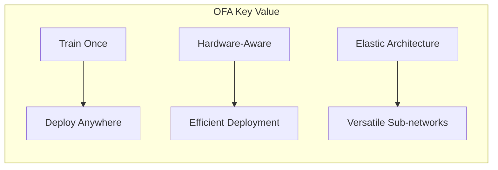
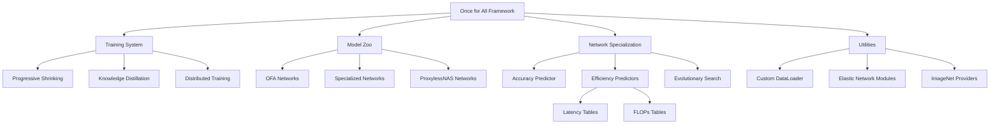
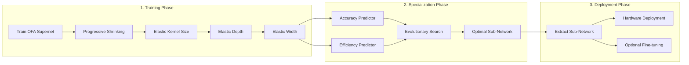
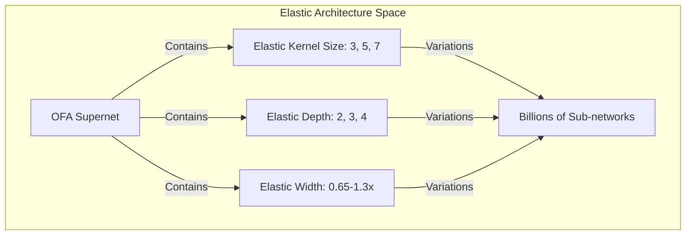
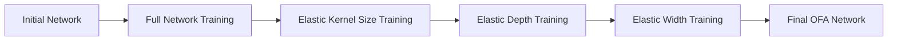
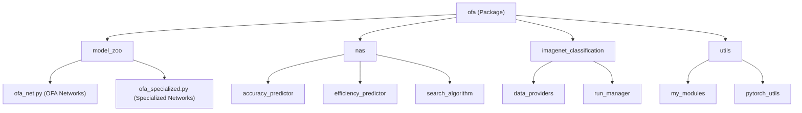
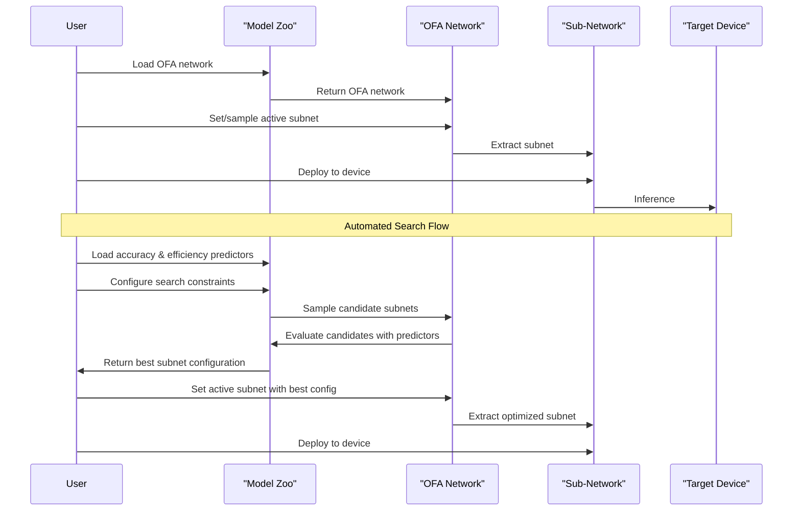

<!-- source: DeepWiki mcp.deepwiki.com · repo mit-han-lab/once-for-all · page 1 Overview · fetched 2026-10-30 -->

# Overview

<details>
<summary>Relevant source files</summary>

The following files were used as context for generating this wiki page:

- [README.md](README.md)
- [figures/cnn_imagenet_new.png](figures/cnn_imagenet_new.png)
- [figures/diverse_hardware.png](figures/diverse_hardware.png)
- [figures/imagenet_80_acc.png](figures/imagenet_80_acc.png)
- [figures/ofa-tutorial.jpg](figures/ofa-tutorial.jpg)
- [figures/overview.png](figures/overview.png)
- [tutorial/README.md](tutorial/README.md)

</details>


Once-for-All (OFA) is a neural network framework designed to solve the challenge of deploying neural networks across diverse hardware platforms with varying resource constraints. It introduces a novel approach: train a single "supernet" once, then extract specialized sub-networks for efficient deployment on target devices.

This page provides a high-level overview of the OFA framework, its architecture, and core concepts. For information about using specific OFA networks, see [OFA Networks](#2.1). For details on the training system, see [Training System](#3).

## What is Once-for-All?

Once-for-All addresses a fundamental challenge in deep learning deployment: the need to create optimized models for different hardware platforms (mobile phones, edge devices, cloud servers) with different computational constraints. Traditional approaches require training separate models for each target platform, which is computationally expensive and time-consuming.

OFA introduces a different paradigm:
1. Train a single large elastic neural network (the "supernet") once
2. Extract specialized sub-networks for different hardware platforms
3. Fine-tune if necessary for the target hardware

The OFA approach dramatically reduces the training cost while maintaining high accuracy across diverse deployment scenarios.



Sources: [README.md:32-42]()

## System Architecture

The OFA framework consists of four main components that work together to enable the "train once, deploy anywhere" capability:



Sources: [README.md:1-42]()

### 1. Training System
The training system implements the progressive shrinking methodology, which is the key to creating a flexible supernet that can be specialized for different deployment scenarios. It also includes knowledge distillation techniques and supports distributed training on multiple servers.

### 2. Model Zoo
The model zoo provides a collection of pre-trained networks that can be loaded and used for inference or further specialization. It includes OFA networks (supernets) and specialized networks optimized for specific hardware platforms.

### 3. Network Specialization
The network specialization system enables finding optimal sub-networks for target hardware platforms. It includes accuracy predictors, efficiency predictors (latency, FLOPs), and evolutionary search algorithms.

### 4. Utilities
The utilities module includes custom data loading pipelines, elastic network modules, and ImageNet dataset providers.

## OFA Workflow

The OFA workflow follows three main phases: training, specialization, and deployment.



Sources: [README.md:32-42](), [README.md:47-62]()

## Key Concepts

### Elastic Architecture

The core innovation of OFA is the elastic architecture, which allows a single network to support multiple sub-networks with different configurations.



The elastic architecture supports variation in:
- **Kernel Size**: The size of the convolutional kernels (e.g., 3×3, 5×5, 7×7)
- **Depth**: The number of layers in the network
- **Width**: The number of channels in each layer
- **Resolution**: The input image size

Sources: [README.md:68-73]()

### Progressive Shrinking

Progressive shrinking is the training methodology that enables creating a flexible supernet. The training starts with the full-sized network and progressively enables the training of smaller sub-networks.



Sources: [README.md:163-169]()

### Network Specialization

Network specialization is the process of finding the optimal sub-network configuration for a target hardware platform. This is done using:

1. **Accuracy Predictor**: Predicts the accuracy of a sub-network without actually training it
2. **Efficiency Predictor**: Predicts the latency, energy consumption, or FLOPs of a sub-network on a target device
3. **Evolutionary Search**: Searches for the optimal sub-network configuration based on the accuracy and efficiency predictions

Sources: [README.md:75-88]()

## Code Organization

The OFA codebase is organized into several key modules:



Sources: [README.md:47-62]()

## Key Interfaces

The main interfaces for using OFA include:

### Loading and Using OFA Networks

```python
# Load an OFA network
from ofa.model_zoo import ofa_net
ofa_network = ofa_net('ofa_mbv3_d234_e346_k357_w1.0', pretrained=True)
    
# Randomly sample sub-networks from OFA network
ofa_network.sample_active_subnet()
random_subnet = ofa_network.get_active_subnet(preserve_weight=True)
    
# Manually set the sub-network
ofa_network.set_active_subnet(ks=7, e=6, d=4)
manual_subnet = ofa_network.get_active_subnet(preserve_weight=True)
```

Sources: [README.md:47-62]()

### Loading Specialized Networks

```python
# Load a specialized network
from ofa.model_zoo import ofa_specialized
net, image_size = ofa_specialized('flops@595M_top1@80.0_finetune@75', pretrained=True)
```

Sources: [README.md:75-88]()

## OFA Network Design Space

OFA provides several network design spaces, each offering different trade-offs between accuracy and efficiency:

| OFA Network | Design Space | Resolution | Width Multiplier | Depth | Expand Ratio | Kernel Size |
|-------------|:------------:|:----------:|:---------------:|:-----:|:------------:|:-----------:|
| ofa_resnet50 | ResNet50D | 128 - 224 | 0.65, 0.8, 1.0 | 0, 1, 2 | 0.2, 0.25, 0.35 | 3 |
| ofa_mbv3_d234_e346_k357_w1.0 | MobileNetV3 | 128 - 224 | 1.0 | 2, 3, 4 | 3, 4, 6 | 3, 5, 7 |
| ofa_mbv3_d234_e346_k357_w1.2 | MobileNetV3 | 160 - 224 | 1.2 | 2, 3, 4 | 3, 4, 6 | 3, 5, 7 |
| ofa_proxyless_d234_e346_k357_w1.3 | ProxylessNAS | 128 - 224 | 1.3 | 2, 3, 4 | 3, 4, 6 | 3, 5, 7 |

Sources: [README.md:68-73]()

## Data Flow During Inference and Search

The following sequence diagram illustrates the data flow during inference and automated search:



Sources: [README.md:47-62](), [README.md:75-88]()

## Summary

Once-for-All (OFA) provides a novel solution to the challenge of deploying neural networks across diverse hardware platforms. By training a single elastic supernet once and then extracting specialized sub-networks for different target devices, OFA significantly reduces the training cost while maintaining high accuracy. The framework includes tools for training, specialization, and deployment, making it a comprehensive solution for efficient neural network deployment.

Sources: [README.md:1-42]()

---

