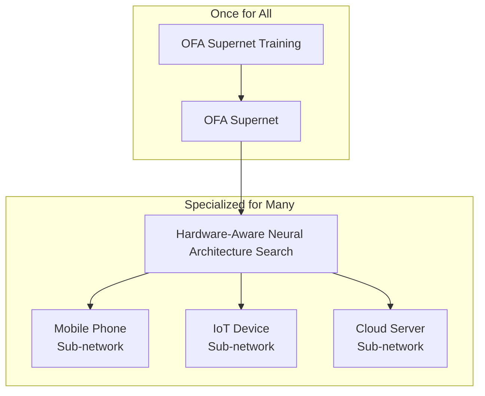
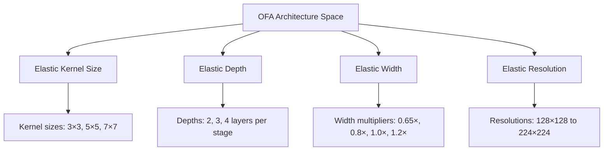
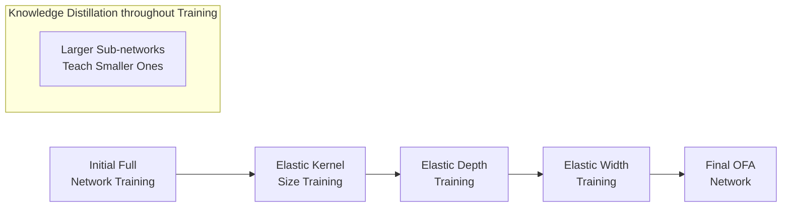
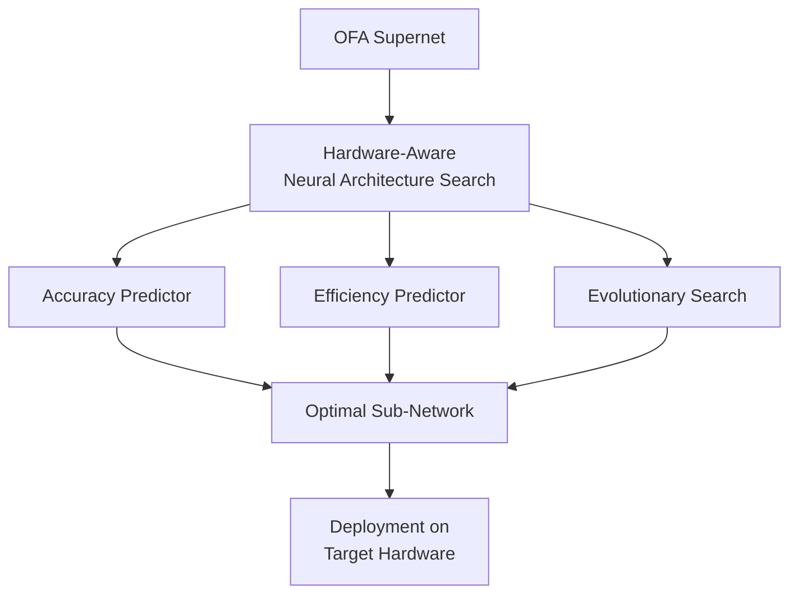
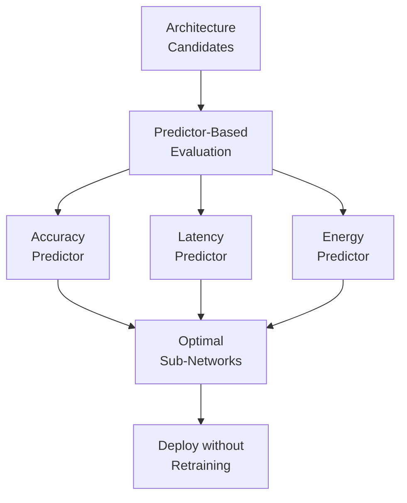
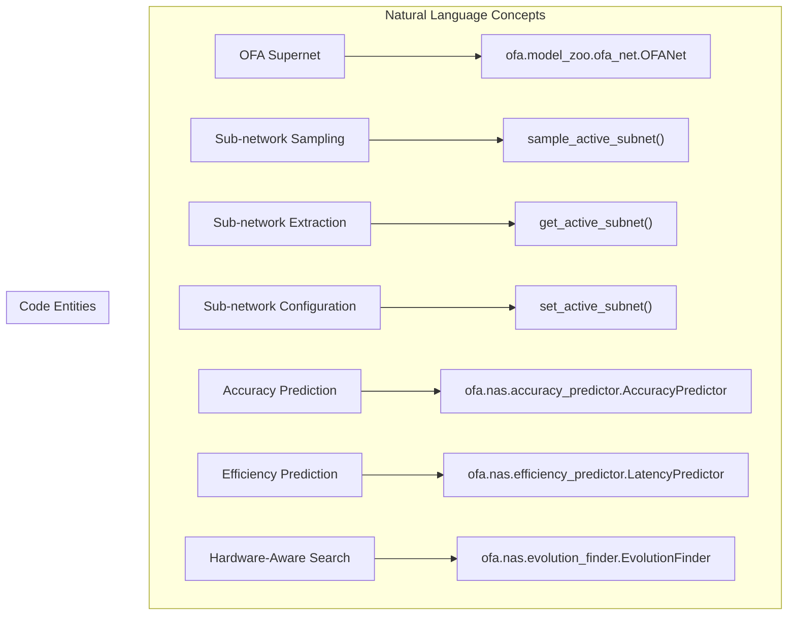
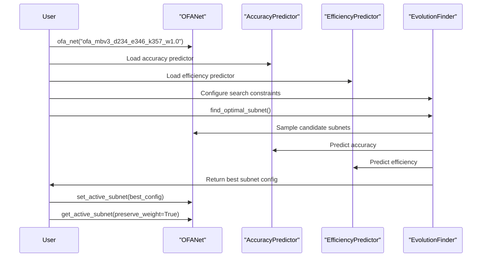
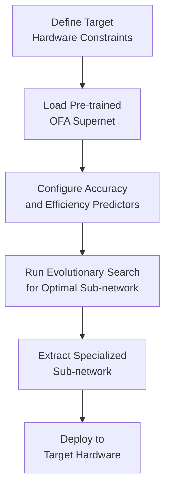

<!-- source: DeepWiki mcp.deepwiki.com · repo mit-han-lab/once-for-all · page 1.1 Key Concepts · fetched 2026-10-30 -->

# Key Concepts

<details>
<summary>Relevant source files</summary>

The following files were used as context for generating this wiki page:

- [README.md](README.md)
- [figures/ofa-tutorial.jpg](figures/ofa-tutorial.jpg)
- [figures/ofa_resnst50_results.png](figures/ofa_resnst50_results.png)
- [figures/ofa_search_cost.png](figures/ofa_search_cost.png)
- [figures/predictor_based_search.png](figures/predictor_based_search.png)
- [figures/select_subnets.png](figures/select_subnets.png)
- [tutorial/README.md](tutorial/README.md)

</details>


This page explains the core concepts of the Once-for-All (OFA) neural network framework. It covers the fundamental architecture design, training methodology, and specialized deployment process that enable OFA's "train once, specialize for many" paradigm. For practical implementation details, see [Getting Started](#1.2).

## Core Concept Overview

The Once-for-All (OFA) framework addresses the challenge of deploying deep neural networks across diverse hardware platforms with different computational constraints. Rather than training separate models for each target device, OFA trains a single versatile neural network (supernet) that can be specialized into various sub-networks to meet specific deployment requirements without additional training.

**Supernet and Sub-networks Relationship**



Sources: [README.md:32-36]()

## OFA Supernet

The OFA supernet is a comprehensive neural network that contains all possible sub-networks that can be derived for deployment. The supernet is trained through a specialized procedure that ensures all sub-networks perform well independently while sharing parameters with the full network.

### Architecture Space

The architecture space defines the range of possible architectures that can be derived from the OFA supernet. It includes several dimensions of flexibility:

- **Elastic Kernel Size**: Different kernel sizes for convolution layers (e.g., 3×3, 5×5, 7×7)
- **Elastic Depth**: Varying network depths (number of layers)
- **Elastic Width**: Different channel widths (e.g., 0.65×, 0.8×, 1.0× of full width)
- **Elastic Resolution**: Support for different input resolutions (e.g., 128×128, 160×160, 224×224)

**OFA Architecture Space Dimensions**



The table below shows examples of design spaces for different OFA network architectures:

| OFA Network | Design Space | Resolution | Width Multiplier | Depth | Expand Ratio | Kernel Size |
|-------------|:------------:|:----------:|:----------------:|:-----:|:------------:|:-----------:|
| ofa_resnet50 | ResNet50D | 128 - 224 | 0.65, 0.8, 1.0 | 0, 1, 2 | 0.2, 0.25, 0.35 | 3 |
| ofa_mbv3_d234_e346_k357_w1.0 | MobileNetV3 | 128 - 224 | 1.0 | 2, 3, 4 | 3, 4, 6 | 3, 5, 7 |
| ofa_mbv3_d234_e346_k357_w1.2 | MobileNetV3 | 160 - 224 | 1.2 | 2, 3, 4 | 3, 4, 6 | 3, 5, 7 |
| ofa_proxyless_d234_e346_k357_w1.3 | ProxylessNAS | 128 - 224 | 1.3 | 2, 3, 4 | 3, 4, 6 | 3, 5, 7 |

Sources: [README.md:68-73]()

## Progressive Shrinking Training

Progressive shrinking is the key training methodology for OFA networks. Instead of training all sub-networks simultaneously, the training process follows a progressive schedule:

1. **Train the full network**: Start by training the largest model with maximum kernel size, depth, and width
2. **Elastic Kernel Size Training**: Train the network to support multiple kernel sizes
3. **Elastic Depth Training**: Train the network to support multiple depths
4. **Elastic Width Training**: Train the network to support multiple channel widths

This progressive approach ensures that smaller sub-networks benefit from the knowledge of larger ones through weight sharing and knowledge distillation.

**Progressive Shrinking Training Process**



The progressive shrinking training is implemented through specialized training scripts that handle the different stages of training for different elastic dimensions.

Sources: [README.md:163-169]()

## Specialized Deployment

Once the OFA supernet is trained, it can be specialized for different deployment scenarios without retraining. This process involves:

**OFA Deployment Workflow**



Sources: [README.md:42-44](), [figures/predictor_based_search.png]()

### Accuracy Predictor

The accuracy predictor estimates the accuracy of sub-networks without actually evaluating them on the validation set, which would be computationally expensive. It enables efficient exploration of the architecture space by quickly identifying promising sub-networks.

### Efficiency Predictor

The efficiency predictor estimates performance metrics such as latency, energy consumption, or FLOPs of sub-networks on target hardware platforms, enabling hardware-aware optimization. The framework includes pre-built latency tables for various devices.

### Evolutionary Search

Evolutionary search is used to find the optimal sub-network from the architecture space based on the accuracy and efficiency predictions. It explores the space efficiently by evolving a population of sub-networks toward better solutions that meet specified constraints.

**Predictor-Based Neural Architecture Search**



The speed difference between traditional neural architecture search (NAS) and OFA's approach is dramatic. As shown in the figures, OFA can find customized models in minutes compared to days or weeks for traditional NAS methods.

Sources: [figures/ofa_search_cost.png](), [figures/predictor_based_search.png]()

## Code Structure and Interfaces

The OFA framework provides several key interfaces and classes that implement the concepts described above.

**OFA Framework Code Structure**



### Key Interfaces

The OFA framework provides several key interfaces for working with OFA networks:

#### Loading OFA Networks

```python
from ofa.model_zoo import ofa_net
ofa_network = ofa_net(net_id, pretrained=True)
```

#### Working with Sub-Networks

```python
# Randomly sample sub-networks from OFA network
ofa_network.sample_active_subnet()
random_subnet = ofa_network.get_active_subnet(preserve_weight=True)
    
# Manually set the sub-network
ofa_network.set_active_subnet(ks=7, e=6, d=4)
manual_subnet = ofa_network.get_active_subnet(preserve_weight=True)
```

#### Loading Specialized Networks

```python
from ofa.model_zoo import ofa_specialized
net, image_size = ofa_specialized(net_id, pretrained=True)
```

**Network Specialization System**



Sources: [README.md:46-62](), [README.md:74-87]()

## Example Operation Workflow

The following workflow depicts how one might use OFA in practice:

1. Load an OFA supernet from the model zoo
2. Use the accuracy and efficiency predictors to evaluate potential sub-networks
3. Apply evolutionary search to find the optimal sub-network for your hardware constraints
4. Extract the specialized sub-network using `get_active_subnet()`
5. Deploy the specialized sub-network to the target hardware

**OFA Operation Workflow**



This workflow enables rapid adaptation to different hardware platforms without the computational cost of training separate models for each target device.

Sources: [README.md:46-62](), [figures/select_subnets.png]()

## Conclusion

The Once-for-All (OFA) framework represents a significant advancement in efficient deep learning deployment by introducing:

1. A versatile supernet that encompasses a large architecture space
2. Progressive shrinking training methodology that ensures all sub-networks perform well
3. Fast specialized deployment through accuracy prediction, efficiency prediction, and evolutionary search

Through these key concepts, OFA achieves its goal of "train once, specialize for many" - training a single neural network that can be specialized for efficient deployment across diverse hardware platforms.

Sources: [README.md:32-36]()

---

