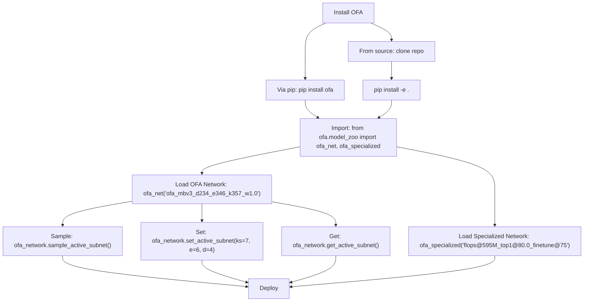
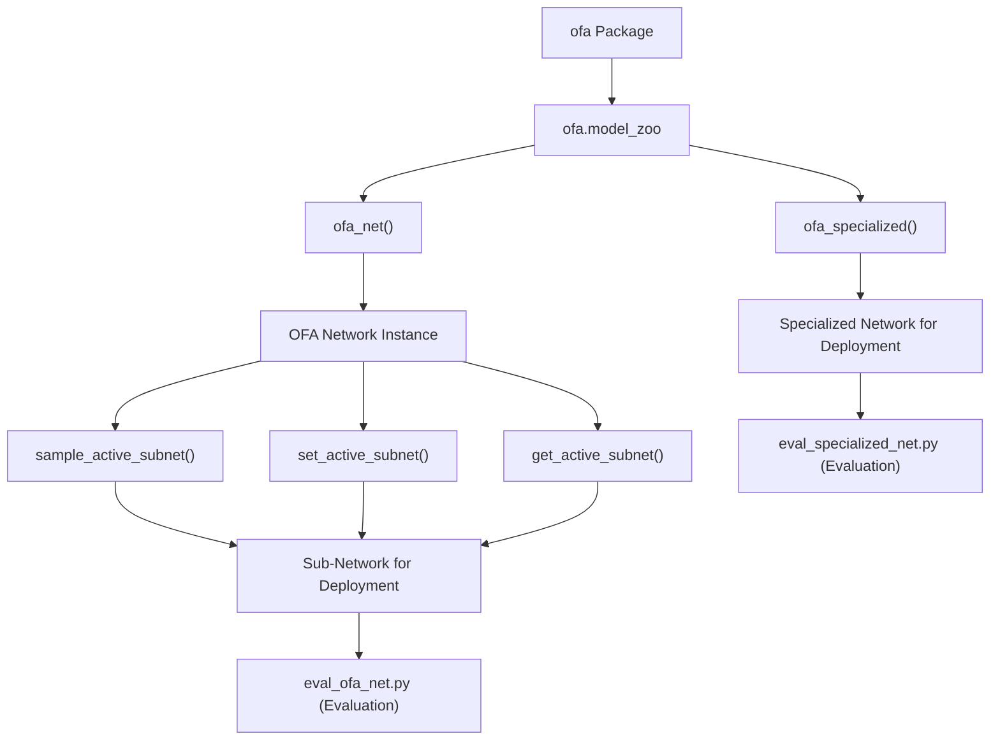
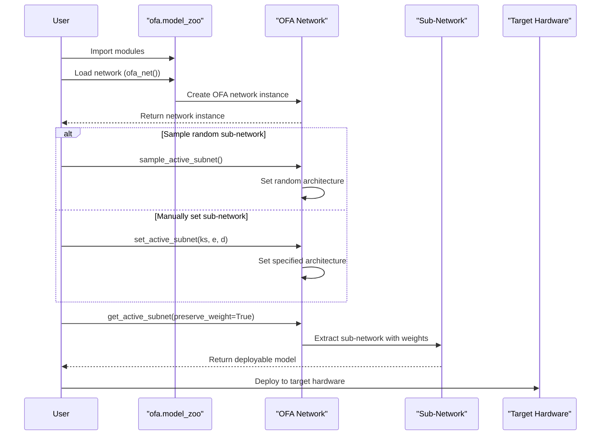

<!-- source: DeepWiki mcp.deepwiki.com · repo mit-han-lab/once-for-all · page 1.2 Getting Started · fetched 2026-10-30 -->

# Getting Started

<details>
<summary>Relevant source files</summary>

The following files were used as context for generating this wiki page:

- [README.md](README.md)
- [build.sh](build.sh)
- [figures/ofa-tutorial.jpg](figures/ofa-tutorial.jpg)
- [requirements.txt](requirements.txt)
- [setup.py](setup.py)
- [tutorial/README.md](tutorial/README.md)

</details>


This page provides instructions for setting up and installing the Once-for-All (OFA) framework. OFA enables you to train one neural network and specialize it for efficient deployment across different hardware platforms and constraints. For information about the core concepts behind OFA, see [Key Concepts](#1.1).

## System Requirements

Before installing OFA, ensure your system meets the following requirements:

- Python 3.6+
- PyTorch 1.4.0+
- For training OFA networks: Horovod and ImageNet dataset
- For inference only: Basic PyTorch installation is sufficient

Sources: [README.md:186-189]()

## Installation Options

### Option 1: Installation via pip

The simplest way to install OFA is through pip:

```bash
pip install ofa
```

This will install the entire OFA codebase with its dependencies.

Sources: [README.md:26]()

### Option 2: Installation from source

For the latest version or if you plan to modify the code, install from source:

```bash
git clone https://github.com/mit-han-lab/once-for-all.git
cd once-for-all
pip install -e .
```

### Dependencies

The main dependencies for OFA include:

```
torch
torchvision
filelock
gdown
```

Sources: [requirements.txt:1-4](), [setup.py:31-33]()

## Installation and Usage Workflow

Below is a diagram illustrating the installation and basic usage workflow of OFA:



Sources: [README.md:26](), [setup.py:41-61]()

## Basic Usage

### Loading Pre-trained OFA Networks

```python
from ofa.model_zoo import ofa_net

# Load a pre-trained OFA network
ofa_network = ofa_net('ofa_mbv3_d234_e346_k357_w1.0', pretrained=True)
```

The OFA framework provides several pre-trained networks with different architecture spaces:

| OFA Network | Design Space | Resolution | Width Multiplier | Depth | Expand Ratio | Kernel Size |
|-------------|--------------|------------|------------------|-------|--------------|-------------|
| ofa_resnet50 | ResNet50D | 128 - 224 | 0.65, 0.8, 1.0 | 0, 1, 2 | 0.2, 0.25, 0.35 | 3 |
| ofa_mbv3_d234_e346_k357_w1.0 | MobileNetV3 | 128 - 224 | 1.0 | 2, 3, 4 | 3, 4, 6 | 3, 5, 7 |
| ofa_mbv3_d234_e346_k357_w1.2 | MobileNetV3 | 160 - 224 | 1.2 | 2, 3, 4 | 3, 4, 6 | 3, 5, 7 |
| ofa_proxyless_d234_e346_k357_w1.3 | ProxylessNAS | 128 - 224 | 1.3 | 2, 3, 4 | 3, 4, 6 | 3, 5, 7 |

Sources: [README.md:48-54](), [README.md:68-73]()

### Working with Sub-networks

The power of OFA lies in its ability to generate specialized sub-networks:

```python
# Randomly sample a sub-network
ofa_network.sample_active_subnet()
random_subnet = ofa_network.get_active_subnet(preserve_weight=True)

# Manually specify a sub-network
ofa_network.set_active_subnet(ks=7, e=6, d=4)
manual_subnet = ofa_network.get_active_subnet(preserve_weight=True)
```

Sources: [README.md:55-61]()

### Evaluating OFA Networks

To evaluate the performance of an OFA network on ImageNet:

```bash
python eval_ofa_net.py --path 'Your path to imagenet' --net ofa_mbv3_d234_e346_k357_w1.0
```

Sources: [README.md:66]()

### Using Specialized Networks

OFA also provides pre-specialized networks optimized for specific constraints:

```python
from ofa.model_zoo import ofa_specialized

# Load a specialized network (optimized for specific constraints)
net, image_size = ofa_specialized('flops@595M_top1@80.0_finetune@75', pretrained=True)
```

To evaluate a specialized network:

```bash
python eval_specialized_net.py --path 'Your path to imagenet' --net flops@595M_top1@80.0_finetune@75
```

Sources: [README.md:78-82](), [README.md:87]()

## OFA Framework Architecture

The following diagram shows the main components of the OFA framework and their relationships:



Sources: [README.md:48-61](), [README.md:78-82]()

## Network Selection and Deployment Process

This sequence diagram shows the typical workflow from network selection to deployment:



Sources: [README.md:48-61]()

## Interactive Tutorial

OFA provides an interactive tutorial in the form of a Jupyter notebook:

```bash
git clone https://github.com/mit-han-lab/once-for-all.git
cd once-for-all/tutorial
jupyter notebook ofa.ipynb
```

You can also use the notebook directly in Google Colab by visiting the OFA repository.

Sources: [tutorial/README.md:3-5](), [tutorial/README.md:37-43]()

## Next Steps

- For a hands-on tutorial of OFA, see the [Basic OFA Tutorial](#6.1)
- For a specific example using ResNet50, check out the [ResNet50 Example](#6.2)
- To learn more about the OFA model zoo, see [Model Zoo](#2)
- For understanding OFA's training system, refer to [Training System](#3)
- For specializing the OFA supernet into efficient sub-networks, see [Network Specialization](#4)

---

