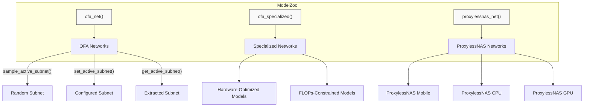
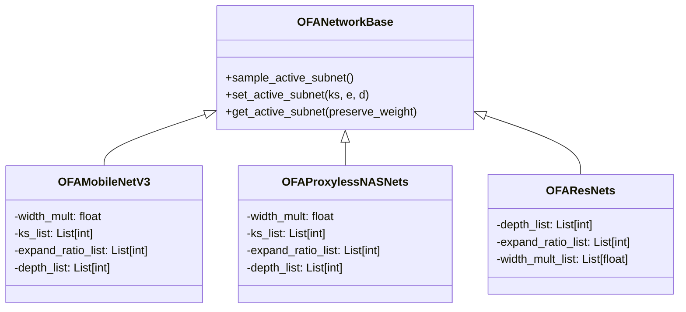
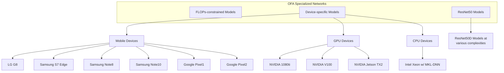
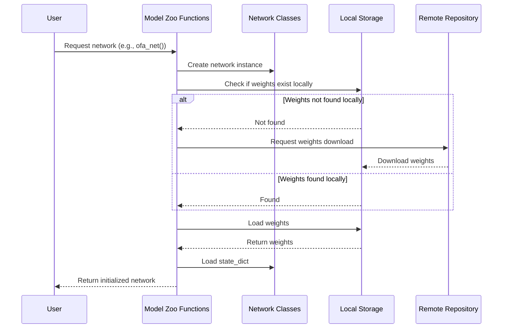
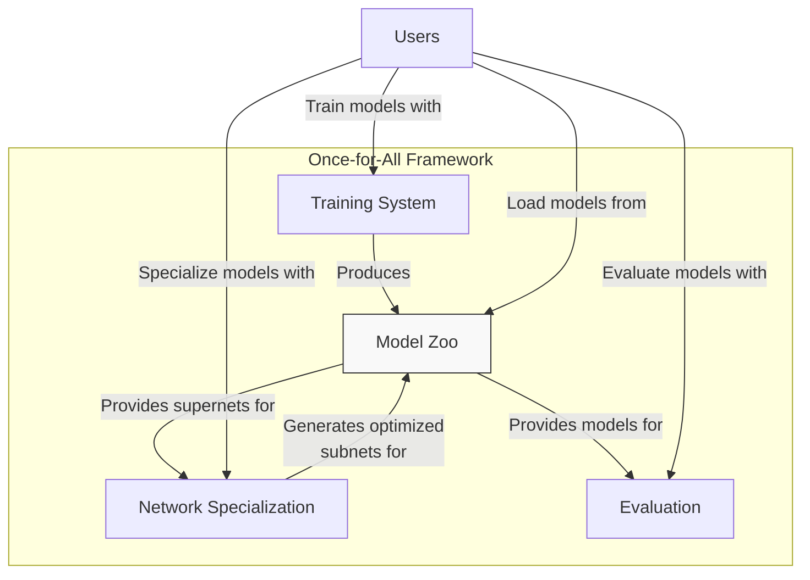

<!-- source: DeepWiki mcp.deepwiki.com · repo mit-han-lab/once-for-all · page 2 Model Zoo · fetched 2026-10-30 -->

# Model Zoo

<details>
<summary>Relevant source files</summary>

The following files were used as context for generating this wiki page:

- [README.md](README.md)
- [figures/ofa-tutorial.jpg](figures/ofa-tutorial.jpg)
- [ofa/model_zoo.py](ofa/model_zoo.py)
- [tutorial/README.md](tutorial/README.md)

</details>


## Purpose and Overview

The Model Zoo in the Once-for-All (OFA) framework provides access to pre-trained neural network models that can be directly deployed or further specialized for specific hardware targets. This page documents how to access and use these models, including OFA supernets, specialized subnets, and ProxylessNAS networks.

For information about training your own OFA networks, see [Training System](#3).

Sources: [README.md:46-62](), [ofa/model_zoo.py:1-24]()

## Model Zoo Architecture

The Model Zoo serves as a central repository for accessing different types of neural networks in the OFA ecosystem:



The Model Zoo exposes three main functions for accessing different types of networks:
- `ofa_net()` - Loads OFA supernets that can generate many subnets
- `ofa_specialized()` - Loads pre-optimized specialized networks for specific hardware/constraints
- `proxylessnas_net()` - Loads ProxylessNAS networks (predecessor to OFA)

Sources: [ofa/model_zoo.py:17-24]()

## OFA Networks

OFA Networks are elastic neural networks that contain many possible subnetworks with different architectures. These supernets can be configured to generate efficient subnetworks for various deployment scenarios.

### Available OFA Networks

| Network ID | Architecture | Resolution | Width Multiplier | Depth Range | Expand Ratio Range | Kernel Size Range |
|------------|--------------|------------|------------------|-------------|-------------------|------------------|
| ofa_mbv3_d234_e346_k357_w1.0 | MobileNetV3 | 128-224 | 1.0 | 2, 3, 4 | 3, 4, 6 | 3, 5, 7 |
| ofa_mbv3_d234_e346_k357_w1.2 | MobileNetV3 | 160-224 | 1.2 | 2, 3, 4 | 3, 4, 6 | 3, 5, 7 |
| ofa_proxyless_d234_e346_k357_w1.3 | ProxylessNAS | 128-224 | 1.3 | 2, 3, 4 | 3, 4, 6 | 3, 5, 7 |
| ofa_resnet50 | ResNet50D | 128-224 | 0.65, 0.8, 1.0 | 0, 1, 2 | 0.2, 0.25, 0.35 | 3 |

Sources: [README.md:69-73](), [ofa/model_zoo.py:61-108]()

### OFA Network Implementation



Sources: [ofa/model_zoo.py:61-108](), [README.md:46-62]()

### Using OFA Networks

OFA networks can be loaded using the `ofa_net()` function:

```python
from ofa.model_zoo import ofa_net

# Load an OFA network with pre-trained weights
ofa_network = ofa_net('ofa_mbv3_d234_e346_k357_w1.0', pretrained=True)

# Randomly sample a subnet from the OFA network
ofa_network.sample_active_subnet()
random_subnet = ofa_network.get_active_subnet(preserve_weight=True)

# Manually configure a subnet
ofa_network.set_active_subnet(ks=7, e=6, d=4)
manual_subnet = ofa_network.get_active_subnet(preserve_weight=True)
```

Sources: [README.md:47-62]()

## Specialized Networks

Specialized networks are pre-extracted subnets from OFA networks, optimized for specific hardware platforms or performance constraints. These networks are ready to deploy without further configuration.

### Specialized Network Categories



Sources: [README.md:101-161]()

### Available Specialized Networks

The OFA framework provides over 40 specialized networks optimized for different platforms and constraints. Some examples include:

| Model ID | Hardware Target | Top-1 Accuracy (%) | Parameters | MACs |
|----------|-----------------|-------------------|------------|------|
| flops@595M_top1@80.0_finetune@75 | FLOPs constraint | 80.0 | 9.1M | 595M |
| LG-G8_lat@24ms_top1@76.4_finetune@25 | LG G8 | 76.4 | 5.8M | 230M |
| s7edge_lat@88ms_top1@76.3_finetune@25 | Samsung S7 Edge | 76.3 | 6.4M | 219M |
| note10_lat@64ms_top1@80.2_finetune@75 | Samsung Note10 | 80.2 | 9.1M | 743M |
| pixel1_lat@143ms_top1@80.1_finetune@75 | Google Pixel1 | 80.1 | 9.2M | 642M |
| 1080ti_gpu64@27ms_top1@76.4_finetune@25 | NVIDIA 1080ti GPU | 76.4 | 6.5M | 397M |
| cpu_lat@17ms_top1@75.7_finetune@25 | Intel Xeon CPU | 75.7 | 4.9M | 365M |
| resnet50D_MAC@4.1B_top1@79.8 | ResNet50D Space | 79.8 | 30.9M | 4.1B |

For a complete list of available specialized networks, refer to the repository README.

Sources: [README.md:101-161]()

### Using Specialized Networks

Specialized networks can be loaded using the `ofa_specialized()` function:

```python
from ofa.model_zoo import ofa_specialized

# Load a specialized network optimized for a specific hardware target
net, image_size = ofa_specialized('flops@595M_top1@80.0_finetune@75', pretrained=True)

# The function returns both the network and the recommended image size
```

Sources: [README.md:75-87](), [ofa/model_zoo.py:27-58]()

## ProxylessNAS Networks

The Model Zoo also provides access to ProxylessNAS networks, which are the predecessors to OFA networks.

### Available ProxylessNAS Networks

The following ProxylessNAS networks are available:

| Network | Function |
|---------|----------|
| ProxylessNAS Mobile | `proxylessnas_mobile()` |
| ProxylessNAS CPU | `proxylessnas_cpu()` |
| ProxylessNAS GPU | `proxylessnas_gpu()` |

Sources: [ofa/model_zoo.py:111-136]()

### Using ProxylessNAS Networks

ProxylessNAS networks can be loaded using specialized functions:

```python
from ofa.model_zoo import proxylessnas_mobile, proxylessnas_cpu, proxylessnas_gpu

# Load ProxylessNAS Mobile
mobile_net = proxylessnas_mobile(pretrained=True)

# Load ProxylessNAS CPU
cpu_net = proxylessnas_cpu(pretrained=True)

# Load ProxylessNAS GPU
gpu_net = proxylessnas_gpu(pretrained=True)
```

Sources: [ofa/model_zoo.py:127-136]()

## Model Loading Mechanism

The Model Zoo uses a consistent loading mechanism for all network types, downloading pre-trained weights from online repositories:



Sources: [ofa/model_zoo.py:27-58](), [ofa/model_zoo.py:61-108]()

## Model Zoo Integration

The Model Zoo integrates with other components of the OFA system to enable comprehensive neural network development and deployment:



For more information on the training system, see [Training System](#3).
For more information on network specialization, see [Network Specialization](#4).

Sources: [README.md:31-45]()

---

