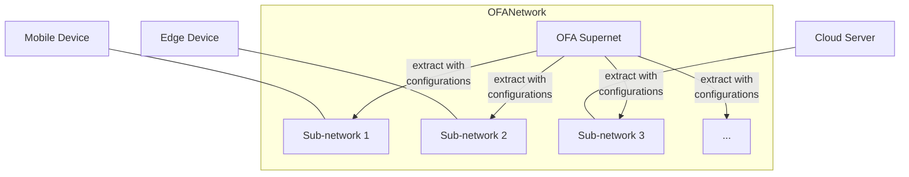
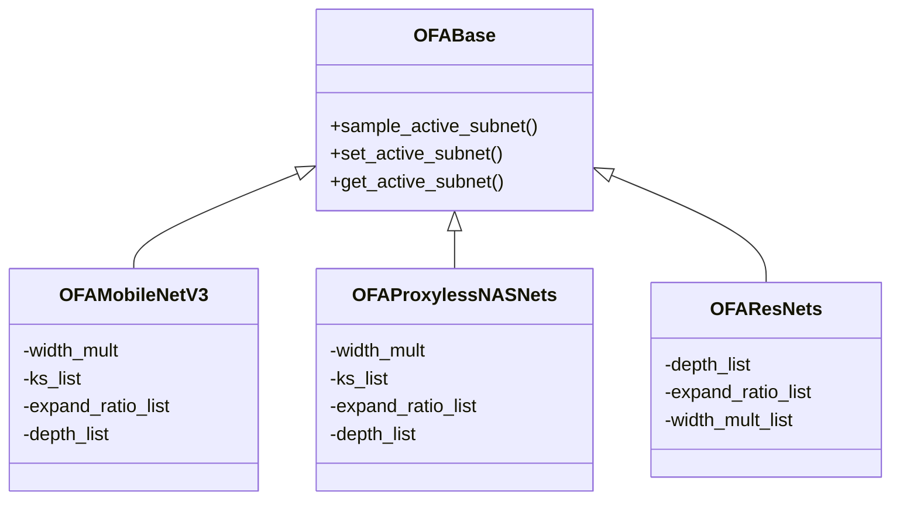
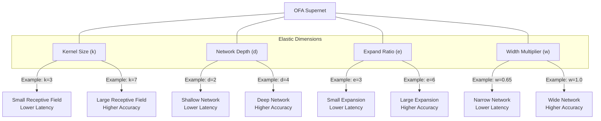
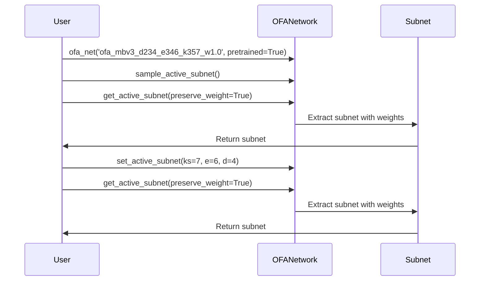

<!-- source: DeepWiki mcp.deepwiki.com · repo mit-han-lab/once-for-all · page 2.1 OFA Networks · fetched 2026-10-30 -->

# OFA Networks

<details>
<summary>Relevant source files</summary>

The following files were used as context for generating this wiki page:

- [README.md](README.md)
- [figures/ofa-tutorial.jpg](figures/ofa-tutorial.jpg)
- [ofa/model_zoo.py](ofa/model_zoo.py)
- [tutorial/README.md](tutorial/README.md)

</details>


This document details the available Once-for-All (OFA) network architectures and their configurations within the Once-for-All framework. For information about specialized networks derived from OFA networks, see [Specialized Networks](#2.2). For details on how to train OFA networks, see [Training System](#3).

## Introduction to OFA Networks

OFA networks are supernets that encapsulate an entire design space of neural network architectures. Each OFA network contains weight-sharing sub-networks that can be extracted by specifying the architectural configurations. The key idea is to train a single OFA network once and then extract specialized sub-networks for different deployment scenarios without requiring retraining.



Sources: [README.md:32-33](), [README.md:46-62]()

## Available OFA Network Architectures

OFA provides three main network architectures, each with different design spaces and characteristics:

### 1. OFA MobileNetV3

Based on MobileNetV3, this architecture offers a design space with various kernel sizes, expand ratios, depths, and width multipliers.

Available pre-trained variants:
- `ofa_mbv3_d234_e346_k357_w1.0`: MobileNetV3 with width multiplier 1.0
- `ofa_mbv3_d234_e346_k357_w1.2`: MobileNetV3 with width multiplier 1.2

### 2. OFA ProxylessNAS

Based on ProxylessNAS, this architecture is optimized for various deployment platforms.

Available pre-trained variant:
- `ofa_proxyless_d234_e346_k357_w1.3`: ProxylessNAS with width multiplier 1.3

### 3. OFA ResNet50

Based on ResNet50, this architecture provides a design space with different depths, expand ratios, and width multipliers.

Available pre-trained variant:
- `ofa_resnet50`: ResNet50 with variable depth, expand ratio, and width multiplier



Sources: [ofa/model_zoo.py:61-108](), [README.md:69-73]()

## OFA Networks Design Space

Each OFA network architecture encompasses a large design space defined by several dimensions:

| OFA Network | Design Space | Resolution | Width Multiplier | Depth | Expand Ratio | Kernel Size |
|-------------|--------------|------------|------------------|-------|--------------|-------------|
| ofa_resnet50 | ResNet50D | 128 - 224 | 0.65, 0.8, 1.0 | 0, 1, 2 | 0.2, 0.25, 0.35 | 3 |
| ofa_mbv3_d234_e346_k357_w1.0 | MobileNetV3 | 128 - 224 | 1.0 | 2, 3, 4 | 3, 4, 6 | 3, 5, 7 |
| ofa_mbv3_d234_e346_k357_w1.2 | MobileNetV3 | 160 - 224 | 1.2 | 2, 3, 4 | 3, 4, 6 | 3, 5, 7 |
| ofa_proxyless_d234_e346_k357_w1.3 | ProxylessNAS | 128 - 224 | 1.3 | 2, 3, 4 | 3, 4, 6 | 3, 5, 7 |

These dimensions create a vast space of possible sub-networks that can be extracted from each OFA network.

Sources: [README.md:69-73]()

## Elastic Dimensions in OFA Networks

OFA networks support multiple elastic dimensions that can be adjusted to create different sub-networks:



Sources: [ofa/model_zoo.py:65-94](), [README.md:69-73]()

## Using OFA Networks

### Loading Pre-trained OFA Networks

```python
from ofa.model_zoo import ofa_net

# Load a pre-trained OFA network
ofa_network = ofa_net('ofa_mbv3_d234_e346_k357_w1.0', pretrained=True)
```

### Working with OFA Networks

OFA networks provide three key methods for manipulating sub-networks:

1. `sample_active_subnet()`: Randomly sample a sub-network configuration
2. `set_active_subnet(ks, e, d)`: Manually set a specific sub-network configuration
3. `get_active_subnet(preserve_weight=True)`: Extract the currently active sub-network

Example usage:

```python
# Randomly sample sub-networks from OFA network
ofa_network.sample_active_subnet()
random_subnet = ofa_network.get_active_subnet(preserve_weight=True)
    
# Manually set the sub-network
ofa_network.set_active_subnet(ks=7, e=6, d=4)
manual_subnet = ofa_network.get_active_subnet(preserve_weight=True)
```



Sources: [README.md:46-62](), [ofa/model_zoo.py:61-108]()

## Implementation Details

OFA network implementations are defined in the elastic_nn.networks module, with the following main classes:

- `OFAMobileNetV3`: Implementation of the OFA MobileNetV3 architecture
- `OFAProxylessNASNets`: Implementation of the OFA ProxylessNAS architecture
- `OFAResNets`: Implementation of the OFA ResNet50 architecture

The `ofa_net` function in `model_zoo.py` provides a convenient way to load these networks with pre-trained weights.

Sources: [ofa/model_zoo.py:10-15](), [ofa/model_zoo.py:61-108]()

## Network Performance Comparison

OFA networks can achieve comparable or better performance than their fixed counterparts while offering flexibility across different deployment scenarios:

- OFA MobileNetV3 networks can reach 80% top-1 accuracy on ImageNet under mobile settings
- OFA networks consistently outperform MobileNetV3 on diverse hardware platforms
- OFA ResNet50 networks can achieve comparable accuracy to standard ResNet50 while offering flexible configurations

For detailed performance numbers and benchmarks, see [Evaluation](#5).

Sources: [README.md:35-41]()

---

