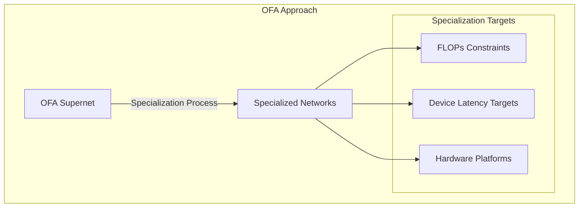
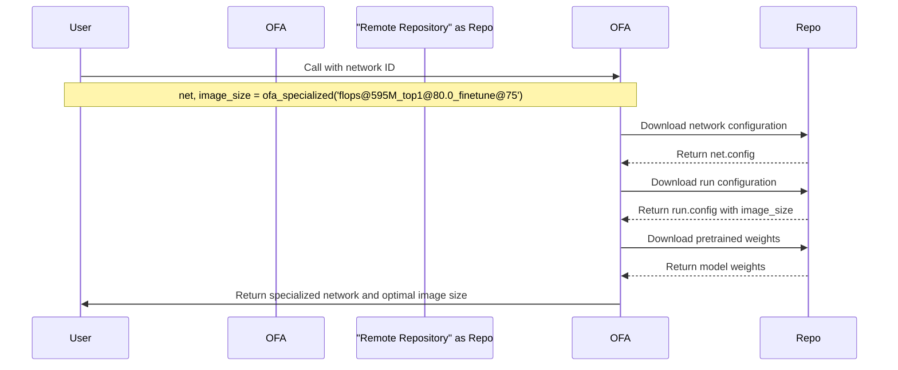
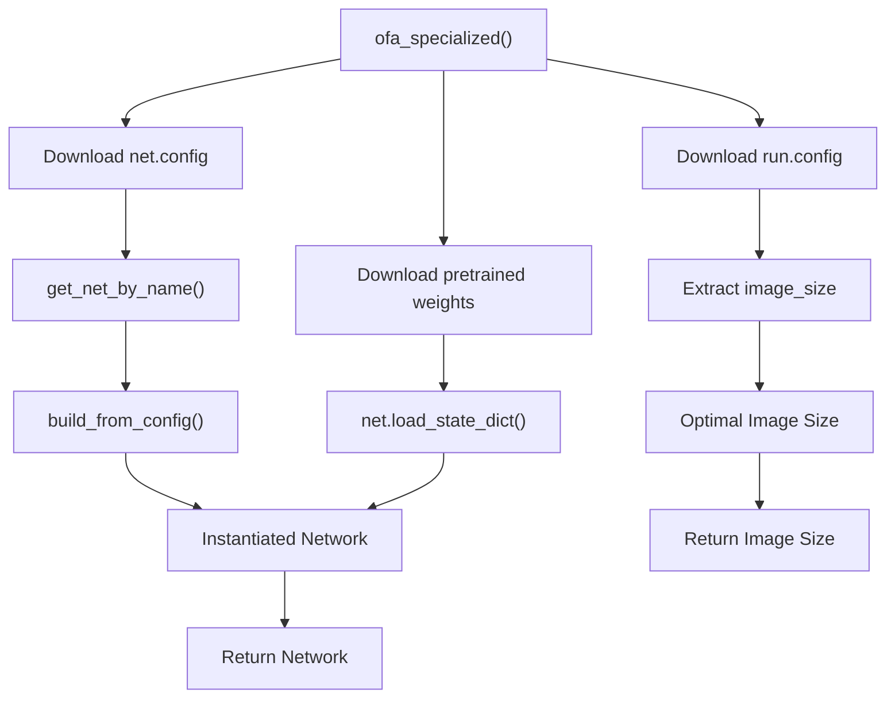
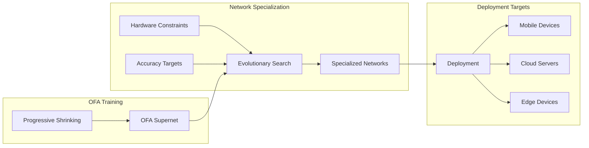

<!-- source: DeepWiki mcp.deepwiki.com · repo mit-han-lab/once-for-all · page 2.2 Specialized Networks · fetched 2026-10-30 -->

# Specialized Networks

<details>
<summary>Relevant source files</summary>

The following files were used as context for generating this wiki page:

- [README.md](README.md)
- [figures/ofa-tutorial.jpg](figures/ofa-tutorial.jpg)
- [ofa/model_zoo.py](ofa/model_zoo.py)
- [tutorial/README.md](tutorial/README.md)

</details>


## Purpose and Scope

This document explains Specialized Networks in the Once-for-All (OFA) framework - pre-trained neural networks that have been optimized for specific hardware platforms or performance constraints. These networks are derived from the OFA supernet and represent specific sub-networks that achieve optimal performance on target hardware. For information about the parent OFA Networks, see [OFA Networks](#2.1).

## Overview

Specialized Networks are a key outcome of the OFA framework's "train once, specialize for many" approach. While the OFA supernet contains a vast array of possible sub-networks, Specialized Networks represent specific configurations that have been optimized for particular deployment scenarios.



Sources: [README.md:32-37](), [README.md:75-83]()

## Using Specialized Networks

Specialized Networks can be easily loaded and used through the `ofa_specialized` function in the model zoo:



### Loading a Specialized Network

The `ofa_specialized` function retrieves both the network and the appropriate image size for inference:

```python
from ofa.model_zoo import ofa_specialized
net, image_size = ofa_specialized(net_id, pretrained=True)
```

Where `net_id` follows naming patterns that indicate the network's optimization target and performance:
- FLOPs-based: `flops@595M_top1@80.0_finetune@75`
- Device-based: `note10_lat@30ms_top1@78.4_finetune@75`

Sources: [ofa/model_zoo.py:27-58](), [README.md:75-83]()

### Evaluating a Specialized Network

Specialized networks can be evaluated using the provided script:

```bash
python eval_specialized_net.py --path 'Your path to imagenet' --net flops@595M_top1@80.0_finetune@75
```

Sources: [README.md:86-87]()

## Implementation Details

The `ofa_specialized` function in the model zoo handles downloading and instantiating specialized networks:



The function performs these key operations:
1. Downloads the network configuration (`net.config`)
2. Builds the network using the appropriate constructor
3. Retrieves the optimal image size from the run configuration
4. Loads the pre-trained weights
5. Returns both the network and the recommended image size

Sources: [ofa/model_zoo.py:27-58]()

## Available Specialized Networks

The OFA framework provides a large collection of specialized networks optimized for different targets. These networks are categorized by their optimization criteria:

### FLOPs-Optimized Networks

| Model Name | FLOPs | Top-1 Accuracy (%) |
|------------|-------|-------------------|
| ofa-595M   | 595M  | 80.0              |
| ofa-482M   | 482M  | 79.6              |
| ofa-389M   | 389M  | 79.1              |

### Device-Optimized Networks

Networks optimized for specific devices with latency constraints:

#### Samsung Note10

| Model Name | Latency | Top-1 Accuracy (%) |
|------------|---------|-------------------|
| ofa-note10-64 | 64ms | 80.2              |
| ofa-note10-50 | 50ms | 79.7              |
| ofa-note10-41 | 41ms | 79.3              |
| ofa-note10-30 | 30ms | 78.4              |
| ofa-note10-22 | 22ms | 76.6              |
| ofa-note10-16 | 16ms | 75.5              |
| ofa-note10-11 | 11ms | 73.6              |
| ofa-note10-08 | 8ms  | 71.4              |

#### Google Pixel1

| Model Name | Latency | Top-1 Accuracy (%) |
|------------|---------|-------------------|
| ofa-pixel1-143 | 143ms | 80.1            |
| ofa-pixel1-132 | 132ms | 79.8            |
| ofa-pixel1-79 | 79ms | 78.7              |
| ofa-pixel1-58 | 58ms | 76.9              |
| ofa-pixel1-40 | 40ms | 74.9              |
| ofa-pixel1-28 | 28ms | 73.3              |
| ofa-pixel1-20 | 20ms | 71.4              |

### Hardware-Optimized Networks

Networks optimized for specific hardware platforms:

#### GPUs (Batch Size 64)

| Model Name | Hardware | Latency | Top-1 Accuracy (%) |
|------------|----------|---------|-------------------|
| ofa-1080ti-27 | 1080ti | 27ms | 76.4              |
| ofa-1080ti-22 | 1080ti | 22ms | 75.3              |
| ofa-v100-11 | V100 | 11ms | 76.1                  |
| ofa-v100-09 | V100 | 9ms | 75.3                   |

#### CPU (Batch Size 1)

| Model Name | Latency | Top-1 Accuracy (%) |
|------------|---------|-------------------|
| ofa-cpu-17 | 17ms | 75.7                 |
| ofa-cpu-15 | 15ms | 74.6                 |
| ofa-cpu-11 | 11ms | 72.0                 |
| ofa-cpu-10 | 10ms | 71.1                 |

Sources: [README.md:90-161]()

## Relationship to the OFA Framework

Specialized Networks represent the practical deployment outcome of the OFA approach:



The specialized networks are the result of:
1. Training the OFA supernet using progressive shrinking
2. Using evolutionary search to find optimal sub-networks for specific hardware constraints
3. Extracting these sub-networks with their weights for efficient deployment

Sources: [README.md:32-37](), [README.md:90-161]()

## Conclusion

Specialized Networks provide ready-to-use models optimized for various deployment scenarios, allowing developers to quickly deploy efficient networks without performing the specialization process themselves. These networks represent different performance-accuracy trade-offs for diverse hardware platforms, from mobile devices to cloud servers.

---

