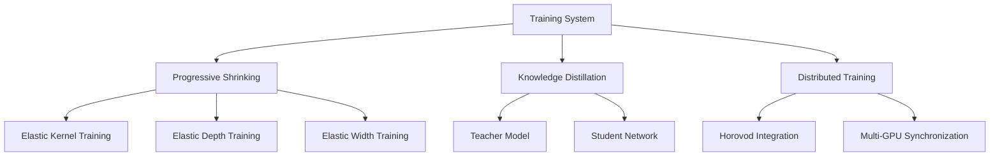
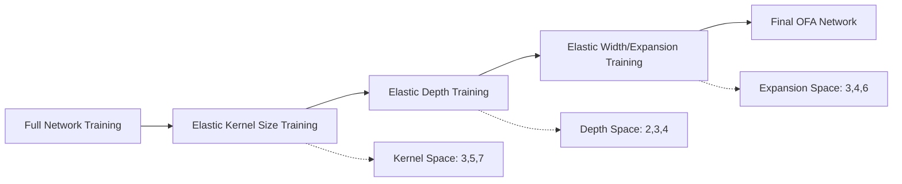
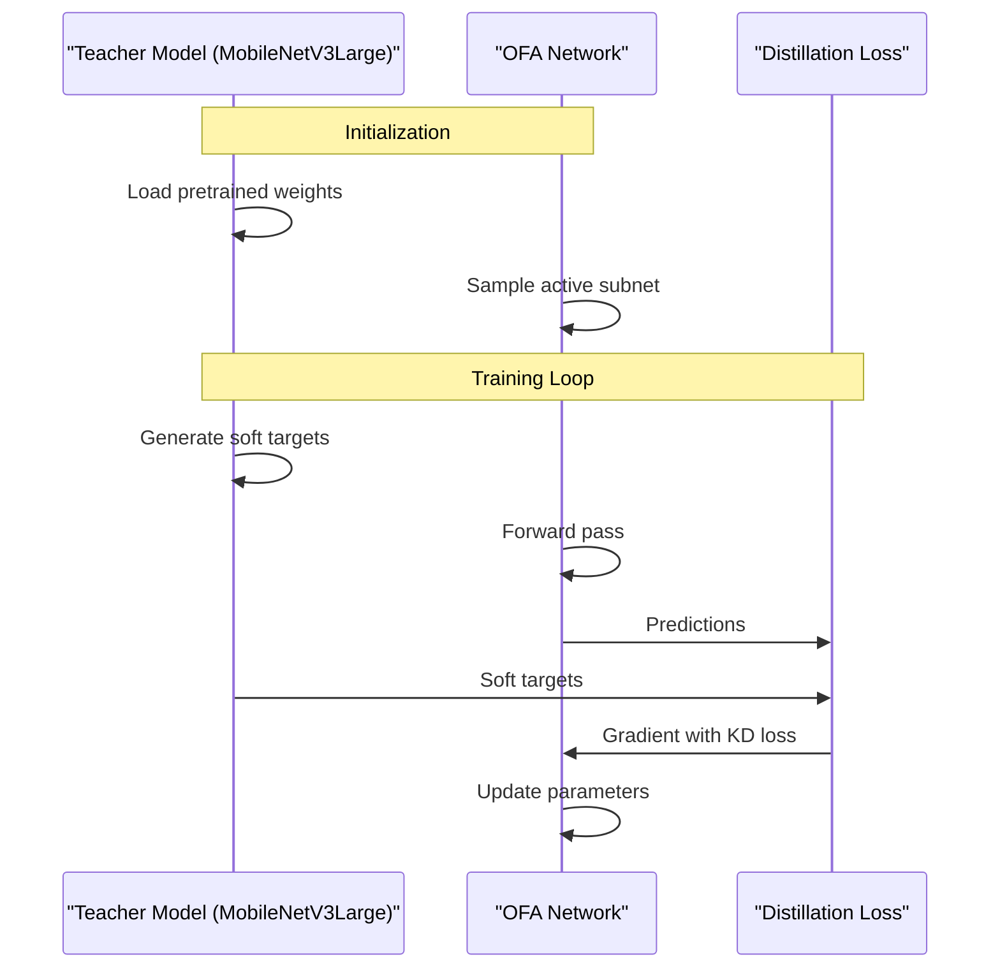
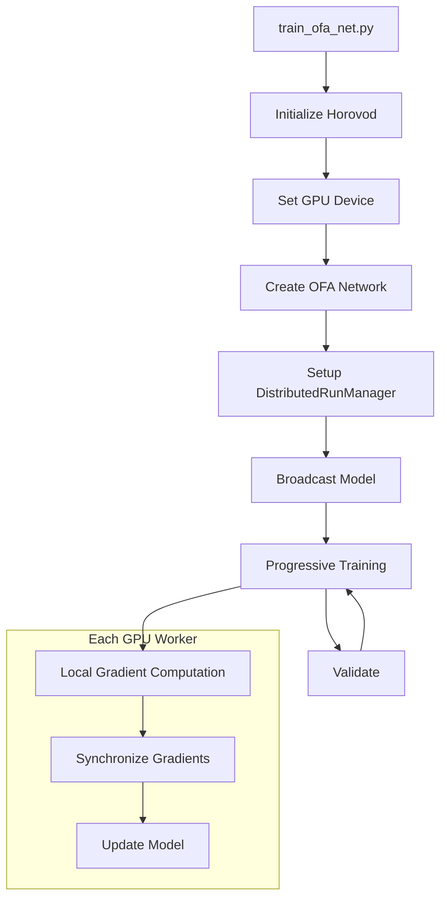
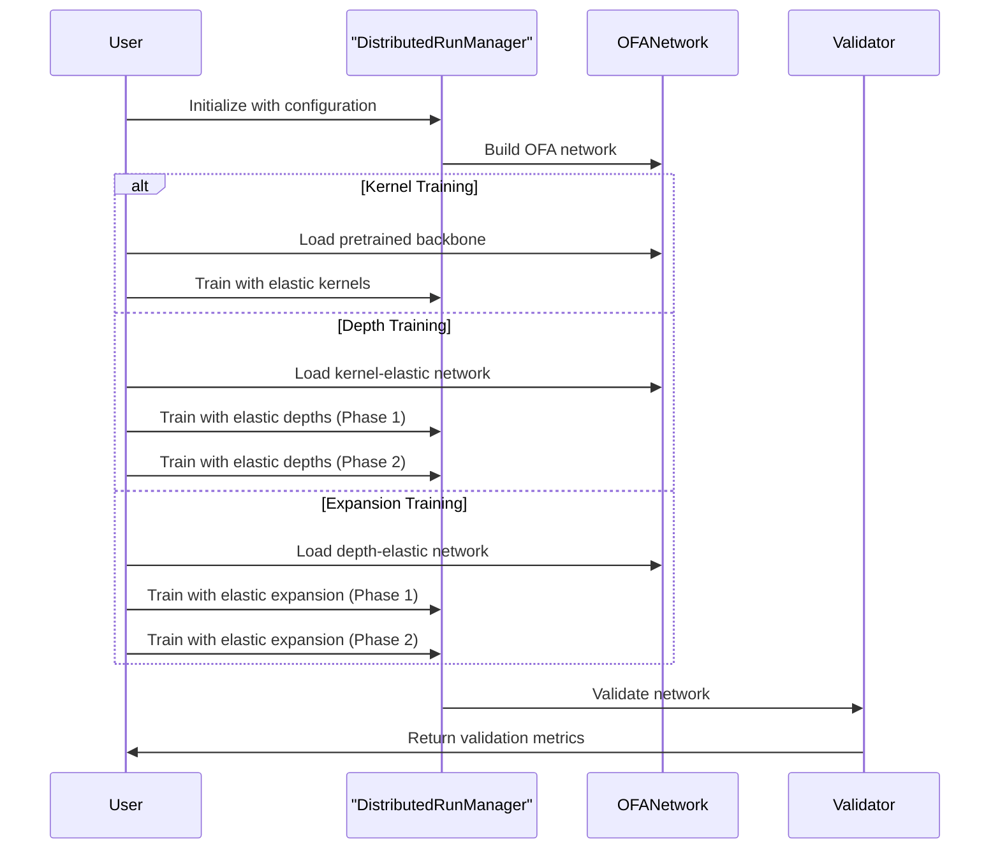
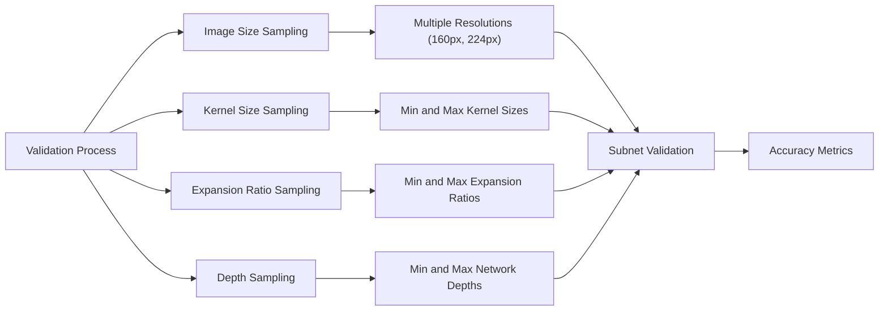

<!-- source: DeepWiki mcp.deepwiki.com · repo mit-han-lab/once-for-all · page 3 Training System · fetched 2026-10-30 -->

# Training System

<details>
<summary>Relevant source files</summary>

The following files were used as context for generating this wiki page:

- [README.md](README.md)
- [figures/ofa-tutorial.jpg](figures/ofa-tutorial.jpg)
- [train_ofa_net.py](train_ofa_net.py)
- [tutorial/README.md](tutorial/README.md)

</details>


The Training System is a core component of the Once for All (OFA) framework responsible for training elastic neural networks that can be specialized for efficient deployment across diverse hardware platforms. This document explains the architecture and implementation of the OFA training system, focusing on the progressive shrinking methodology and distributed training approach.

For information about using pre-trained OFA networks, see [Model Zoo](#2).

## Overview

The OFA Training System implements the "train once, specialize for deployment" paradigm by training a single supernet that encompasses a broad architecture space. The system enables training across multiple dimensions of network flexibility, including:

- Elastic kernel sizes
- Elastic network depths
- Elastic channel widths (expansion ratios)



Sources: [train_ofa_net.py](), [README.md:162-169]()

## Progressive Shrinking Training Methodology

Progressive shrinking is the core training methodology of OFA. Instead of training all possible subnet configurations simultaneously, OFA progressively trains the network in stages:



Sources: [train_ofa_net.py:254-313]()

The progressive shrinking process follows these steps:

1. **Initial Training**: Begin with the largest network in the search space
2. **Kernel Size Shrinking**: Train the network to support multiple kernel sizes (e.g., 3×3, 5×5, 7×7)
3. **Depth Shrinking**: Introduce depth flexibility to support different layer counts
4. **Width Shrinking**: Introduce width flexibility to support different channel counts

This approach ensures knowledge transfer from larger sub-networks to smaller ones, significantly improving the performance of resource-constrained models.

## Training Tasks

The training system supports three main tasks corresponding to the different elastic dimensions:

| Task | Configuration | Architecture Space | Training Phases |
|------|--------------|-------------------|----------------|
| Kernel | Dynamic batch size: 1<br>Epochs: 120<br>Base LR: 3e-2 | Kernel sizes: 3,5,7<br>Expand ratio: 6<br>Depth: 4 | Single phase |
| Depth | Dynamic batch size: 2<br>Epochs: 25-120<br>Base LR: 2.5e-3 to 7.5e-3 | Phase 1: Depths 3,4<br>Phase 2: Depths 2,3,4 | Two phases |
| Expand | Dynamic batch size: 4<br>Epochs: 25-120<br>Base LR: 2.5e-3 to 7.5e-3 | Phase 1: Expand 4,6<br>Phase 2: Expand 3,4,6 | Two phases |

Sources: [train_ofa_net.py:42-91]()

## Knowledge Distillation

The training system employs knowledge distillation to transfer knowledge from a large pre-trained teacher model to the elastic student network:



Sources: [train_ofa_net.py:207-238]()

Key knowledge distillation components:
- Teacher model: MobileNetV3Large with fixed parameters (depth=4, kernel size=7, expand ratio=6)
- KD ratio: Controls the weight of the distillation loss
- KD type: Determines the type of distillation loss (e.g., cross-entropy)

## Distributed Training Architecture

OFA implements distributed training using Horovod, which enables efficient scaling across multiple GPUs and servers:



Sources: [train_ofa_net.py:134-138](), [train_ofa_net.py:222-232]()

The distributed training system includes:
- Horovod initialization to coordinate multiple processes
- GPU device assignment for each process
- Gradient synchronization across workers
- Linear learning rate scaling based on the number of GPUs
- Optional gradient compression for efficient communication

## Training Configuration

The training system provides extensive configuration options:

| Category | Parameters | Description |
|----------|------------|-------------|
| Learning Rate | Base LR, warmup epochs, scheduler | Cosine LR schedule with optional warmup |
| Optimization | SGD with momentum (0.9), weight decay (3e-5) | Standard optimization settings |
| Architecture Space | Kernel sizes, expansion ratios, depths | Defines the search space of the OFA network |
| Data Augmentation | Image sizes (128-224), distortion, scaling | Multi-size training with augmentation |
| Batch Size | Base batch size (64), dynamic batch steps | Controls memory usage and training stability |
| Knowledge Distillation | KD ratio (1.0), KD type (ce) | Controls the influence of the teacher model |

Sources: [train_ofa_net.py:92-130]()

## Training Workflow

The OFA training workflow consists of the following steps:



Sources: [train_ofa_net.py:254-313]()

## Validation System

During training, the system periodically validates the OFA network across different architectural configurations:



Sources: [train_ofa_net.py:246-253]()

The validation system tests the model on key combinations of:
- Different image sizes (typically 160px and 224px)
- Minimum and maximum kernel sizes from the elastic space
- Minimum and maximum expansion ratios from the elastic space
- Minimum and maximum depths from the elastic space

This comprehensive validation ensures the OFA network maintains accuracy across the entire architectural search space.

## Running Distributed Training

The OFA training system can be launched using either MPI or Horovod commands:

```bash
# Using MPI
mpirun -np 32 -H <server1_ip>:8,<server2_ip>:8,<server3_ip>:8,<server4_ip>:8 \
    -bind-to none -map-by slot \
    -x NCCL_DEBUG=INFO -x LD_LIBRARY_PATH -x PATH \
    python train_ofa_net.py

# Using Horovod
horovodrun -np 32 -H <server1_ip>:8,<server2_ip>:8,<server3_ip>:8,<server4_ip>:8 \
    python train_ofa_net.py
```

Sources: [README.md:164-174]()

Key command-line arguments include:
- `--task`: Specifies the training task (kernel, depth, expand)
- `--phase`: For depth and expand tasks, specifies training phase (1 or 2)
- `--resume`: Resumes training from a checkpoint

The training system automatically downloads appropriate pre-trained models for each training phase to ensure a smooth progressive training process.

Sources: [train_ofa_net.py:27-41]()

---

