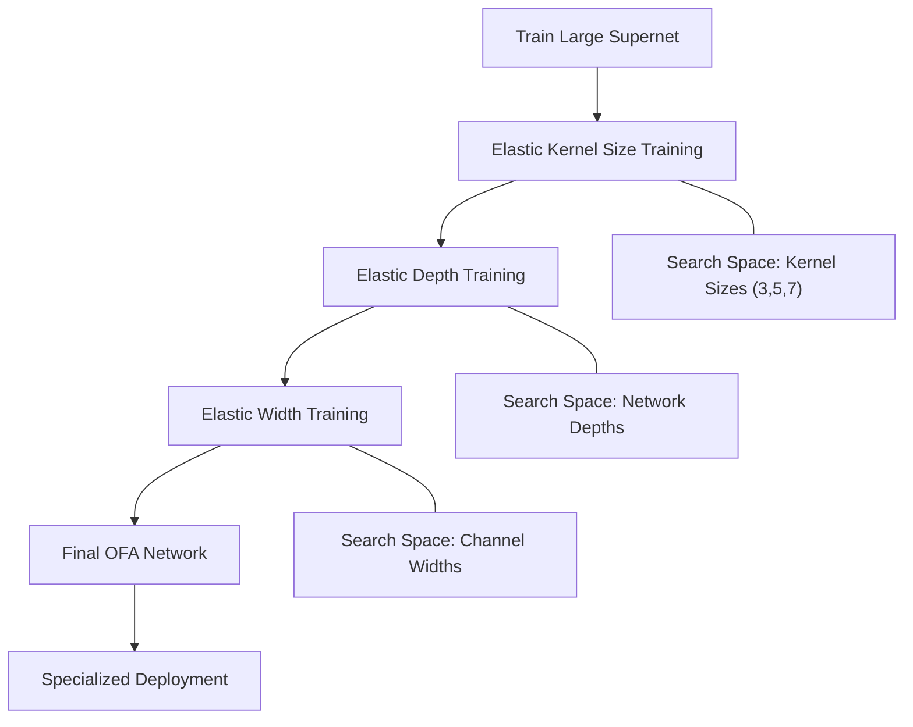
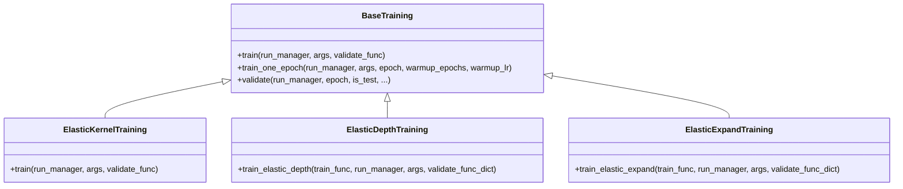
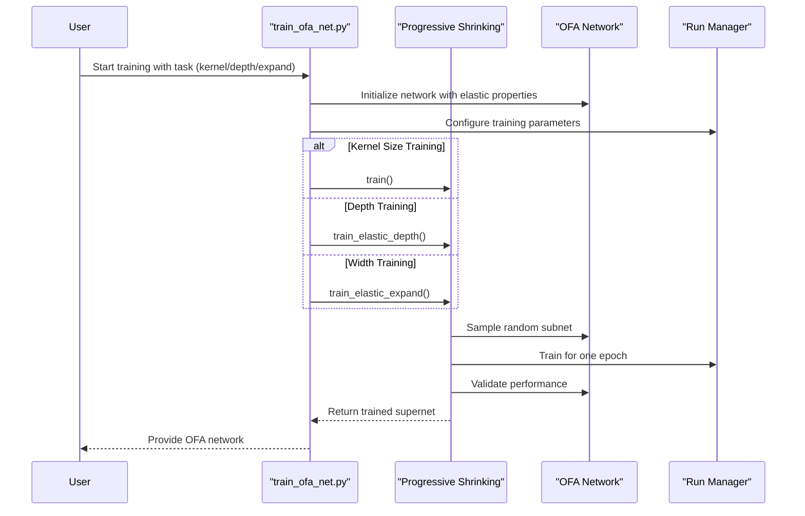
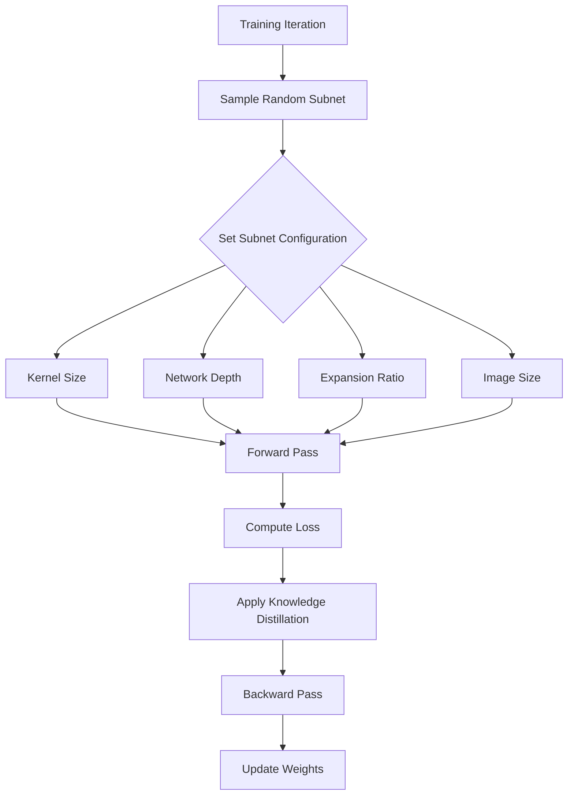
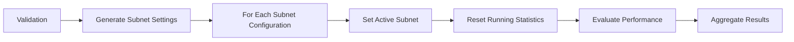

<!-- source: DeepWiki mcp.deepwiki.com · repo mit-han-lab/once-for-all · page 3.1 Progressive Shrinking Training · fetched 2026-10-30 -->

# Progressive Shrinking Training

<details>
<summary>Relevant source files</summary>

The following files were used as context for generating this wiki page:

- [ofa/imagenet_classification/elastic_nn/training/progressive_shrinking.py](ofa/imagenet_classification/elastic_nn/training/progressive_shrinking.py)
- [ofa/imagenet_classification/elastic_nn/utils.py](ofa/imagenet_classification/elastic_nn/utils.py)
- [train_ofa_net.py](train_ofa_net.py)

</details>


Progressive Shrinking (PS) is the core training methodology used in the Once-for-All (OFA) framework to train elastic neural networks that can be specialized for various deployment scenarios. This page documents the technical details of Progressive Shrinking, its workflow, and implementation specifics.

For information about the general OFA architecture, see [Overview](#1). For details on using pre-trained OFA networks, see [Model Zoo](#2).

## Purpose and Scope

Progressive Shrinking is designed to efficiently train a single supernet that contains numerous subnetworks (subnet) with varying architectures. Instead of training all possible architectural configurations from scratch, Progressive Shrinking gradually expands the searchable dimensions of the network (kernel size, depth, width), allowing the supernet to converge while accommodating all possible subnet configurations.

Sources: [ofa/imagenet_classification/elastic_nn/training/progressive_shrinking.py:1-30](), [train_ofa_net.py:1-26]()

## Progressive Shrinking Methodology

Progressive Shrinking follows a specific sequence of training stages to gradually expand the architectural search space:



The training process starts with a large supernet and progressively introduces flexibility in:
1. **Kernel Size** - Allowing different convolutional kernel sizes (e.g., 3×3, 5×5, 7×7)
2. **Network Depth** - Allowing varying depths for each stage of the network
3. **Channel Width** - Allowing different expansion ratios for channels

Each stage builds upon the previous one, gradually increasing the network's flexibility while preserving performance.

Sources: [train_ofa_net.py:27-91](), [ofa/imagenet_classification/elastic_nn/training/progressive_shrinking.py:287-387]()

## Training Stages Implementation

Progressive Shrinking is implemented through three main training functions, each responsible for a different dimension of elasticity:



### 1. Elastic Kernel Size Training

Starts with a trained network and introduces varying kernel sizes:
- Kernel sizes: 3×3, 5×5, 7×7
- Enables the network to adapt to different kernel sizes without retraining

### 2. Elastic Depth Training

Adds depth flexibility to the kernel-elastic network:
- Implemented in two phases
- Phase 1: Supports depths [3, 4]
- Phase 2: Expands to depths [2, 3, 4]
- Allows dropping layers while maintaining performance

### 3. Elastic Width Training

Adds channel width flexibility to the depth and kernel-elastic network:
- Also implemented in two phases
- Phase 1: Supports expansion ratios [4, 6]
- Phase 2: Expands to expansion ratios [3, 4, 6]
- Enables adapting channel width for different compute requirements

Sources: [train_ofa_net.py:42-91](), [ofa/imagenet_classification/elastic_nn/training/progressive_shrinking.py:287-387]()

## Training Workflow

The training workflow is orchestrated by the main script that selects appropriate training functions based on the current stage:



Each training stage follows these steps:
1. Load a pre-trained model if available
2. Configure the elastic search space for the current dimension
3. Train the network using progressive shrinking
4. Validate performance across different subnet configurations
5. Save the model for the next stage or final deployment

Sources: [train_ofa_net.py:131-313](), [ofa/imagenet_classification/elastic_nn/training/progressive_shrinking.py:234-278]()

## Subnet Sampling and Training

During progressive shrinking, the network learns to handle multiple architectural configurations by randomly sampling and training different subnets:



Key aspects of the subnet sampling process:
1. Each training iteration samples a random subnet configuration
2. Different dimensions are constrained according to the current training stage
3. Multiple subnets are sampled within each batch for efficiency (dynamic batch size)
4. A consistent random seed ensures reproducibility for each subnet

Sources: [ofa/imagenet_classification/elastic_nn/training/progressive_shrinking.py:115-231]()

## Validation During Progressive Shrinking

Validation is a critical component that ensures the supernet maintains performance across different subnet configurations:



The validation process:
1. Generates subnet configurations to test based on the current training stage
2. Sets the network to each configuration
3. Resets batch normalization statistics for the specific subnet
4. Evaluates performance on the validation dataset
5. Aggregates results across all tested configurations

Sources: [ofa/imagenet_classification/elastic_nn/training/progressive_shrinking.py:33-112](), [ofa/imagenet_classification/elastic_nn/utils.py:16-84]()

## Knowledge Distillation in Progressive Shrinking

Knowledge distillation is a key technique used in Progressive Shrinking to transfer knowledge from larger to smaller networks:

| Component | Description |
|-----------|-------------|
| Teacher Model | Pre-trained large network (MobileNetV3Large) |
| Student Model | Randomly sampled subnet from the OFA network |
| Distillation Loss | Cross-entropy or MSE between teacher and student outputs |
| Combined Loss | `kd_ratio * kd_loss + ce_loss` where ce_loss is standard cross-entropy |

The knowledge distillation workflow:
1. Teacher model generates soft labels for the input batch
2. Student model (sampled subnet) makes predictions
3. Loss combines classification loss and distillation loss
4. Gradients update only the student model parameters

This approach helps smaller subnets achieve performance closer to the larger teacher model.

Sources: [train_ofa_net.py:127-129](), [ofa/imagenet_classification/elastic_nn/training/progressive_shrinking.py:157-206]()

## Implementation Details

### Task Configuration Parameters

Progressive Shrinking uses different hyperparameters for each training task:

| Task | Phases | Learning Rate | Epochs | Search Space Parameters |
|------|--------|--------------|--------|------------------------|
| Kernel | 1 | 3e-2 | 120 | ks_list="3,5,7", expand_list="6", depth_list="4" |
| Depth | 2 | 2.5e-3 / 7.5e-3 | 25 / 120 | Phase 1: depth_list="3,4"<br>Phase 2: depth_list="2,3,4" |
| Expand | 2 | 2.5e-3 / 7.5e-3 | 25 / 120 | Phase 1: expand_list="4,6"<br>Phase 2: expand_list="3,4,6" |

The dynamic batch size also varies by task to balance memory usage and training efficiency.

Sources: [train_ofa_net.py:42-91]()

### Running Statistics Reset

A crucial implementation detail is resetting batch normalization statistics for each subnet configuration:

```python
# Reset running statistics for the specific subnet configuration
run_manager.reset_running_statistics(dynamic_net)
```

This ensures that each subnet has appropriate batch normalization statistics, which is essential for maintaining performance across different architectural configurations.

Sources: [ofa/imagenet_classification/elastic_nn/training/progressive_shrinking.py:98](), [ofa/imagenet_classification/elastic_nn/utils.py:16-84]()

## Conclusion

Progressive Shrinking is a sophisticated training methodology that enables the Once-for-All framework to train a single supernet containing numerous deployable subnets. By progressively introducing flexibility in kernel size, depth, and width, the approach efficiently trains a network that can be specialized for various deployment scenarios without the need for retraining.

For details on how to deploy the trained OFA networks, see [Network Specialization](#4).

---

