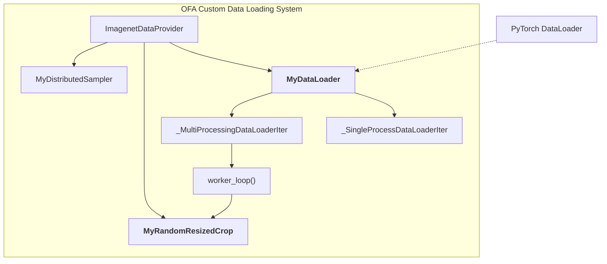
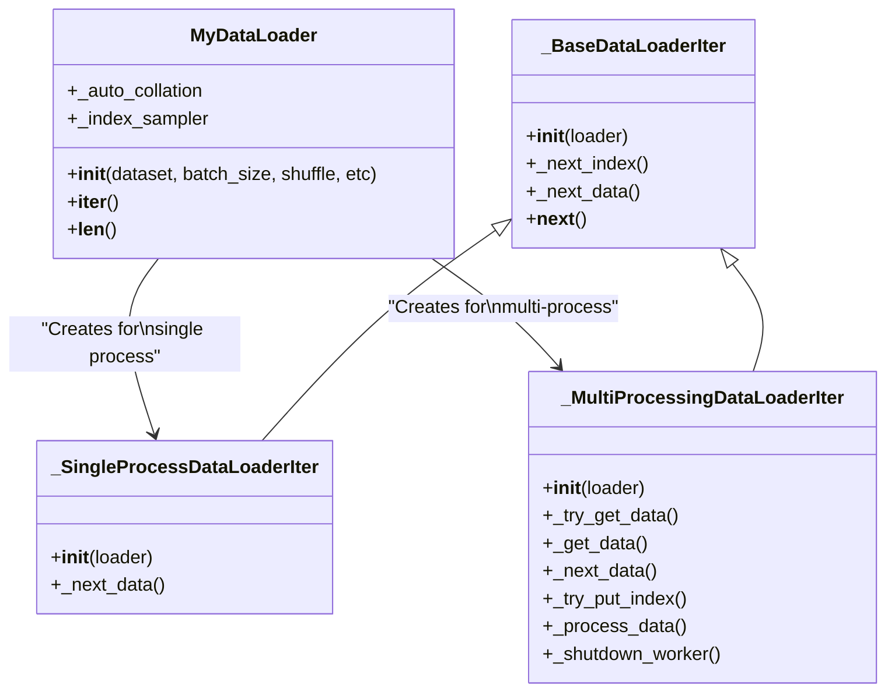
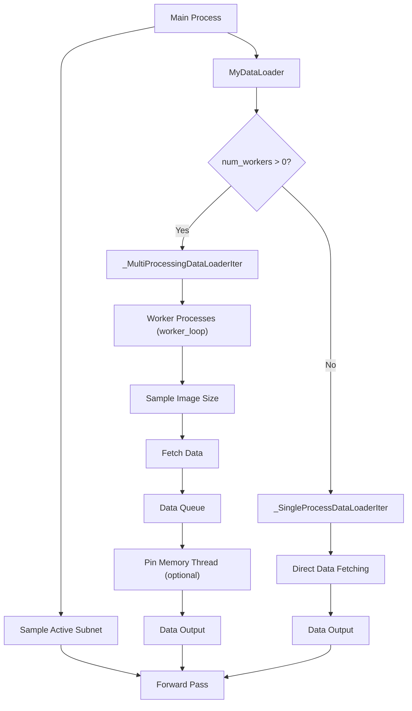
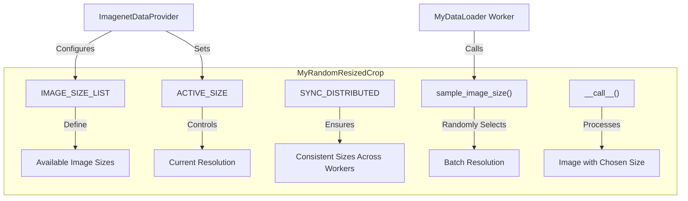
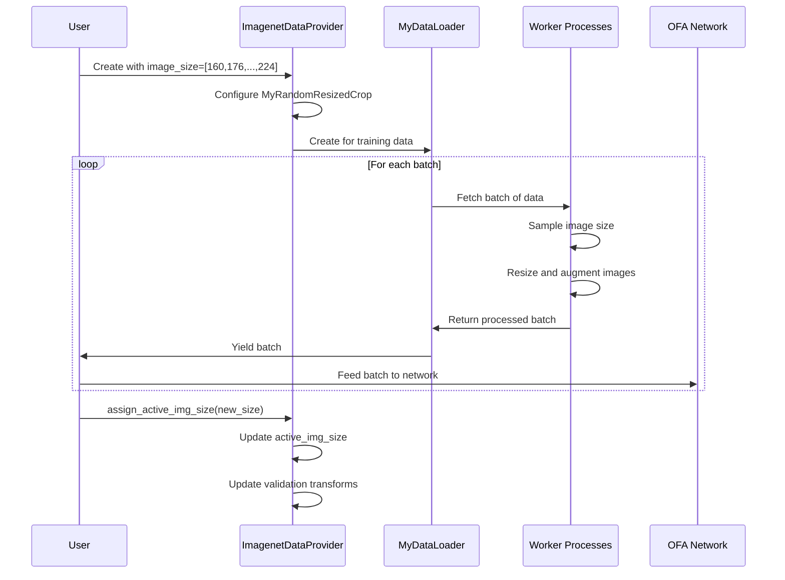
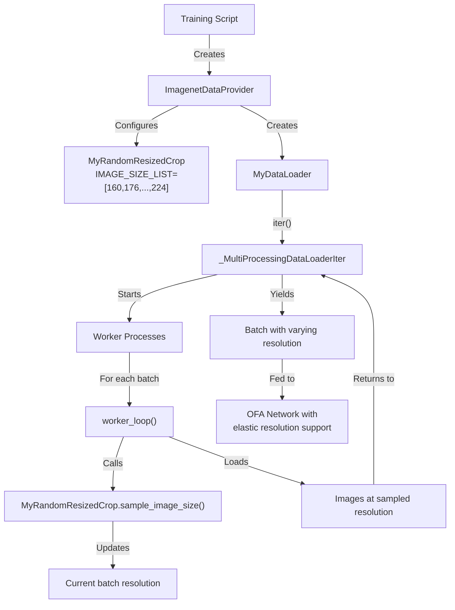

<!-- source: DeepWiki mcp.deepwiki.com · repo mit-han-lab/once-for-all · page 3.2 Custom Data Loading · fetched 2026-10-30 -->

# Custom Data Loading

<details>
<summary>Relevant source files</summary>

The following files were used as context for generating this wiki page:

- [ofa/imagenet_classification/data_providers/imagenet.py](ofa/imagenet_classification/data_providers/imagenet.py)
- [ofa/utils/__init__.py](ofa/utils/__init__.py)
- [ofa/utils/my_dataloader/__init__.py](ofa/utils/my_dataloader/__init__.py)
- [ofa/utils/my_dataloader/my_data_loader.py](ofa/utils/my_dataloader/my_data_loader.py)
- [ofa/utils/my_dataloader/my_data_worker.py](ofa/utils/my_dataloader/my_data_worker.py)

</details>


## Purpose and Scope

This document explains the custom data loading system in the Once-for-All (OFA) framework. The system extends PyTorch's default data loading mechanisms to support key OFA features, particularly handling multiple image sizes during training for elastic resolution search. This page covers the internals of the custom data loader, how it differs from PyTorch's default implementations, and how it's used within the OFA training pipeline.

For information about the general training system, see [Training System](#3). For specifics on the Progressive Shrinking training methodology, see [Progressive Shrinking Training](#3.1).

## Overview

The OFA custom data loading system includes specialized versions of PyTorch's data loading components, modified to handle dynamic image resizing required for training elastic networks. The primary innovation is support for randomized image sizes during training, which is critical for the once-for-all training approach.

### Key Components



Sources:
- [ofa/utils/my_dataloader/my_data_loader.py:67-315]()
- [ofa/utils/my_dataloader/my_data_worker.py:128-242]()
- [ofa/imagenet_classification/data_providers/imagenet.py:19-310]()

## MyDataLoader: Extended DataLoader

The `MyDataLoader` class is a custom implementation that extends the functionality of PyTorch's `DataLoader` to support OFA-specific requirements.



Sources:
- [ofa/utils/my_dataloader/my_data_loader.py:67-373]()
- [ofa/utils/my_dataloader/my_data_loader.py:374-452]()
- [ofa/utils/my_dataloader/my_data_loader.py:455-973]()

### Core Functionality

The `MyDataLoader` provides the same interface as PyTorch's `DataLoader` but adds integration points for OFA-specific features:

1. **Dynamic Image Size Support**: Works with `MyRandomResizedCrop` to support different image resolutions
2. **Multi-processing Support**: Includes customized worker processes that handle OFA-specific data augmentation
3. **Compatibility**: Maintains the same API as the standard PyTorch DataLoader

Sources:
- [ofa/utils/my_dataloader/my_data_loader.py:67-126]()
- [ofa/imagenet_classification/data_providers/imagenet.py:44-62]()

## Multi-Process Data Loading Architecture

The custom data loader uses a multi-processing architecture similar to PyTorch's default implementation but with OFA-specific modifications.



Sources:
- [ofa/utils/my_dataloader/my_data_loader.py:330-334]()
- [ofa/utils/my_dataloader/my_data_loader.py:736-830]()
- [ofa/utils/my_dataloader/my_data_worker.py:128-242]()

### Worker Loop Implementation

The worker loop is responsible for fetching data in each worker process. The OFA custom implementation adds an important feature:

```
MyRandomResizedCrop.sample_image_size(idx)
```

This line in the worker loop samples a random image size for each batch, which is essential for training networks with elastic resolution support.

Sources:
- [ofa/utils/my_dataloader/my_data_worker.py:210]()
- [ofa/utils/my_dataloader/my_data_worker.py:128-242]()

## MyRandomResizedCrop: Elastic Resolution Support

One of the key components in OFA's custom data loading system is `MyRandomResizedCrop`, which extends PyTorch's `RandomResizedCrop` to support randomly selecting from multiple image sizes during training.



Sources:
- [ofa/imagenet_classification/data_providers/imagenet.py:47-50]()
- [ofa/imagenet_classification/data_providers/imagenet.py:204-216]()
- [ofa/utils/my_dataloader/my_data_worker.py:210]()

### Key Features

1. **Multiple Image Size Support**: Maintains a list of image sizes that can be used during training
2. **Dynamic Size Selection**: Randomly samples from the image size list for each batch
3. **Distributed Training Support**: Can synchronize image sizes across workers in distributed training
4. **Continuous Size Selection**: Option for continuous size sampling (rather than discrete sizes)

Sources:
- [ofa/imagenet_classification/data_providers/imagenet.py:204-216]()
- [ofa/utils/my_dataloader/my_data_worker.py:210]()

## Integration with Data Providers

The custom data loading system is integrated with OFA's data providers, particularly the `ImagenetDataProvider` class, which uses these components to create data loaders suitable for training OFA networks.



Sources:
- [ofa/imagenet_classification/data_providers/imagenet.py:22-150]()
- [ofa/imagenet_classification/data_providers/imagenet.py:257-265]()

### DataProvider Configuration

The `ImagenetDataProvider` has special handling for when `image_size` is a list instead of a single integer:

1. When `image_size` is a list, it sets up `MyRandomResizedCrop` with this list of sizes
2. It uses `MyDataLoader` instead of the standard PyTorch DataLoader
3. It provides the `assign_active_img_size` method to change the active image size during training or evaluation

Sources:
- [ofa/imagenet_classification/data_providers/imagenet.py:44-62]()
- [ofa/imagenet_classification/data_providers/imagenet.py:257-265]()

## Usage Example

The following table illustrates how to use the custom data loading components:

| Task | Code Example |
|------|--------------|
| **Setup for multiple image sizes** | `data_provider = ImagenetDataProvider(image_size=[160, 176, 192, 208, 224])` |
| **Create sub-dataset for BN calibration** | `data_provider.build_sub_train_loader(n_images=2000, batch_size=32)` |
| **Change active image size** | `data_provider.assign_active_img_size(192)` |

The code below shows a simplified example of how the custom data loading system is used in practice:

```python
# Initialize data provider with multiple image sizes
data_provider = ImagenetDataProvider(
    train_batch_size=256,
    test_batch_size=512,
    image_size=[160, 176, 192, 208, 224],  # List enables elastic resolution
    n_worker=32
)

# Train with dynamic image sizes (handled automatically by MyDataLoader and MyRandomResizedCrop)
for epoch in range(num_epochs):
    for images, labels in data_provider.train:
        # Images could have different resolutions in different batches
        # The network needs to handle this (elastic resolution)
        output = model(images)
        # ... rest of training loop

# Switch to specific image size for evaluation
data_provider.assign_active_img_size(224)
```

Sources:
- [ofa/imagenet_classification/data_providers/imagenet.py:22-62]()
- [ofa/imagenet_classification/data_providers/imagenet.py:257-265]()
- [ofa/imagenet_classification/data_providers/imagenet.py:267-310]()

## Data Flow During Training



Sources:
- [ofa/utils/my_dataloader/my_data_worker.py:128-242]()
- [ofa/utils/my_dataloader/my_data_worker.py:210]()
- [ofa/imagenet_classification/data_providers/imagenet.py:44-62]()

## Summary

The OFA custom data loading system extends PyTorch's data loading capabilities to support:

1. **Dynamic Resolution Training**: Essential for elastic resolution in OFA networks
2. **Efficient Multi-process Loading**: Preserves PyTorch's efficient data loading architecture while adding OFA-specific features
3. **Seamless Integration**: Works with other OFA components like elastic network architectures

This system is a critical component that enables the training of OFA networks with elastic resolution, a key aspect of the Once-for-All approach to neural network deployment.

Sources:
- [ofa/utils/my_dataloader/my_data_loader.py:67-126]()
- [ofa/utils/my_dataloader/my_data_worker.py:128-242]()
- [ofa/imagenet_classification/data_providers/imagenet.py:22-62]()

---

