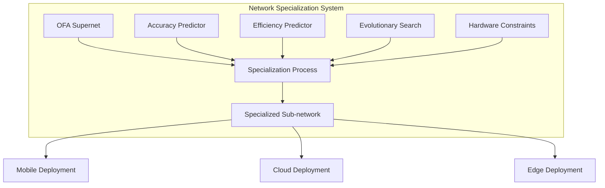
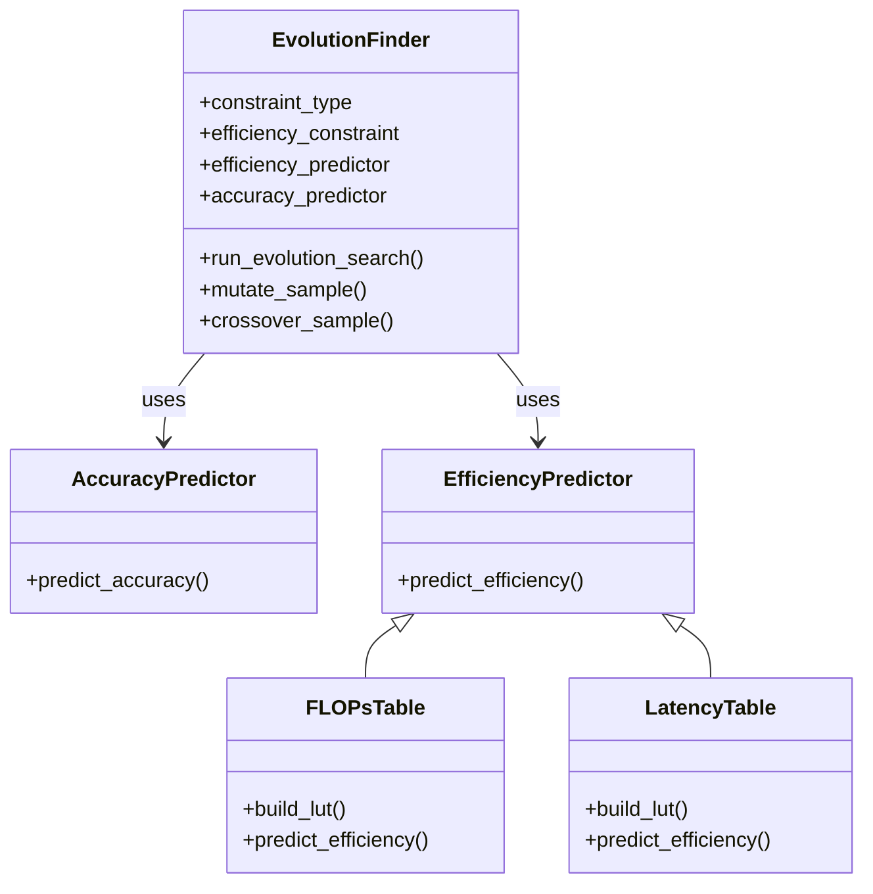
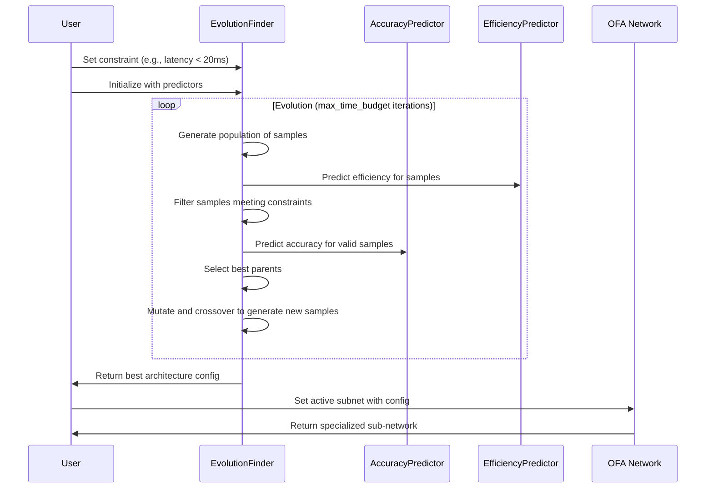
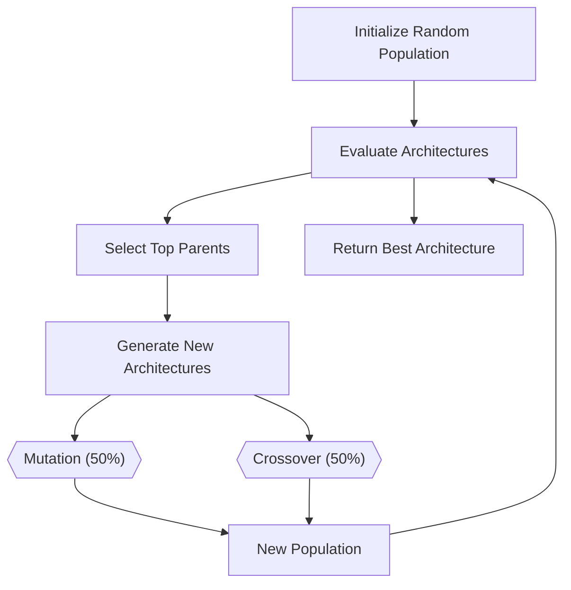
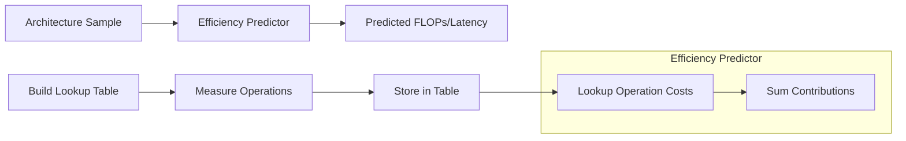
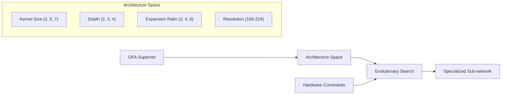

<!-- source: DeepWiki mcp.deepwiki.com · repo mit-han-lab/once-for-all · page 4 Network Specialization · fetched 2026-10-30 -->

# Network Specialization

<details>
<summary>Relevant source files</summary>

The following files were used as context for generating this wiki page:

- [README.md](README.md)
- [figures/ofa-tutorial.jpg](figures/ofa-tutorial.jpg)
- [ofa/tutorial/__init__.py](ofa/tutorial/__init__.py)
- [ofa/tutorial/evolution_finder.py](ofa/tutorial/evolution_finder.py)
- [ofa/tutorial/flops_table.py](ofa/tutorial/flops_table.py)
- [ofa/tutorial/imagenet_eval_helper.py](ofa/tutorial/imagenet_eval_helper.py)
- [tutorial/README.md](tutorial/README.md)

</details>


Network Specialization is the process of extracting optimized sub-networks from the Once-for-All (OFA) supernet that meet specific deployment constraints while maximizing accuracy. This document explains how the specialization system works, its components, and how to use it to obtain efficient neural networks tailored for specific hardware platforms and resource constraints.

For information about the OFA model zoo and pre-trained networks, see [Model Zoo](#2).

## Overview

The core philosophy of OFA is "train once, specialize for many deployment scenarios." After training a single OFA supernet, Network Specialization enables you to derive hardware-aware sub-networks optimized for different efficiency constraints such as:

- Latency on specific devices (e.g., mobile phones, GPUs)
- FLOPs (computational complexity)
- Energy consumption
- Memory usage

The specialization process uses evolutionary search guided by accuracy and efficiency predictors to find optimal sub-networks within the vast architecture space of the OFA supernet.



Sources: [README.md:32-36](), [ofa/tutorial/evolution_finder.py:53-86]()

## Key Components

The Network Specialization system consists of three main components:

1. **Accuracy Predictor**: Predicts the accuracy of candidate sub-networks without actual evaluation
2. **Efficiency Predictors**: Predict the efficiency metrics (latency or FLOPs) of sub-networks
3. **Evolution Finder**: Implements evolutionary search to find optimal sub-networks



Sources: [ofa/tutorial/__init__.py:1-5](), [ofa/tutorial/evolution_finder.py:53-86]()

## Specialization Workflow

The Network Specialization process follows these steps:

1. **Define constraints**: Specify the target hardware and efficiency constraints
2. **Initialize search**: Set up the accuracy and efficiency predictors
3. **Run evolutionary search**: Find sub-networks that maximize accuracy within constraints
4. **Extract specialized network**: Extract the best sub-network from the OFA supernet



Sources: [ofa/tutorial/evolution_finder.py:176-242](), [README.md:46-62]()

## Evolutionary Search

The evolutionary search is implemented in the `EvolutionFinder` class, which explores the architecture space to find optimal sub-networks. The search process involves:

1. **Population initialization**: Randomly sample architectures that meet constraints
2. **Parent selection**: Select the top-performing architectures based on accuracy
3. **Mutation**: Introduce random changes to architectures
4. **Crossover**: Combine traits from different architectures
5. **Evaluation**: Predict performance and keep the best architectures

Key parameters include:
- `population_size`: Number of architectures in each generation
- `max_time_budget`: Maximum number of iterations
- `parent_ratio`: Fraction of population to select as parents
- `mutation_ratio`: Fraction of population to generate via mutation



Sources: [ofa/tutorial/evolution_finder.py:176-242](), [ofa/tutorial/evolution_finder.py:53-175]()

## Efficiency Predictors

The Network Specialization system uses efficiency predictors to evaluate candidate architectures without actual deployment:

### FLOPs Predictor

The `FLOPsTable` class predicts the computational complexity (FLOPs) of a network. It works by:

1. Building a lookup table of FLOPs for different network components
2. Using this table to efficiently estimate the total FLOPs of a network configuration

### Latency Predictor

The `LatencyTable` class predicts the inference time of a network on specific hardware platforms. It:

1. Measures the latency of individual operations on the target hardware
2. Builds a lookup table to predict latency of full networks

Both predictors enable rapid evaluation of thousands of candidate architectures during search without the need for actual deployment or measurement.



Sources: [ofa/tutorial/flops_table.py:17-486](), [ofa/tutorial/evolution_finder.py:156-158]()

## Specialization Examples

The OFA framework provides pre-specialized networks for various hardware platforms with different latency constraints:

| Device | Latency | Top-1 Accuracy | Network ID |
|--------|---------|----------------|------------|
| Note10 | 8ms | 71.4% | note10_lat@8ms_top1@71.4_finetune@25 |
| Note10 | 16ms | 75.5% | note10_lat@16ms_top1@75.5_finetune@25 |
| Pixel2 | 25ms | 71.5% | pixel2_lat@25ms_top1@71.5_finetune@25 |
| V100 GPU | 5ms | 71.6% | v100_gpu64@5ms_top1@71.6_finetune@25 |
| FLOPs | 389M | 79.1% | flops@389M_top1@79.1_finetune@75 |

These networks can be loaded directly from the model zoo:

```python
from ofa.model_zoo import ofa_specialized
net, image_size = ofa_specialized('note10_lat@16ms_top1@75.5_finetune@25', pretrained=True)
```

You can also perform your own specialization by:

1. Loading an OFA network
2. Creating accuracy and efficiency predictors
3. Initializing the EvolutionFinder with your constraints
4. Running the evolutionary search
5. Extracting the specialized sub-network

```python
from ofa.model_zoo import ofa_net
from ofa.tutorial import AccuracyPredictor, LatencyTable, EvolutionFinder

# 1. Load OFA network
ofa_network = ofa_net('ofa_mbv3_d234_e346_k357_w1.0', pretrained=True)

# 2. Create predictors
accuracy_predictor = AccuracyPredictor()
latency_predictor = LatencyTable(device='note10')

# 3. Initialize finder with your constraints
finder = EvolutionFinder(
    constraint_type='latency',
    efficiency_constraint=20,  # 20ms latency constraint
    efficiency_predictor=latency_predictor,
    accuracy_predictor=accuracy_predictor,
)

# 4. Run search
best_valids, best_info = finder.run_evolution_search()

# 5. Extract the specialized sub-network
ofa_network.set_active_subnet(
    ks=best_info[1]['ks'],
    e=best_info[1]['e'],
    d=best_info[1]['d']
)
specialized_network = ofa_network.get_active_subnet(preserve_weight=True)
```

Sources: [README.md:75-83](), [README.md:103-128](), [ofa/tutorial/imagenet_eval_helper.py:116-257]()

## Evaluation of Specialized Networks

The framework provides utilities to evaluate the specialized networks on ImageNet:

```python
from ofa.tutorial import evaluate_ofa_subnet, evaluate_ofa_specialized

# Evaluate a specialized network from the model zoo
evaluate_ofa_specialized(path='path/to/imagenet', batch_size=128)

# Evaluate a custom sub-network
evaluate_ofa_subnet(
    ofa_net=ofa_network, 
    path='path/to/imagenet',
    net_config=best_info[1],  # Configuration found by EvolutionFinder
    data_loader=data_loader,
    batch_size=128
)
```

When evaluating networks, the system performs:
1. Calibration of batch normalization statistics
2. Validation on the ImageNet validation set

Sources: [ofa/tutorial/imagenet_eval_helper.py:16-114](), [README.md:64-67](), [README.md:86-88]()

## Architecture Space and Constraints

The OFA architecture space is defined by several dimensions:

- **Kernel Size (ks)**: Size of convolution kernels (3×3, 5×5, 7×7)
- **Depth (d)**: Number of blocks in each stage
- **Expansion Ratio (e)**: Width of bottleneck layers
- **Resolution (r)**: Input image resolution

During specialization, the EvolutionFinder explores this space while respecting platform-specific constraints like latency or FLOPs.



Sources: [ofa/tutorial/evolution_finder.py:9-50](), [README.md:68-74]()

## Conclusion

Network Specialization is a critical component of the OFA framework, enabling the extraction of hardware-aware, efficient sub-networks from a single trained supernet. By using predictors and evolutionary search, it enables rapid specialization for various deployment scenarios without the need for retraining.

The key advantages of this approach are:
1. Eliminating the need to train separate models for each target device
2. Efficiently navigating the vast architecture space to find optimal sub-networks
3. Providing a systematic way to balance accuracy and efficiency trade-offs
4. Supporting a wide range of hardware platforms and constraints

For more details on specific components of the specialization system, see:
- [Accuracy Prediction](#4.1)
- [Efficiency Prediction](#4.2)
- [Evolutionary Search](#4.3)

---

