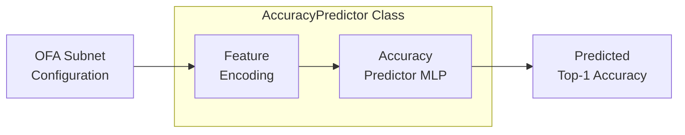
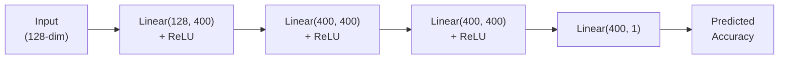
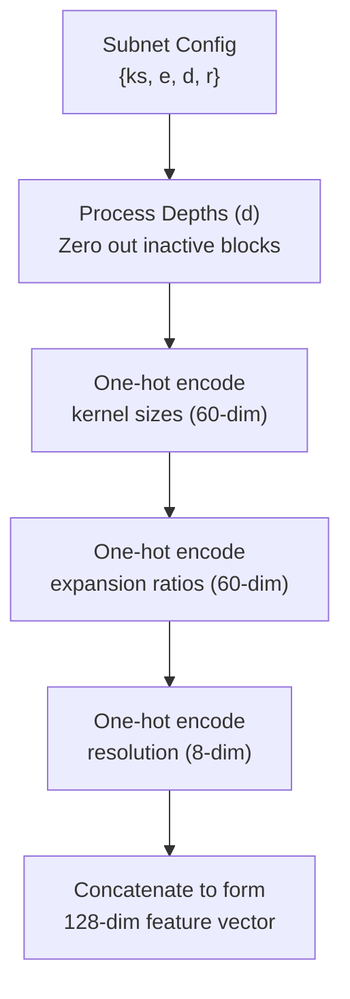
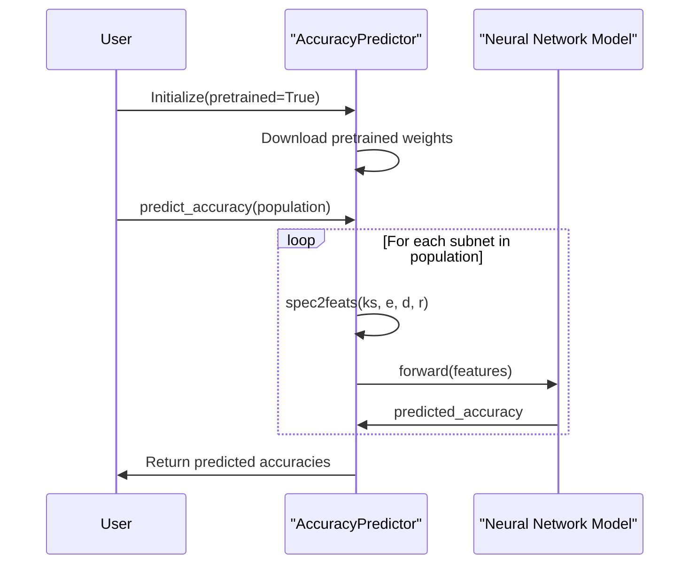
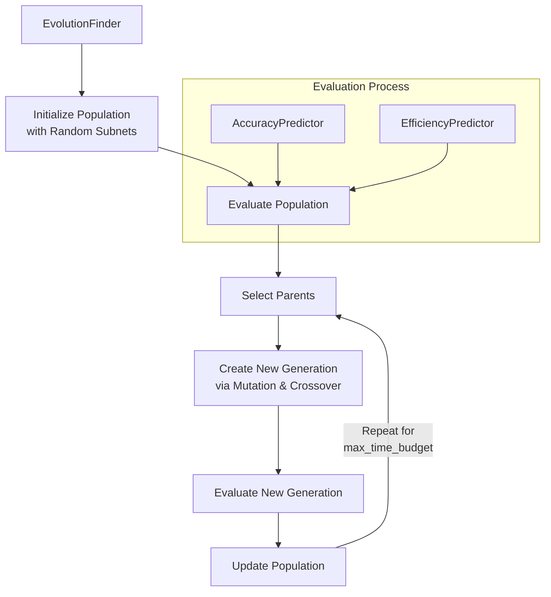
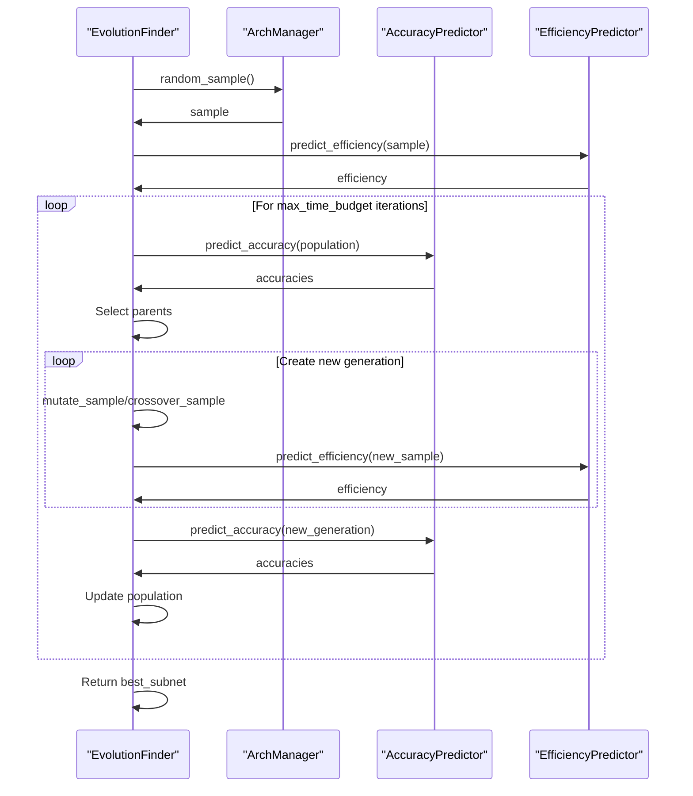

<!-- source: DeepWiki mcp.deepwiki.com · repo mit-han-lab/once-for-all · page 4.1 Accuracy Prediction · fetched 2026-10-30 -->

# Accuracy Prediction

<details>
<summary>Relevant source files</summary>

The following files were used as context for generating this wiki page:

- [ofa/tutorial/__init__.py](ofa/tutorial/__init__.py)
- [ofa/tutorial/accuracy_predictor.py](ofa/tutorial/accuracy_predictor.py)
- [ofa/tutorial/evolution_finder.py](ofa/tutorial/evolution_finder.py)
- [ofa/tutorial/flops_table.py](ofa/tutorial/flops_table.py)
- [ofa/tutorial/imagenet_eval_helper.py](ofa/tutorial/imagenet_eval_helper.py)

</details>


## Purpose and Scope

The Accuracy Prediction system in the Once-for-All (OFA) framework provides an efficient method to estimate the accuracy of sub-networks without expensive training. This capability is crucial for architecture search, allowing rapid evaluation of thousands of candidate architectures derived from the OFA supernet. This document describes the accuracy predictor's implementation, feature representation, and integration with the evolutionary search system. For information about efficiency prediction (latency and FLOPs), see [Efficiency Prediction](#4.2).

## System Overview

The Accuracy Prediction system uses a multi-layer perceptron (MLP) to estimate the ImageNet validation accuracy of different sub-network architectures sampled from the OFA supernet. This prediction is based on a compact encoding of the network's architecture parameters.



Sources: [ofa/tutorial/accuracy_predictor.py:24-64]()

## Accuracy Predictor Architecture

The Accuracy Predictor employs a simple yet effective MLP with three hidden layers. The model maps a 128-dimensional architecture encoding to a single scalar value representing the predicted Top-1 accuracy on ImageNet.



Sources: [ofa/tutorial/accuracy_predictor.py:28-36]()

## Feature Encoding

The accuracy predictor converts OFA subnet configurations to a fixed-length 128-dimensional feature vector. This encoding represents three key architectural aspects:

1. Kernel sizes (ks) - 60 dimensions
2. Expansion ratios (e) - 60 dimensions
3. Resolution (r) - 8 dimensions

The encoding maps discrete architectural choices to one-hot vectors, creating a representation that captures the entire network architecture in a format suitable for the predictor.



Sources: [ofa/tutorial/accuracy_predictor.py:67-91]()

## Encoding Details

The feature vector is constructed from the following components:

| Component | Size | Description |
|-----------|------|-------------|
| Kernel Size | 60 | One-hot encoding of kernel sizes (3, 5, 7) for each of the 20 blocks |
| Expansion Ratio | 60 | One-hot encoding of expansion ratios (3, 4, 6) for each of the 20 blocks |
| Resolution | 8 | One-hot encoding of input resolution (112 to 224, step 16) |

For blocks that are inactive due to depth constraints, both kernel size and expansion ratio values are set to 0.

Sources: [ofa/tutorial/accuracy_predictor.py:67-91]()

## Usage

The `AccuracyPredictor` class provides a simple interface for predicting the accuracy of subnet configurations:

1. Initialize the predictor (optionally loading pretrained weights)
2. Convert subnet configurations to feature vectors
3. Use the predictor to estimate the accuracy of candidate architectures



Sources: [ofa/tutorial/accuracy_predictor.py:49-64]()

## Integration with Evolutionary Search

The accuracy predictor is a key component in the evolutionary architecture search process. The `EvolutionFinder` class uses both the accuracy predictor and an efficiency predictor to evaluate candidate architectures during the search for optimal sub-networks.



Sources: [ofa/tutorial/evolution_finder.py:53-242]()

## Search Workflow

During evolutionary search, the accuracy predictor enables rapid evaluation of many architectures:

1. The search begins with a random population of subnet configurations that satisfy efficiency constraints
2. For each generation:
   - Evaluate current population using the accuracy predictor
   - Select best performing configurations as parents
   - Generate new population through mutation and crossover
   - Ensure new candidates meet efficiency constraints
   - Repeat until the maximum iterations are reached

The evolutionary search aims to maximize predicted accuracy while satisfying hardware-specific constraints (FLOPs or latency).



Sources: [ofa/tutorial/evolution_finder.py:176-242]()

## Technical Implementation

The Accuracy Predictor is implemented as a PyTorch module that can run on either CPU or GPU. The pretrained model is automatically downloaded from a remote repository when initialized with `pretrained=True`.

| Method | Description |
|--------|-------------|
| `__init__(pretrained=True, device="cuda:0")` | Initializes the predictor and loads weights |
| `predict_accuracy(population)` | Predicts accuracy for a list of subnet configurations |
| `spec2feats(ks_list, ex_list, d_list, r)` | Converts network specification to features |

Sources: [ofa/tutorial/accuracy_predictor.py:24-91]()

## Pretrained Model

The accuracy predictor uses a pretrained model that was trained to approximate the true validation accuracy of different sub-networks. The model weights are stored at a remote URL and automatically downloaded during initialization.

```
https://raw.githubusercontent.com/han-cai/files/master/ofa/acc_predictor.pth
```

Sources: [ofa/tutorial/accuracy_predictor.py:37-44]()

---

